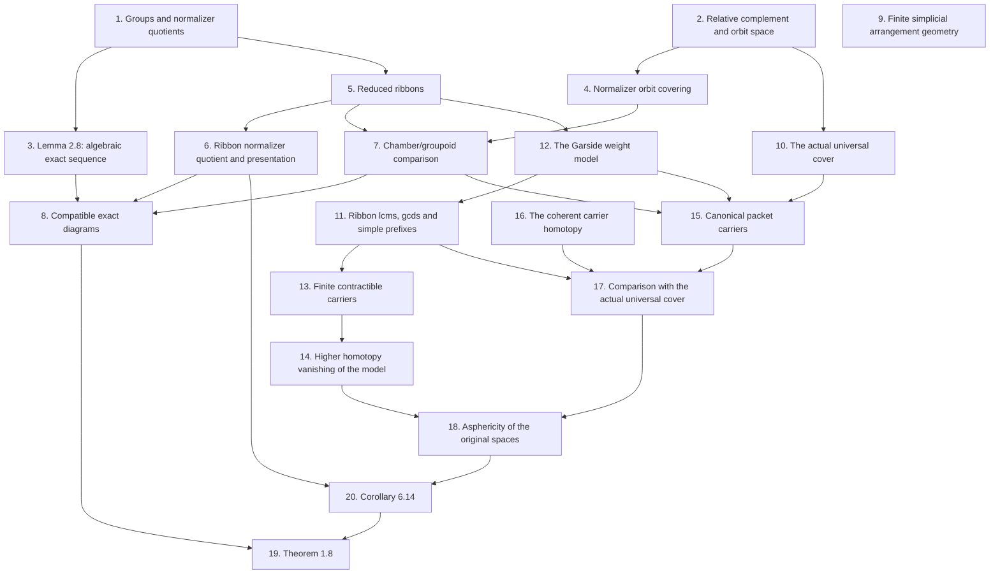

# Artin–Tits normalisers in Lean

Formal proofs for Garnier–Heng–Licata–Yacobi, [*Normalisers of parabolic subgroups of Artin–Tits groups and Tits cone intersections*, arXiv:2509.21915v3](https://arxiv.org/abs/2509.21915v3).

The main results below are proved and verified. [Clean GitHub CI](https://github.com/lazyinspirit/artin-tits-normalisers-lean/actions/runs/43599459363) passed 159 commands, a clean rebuild, 64 exact kernel replays and an audit of 1,866 new declarations. The immutable [verified source tag](https://github.com/lazyinspirit/artin-tits-normalisers-lean/tree/theorem-1.8-verified) points to `3c389334729dbd37d26bdf52dd808e540aae6d37`.

## Start here

- [20 important results and definitions](docs/navigation/index.md), each with a focused `PROJECT.md`.
- [Dependency graph of the 20 important entries](docs/navigation/important-dependencies.md).
- [External Lean proofs and libraries](docs/navigation/external/modules.md): exact repositories, commits, source modules and proof references.
- [Proof architecture and mathematical scope](docs/theorem18/landmarks/milestone5-final-report.md).
- [Compilation and verification evidence](docs/navigation/data/evidence-atlas.json), [final CI archive](docs/theorem18/landmarks/github-evidence/run-43599459363/README.md), and [closeout](docs/theorem18/landmarks/milestone5-closeout.json).

## Main results

| Article result | Formally proved scope | Statement, sources and evidence |
|---|---|---|
| [Lemma 2.8](https://arxiv.org/pdf/2509.21915v3#page=6), p. 6 | Algebraic normalizer short exact sequence; arbitrary Coxeter matrix and subset. | [PROJECT.md](docs/navigation/projects/03-lemma-2-8/PROJECT.md) |
| [Theorem 6.7](https://arxiv.org/pdf/2509.21915v3#page=26), p. 26 | Compatible topological/algebraic exact diagrams in finite type. | [PROJECT.md](docs/navigation/projects/08-exact-diagrams/PROJECT.md) |
| [Theorem 1.8](https://arxiv.org/pdf/2509.21915v3#page=3), p. 3 | Both original-space K(G,1) conclusions and both exact diagrams, at every complement basepoint. | [PROJECT.md](docs/navigation/projects/19-theorem-1-8/PROJECT.md) |
| [Corollary 6.14](https://arxiv.org/pdf/2509.21915v3#page=27), p. 27 | Normalizer quotient orbit space is K(G,1), at every orbit basepoint. | [PROJECT.md](docs/navigation/projects/20-corollary-6-14/PROJECT.md) |

The finite-type results quantify every actual finite Coxeter group, every subset, and every indicated basepoint. Empty/full subsets, rank zero, reducible and noncrystallographic types are included. Lean uses the standard-presentation Artin group and genuinely generated parabolics. The general all-types identification with the article's topological Artin definition in §2.2 is recorded as a model convention; the project proves the specific finite-space fundamental-group equivalences used here. Its K(G,1) predicate consists of path connectedness, vanishing higher based homotopy groups, and the specified fundamental-group isomorphism. Per-result correspondence notes explain differences from broader original statements, including general-arrangement or finite-CW claims.

## Dependency graph: 20 important results and definitions

Arrows summarize checked prerequisite paths through internal implementation helpers. Redundant transitive arrows are omitted for readability. Each `PROJECT.md` links the complete immediate internal and external dependency records. The simplicial-geometry entry is retained as verified context for the article's Deligne argument; the completed Lean comparison uses its explicit carrier construction.



[The 20 focused dossiers](docs/navigation/index.md) provide the statement, proof and evidence paths. Exhaustive machine-readable dependency records remain in [provenance](docs/provenance/deligne/run-20261114T132100Z/graph.json.gz).

## What each PROJECT.md contains

Each of the 20 important entries records:

1. Original article statements, with exact original result labels and printed page numbers.
2. Original Alphabeta Math statements, with direct item URLs.
3. Checked Lean translations and their file paths.
4. Explicit proof-source paths, including declaration locations when statement and proof share a file.
5. All immediate internal and external dependencies, with exact machine records.
6. Compilation, audit, kernel-replay and CI evidence paths.

Correspondence categories and scope differences are explicit. Local formalization helpers have no invented article or Alphabeta original; related parent results are linked separately. [Original-source snapshots and attribution](docs/navigation/data/attribution/README.md) retain exact source identities and verified public-item links.

## External Lean proofs used

<!-- Root README fragment: resolve local links from the repository root. -->

All external Lean sources are listed below. Counts come from actual compiled type, value and structural references across the full recorded project frontier. Imported modules and selected supplier closures are recorded separately in the [complete source catalog](docs/navigation/external/modules.md) and [machine catalog](docs/navigation/external/catalog.json.gz). Per-result `PROJECT` pages link immediate external dependencies to their exact original source modules.

| Repository at exact commit | Role | Referenced theorems / definitions / other | Defining modules | Selected supplier units | License |
|---|---|---:|---:|---:|---|
| [leanprover/lean4@b35cb10cf2ce](https://github.com/leanprover/lean4/tree/b35cb10cf2ced51a2fd1880cfdbf75c71ab7a35a) | Lean compiler/kernel, Init and Std foundations; Lean/Lake build SDK | 4,323 / 2,339 / 582 | 145 | — | [Apache-2.0](https://github.com/leanprover/lean4/blob/b35cb10cf2ced51a2fd1880cfdbf75c71ab7a35a/LICENSE) |
| [leanprover-community/mathlib4@65d730f7150f](https://github.com/leanprover-community/mathlib4/tree/65d730f7150f21fdfa32f3e73a3f549c1f96a0e9) | Mathematical foundation and proofs, definitions and structures referenced by actual compiled terms | 27,185 / 7,648 / 1,813 | 1,444 | — | [Apache-2.0](https://github.com/leanprover-community/mathlib4/blob/65d730f7150f21fdfa32f3e73a3f549c1f96a0e9/LICENSE) |
| [TauCetiProject/TauCeti@62bbc0596dc3](https://github.com/TauCetiProject/TauCeti/tree/62bbc0596dc3539d488232e4e924a338548ea0a9) | Selected Coxeter/Artin algebra and topology proof suppliers | 679 / 118 / 16 | 45 | 56 | [Apache-2.0](https://github.com/TauCetiProject/TauCeti/blob/62bbc0596dc3539d488232e4e924a338548ea0a9/LICENSE) |
| [openai/math@4eaee8754825](https://github.com/openai/math/tree/4eaee87548250b2682affda7d05d947c05554bae) | Selected positive Artin/ribbon algebra and realization/weight proof suppliers | 1,444 / 445 / 33 | 167 | 371 | [Apache-2.0](https://github.com/openai/math/blob/4eaee87548250b2682affda7d05d947c05554bae/LICENSE) |
| [kangxyz/colib@bac5cab53eb6](https://github.com/kangxyz/colib/tree/bac5cab53eb6526e366e861d289253ec81aa89f0) | Selected cover-nerve realization, domination and simplex extension/gluing proof suppliers | 215 / 70 / 4 | 30 | 37 | [Apache-2.0](https://github.com/kangxyz/colib/blob/bac5cab53eb6526e366e861d289253ec81aa89f0/LICENSE) |
| [leanprover-community/batteries@4af7237d1462](https://github.com/leanprover-community/batteries/tree/4af7237d146261353907b06a01b6f3fc06cfa067) | Transitive library support; actual compiled theorem/definition dependencies as well as elaboration support | 117 / 58 / 19 | 13 | — | [Apache-2.0](https://github.com/leanprover-community/batteries/blob/4af7237d146261353907b06a01b6f3fc06cfa067/LICENSE) |
| [leanprover-community/aesop@7d11bfa88558](https://github.com/leanprover-community/aesop/tree/7d11bfa88558f8d3d90afdf6bd877ed70001498d) | Proof-search tooling plus actual compiled BuiltinRules dependencies | 2 / 1 / 0 | 1 | — | [Apache-2.0](https://github.com/leanprover-community/aesop/blob/7d11bfa88558f8d3d90afdf6bd877ed70001498d/LICENSE) |
| [leanprover-community/plausible@129d1ba9a16b](https://github.com/leanprover-community/plausible/tree/129d1ba9a16bc0660f46c79e9fb041ef5d5d80de) | Inherited testing/tactic infrastructure; no declaration in the recorded logical dependency graph | 0 / 0 / 0 | 0 | — | [Apache-2.0](https://github.com/leanprover-community/plausible/blob/129d1ba9a16bc0660f46c79e9fb041ef5d5d80de/LICENSE) |
| [leanprover-community/LeanSearchClient@c61286b7b63c](https://github.com/leanprover-community/LeanSearchClient/tree/c61286b7b63cbfd563b28e11e81d0a18233a044a) | Inherited theorem-search tooling; no declaration in the recorded logical dependency graph | 0 / 0 / 0 | 0 | — | [Apache-2.0](https://github.com/leanprover-community/LeanSearchClient/blob/c61286b7b63cbfd563b28e11e81d0a18233a044a/LICENSE) |
| [leanprover-community/import-graph@e5d5639bedc7](https://github.com/leanprover-community/import-graph/tree/e5d5639bedc7feecfbcb98e30b3bf26463d9f722) | Inherited import-graph/linter infrastructure; no declaration in the recorded logical dependency graph | 0 / 0 / 0 | 0 | — | [Apache-2.0](https://github.com/leanprover-community/import-graph/blob/e5d5639bedc7feecfbcb98e30b3bf26463d9f722/LICENSE) |
| [leanprover-community/ProofWidgets4@16259c0d07d6](https://github.com/leanprover-community/ProofWidgets4/tree/16259c0d07d61ee37d999d05b5cf96338b8daa11) | Inherited editor/widget infrastructure; no declaration in the recorded logical dependency graph | 0 / 0 / 0 | 0 | — | [Apache-2.0](https://github.com/leanprover-community/ProofWidgets4/blob/16259c0d07d61ee37d999d05b5cf96338b8daa11/LICENSE) |
| [leanprover-community/quote4@b0256621cb88](https://github.com/leanprover-community/quote4/tree/b0256621cb88178e9ad932a53633077b3029e621) | Inherited quotation/metaprogramming infrastructure; no declaration in the recorded logical dependency graph | 0 / 0 / 0 | 0 | — | [Apache-2.0](https://github.com/leanprover-community/quote4/blob/b0256621cb88178e9ad932a53633077b3029e621/LICENSE) |
| [leanprover/lean4-cli@c09cb1e4f1e6](https://github.com/leanprover/lean4-cli/tree/c09cb1e4f1e6e1c231a1175a12b681b075054a1b) | Inherited command-line build/tool support; no imported module or declaration in the recorded graph | 0 / 0 / 0 | 0 | — | [MIT](https://github.com/leanprover/lean4-cli/blob/c09cb1e4f1e6e1c231a1175a12b681b075054a1b/LICENSE) |

The nine inherited Lake packages are mathlib, plausible, LeanSearchClient, importGraph, proofwidgets, aesop, Qq and batteries, plus Cli. Their exact pins and licenses are included even where the graph has no declaration references. Lean v4.36.0-rc2 is pinned to commit `b35cb10cf2ced51a2fd1880cfdbf75c71ab7a35a`; its Init and Std declarations are counted as foundation dependencies.

The three selected scientific supplier repositories contribute 464 accepted source units; 242 units contain declarations reached by this graph. The remaining 222 units belong to the checked supplier import closures. Source ports, preserved originals, licenses, acceptance receipts and replay evidence are linked in the complete catalog. One audited project-root alias canonically defined in mathlib is recorded separately.

The scientific source is fixed by [`theorem-1.8-verified`](https://github.com/lazyinspirit/artin-tits-normalisers-lean/tree/theorem-1.8-verified), commit `3c389334729dbd37d26bdf52dd808e540aae6d37`. [Clean CI 43599459363](https://github.com/lazyinspirit/artin-tits-normalisers-lean/actions/runs/43599459363) and its [permanent source-bound archive](docs/theorem18/landmarks/github-evidence/run-43599459363/README.md) passed. The catalog records dependencies across the complete project frontier; it does not claim a contraction of the actual universal cover or a two-sided nerve homotopy equivalence.

## Original-source precision

[Source notes](docs/navigation/source-notes/README.md) preserve earlier qualified findings and a subsequently checked scope issue in [Remark 3.27, p. 13](docs/navigation/source-notes/remark-3-27.md). The infinite-dihedral counterexample concerns the unrestricted finite-CW assertion; the verified finite-type Theorem 1.8 is unaffected. This source review is distinct from the Lean proof catalog.

## Build and reproduce the verified evidence

Install [elan](https://github.com/leanprover/elan); the committed toolchain selects Lean `v4.36.0-rc2`. Mathlib is pinned to `65d730f7150f21fdfa32f3e73a3f549c1f96a0e9`.

To build the unchanged Lean proof sources from the current checkout:

```bash
cd deligne
python3 scripts/cache_prerequisites.py
lake build ArtinDeligne
```

Full evidence reproduction uses the verified tagged worktree because the archived verifier also binds the original README as an input. The current branch adds navigation documentation.

```bash
git fetch --tags
git worktree add --detach ../artin-tits-verified theorem-1.8-verified
cd ../artin-tits-verified/deligne
python3 scripts/cache_prerequisites.py
python3 scripts/verify.py --execute --mode final --output evidence/my-verification
```

To repeat the archived GitHub workflow at that source:

```bash
gh workflow run deligne.yml --ref theorem-1.8-verified
```

The verifier uses the official bundled kernel algorithm through an exact-module runner and checks all public/private/server declarations. Records distinguish fresh replays from pinned imported context and earlier successful verification packets. Detailed [verification limits](docs/theorem18/landmarks/milestone5-final-report.md#reproduction-and-verification-limits) and the [evidence atlas](docs/navigation/data/evidence-atlas.json) give the exact scope.

## Repository map and history

| Location | Contents |
|---|---|
| `ArtinNormalisers/`, root aggregates | Algebraic Lemma 2.8 and arrangement foundations |
| `landmarks/` | Landmark 1: normalizer action and covering |
| `ribbons/` | Landmark 2: positive ribbons and presentation |
| `chambers/` | Landmark 3: actual chamber/groupoid comparison |
| `sequences/` | Landmark 4: compatible exact diagrams |
| `asphericity/`, `homotopy/`, `deligne/` | Landmark 5 and the completed Theorem 1.8 |
| `docs/navigation/` | Current result pages, graphs, source/evidence catalogs and regeneration tools |
| `docs/provenance/` | Full proof-source ledger, pins, original/ported source records and compiled dependency graphs |
| `docs/theorem18/landmarks/github-evidence/` | Permanent CI records and source archives |
| `docs/history/` | Historical README and record-navigation guide |

Scientific sources and historical evidence keep their original paths. The [previous README and its source context](docs/history/README.md) is preserved byte-for-byte; earlier milestone reports describe their own recorded checkpoints. The certified proof snapshot remains available through `theorem-1.8-verified`.
