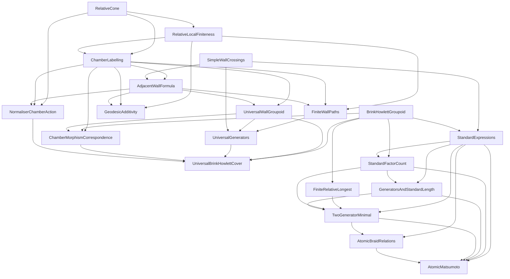

# Artin–Tits normalisers: Theorems 1.3 and 1.4

All listed results compiled and passed the axiom audit.

[Article](https://arxiv.org/pdf/2509.21915) · [Alphabeta Math](https://alphabetamath.cc/research-portal/artin-tits-normalisers-2509-21915)

## Dependency graph

The graph shows 20 important definitions/results, including both main theorems. Two supporting endpoints are omitted from this overview; all 22 checked endpoints and their exact immediate dependencies remain in [PROJECT.md](PROJECT.md).

## External proofs

Base library: [mathlib](https://github.com/leanprover-community/mathlib4/tree/65d730f7150f21fdfa32f3e73a3f549c1f96a0e9), commit 65d730f7150f21fdfa32f3e73a3f549c1f96a0e9 (Apache-2.0).

- **existing-vector**: [ArtinNormalisers.Theorem18.Vector](https://github.com/lazyinspirit/artin-tits-normalisers-lean/blob/8668c70d25e6c5d63c313bac756052f9c83ee7f0/ArtinNormalisers/Theorem18/Geometry.lean#L23);  [repository](https://github.com/lazyinspirit/artin-tits-normalisers-lean); revision `8668c70d25e6c5d63c313bac756052f9c83ee7f0`; license: Apache-2.0. Root vector type. Inspected local source at /home/lazyinspirit/Projects/artin-tits-normalisers-lean/ArtinNormalisers/Theorem18/Geometry.lean; unchanged between the recorded revision and local HEAD.
Root vector type. Inspected /home/lazyinspirit/Projects/artin-tits-normalisers-lean/ArtinNormalisers/Theorem18/Geometry.lean; unchanged between the requested revision and observed HEAD 1bdd7a76d6447fe84bc46aab09120f20292bf334.
  Used by: RelativeCone.
- **existing-dual**: [ArtinNormalisers.Theorem18.Dual](https://github.com/lazyinspirit/artin-tits-normalisers-lean/blob/8668c70d25e6c5d63c313bac756052f9c83ee7f0/ArtinNormalisers/Theorem18/Geometry.lean#L26);  [repository](https://github.com/lazyinspirit/artin-tits-normalisers-lean); revision `8668c70d25e6c5d63c313bac756052f9c83ee7f0`; license: Apache-2.0. Ambient algebraic dual space.
Ambient algebraic dual. Inspected the same unchanged local Geometry.lean source.
  Used by: RelativeCone.
- **existing-relative-subspace**: [ArtinNormalisers.Theorem18.relativeSubspace](https://github.com/lazyinspirit/artin-tits-normalisers-lean/blob/8668c70d25e6c5d63c313bac756052f9c83ee7f0/ArtinNormalisers/Theorem18/Geometry.lean#L85);  [repository](https://github.com/lazyinspirit/artin-tits-normalisers-lean); revision `8668c70d25e6c5d63c313bac756052f9c83ee7f0`; license: Apache-2.0. Defines ΘJ by vanishing on the simple roots indexed by J.
Defines Θ_J by vanishing on the simple roots indexed by J. Inspected the same unchanged local Geometry.lean source.
  Used by: RelativeCone.
- **existing-dual-coordinates**: [ArtinNormalisers.Theorem18.dualCoordinates](https://github.com/lazyinspirit/artin-tits-normalisers-lean/blob/8668c70d25e6c5d63c313bac756052f9c83ee7f0/ArtinNormalisers/Theorem18/Geometry.lean#L32);  [repository](https://github.com/lazyinspirit/artin-tits-normalisers-lean); revision `8668c70d25e6c5d63c313bac756052f9c83ee7f0`; license: Apache-2.0. Induces the coordinate Euclidean topology on ΘJ in finite rank.
Induces the coordinate Euclidean topology on Θ_J in finite rank. Inspected the same unchanged local Geometry.lean source.
  Used by: RelativeCone.
- **existing-retained-roots**: [ArtinNormalisers.Theorem18.retainedRoots](https://github.com/lazyinspirit/artin-tits-normalisers-lean/blob/8668c70d25e6c5d63c313bac756052f9c83ee7f0/ArtinNormalisers/Theorem18/Geometry.lean#L124);  [repository](https://github.com/lazyinspirit/artin-tits-normalisers-lean); revision `8668c70d25e6c5d63c313bac756052f9c83ee7f0`; license: Apache-2.0. Defines the relative roots by existence of a nonzero evaluation on ΘJ.
Defines relative roots by existence of a nonzero evaluation on Θ_J. Inspected the same unchanged local Geometry.lean source.
  Used by: RelativeCone.
- **existing-restricted-hyperplane**: [ArtinNormalisers.Theorem18.restrictedHyperplane](https://github.com/lazyinspirit/artin-tits-normalisers-lean/blob/8668c70d25e6c5d63c313bac756052f9c83ee7f0/ArtinNormalisers/Theorem18/Geometry.lean#L128);  [repository](https://github.com/lazyinspirit/artin-tits-normalisers-lean); revision `8668c70d25e6c5d63c313bac756052f9c83ee7f0`; license: Apache-2.0. Constructs each restricted evaluation kernel as a submodule of ΘJ.
Constructs the restricted evaluation kernel as a submodule of Θ_J. Inspected the same unchanged local Geometry.lean source.
  Used by: RelativeCone.
- **existing-dual-action**: [ArtinNormalisers.Theorem18.dualAction](https://github.com/lazyinspirit/artin-tits-normalisers-lean/blob/8668c70d25e6c5d63c313bac756052f9c83ee7f0/ArtinNormalisers/Theorem18/NormalizerAction.lean#L23);  [repository](https://github.com/lazyinspirit/artin-tits-normalisers-lean); revision `8668c70d25e6c5d63c313bac756052f9c83ee7f0`; license: Apache-2.0. Defines the translates of the closed fundamental chamber forming the Tits cone. Inspected local source; unchanged at local HEAD.
Contragredient action defining the translates forming the Tits cone. Inspected /home/lazyinspirit/Projects/artin-tits-normalisers-lean/ArtinNormalisers/Theorem18/NormalizerAction.lean; unchanged at observed HEAD.
  Used by: RelativeCone.
- **existing-dominant**: [ArtinNormalisers.Landmark1.IsDominant](https://github.com/lazyinspirit/artin-tits-normalisers-lean/blob/8668c70d25e6c5d63c313bac756052f9c83ee7f0/landmarks/ArtinLandmarks/Dominant.lean#L25);  [repository](https://github.com/lazyinspirit/artin-tits-normalisers-lean); revision `8668c70d25e6c5d63c313bac756052f9c83ee7f0`; license: Apache-2.0. Membership in the closed fundamental chamber. Inspected local source; unchanged at local HEAD.
Membership in the closed fundamental chamber. Inspected /home/lazyinspirit/Projects/artin-tits-normalisers-lean/landmarks/ArtinLandmarks/Dominant.lean; unchanged at observed HEAD.
  Used by: RelativeCone.
- **mathlib-coxeter-group**: [CoxeterMatrix.Group](https://github.com/leanprover-community/mathlib4/blob/65d730f7150f21fdfa32f3e73a3f549c1f96a0e9/Mathlib/GroupTheory/Coxeter/Basic.lean#L108);  [repository](https://github.com/leanprover-community/mathlib4); revision `65d730f7150f21fdfa32f3e73a3f549c1f96a0e9`; license: Apache-2.0. The Coxeter group indexing chamber translates; inspected the pinned local mathlib source.
Coxeter group indexing chamber translates. Inspected the pinned local declaration and confirmed the local mathlib commit.
  Used by: RelativeCone.
- **mathlib-induced-topology**: [TopologicalSpace.induced](https://github.com/leanprover-community/mathlib4/blob/65d730f7150f21fdfa32f3e73a3f549c1f96a0e9/Mathlib/Topology/Defs/Induced.lean#L65);  [repository](https://github.com/leanprover-community/mathlib4); revision `65d730f7150f21fdfa32f3e73a3f549c1f96a0e9`; license: Apache-2.0. Pulls the coordinate topology back to ΘJ.
Pulls coordinate topology back to Θ_J. Fresh GitHub code search for "TopologicalSpace.induced" repo:leanprover-community/mathlib4 returned 28 hits; the first three paths were inspected. Indexed results were at bb3798b8ca9bdd3c81ccdbcf5273fea6cef76a6f; actual use was checked against the pinned local declaration. Inspected the recorded searches and scope findings in prerequisite reports 9d02fc77-236f-4ba3-b56f-1c73158cdabd and c4f3934a-ee4c-4a84-be76-023266192596; their unfinished reading is not claimed as completed here.
  Used by: RelativeCone.
- **mathlib-interior**: [interior](https://github.com/leanprover-community/mathlib4/blob/65d730f7150f21fdfa32f3e73a3f549c1f96a0e9/Mathlib/Topology/Defs/Basic.lean#L122);  [repository](https://github.com/leanprover-community/mathlib4); revision `65d730f7150f21fdfa32f3e73a3f549c1f96a0e9`; license: Apache-2.0. Takes the interior of Cone(J) as a subset of ΘJ with the explicitly supplied topology.
Takes the interior in Θ_J with its explicitly supplied topology. Located in pinned local mathlib.
  Used by: RelativeCone.
- **mathlib-set-image**: [Set.image](https://github.com/leanprover-community/mathlib4/blob/65d730f7150f21fdfa32f3e73a3f549c1f96a0e9/Mathlib/Data/Set/Defs.lean#L261);  [repository](https://github.com/leanprover-community/mathlib4); revision `65d730f7150f21fdfa32f3e73a3f549c1f96a0e9`; license: Apache-2.0. Forms the set of distinct traces of positive relative roots.
Forms the set of distinct restricted kernels of positive relative roots. Located in pinned local mathlib.
  Used by: RelativeCone.
- **existing-geometric-representation**: [CoxeterSystem.geometricRepresentation](https://github.com/lazyinspirit/artin-tits-normalisers-lean/blob/8668c70d25e6c5d63c313bac756052f9c83ee7f0/vendor/TauCeti/GroupTheory/Coxeter/Geometric/Basic.lean#L475);  [repository](https://github.com/lazyinspirit/artin-tits-normalisers-lean); revision `8668c70d25e6c5d63c313bac756052f9c83ee7f0`; license: Apache-2.0. Defines the action used in the arrow predicate. Inspected the corresponding local source; unchanged at local HEAD 1bdd7a76d6447fe84bc46aab09120f20292bf334. The expression compiled with import ArtinDeligne in a noncomputable example under Lean v4.36.0-rc2.
  Used by: BrinkHowlettGroupoid.
- **existing-parabolic**: [CoxeterSystem.parabolic](https://github.com/lazyinspirit/artin-tits-normalisers-lean/blob/8668c70d25e6c5d63c313bac756052f9c83ee7f0/vendor/TauCeti/GroupTheory/Coxeter/Parabolic.lean#L115);  [repository](https://github.com/lazyinspirit/artin-tits-normalisers-lean); revision `8668c70d25e6c5d63c313bac756052f9c83ee7f0`; license: Apache-2.0. The supplied endpoint uses parabolic conjugacy to define its object subtype.
  Used by: BrinkHowlettGroupoid.
- **mathlib-groupoid**: [CategoryTheory.Groupoid](https://github.com/leanprover-community/mathlib4/blob/65d730f7150f21fdfa32f3e73a3f549c1f96a0e9/Mathlib/CategoryTheory/Groupoid.lean#L46);  [repository](https://github.com/leanprover-community/mathlib4); revision `65d730f7150f21fdfa32f3e73a3f549c1f96a0e9`; license: Apache-2.0. Constructs the groupoid directly, including its inherited category fields. Inspected this pinned source. A fresh bounded GitHub search for '"Brink" "Howlett" language:Lean' returned no results; no specialized external construction is assumed.
  Used by: BrinkHowlettGroupoid.
- **mathlib-single**: [Finsupp.single](https://github.com/leanprover-community/mathlib4/blob/65d730f7150f21fdfa32f3e73a3f549c1f96a0e9/Mathlib/Data/Finsupp/Single.lean#L47);  [repository](https://github.com/leanprover-community/mathlib4); revision `65d730f7150f21fdfa32f3e73a3f549c1f96a0e9`; license: Apache-2.0. Represents each simple root by its basis vector.
  Used by: BrinkHowlettGroupoid.
- **mathlib-image**: [Set.image](https://github.com/leanprover-community/mathlib4/blob/65d730f7150f21fdfa32f3e73a3f549c1f96a0e9/Mathlib/Data/Set/Defs.lean#L261);  [repository](https://github.com/leanprover-community/mathlib4); revision `65d730f7150f21fdfa32f3e73a3f549c1f96a0e9`; license: Apache-2.0. Forms simple-root sets and their images under the geometric representation.
  Used by: BrinkHowlettGroupoid.
- **mathlib-image-image**: [Set.image_image](https://github.com/leanprover-community/mathlib4/blob/65d730f7150f21fdfa32f3e73a3f549c1f96a0e9/Mathlib/Data/Set/Image.lean#L235);  [repository](https://github.com/leanprover-community/mathlib4); revision `65d730f7150f21fdfa32f3e73a3f549c1f96a0e9`; license: Apache-2.0. Combines successive images in both local action identities.
  Used by: BrinkHowlettGroupoid.
- **mathlib-image-id**: [Set.image_id'](https://github.com/leanprover-community/mathlib4/blob/65d730f7150f21fdfa32f3e73a3f549c1f96a0e9/Mathlib/Data/Set/Image.lean#L308);  [repository](https://github.com/leanprover-community/mathlib4); revision `65d730f7150f21fdfa32f3e73a3f549c1f96a0e9`; license: Apache-2.0. Closes the identity-arrow and inverse-action image calculations.
  Used by: BrinkHowlettGroupoid.
- **mathlib-map-mul**: [map_mul](https://github.com/leanprover-community/mathlib4/blob/65d730f7150f21fdfa32f3e73a3f549c1f96a0e9/Mathlib/Algebra/Group/Hom/Defs.lean#L326);  [repository](https://github.com/leanprover-community/mathlib4); revision `65d730f7150f21fdfa32f3e73a3f549c1f96a0e9`; license: Apache-2.0. Expands the representation of a product.
  Used by: BrinkHowlettGroupoid.
- **mathlib-map-one**: [map_one](https://github.com/leanprover-community/mathlib4/blob/65d730f7150f21fdfa32f3e73a3f549c1f96a0e9/Mathlib/Algebra/Group/Hom/Defs.lean#L234);  [repository](https://github.com/leanprover-community/mathlib4); revision `65d730f7150f21fdfa32f3e73a3f549c1f96a0e9`; license: Apache-2.0. Expands the representation of the identity.
  Used by: BrinkHowlettGroupoid.
- **mathlib-mul-apply**: [mul_apply_eq_comp](https://github.com/leanprover-community/mathlib4/blob/65d730f7150f21fdfa32f3e73a3f549c1f96a0e9/Mathlib/Algebra/Group/IsApply.lean#L118);  [repository](https://github.com/leanprover-community/mathlib4); revision `65d730f7150f21fdfa32f3e73a3f549c1f96a0e9`; license: Apache-2.0. Identifies multiplication of representation endomorphisms with composition.
  Used by: BrinkHowlettGroupoid.
- **mathlib-one-apply**: [one_apply_eq_self](https://github.com/leanprover-community/mathlib4/blob/65d730f7150f21fdfa32f3e73a3f549c1f96a0e9/Mathlib/Algebra/Group/IsApply.lean#L96);  [repository](https://github.com/leanprover-community/mathlib4); revision `65d730f7150f21fdfa32f3e73a3f549c1f96a0e9`; license: Apache-2.0. The identity endomorphism fixes each root.
  Used by: BrinkHowlettGroupoid.
- **mathlib-representation-inverse**: [Representation.inv_self_apply](https://github.com/leanprover-community/mathlib4/blob/65d730f7150f21fdfa32f3e73a3f549c1f96a0e9/Mathlib/RepresentationTheory/Basic.lean#L92);  [repository](https://github.com/leanprover-community/mathlib4); revision `65d730f7150f21fdfa32f3e73a3f549c1f96a0e9`; license: Apache-2.0. Cancels the inverse representation action in the local image_inv proof.
  Used by: BrinkHowlettGroupoid.
- **mathlib-one-mul**: [one_mul](https://github.com/leanprover-community/mathlib4/blob/65d730f7150f21fdfa32f3e73a3f549c1f96a0e9/Mathlib/Algebra/Group/Monoid.lean#L91);  [repository](https://github.com/leanprover-community/mathlib4); revision `65d730f7150f21fdfa32f3e73a3f549c1f96a0e9`; license: Apache-2.0. Proves id_comp on arrow labels.
  Used by: BrinkHowlettGroupoid.
- **mathlib-mul-one**: [mul_one](https://github.com/leanprover-community/mathlib4/blob/65d730f7150f21fdfa32f3e73a3f549c1f96a0e9/Mathlib/Algebra/Group/Monoid.lean#L95);  [repository](https://github.com/leanprover-community/mathlib4); revision `65d730f7150f21fdfa32f3e73a3f549c1f96a0e9`; license: Apache-2.0. Proves comp_id on arrow labels.
  Used by: BrinkHowlettGroupoid.
- **mathlib-mul-assoc**: [mul_assoc](https://github.com/leanprover-community/mathlib4/blob/65d730f7150f21fdfa32f3e73a3f549c1f96a0e9/Mathlib/Algebra/Group/Semigroup.lean#L166);  [repository](https://github.com/leanprover-community/mathlib4); revision `65d730f7150f21fdfa32f3e73a3f549c1f96a0e9`; license: Apache-2.0. Proves associativity of composition on labels.
  Used by: BrinkHowlettGroupoid.
- **mathlib-inv-mul**: [inv_mul_cancel](https://github.com/leanprover-community/mathlib4/blob/65d730f7150f21fdfa32f3e73a3f549c1f96a0e9/Mathlib/Algebra/Group/Defs.lean#L54);  [repository](https://github.com/leanprover-community/mathlib4); revision `65d730f7150f21fdfa32f3e73a3f549c1f96a0e9`; license: Apache-2.0. Proves inv_comp on labels.
  Used by: BrinkHowlettGroupoid.
- **mathlib-mul-inv**: [mul_inv_cancel](https://github.com/leanprover-community/mathlib4/blob/65d730f7150f21fdfa32f3e73a3f549c1f96a0e9/Mathlib/Algebra/Group/Defs.lean#L62);  [repository](https://github.com/leanprover-community/mathlib4); revision `65d730f7150f21fdfa32f3e73a3f549c1f96a0e9`; license: Apache-2.0. Proves comp_inv on labels.
  Used by: BrinkHowlettGroupoid.
- **lean-subtype-ext**: [Subtype.ext](https://github.com/leanprover/lean4/blob/b35cb10cf2ced51a2fd1880cfdbf75c71ab7a35a/src/Init/Core.lean#L1377);  [repository](https://github.com/leanprover/lean4); revision `b35cb10cf2ced51a2fd1880cfdbf75c71ab7a35a`; license: Apache-2.0. Lifts equality of group labels to equality of subtype arrows.
  Used by: BrinkHowlettGroupoid.
- **lean-congrarg**: [congrArg](https://github.com/leanprover/lean4/blob/b35cb10cf2ced51a2fd1880cfdbf75c71ab7a35a/src/Init/Prelude.lean#L415);  [repository](https://github.com/leanprover/lean4); revision `b35cb10cf2ced51a2fd1880cfdbf75c71ab7a35a`; license: Apache-2.0. Applies inverse-action image to the reversed arrow predicate.
  Used by: BrinkHowlettGroupoid.
- **mathlib-subgroup-map**: [Subgroup.map](https://github.com/leanprover-community/mathlib4/blob/65d730f7150f21fdfa32f3e73a3f549c1f96a0e9/Mathlib/Algebra/Group/Subgroup/Map.lean#L112);  [repository](https://github.com/leanprover-community/mathlib4); revision `65d730f7150f21fdfa32f3e73a3f549c1f96a0e9`; license: Apache-2.0. Occurs in the supplied object subtype's conjugacy condition.
  Used by: BrinkHowlettGroupoid.
- **mathlib-conjugation**: [MulAut.conj](https://github.com/leanprover-community/mathlib4/blob/65d730f7150f21fdfa32f3e73a3f549c1f96a0e9/Mathlib/Algebra/Group/End.lean#L721);  [repository](https://github.com/leanprover-community/mathlib4); revision `65d730f7150f21fdfa32f3e73a3f549c1f96a0e9`; license: Apache-2.0. Occurs in the supplied object subtype's conjugacy condition.
  Used by: BrinkHowlettGroupoid.
- **mathlib-equiv-hom**: [MulEquiv.toMonoidHom](https://github.com/leanprover-community/mathlib4/blob/65d730f7150f21fdfa32f3e73a3f549c1f96a0e9/Mathlib/Algebra/Group/Equiv/Defs.lean#L517);  [repository](https://github.com/leanprover-community/mathlib4); revision `65d730f7150f21fdfa32f3e73a3f549c1f96a0e9`; license: Apache-2.0. Converts conjugation to the homomorphism used in the supplied object subtype.
  Used by: BrinkHowlettGroupoid.
- **parabolic**: [CoxeterSystem.parabolic](https://github.com/lazyinspirit/artin-tits-normalisers-lean/blob/8668c70d25e6c5d63c313bac756052f9c83ee7f0/vendor/TauCeti/GroupTheory/Coxeter/Parabolic.lean#L114);  [repository](https://github.com/lazyinspirit/artin-tits-normalisers-lean); revision `8668c70d25e6c5d63c313bac756052f9c83ee7f0`; license: Apache-2.0. Standard parabolic subgroup. Inspected local vendor/TauCeti/GroupTheory/Coxeter/Parabolic.lean; unchanged at local HEAD 1bdd7a76d6447fe84bc46aab09120f20292bf334.
  Used by: SimpleWallCrossings.
- **parabolic-mono**: [CoxeterSystem.parabolic_mono](https://github.com/lazyinspirit/artin-tits-normalisers-lean/blob/8668c70d25e6c5d63c313bac756052f9c83ee7f0/vendor/TauCeti/GroupTheory/Coxeter/Parabolic.lean#L129);  [repository](https://github.com/lazyinspirit/artin-tits-normalisers-lean); revision `8668c70d25e6c5d63c313bac756052f9c83ee7f0`; license: Apache-2.0. Constructs W_L → W_D from L ⊆ D. Inspected the local declaration; unchanged at local HEAD.
  Used by: SimpleWallCrossings.
- **geometric-representation**: [CoxeterSystem.geometricRepresentation](https://github.com/lazyinspirit/artin-tits-normalisers-lean/blob/8668c70d25e6c5d63c313bac756052f9c83ee7f0/vendor/TauCeti/GroupTheory/Coxeter/Geometric/Basic.lean#L475);  [repository](https://github.com/lazyinspirit/artin-tits-normalisers-lean); revision `8668c70d25e6c5d63c313bac756052f9c83ee7f0`; license: Apache-2.0. Defines the root action appearing in the opposition choice predicate. Inspected local source; unchanged at local HEAD.
  Used by: SimpleWallCrossings.
- **coxeter-length**: [CoxeterSystem.length](https://github.com/leanprover-community/mathlib4/blob/65d730f7150f21fdfa32f3e73a3f549c1f96a0e9/Mathlib/GroupTheory/Coxeter/Length.lean#L73);  [repository](https://github.com/leanprover-community/mathlib4); revision `65d730f7150f21fdfa32f3e73a3f549c1f96a0e9`; license: Apache-2.0. Ambient Coxeter length maximized on each finite subparabolic; inspected pinned local source.
  Used by: SimpleWallCrossings.
- **finite-injection**: [Finite.of_injective](https://github.com/leanprover-community/mathlib4/blob/65d730f7150f21fdfa32f3e73a3f549c1f96a0e9/Mathlib/Data/Fintype/EquivFin.lean#L181);  [repository](https://github.com/leanprover-community/mathlib4); revision `65d730f7150f21fdfa32f3e73a3f549c1f96a0e9`; license: Apache-2.0. Transfers finiteness from W_D to W_L through the explicit injective inclusion.
  Used by: SimpleWallCrossings.
- **finite-maximum**: [Finite.exists_max](https://github.com/leanprover-community/mathlib4/blob/65d730f7150f21fdfa32f3e73a3f549c1f96a0e9/Mathlib/Data/Fintype/Lattice.lean#L54);  [repository](https://github.com/leanprover-community/mathlib4); revision `65d730f7150f21fdfa32f3e73a3f549c1f96a0e9`; license: Apache-2.0. Provides a maximum-length witness. Fresh GitHub search for "Finite.exists_max" repo:leanprover-community/mathlib4 found this declaration at indexed revision bb3798b8ca9bdd3c81ccdbcf5273fea6cef76a6f; actual proof use and source inspection are at the pinned revision recorded here.
  Used by: SimpleWallCrossings.
- **equiv-refl**: [Equiv.refl](https://github.com/leanprover-community/mathlib4/blob/65d730f7150f21fdfa32f3e73a3f549c1f96a0e9/Mathlib/Logic/Equiv/Defs.lean#L138);  [repository](https://github.com/leanprover-community/mathlib4); revision `65d730f7150f21fdfa32f3e73a3f549c1f96a0e9`; license: Apache-2.0. Supplies inhabitedness of D ≃ D, without asserting the opposition equation.
  Used by: SimpleWallCrossings.
- **simple-root**: [Finsupp.single](https://github.com/leanprover-community/mathlib4/blob/65d730f7150f21fdfa32f3e73a3f549c1f96a0e9/Mathlib/Data/Finsupp/Single.lean#L47);  [repository](https://github.com/leanprover-community/mathlib4); revision `65d730f7150f21fdfa32f3e73a3f549c1f96a0e9`; license: Apache-2.0. Expresses simple roots as coordinate basis vectors in the opposition predicate.
  Used by: SimpleWallCrossings.
- **component-path**: [Relation.ReflTransGen; Relation.ReflTransGen.refl](https://github.com/leanprover-community/mathlib4/blob/65d730f7150f21fdfa32f3e73a3f549c1f96a0e9/Mathlib/Logic/Relation.lean#L382);  [repository](https://github.com/leanprover-community/mathlib4); revision `65d730f7150f21fdfa32f3e73a3f549c1f96a0e9`; license: Apache-2.0. Encodes induced-diagram connectivity and the zero-edge path establishing a ∈ D.
  Used by: SimpleWallCrossings.
- **insert-membership**: [Set.mem_insert](https://github.com/leanprover-community/mathlib4/blob/65d730f7150f21fdfa32f3e73a3f549c1f96a0e9/Mathlib/Data/Set/Insert.lean#L53);  [repository](https://github.com/leanprover-community/mathlib4); revision `65d730f7150f21fdfa32f3e73a3f549c1f96a0e9`; license: Apache-2.0. Shows a ∈ insert a I.
  Used by: SimpleWallCrossings.
- **difference-subset**: [Set.sdiff_subset](https://github.com/leanprover-community/mathlib4/blob/65d730f7150f21fdfa32f3e73a3f549c1f96a0e9/Mathlib/Order/BooleanAlgebra/Set.lean#L230);  [repository](https://github.com/leanprover-community/mathlib4); revision `65d730f7150f21fdfa32f3e73a3f549c1f96a0e9`; license: Apache-2.0. Provides D \ {a} ⊆ D for the first longest-element factor.
  Used by: SimpleWallCrossings.
- **choose**: [Classical.choose](https://github.com/leanprover/lean4/blob/b35cb10cf2ced51a2fd1880cfdbf75c71ab7a35a/src/Init/Classical.lean#L29);  [repository](https://github.com/leanprover/lean4); revision `b35cb10cf2ced51a2fd1880cfdbf75c71ab7a35a`; license: Apache-2.0. Selects the witness from Finite.exists_max. Inspected installed source; revision confirmed against the v4.36.0-rc2 tag.
  Used by: SimpleWallCrossings.
- **epsilon**: [Classical.epsilon](https://github.com/leanprover/lean4/blob/b35cb10cf2ced51a2fd1880cfdbf75c71ab7a35a/src/Init/Classical.lean#L109);  [repository](https://github.com/leanprover/lean4); revision `b35cb10cf2ced51a2fd1880cfdbf75c71ab7a35a`; license: Apache-2.0. Implements the supplied raw-data opposition choice. No epsilon specification theorem is invoked or presumed.
  Used by: SimpleWallCrossings.
- **subtype-ext**: [Subtype.ext](https://github.com/leanprover/lean4/blob/b35cb10cf2ced51a2fd1880cfdbf75c71ab7a35a/src/Init/Core.lean#L1377);  [repository](https://github.com/leanprover/lean4); revision `b35cb10cf2ced51a2fd1880cfdbf75c71ab7a35a`; license: Apache-2.0. Proves injectivity of parabolic inclusion from equality of underlying elements.
  Used by: SimpleWallCrossings.
- **congr-arg**: [congrArg](https://github.com/leanprover/lean4/blob/b35cb10cf2ced51a2fd1880cfdbf75c71ab7a35a/src/Init/Prelude.lean#L415);  [repository](https://github.com/leanprover/lean4); revision `b35cb10cf2ced51a2fd1880cfdbf75c71ab7a35a`; license: Apache-2.0. Projects equality in W_D to equality in W.
  Used by: SimpleWallCrossings.
- **parabolic-api**: [CoxeterSystem.parabolic; CoxeterSystem.exists_wordProd_eq_of_mem_parabolic; CoxeterSystem.wordProd_mem_parabolic; CoxeterSystem.simple_mem_parabolic; CoxeterSystem.exists_isReduced_wordProd_eq_of_mem_parabolic; CoxeterSystem.parabolic_mono](https://github.com/lazyinspirit/artin-tits-normalisers-lean/blob/8668c70d25e6c5d63c313bac756052f9c83ee7f0/vendor/TauCeti/GroupTheory/Coxeter/Parabolic.lean);  [repository](https://github.com/lazyinspirit/artin-tits-normalisers-lean); revision `8668c70d25e6c5d63c313bac756052f9c83ee7f0`; license: Apache-2.0. Arbitrary-rank parabolic words, reduced words, subgroup membership and monotonicity; also unfolds parabolic to subgroup closure (the generated equation CoxeterSystem.parabolic.eq_1). Inspected at the listed local source path under /home/lazyinspirit/Projects/artin-tits-normalisers-lean; verified unchanged from the requested commit to local HEAD 1bdd7a76d6447fe84bc46aab09120f20292bf334.
  Used by: ElementaryWallMorphism.
- **geometric-api**: [CoxeterSystem.geometricRepresentation; CoxeterMatrix.geometricReflection; CoxeterSystem.geometricRepresentation_simple; CoxeterMatrix.geometricReflection_apply_apply_of_ne; CoxeterMatrix.geometricReflection_apply_single_self; CoxeterMatrix.geometricReflection_apply_of_eq_zero; CoxeterMatrix.geometricForm; CoxeterMatrix.geometricForm_single_single](https://github.com/lazyinspirit/artin-tits-normalisers-lean/blob/8668c70d25e6c5d63c313bac756052f9c83ee7f0/vendor/TauCeti/GroupTheory/Coxeter/Geometric/Basic.lean);  [repository](https://github.com/lazyinspirit/artin-tits-normalisers-lean); revision `8668c70d25e6c5d63c313bac756052f9c83ee7f0`; license: Apache-2.0. Root action, reflection coordinates, simple-root negation and orthogonal root fixing. No finite-rank hypothesis is imposed. Inspected at the listed local source path under /home/lazyinspirit/Projects/artin-tits-normalisers-lean; verified unchanged from the requested commit to local HEAD 1bdd7a76d6447fe84bc46aab09120f20292bf334.
  Used by: ElementaryWallMorphism.
- **root-sign-api**: [CoxeterSystem.geometricRepresentation_single_neg_iff; CoxeterSystem.geometricRepresentation_single_pos_iff; CoxeterSystem.ne_zero_of_mem_geometricRoots; CoxeterSystem.eq_single_or_eq_neg_single_of_mem_geometricRoots](https://github.com/lazyinspirit/artin-tits-normalisers-lean/blob/8668c70d25e6c5d63c313bac756052f9c83ee7f0/landmarks/vendor/ArtinLandmarkVendor/Geometric/Sign.lean);  [repository](https://github.com/lazyinspirit/artin-tits-normalisers-lean); revision `8668c70d25e6c5d63c313bac756052f9c83ee7f0`; license: Apache-2.0. Right-descent sign criteria, root nonvanishing and classification of roots with singleton support; used in the local opposition proof. Inspected at the listed local source path under /home/lazyinspirit/Projects/artin-tits-normalisers-lean; verified unchanged from the requested commit to local HEAD 1bdd7a76d6447fe84bc46aab09120f20292bf334.
  Used by: ElementaryWallMorphism.
- **commuting-simple**: [CoxeterSystem.commute_simple_of_eq_two](https://github.com/lazyinspirit/artin-tits-normalisers-lean/blob/8668c70d25e6c5d63c313bac756052f9c83ee7f0/vendor/TauCeti/GroupTheory/Coxeter/Basic.lean);  [repository](https://github.com/lazyinspirit/artin-tits-normalisers-lean); revision `8668c70d25e6c5d63c313bac756052f9c83ee7f0`; license: Apache-2.0. Exponent two implies simple-generator commutation; used for the complementary components. Inspected at the listed local source path under /home/lazyinspirit/Projects/artin-tits-normalisers-lean; verified unchanged from the requested commit to local HEAD 1bdd7a76d6447fe84bc46aab09120f20292bf334.
  Used by: ElementaryWallMorphism.
- **coxeter-word-api**: [CoxeterSystem; CoxeterSystem.simple; CoxeterSystem.wordProd; CoxeterSystem.wordProd_nil; CoxeterSystem.wordProd_cons; CoxeterSystem.wordProd_append; CoxeterSystem.wordProd_singleton](https://github.com/leanprover-community/mathlib4/blob/65d730f7150f21fdfa32f3e73a3f549c1f96a0e9/Mathlib/GroupTheory/Coxeter/Basic.lean);  [repository](https://github.com/leanprover-community/mathlib4); revision `65d730f7150f21fdfa32f3e73a3f549c1f96a0e9`; license: Apache-2.0. Word multiplication and simple generators in the ambient Coxeter system.
  Used by: ElementaryWallMorphism.
- **coxeter-length-api**: [CoxeterSystem.length; CoxeterSystem.length_mul_simple; CoxeterSystem.IsRightDescent; CoxeterSystem.IsReduced; CoxeterSystem.IsReduced.take; CoxeterSystem.IsReduced.eq; CoxeterSystem.length_eq_zero_iff; CoxeterSystem.length_simple_mul; CoxeterSystem.length_eq_one_iff](https://github.com/leanprover-community/mathlib4/blob/65d730f7150f21fdfa32f3e73a3f549c1f96a0e9/Mathlib/GroupTheory/Coxeter/Length.lean);  [repository](https://github.com/leanprover-community/mathlib4); revision `65d730f7150f21fdfa32f3e73a3f549c1f96a0e9`; license: Apache-2.0. Length dichotomies, reduced prefixes, and recognition of identity and simple generators; proves the local finite-parabolic opposition result without restricting ambient rank.
  Used by: ElementaryWallMorphism.
- **finite-max**: [Finite.exists_max](https://github.com/leanprover-community/mathlib4/blob/65d730f7150f21fdfa32f3e73a3f549c1f96a0e9/Mathlib/Data/Fintype/Lattice.lean);  [repository](https://github.com/leanprover-community/mathlib4); revision `65d730f7150f21fdfa32f3e73a3f549c1f96a0e9`; license: Apache-2.0. Certifies the actual Classical.choose maxima used by SimpleWallCrossings.
  Used by: ElementaryWallMorphism.
- **finite-subgroup**: [Finite.of_injective](https://github.com/leanprover-community/mathlib4/blob/65d730f7150f21fdfa32f3e73a3f549c1f96a0e9/Mathlib/Data/Fintype/EquivFin.lean);  [repository](https://github.com/leanprover-community/mathlib4); revision `65d730f7150f21fdfa32f3e73a3f549c1f96a0e9`; license: Apache-2.0. Injects each subparabolic into the given finite crossing component.
  Used by: ElementaryWallMorphism.
- **mathlib-routine-declarations**: [Mathlib/Algebra/BigOperators/Finsupp/Basic.lean: Finsupp.coe_finsetSum, Finset.sum_apply'
Mathlib/Algebra/BigOperators/Group/Finset/Basic.lean: Finset.sum_congr
Mathlib/Algebra/BigOperators/Group/Finset/Defs.lean: Finset.sum, map_sum
Mathlib/Algebra/BigOperators/Group/Finset/Piecewise.lean: Finset.sum_ite_eq'
Mathlib/Algebra/BigOperators/Pi.lean: Finset.sum_apply
Mathlib/Algebra/CharZero/Defs.lean: NeZero.charZero_one
Mathlib/Algebra/Group/Basic.lean: DivisionMonoid.toDivInvOneMonoid, SubtractionMonoid.toSubNegZeroMonoid, neg_eq_zero, sub_eq_zero_of_eq, neg_eq_zero._simp_1, neg_injective, mul_zpow_neg_one
Mathlib/Algebra/Group/Commute/Defs.lean: Commute.mul_left
Mathlib/Algebra/Group/Defs.lean: Group, Group.toDivInvMonoid, Group.toDivisionMonoid, AddCommGroup.toDivisionAddCommMonoid, AddGroup.toSubNegMonoid, mul_inv_cancel_right
Mathlib/Algebra/Group/DivInvMonoid.lean: DivInvMonoid.toMonoid, InvOneClass.toOne, DivInvOneMonoid.toInvOneClass, SubNegZeroMonoid.toNegZeroClass, SubtractionCommMonoid.toSubtractionMonoid, InvOneClass.toInv, inv_eq_of_mul_eq_one_left, SubNegMonoid.toNeg, SubtractionMonoid.toSubNegMonoid, NegZeroClass.toNeg, SubNegMonoid.toSub, NegZeroClass.toZero, InvolutiveNeg.toNeg, neg_neg, DivInvMonoid.toDiv, neg_zero, ZPow.toPow, DivInvMonoid.toZPow, DivisionMonoid.toDivInvMonoid, DivInvMonoid.toInv, DivInvMonoid, zpow_neg_one
Mathlib/Algebra/Group/End.lean: MulAut, MulAut.instGroup, MulAut.conj
Mathlib/Algebra/Group/Equiv/Defs.lean: MulEquiv.toMonoidHom, MulEquiv, MulEquiv.instEquivLike, MulEquivClass.instMonoidHomClass, MulEquiv.instMulEquivClass
Mathlib/Algebra/Group/Finsupp.lean: Finsupp.instAddCommMonoid, Finsupp.instNeg, Finsupp.instAddCommGroup, Finsupp.instAddGroup
Mathlib/Algebra/Group/Hom/Defs.lean: MonoidHom, MonoidHom.instFunLike, map_one, MonoidHomClass.toOneHomClass, MonoidHom.instMonoidHomClass, map_mul, MonoidHomClass.toMulHomClass, map_neg, MonoidHom.comp, MonoidHom.ext, MonoidHom.ofClass
Mathlib/Algebra/Group/IsApply.lean: one_apply_eq_self, mul_apply_eq_comp
Mathlib/Algebra/Group/Monoid.lean: Monoid.toMulOneClass, MulOne.toMul, MulOneClass.toMulOne, AddMonoid.toAddZeroClass, AddZero.toZero, AddZeroClass.toAddZero, AddCommMonoid.toAddMonoid, mul_one, add_zero, Monoid.toSemigroup, AddMonoid.toAddSemigroup, NPow.toPow, Monoid.toNPow
Mathlib/Algebra/Group/Nat/Defs.lean: Nat.instAddMonoid
Mathlib/Algebra/Group/Pi/Basic.lean: Pi.addCommMonoid
Mathlib/Algebra/Group/Semiconj/Defs.lean: SemiconjBy.one_left._simp_2
Mathlib/Algebra/Group/Semigroup.lean: Semigroup.toMul, mul_assoc, AddSemigroup.toAdd, Commute, SemiconjBy, Semigroup
Mathlib/Algebra/Group/Subgroup/Defs.lean: Subgroup, Subgroup.instSetLike, Subgroup.mul_mem, Subgroup.toGroup
Mathlib/Algebra/Group/Subgroup/Lattice.lean: Subgroup.closure
Mathlib/Algebra/Group/Subgroup/Map.lean: Subgroup.map, MonoidHom.map_closure, Subgroup.map_map
Mathlib/Algebra/GroupWithZero/Action/Defs.lean: SMulZeroClass.toSMul, DistribSMul.toSMulZeroClass
Mathlib/Algebra/GroupWithZero/Defs.lean: MulZeroOneClass.toMulOneClass, MulZeroClass.toZero, MulZeroClass.mul_zero
Mathlib/Algebra/Module/Defs.lean: Semiring.toModule, Module.toDistribMulAction
Mathlib/Algebra/Module/LinearMap/Defs.lean: LinearMap, LinearMap.instFunLike, SemilinearMapClass.distribMulActionSemiHomClass, LinearMap.semilinearMapClass, SemilinearMapClass.toMulActionSemiHomClass, LinearMap.addCommMonoid, LinearMap.module
Mathlib/Algebra/Module/LinearMap/End.lean: Module.End.instSemiring, Module.End.instOne, Module.End.instIsOneApplyEqSelf, Module.End.instMul, Module.End.instIsMulApplyEqComp, Module.End
Mathlib/Algebra/NeZero.lean: one_ne_zero._simp_1
Mathlib/Algebra/Order/Archimedean/Real/Basic.lean: Real.instFloorRing
Mathlib/Algebra/Order/BigOperators/Group/Finset.lean: Finset.sum_nonpos
Mathlib/Algebra/Order/Floor/Defs.lean: FloorSemiring.instCharZero, FloorRing.toFloorSemiring
Mathlib/Algebra/Order/GroupWithZero/Basic.lean: mul_nonpos_of_nonneg_of_nonpos
Mathlib/Algebra/Order/Monoid/Defs.lean: IsOrderedAddMonoid.toAddLeftMono
Mathlib/Algebra/Order/Ring/Defs.lean: IsOrderedRing.toPosMulMono
Mathlib/Algebra/Ring/Defs.lean: Semiring.toNonAssocSemiring, instMulZeroOneClassOfSemiring, NonUnitalNonAssocRing.toNonUnitalNonAssocSemiring, NonUnitalNonAssocCommRing.toNonUnitalNonAssocRing, NonUnitalCommRing.toNonUnitalNonAssocCommRing, CommRing.toNonUnitalCommRing, Semiring.toMonoid, instMulZeroClassOfSemiring, Distrib.toMul, instDistribOfSemiring, NonAssocSemiring.toAddCommMonoidWithOne, Ring.toAddGroupWithOne, CommSemiring.toSemiring, Distrib.toAdd, Ring, CommRing.toRing, Ring.toAddCommGroup, Ring.toSemiring, HasDistribNeg.toInvolutiveNeg, NonUnitalNonAssocSemiring.toDistrib, NonUnitalNonAssocRing.toHasDistribNeg, Semiring.toAddCommMonoid
Mathlib/Algebra/Ring/Hom/Defs.lean: RingHom.id, RingHom, RingHom.instFunLike
Mathlib/Algebra/Ring/Nat.lean: Nat.instCommSemiring
Mathlib/Algebra/Torsor/Defs.lean: Torsor.nonempty, Group.instTorsor
Mathlib/Analysis/Complex/Trigonometric.lean: Real.cos
Mathlib/Analysis/SpecialFunctions/Trigonometric/Basic.lean: Real.pi, Real.cos_pi_div_two
Mathlib/Basic/Finite/Defs.lean: Finite
Mathlib/Basic/FunLike/Basic.lean: DFunLike.coe
Mathlib/Basic/FunLike/Equiv.lean: EquivLike.toFunLike
Mathlib/Basic/IsEmpty/Defs.lean: IsEmpty.forall_iff._simp_1, instIsEmptyFalse
Mathlib/Basic/Real/Basic.lean: Real, Real.instZero, Real.semiring, Real.instAddCommMonoid, Real.instOne, Real.instAddCommGroup, Real.instLE, Real.instPreorder, Real.instAddMonoid, Real.commRing, Real.decidableEq, Real.instMul, Real.instIsOrderedAddMonoid, Real.partialOrder, Real.instIsOrderedRing, Real.instAddGroup, Real.linearOrder, Real.instRing, Real.instCommSemiring, Real.instNatCast, Real.instIsStrictOrderedRing, Real.instNeg, Real.instDivInvMonoid
Mathlib/Basic/SetLike/Basic.lean: SetLike.instMembership
Mathlib/CategoryTheory/Category/Basic.lean: CategoryTheory.CategoryStruct.toQuiver, CategoryTheory.Category.toCategoryStruct
Mathlib/CategoryTheory/Groupoid.lean: CategoryTheory.Groupoid.toCategory
Mathlib/Combinatorics/Quiver/Basic.lean: Quiver.Hom
Mathlib/Data/Finset/Defs.lean: Finset, Finset.instSetLike, Finset.decidableMem
Mathlib/Data/Finsupp/Defs.lean: Finsupp, Finsupp.instFunLike, Finsupp.instZero, Finsupp.support, Finsupp.ext, Finsupp.mem_support_iff._simp_1, Finsupp.mem_support_iff
Mathlib/Data/Finsupp/Pointwise.lean: Finsupp.instNonUnitalNonAssocRing
Mathlib/Data/Finsupp/SMul.lean: Finsupp.module
Mathlib/Data/Finsupp/SMulWithZero.lean: Finsupp.smulZeroClass, Finsupp.smul_single
Mathlib/Data/Finsupp/Single.lean: Finsupp.single, Finsupp.single_apply, Finsupp.single_eq_of_ne', Finsupp.single_eq_same, Finsupp.single_left_injective
Mathlib/Data/Int/Cast/Defs.lean: AddGroupWithOne.toAddGroup, AddGroupWithOne.toAddMonoidWithOne
Mathlib/Data/List/Induction.lean: List.reverseRecOn
Mathlib/Data/Nat/Basic.lean: Nat.instLinearOrder
Mathlib/Data/Nat/Cast/Defs.lean: instOfNatAtLeastTwo, AddMonoidWithOne.toNatCast, AddCommMonoidWithOne.toAddMonoidWithOne, Nat.cast_zero, Nat.cast_one
Mathlib/Data/Nat/Init.lean: Nat.instAtLeastTwoHAddOfNat
Mathlib/Data/Set/Basic.lean: Set.decidableOfPred
Mathlib/Data/Set/CoeSort.lean: Set.Elem
Mathlib/Data/Set/Defs.lean: Set, Set.instMembership, Set.ofPred, Set.insert, Set.instLE, Set.instSDiff, Set.instSingletonSet, Set.image, Set.ext
Mathlib/Data/Set/Insert.lean: Set.mem_insert, Set.mem_singleton_iff, Set.mem_insert_of_mem
Mathlib/GroupTheory/Coxeter/Matrix.lean: CoxeterMatrix, CoxeterMatrix.M
Mathlib/GroupTheory/GroupAction/Hom.lean: DistribMulActionSemiHomClass.toAddMonoidHomClass, map_smul
Mathlib/GroupTheory/GroupAction/Ring.lean: NonUnitalNonAssocSemiring.toDistribSMul
Mathlib/LinearAlgebra/BilinearMap.lean: LinearMap.BilinForm, LinearMap.mk₂._proof_1
Mathlib/Logic/Equiv/Defs.lean: Equiv, Equiv.instEquivLike, Equiv.mk, Equiv.refl, Equiv.ext, Equiv.injective
Mathlib/Logic/Function/Basic.lean: Function.Involutive
Mathlib/Logic/Relation.lean: Relation.ReflTransGen, Relation.ReflTransGen.refl, Relation.ReflTransGen.tail
Mathlib/Order/Basic.lean: LT.lt.le
Mathlib/Order/BooleanAlgebra/Set.lean: Set.sdiff_subset
Mathlib/Order/Defs/Lattice.lean: SemilatticeInf.toPartialOrder, Lattice.toSemilatticeInf, DistribLattice.toLattice
Mathlib/Order/Defs/PartialOrder.lean: Preorder.toLT, lt_of_le_of_ne, Preorder.toLE, PartialOrder.toPreorder
Mathlib/Order/Lattice.lean: instDistribLatticeOfLinearOrder
Mathlib/Order/Preorder/Finsupp.lean: Finsupp.instLE, Finsupp.preorder, Finsupp.partialorder
Mathlib/RepresentationTheory/Basic.lean: Representation
Mathlib/Tactic/Linarith/Lemmas.lean: Mathlib.Tactic.Linarith.eq_of_not_lt_of_not_gt, Mathlib.Tactic.Linarith.lt_irrefl, Mathlib.Tactic.Linarith.lt_of_eq_of_lt, Mathlib.Tactic.Linarith.mul_neg, Mathlib.Tactic.Linarith.sub_neg_of_lt
Mathlib/Tactic/NormNum/Basic.lean: Mathlib.Meta.NormNum.isInt_neg, Mathlib.Meta.NormNum.isNat_add, Mathlib.Meta.NormNum.isNat_ofNat, Mathlib.Meta.NormNum.isNat_mul, Mathlib.Meta.NormNum.isInt_add, Mathlib.Meta.NormNum.isInt_mul
Mathlib/Tactic/NormNum/Eq.lean: Mathlib.Meta.NormNum.isNat_eq_false
Mathlib/Tactic/NormNum/Ineq.lean: Mathlib.Meta.NormNum.isNat_lt_true, Mathlib.Meta.NormNum.isNat_le_false
Mathlib/Tactic/NormNum/Result.lean: Nat.rawCast, Int.rawCast, Mathlib.Meta.NormNum.instAddMonoidWithOne, Mathlib.Meta.NormNum.IsInt.to_raw_eq, Mathlib.Meta.NormNum.IsNat.to_isInt, Mathlib.Meta.NormNum.IsNat.of_raw, Mathlib.Meta.NormNum.IsNat.to_raw_eq, Mathlib.Meta.NormNum.IsInt.to_isNat, Mathlib.Meta.NormNum.IsInt.of_raw, Mathlib.Meta.NormNum.instAtLeastTwo
Mathlib/Tactic/Ring/Basic.lean: Mathlib.Tactic.Ring.of_eq, Mathlib.Tactic.Ring.cast_pos, Mathlib.Tactic.Ring.cast_zero
Mathlib/Tactic/Ring/Common.lean: Mathlib.Tactic.Ring.Common.add_congr, Mathlib.Tactic.Ring.Common.neg_congr, Mathlib.Tactic.Ring.Common.sub_congr, Mathlib.Tactic.Ring.Common.atom_pf, Mathlib.Tactic.Ring.Common.neg_add, Mathlib.Tactic.Ring.Common.neg_mul, Mathlib.Tactic.Ring.Common.neg_zero, Mathlib.Tactic.Ring.Common.sub_pf, Mathlib.Tactic.Ring.Common.add_pf_add_overlap, Mathlib.Tactic.Ring.Common.add_overlap_pf, Mathlib.Tactic.Ring.Common.add_pf_zero_add, Mathlib.Tactic.Ring.Common.mul_congr, Mathlib.Tactic.Ring.Common.add_pf_add_zero, Mathlib.Tactic.Ring.Common.add_mul, Mathlib.Tactic.Ring.Common.mul_add, Mathlib.Tactic.Ring.Common.mul_pf_right, Mathlib.Tactic.Ring.Common.mul_zero, Mathlib.Tactic.Ring.Common.zero_mul, Mathlib.Tactic.Ring.Common.add_pf_add_overlap_zero, Mathlib.Tactic.Ring.Common.add_overlap_pf_zero](https://github.com/leanprover-community/mathlib4/tree/65d730f7150f21fdfa32f3e73a3f549c1f96a0e9);  [repository](https://github.com/leanprover-community/mathlib4); revision `65d730f7150f21fdfa32f3e73a3f549c1f96a0e9`; license: Apache-2.0. Elementary algebra, finite sums, sets, lists, Finsupp, equivalences, subgroup images, order and the proof lemmas emitted by group/ring/linarith/norm_num. Complete module-grouped inventory of the remaining direct external constants in the compiled proof, after recursively expanding its generated local proof helpers; not a transitive dependency list. Each listed path p has exact source URL https://github.com/leanprover-community/mathlib4/blob/65d730f7150f21fdfa32f3e73a3f549c1f96a0e9/ followed by p. All named declarations in this record share this revision and license. Inferred instances and generated simp lemmas are included.
  Used by: ElementaryWallMorphism.
- **lean-core-declarations**: [src/Init/Classical.lean: Classical.propDecidable, Classical.choose, Classical.choose_spec, Classical.epsilon, Classical.epsilon_spec_aux
src/Init/Core.lean: Exists, Ne, Exists.casesOn, Eq.mpr, Decidable.byContradiction, le_of_le_of_eq, Iff.mpr, imp_self._simp_1, Iff.mp, Eq.mp, Exists.intro, Not.intro, Subtype.ext, SDiff.sdiff, Singleton.singleton, Iff.intro
src/Init/Data/Cast.lean: Nat.cast
src/Init/Data/Int/Basic.lean: Int, instOfNat, Int.instNegInt, instNatCastInt, Int.instSub, Int.instAdd, Int.instLEInt, Int.negOfNat, Int.ofNat
src/Init/Data/Int/Lemmas.lean: Int.natCast_add, Int.sub_eq_zero_of_eq
src/Init/Data/Int/Order.lean: Int.sub_nonneg_of_le, Int.add_one_le_of_lt
src/Init/Data/List/Basic.lean: List.instMembership, List.instAppend, List.take, List.length_append
src/Init/Data/List/Lemmas.lean: List.mem_cons._simp_1, List.not_mem_nil._simp_1, List.mem_append._simp_1
src/Init/Data/List/TakeDrop.lean: List.take_left
src/Init/Data/Nat/Basic.lean: Nat.le_of_not_lt, Nat.lt_or_gt_of_ne, Nat.instNeZeroSucc
src/Init/Data/NeZero.lean: instNeZeroNatHAdd_1
src/Init/Data/Zero.lean: One.toOfNat1, Zero.toOfNat0
src/Init/Omega/Coeffs.lean: Lean.Omega.Coeffs.ofList
src/Init/Omega/Constraint.lean: Lean.Omega.Constraint.not_sat'_of_isImpossible, Lean.Omega.Constraint.mk, Lean.Omega.Constraint.isImpossible, Lean.Omega.Constraint.combine_sat', Lean.Omega.tidy_sat, Lean.Omega.Constraint.addEquality_sat, Lean.Omega.Constraint.addInequality_sat, Lean.Omega.combo_sat'
src/Init/Omega/Int.lean: Lean.Omega.Int.sub_congr, Lean.Omega.Int.add_congr, Lean.Omega.Int.ofNat_congr, Lean.Omega.Int.ofNat_le_of_le, Lean.Omega.Int.ofNat_lt_of_lt
src/Init/Omega/LinearCombo.lean: Lean.Omega.LinearCombo.eval, Lean.Omega.LinearCombo, Lean.Omega.LinearCombo.instSub, Lean.Omega.LinearCombo.mk, Lean.Omega.LinearCombo.coordinate, Lean.Omega.LinearCombo.instAdd, Lean.Omega.LinearCombo.coordinate_eval_1, Lean.Omega.LinearCombo.coordinate_eval_0, Lean.Omega.LinearCombo.add_eval, Lean.Omega.LinearCombo.sub_eval, Lean.Omega.LinearCombo.coordinate_eval_3, Lean.Omega.LinearCombo.coordinate_eval_4, Lean.Omega.LinearCombo.coordinate_eval_2, Lean.Omega.LinearCombo.coordinate_eval_5
src/Init/Prelude.lean: Eq, Not, Membership.mem, And, Nat, OfNat.ofNat, instOfNatNat, Subtype, LE.le, instLENat, Subtype.val, HMul.hMul, instHMul, Neg.neg, Inv.inv, List, And.casesOn, Eq.ndrec, List.rec, List.nil, Eq.trans, True, congrFun', congrArg, List.cons, Eq.rec, Or, Eq.symm, id, HAdd.hAdd, instHAdd, instAddNat, Subtype.mk, Subtype.property, Or.casesOn, instDecidableEqNat, Option.some, of_decide_eq_true, Bool, Bool.true, instDecidableEqBool, Decidable.decide, Eq.refl, Option.none, HSub.hSub, instHSub, LT.lt, instLTNat, Nat.decLt, HSMul.hSMul, instHSMul, ite, congrFun, instDecidableNot, List.length, False, HAppend.hAppend, instHAppendOfAppend, congr, rfl, Or.elim, GT.gt, HPow.hPow, instHPow, inferInstance, Bool.false, False.elim, And.intro, And.left, And.right, Nonempty.intro, Prod, Prod.fst, Prod.snd, HDiv.hDiv, instHDiv, Trans.trans, instTransEq, dite, instDecidableAnd
src/Init/PropLemmas.lean: ite_not, right_eq_ite_iff._simp_1
src/Init/SimpLemmas.lean: of_eq_true, eq_self, true_or, eq_true, or_true, ite_congr, implies_congr, forall_congr, implies_true, or_false, eq_false, not_false_eq_true, and_self](https://github.com/leanprover/lean4/tree/b35cb10cf2ced51a2fd1880cfdbf75c71ab7a35a);  [repository](https://github.com/leanprover/lean4); revision `b35cb10cf2ced51a2fd1880cfdbf75c71ab7a35a`; license: Apache-2.0. Logic, classical selection (including epsilon_spec_aux only after a proved witness), subtypes, list induction infrastructure and the checked arithmetic certificates emitted by omega. Complete module-grouped inventory of the remaining direct external constants in the compiled proof, after recursively expanding its generated local proof helpers; not a transitive dependency list. Each listed path p has exact source URL https://github.com/leanprover/lean4/blob/b35cb10cf2ced51a2fd1880cfdbf75c71ab7a35a/ followed by p. All named declarations in this record share this revision and license. Inferred instances and generated simp lemmas are included.
  Used by: ElementaryWallMorphism.
- **relative-cone-mathlib-infrastructure**: [Mathlib/Algebra/Algebra/Basic.lean: Algebra.to_smulCommClass
Mathlib/Algebra/Algebra/Defs.lean: Algebra.id, Algebra.toSMul
Mathlib/Algebra/Group/Action/Defs.lean: SMulCommClass
Mathlib/Algebra/Group/Defs.lean: Group.toDivInvMonoid
Mathlib/Algebra/Group/DivInvMonoid.lean: DivInvMonoid.toMonoid
Mathlib/Algebra/Group/Finsupp.lean: Finsupp.instAddCommMonoid
Mathlib/Algebra/Group/Hom/Defs.lean: MonoidHom.instFunLike
Mathlib/Algebra/Group/Monoid.lean: Monoid.toMulOneClass, MulOneClass.toMulOne
Mathlib/Algebra/Group/Pi/Basic.lean: Pi.addCommMonoid
Mathlib/Algebra/GroupWithZero/Defs.lean: MulZeroOneClass.toMulOneClass
Mathlib/Algebra/Module/Defs.lean: Semiring.toModule
Mathlib/Algebra/Module/Equiv/Defs.lean: LinearEquiv
Mathlib/Algebra/Module/LinearMap/Defs.lean: LinearMap, LinearMap.addCommMonoid, LinearMap.instFunLike, LinearMap.module
Mathlib/Algebra/Module/LinearMap/End.lean: Module.End.instSemiring
Mathlib/Algebra/Module/Pi.lean: Pi.Function.module
Mathlib/Algebra/Module/Submodule/Defs.lean: Submodule, Submodule.addCommMonoid, Submodule.module, Submodule.setLike
Mathlib/Algebra/Ring/CompTypeclasses.lean: RingHomInvPair.ids
Mathlib/Algebra/Ring/Defs.lean: CommSemiring.toSemiring, Distrib.toMul, Semiring.toAddCommMonoid, Semiring.toNonAssocSemiring, instDistribOfSemiring, instMulZeroOneClassOfSemiring
Mathlib/Algebra/Ring/Hom/Defs.lean: RingHom.id
Mathlib/Basic/Finite/Defs.lean: Finite
Mathlib/Basic/FunLike/Basic.lean: DFunLike.coe
Mathlib/Basic/FunLike/Equiv.lean: EquivLike.toFunLike
Mathlib/Basic/Real/Basic.lean: Real, Real.instAddCommMonoid, Real.instCommSemiring, Real.instPreorder, Real.instZero, Real.semiring
Mathlib/Basic/SetLike/Basic.lean: SetLike.instMembership
Mathlib/Data/Finsupp/Defs.lean: Finsupp.instZero
Mathlib/Data/Finsupp/SMul.lean: Finsupp.module
Mathlib/Data/Set/Defs.lean: Set, Set.instMembership, Set.ofPred
Mathlib/GroupTheory/Coxeter/Basic.lean: CoxeterMatrix.relationsSet
Mathlib/GroupTheory/Coxeter/Matrix.lean: CoxeterMatrix
Mathlib/GroupTheory/PresentedGroup.lean: instGroupPresentedGroup
Mathlib/LinearAlgebra/DFinsupp.lean: DFinsupp.instEquivLikeLinearEquiv
Mathlib/Order/Defs/PartialOrder.lean: Preorder.toLT
Mathlib/Order/Preorder/Finsupp.lean: Finsupp.preorder
Mathlib/RepresentationTheory/Basic.lean: Representation
Mathlib/Topology/Constructions.lean: Pi.topologicalSpace
Mathlib/Topology/Defs/Basic.lean: TopologicalSpace
Mathlib/Topology/MetricSpace/Pseudo/Defs.lean: PseudoMetricSpace.toUniformSpace, Real.pseudoMetricSpace
Mathlib/Topology/UniformSpace/Defs.lean: UniformSpace.toTopologicalSpace](https://github.com/leanprover-community/mathlib4/tree/65d730f7150f21fdfa32f3e73a3f549c1f96a0e9);  [repository](https://github.com/leanprover-community/mathlib4); revision `65d730f7150f21fdfa32f3e73a3f549c1f96a0e9`; license: Apache-2.0. Complete module-grouped inventory of remaining direct external constants in the compiled expression and its type, recursively expanding generated local helper checkedRelativeCone._proof_1. Includes inferred instances and coercions; excludes transitive bodies of imported declarations. Each listed path p has exact URL https://github.com/leanprover-community/mathlib4/blob/65d730f7150f21fdfa32f3e73a3f549c1f96a0e9/ followed by p. Inventory obtained from Lean environment module metadata. The expression compiled with import ArtinDeligne under Lean v4.36.0-rc2, exit code 0. The axiom audit reported only standard propext, Classical.choice and Quot.sound.
  Used by: RelativeCone.
- **relative-cone-lean-infrastructure**: [src/Init/Core.lean: Exists
src/Init/Data/Zero.lean: Zero.toOfNat0
src/Init/Prelude.lean: And, Eq, LT.lt, Membership.mem, OfNat.ofNat, Prod, Prod.mk, Subtype, Subtype.val, inferInstance, instSMulOfMul](https://github.com/leanprover/lean4/tree/b35cb10cf2ced51a2fd1880cfdbf75c71ab7a35a);  [repository](https://github.com/leanprover/lean4); revision `b35cb10cf2ced51a2fd1880cfdbf75c71ab7a35a`; license: Apache-2.0. Complete module-grouped inventory of remaining direct Lean core constants in the compiled expression and its type, recursively expanding generated local helper checkedRelativeCone._proof_1. Each listed path p has exact URL https://github.com/leanprover/lean4/blob/b35cb10cf2ced51a2fd1880cfdbf75c71ab7a35a/ followed by p. Inventory obtained from Lean environment module metadata. No new axioms or unproved dependencies were introduced.
  Used by: RelativeCone.
- **standard-expressions-parabolic**: [CoxeterSystem.parabolic](https://github.com/lazyinspirit/artin-tits-normalisers-lean/blob/8668c70d25e6c5d63c313bac756052f9c83ee7f0/vendor/TauCeti/GroupTheory/Coxeter/Parabolic.lean#L115);  [repository](https://github.com/lazyinspirit/artin-tits-normalisers-lean); revision `8668c70d25e6c5d63c313bac756052f9c83ee7f0`; license: Apache-2.0. Defines associates and crossing-component finiteness. Inspected local source at /home/lazyinspirit/Projects/artin-tits-normalisers-lean/vendor/TauCeti/GroupTheory/Coxeter/Parabolic.lean; verified unchanged between the recorded revision and local HEAD 1bdd7a76d6447fe84bc46aab09120f20292bf334.
  Used by: StandardExpressions.
- **standard-expressions-root-action**: [CoxeterSystem.geometricRepresentation](https://github.com/lazyinspirit/artin-tits-normalisers-lean/blob/8668c70d25e6c5d63c313bac756052f9c83ee7f0/vendor/TauCeti/GroupTheory/Coxeter/Geometric/Basic.lean#L475);  [repository](https://github.com/lazyinspirit/artin-tits-normalisers-lean); revision `8668c70d25e6c5d63c313bac756052f9c83ee7f0`; license: Apache-2.0. Occurs in the elaborated arrow type inherited from BrinkHowlettGroupoid. Inspected local source at /home/lazyinspirit/Projects/artin-tits-normalisers-lean/vendor/TauCeti/GroupTheory/Coxeter/Geometric/Basic.lean; verified unchanged between the recorded revision and local HEAD 1bdd7a76d6447fe84bc46aab09120f20292bf334.
  Used by: StandardExpressions.
- **standard-expressions-mathlib**: [Mathlib/Algebra/Group/Basic.lean: DivisionMonoid.toDivInvOneMonoid
Mathlib/Algebra/Group/Defs.lean: Group, Group.toDivInvMonoid, Group.toDivisionMonoid
Mathlib/Algebra/Group/DivInvMonoid.lean: DivInvMonoid.toMonoid, DivInvOneMonoid.toInvOneClass, InvOneClass.toOne
Mathlib/Algebra/Group/End.lean: MulAut, MulAut.conj, MulAut.instGroup
Mathlib/Algebra/Group/Equiv/Defs.lean: MulEquiv.toMonoidHom
Mathlib/Algebra/Group/Finsupp.lean: Finsupp.instAddCommMonoid
Mathlib/Algebra/Group/Hom/Defs.lean: MonoidHom, MonoidHom.instFunLike
Mathlib/Algebra/Group/Monoid.lean: Monoid.toMulOneClass, MulOne.toMul, MulOneClass.toMulOne
Mathlib/Algebra/Group/Subgroup/Defs.lean: Subgroup, Subgroup.instSetLike
Mathlib/Algebra/Group/Subgroup/Map.lean: Subgroup.map
Mathlib/Algebra/GroupWithZero/Defs.lean: MulZeroClass.toZero, MulZeroOneClass.toMulOneClass
Mathlib/Algebra/GroupWithZero/Nat.lean: Nat.instMulZeroClass
Mathlib/Algebra/Module/Defs.lean: Semiring.toModule
Mathlib/Algebra/Module/LinearMap/Defs.lean: LinearMap, LinearMap.instFunLike
Mathlib/Algebra/Module/LinearMap/End.lean: Module.End.instSemiring
Mathlib/Algebra/Ring/Defs.lean: Semiring.toNonAssocSemiring, instMulZeroOneClassOfSemiring
Mathlib/Algebra/Ring/Hom/Defs.lean: RingHom.id
Mathlib/Basic/Finite/Defs.lean: Finite
Mathlib/Basic/FunLike/Basic.lean: DFunLike.coe
Mathlib/Basic/Real/Basic.lean: Real, Real.instAddCommMonoid, Real.instOne, Real.instZero, Real.semiring
Mathlib/Basic/SetLike/Basic.lean: SetLike.instMembership
Mathlib/CategoryTheory/Category/Basic.lean: CategoryTheory.Category.toCategoryStruct, CategoryTheory.CategoryStruct.toQuiver
Mathlib/CategoryTheory/Groupoid.lean: CategoryTheory.Groupoid.toCategory
Mathlib/Combinatorics/Quiver/Basic.lean: Quiver.Hom
Mathlib/Data/Finsupp/Defs.lean: Finsupp
Mathlib/Data/Finsupp/SMul.lean: Finsupp.module
Mathlib/Data/Finsupp/Single.lean: Finsupp.single
Mathlib/Data/Set/Defs.lean: Set, Set.image, Set.insert, Set.instMembership, Set.ofPred
Mathlib/GroupTheory/Coxeter/Basic.lean: CoxeterSystem
Mathlib/GroupTheory/Coxeter/Length.lean: CoxeterSystem.length
Mathlib/GroupTheory/Coxeter/Matrix.lean: CoxeterMatrix, CoxeterMatrix.M
Mathlib/Logic/Relation.lean: Relation.ReflTransGen
Mathlib/RepresentationTheory/Basic.lean: Representation](https://github.com/leanprover-community/mathlib4/tree/65d730f7150f21fdfa32f3e73a3f549c1f96a0e9);  [repository](https://github.com/leanprover-community/mathlib4); revision `65d730f7150f21fdfa32f3e73a3f549c1f96a0e9`; license: Apache-2.0. Coxeter length, component connectivity, sets, subgroups, category projections and inferred instances. Complete module-grouped inventory of direct external constants in the compiled expression and type, recursively expanding generated local proof helpers. Each listed path p has exact URL https://github.com/leanprover-community/mathlib4/blob/65d730f7150f21fdfa32f3e73a3f549c1f96a0e9/ followed by p; all declarations share this revision and license. Local searches in chambers/, ribbons/, deligne/ and pinned mathlib Coxeter modules found no StandardExpressions/standardExpression/standard_expression/BrinkHowlett declaration. Reused bounded search findings from the supplied prerequisite reports without crediting unfinished reading as complete. Fresh GitHub search BrinkHowlett language:Lean returned no hits. Compiled with import ArtinDeligne under Lean v4.36.0-rc2; axiom audit reports only propext, Classical.choice and Quot.sound.
  Used by: StandardExpressions.
- **standard-expressions-lean-core**: [src/Init/Core.lean: Exists, Ne
src/Init/Data/List/Basic.lean: List.foldr, List.prod, List.sum
src/Init/Data/Zero.lean: One.toOfNat1
src/Init/Prelude.lean: And, And.left, And.right, Eq, List, List.map, Membership.mem, Nat, Not, OfNat.ofNat, Prod, Prod.fst, Prod.snd, Subtype, Subtype.property, Subtype.val, instAddNat, instOfNatNat](https://github.com/leanprover/lean4/tree/b35cb10cf2ced51a2fd1880cfdbf75c71ab7a35a);  [repository](https://github.com/leanprover/lean4); revision `b35cb10cf2ced51a2fd1880cfdbf75c71ab7a35a`; license: Apache-2.0. List.foldr threads endpoints; List.map, List.prod and List.sum form the product and length sum. Remaining declarations supply logic, projections and generated proof infrastructure. Complete direct-constant inventory after expanding generated local proof helpers. Each listed path p has exact URL https://github.com/leanprover/lean4/blob/b35cb10cf2ced51a2fd1880cfdbf75c71ab7a35a/ followed by p; all declarations share this revision and license. BrinkHowlettGroupoid and SimpleWallCrossings are supplied internal prerequisites.
  Used by: StandardExpressions.
- **frl-final-cuvsny-project-1**: [ArtinNormalisers.Chamber3.inverse_parabolic_transporter](https://github.com/lazyinspirit/artin-tits-normalisers-lean/blob/8668c70d25e6c5d63c313bac756052f9c83ee7f0/chambers/ArtinChambers/PositiveTransport.lean#L23);  [repository](https://github.com/lazyinspirit/artin-tits-normalisers-lean); revision `8668c70d25e6c5d63c313bac756052f9c83ee7f0`; license: Apache-2.0. Reverses the proved parabolic transporter to witness the associate condition with q=r⁻¹. Inspected /home/lazyinspirit/Projects/artin-tits-normalisers-lean/chambers/ArtinChambers/PositiveTransport.lean; unchanged from the recorded revision to observed HEAD 1bdd7a76d6447fe84bc46aab09120f20292bf334.
  Used by: FiniteRelativeLongest.
- **frl-final-cuvsny-project-2**: [CoxeterSystem.eq_single_or_eq_neg_single_of_mem_geometricRoots; CoxeterSystem.geometricReflection_pos_of_mem_geometricRoots; CoxeterSystem.geometricRepresentation_apply_mem_geometricRoots_iff; CoxeterSystem.geometricRepresentation_injective; CoxeterSystem.geometricRepresentation_single_neg_iff; CoxeterSystem.geometricRepresentation_single_pos_iff; CoxeterSystem.geometricRoots; CoxeterSystem.ne_zero_of_mem_geometricRoots](https://github.com/lazyinspirit/artin-tits-normalisers-lean/blob/8668c70d25e6c5d63c313bac756052f9c83ee7f0/landmarks/vendor/ArtinLandmarkVendor/Geometric/Sign.lean);  [repository](https://github.com/lazyinspirit/artin-tits-normalisers-lean); revision `8668c70d25e6c5d63c313bac756052f9c83ee7f0`; license: Apache-2.0. Root signs, nonvanishing, singleton-support classification, positivity outside a parabolic root set and faithfulness. Actual compiled uses; no ambient finiteness assumption. Inspected the corresponding local file, unchanged from the recorded revision to observed HEAD 1bdd7a76d6447fe84bc46aab09120f20292bf334.
  Used by: FiniteRelativeLongest.
- **frl-final-cuvsny-project-3**: [CoxeterSystem.commute_simple_of_eq_two](https://github.com/lazyinspirit/artin-tits-normalisers-lean/blob/8668c70d25e6c5d63c313bac756052f9c83ee7f0/vendor/TauCeti/GroupTheory/Coxeter/Basic.lean#L92);  [repository](https://github.com/lazyinspirit/artin-tits-normalisers-lean); revision `8668c70d25e6c5d63c313bac756052f9c83ee7f0`; license: Apache-2.0. Commutes generators in distinct diagram components to factor parabolic words. Inspected the corresponding local file, unchanged from the recorded revision to observed HEAD.
  Used by: FiniteRelativeLongest.
- **frl-final-cuvsny-project-4**: [CoxeterMatrix.geometricForm; CoxeterMatrix.geometricForm_single_single; CoxeterMatrix.geometricReflection; CoxeterMatrix.geometricReflection_apply; CoxeterMatrix.geometricReflection_apply_apply_of_ne; CoxeterMatrix.geometricReflection_apply_of_eq_zero; CoxeterMatrix.geometricReflection_apply_single_self; CoxeterSystem.geometricForm_geometricRepresentation; CoxeterSystem.geometricRepresentation; CoxeterSystem.geometricRepresentation_simple](https://github.com/lazyinspirit/artin-tits-normalisers-lean/blob/8668c70d25e6c5d63c313bac756052f9c83ee7f0/vendor/TauCeti/GroupTheory/Coxeter/Geometric/Basic.lean);  [repository](https://github.com/lazyinspirit/artin-tits-normalisers-lean); revision `8668c70d25e6c5d63c313bac756052f9c83ee7f0`; license: Apache-2.0. Reflection coordinates, form invariance, arbitrary-rank geometric action, opposition and reflection-equivariant conjugacy. Inspected the corresponding local file, unchanged from the recorded revision to observed HEAD.
  Used by: FiniteRelativeLongest.
- **frl-final-cuvsny-project-5**: [CoxeterSystem.exists_isReduced_wordProd_eq_of_mem_parabolic; CoxeterSystem.exists_rightDescent_mem_of_mem_parabolic_of_ne_one; CoxeterSystem.exists_wordProd_eq_of_mem_parabolic; CoxeterSystem.parabolic; CoxeterSystem.parabolic_mono; CoxeterSystem.simple_mem_parabolic; CoxeterSystem.wordProd_mem_parabolic](https://github.com/lazyinspirit/artin-tits-normalisers-lean/blob/8668c70d25e6c5d63c313bac756052f9c83ee7f0/vendor/TauCeti/GroupTheory/Coxeter/Parabolic.lean);  [repository](https://github.com/lazyinspirit/artin-tits-normalisers-lean); revision `8668c70d25e6c5d63c313bac756052f9c83ee7f0`; license: Apache-2.0. Parabolic membership, monotonicity, word and reduced-word witnesses, and a parabolic right descent for the faithful finite-action argument. Inspected the corresponding local file, unchanged from the recorded revision to observed HEAD.
  Used by: FiniteRelativeLongest.
- **frl-final-cuvsny-mathlib-inventory**: [Mathlib/Algebra/Algebra/Defs.lean: Algebra.id, IsScalarTower.right
Mathlib/Algebra/BigOperators/Finsupp/Basic.lean: Finset.sum_apply', Finsupp.coe_finsetSum
Mathlib/Algebra/BigOperators/Group/Finset/Basic.lean: Finset.sum_congr
Mathlib/Algebra/BigOperators/Group/Finset/Defs.lean: Finset.sum, map_sum
Mathlib/Algebra/BigOperators/Group/Finset/Piecewise.lean: Finset.sum_ite_eq'
Mathlib/Algebra/BigOperators/Pi.lean: Finset.sum_apply
Mathlib/Algebra/CharP/Defs.lean: CharP.cast_eq_zero, CharP.ofCharZero
Mathlib/Algebra/CharZero/Defs.lean: NeZero.charZero_one
Mathlib/Algebra/Field/Defs.lean: DivisionRing.toDivInvMonoid, DivisionRing.toRing, DivisionSemiring.toGroupWithZero, DivisionSemiring.toSemiring, Field.toDivisionRing, Field.toSemifield, Semifield.toCommGroupWithZero, Semifield.toCommSemiring, Semifield.toDivisionSemiring
Mathlib/Algebra/Group/Basic.lean: DivisionMonoid.toDivInvOneMonoid, SubtractionMonoid.toSubNegZeroMonoid, inv_mul_eq_one, neg_eq_zero, neg_eq_zero._simp_1, neg_ne_zero, sub_eq_zero_of_eq
Mathlib/Algebra/Group/Commute/Defs.lean: Commute.mul_left, Commute.mul_right, Commute.one_left._simp_2, Commute.one_right._simp_2
Mathlib/Algebra/Group/Defs.lean: AddCommGroup.toAddCommMonoid, AddCommGroup.toAddGroup, AddCommGroup.toDivisionAddCommMonoid, AddGroup.toSubNegMonoid, AddGroup.toSubtractionMonoid, Group, Group.toDivInvMonoid, Group.toDivisionMonoid
Mathlib/Algebra/Group/DivInvMonoid.lean: DivInvMonoid.toDiv, DivInvMonoid.toMonoid, DivInvOneMonoid.toInvOneClass, DivisionCommMonoid.toDivisionMonoid, InvOneClass.toInv, InvOneClass.toOne, InvolutiveNeg.toNeg, NegZeroClass.toNeg, NegZeroClass.toZero, SubNegMonoid.toAddMonoid, SubNegMonoid.toNeg, SubNegMonoid.toSub, SubNegZeroMonoid.toNegZeroClass, SubtractionCommMonoid.toSubtractionMonoid, SubtractionMonoid.toSubNegMonoid, inv_eq_of_mul_eq_one_left, neg_neg, neg_zero
Mathlib/Algebra/Group/End.lean: MulAut, MulAut.conj, MulAut.instGroup
Mathlib/Algebra/Group/Equiv/Defs.lean: MulEquiv.toMonoidHom
Mathlib/Algebra/Group/Finsupp.lean: Finsupp.instAddCommGroup, Finsupp.instAddCommMonoid, Finsupp.instAddGroup, Finsupp.instAddZeroClass, Finsupp.instIsLeftCancelAdd, Finsupp.instNeg, Finsupp.instSub
Mathlib/Algebra/Group/Hom/Defs.lean: MonoidHom, MonoidHom.instFunLike, MonoidHom.instMonoidHomClass, MonoidHomClass.toMulHomClass, MonoidHomClass.toOneHomClass, map_mul, map_neg, map_one, map_sub
Mathlib/Algebra/Group/IsApply.lean: mul_apply_eq_comp, one_apply_eq_self
Mathlib/Algebra/Group/Monoid.lean: AddCommMonoid.toAddCommSemigroup, AddCommMonoid.toAddMonoid, AddMonoid.toAddSemigroup, AddMonoid.toAddZeroClass, AddZero.toAdd, AddZero.toZero, AddZeroClass.toAddZero, Monoid.toMulOneClass, Monoid.toNPow, Monoid.toSemigroup, MulOne.toMul, MulOneClass.toMulOne, NPow.toPow, add_zero, mul_one, one_mul, zero_add
Mathlib/Algebra/Group/Nat/Defs.lean: Nat.instAddMonoid
Mathlib/Algebra/Group/Pi/Basic.lean: Pi.addCommMonoid
Mathlib/Algebra/Group/Semigroup.lean: AddCommMagma.toAdd, AddCommSemigroup.toAddCommMagma, AddSemigroup.toAdd, Commute, Commute.eq, Semigroup.toMul, mul_assoc
Mathlib/Algebra/Group/Subgroup/Defs.lean: Subgroup, Subgroup.instSetLike, Subgroup.instSubgroupClass, Subgroup.inv_mem, Subgroup.mul_mem, Subgroup.one_mem, Subgroup.toGroup, SubgroupClass.toSubmonoidClass
Mathlib/Algebra/Group/Subgroup/Lattice.lean: Subgroup.closure
Mathlib/Algebra/Group/Subgroup/Map.lean: MonoidHom.map_closure, Subgroup.map
Mathlib/Algebra/Group/Submonoid/Defs.lean: SubmonoidClass.toMulMemClass
Mathlib/Algebra/Group/Subsemigroup/Defs.lean: MulMemClass.mul_mem
Mathlib/Algebra/GroupWithZero/Action/Defs.lean: DistribMulAction.toDistribSMul, DistribSMul.toSMulZeroClass, SMulZeroClass.toSMul
Mathlib/Algebra/GroupWithZero/Basic.lean: GroupWithZero.toDivisionMonoid, div_zero, mul_ne_zero
Mathlib/Algebra/GroupWithZero/Defs.lean: GroupWithZero.toDivInvMonoid, GroupWithZero.toMonoidWithZero, MonoidWithZero.toMulZeroOneClass, MulZeroClass.mul_zero, MulZeroClass.toMul, MulZeroClass.toZero, MulZeroOneClass.toMulOneClass, MulZeroOneClass.toMulZeroClass
Mathlib/Algebra/GroupWithZero/Units/Basic.lean: CommGroupWithZero.toDivisionCommMonoid
Mathlib/Algebra/Module/Defs.lean: Module.toDistribMulAction, Semiring.toModule
Mathlib/Algebra/Module/LinearMap/Defs.lean: LinearMap, LinearMap.addCommMonoid, LinearMap.ext, LinearMap.instFunLike, LinearMap.module, LinearMap.semilinearMapClass, SemilinearMapClass.distribMulActionSemiHomClass, SemilinearMapClass.toMulActionSemiHomClass
Mathlib/Algebra/Module/LinearMap/End.lean: Module.End, Module.End.instIsMulApplyEqComp, Module.End.instIsOneApplyEqSelf, Module.End.instMul, Module.End.instOne, Module.End.instSemiring
Mathlib/Algebra/Module/Submodule/Basic.lean: Submodule.smul_mem_iff
Mathlib/Algebra/Module/Submodule/Defs.lean: Submodule, Submodule.instPartialOrder, Submodule.setLike, Submodule.sub_mem
Mathlib/Algebra/Module/Submodule/EqLocus.lean: LinearMap.eqLocus
Mathlib/Algebra/Module/Submodule/Ker.lean: LinearMap.ker
Mathlib/Algebra/Module/Submodule/Map.lean: Submodule.comap
Mathlib/Algebra/NeZero.lean: one_ne_zero._simp_1
Mathlib/Algebra/Order/Archimedean/Real/Basic.lean: Real.instFloorRing
Mathlib/Algebra/Order/BigOperators/Group/Finset.lean: Finset.sum_nonpos
Mathlib/Algebra/Order/Floor/Defs.lean: FloorRing.toFloorSemiring, FloorSemiring.instCharZero
Mathlib/Algebra/Order/Group/Unbundled/Basic.lean: neg_neg_iff_pos, neg_nonpos, neg_pos
Mathlib/Algebra/Order/GroupWithZero/Basic.lean: MulPosReflectLE.toMulPosReflectLT, PosMulReflectLE.toPosMulReflectLT, div_lt_div_of_pos_left, div_pos, mul_nonpos_of_nonneg_of_nonpos
Mathlib/Algebra/Order/GroupWithZero/Defs.lean: MulPosStrictMono.toMulPosReflectLE, PosMulStrictMono.toPosMulReflectLE
Mathlib/Algebra/Order/Monoid/Defs.lean: IsOrderedAddMonoid.toAddLeftMono
Mathlib/Algebra/Order/Monoid/Unbundled/Basic.lean: instIsLeftCancelAddOfAddLeftReflectLE
Mathlib/Algebra/Order/Monoid/Unbundled/Defs.lean: AddGroup.addLeftReflectLE_of_addLeftMono, IsLeftCancelAdd.addLeftStrictMono_of_addLeftMono
Mathlib/Algebra/Order/Ring/Defs.lean: IsOrderedRing.toPosMulMono, IsStrictOrderedRing.toMulPosStrictMono, IsStrictOrderedRing.toPosMulStrictMono
Mathlib/Algebra/Ring/Defs.lean: CommRing.toNonUnitalCommRing, CommRing.toRing, CommSemiring.toSemiring, Distrib.toAdd, Distrib.toMul, HasDistribNeg.toInvolutiveNeg, NonAssocSemiring.toAddCommMonoidWithOne, NonUnitalCommRing.toNonUnitalNonAssocCommRing, NonUnitalNonAssocCommRing.toNonUnitalNonAssocRing, NonUnitalNonAssocRing.toHasDistribNeg, NonUnitalNonAssocRing.toNonUnitalNonAssocSemiring, NonUnitalNonAssocSemiring.toDistrib, Ring, Ring.toAddCommGroup, Ring.toAddGroupWithOne, Ring.toSemiring, Semiring.toAddCommMonoid, Semiring.toMonoid, Semiring.toNonAssocSemiring, instDistribOfSemiring, instMulZeroClassOfSemiring, instMulZeroOneClassOfSemiring
Mathlib/Algebra/Ring/Hom/Defs.lean: RingHom, RingHom.id, RingHom.instFunLike
Mathlib/Algebra/Ring/Int/Defs.lean: Int.instRing
Mathlib/Algebra/Ring/Nat.lean: Nat.instCommSemiring
Mathlib/Algebra/Torsor/Defs.lean: Group.instTorsor, Torsor.nonempty
Mathlib/Analysis/Complex/Trigonometric.lean: Real.cos, Real.cos_zero
Mathlib/Analysis/Normed/Field/Basic.lean: NormedDivisionRing.toNormMulClass, NormedField.toNormedDivisionRing, Real.normedField
Mathlib/Analysis/Normed/Ring/Basic.lean: NormMulClass.toNoZeroDivisors, NormedCommRing.toNormedRing, Real.normedCommRing
Mathlib/Analysis/SpecialFunctions/Trigonometric/Basic.lean: Real.cos_pi_div_two, Real.cos_pos_of_mem_Ioo, Real.pi, Real.pi_pos
Mathlib/Basic/Finite/Defs.lean: Finite, Set.Finite, Set.Finite.to_subtype
Mathlib/Basic/Finite/Prod.lean: Finite.instProd, Pi.finite
Mathlib/Basic/FunLike/Basic.lean: DFunLike.coe
Mathlib/Basic/FunLike/Equiv.lean: EquivLike.toFunLike
Mathlib/Basic/IsEmpty/Defs.lean: IsEmpty.forall_iff._simp_1, instIsEmptyFalse
Mathlib/Basic/Real/Basic.lean: Real, Real.commRing, Real.decidableEq, Real.instAddCommGroup, Real.instAddCommMonoid, Real.instAddGroup, Real.instAddMonoid, Real.instCommSemiring, Real.instDivInvMonoid, Real.instField, Real.instIsOrderedAddMonoid, Real.instIsOrderedRing, Real.instIsStrictOrderedRing, Real.instLE, Real.instLT, Real.instMul, Real.instNatCast, Real.instNeg, Real.instOne, Real.instPreorder, Real.instRing, Real.instZero, Real.instZeroLEOneClass, Real.linearOrder, Real.partialOrder, Real.semiring
Mathlib/Basic/SetLike/Basic.lean: SetLike.coe, SetLike.instMembership
Mathlib/Data/Finset/Defs.lean: Finset, Finset.decidableMem, Finset.instSetLike
Mathlib/Data/Finsupp/Defs.lean: Finsupp, Finsupp.ext, Finsupp.instFunLike, Finsupp.instZero, Finsupp.mem_support_iff, Finsupp.mem_support_iff._simp_1, Finsupp.support
Mathlib/Data/Finsupp/Order.lean: Finsupp.isOrderedAddMonoid, Finsupp.single_nonneg
Mathlib/Data/Finsupp/Pointwise.lean: Finsupp.instNonUnitalNonAssocRing
Mathlib/Data/Finsupp/SMul.lean: Finsupp.module
Mathlib/Data/Finsupp/SMulWithZero.lean: Finsupp.isScalarTower, Finsupp.smulZeroClass, Finsupp.smul_single
Mathlib/Data/Finsupp/Single.lean: Finsupp.single, Finsupp.single_apply, Finsupp.single_eq_of_ne', Finsupp.single_eq_same, Finsupp.single_left_injective
Mathlib/Data/Fintype/EquivFin.lean: Finite.of_injective
Mathlib/Data/Fintype/Lattice.lean: Finite.exists_max
Mathlib/Data/Int/Cast/Defs.lean: AddGroupWithOne.toAddGroup, AddGroupWithOne.toAddMonoidWithOne
Mathlib/Data/List/Induction.lean: List.reverseRecOn
Mathlib/Data/Nat/Basic.lean: Nat.instLinearOrder
Mathlib/Data/Nat/Cast/Defs.lean: AddCommMonoidWithOne.toAddMonoidWithOne, AddMonoidWithOne, AddMonoidWithOne.toAddMonoid, AddMonoidWithOne.toNatCast, AddMonoidWithOne.toOne, Nat.cast_one, Nat.cast_zero, instOfNatAtLeastTwo
Mathlib/Data/Nat/Cast/Order/Basic.lean: Nat.cast_lt._simp_1
Mathlib/Data/Nat/Init.lean: Nat.instAtLeastTwoHAddOfNat
Mathlib/Data/Set/Basic.lean: Set.decidableOfPred, Set.instBoundedOrder, Set.instDistribLattice, Set.inter_subset_left, Set.inter_subset_right, Set.mem_inter_iff, Set.mem_union, Set.subset_union_left, Set.subset_union_right
Mathlib/Data/Set/BooleanAlgebra.lean: Set.instCompleteAtomicBooleanAlgebra
Mathlib/Data/Set/CoeSort.lean: Set.Elem
Mathlib/Data/Set/Defs.lean: Set, Set.ext, Set.image, Set.insert, Set.instLE, Set.instMax, Set.instMembership, Set.instMin, Set.instSDiff, Set.ofPred
Mathlib/Data/Set/Disjoint.lean: Set.disjoint_left
Mathlib/Data/Set/Finite/Basic.lean: Finset.finite_toSet, Set.Finite.subset, Set.Finite.union
Mathlib/Data/Set/Finite/Lattice.lean: Set.Finite.biUnion
Mathlib/Data/Set/Finite/Range.lean: Set.finite_range
Mathlib/Data/Set/Image.lean: Set.image_congr, Set.image_id', Set.image_image, Set.image_union
Mathlib/Data/Set/Operations.lean: Set.mem_image_of_mem, Set.mem_sdiff, Set.range
Mathlib/GroupTheory/Coxeter/Basic.lean: CoxeterSystem, CoxeterSystem.simple, CoxeterSystem.wordProd, CoxeterSystem.wordProd_append, CoxeterSystem.wordProd_cons, CoxeterSystem.wordProd_nil, CoxeterSystem.wordProd_singleton
Mathlib/GroupTheory/Coxeter/Length.lean: CoxeterSystem.IsReduced, CoxeterSystem.IsReduced.eq, CoxeterSystem.IsReduced.take, CoxeterSystem.IsRightDescent, CoxeterSystem.length, CoxeterSystem.length_eq_one_iff, CoxeterSystem.length_eq_zero_iff, CoxeterSystem.length_mul_simple, CoxeterSystem.length_simple_mul
Mathlib/GroupTheory/Coxeter/Matrix.lean: CoxeterMatrix, CoxeterMatrix.M, CoxeterMatrix.off_diagonal, CoxeterMatrix.symmetric
Mathlib/GroupTheory/GroupAction/Hom.lean: DistribMulActionSemiHomClass.toAddMonoidHomClass, map_smul
Mathlib/GroupTheory/GroupAction/Ring.lean: NonUnitalNonAssocSemiring.toDistribSMul
Mathlib/LinearAlgebra/BilinearMap.lean: LinearMap.BilinForm, LinearMap.mk₂._proof_1
Mathlib/LinearAlgebra/Finsupp/Defs.lean: Finsupp.lapply
Mathlib/LinearAlgebra/Span/Defs.lean: Submodule.span, Submodule.span_le, Submodule.subset_span
Mathlib/Logic/Equiv/Defs.lean: Equiv, Equiv.apply_symm_apply, Equiv.instEquivLike, Equiv.mk, Equiv.symm
Mathlib/Logic/Function/Basic.lean: Function.Involutive
Mathlib/Logic/Relation.lean: Relation.ReflTransGen, Relation.ReflTransGen.rec, Relation.ReflTransGen.refl, Relation.ReflTransGen.tail
Mathlib/Order/Basic.lean: LT.lt.le, LT.lt.not_gt
Mathlib/Order/BoundedOrder/Basic.lean: BoundedOrder.toOrderBot
Mathlib/Order/CompleteBooleanAlgebra.lean: CompleteAtomicBooleanAlgebra.toCompleteBooleanAlgebra, CompleteBooleanAlgebra.toCompleteLattice
Mathlib/Order/CompletePartialOrder.lean: CompleteLattice.toCompletePartialOrder, CompletePartialOrder.toOrderBot, CompletePartialOrder.toPartialOrder
Mathlib/Order/Defs/Lattice.lean: DistribLattice.toLattice, Lattice.toSemilatticeInf, SemilatticeInf.toPartialOrder
Mathlib/Order/Defs/LinearOrder.lean: LinearOrder.toPartialOrder, lt_of_not_ge
Mathlib/Order/Defs/PartialOrder.lean: LE.le.not_gt, PartialOrder.toPreorder, Preorder.toLE, Preorder.toLT, lt_of_le_of_ne, lt_trans, ne_of_gt
Mathlib/Order/Disjoint.lean: Disjoint
Mathlib/Order/Lattice.lean: instDistribLatticeOfLinearOrder
Mathlib/Order/Preorder/Finsupp.lean: Finsupp.instLE, Finsupp.partialorder, Finsupp.preorder
Mathlib/Order/SetNotation.lean: Set.iUnion, Set.mem_iUnion
Mathlib/RepresentationTheory/Basic.lean: Representation, Representation.inv_self_apply, Representation.self_inv_apply
Mathlib/Tactic/Abel.lean: Mathlib.Tactic.Abel.subst_into_addg, Mathlib.Tactic.Abel.subst_into_negg, Mathlib.Tactic.Abel.term_add_constg, Mathlib.Tactic.Abel.term_add_termg, Mathlib.Tactic.Abel.term_atomg, Mathlib.Tactic.Abel.term_neg, Mathlib.Tactic.Abel.termg, Mathlib.Tactic.Abel.unfold_sub, Mathlib.Tactic.Abel.zero_termg
Mathlib/Tactic/CancelDenoms/Core.lean: Mathlib.Tactic.CancelDenoms.div_subst, Mathlib.Tactic.CancelDenoms.neg_subst, Mathlib.Tactic.CancelDenoms.sub_subst
Mathlib/Tactic/Linarith/Lemmas.lean: Mathlib.Tactic.Linarith.add_lt_of_neg_of_le, Mathlib.Tactic.Linarith.add_neg, Mathlib.Tactic.Linarith.eq_of_not_lt_of_not_gt, Mathlib.Tactic.Linarith.lt_irrefl, Mathlib.Tactic.Linarith.lt_of_eq_of_lt, Mathlib.Tactic.Linarith.mul_neg, Mathlib.Tactic.Linarith.mul_nonpos, Mathlib.Tactic.Linarith.sub_neg_of_lt, Mathlib.Tactic.Linarith.sub_nonpos_of_le
Mathlib/Tactic/Linarith/Preprocessing.lean: Mathlib.Tactic.Linarith.without_one_mul
Mathlib/Tactic/NormNum/Basic.lean: Mathlib.Meta.NormNum.isInt_add, Mathlib.Meta.NormNum.isInt_mul, Mathlib.Meta.NormNum.isInt_neg, Mathlib.Meta.NormNum.isNNRat_div, Mathlib.Meta.NormNum.isNNRat_mul, Mathlib.Meta.NormNum.isNat_add, Mathlib.Meta.NormNum.isNat_eq_true, Mathlib.Meta.NormNum.isNat_mul, Mathlib.Meta.NormNum.isNat_ofNat
Mathlib/Tactic/NormNum/Eq.lean: Mathlib.Meta.NormNum.isNat_eq_false
Mathlib/Tactic/NormNum/Ineq.lean: Mathlib.Meta.NormNum.isNat_le_false, Mathlib.Meta.NormNum.isNat_le_true, Mathlib.Meta.NormNum.isNat_lt_true
Mathlib/Tactic/NormNum/Inv.lean: Mathlib.Meta.NormNum.isNNRat_inv_pos
Mathlib/Tactic/NormNum/Result.lean: Int.rawCast, Mathlib.Meta.NormNum.IsInt.of_raw, Mathlib.Meta.NormNum.IsInt.to_isNat, Mathlib.Meta.NormNum.IsInt.to_raw_eq, Mathlib.Meta.NormNum.IsNNRat.to_isNat, Mathlib.Meta.NormNum.IsNat.of_raw, Mathlib.Meta.NormNum.IsNat.to_eq, Mathlib.Meta.NormNum.IsNat.to_isInt, Mathlib.Meta.NormNum.IsNat.to_isNNRat, Mathlib.Meta.NormNum.IsNat.to_raw_eq, Mathlib.Meta.NormNum.instAddMonoidWithOne, Mathlib.Meta.NormNum.instAddMonoidWithOne', Mathlib.Meta.NormNum.instAtLeastTwo, Nat.rawCast
Mathlib/Tactic/Ring/Basic.lean: Mathlib.Tactic.Ring.cast_pos, Mathlib.Tactic.Ring.cast_zero, Mathlib.Tactic.Ring.of_eq
Mathlib/Tactic/Ring/Common.lean: Mathlib.Tactic.Ring.Common.add_congr, Mathlib.Tactic.Ring.Common.add_mul, Mathlib.Tactic.Ring.Common.add_overlap_pf, Mathlib.Tactic.Ring.Common.add_overlap_pf_zero, Mathlib.Tactic.Ring.Common.add_pf_add_gt, Mathlib.Tactic.Ring.Common.add_pf_add_overlap, Mathlib.Tactic.Ring.Common.add_pf_add_overlap_zero, Mathlib.Tactic.Ring.Common.add_pf_add_zero, Mathlib.Tactic.Ring.Common.add_pf_zero_add, Mathlib.Tactic.Ring.Common.atom_pf, Mathlib.Tactic.Ring.Common.div_congr, Mathlib.Tactic.Ring.Common.div_pf, Mathlib.Tactic.Ring.Common.inv_mul, Mathlib.Tactic.Ring.Common.inv_single, Mathlib.Tactic.Ring.Common.mul_add, Mathlib.Tactic.Ring.Common.mul_congr, Mathlib.Tactic.Ring.Common.mul_pf_left, Mathlib.Tactic.Ring.Common.mul_pf_right, Mathlib.Tactic.Ring.Common.mul_zero, Mathlib.Tactic.Ring.Common.neg_add, Mathlib.Tactic.Ring.Common.neg_congr, Mathlib.Tactic.Ring.Common.neg_mul, Mathlib.Tactic.Ring.Common.neg_zero, Mathlib.Tactic.Ring.Common.sub_congr, Mathlib.Tactic.Ring.Common.sub_pf, Mathlib.Tactic.Ring.Common.zero_mul](https://github.com/leanprover-community/mathlib4/tree/65d730f7150f21fdfa32f3e73a3f549c1f96a0e9);  [repository](https://github.com/leanprover-community/mathlib4); revision `65d730f7150f21fdfa32f3e73a3f549c1f96a0e9`; license: Apache-2.0. Complete module-grouped inventory of all 478 direct mathlib constants in the compiled expression and type, including inferred instances and tactic certificates, after expanding generated local constants. For every displayed path p, its exact source URL is https://github.com/leanprover-community/mathlib4/blob/65d730f7150f21fdfa32f3e73a3f549c1f96a0e9/ followed by p. Finite actions and finite supports prove sphericality; maxima, Coxeter words and finitely supported sums prove opposition; subgroup images and representation cancellation prove transport. Reused the supplied investigations' bounded GitHub searches, including the recorded mathlib and TauCeti searches; no fresh network-search or exhaustive absence claim.
  Used by: FiniteRelativeLongest.
- **frl-final-cuvsny-lean-inventory**: [src/Init/Classical.lean: Classical.choose, Classical.choose_spec, Classical.or_iff_not_imp_left, Classical.propDecidable
src/Init/Core.lean: Decidable.byContradiction, Eq.mp, Eq.mpr, Exists, Exists.casesOn, Exists.intro, Iff, Iff.intro, Iff.mp, Iff.mpr, Ne, Ne.symm, Not.intro, SDiff.sdiff, Subtype.ext, imp_self._simp_1, le_of_le_of_eq, propext
src/Init/Data/Cast.lean: Nat.cast
src/Init/Data/Function.lean: Function.Injective
src/Init/Data/Int/Basic.lean: Int, Int.instAdd, Int.instLEInt, Int.instNegInt, Int.instSub, Int.negOfNat, Int.ofNat, instNatCastInt, instOfNat
src/Init/Data/Int/Lemmas.lean: Int.natCast_add, Int.sub_eq_zero_of_eq
src/Init/Data/Int/Order.lean: Int.add_one_le_of_lt, Int.natCast_nonneg, Int.sub_nonneg_of_le
src/Init/Data/List/Basic.lean: List.instAppend, List.instMembership, List.length_append, List.take
src/Init/Data/List/Lemmas.lean: List.mem_append._simp_1, List.mem_cons._simp_1, List.not_mem_nil._simp_1
src/Init/Data/List/TakeDrop.lean: List.take_left
src/Init/Data/Nat/Basic.lean: Nat.instNeZeroSucc, Nat.le_of_not_lt, Nat.lt_or_gt_of_ne
src/Init/Data/NeZero.lean: instNeZeroNatHAdd_1
src/Init/Data/Zero.lean: One.toOfNat1, Zero.toOfNat0
src/Init/Omega/Coeffs.lean: Lean.Omega.Coeffs.ofList
src/Init/Omega/Constraint.lean: Lean.Omega.Constraint.addEquality_sat, Lean.Omega.Constraint.addInequality_sat, Lean.Omega.Constraint.combine_sat', Lean.Omega.Constraint.isImpossible, Lean.Omega.Constraint.mk, Lean.Omega.Constraint.not_sat'_of_isImpossible, Lean.Omega.combo_sat', Lean.Omega.tidy_sat
src/Init/Omega/Int.lean: Lean.Omega.Int.add_congr, Lean.Omega.Int.ofNat_congr, Lean.Omega.Int.ofNat_le_of_le, Lean.Omega.Int.ofNat_lt_of_lt, Lean.Omega.Int.sub_congr
src/Init/Omega/LinearCombo.lean: Lean.Omega.LinearCombo, Lean.Omega.LinearCombo.add_eval, Lean.Omega.LinearCombo.coordinate, Lean.Omega.LinearCombo.coordinate_eval_0, Lean.Omega.LinearCombo.coordinate_eval_1, Lean.Omega.LinearCombo.coordinate_eval_2, Lean.Omega.LinearCombo.coordinate_eval_3, Lean.Omega.LinearCombo.coordinate_eval_4, Lean.Omega.LinearCombo.coordinate_eval_5, Lean.Omega.LinearCombo.eval, Lean.Omega.LinearCombo.instAdd, Lean.Omega.LinearCombo.instSub, Lean.Omega.LinearCombo.mk, Lean.Omega.LinearCombo.sub_eval
src/Init/Prelude.lean: And, And.casesOn, And.intro, And.left, And.right, Bool, Bool.false, Bool.true, Decidable.decide, Eq, Eq.ndrec, Eq.rec, Eq.refl, Eq.symm, Eq.trans, False, False.elim, GT.gt, HAdd.hAdd, HAppend.hAppend, HDiv.hDiv, HMul.hMul, HPow.hPow, HSMul.hSMul, HSub.hSub, Inv.inv, LE.le, LT.lt, List, List.cons, List.length, List.nil, List.rec, Max.max, Membership.mem, Min.min, Mul, Nat, Nat.decLt, Nat.mul, Neg.neg, Not, OfNat.ofNat, Option.none, Option.some, Or, Or.casesOn, Or.elim, Or.inl, Or.inr, Prod, Prod.fst, Prod.mk, Prod.snd, Subtype, Subtype.mk, Subtype.property, Subtype.val, Trans.trans, True, cast, congr, congrArg, congrFun, congrFun', dite, id, inferInstance, instAddNat, instDecidableAnd, instDecidableEqBool, instDecidableEqNat, instDecidableNot, instHAdd, instHAppendOfAppend, instHDiv, instHMul, instHPow, instHSMul, instHSub, instLENat, instLTNat, instOfNatNat, instSMulOfMul, instTransEq, ite, of_decide_eq_true, rfl
src/Init/PropLemmas.lean: Decidable.not_and_iff_not_or_not', ite_not, right_eq_ite_iff._simp_1
src/Init/SimpLemmas.lean: eq_false, eq_self, eq_true, forall_congr, implies_congr, implies_true, ite_congr, not_false_eq_true, of_eq_true, or_false, or_true, true_or](https://github.com/leanprover/lean4/tree/b35cb10cf2ced51a2fd1880cfdbf75c71ab7a35a);  [repository](https://github.com/leanprover/lean4); revision `b35cb10cf2ced51a2fd1880cfdbf75c71ab7a35a`; license: Apache-2.0. Complete module-grouped inventory of all 183 direct Lean core constants, after expanding all 13 generated local constants. For each displayed path p, its exact source URL is https://github.com/leanprover/lean4/blob/b35cb10cf2ced51a2fd1880cfdbf75c71ab7a35a/ followed by p. Supplies logic, equality, subtypes, classical selection and checked omega certificates. The exact returned expression compiled with import ArtinDeligne under Lean v4.36.0-rc2, exit 0; its axiom audit contains only propext, Classical.choice and Quot.sound. Verification artifacts are /tmp/lean-agent-CuvSNy/Check.lean, Audit.lean, audit.log, constants.json and verification.json. This checks existing compiled dependencies, not a fresh dependency rebuild. No missing prerequisite parameters, agents, remote modifications or source-repository writes.
  Used by: FiniteRelativeLongest.
- **rlf-root-signs**: [CoxeterSystem.geometricReflection_apply_mem_geometricRoots_iff; CoxeterSystem.geometricReflection_pos_of_mem_geometricRoots; CoxeterSystem.geometricRepresentation_apply_mem_geometricRoots_iff; CoxeterSystem.geometricRoots; CoxeterSystem.pos_or_neg_of_mem_geometricRoots](https://github.com/lazyinspirit/artin-tits-normalisers-lean/blob/8668c70d25e6c5d63c313bac756052f9c83ee7f0/landmarks/vendor/ArtinLandmarkVendor/Geometric/Sign.lean);  [repository](https://github.com/lazyinspirit/artin-tits-normalisers-lean); revision `8668c70d25e6c5d63c313bac756052f9c83ee7f0`; license: Apache-2.0. Root signs, root stability and positivity under simple reflection away from its own root. Supplies the proved inversion-finiteness induction. No rank or spherical-type assumption. Inspected local source and verified unchanged at observed HEAD 1bdd7a76d6447fe84bc46aab09120f20292bf334. Complete direct inventory for this module.
  Used by: RelativeLocalFiniteness.
- **rlf-dominant**: [ArtinNormalisers.Landmark1.IsDominant; ArtinNormalisers.Landmark1.evaluation_nonpos_of_nonpos](https://github.com/lazyinspirit/artin-tits-normalisers-lean/blob/8668c70d25e6c5d63c313bac756052f9c83ee7f0/landmarks/ArtinLandmarks/Dominant.lean);  [repository](https://github.com/lazyinspirit/artin-tits-normalisers-lean); revision `8668c70d25e6c5d63c313bac756052f9c83ee7f0`; license: Apache-2.0. Closed-chamber membership and nonpositive evaluation on coordinatewise nonpositive finitely supported vectors. Applying the evaluation lemma to -alpha gives nonnegative evaluation of positive roots, including boundary points. Inspected local source and verified unchanged at observed HEAD 1bdd7a76d6447fe84bc46aab09120f20292bf334. Complete direct inventory for this module.
  Used by: RelativeLocalFiniteness.
- **rlf-coordinate-geometry**: [ArtinNormalisers.Theorem18.Dual; ArtinNormalisers.Theorem18.Vector; ArtinNormalisers.Theorem18.dualCoordinates; ArtinNormalisers.Theorem18.dualCoordinates._proof_2; ArtinNormalisers.Theorem18.relativeSubspace; ArtinNormalisers.Theorem18.restrictedHyperplane; ArtinNormalisers.Theorem18.retainedRoots; ArtinNormalisers.Theorem18.roots; ArtinNormalisers.Theorem18.simpleRoot](https://github.com/lazyinspirit/artin-tits-normalisers-lean/blob/8668c70d25e6c5d63c313bac756052f9c83ee7f0/ArtinNormalisers/Theorem18/Geometry.lean);  [repository](https://github.com/lazyinspirit/artin-tits-normalisers-lean); revision `8668c70d25e6c5d63c313bac756052f9c83ee7f0`; license: Apache-2.0. Actual coordinates, relative subspace, roots, retained-root nonzero evaluation witnesses and restricted kernels. Includes the generated dualCoordinates._proof_2 appearing in the compiled direct inventory. The finite-group theorem roots_finite is unused. Inspected local source and verified unchanged at observed HEAD 1bdd7a76d6447fe84bc46aab09120f20292bf334. Complete direct inventory for this module.
  Used by: RelativeLocalFiniteness.
- **rlf-dual-action**: [ArtinNormalisers.Theorem18.dualAction](https://github.com/lazyinspirit/artin-tits-normalisers-lean/blob/8668c70d25e6c5d63c313bac756052f9c83ee7f0/ArtinNormalisers/Theorem18/NormalizerAction.lean);  [repository](https://github.com/lazyinspirit/artin-tits-normalisers-lean); revision `8668c70d25e6c5d63c313bac756052f9c83ee7f0`; license: Apache-2.0. Contragredient action, definitionally (w.g)(alpha)=g(rho(w^-1)alpha), fixes the inversion orientation. Inspected local source and verified unchanged at observed HEAD 1bdd7a76d6447fe84bc46aab09120f20292bf334. Complete direct inventory for this module.
  Used by: RelativeLocalFiniteness.
- **rlf-geometric-action**: [CoxeterMatrix.geometricReflection; CoxeterMatrix.geometricReflection_mul_self; CoxeterSystem.geometricRepresentation; CoxeterSystem.geometricRepresentation_simple](https://github.com/lazyinspirit/artin-tits-normalisers-lean/blob/8668c70d25e6c5d63c313bac756052f9c83ee7f0/vendor/TauCeti/GroupTheory/Coxeter/Geometric/Basic.lean);  [repository](https://github.com/lazyinspirit/artin-tits-normalisers-lean); revision `8668c70d25e6c5d63c313bac756052f9c83ee7f0`; license: Apache-2.0. Representation, simple-generator compatibility and reflection involutivity prove the inversion-set containment. Inspected local source and verified unchanged at observed HEAD 1bdd7a76d6447fe84bc46aab09120f20292bf334. Complete direct inventory for this module.
  Used by: RelativeLocalFiniteness.
- **rlf-mathlib**: [Mathlib/Algebra/Algebra/Basic.lean: Algebra.to_smulCommClass
Mathlib/Algebra/Algebra/Defs.lean: Algebra.id, Algebra.toSMul, IsScalarTower.right
Mathlib/Algebra/BigOperators/Finsupp/Basic.lean: Finsupp.sum, Finsupp.sum_fintype
Mathlib/Algebra/BigOperators/Group/Finset/Basic.lean: Finset.sum_congr, Finset.sum_const
Mathlib/Algebra/BigOperators/Group/Finset/Defs.lean: Finset.sum, Finset.sum_const_zero, Finset.sum_sub_distrib
Mathlib/Algebra/Field/Defs.lean: DivisionRing.toDivInvMonoid, DivisionRing.toDivisionSemiring, DivisionRing.toRing, DivisionSemiring.toGroupWithZero, DivisionSemiring.toSemiring, Field.toDivisionRing, Field.toSemifield, Semifield.toCommGroupWithZero, Semifield.toCommSemiring, Semifield.toDivisionSemiring
Mathlib/Algebra/Group/Action/Defs.lean: SMulCommClass
Mathlib/Algebra/Group/Action/Pi.lean: Function.hasSMul
Mathlib/Algebra/Group/Basic.lean: DivisionMonoid.toDivInvOneMonoid, SubtractionMonoid.toSubNegZeroMonoid, add_sub_cancel_left, mul_pow, sub_eq_zero_of_eq, sub_zero
Mathlib/Algebra/Group/Defs.lean: AddCommGroup.toAddCommMonoid, AddCommGroup.toAddGroup, AddCommGroup.toDivisionAddCommMonoid, AddGroup, AddGroup.toSubNegMonoid, AddGroup.toSubtractionMonoid, Group.toDivInvMonoid, Group.toDivisionMonoid, sub_self
Mathlib/Algebra/Group/DivInvMonoid.lean: DivInvMonoid.toDiv, DivInvMonoid.toMonoid, DivInvOneMonoid.toInvOneClass, DivisionCommMonoid.toDivisionMonoid, InvOneClass.toInv, InvOneClass.toOne, NegZeroClass.toNeg, NegZeroClass.toZero, SubNegMonoid.toAddMonoid, SubNegMonoid.toNeg, SubNegMonoid.toSub, SubNegZeroMonoid.toNegZeroClass, SubNegZeroMonoid.toSubNegMonoid, SubtractionCommMonoid.toAddCommMonoid, SubtractionCommMonoid.toSubtractionMonoid, SubtractionMonoid.toSubNegMonoid
Mathlib/Algebra/Group/Finsupp.lean: Finsupp.instAddCommMonoid, Finsupp.instAddGroup
Mathlib/Algebra/Group/Hom/Defs.lean: MonoidHom.instFunLike, MonoidHom.instMonoidHomClass, MonoidHomClass.toMulHomClass, MonoidHomClass.toOneHomClass, map_add, map_mul, map_neg, map_one
Mathlib/Algebra/Group/IsApply.lean: mul_apply_eq_comp, one_apply_eq_self
Mathlib/Algebra/Group/Monoid.lean: AddCommMonoid.toAddCommSemigroup, AddCommMonoid.toAddMonoid, AddMonoid.toAddSemigroup, AddMonoid.toAddZeroClass, AddMonoid.toNSMul, AddZero.toAdd, AddZero.toZero, AddZeroClass.toAddZero, CommMonoid.toMonoid, Monoid.toMulOneClass, Monoid.toNPow, MulOne.toMul, MulOneClass.toMulOne, NPow.toPow, NSMul.toSMul, mul_one
Mathlib/Algebra/Group/Pi/Basic.lean: Pi.addCommMonoid
Mathlib/Algebra/Group/Semigroup.lean: AddCommMagma.toAdd, AddCommSemigroup.toAddCommMagma, AddSemigroup.toAdd, Semigroup.toMul, mul_assoc, mul_comm
Mathlib/Algebra/Group/Subgroup/Defs.lean: AddSubgroupClass.sub
Mathlib/Algebra/GroupWithZero/Action/Defs.lean: DistribMulAction.toDistribSMul, DistribSMul.toSMulZeroClass, SMulZeroClass.toSMul
Mathlib/Algebra/GroupWithZero/Basic.lean: GroupWithZero.toDivisionMonoid, zero_pow
Mathlib/Algebra/GroupWithZero/Defs.lean: GroupWithZero.toMonoidWithZero, MonoidWithZero, MonoidWithZero.toMonoid, MonoidWithZero.toMulZeroOneClass, MulZeroClass.mul_zero, MulZeroClass.toMul, MulZeroClass.toZero, MulZeroClass.zero_mul, MulZeroOneClass.toMulOneClass, MulZeroOneClass.toMulZeroClass
Mathlib/Algebra/GroupWithZero/Units/Basic.lean: CommGroupWithZero.toDivisionCommMonoid, div_mul_cancel₀
Mathlib/Algebra/Module/Defs.lean: Module.toDistribMulAction, Semiring.toModule, neg_smul
Mathlib/Algebra/Module/Equiv/Defs.lean: LinearEquiv, LinearEquiv.instEquivLike, LinearEquiv.instSemilinearEquivClass, LinearEquiv.symm, LinearEquiv.symm_apply_apply, SemilinearEquivClass.instSemilinearMapClass
Mathlib/Algebra/Module/LinearMap/Defs.lean: LinearMap, LinearMap.addCommGroup, LinearMap.addCommMonoid, LinearMap.congr_fun, LinearMap.instAdd, LinearMap.instFunLike, LinearMap.instIsScalarTower, LinearMap.instSMul, LinearMap.instSub, LinearMap.module, LinearMap.semilinearMapClass, SemilinearMapClass.distribMulActionSemiHomClass, SemilinearMapClass.toAddHomClass, SemilinearMapClass.toMulActionSemiHomClass
Mathlib/Algebra/Module/LinearMap/End.lean: Module.End, Module.End.instIsMulApplyEqComp, Module.End.instIsOneApplyEqSelf, Module.End.instMul, Module.End.instOne, Module.End.instSemiring
Mathlib/Algebra/Module/Pi.lean: Pi.Function.module
Mathlib/Algebra/Module/Submodule/Defs.lean: Submodule, Submodule.add, Submodule.addCommGroup, Submodule.addCommMonoid, Submodule.addSubgroupClass, Submodule.module, Submodule.setLike, Submodule.smul, Submodule.zero
Mathlib/Algebra/Notation/Pi/Defs.lean: Pi.instAdd, Pi.instSub
Mathlib/Algebra/Order/Archimedean/Real/Basic.lean: Real.instFloorRing
Mathlib/Algebra/Order/BigOperators/Group/Finset.lean: Finset.abs_sum_le_sum_abs, Finset.single_le_sum, Finset.sum_le_sum
Mathlib/Algebra/Order/Field/Basic.lean: div_le_self, half_pos
Mathlib/Algebra/Order/Floor/Defs.lean: FloorRing.toFloorSemiring, FloorSemiring.instCharZero
Mathlib/Algebra/Order/Group/Unbundled/Abs.lean: abs, abs_neg, abs_nonneg, abs_of_pos, abs_pos, abs_zero
Mathlib/Algebra/Order/Group/Unbundled/Basic.lean: neg_nonpos
Mathlib/Algebra/Order/GroupWithZero/Basic.lean: PosMulReflectLE.toPosMulReflectLT, div_pos, mul_pos, sq_lt_sq₀, sq_pos_of_pos
Mathlib/Algebra/Order/GroupWithZero/Defs.lean: PosMulStrictMono.toPosMulReflectLE, mul_le_mul, mul_lt_mul_of_pos_right
Mathlib/Algebra/Order/Monoid/Defs.lean: IsOrderedAddMonoid.toAddLeftMono, IsOrderedAddMonoid.toAddRightMono
Mathlib/Algebra/Order/Monoid/Unbundled/Basic.lean: Right.add_pos_of_nonneg_of_pos, instIsLeftCancelAddOfAddLeftReflectLE
Mathlib/Algebra/Order/Monoid/Unbundled/Defs.lean: AddGroup.addLeftReflectLE_of_addLeftMono, AddLeftMono, IsLeftCancelAdd.addLeftStrictMono_of_addLeftMono
Mathlib/Algebra/Order/Ring/Abs.lean: abs_lt_of_sq_lt_sq, abs_mul, sq_abs
Mathlib/Algebra/Order/Ring/Defs.lean: IsOrderedRing.toMulPosMono, IsOrderedRing.toPosMulMono, IsStrictOrderedRing.toMulPosStrictMono, IsStrictOrderedRing.toPosMulStrictMono
Mathlib/Algebra/Order/Ring/Unbundled/Basic.lean: mul_neg_iff, sq_nonneg
Mathlib/Algebra/Order/Star/Basic.lean: StarOrderedRing.toExistsAddOfLE
Mathlib/Algebra/Order/Star/Real.lean: Real.instStarOrderedRing
Mathlib/Algebra/Ring/CompTypeclasses.lean: RingHomInvPair.ids
Mathlib/Algebra/Ring/Defs.lean: CommRing.toNonUnitalCommRing, CommRing.toRing, CommSemiring.toSemiring, Distrib.toAdd, Distrib.toMul, NonAssocSemiring.toAddCommMonoidWithOne, NonAssocSemiring.toNonUnitalNonAssocSemiring, NonUnitalCommRing.toNonUnitalCommSemiring, NonUnitalCommRing.toNonUnitalNonAssocCommRing, NonUnitalCommSemiring.toNonUnitalSemiring, NonUnitalNonAssocCommRing.toNonUnitalNonAssocCommSemiring, NonUnitalNonAssocCommRing.toNonUnitalNonAssocRing, NonUnitalNonAssocCommSemiring.toCommMagma, NonUnitalNonAssocRing.toAddCommGroup, NonUnitalNonAssocRing.toNonUnitalNonAssocSemiring, NonUnitalNonAssocSemiring.toAddCommMonoid, NonUnitalNonAssocSemiring.toDistrib, Ring, Ring.toAddCommGroup, Ring.toAddGroupWithOne, Ring.toSemiring, Semiring, Semiring.toAddCommMonoid, Semiring.toMonoid, Semiring.toNonAssocSemiring, instDistribOfSemiring, instMulZeroClassOfSemiring, instMulZeroOneClassOfSemiring, nsmul_eq_mul, sub_mul
Mathlib/Algebra/Ring/Hom/Defs.lean: RingHom, RingHom.id, RingHom.instFunLike
Mathlib/Algebra/Ring/Nat.lean: Nat.instAddMonoidWithOne, Nat.instCommSemiring
Mathlib/Analysis/Normed/Group/Real.lean: Real.normedAddCommGroup
Mathlib/Analysis/Normed/Order/Lattice.lean: HasSolidNorm.orderClosedTopology, instHasSolidNormReal
Mathlib/Basic/Finite/Defs.lean: Finite, Set.Finite
Mathlib/Basic/FunLike/Basic.lean: DFunLike.coe
Mathlib/Basic/FunLike/Equiv.lean: EquivLike.toFunLike
Mathlib/Basic/Real/Basic.lean: Real, Real.commRing, Real.decidableEq, Real.instAdd, Real.instAddCommGroup, Real.instAddCommMonoid, Real.instAddGroup, Real.instAddMonoid, Real.instCommMonoid, Real.instCommSemiring, Real.instDivInvMonoid, Real.instDivisionRing, Real.instField, Real.instIsOrderedAddMonoid, Real.instIsOrderedRing, Real.instIsStrictOrderedRing, Real.instLE, Real.instLT, Real.instMonoid, Real.instMonoidWithZero, Real.instMul, Real.instNatCast, Real.instNeg, Real.instNontrivial, Real.instOne, Real.instPreorder, Real.instRing, Real.instSemigroup, Real.instSub, Real.instZero, Real.instZeroLEOneClass, Real.lattice, Real.linearOrder, Real.partialOrder, Real.semiring
Mathlib/Basic/Real/Star.lean: instStarRingReal
Mathlib/Basic/SetLike/Basic.lean: SetLike.coe, SetLike.instMembership
Mathlib/Data/Finset/Card.lean: Finset.card
Mathlib/Data/Finset/Defs.lean: Finset, Finset.instSetLike
Mathlib/Data/Finset/Empty.lean: Finset.Nonempty
Mathlib/Data/Finset/Max.lean: Finset.exists_max_image
Mathlib/Data/Finsupp/Defs.lean: Finsupp, Finsupp.instDecidableEq, Finsupp.instFunLike, Finsupp.instZero
Mathlib/Data/Finsupp/Order.lean: Finsupp.isOrderedAddMonoid
Mathlib/Data/Finsupp/SMul.lean: Finsupp.module
Mathlib/Data/Finsupp/Single.lean: Finsupp.single, Finsupp.single_apply, Finsupp.single_eq_of_ne'
Mathlib/Data/Fintype/Card.lean: Fintype.card
Mathlib/Data/Fintype/Defs.lean: Finset.mem_univ, Finset.univ, Fintype.decidableExistsFintype
Mathlib/Data/Fintype/EquivFin.lean: Fintype.ofFinite
Mathlib/Data/Int/Cast/Defs.lean: AddGroupWithOne.toAddGroup, AddGroupWithOne.toAddMonoidWithOne
Mathlib/Data/Nat/Cast/Defs.lean: AddCommMonoidWithOne.toAddMonoidWithOne, AddMonoidWithOne, AddMonoidWithOne.toNatCast, AddMonoidWithOne.toOne, Nat.cast_one, Nat.cast_zero, instOfNatAtLeastTwo
Mathlib/Data/Nat/Cast/Order/Basic.lean: Nat.cast_nonneg'
Mathlib/Data/Nat/Cast/Order/Ring.lean: Nat.cast_nonneg
Mathlib/Data/Nat/Init.lean: Nat.instAtLeastTwoHAddOfNat
Mathlib/Data/Set/Basic.lean: Set.mem_empty_iff_false
Mathlib/Data/Set/Defs.lean: Set, Set.Nonempty, Set.ext, Set.image, Set.instEmptyCollection, Set.instLE, Set.instMax, Set.instMembership, Set.instMin, Set.instSingletonSet, Set.ofPred
Mathlib/Data/Set/Finite/Basic.lean: Set.Finite.image, Set.Finite.subset, Set.Finite.union, Set.finite_empty, Set.finite_singleton
Mathlib/Data/Set/Finite/Lattice.lean: Set.finite_iUnion
Mathlib/Data/Set/Operations.lean: Set.preimage
Mathlib/GroupTheory/Coxeter/Basic.lean: CoxeterMatrix.Group, CoxeterMatrix.relationsSet, CoxeterMatrix.toCoxeterSystem, CoxeterSystem, CoxeterSystem.simple, CoxeterSystem.simple_induction_right
Mathlib/GroupTheory/Coxeter/Matrix.lean: CoxeterMatrix
Mathlib/GroupTheory/GroupAction/Hom.lean: DistribMulActionSemiHomClass.toAddMonoidHomClass, map_smul
Mathlib/GroupTheory/GroupAction/Ring.lean: NonUnitalNonAssocSemiring.toDistribSMul
Mathlib/GroupTheory/PresentedGroup.lean: instGroupPresentedGroup
Mathlib/LinearAlgebra/DFinsupp.lean: DFinsupp.instEquivLikeLinearEquiv
Mathlib/LinearAlgebra/Finsupp/Defs.lean: Finsupp.lapply
Mathlib/LinearAlgebra/Finsupp/LinearCombination.lean: Finsupp.linearCombination, Finsupp.linearCombination_apply
Mathlib/Order/Basic.lean: LE.le.trans, LT.lt.le
Mathlib/Order/Defs/Lattice.lean: DistribLattice.toLattice, Lattice.toSemilatticeInf, SemilatticeInf.toPartialOrder
Mathlib/Order/Defs/LinearOrder.lean: LinearOrder.toPartialOrder, le_of_not_gt, lt_of_not_ge
Mathlib/Order/Defs/PartialOrder.lean: PartialOrder.toPreorder, Preorder.toLE, Preorder.toLT, instTransLE, instTransLELT, le_of_lt, lt_asymm, lt_of_le_of_lt, lt_of_lt_of_le, ne_of_gt, not_lt_of_ge
Mathlib/Order/Lattice.lean: instDistribLatticeOfLinearOrder
Mathlib/Order/Preorder/Finsupp.lean: Finsupp.instLE, Finsupp.preorder
Mathlib/Order/SetNotation.lean: Set.iUnion, Set.mem_iUnion
Mathlib/RepresentationTheory/Basic.lean: Representation
Mathlib/Tactic/CancelDenoms/Core.lean: Mathlib.Tactic.CancelDenoms.div_subst, Mathlib.Tactic.CancelDenoms.sub_subst
Mathlib/Tactic/Linarith/Lemmas.lean: Mathlib.Tactic.Linarith.add_lt_of_le_of_neg, Mathlib.Tactic.Linarith.add_lt_of_neg_of_le, Mathlib.Tactic.Linarith.lt_irrefl, Mathlib.Tactic.Linarith.lt_of_lt_of_eq, Mathlib.Tactic.Linarith.mul_nonpos, Mathlib.Tactic.Linarith.natCast_nonneg, Mathlib.Tactic.Linarith.sub_neg_of_lt, Mathlib.Tactic.Linarith.sub_nonpos_of_le
Mathlib/Tactic/NormNum/Basic.lean: Mathlib.Meta.NormNum.isInt_add, Mathlib.Meta.NormNum.isInt_mul, Mathlib.Meta.NormNum.isInt_neg, Mathlib.Meta.NormNum.isNNRat_div, Mathlib.Meta.NormNum.isNNRat_mul, Mathlib.Meta.NormNum.isNat_add, Mathlib.Meta.NormNum.isNat_eq_true, Mathlib.Meta.NormNum.isNat_mul, Mathlib.Meta.NormNum.isNat_ofNat, Mathlib.Meta.NormNum.isRat_add, Mathlib.Meta.NormNum.isRat_mul, Mathlib.Meta.NormNum.isRat_neg
Mathlib/Tactic/NormNum/Ineq.lean: Mathlib.Meta.NormNum.isNat_lt_true
Mathlib/Tactic/NormNum/Inv.lean: Mathlib.Meta.NormNum.isNNRat_inv_pos
Mathlib/Tactic/NormNum/Pow.lean: Mathlib.Meta.NormNum.IsNatPowT.bit0, Mathlib.Meta.NormNum.IsNatPowT.run, Mathlib.Meta.NormNum.isNNRat_pow, Mathlib.Meta.NormNum.one_natPow
Mathlib/Tactic/NormNum/Result.lean: Int.rawCast, Mathlib.Meta.NormNum.IsInt.of_raw, Mathlib.Meta.NormNum.IsInt.to_isNat, Mathlib.Meta.NormNum.IsInt.to_raw_eq, Mathlib.Meta.NormNum.IsNNRat.den_nz, Mathlib.Meta.NormNum.IsNNRat.of_raw, Mathlib.Meta.NormNum.IsNNRat.to_isNat, Mathlib.Meta.NormNum.IsNNRat.to_isRat, Mathlib.Meta.NormNum.IsNNRat.to_raw_eq, Mathlib.Meta.NormNum.IsNat.mk, Mathlib.Meta.NormNum.IsNat.of_raw, Mathlib.Meta.NormNum.IsNat.raw_refl, Mathlib.Meta.NormNum.IsNat.to_isInt, Mathlib.Meta.NormNum.IsNat.to_isNNRat, Mathlib.Meta.NormNum.IsNat.to_raw_eq, Mathlib.Meta.NormNum.IsRat.den_nz, Mathlib.Meta.NormNum.IsRat.of_raw, Mathlib.Meta.NormNum.IsRat.to_isInt, Mathlib.Meta.NormNum.IsRat.to_isNNRat, Mathlib.Meta.NormNum.IsRat.to_raw_eq, Mathlib.Meta.NormNum.instAddMonoidWithOne, Mathlib.Meta.NormNum.instAddMonoidWithOne', Mathlib.Meta.NormNum.instAtLeastTwo, NNRat.rawCast, Nat.rawCast, Rat.rawCast
Mathlib/Tactic/Positivity/Core.lean: Mathlib.Meta.Positivity.pos_of_isNat
Mathlib/Tactic/Push.lean: Classical.not_not._simp_2, Mathlib.Tactic.Push.not_exists._simp_1
Mathlib/Tactic/Ring/Basic.lean: Mathlib.Tactic.Ring.cast_pos, Mathlib.Tactic.Ring.cast_zero, Mathlib.Tactic.Ring.of_eq
Mathlib/Tactic/Ring/Common.lean: Mathlib.Tactic.Ring.Common.add_congr, Mathlib.Tactic.Ring.Common.add_mul, Mathlib.Tactic.Ring.Common.add_overlap_pf, Mathlib.Tactic.Ring.Common.add_overlap_pf_zero, Mathlib.Tactic.Ring.Common.add_pf_add_gt, Mathlib.Tactic.Ring.Common.add_pf_add_lt, Mathlib.Tactic.Ring.Common.add_pf_add_overlap, Mathlib.Tactic.Ring.Common.add_pf_add_overlap_zero, Mathlib.Tactic.Ring.Common.add_pf_add_zero, Mathlib.Tactic.Ring.Common.add_pf_zero_add, Mathlib.Tactic.Ring.Common.atom_pf, Mathlib.Tactic.Ring.Common.atom_pf', Mathlib.Tactic.Ring.Common.coeff_one, Mathlib.Tactic.Ring.Common.div_congr, Mathlib.Tactic.Ring.Common.div_pf, Mathlib.Tactic.Ring.Common.inv_single, Mathlib.Tactic.Ring.Common.mul_add, Mathlib.Tactic.Ring.Common.mul_congr, Mathlib.Tactic.Ring.Common.mul_pf_left, Mathlib.Tactic.Ring.Common.mul_pf_right, Mathlib.Tactic.Ring.Common.mul_pow_mul, Mathlib.Tactic.Ring.Common.mul_pp_pf_overlap, Mathlib.Tactic.Ring.Common.mul_zero, Mathlib.Tactic.Ring.Common.neg_add, Mathlib.Tactic.Ring.Common.neg_mul, Mathlib.Tactic.Ring.Common.neg_zero, Mathlib.Tactic.Ring.Common.one_pow, Mathlib.Tactic.Ring.Common.pow_add, Mathlib.Tactic.Ring.Common.pow_bit0, Mathlib.Tactic.Ring.Common.pow_congr, Mathlib.Tactic.Ring.Common.pow_nat, Mathlib.Tactic.Ring.Common.pow_one, Mathlib.Tactic.Ring.Common.pow_one_cast_of_isNat, Mathlib.Tactic.Ring.Common.pow_zero, Mathlib.Tactic.Ring.Common.single_pow, Mathlib.Tactic.Ring.Common.sub_congr, Mathlib.Tactic.Ring.Common.sub_pf, Mathlib.Tactic.Ring.Common.zero_mul
Mathlib/Topology/Algebra/Group/Defs.lean: Continuous.sub, IsTopologicalAddGroup.to_continuousSub
Mathlib/Topology/Algebra/Monoid.lean: Continuous.pow, continuous_finsetSum
Mathlib/Topology/Algebra/Ring/Basic.lean: IsSemitopologicalRing.toIsSemitopologicalSemiring, IsSemitopologicalSemiring.toContinuousAdd, IsTopologicalRing.toIsSemitopologicalRing, IsTopologicalRing.toIsTopologicalSemiring, IsTopologicalSemiring.toContinuousMul
Mathlib/Topology/Algebra/Ring/Real.lean: instIsTopologicalAddGroupReal, instIsTopologicalRingReal
Mathlib/Topology/Closure.lean: interior_maximal, interior_subset, isOpen_interior
Mathlib/Topology/Constructions.lean: Pi.topologicalSpace, continuous_apply
Mathlib/Topology/Continuous.lean: Continuous.comp, continuous_const
Mathlib/Topology/Defs/Basic.lean: Continuous, IsOpen, TopologicalSpace, interior
Mathlib/Topology/Defs/Induced.lean: TopologicalSpace.induced
Mathlib/Topology/MetricSpace/Pseudo/Defs.lean: Dist.dist, Metric.ball, Metric.isOpen_iff, PseudoMetricSpace.toDist, PseudoMetricSpace.toUniformSpace, Real.dist_eq, Real.pseudoMetricSpace
Mathlib/Topology/MetricSpace/Pseudo/Pi.lean: dist_pi_lt_iff, pseudoMetricSpacePi
Mathlib/Topology/Order.lean: continuous_induced_dom, isOpen_induced_iff
Mathlib/Topology/Order/OrderClosed.lean: isOpen_lt
Mathlib/Topology/UniformSpace/Defs.lean: UniformSpace.toTopologicalSpace](https://github.com/leanprover-community/mathlib4/tree/65d730f7150f21fdfa32f3e73a3f549c1f96a0e9);  [repository](https://github.com/leanprover-community/mathlib4); revision `65d730f7150f21fdfa32f3e73a3f549c1f96a0e9`; license: Apache-2.0. Complete module-grouped inventory of direct imported constants in the compiled expression and type after expanding generated local helpers, including inferred instances and tactic certificates; imported declaration bodies are not transitively expanded. Each listed path p has exact URL https://github.com/leanprover-community/mathlib4/blob/65d730f7150f21fdfa32f3e73a3f549c1f96a0e9/ followed by p. Internal RelativeCone is a supplied proved prerequisite. Inspected the pinned local declarations and confirmed the mathlib commit. Fresh GitHub search for "dist_pi_lt_iff" repo:leanprover-community/mathlib4 found Pi.lean and two usage paths at indexed revision bb3798b8ca9bdd3c81ccdbcf5273fea6cef76a6f; actual use is at the pinned revision. Reused the supplied prerequisite reports' bounded searches without crediting unfinished reading. The complete endpoint compiled with import ArtinDeligne under Lean 4.36.0-rc2, exit 0.
  Used by: RelativeLocalFiniteness.
- **rlf-lean-core**: [src/Init/BinderNameHint.lean: binderNameHint
src/Init/Classical.lean: Classical.propDecidable
src/Init/Core.lean: Decidable.byContradiction, EmptyCollection.emptyCollection, Eq.mp, Eq.mpr, Exists, Exists.casesOn, Exists.intro, Iff, Iff.mp, Iff.mpr, Ne, Singleton.singleton, dite_eq_left, dite_eq_right, ite_eq_left, ite_eq_right, propext
src/Init/Data/Cast.lean: Nat.cast
src/Init/Data/Int/Basic.lean: Int, Int.mul, Int.negOfNat, Int.ofNat
src/Init/Data/Nat/Basic.lean: Nat.instNeZeroSucc
src/Init/Data/NeZero.lean: ite.congr_simp
src/Init/Data/Zero.lean: One.toOfNat1, Zero.toOfNat0
src/Init/Prelude.lean: And, And.casesOn, And.intro, And.left, And.right, Bool, Bool.false, Bool.true, Decidable.decide, Eq, Eq.ndrec, Eq.rec, Eq.refl, Eq.symm, Eq.trans, False, False.elim, Function.comp, GT.gt, HAdd.hAdd, HDiv.hDiv, HMul.hMul, HPow.hPow, HSMul.hSMul, HSub.hSub, Inv.inv, LE, LE.le, LT.lt, Max.max, Membership.mem, Min.min, Mul, Nat, Nat.ble, Nat.mul, Neg.neg, Not, OfNat.ofNat, Or, Or.casesOn, Or.inl, Or.inr, Prod, Prod.fst, Prod.snd, Subtype, Subtype.mk, Subtype.property, Subtype.val, Trans.trans, True, congr, congrArg, congrFun, congrFun', dite, funext, id, inferInstance, instDecidableEqNat, instDecidableNot, instHAdd, instHDiv, instHMul, instHPow, instHSMul, instHSub, instOfNatNat, instSMulOfMul, instTransEq_1, ite, of_decide_eq_true, rfl
src/Init/SimpLemmas.lean: eq_false, eq_self, eq_true, forall_congr, iff_false, ite_eq_left_of_eq_true, ite_eq_right_of_eq_false, not_false_eq_true, of_eq_true](https://github.com/leanprover/lean4/tree/b35cb10cf2ced51a2fd1880cfdbf75c71ab7a35a);  [repository](https://github.com/leanprover/lean4); revision `b35cb10cf2ced51a2fd1880cfdbf75c71ab7a35a`; license: Apache-2.0. Complete module-grouped direct core-constant inventory after expanding generated local helpers. Each path p has exact URL https://github.com/leanprover/lean4/blob/b35cb10cf2ced51a2fd1880cfdbf75c71ab7a35a/ followed by p. Compiler revision confirmed by lean --version. The completed endpoint's axiom audit reports only propext, Classical.choice and Quot.sound; no sorryAx or new axioms.
  Used by: RelativeLocalFiniteness.
- **cl-project-1**: [ArtinNormalisers.Chamber3.connectedComponentIn_eq_of_open_partition](https://github.com/lazyinspirit/artin-tits-normalisers-lean/blob/8668c70d25e6c5d63c313bac756052f9c83ee7f0/chambers/ArtinChambers/ChamberLabels.lean#L56);  [repository](https://github.com/lazyinspirit/artin-tits-normalisers-lean); revision `8668c70d25e6c5d63c313bac756052f9c83ee7f0`; license: Apache-2.0. Identifies connected components from the proved open preconnected partition. No finite-group hypothesis. The finite-group classification theorem in the same file is unused.
  Used by: ChamberLabelling.
- **cl-project-2**: [ArtinNormalisers.Chamber3.mem_standardFacet_zeroIndices; ArtinNormalisers.Chamber3.standardFacet; ArtinNormalisers.Chamber3.standardFacet_isDominant](https://github.com/lazyinspirit/artin-tits-normalisers-lean/blob/8668c70d25e6c5d63c313bac756052f9c83ee7f0/chambers/ArtinChambers/Dominant.lean);  [repository](https://github.com/lazyinspirit/artin-tits-normalisers-lean); revision `8668c70d25e6c5d63c313bac756052f9c83ee7f0`; license: Apache-2.0. Coordinate faces, their dominance and the face containing a dominant functional. No spherical-type hypothesis.
  Used by: ChamberLabelling.
- **cl-project-3**: [ArtinNormalisers.Chamber3.RawFacetLabel; ArtinNormalisers.Chamber3.RawFacetLabel.indices; ArtinNormalisers.Chamber3.RawFacetLabel.mk; ArtinNormalisers.Chamber3.RawFacetLabel.parabolic_conjugacy; ArtinNormalisers.Chamber3.RawFacetLabel.representative; ArtinNormalisers.Chamber3.convex_translatedFacet; ArtinNormalisers.Chamber3.isOpen_translatedFacet; ArtinNormalisers.Chamber3.mem_translatedFacet_iff; ArtinNormalisers.Chamber3.realRelativeRegular_of_mem_translatedFacet; ArtinNormalisers.Chamber3.translatedFacet; ArtinNormalisers.Chamber3.translatedFacet_eq_iff; ArtinNormalisers.Chamber3.translatedFacet_eq_of_indices_coset; ArtinNormalisers.Chamber3.translatedFacet_eq_of_intersection; ArtinNormalisers.Chamber3.translatedFacet_nonempty](https://github.com/lazyinspirit/artin-tits-normalisers-lean/blob/8668c70d25e6c5d63c313bac756052f9c83ee7f0/chambers/ArtinChambers/FacetTransport.lean);  [repository](https://github.com/lazyinspirit/artin-tits-normalisers-lean); revision `8668c70d25e6c5d63c313bac756052f9c83ee7f0`; license: Apache-2.0. Nonempty open convex transported faces, regularity, intersection classification and right-parabolic ambiguity. Only openness requires finite rank; no endpoint used requires a finite Coxeter group.
  Used by: ChamberLabelling.
- **cl-project-4**: [ArtinNormalisers.Chamber3.minimalCosetRep_transports_parabolic](https://github.com/lazyinspirit/artin-tits-normalisers-lean/blob/8668c70d25e6c5d63c313bac756052f9c83ee7f0/chambers/ArtinChambers/PositiveTransport.lean#L80);  [repository](https://github.com/lazyinspirit/artin-tits-normalisers-lean); revision `8668c70d25e6c5d63c313bac756052f9c83ee7f0`; license: Apache-2.0. Minimum right-coset representatives preserve the conjugated-parabolic equality, at arbitrary rank.
  Used by: ChamberLabelling.
- **cl-project-5**: [ArtinNormalisers.Chamber3.dualAction_stabilizer_conjugate](https://github.com/lazyinspirit/artin-tits-normalisers-lean/blob/8668c70d25e6c5d63c313bac756052f9c83ee7f0/chambers/ArtinChambers/RegularCriterion.lean#L24);  [repository](https://github.com/lazyinspirit/artin-tits-normalisers-lean); revision `8668c70d25e6c5d63c313bac756052f9c83ee7f0`; license: Apache-2.0. Conjugation transports point stabilizers; establishes the raw face transporter from a dominant translate.
  Used by: ChamberLabelling.
- **cl-project-6**: [CoxeterSystem.geometricRoots; CoxeterSystem.neg_mem_geometricRoots_iff; CoxeterSystem.pos_or_neg_of_mem_geometricRoots](https://github.com/lazyinspirit/artin-tits-normalisers-lean/blob/8668c70d25e6c5d63c313bac756052f9c83ee7f0/landmarks/vendor/ArtinLandmarkVendor/Geometric/Sign.lean);  [repository](https://github.com/lazyinspirit/artin-tits-normalisers-lean); revision `8668c70d25e6c5d63c313bac756052f9c83ee7f0`; license: Apache-2.0. Root signs and negation identify positive-root trace avoidance with regularity for all retained roots.
  Used by: ChamberLabelling.
- **cl-project-7**: [ArtinNormalisers.Landmark1.IsDominant; ArtinNormalisers.Landmark1.dominant_fixed_iff; ArtinNormalisers.Landmark1.pointwise_flat_fixed_iff; ArtinNormalisers.Landmark1.zeroIndices](https://github.com/lazyinspirit/artin-tits-normalisers-lean/blob/8668c70d25e6c5d63c313bac756052f9c83ee7f0/landmarks/ArtinLandmarks/Dominant.lean);  [repository](https://github.com/lazyinspirit/artin-tits-normalisers-lean); revision `8668c70d25e6c5d63c313bac756052f9c83ee7f0`; license: Apache-2.0. Dominant-point and pointwise-flat stabilizers, without rank or type restrictions, prove the local regular-cone stabilizer assertion.
  Used by: ChamberLabelling.
- **cl-project-8**: [ArtinNormalisers.Landmark1.realRelativeRegular; ArtinNormalisers.Landmark1.realRelativeRegular._proof_1](https://github.com/lazyinspirit/artin-tits-normalisers-lean/blob/8668c70d25e6c5d63c313bac756052f9c83ee7f0/landmarks/ArtinLandmarks/RegularStabilizer.lean);  [repository](https://github.com/lazyinspirit/artin-tits-normalisers-lean); revision `8668c70d25e6c5d63c313bac756052f9c83ee7f0`; license: Apache-2.0. Regularity definition and generated proof constant only. The finite-group regular-stabilizer theorem is unused.
  Used by: ChamberLabelling.
- **cl-project-9**: [ArtinNormalisers.Artin.coxeterParabolic](https://github.com/lazyinspirit/artin-tits-normalisers-lean/blob/8668c70d25e6c5d63c313bac756052f9c83ee7f0/ArtinNormalisers/Artin/Basic.lean);  [repository](https://github.com/lazyinspirit/artin-tits-normalisers-lean); revision `8668c70d25e6c5d63c313bac756052f9c83ee7f0`; license: Apache-2.0. Standard Coxeter parabolic subgroup.
  Used by: ChamberLabelling.
- **cl-project-10**: [ArtinNormalisers.Artin.coxeterParabolic_eq](https://github.com/lazyinspirit/artin-tits-normalisers-lean/blob/8668c70d25e6c5d63c313bac756052f9c83ee7f0/ArtinNormalisers/Artin/NormalizerLift.lean#L25);  [repository](https://github.com/lazyinspirit/artin-tits-normalisers-lean); revision `8668c70d25e6c5d63c313bac756052f9c83ee7f0`; license: Apache-2.0. Identifies the project parabolic with CoxeterSystem.parabolic.
  Used by: ChamberLabelling.
- **cl-project-11**: [ArtinNormalisers.Theorem18.Dual; ArtinNormalisers.Theorem18.Vector; ArtinNormalisers.Theorem18.dualContinuousSMul; ArtinNormalisers.Theorem18.dualCoordinates; ArtinNormalisers.Theorem18.dualCoordinates._proof_2; ArtinNormalisers.Theorem18.dualTopologicalAddGroup; ArtinNormalisers.Theorem18.dualTopologicalSpace; ArtinNormalisers.Theorem18.relativeSubspace; ArtinNormalisers.Theorem18.restrictedHyperplane; ArtinNormalisers.Theorem18.retainedRoots; ArtinNormalisers.Theorem18.root; ArtinNormalisers.Theorem18.roots; ArtinNormalisers.Theorem18.simpleRoot](https://github.com/lazyinspirit/artin-tits-normalisers-lean/blob/8668c70d25e6c5d63c313bac756052f9c83ee7f0/ArtinNormalisers/Theorem18/Geometry.lean);  [repository](https://github.com/lazyinspirit/artin-tits-normalisers-lean); revision `8668c70d25e6c5d63c313bac756052f9c83ee7f0`; license: Apache-2.0. Spaces, coordinate topology, relative flat, retained roots and evaluation kernels, including inferred instances and generated coordinate proof. No finite-group root-finiteness theorem is used.
  Used by: ChamberLabelling.
- **cl-project-12**: [ArtinNormalisers.Theorem18.dualAction; ArtinNormalisers.Theorem18.dualAction_simple_fixed_iff; ArtinNormalisers.Theorem18.mem_relativeSubspace_iff_fixed](https://github.com/lazyinspirit/artin-tits-normalisers-lean/blob/8668c70d25e6c5d63c313bac756052f9c83ee7f0/ArtinNormalisers/Theorem18/NormalizerAction.lean);  [repository](https://github.com/lazyinspirit/artin-tits-normalisers-lean); revision `8668c70d25e6c5d63c313bac756052f9c83ee7f0`; license: Apache-2.0. Contragredient action, simple-reflection fixing criterion and pointwise parabolic fixing.
  Used by: ChamberLabelling.
- **cl-project-13**: [CoxeterSystem.IsMinimalCosetRep; CoxeterSystem.IsMinimalCosetRep.eq_of_inv_mul_mem; CoxeterSystem.inv_mul_minimalCosetRep_mem; CoxeterSystem.isMinimalCosetRep_minimalCosetRep; CoxeterSystem.minimalCosetRep; CoxeterSystem.parabolic](https://github.com/lazyinspirit/artin-tits-normalisers-lean/blob/8668c70d25e6c5d63c313bac756052f9c83ee7f0/vendor/TauCeti/GroupTheory/Coxeter/Parabolic.lean);  [repository](https://github.com/lazyinspirit/artin-tits-normalisers-lean); revision `8668c70d25e6c5d63c313bac756052f9c83ee7f0`; license: Apache-2.0. Minimum right-coset representatives, membership, minimality and uniqueness at arbitrary rank. All project records refer to corresponding local paths under /home/lazyinspirit/Projects/artin-tits-normalisers-lean. A fresh diff confirmed the cited source directories unchanged from the recorded revision to observed HEAD 1bdd7a76d6447fe84bc46aab09120f20292bf334.
  Used by: ChamberLabelling.
- **cl-mathlib**: [Mathlib/Algebra/Algebra/Basic.lean: Algebra.to_smulCommClass
Mathlib/Algebra/Algebra/Defs.lean: Algebra.id
Mathlib/Algebra/Group/Basic.lean: DivisionMonoid.toDivInvOneMonoid, SubtractionMonoid.toSubNegZeroMonoid, neg_ne_zero, zpow_add_one, zpow_mul, zpow_one_add
Mathlib/Algebra/Group/Defs.lean: AddCommGroup.toAddGroup, AddCommGroup.toDivisionAddCommMonoid, AddGroup.toSubNegMonoid, AddGroup.toSubtractionMonoid, Group, Group.toDivInvMonoid, Group.toDivisionMonoid, add_neg_cancel, inv_mul_cancel, inv_mul_cancel_left, neg_add_cancel
Mathlib/Algebra/Group/DivInvMonoid.lean: DivInvMonoid, DivInvMonoid.toInv, DivInvMonoid.toMonoid, DivInvMonoid.toZPow, DivInvOneMonoid.toInvOneClass, DivisionMonoid, DivisionMonoid.toDivInvMonoid, DivisionMonoid.toInvolutiveInv, InvOneClass.toInv, InvolutiveInv.toInv, NegZeroClass.toNeg, NegZeroClass.toZero, SubNegMonoid.toAddMonoid, SubNegMonoid.toNeg, SubNegZeroMonoid.toNegZeroClass, SubtractionCommMonoid.toSubtractionMonoid, SubtractionMonoid, SubtractionMonoid.toSubNegMonoid, ZPow.toPow, inv_inv, neg_neg, neg_zero, zpow_neg_one, zpow_one, zpow_zero
Mathlib/Algebra/Group/End.lean: MulAut, MulAut.conj, MulAut.conj_symm_apply, MulAut.instGroup
Mathlib/Algebra/Group/Equiv/Defs.lean: MulEquiv, MulEquiv.instEquivLike, MulEquiv.symm, MulEquiv.toMonoidHom
Mathlib/Algebra/Group/Finsupp.lean: Finsupp.instAddCommMonoid, Finsupp.instAddGroup, Finsupp.instIsLeftCancelAdd, Finsupp.instNeg
Mathlib/Algebra/Group/Hom/Defs.lean: MonoidHom, MonoidHom.instFunLike, MonoidHom.instMonoidHomClass, MonoidHomClass.toMulHomClass, MonoidHomClass.toOneHomClass, MulHomClass, map_mul, map_neg, map_one
Mathlib/Algebra/Group/Int/Defs.lean: Int.instAddGroup
Mathlib/Algebra/Group/IsApply.lean: IsMulApplyEqComp, mul_apply_eq_comp, one_apply_eq_self
Mathlib/Algebra/Group/Monoid.lean: AddCommMonoid.toAddMonoid, AddMonoid.toAddZeroClass, AddZero.toAdd, AddZero.toZero, AddZeroClass.toAddZero, Monoid.toMulOneClass, Monoid.toSemigroup, MulOne.toMul, MulOne.toOne, MulOneClass.toMulOne, mul_one, one_mul
Mathlib/Algebra/Group/Pi/Basic.lean: Pi.addCommMonoid
Mathlib/Algebra/Group/Semigroup.lean: Semigroup, Semigroup.toMul, mul_assoc
Mathlib/Algebra/Group/Subgroup/Defs.lean: Subgroup, Subgroup.ext, Subgroup.instPartialOrder, Subgroup.instSetLike, Subgroup.mk
Mathlib/Algebra/Group/Subgroup/Lattice.lean: Subgroup.closure, Subgroup.closure_le
Mathlib/Algebra/Group/Subgroup/Map.lean: Subgroup.comap, Subgroup.map, Subgroup.mem_map_equiv
Mathlib/Algebra/Group/Submonoid/Defs.lean: Submonoid.mk
Mathlib/Algebra/Group/Subsemigroup/Defs.lean: Subsemigroup.mk
Mathlib/Algebra/GroupWithZero/Action/Defs.lean: DistribMulAction.toDistribSMul, DistribSMul.toSMulZeroClass, SMulZeroClass.toSMul
Mathlib/Algebra/GroupWithZero/Defs.lean: MulZeroOneClass.toMulOneClass
Mathlib/Algebra/Module/Defs.lean: Module.toDistribMulAction, Semiring.toModule
Mathlib/Algebra/Module/Equiv/Defs.lean: LinearEquiv
Mathlib/Algebra/Module/LinearMap/Defs.lean: LinearMap, LinearMap.addCommGroup, LinearMap.addCommMonoid, LinearMap.instFunLike, LinearMap.module, LinearMap.semilinearMapClass, SemilinearMapClass.distribMulActionSemiHomClass
Mathlib/Algebra/Module/LinearMap/End.lean: Module.End.instSemiring
Mathlib/Algebra/Module/Pi.lean: Pi.Function.module
Mathlib/Algebra/Module/Submodule/Defs.lean: Submodule, Submodule.addCommGroup, Submodule.addCommMonoid, Submodule.module, Submodule.setLike, Submodule.smulMemClass
Mathlib/Algebra/Order/Group/Unbundled/Basic.lean: neg_pos
Mathlib/Algebra/Order/Monoid/Defs.lean: IsOrderedAddMonoid.toAddLeftMono
Mathlib/Algebra/Order/Monoid/Unbundled/Basic.lean: instIsLeftCancelAddOfAddLeftReflectLE
Mathlib/Algebra/Order/Monoid/Unbundled/Defs.lean: AddGroup.addLeftReflectLE_of_addLeftMono, IsLeftCancelAdd.addLeftStrictMono_of_addLeftMono
Mathlib/Algebra/Ring/CompTypeclasses.lean: RingHomInvPair.ids
Mathlib/Algebra/Ring/Defs.lean: CommRing.toNonUnitalCommRing, CommSemiring.toSemiring, Distrib.toMul, HasDistribNeg.toInvolutiveNeg, NonUnitalCommRing.toNonUnitalNonAssocCommRing, NonUnitalNonAssocCommRing.toNonUnitalNonAssocRing, NonUnitalNonAssocRing.toHasDistribNeg, NonUnitalNonAssocRing.toNonUnitalNonAssocSemiring, NonUnitalNonAssocSemiring.toDistrib, Semiring.toAddCommMonoid, Semiring.toMonoid, Semiring.toNonAssocSemiring, instMulZeroOneClassOfSemiring
Mathlib/Algebra/Ring/Hom/Defs.lean: RingHom, RingHom.id, RingHom.instFunLike
Mathlib/Algebra/Ring/Int/Defs.lean: Int.instCommRing, Int.instSemiring
Mathlib/Analysis/Convex/PathConnected.lean: Convex.isPreconnected
Mathlib/Basic/Finite/Defs.lean: Finite
Mathlib/Basic/FunLike/Basic.lean: DFunLike.coe, FunLike
Mathlib/Basic/FunLike/Equiv.lean: EquivLike.toFunLike
Mathlib/Basic/Real/Basic.lean: Real, Real.decidableEq, Real.instAddCommGroup, Real.instAddCommMonoid, Real.instAddGroup, Real.instAddMonoid, Real.instCommSemiring, Real.instIsOrderedAddMonoid, Real.instLT, Real.instPreorder, Real.instRing, Real.instZero, Real.partialOrder, Real.semiring
Mathlib/Basic/SetLike/Basic.lean: SetLike.coe, SetLike.instMembership
Mathlib/Data/Finsupp/Defs.lean: Finsupp, Finsupp.instZero
Mathlib/Data/Finsupp/Order.lean: Finsupp.isOrderedAddMonoid
Mathlib/Data/Finsupp/SMul.lean: Finsupp.module
Mathlib/Data/Set/Basic.lean: Set.Subset.antisymm
Mathlib/Data/Set/Defs.lean: Set, Set.Nonempty, Set.ext, Set.image, Set.instLE, Set.instMembership, Set.ofPred
Mathlib/Data/Set/Operations.lean: Set.BijOn, Set.InjOn, Set.MapsTo, Set.SurjOn, Set.mem_image_of_mem
Mathlib/GroupTheory/Coxeter/Basic.lean: CoxeterMatrix.Group, CoxeterMatrix.relationsSet, CoxeterMatrix.simple, CoxeterMatrix.toCoxeterSystem, CoxeterSystem
Mathlib/GroupTheory/Coxeter/Matrix.lean: CoxeterMatrix
Mathlib/GroupTheory/GroupAction/Hom.lean: DistribMulActionSemiHomClass.toAddMonoidHomClass
Mathlib/GroupTheory/PresentedGroup.lean: instGroupPresentedGroup
Mathlib/LinearAlgebra/DFinsupp.lean: DFinsupp.instEquivLikeLinearEquiv
Mathlib/Order/Defs/PartialOrder.lean: PartialOrder.toPreorder, Preorder.toLE, Preorder.toLT
Mathlib/Order/Preorder/Finsupp.lean: Finsupp.partialorder, Finsupp.preorder
Mathlib/RepresentationTheory/Basic.lean: Representation, Representation.inv_self_apply
Mathlib/Tactic/Group.lean: Mathlib.Tactic.Group._zpow_trick_one, Mathlib.Tactic.Group._zpow_trick_one'
Mathlib/Topology/Algebra/Group/Defs.lean: IsTopologicalAddGroup.toContinuousAdd
Mathlib/Topology/Algebra/Module/Basic.lean: Submodule.isTopologicalAddGroup
Mathlib/Topology/Algebra/MulAction.lean: SMulMemClass.continuousSMul
Mathlib/Topology/Closure.lean: interior_maximal, interior_subset
Mathlib/Topology/Connected/Basic.lean: connectedComponentIn
Mathlib/Topology/Constructions.lean: Pi.topologicalSpace
Mathlib/Topology/Defs/Basic.lean: TopologicalSpace, interior
Mathlib/Topology/Defs/Induced.lean: TopologicalSpace.induced, instTopologicalSpaceSubtype
Mathlib/Topology/MetricSpace/Pseudo/Defs.lean: PseudoMetricSpace.toUniformSpace, Real.pseudoMetricSpace
Mathlib/Topology/Order.lean: induced_compose
Mathlib/Topology/UniformSpace/Defs.lean: UniformSpace.toTopologicalSpace](https://github.com/leanprover-community/mathlib4/tree/65d730f7150f21fdfa32f3e73a3f549c1f96a0e9);  [repository](https://github.com/leanprover-community/mathlib4); revision `65d730f7150f21fdfa32f3e73a3f549c1f96a0e9`; license: Apache-2.0. Retained complete module-grouped inventory of 218 direct mathlib constants after expanding eight generated local simp helpers; imported bodies are not transitively expanded. Each path p has exact URL https://github.com/leanprover-community/mathlib4/blob/65d730f7150f21fdfa32f3e73a3f549c1f96a0e9/ followed by p. Prior recorded GitHub search for "induced_compose" repo:leanprover-community/mathlib4 language:Lean returned 14 results, including Mathlib/Topology/Order.lean at indexed revision 7692d7fbbf9cad52d465b18742a9838e5d0c84c5; actual use is at the pinned revision. Prior project search for translatedFacet returned zero indexed results; actual local declarations were located and compiled. Search findings and constant inventory are reused from the supplied reports, without a fresh-search or exhaustive-absence claim.
  Used by: ChamberLabelling.
- **cl-lean-core**: [src/Init/Core.lean: Decidable.byContradiction, Eq.mp, Eq.mpr, Exists, Exists.casesOn, Exists.intro, Iff, Iff.intro, Iff.mp, Iff.mpr, Iff.symm, Ne, propext
src/Init/Data/Int/Basic.lean: Int, Int.instAdd, Int.instMul, Int.instNegInt, instOfNat
src/Init/Data/Int/Lemmas.lean: Int.mul_neg
src/Init/Data/Zero.lean: One.toOfNat1, Zero.toOfNat0
src/Init/Ext.lean: Prod.ext
src/Init/Prelude.lean: And, And.casesOn, And.intro, And.left, And.right, Eq, Eq.ndrec, Eq.rec, Eq.refl, Eq.symm, Eq.trans, False, Function.comp, HAdd.hAdd, HMul.hMul, HPow.hPow, Inv.inv, LE.le, LT.lt, Membership.mem, Mul, Neg.neg, Not, OfNat.ofNat, Or, Or.casesOn, Prod, Prod.fst, Prod.mk, Prod.snd, Subtype, Subtype.property, Subtype.val, True, congr, congrArg, congrFun', id, inferInstance, instHAdd, instHMul, instHPow, outParam, rfl
src/Init/SimpLemmas.lean: eq_self, of_eq_true](https://github.com/leanprover/lean4/tree/b35cb10cf2ced51a2fd1880cfdbf75c71ab7a35a);  [repository](https://github.com/leanprover/lean4); revision `b35cb10cf2ced51a2fd1880cfdbf75c71ab7a35a`; license: Apache-2.0. Retained complete module-grouped inventory of 68 direct core constants after expanding eight generated local simp helpers. Each path p has exact URL https://github.com/leanprover/lean4/blob/b35cb10cf2ced51a2fd1880cfdbf75c71ab7a35a/ followed by p. The complete proof code compiled against the exact ChamberLabelling translation with only import ArtinDeligne and the supplied RelativeCone definition under Lean v4.36.0-rc2, exit 0. Axiom audit: propext, Classical.choice, Quot.sound only. Artifact: /tmp/lean-agent-jQuRdn/Check.lean. Returned changes to that checked code are comments only. Inventory is reused as recorded, not freshly regenerated. Four supplied helper audits were integrated without mathematical code changes; no helper result is assumed. RelativeCone is an internal prerequisite. No new prerequisites, agents, source-repository writes or remote modifications. Verification uses existing compiled dependencies, not a fresh dependency rebuild.
  Used by: ChamberLabelling.
- **sfc-final-project-1**: [ArtinNormalisers.Chamber3.length_eq_add_iff_rootInversions_subset_system; ArtinNormalisers.Chamber3.rootInversions_subset_of_length_eq_add_system](https://github.com/lazyinspirit/artin-tits-normalisers-lean/blob/8668c70d25e6c5d63c313bac756052f9c83ee7f0/chambers/ArtinChambers/WeakInversions.lean);  [repository](https://github.com/lazyinspirit/artin-tits-normalisers-lean); revision `8668c70d25e6c5d63c313bac756052f9c83ee7f0`; license: Apache-2.0. Arbitrary-rank additive-prefix/inversion equivalence and its forward implication. Inspected actual local provider; diff from the requested revision to observed HEAD 1bdd7a76d6447fe84bc46aab09120f20292bf334, including working tree, is empty.
  Used by: StandardFactorCount.
- **sfc-final-project-2**: [CoxeterSystem.eq_single_or_eq_neg_single_of_mem_geometricRoots; CoxeterSystem.geometricReflection_apply_mem_geometricRoots_iff; CoxeterSystem.geometricReflection_pos_of_mem_geometricRoots; CoxeterSystem.geometricRepresentation_apply_mem_geometricRoots_iff; CoxeterSystem.geometricRepresentation_injective; CoxeterSystem.geometricRepresentation_single_neg_iff; CoxeterSystem.geometricRepresentation_single_pos_iff; CoxeterSystem.geometricRoots; CoxeterSystem.ne_zero_of_mem_geometricRoots; CoxeterSystem.neg_mem_geometricRoots_iff; CoxeterSystem.pos_or_neg_of_mem_geometricRoots; CoxeterSystem.single_mem_geometricRoots](https://github.com/lazyinspirit/artin-tits-normalisers-lean/blob/8668c70d25e6c5d63c313bac756052f9c83ee7f0/landmarks/vendor/ArtinLandmarkVendor/Geometric/Sign.lean);  [repository](https://github.com/lazyinspirit/artin-tits-normalisers-lean); revision `8668c70d25e6c5d63c313bac756052f9c83ee7f0`; license: Apache-2.0. Ambient-root signs, stability, nonvanishing, faithfulness, simple-root descents and singleton support. Actual direct inventory for this module. Provider unchanged at observed HEAD; no rank restriction.
  Used by: StandardFactorCount.
- **sfc-final-project-3**: [CoxeterSystem.commute_simple_of_eq_two](https://github.com/lazyinspirit/artin-tits-normalisers-lean/blob/8668c70d25e6c5d63c313bac756052f9c83ee7f0/vendor/TauCeti/GroupTheory/Coxeter/Basic.lean);  [repository](https://github.com/lazyinspirit/artin-tits-normalisers-lean); revision `8668c70d25e6c5d63c313bac756052f9c83ee7f0`; license: Apache-2.0. Commutation of separated simple generators. Inspected local provider, unchanged at observed HEAD.
  Used by: StandardFactorCount.
- **sfc-final-project-4**: [CoxeterMatrix.geometricForm; CoxeterMatrix.geometricForm_single_single; CoxeterMatrix.geometricReflection; CoxeterMatrix.geometricReflection_apply; CoxeterMatrix.geometricReflection_apply_apply_of_ne; CoxeterMatrix.geometricReflection_apply_of_eq_zero; CoxeterMatrix.geometricReflection_apply_single_self; CoxeterMatrix.geometricReflection_mul_self; CoxeterSystem.geometricForm_geometricRepresentation; CoxeterSystem.geometricRepresentation; CoxeterSystem.geometricRepresentation_simple](https://github.com/lazyinspirit/artin-tits-normalisers-lean/blob/8668c70d25e6c5d63c313bac756052f9c83ee7f0/vendor/TauCeti/GroupTheory/Coxeter/Geometric/Basic.lean);  [repository](https://github.com/lazyinspirit/artin-tits-normalisers-lean); revision `8668c70d25e6c5d63c313bac756052f9c83ee7f0`; license: Apache-2.0. Reflection coordinates, form invariance and the arbitrary-rank geometric representation. Complete direct inventory for this module; provider unchanged at observed HEAD.
  Used by: StandardFactorCount.
- **sfc-final-project-5**: [CoxeterSystem.IsMinimalCosetRep; CoxeterSystem.exists_isMinimalCosetRep; CoxeterSystem.exists_isReduced_wordProd_eq_of_mem_parabolic; CoxeterSystem.exists_rightDescent_mem_of_mem_parabolic_of_ne_one; CoxeterSystem.exists_wordProd_eq_of_mem_parabolic; CoxeterSystem.isMinimalCosetRep_iff; CoxeterSystem.parabolic; CoxeterSystem.parabolic_mono; CoxeterSystem.simple_mem_parabolic; CoxeterSystem.wordProd_mem_parabolic](https://github.com/lazyinspirit/artin-tits-normalisers-lean/blob/8668c70d25e6c5d63c313bac756052f9c83ee7f0/vendor/TauCeti/GroupTheory/Coxeter/Parabolic.lean);  [repository](https://github.com/lazyinspirit/artin-tits-normalisers-lean); revision `8668c70d25e6c5d63c313bac756052f9c83ee7f0`; license: Apache-2.0. Arbitrary-rank parabolic words, minimal representatives, descents and subgroup membership. Complete direct inventory for this module; provider unchanged at observed HEAD.
  Used by: StandardFactorCount.
- **sfc-final-mathlib**: [Mathlib/Data/Nat/Cast/Defs.lean: AddMonoidWithOne, instOfNatAtLeastTwo, AddCommMonoidWithOne.toAddMonoidWithOne, AddMonoidWithOne.toAddMonoid, AddMonoidWithOne.toNatCast, AddMonoidWithOne.toOne, Nat.cast_one, Nat.cast_zero
Mathlib/Algebra/Group/Semigroup.lean: Commute, mul_assoc, AddCommMagma.toAdd, AddCommSemigroup.toAddCommMagma, AddSemigroup.toAdd, Commute.eq, Semigroup.toMul
Mathlib/GroupTheory/Coxeter/Matrix.lean: CoxeterMatrix, CoxeterMatrix.M, CoxeterMatrix.off_diagonal, CoxeterMatrix.symmetric
Mathlib/GroupTheory/Coxeter/Basic.lean: CoxeterSystem, CoxeterSystem.inv_simple, CoxeterSystem.simple, CoxeterSystem.wordProd, CoxeterSystem.wordProd_append, CoxeterSystem.wordProd_cons, CoxeterSystem.wordProd_nil, CoxeterSystem.wordProd_singleton
Mathlib/Order/Disjoint.lean: Disjoint
Mathlib/Logic/Equiv/Defs.lean: Equiv, Equiv.apply_symm_apply, Equiv.ext, Equiv.instEquivLike, Equiv.mk, Equiv.refl, Equiv.symm
Mathlib/Basic/Finite/Defs.lean: Finite, Set.Finite, Set.Finite.to_subtype
Mathlib/Data/Finset/Defs.lean: Finset, Finset.decidableMem, Finset.instSetLike
Mathlib/Data/Finsupp/Defs.lean: Finsupp, Finsupp.ext, Finsupp.instDecidableEq, Finsupp.instFunLike, Finsupp.instZero, Finsupp.mem_support_iff, Finsupp.support, Finsupp.mem_support_iff._simp_1
Mathlib/Algebra/Group/Defs.lean: Group, inv_mul_cancel_left, mul_inv_cancel_left, sub_self, AddCommGroup.toAddCommMonoid, AddCommGroup.toAddGroup, AddCommGroup.toDivisionAddCommMonoid, AddGroup.toSubNegMonoid, AddGroup.toSubtractionMonoid, Group.toDivInvMonoid, Group.toDivisionMonoid
Mathlib/Algebra/Module/LinearMap/Defs.lean: LinearMap, LinearMap.addCommMonoid, LinearMap.congr_fun, LinearMap.ext, LinearMap.instFunLike, LinearMap.module, LinearMap.semilinearMapClass, SemilinearMapClass.distribMulActionSemiHomClass, SemilinearMapClass.toMulActionSemiHomClass
Mathlib/Algebra/Group/Hom/Defs.lean: MonoidHom, map_mul, map_neg, map_one, map_sub, MonoidHom.instFunLike, MonoidHom.instMonoidHomClass, MonoidHom.ofClass, MonoidHomClass.toMulHomClass, MonoidHomClass.toOneHomClass
Mathlib/Algebra/Group/End.lean: MulAut, MulAut.conj, MulAut.instGroup
Mathlib/Algebra/Group/Equiv/Defs.lean: MulEquiv, MulEquiv.instEquivLike, MulEquiv.instMulEquivClass, MulEquiv.toMonoidHom, MulEquivClass.instMonoidHomClass
Mathlib/Basic/Real/Basic.lean: Real, Real.commRing, Real.decidableEq, Real.decidableLT, Real.instAddCommGroup, Real.instAddCommMonoid, Real.instAddGroup, Real.instAddMonoid, Real.instCommSemiring, Real.instDivInvMonoid, Real.instField, Real.instIsOrderedAddMonoid, Real.instIsOrderedRing, Real.instIsStrictOrderedRing, Real.instLE, Real.instLT, Real.instMul, Real.instNatCast, Real.instNeg, Real.instOne, Real.instPreorder, Real.instRing, Real.instSub, Real.instZero, Real.instZeroLEOneClass, Real.linearOrder, Real.partialOrder, Real.semiring
Mathlib/RepresentationTheory/Basic.lean: Representation, Representation.apply_bijective, Representation.inv_self_apply, Representation.self_inv_apply
Mathlib/Algebra/Ring/Defs.lean: Ring, instDistribOfSemiring, instMulZeroClassOfSemiring, instMulZeroOneClassOfSemiring, CommRing.toNonUnitalCommRing, CommRing.toRing, CommSemiring.toSemiring, Distrib.toAdd, Distrib.toMul, HasDistribNeg.toInvolutiveNeg, NonAssocSemiring.toAddCommMonoidWithOne, NonUnitalCommRing.toNonUnitalCommSemiring, NonUnitalCommRing.toNonUnitalNonAssocCommRing, NonUnitalCommSemiring.toNonUnitalSemiring, NonUnitalNonAssocCommRing.toNonUnitalNonAssocRing, NonUnitalNonAssocRing.toHasDistribNeg, NonUnitalNonAssocRing.toNonUnitalNonAssocSemiring, NonUnitalNonAssocSemiring.toDistrib, NonUnitalNonAssocSemiring.toMulZeroClass, NonUnitalSemiring.toNonUnitalNonAssocSemiring, Ring.toAddCommGroup, Ring.toAddGroupWithOne, Ring.toSemiring, Semiring.toAddCommMonoid, Semiring.toMonoid, Semiring.toNonAssocSemiring
Mathlib/Algebra/Ring/Hom/Defs.lean: RingHom, RingHom.id, RingHom.instFunLike
Mathlib/Data/Set/Defs.lean: Set, Set.ext, Set.image, Set.insert, Set.instEmptyCollection, Set.instInsert, Set.instLE, Set.instMax, Set.instMembership, Set.instMin, Set.instSDiff, Set.instSingletonSet, Set.ofPred, Set.powerset
Mathlib/Algebra/Group/Subgroup/Defs.lean: Subgroup, Subgroup.instSetLike, Subgroup.instSubgroupClass, Subgroup.inv_mem, Subgroup.mul_mem, Subgroup.one_mem, Subgroup.toGroup, SubgroupClass.toSubmonoidClass
Mathlib/Algebra/Module/Submodule/Defs.lean: Submodule, Submodule.instPartialOrder, Submodule.setLike, Submodule.sub_mem
Mathlib/Algebra/Group/Monoid.lean: add_zero, mul_one, one_mul, zero_add, AddCommMonoid.toAddCommSemigroup, AddCommMonoid.toAddMonoid, AddMonoid.toAddSemigroup, AddMonoid.toAddZeroClass, AddZero.toAdd, AddZero.toZero, AddZeroClass.toAddZero, Monoid.toMulOneClass, Monoid.toNPow, Monoid.toSemigroup, MulOne.toMul, MulOneClass.toMulOne, NPow.toPow
Mathlib/Algebra/Order/GroupWithZero/Basic.lean: div_lt_div_of_pos_left, div_pos, mul_neg_of_pos_of_neg, mul_nonneg, mul_nonpos_of_nonneg_of_nonpos, mul_pos, MulPosReflectLE.toMulPosReflectLT, PosMulReflectLE.toPosMulReflectLT
Mathlib/Algebra/GroupWithZero/Basic.lean: div_zero, mul_ne_zero, GroupWithZero.toDivisionMonoid
Mathlib/Order/Lattice.lean: instDistribLatticeOfLinearOrder
Mathlib/Basic/IsEmpty/Defs.lean: instIsEmptyFalse, IsEmpty.forall_iff._simp_1
Mathlib/Algebra/Order/Monoid/Unbundled/Basic.lean: instIsLeftCancelAddOfAddLeftReflectLE
Mathlib/Algebra/Order/Star/Basic.lean: instIsOrderedModule
Mathlib/Order/RelClasses.lean: instReflLe
Mathlib/Basic/Real/Star.lean: instStarRingReal
Mathlib/Algebra/Group/DivInvMonoid.lean: inv_eq_of_mul_eq_one_left, inv_one, mul_inv_rev, neg_neg, neg_zero, DivInvMonoid.toDiv, DivInvMonoid.toInv, DivInvMonoid.toMonoid, DivInvOneMonoid.toInvOneClass, DivisionCommMonoid.toDivisionMonoid, DivisionMonoid.toDivInvMonoid, InvOneClass.toInv, InvOneClass.toOne, InvolutiveNeg.toNeg, NegZeroClass.toNeg, NegZeroClass.toZero, SubNegMonoid.toAddMonoid, SubNegMonoid.toNeg, SubNegMonoid.toSub, SubNegZeroMonoid.toNegZeroClass, SubNegZeroMonoid.toSubNegMonoid, SubtractionCommMonoid.toSubtractionMonoid, SubtractionMonoid.toSubNegMonoid
Mathlib/Algebra/Group/Basic.lean: inv_mul_eq_one, neg_eq_zero, neg_injective, neg_ne_zero, sub_eq_zero, sub_eq_zero_of_eq, DivisionMonoid.toDivInvOneMonoid, SubtractionMonoid.toSubNegZeroMonoid, neg_eq_zero._simp_1
Mathlib/Order/Defs/PartialOrder.lean: le_antisymm, lt_asymm, lt_of_le_of_ne, lt_trans, ne_of_gt, not_lt_of_ge, PartialOrder.toPreorder, Preorder.toLE, Preorder.toLT, LE.le.not_gt, LT.lt.not_ge
Mathlib/Order/Defs/LinearOrder.lean: le_of_not_gt, lt_of_not_ge, LinearOrder.toPartialOrder
Mathlib/GroupTheory/GroupAction/Hom.lean: map_smul, DistribMulActionSemiHomClass.toAddMonoidHomClass
Mathlib/Algebra/BigOperators/Group/Finset/Defs.lean: map_sum, Finset.sum
Mathlib/Algebra/Group/IsApply.lean: mul_apply_eq_comp, one_apply_eq_self
Mathlib/Algebra/Order/Group/Unbundled/Basic.lean: neg_neg_iff_pos, neg_nonpos, neg_pos, Left.neg_neg_iff._simp_1, Left.nonneg_neg_iff._simp_1
Mathlib/Algebra/Order/Module/Defs.lean: smul_nonneg, IsOrderedModule.toPosSMulMono
Mathlib/Algebra/Order/Monoid/Unbundled/Defs.lean: AddGroup.addLeftReflectLE_of_addLeftMono, IsLeftCancelAdd.addLeftStrictMono_of_addLeftMono
Mathlib/Data/Int/Cast/Defs.lean: AddGroupWithOne.toAddGroup, AddGroupWithOne.toAddMonoidWithOne
Mathlib/Algebra/Algebra/Defs.lean: Algebra.id, IsScalarTower.right
Mathlib/Algebra/Algebra/Basic.lean: Algebra.to_smulCommClass
Mathlib/Order/BoundedOrder/Basic.lean: BoundedOrder.toOrderBot
Mathlib/Algebra/CharP/Defs.lean: CharP.cast_eq_zero, CharP.ofCharZero
Mathlib/Algebra/GroupWithZero/Units/Basic.lean: CommGroupWithZero.toDivisionCommMonoid
Mathlib/Algebra/Group/Commute/Defs.lean: Commute.mul_left, Commute.mul_right, Commute.one_left._simp_2, Commute.one_right._simp_2
Mathlib/Order/CompleteBooleanAlgebra.lean: CompleteAtomicBooleanAlgebra.toCompleteBooleanAlgebra, CompleteBooleanAlgebra.toCompleteLattice
Mathlib/Order/CompletePartialOrder.lean: CompleteLattice.toCompletePartialOrder, CompletePartialOrder.toOrderBot, CompletePartialOrder.toPartialOrder
Mathlib/GroupTheory/Coxeter/Length.lean: CoxeterSystem.IsLeftDescent, CoxeterSystem.IsReduced, CoxeterSystem.IsRightDescent, CoxeterSystem.exists_leftDescent_of_ne_one, CoxeterSystem.isLeftDescent_iff, CoxeterSystem.isRightDescent_inv_iff, CoxeterSystem.length, CoxeterSystem.length_eq_one_iff, CoxeterSystem.length_eq_zero_iff, CoxeterSystem.length_mul_le, CoxeterSystem.length_mul_simple, CoxeterSystem.length_one, CoxeterSystem.length_simple_mul, CoxeterSystem.IsReduced.eq, CoxeterSystem.IsReduced.take
Mathlib/Basic/FunLike/Basic.lean: DFunLike.coe
Mathlib/Order/Defs/Lattice.lean: DistribLattice.toLattice, Lattice.toSemilatticeInf, SemilatticeInf.toPartialOrder
Mathlib/Algebra/GroupWithZero/Action/Defs.lean: DistribMulAction.toDistribSMul, DistribSMul.toSMulZeroClass, SMulZeroClass.toSMul
Mathlib/Algebra/Field/Defs.lean: DivisionRing.toDivInvMonoid, DivisionRing.toRing, DivisionSemiring.toGroupWithZero, DivisionSemiring.toSemiring, Field.toDivisionRing, Field.toSemifield, Semifield.toCommGroupWithZero, Semifield.toCommSemiring, Semifield.toDivisionSemiring
Mathlib/Basic/FunLike/Equiv.lean: EquivLike.toFunLike
Mathlib/Data/Fintype/Lattice.lean: Finite.exists_max
Mathlib/Basic/Finite/Prod.lean: Finite.instProd, Pi.finite
Mathlib/Data/Fintype/EquivFin.lean: Finite.of_injective
Mathlib/Data/Set/Finite/Basic.lean: Finset.finite_toSet, Set.finite_empty, Set.Finite.image, Set.Finite.insert, Set.Finite.subset, Set.Finite.union
Mathlib/Algebra/BigOperators/Pi.lean: Finset.sum_apply
Mathlib/Algebra/BigOperators/Finsupp/Basic.lean: Finset.sum_apply', Finsupp.coe_finsetSum
Mathlib/Algebra/BigOperators/Group/Finset/Basic.lean: Finset.sum_congr, Finset.sum_eq_zero
Mathlib/Algebra/BigOperators/Group/Finset/Piecewise.lean: Finset.sum_ite_eq'
Mathlib/Algebra/Order/BigOperators/Group/Finset.lean: Finset.sum_nonneg, Finset.sum_nonpos
Mathlib/Algebra/Group/Finsupp.lean: Finsupp.instAddCommGroup, Finsupp.instAddCommMonoid, Finsupp.instAddGroup, Finsupp.instAddZeroClass, Finsupp.instIsLeftCancelAdd, Finsupp.instNeg, Finsupp.instSub
Mathlib/Order/Preorder/Finsupp.lean: Finsupp.instLE, Finsupp.partialorder, Finsupp.preorder
Mathlib/Data/Finsupp/Pointwise.lean: Finsupp.instNonUnitalNonAssocRing
Mathlib/Data/Finsupp/Order.lean: Finsupp.instPosSMulMono, Finsupp.isOrderedAddMonoid, Finsupp.single_nonneg
Mathlib/Data/Finsupp/SMulWithZero.lean: Finsupp.isScalarTower, Finsupp.smulZeroClass, Finsupp.smul_single
Mathlib/LinearAlgebra/Finsupp/Defs.lean: Finsupp.lapply
Mathlib/Data/Finsupp/SMul.lean: Finsupp.module
Mathlib/Data/Finsupp/Single.lean: Finsupp.single, Finsupp.single_apply, Finsupp.single_eq_of_ne, Finsupp.single_eq_of_ne', Finsupp.single_eq_same, Finsupp.single_left_injective, Finsupp.single_ne_zero
Mathlib/Data/Fintype/Card.lean: Fintype.card, Fintype.card_unique
Mathlib/Data/Fintype/Basic.lean: Fintype.subtypeEq
Mathlib/Algebra/Order/Floor/Defs.lean: FloorRing.toFloorSemiring, FloorSemiring.instCharZero
Mathlib/Logic/Function/Basic.lean: Function.Involutive
Mathlib/Algebra/Torsor/Defs.lean: Group.instTorsor, Torsor.nonempty
Mathlib/Algebra/GroupWithZero/Defs.lean: GroupWithZero.toDivInvMonoid, GroupWithZero.toMonoidWithZero, MonoidWithZero.toMulZeroOneClass, MulZeroClass.mul_zero, MulZeroClass.toMul, MulZeroClass.toZero, MulZeroOneClass.toMulOneClass, MulZeroOneClass.toMulZeroClass
Mathlib/Algebra/Ring/Int/Defs.lean: Int.instRing
Mathlib/Tactic/NormNum/Result.lean: Int.rawCast, Nat.rawCast, Mathlib.Meta.NormNum.instAddMonoidWithOne, Mathlib.Meta.NormNum.instAddMonoidWithOne', Mathlib.Meta.NormNum.instAtLeastTwo, Mathlib.Meta.NormNum.IsInt.of_raw, Mathlib.Meta.NormNum.IsInt.to_isNat, Mathlib.Meta.NormNum.IsInt.to_raw_eq, Mathlib.Meta.NormNum.IsNNRat.to_isNat, Mathlib.Meta.NormNum.IsNat.of_raw, Mathlib.Meta.NormNum.IsNat.to_eq, Mathlib.Meta.NormNum.IsNat.to_isInt, Mathlib.Meta.NormNum.IsNat.to_isNNRat, Mathlib.Meta.NormNum.IsNat.to_raw_eq
Mathlib/Algebra/Order/Monoid/Defs.lean: IsOrderedAddMonoid.toAddLeftMono
Mathlib/Algebra/Order/Ring/Defs.lean: IsOrderedRing.toPosMulMono, IsStrictOrderedRing.toMulPosStrictMono, IsStrictOrderedRing.toPosMulStrictMono
Mathlib/LinearAlgebra/BilinearMap.lean: LinearMap.BilinForm, LinearMap.mk₂._proof_1
Mathlib/Algebra/Module/Submodule/EqLocus.lean: LinearMap.eqLocus
Mathlib/Algebra/Module/Submodule/Ker.lean: LinearMap.ker
Mathlib/Data/List/Induction.lean: List.reverseRecOn
Mathlib/Algebra/Module/LinearMap/End.lean: Module.End, Module.End.instIsMulApplyEqComp, Module.End.instIsOneApplyEqSelf, Module.End.instMul, Module.End.instOne, Module.End.instSemiring
Mathlib/Algebra/Module/Defs.lean: Module.toDistribMulAction, Semiring.toModule
Mathlib/Algebra/Group/Subgroup/Map.lean: MonoidHom.map_closure, Subgroup.map
Mathlib/Algebra/Group/Subsemigroup/Defs.lean: MulMemClass.mul_mem
Mathlib/Algebra/Order/GroupWithZero/Defs.lean: MulPosStrictMono.toMulPosReflectLE, PosMulStrictMono.toPosMulReflectLE
Mathlib/SetTheory/Cardinal/Finite.lean: Nat.card, Nat.card_eq_fintype_card
Mathlib/Algebra/Group/Nat/Defs.lean: Nat.instAddMonoid
Mathlib/Data/Nat/Init.lean: Nat.instAtLeastTwoHAddOfNat, Nat.strong_induction_on
Mathlib/Algebra/Ring/Nat.lean: Nat.instCommSemiring
Mathlib/Data/Nat/Basic.lean: Nat.instLinearOrder, Nat.instPreorder
Mathlib/Algebra/GroupWithZero/Nat.lean: Nat.instMulZeroClass
Mathlib/Algebra/CharZero/Defs.lean: NeZero.charZero_one
Mathlib/GroupTheory/GroupAction/Ring.lean: NonUnitalNonAssocSemiring.toDistribSMul
Mathlib/Analysis/Normed/Ring/Basic.lean: NormMulClass.toNoZeroDivisors, NormedCommRing.toNormedRing, Real.normedCommRing
Mathlib/Analysis/Normed/Field/Basic.lean: NormedDivisionRing.toNormMulClass, NormedField.toNormedDivisionRing, Real.normedField
Mathlib/Algebra/Group/Pi/Basic.lean: Pi.addCommMonoid
Mathlib/Combinatorics/Quiver/Basic.lean: Quiver.Hom
Mathlib/Analysis/RCLike/Basic.lean: RCLike.instStarModuleReal, Real.instRCLike
Mathlib/Analysis/Complex/Trigonometric.lean: Real.cos, Real.cos_zero
Mathlib/Analysis/SpecialFunctions/Trigonometric/Basic.lean: Real.cos_pi_div_two, Real.cos_pos_of_mem_Ioo, Real.pi, Real.pi_pos
Mathlib/Algebra/Order/Archimedean/Real/Basic.lean: Real.instFloorRing
Mathlib/Algebra/Order/Star/Real.lean: Real.instStarOrderedRing
Mathlib/Logic/Relation.lean: Relation.ReflTransGen, Relation.ReflTransGen.rec, Relation.ReflTransGen.refl, Relation.ReflTransGen.tail
Mathlib/Data/Set/CoeSort.lean: Set.Elem
Mathlib/Data/Set/Basic.lean: Set.decidableOfPred, Set.eq_empty_iff_forall_notMem, Set.instBoundedOrder, Set.instDistribLattice, Set.inter_subset_left, Set.inter_subset_right, Set.mem_empty_iff_false, Set.mem_inter_iff, Set.mem_union, Set.subset_union_left, Set.subset_union_right
Mathlib/Data/Set/Disjoint.lean: Set.disjoint_left
Mathlib/Data/Set/Finite/Range.lean: Set.finite_range
Mathlib/Order/SetNotation.lean: Set.iUnion, Set.mem_iUnion
Mathlib/Data/Set/Image.lean: Set.image_congr, Set.image_id', Set.image_image, Set.image_union, Function.Injective.image_injective
Mathlib/Data/Set/BooleanAlgebra.lean: Set.instCompleteAtomicBooleanAlgebra
Mathlib/Data/Set/Operations.lean: Set.mem_image_of_mem, Set.mem_sdiff, Set.range, Set.mem_sdiff._simp_1
Mathlib/Data/Set/Insert.lean: Set.mem_insert, Set.mem_singleton_iff, Set.subset_insert, Set.mem_singleton_iff._simp_1
Mathlib/Data/Set/Card.lean: Set.ncard, Set.ncard_empty, Set.ncard_image_of_injective, Set.ncard_union_eq
Mathlib/Order/BooleanAlgebra/Set.lean: Set.sdiff_subset
Mathlib/Basic/SetLike/Basic.lean: SetLike.coe, SetLike.instMembership
Mathlib/Algebra/Group/Subgroup/Lattice.lean: Subgroup.closure
Mathlib/Algebra/Module/Submodule/Map.lean: Submodule.comap
Mathlib/Algebra/Module/Submodule/Basic.lean: Submodule.smul_mem_iff
Mathlib/LinearAlgebra/Span/Defs.lean: Submodule.span, Submodule.span_le, Submodule.subset_span
Mathlib/Algebra/Group/Submonoid/Defs.lean: SubmonoidClass.toMulMemClass
Mathlib/Basic/Unique.lean: Unique.subtypeEq
Mathlib/Algebra/NeZero.lean: one_ne_zero._simp_1, zero_ne_one._simp_1
Mathlib/CategoryTheory/Category/Basic.lean: CategoryTheory.Category.toCategoryStruct, CategoryTheory.CategoryStruct.comp, CategoryTheory.CategoryStruct.id, CategoryTheory.CategoryStruct.toQuiver
Mathlib/CategoryTheory/Groupoid.lean: CategoryTheory.Groupoid.inv, CategoryTheory.Groupoid.toCategory
Mathlib/Tactic/Push.lean: Classical.not_not._simp_2, Mathlib.Tactic.Push.not_and_eq, Mathlib.Tactic.Push.not_exists._simp_1
Mathlib/Order/Basic.lean: LE.le.trans, LT.lt.le, LT.lt.not_gt
Mathlib/Data/Nat/Cast/Order/Basic.lean: Nat.cast_lt._simp_1
Mathlib/Data/Set/Finite/Lattice.lean: Set.Finite.biUnion
Mathlib/Data/Set/Finite/Powerset.lean: Set.Finite.powerset
Mathlib/Tactic/NormNum/Basic.lean: Mathlib.Meta.NormNum.isInt_add, Mathlib.Meta.NormNum.isInt_mul, Mathlib.Meta.NormNum.isInt_neg, Mathlib.Meta.NormNum.isNNRat_div, Mathlib.Meta.NormNum.isNNRat_mul, Mathlib.Meta.NormNum.isNat_add, Mathlib.Meta.NormNum.isNat_eq_true, Mathlib.Meta.NormNum.isNat_mul, Mathlib.Meta.NormNum.isNat_ofNat
Mathlib/Tactic/NormNum/Inv.lean: Mathlib.Meta.NormNum.isNNRat_inv_pos
Mathlib/Tactic/NormNum/Eq.lean: Mathlib.Meta.NormNum.isNat_eq_false
Mathlib/Tactic/NormNum/Ineq.lean: Mathlib.Meta.NormNum.isNat_le_false, Mathlib.Meta.NormNum.isNat_le_true, Mathlib.Meta.NormNum.isNat_lt_true
Mathlib/Tactic/Abel.lean: Mathlib.Tactic.Abel.subst_into_addg, Mathlib.Tactic.Abel.subst_into_negg, Mathlib.Tactic.Abel.term_add_constg, Mathlib.Tactic.Abel.term_add_termg, Mathlib.Tactic.Abel.term_atomg, Mathlib.Tactic.Abel.term_neg, Mathlib.Tactic.Abel.termg, Mathlib.Tactic.Abel.unfold_sub, Mathlib.Tactic.Abel.zero_termg
Mathlib/Tactic/CancelDenoms/Core.lean: Mathlib.Tactic.CancelDenoms.div_subst, Mathlib.Tactic.CancelDenoms.neg_subst, Mathlib.Tactic.CancelDenoms.sub_subst
Mathlib/Tactic/Linarith/Lemmas.lean: Mathlib.Tactic.Linarith.add_lt_of_le_of_neg, Mathlib.Tactic.Linarith.add_lt_of_neg_of_le, Mathlib.Tactic.Linarith.add_neg, Mathlib.Tactic.Linarith.eq_of_not_lt_of_not_gt, Mathlib.Tactic.Linarith.lt_irrefl, Mathlib.Tactic.Linarith.lt_of_eq_of_lt, Mathlib.Tactic.Linarith.mul_neg, Mathlib.Tactic.Linarith.mul_nonpos, Mathlib.Tactic.Linarith.sub_neg_of_lt, Mathlib.Tactic.Linarith.sub_nonpos_of_le
Mathlib/Tactic/Linarith/Preprocessing.lean: Mathlib.Tactic.Linarith.without_one_mul
Mathlib/Tactic/Ring/Basic.lean: Mathlib.Tactic.Ring.cast_pos, Mathlib.Tactic.Ring.cast_zero, Mathlib.Tactic.Ring.of_eq
Mathlib/Tactic/Ring/Common.lean: Mathlib.Tactic.Ring.Common.add_congr, Mathlib.Tactic.Ring.Common.add_mul, Mathlib.Tactic.Ring.Common.add_overlap_pf, Mathlib.Tactic.Ring.Common.add_overlap_pf_zero, Mathlib.Tactic.Ring.Common.add_pf_add_gt, Mathlib.Tactic.Ring.Common.add_pf_add_overlap, Mathlib.Tactic.Ring.Common.add_pf_add_overlap_zero, Mathlib.Tactic.Ring.Common.add_pf_add_zero, Mathlib.Tactic.Ring.Common.add_pf_zero_add, Mathlib.Tactic.Ring.Common.atom_pf, Mathlib.Tactic.Ring.Common.div_congr, Mathlib.Tactic.Ring.Common.div_pf, Mathlib.Tactic.Ring.Common.inv_mul, Mathlib.Tactic.Ring.Common.inv_single, Mathlib.Tactic.Ring.Common.mul_add, Mathlib.Tactic.Ring.Common.mul_congr, Mathlib.Tactic.Ring.Common.mul_pf_left, Mathlib.Tactic.Ring.Common.mul_pf_right, Mathlib.Tactic.Ring.Common.mul_zero, Mathlib.Tactic.Ring.Common.neg_add, Mathlib.Tactic.Ring.Common.neg_congr, Mathlib.Tactic.Ring.Common.neg_mul, Mathlib.Tactic.Ring.Common.neg_zero, Mathlib.Tactic.Ring.Common.sub_congr, Mathlib.Tactic.Ring.Common.sub_pf, Mathlib.Tactic.Ring.Common.zero_mul](https://github.com/leanprover-community/mathlib4/tree/65d730f7150f21fdfa32f3e73a3f549c1f96a0e9);  [repository](https://github.com/leanprover-community/mathlib4); revision `65d730f7150f21fdfa32f3e73a3f549c1f96a0e9`; license: Apache-2.0. Complete module-grouped inventory of 578 direct mathlib constants, expanding all 19 authored/generated local constants. Each listed path p has exact URL https://github.com/leanprover-community/mathlib4/blob/65d730f7150f21fdfa32f3e73a3f549c1f96a0e9/ followed by p. Includes inferred instances and tactic certificates; imported bodies are not transitively expanded. Reused recorded bounded GitHub searches from supplied investigations and reports, including Set.ncard_union_eq; no fresh-search or exhaustive-absence claim. Pinned local revision confirmed. Exact mathematical code compiled, exit 0; axiom audit only propext, Classical.choice, Quot.sound. Existing compiled dependencies were checked, not rebuilt. Machine inventory: /tmp/lean-agent-PNm0mn/constants.json. Internal boundaries BrinkHowlettGroupoid, SimpleWallCrossings, ElementaryWallMorphism, StandardExpressions and its two generated proof constants are excluded from external attribution.
  Used by: StandardFactorCount.
- **sfc-final-init**: [src/Init/Prelude.lean: And, Bool, Eq, False, List, Max, Mul, Nat, Nonempty, Not, Or, Prod, Subtype, True, cast, congr, congrArg, congrFun, congrFun', dite, funext, id, inferInstance, instAddNat, instDecidableAnd, instDecidableEqBool, instDecidableEqNat, instDecidableNot, instHAdd, instHAppendOfAppend, instHDiv, instHMul, instHPow, instHSMul, instHSub, instLENat, instLTNat, instOfNatNat, instSMulOfMul, instTransEq, ite, of_decide_eq_true, rfl, And.casesOn, And.intro, And.left, And.right, Bool.false, Bool.true, Decidable.decide, Eq.ndrec, Eq.rec, Eq.refl, Eq.symm, Eq.trans, False.elim, GT.gt, HAdd.hAdd, HAppend.hAppend, HDiv.hDiv, HMul.hMul, HPow.hPow, HSMul.hSMul, HSub.hSub, Inv.inv, LE.le, LT.lt, List.cons, List.length, List.map, List.nil, List.rec, Max.max, Membership.mem, Min.min, Nat.decLt, Nat.mul, Neg.neg, Nonempty.casesOn, Nonempty.intro, OfNat.ofNat, Option.none, Option.some, Or.casesOn, Or.elim, Or.inl, Or.inr, Or.resolve_left, Or.resolve_right, Prod.fst, Prod.mk, Prod.snd, Subtype.mk, Subtype.property, Subtype.val, Trans.trans
src/Init/Core.lean: Exists, Iff, Ne, le_of_le_of_eq, not_false, propext, Decidable.byContradiction, EmptyCollection.emptyCollection, Eq.mp, Eq.mpr, Exists.casesOn, Exists.intro, Iff.intro, Iff.mp, Iff.mpr, Iff.rfl, Iff.symm, Iff.trans, Insert.insert, Ne.symm, Not.intro, SDiff.sdiff, Singleton.singleton, Subtype.ext, imp_self._simp_1
src/Init/Data/Int/Basic.lean: Int, instNatCastInt, instOfNat, Int.instAdd, Int.instLEInt, Int.instNegInt, Int.instSub, Int.negOfNat, Int.ofNat
src/Init/SimpLemmas.lean: and_false, eq_false, eq_self, eq_true, forall_congr, iff_false, implies_congr, implies_true, ite_congr, not_false_eq_true, not_true_eq_false, of_eq_true, or_false, or_true, true_or
src/Init/BinderNameHint.lean: binderNameHint
src/Init/Data/NeZero.lean: instNeZeroNatHAdd_1
src/Init/PropLemmas.lean: ite_not, Decidable.not_and_iff_not_or_not', right_eq_ite_iff._simp_1
src/Init/Classical.lean: Classical.choose, Classical.choose_spec, Classical.epsilon, Classical.epsilon_spec_aux, Classical.not_forall, Classical.not_imp, Classical.or_iff_not_imp_left, Classical.propDecidable
src/Init/Data/Function.lean: Function.Injective, Function.Surjective
src/Init/Data/Int/Order.lean: Int.add_one_le_of_lt, Int.natCast_nonneg, Int.sub_nonneg_of_le
src/Init/Data/Int/Lemmas.lean: Int.natCast_add, Int.sub_eq_zero_of_eq
src/Init/Data/List/Basic.lean: List.foldr, List.instAppend, List.instMembership, List.length_append, List.map_nil, List.prod, List.sum, List.take
src/Init/Data/List/TakeDrop.lean: List.take_left
src/Init/Data/Nat/Basic.lean: Nat.add_le_add_left, Nat.instNeZeroSucc, Nat.le_of_not_lt, Nat.lt_or_gt_of_ne, Nat.pos_of_ne_zero
src/Init/Data/Cast.lean: Nat.cast
src/Init/Data/Zero.lean: One.toOfNat1, Zero.toOfNat0
src/Init/Omega/LinearCombo.lean: Lean.Omega.LinearCombo, Lean.Omega.LinearCombo.add_eval, Lean.Omega.LinearCombo.coordinate, Lean.Omega.LinearCombo.coordinate_eval_0, Lean.Omega.LinearCombo.coordinate_eval_1, Lean.Omega.LinearCombo.coordinate_eval_2, Lean.Omega.LinearCombo.coordinate_eval_3, Lean.Omega.LinearCombo.coordinate_eval_4, Lean.Omega.LinearCombo.coordinate_eval_5, Lean.Omega.LinearCombo.coordinate_eval_6, Lean.Omega.LinearCombo.coordinate_eval_7, Lean.Omega.LinearCombo.coordinate_eval_8, Lean.Omega.LinearCombo.coordinate_eval_9, Lean.Omega.LinearCombo.eval, Lean.Omega.LinearCombo.instAdd, Lean.Omega.LinearCombo.instSub, Lean.Omega.LinearCombo.mk, Lean.Omega.LinearCombo.sub_eval
src/Init/Omega/Constraint.lean: Lean.Omega.combo_sat', Lean.Omega.tidy_sat, Lean.Omega.Constraint.addEquality_sat, Lean.Omega.Constraint.addInequality_sat, Lean.Omega.Constraint.combine_sat', Lean.Omega.Constraint.isImpossible, Lean.Omega.Constraint.mk, Lean.Omega.Constraint.not_sat'_of_isImpossible
src/Init/Data/List/Lemmas.lean: List.mem_append._simp_1, List.mem_cons._simp_1, List.not_mem_nil._simp_1
src/Init/Data/Order/Lemmas.lean: Std.le_refl._simp_1
src/Init/Omega/Coeffs.lean: Lean.Omega.Coeffs.ofList
src/Init/Omega/Int.lean: Lean.Omega.Int.add_congr, Lean.Omega.Int.ofNat_congr, Lean.Omega.Int.ofNat_le_of_le, Lean.Omega.Int.ofNat_lt_of_lt, Lean.Omega.Int.sub_congr](https://github.com/leanprover/lean4/tree/b35cb10cf2ced51a2fd1880cfdbf75c71ab7a35a);  [repository](https://github.com/leanprover/lean4); revision `b35cb10cf2ced51a2fd1880cfdbf75c71ab7a35a`; license: Apache-2.0. Complete module-grouped inventory of 218 direct Lean core constants after expanding all 19 authored/generated local constants. Each listed path p has exact URL https://github.com/leanprover/lean4/blob/b35cb10cf2ced51a2fd1880cfdbf75c71ab7a35a/ followed by p. Supplies logic, subtypes, list induction, actual-choice certificates and checked arithmetic certificates. Compiler revision confirmed. No new axioms, sorryAx, unproved endpoint parameters or unsafe proof machinery. Verification artifacts and the complete machine inventory are in /tmp/lean-agent-PNm0mn; complete proof and declaration names are embedded here for recovery.
  Used by: StandardFactorCount.
- **gsl-parabolic**: [CoxeterSystem.parabolic](https://github.com/lazyinspirit/artin-tits-normalisers-lean/blob/8668c70d25e6c5d63c313bac756052f9c83ee7f0/vendor/TauCeti/GroupTheory/Coxeter/Parabolic.lean#L115);  [repository](https://github.com/lazyinspirit/artin-tits-normalisers-lean); revision `8668c70d25e6c5d63c313bac756052f9c83ee7f0`; license: Apache-2.0. Defines associates and component finiteness in the endpoint. Inspected /home/lazyinspirit/Projects/artin-tits-normalisers-lean/vendor/TauCeti/GroupTheory/Coxeter/Parabolic.lean; fresh diff confirms unchanged from the cited commit through observed HEAD 1bdd7a76d6447fe84bc46aab09120f20292bf334, including working tree.
  Used by: GeneratorsAndStandardLength.
- **gsl-root-action**: [CoxeterSystem.geometricRepresentation](https://github.com/lazyinspirit/artin-tits-normalisers-lean/blob/8668c70d25e6c5d63c313bac756052f9c83ee7f0/vendor/TauCeti/GroupTheory/Coxeter/Geometric/Basic.lean#L475);  [repository](https://github.com/lazyinspirit/artin-tits-normalisers-lean); revision `8668c70d25e6c5d63c313bac756052f9c83ee7f0`; license: Apache-2.0. Appears in the root-action hom type exposed during elaboration. Inspected /home/lazyinspirit/Projects/artin-tits-normalisers-lean/vendor/TauCeti/GroupTheory/Coxeter/Geometric/Basic.lean; fresh diff confirms unchanged from the cited commit through observed HEAD 1bdd7a76d6447fe84bc46aab09120f20292bf334, including working tree.
  Used by: GeneratorsAndStandardLength.
- **gsl-mathlib**: [Mathlib/Algebra/Group/Basic.lean: DivisionMonoid.toDivInvOneMonoid
Mathlib/Algebra/Group/Defs.lean: Group, Group.toDivInvMonoid, Group.toDivisionMonoid
Mathlib/Algebra/Group/DivInvMonoid.lean: DivInvMonoid.toMonoid, DivInvOneMonoid.toInvOneClass, InvOneClass.toOne
Mathlib/Algebra/Group/End.lean: MulAut, MulAut.conj, MulAut.instGroup
Mathlib/Algebra/Group/Equiv/Defs.lean: MulEquiv.toMonoidHom
Mathlib/Algebra/Group/Finsupp.lean: Finsupp.instAddCommMonoid
Mathlib/Algebra/Group/Hom/Defs.lean: MonoidHom, MonoidHom.instFunLike
Mathlib/Algebra/Group/Monoid.lean: Monoid.toMulOneClass, MulOne.toMul, MulOneClass.toMulOne
Mathlib/Algebra/Group/Subgroup/Defs.lean: Subgroup, Subgroup.instSetLike
Mathlib/Algebra/Group/Subgroup/Map.lean: Subgroup.map
Mathlib/Algebra/GroupWithZero/Defs.lean: MulZeroClass.toZero, MulZeroOneClass.toMulOneClass
Mathlib/Algebra/GroupWithZero/Nat.lean: Nat.instMulZeroClass
Mathlib/Algebra/Module/Defs.lean: Semiring.toModule
Mathlib/Algebra/Module/LinearMap/Defs.lean: LinearMap, LinearMap.instFunLike
Mathlib/Algebra/Module/LinearMap/End.lean: Module.End.instSemiring
Mathlib/Algebra/Ring/Defs.lean: Semiring.toNonAssocSemiring, instMulZeroOneClassOfSemiring
Mathlib/Algebra/Ring/Hom/Defs.lean: RingHom.id
Mathlib/Basic/Finite/Defs.lean: Finite, Set.Finite
Mathlib/Basic/FunLike/Basic.lean: DFunLike.coe
Mathlib/Basic/Real/Basic.lean: Real, Real.instAddCommMonoid, Real.instOne, Real.instPreorder, Real.instZero, Real.semiring
Mathlib/Basic/SetLike/Basic.lean: SetLike.instMembership
Mathlib/CategoryTheory/Category/Basic.lean: CategoryTheory.Category.toCategoryStruct, CategoryTheory.CategoryStruct.toQuiver
Mathlib/CategoryTheory/Groupoid.lean: CategoryTheory.Groupoid.toCategory
Mathlib/Combinatorics/Quiver/Basic.lean: Quiver.Hom
Mathlib/Data/Finsupp/Defs.lean: Finsupp, Finsupp.instZero
Mathlib/Data/Finsupp/SMul.lean: Finsupp.module
Mathlib/Data/Finsupp/Single.lean: Finsupp.single
Mathlib/Data/Set/Defs.lean: Set, Set.image, Set.insert, Set.instLE, Set.instMembership, Set.instMin, Set.ofPred
Mathlib/GroupTheory/Coxeter/Basic.lean: CoxeterSystem
Mathlib/GroupTheory/Coxeter/Length.lean: CoxeterSystem.length
Mathlib/GroupTheory/Coxeter/Matrix.lean: CoxeterMatrix, CoxeterMatrix.M
Mathlib/Logic/Relation.lean: Relation.ReflTransGen
Mathlib/Order/Defs/PartialOrder.lean: Preorder.toLT
Mathlib/Order/Preorder/Finsupp.lean: Finsupp.preorder
Mathlib/RepresentationTheory/Basic.lean: Representation
Mathlib/SetTheory/Cardinal/Finite.lean: Nat.card](https://github.com/leanprover-community/mathlib4/tree/65d730f7150f21fdfa32f3e73a3f549c1f96a0e9);  [repository](https://github.com/leanprover-community/mathlib4); revision `65d730f7150f21fdfa32f3e73a3f549c1f96a0e9`; license: Apache-2.0. Complete module-grouped inventory of direct imported constants in the compiled expression and its type, expanding generated local helpers; imported bodies are not transitively expanded. Includes inferred instances. Each displayed path p has exact URL https://github.com/leanprover-community/mathlib4/blob/65d730f7150f21fdfa32f3e73a3f549c1f96a0e9/ followed by p. Reused the supplied prerequisite investigations: 9d02fc77-236f-4ba3-b56f-1c73158cdabd recorded failed network searches; c4f3934a-ee4c-4a84-be76-023266192596 completed bounded GitHub queries, including "Brink" "Howlett" language:Lean (0 results) and Matsumoto language:Lean repo:leanprover-community/mathlib4 (0 results). No fresh network-search or exhaustive-absence claim. Fresh local searches in chambers/, ribbons/, deligne/ and pinned mathlib Coxeter sources found no specialized endpoint. Internal StandardFactorCount supplies the proof. Pinned mathlib revision confirmed.
  Used by: GeneratorsAndStandardLength.
- **gsl-core**: [src/Init/Core.lean: Exists, Exists.intro, Iff, Ne
src/Init/Data/List/Basic.lean: List.foldr, List.prod, List.sum
src/Init/Data/Zero.lean: One.toOfNat1, Zero.toOfNat0
src/Init/Prelude.lean: And, And.intro, And.left, And.right, Eq, Eq.symm, Eq.trans, LE.le, LT.lt, List, List.length, List.map, Membership.mem, Min.min, Nat, Nonempty, Nonempty.casesOn, Not, OfNat.ofNat, Prod, Prod.fst, Prod.snd, Subtype, Subtype.property, Subtype.val, instAddNat, instOfNatNat](https://github.com/leanprover/lean4/tree/b35cb10cf2ced51a2fd1880cfdbf75c71ab7a35a);  [repository](https://github.com/leanprover/lean4); revision `b35cb10cf2ced51a2fd1880cfdbf75c71ab7a35a`; license: Apache-2.0. Complete module-grouped inventory of direct imported core constants in the compiled expression and type, expanding generated local helpers. Each displayed path p has exact URL https://github.com/leanprover/lean4/blob/b35cb10cf2ced51a2fd1880cfdbf75c71ab7a35a/ followed by p. Supplies logic, subtype projections, existential elimination and equality transitivity/symmetry. Exact returned proof compiled against supplied definitions and proved StandardFactorCount with ArtinDeligne under Lean v4.36.0-rc2, exit 0. Axiom audit: propext, Classical.choice, Quot.sound only. Artifacts: /tmp/lean-agent-KZXfev/Check.lean, Audit.lean and constants.json. Verification uses existing compiled dependencies, not a fresh dependency rebuild. Internal BrinkHowlettGroupoid, SimpleWallCrossings, StandardExpressions (including generated proof constants) and StandardFactorCount are supplied proved prerequisites, excluded from external attribution. No agents, new prerequisites, source-repository writes or remote modifications. Read the complete corollary portal proof and defect report, and article text surrounding Lemma 4.10/Corollary 4.13; broader reading is reused only as recorded, not claimed newly complete.
  Used by: GeneratorsAndStandardLength.
- **awf-complete-project**: [ArtinNormalisers/Artin/Basic.lean: ArtinNormalisers.Artin.coxeterParabolic
ArtinNormalisers/Artin/NormalizerLift.lean: ArtinNormalisers.Artin.coxeterParabolic_eq
ArtinNormalisers/Theorem18/Geometry.lean: ArtinNormalisers.Theorem18.{Dual,Vector,continuous_evaluation,dualContinuousAdd,dualContinuousSMul,dualCoordinates,dualCoordinatesHomeomorph,dualTopologicalSpace,relativeSubspace,restrictedHyperplane,retainedRoots,roots,simpleRoot};ArtinNormalisers.Theorem18.dualCoordinates._proof_2
ArtinNormalisers/Theorem18/NormalizerAction.lean: ArtinNormalisers.Theorem18.{dualAction,dualAction_apply,mem_relativeSubspace_iff_fixed}
chambers/ArtinChambers/Dominant.lean: ArtinNormalisers.Chamber3.{canonicalDominant_mem_standardFacet,standardFacet,standardFacet_isDominant,standardFacet_translate_indices_eq};ArtinNormalisers.Chamber3.standardFacet._proof_1
chambers/ArtinChambers/FacetTransport.lean: ArtinNormalisers.Chamber3.{RawFacetLabel,facetFlatEquiv,isOpen_translatedFacet,mem_translatedFacet_iff,translatedFacet,translatedFacet_eq_of_intersection,translatedFacet_intersection_indices_coset};ArtinNormalisers.Chamber3.RawFacetLabel.{indices,mk,representative};ArtinNormalisers.Chamber3.facetFlatEquiv._proof_3
landmarks/ArtinLandmarks/Dominant.lean: ArtinNormalisers.Landmark1.{IsDominant,canonicalDominant,canonicalDominant_apply_simpleRoot,canonicalDominant_mem_relativeSubspace,evaluation_nonpos_of_nonpos}
landmarks/vendor/ArtinLandmarkVendor/Geometric/Sign.lean: CoxeterSystem.{eq_single_or_eq_neg_single_of_mem_geometricRoots,geometricReflection_apply_mem_geometricRoots_iff,geometricReflection_pos_of_mem_geometricRoots,geometricRepresentation_apply_mem_geometricRoots_iff,geometricRepresentation_single_neg_iff,geometricRepresentation_single_pos_iff,geometricRoots,ne_zero_of_mem_geometricRoots,pos_or_neg_of_mem_geometricRoots}
vendor/TauCeti/GroupTheory/Coxeter/Basic.lean: CoxeterSystem.commute_simple_of_eq_two
vendor/TauCeti/GroupTheory/Coxeter/Geometric/Basic.lean: CoxeterMatrix.{geometricForm,geometricForm_single_single,geometricReflection,geometricReflection_apply,geometricReflection_apply_apply_of_ne,geometricReflection_apply_of_eq_zero,geometricReflection_apply_single_self,geometricReflection_mul_self};CoxeterSystem.{geometricRepresentation,geometricRepresentation_simple}
vendor/TauCeti/GroupTheory/Coxeter/Parabolic.lean: CoxeterSystem.{IsMinimalCosetRep,exists_isMinimalCosetRep,exists_isReduced_wordProd_eq_of_mem_parabolic,exists_rightDescent_mem_of_mem_parabolic_of_ne_one,exists_wordProd_eq_of_mem_parabolic,isMinimalCosetRep_iff,parabolic,parabolic_mono,simple_mem_parabolic,wordProd_mem_parabolic};CoxeterSystem.IsMinimalCosetRep.eq_of_inv_mul_mem](https://github.com/lazyinspirit/artin-tits-normalisers-lean/tree/8668c70d25e6c5d63c313bac756052f9c83ee7f0);  [repository](https://github.com/lazyinspirit/artin-tits-normalisers-lean); revision `8668c70d25e6c5d63c313bac756052f9c83ee7f0`; license: Apache-2.0. P.{a,b} denotes exact declarations P.a and P.b; semicolons separate groups. Complete inventory of 71 direct project constants after expanding authored/generated local constants. Each displayed path p has exact URL https://github.com/lazyinspirit/artin-tits-normalisers-lean/blob/8668c70d25e6c5d63c313bac756052f9c83ee7f0/p. Actual local providers were inspected; fresh diff through observed HEAD 1bdd7a76d6447fe84bc46aab09120f20292bf334 and working tree is empty. Flat charts, open facets, intersection classification and minimal-coset uniqueness justify recognition. Root signs, parabolic words, reflection coordinates and canonical functionals justify actual opposition and sphericality. No finite-Coxeter-group endpoint is used. RelativeCone and SimpleWallCrossings are internal boundaries. Reused completed helper reports and bounded GitHub searches from prerequisite investigations 9d02fc77 and c4f3934a; no fresh network-search or exhaustive-absence claim.
P.{a,b} denotes exact declarations P.a and P.b; semicolons separate groups. Complete inventory of 71 direct project constants after expanding authored/generated local constants. Each displayed path p has exact URL https://github.com/lazyinspirit/artin-tits-normalisers-lean/blob/8668c70d25e6c5d63c313bac756052f9c83ee7f0/p. Actual local providers were inspected; fresh diff through observed HEAD 1bdd7a76d6447fe84bc46aab09120f20292bf334 and working tree is empty. Flat charts, open facets, intersection classification and minimal-coset uniqueness justify recognition. Root signs, parabolic words, reflection coordinates and canonical functionals justify actual opposition and sphericality. No finite-Coxeter-group endpoint is used. RelativeCone and SimpleWallCrossings are internal boundaries. Reused completed helper reports and bounded GitHub searches from prerequisite investigations 9d02fc77 and c4f3934a; no fresh network-search or exhaustive-absence claim. Recovery run: inspected the persistent proof/helper reports before reusing the interrupted draft; confirmed the recorded project providers unchanged from the cited revision through observed HEAD 1bdd7a76d6447fe84bc46aab09120f20292bf334. This is proof authoring/compilation only, with no translation review.
  Used by: AdjacentWallFormula.
- **awf-complete-mathlib**: [Mathlib/Algebra/Algebra/Basic.lean: Algebra.to_smulCommClass
Mathlib/Algebra/Algebra/Defs.lean: Algebra.id;IsScalarTower.right
Mathlib/Algebra/BigOperators/Finsupp/Basic.lean: Finset.sum_apply';Finsupp.{coe_finsetSum,univ_sum_single}
Mathlib/Algebra/BigOperators/Group/Finset/Basic.lean: Finset.{sum_congr,sum_eq_single,sum_eq_zero};Fintype.sum_subtype_add_sum_subtype
Mathlib/Algebra/BigOperators/Group/Finset/Defs.lean: Finset.{sum,sum_neg_distrib};map_sum
Mathlib/Algebra/BigOperators/Group/Finset/Piecewise.lean: Finset.sum_ite_eq'
Mathlib/Algebra/BigOperators/Pi.lean: Finset.sum_apply
Mathlib/Algebra/CharP/Defs.lean: CharP.{cast_eq_zero,ofCharZero}
Mathlib/Algebra/CharZero/Defs.lean: NeZero.charZero_one
Mathlib/Algebra/Field/Defs.lean: DivisionRing.{toDivInvMonoid,toRing};DivisionSemiring.{toGroupWithZero,toSemiring};Field.{toDivisionRing,toSemifield};Semifield.{toCommGroupWithZero,toCommSemiring,toDivisionSemiring}
Mathlib/Algebra/Group/Action/Defs.lean: IsScalarTower.left;Monoid.toMulAction;MulAction.toSemigroupAction;SemigroupAction.toSMul;instSMulCommClassOfIsScalarTower
Mathlib/Algebra/Group/Basic.lean: DivisionMonoid.toDivInvOneMonoid;SubtractionMonoid.toSubNegZeroMonoid;inv_mul_eq_one;mul_zpow_neg_one;neg_eq_zero;neg_eq_zero._simp_1;neg_injective;neg_ne_zero;sub_eq_zero_of_eq;sub_neg_eq_add;sub_zero;zpow_one_add
Mathlib/Algebra/Group/Commute/Defs.lean: Commute.{mul_left,mul_right};Commute.one_left._simp_2;Commute.one_right._simp_2
Mathlib/Algebra/Group/Defs.lean: AddCommGroup;AddCommGroup.{toAddCommMonoid,toAddGroup,toDivisionAddCommMonoid};AddGroup.{toSubNegMonoid,toSubtractionMonoid};Group;Group.{toCancelMonoid,toDivInvMonoid,toDivisionMonoid};add_neg_cancel;inv_mul_cancel;inv_mul_cancel_left;mul_inv_cancel_right;neg_add_cancel
Mathlib/Algebra/Group/DivInvMonoid.lean: DivInvMonoid;DivInvMonoid.{toDiv,toInv,toMonoid,toZPow};DivInvOneMonoid.toInvOneClass;DivisionCommMonoid.toDivisionMonoid;DivisionMonoid.{toDivInvMonoid,toInvolutiveInv};InvOneClass.{toInv,toOne};InvolutiveInv.toInv;InvolutiveNeg.toNeg;NegZeroClass.{toNeg,toZero};SubNegMonoid.{toAddMonoid,toNeg,toSub};SubNegZeroMonoid.toNegZeroClass;SubtractionCommMonoid.{toAddCommMonoid,toSubtractionMonoid};SubtractionMonoid;SubtractionMonoid.toSubNegMonoid;ZPow.toPow;inv_eq_of_mul_eq_one_left;inv_inv;neg_neg;neg_zero;zpow_neg_one;zpow_zero
Mathlib/Algebra/Group/End.lean: MulAut;MulAut.{conj,conj_symm_apply,instGroup}
Mathlib/Algebra/Group/Equiv/Defs.lean: MulEquiv;MulEquiv.{instEquivLike,symm,toMonoidHom}
Mathlib/Algebra/Group/Finsupp.lean: Finsupp.{instAddCommGroup,instAddCommMonoid,instAddGroup,instAddZeroClass,instIsLeftCancelAdd,instNeg,instSub}
Mathlib/Algebra/Group/Hom/Defs.lean: AddHom.{mk,toFun};MonoidHom;MonoidHom.{instFunLike,instMonoidHomClass};MonoidHomClass.{toMulHomClass,toOneHomClass};map_add;map_mul;map_neg;map_one
Mathlib/Algebra/Group/Int/Defs.lean: Int.instAddGroup
Mathlib/Algebra/Group/IsApply.lean: mul_apply_eq_comp;one_apply_eq_self
Mathlib/Algebra/Group/Monoid.lean: AddCommMonoid.{toAddCommSemigroup,toAddMonoid};AddMonoid.{toAddSemigroup,toAddZeroClass};AddZero.{toAdd,toZero};AddZeroClass.toAddZero;CancelMonoid.toLeftCancelMonoid;LeftCancelMonoid.toLeftCancelSemigroup;Monoid.{toMulOneClass,toNPow,toSemigroup};MulOne.{toMul,toOne};MulOneClass.toMulOne;NPow.toPow;add_zero;mul_one;one_mul;zero_add
Mathlib/Algebra/Group/Nat/Defs.lean: Nat.instAddMonoid
Mathlib/Algebra/Group/Pi/Basic.lean: Pi.{addCommGroup,addCommMonoid,addGroup,subNegZeroMonoid}
Mathlib/Algebra/Group/Semiconj/Defs.lean: SemiconjBy.one_left._simp_2
Mathlib/Algebra/Group/Semigroup.lean: AddCommMagma.toAdd;AddCommSemigroup.toAddCommMagma;AddSemigroup.toAdd;Commute;Commute.eq;LeftCancelSemigroup.toIsLeftCancelMul;SemiconjBy;Semigroup;Semigroup.toMul;add_comm;mul_assoc;mul_left_cancel
Mathlib/Algebra/Group/Subgroup/Defs.lean: Subgroup;Subgroup.{ext,instSetLike,instSubgroupClass,inv_mem,mul_mem,one_mem,toGroup};SubgroupClass.toSubmonoidClass
Mathlib/Algebra/Group/Subgroup/Lattice.lean: Subgroup.closure
Mathlib/Algebra/Group/Subgroup/Map.lean: MonoidHom.map_closure;Subgroup.{map,mem_map_equiv}
Mathlib/Algebra/Group/Submonoid/Defs.lean: AddSubmonoid.mk;AddSubmonoidClass.toAddZeroClass;SubmonoidClass.toMulMemClass
Mathlib/Algebra/Group/Subsemigroup/Defs.lean: AddSubsemigroup.mk;MulMemClass.mul_mem
Mathlib/Algebra/GroupWithZero/Action/Defs.lean: DistribMulAction.{toDistribSMul,toMulAction};DistribSMul.toSMulZeroClass;MulActionWithZero.toSMulWithZero;SMulZeroClass.toSMul;zero_smul
Mathlib/Algebra/GroupWithZero/Basic.lean: GroupWithZero.toDivisionMonoid;div_zero;mul_ne_zero
Mathlib/Algebra/GroupWithZero/Defs.lean: GroupWithZero.{toDivInvMonoid,toMonoidWithZero};MonoidWithZero.toMulZeroOneClass;MulZeroClass.{mul_zero,toMul,toZero,zero_mul};MulZeroOneClass.{toMulOneClass,toMulZeroClass};mul_eq_zero
Mathlib/Algebra/GroupWithZero/Units/Basic.lean: CommGroupWithZero.toDivisionCommMonoid
Mathlib/Algebra/Module/Defs.lean: Module;Module.{toDistribMulAction,toMulActionWithZero};Semiring.toModule
Mathlib/Algebra/Module/Equiv/Defs.lean: LinearEquiv;LinearEquiv.{apply_symm_apply,injective,instEquivLike,mk,symm,toLinearMap}
Mathlib/Algebra/Module/LinearMap/Defs.lean: LinearMap;LinearMap.{addCommGroup,addCommMonoid,addMonoid,congr_fun,instAdd,instFunLike,instIsScalarTower,instSMul,mk,module,semilinearMapClass,toAddHom};SemilinearMapClass.{distribMulActionSemiHomClass,toAddHomClass,toMulActionSemiHomClass}
Mathlib/Algebra/Module/LinearMap/End.lean: Module.End;Module.End.{instIsMulApplyEqComp,instIsOneApplyEqSelf,instMul,instOne,instSemiring}
Mathlib/Algebra/Module/Pi.lean: Pi.Function.module
Mathlib/Algebra/Module/Submodule/Basic.lean: Submodule.smul_mem_iff
Mathlib/Algebra/Module/Submodule/Defs.lean: Submodule;Submodule.{add,addCommGroup,addCommMonoid,addSubmonoidClass,instPartialOrder,mk,module,setLike,smul,sub_mem,zero};Submodule.add._proof_1
Mathlib/Algebra/Module/Submodule/EqLocus.lean: LinearMap.eqLocus
Mathlib/Algebra/Module/Submodule/Ker.lean: LinearMap.ker
Mathlib/Algebra/Module/Submodule/Lattice.lean: Submodule.instTop
Mathlib/Algebra/Module/Submodule/Map.lean: Submodule.{comap,map}
Mathlib/Algebra/NeZero.lean: one_ne_zero._simp_1
Mathlib/Algebra/Notation/Defs.lean: VSub.vsub
Mathlib/Algebra/Notation/Pi/Basic.lean: Pi.{single,single_apply,single_eq_of_ne,single_eq_same}
Mathlib/Algebra/Notation/Pi/Defs.lean: Pi.{instAdd,instSub,instZero}
Mathlib/Algebra/Order/Archimedean/Real/Basic.lean: Real.instFloorRing
Mathlib/Algebra/Order/BigOperators/Group/Finset.lean: Finset.{sum_eq_zero_iff_of_nonneg,sum_nonneg,sum_nonpos}
Mathlib/Algebra/Order/Field/Basic.lean: LinearOrderedSemiField.toDenselyOrdered
Mathlib/Algebra/Order/Floor/Defs.lean: FloorRing.toFloorSemiring;FloorSemiring.instCharZero
Mathlib/Algebra/Order/Group/Unbundled/Basic.lean: Left.nonneg_neg_iff._simp_1;neg_neg_iff_pos;neg_nonneg;neg_nonpos;neg_pos
Mathlib/Algebra/Order/GroupWithZero/Basic.lean: MulPosReflectLE.toMulPosReflectLT;PosMulReflectLE.toPosMulReflectLT;div_lt_div_of_pos_left;div_pos;mul_neg_of_pos_of_neg;mul_nonneg;mul_nonpos_of_nonneg_of_nonpos
Mathlib/Algebra/Order/GroupWithZero/Defs.lean: MulPosStrictMono.toMulPosReflectLE;PosMulStrictMono.toPosMulReflectLE
Mathlib/Algebra/Order/Monoid/Defs.lean: IsOrderedAddMonoid.toAddLeftMono
Mathlib/Algebra/Order/Monoid/Unbundled/Basic.lean: add_pos_of_nonneg_of_pos;add_pos_of_pos_of_nonneg;instIsLeftCancelAddOfAddLeftReflectLE
Mathlib/Algebra/Order/Monoid/Unbundled/Defs.lean: AddGroup.addLeftReflectLE_of_addLeftMono;IsLeftCancelAdd.addLeftStrictMono_of_addLeftMono
Mathlib/Algebra/Order/Ring/Defs.lean: IsOrderedRing.toPosMulMono;IsStrictOrderedRing.{toMulPosStrictMono,toPosMulStrictMono};instNoMaxOrderOfNontrivial
Mathlib/Algebra/Order/ZeroLEOne.lean: zero_lt_one;zero_lt_one._simp_1
Mathlib/Algebra/Ring/CompTypeclasses.lean: RingHomCompTriple.ids;RingHomInvPair.ids;RingHomSurjective.ids
Mathlib/Algebra/Ring/Defs.lean: CommRing.{toNonUnitalCommRing,toRing};CommSemiring.toSemiring;Distrib.{toAdd,toMul};HasDistribNeg.toInvolutiveNeg;NonAssocSemiring.toAddCommMonoidWithOne;NonUnitalCommRing.toNonUnitalNonAssocCommRing;NonUnitalNonAssocCommRing.toNonUnitalNonAssocRing;NonUnitalNonAssocRing.{toHasDistribNeg,toNonUnitalNonAssocSemiring};NonUnitalNonAssocSemiring.toDistrib;Ring;Ring.{toAddCommGroup,toAddGroupWithOne,toSemiring};Semiring.{toAddCommMonoid,toMonoid,toNonAssocSemiring};instDistribOfSemiring;instMulZeroClassOfSemiring;instMulZeroOneClassOfSemiring;neg_mul
Mathlib/Algebra/Ring/Hom/Defs.lean: RingHom;RingHom.{id,instFunLike}
Mathlib/Algebra/Ring/Int/Defs.lean: Int.instRing
Mathlib/Algebra/Ring/Nat.lean: Nat.{instAddMonoidWithOne,instCommSemiring}
Mathlib/Algebra/Torsor/Defs.lean: AddGroup.instAddTorsor;AddTorsor.toVSub;Group.instTorsor;Torsor.nonempty
Mathlib/Analysis/Complex/Trigonometric.lean: Real.{cos,cos_zero}
Mathlib/Analysis/InnerProductSpace/Basic.lean: RCLike.toInnerProductSpaceReal
Mathlib/Analysis/InnerProductSpace/Defs.lean: InnerProductSpace.toNormedSpace
Mathlib/Analysis/Normed/Affine/AddTorsorBases.lean: IsOpen.affineSpan_eq_top
Mathlib/Analysis/Normed/Field/Basic.lean: NormedDivisionRing.toNormMulClass;NormedField.toNormedDivisionRing;Real.normedField
Mathlib/Analysis/Normed/Group/AddTorsor.lean: NormedAddTorsor.toAddTorsor;SeminormedAddCommGroup.toNormedAddTorsor
Mathlib/Analysis/Normed/Group/Constructions.lean: Pi.{normedAddCommGroup,seminormedAddCommGroup}
Mathlib/Analysis/Normed/Group/Defs.lean: NormedAddCommGroup.{toAddCommGroup,toSeminormedAddCommGroup}
Mathlib/Analysis/Normed/Group/Real.lean: Real.normedAddCommGroup
Mathlib/Analysis/Normed/Module/Basic.lean: NormedSpace.toModule;Pi.normedSpace
Mathlib/Analysis/Normed/Order/Lattice.lean: HasSolidNorm.orderClosedTopology;instHasSolidNormReal
Mathlib/Analysis/Normed/Ring/Basic.lean: NonUnitalSeminormedCommRing.toNonUnitalSeminormedRing;NonUnitalSeminormedRing.toSeminormedAddCommGroup;NormMulClass.toNoZeroDivisors;NormedCommRing.{toNormedRing,toSeminormedCommRing};Real.normedCommRing;SeminormedCommRing.toNonUnitalSeminormedCommRing
Mathlib/Analysis/RCLike/Basic.lean: Real.instRCLike
Mathlib/Analysis/SpecialFunctions/Trigonometric/Basic.lean: Real.{cos_pi_div_two,cos_pos_of_mem_Ioo,pi,pi_pos}
Mathlib/Basic/Finite/Defs.lean: Finite;Set.Finite;Set.Finite.to_subtype
Mathlib/Basic/Finite/Prod.lean: Finite.instProd;Pi.finite
Mathlib/Basic/FunLike/Basic.lean: DFunLike.coe
Mathlib/Basic/FunLike/Equiv.lean: EquivLike.toFunLike
Mathlib/Basic/IsEmpty/Defs.lean: IsEmpty.forall_iff._simp_1;instIsEmptyFalse
Mathlib/Basic/Real/Basic.lean: Real;Real.{commRing,decidableEq,decidableLE,decidableLT,instAdd,instAddCommGroup,instAddCommMonoid,instAddGroup,instAddMonoid,instCommMonoid,instCommSemiring,instDivInvMonoid,instField,instIsOrderedAddMonoid,instIsOrderedRing,instIsStrictOrderedRing,instLE,instLT,instMax,instMonoid,instMonoidWithZero,instMul,instNatCast,instNeg,instNontrivial,instOne,instPreorder,instRing,instSemilatticeSup,instSub,instZero,instZeroLEOneClass,lattice,linearOrder,partialOrder,semiring}
Mathlib/Basic/SetLike/Basic.lean: SetLike.{coe,instMembership}
Mathlib/Data/Finset/Defs.lean: Finset;Finset.{decidableMem,instSetLike}
Mathlib/Data/Finsupp/Defs.lean: Finsupp;Finsupp.{ext,instDecidableEq,instFunLike,instZero,mem_support_iff,notMem_support_iff,support};Finsupp.mem_support_iff._simp_1
Mathlib/Data/Finsupp/Order.lean: Finsupp.{isOrderedAddMonoid,single_nonneg}
Mathlib/Data/Finsupp/Pointwise.lean: Finsupp.instNonUnitalNonAssocRing
Mathlib/Data/Finsupp/SMul.lean: Finsupp.module
Mathlib/Data/Finsupp/SMulWithZero.lean: Finsupp.{isScalarTower,smulZeroClass,smul_single}
Mathlib/Data/Finsupp/Single.lean: Finsupp.{single,single_apply,single_eq_of_ne',single_eq_same,single_left_injective}
Mathlib/Data/Fintype/Card.lean: Fintype.{card,card_subtype_compl,card_subtype_le}
Mathlib/Data/Fintype/Defs.lean: Finset.{mem_univ,univ};Fintype
Mathlib/Data/Fintype/EquivFin.lean: Finite.of_injective;Fintype.{card_eq_one_iff,ofFinite};Subtype.finite;instFiniteProp
Mathlib/Data/Fintype/Lattice.lean: Finite.exists_max
Mathlib/Data/Fintype/Sets.lean: Subtype.fintype
Mathlib/Data/Int/Cast/Defs.lean: AddGroupWithOne.{toAddGroup,toAddMonoidWithOne}
Mathlib/Data/List/Induction.lean: List.reverseRecOn
Mathlib/Data/Nat/Basic.lean: Nat.instLinearOrder
Mathlib/Data/Nat/Cast/Defs.lean: AddCommMonoidWithOne.toAddMonoidWithOne;AddMonoidWithOne;AddMonoidWithOne.{toAddMonoid,toNatCast,toOne};Nat.{cast_one,cast_zero};instOfNatAtLeastTwo
Mathlib/Data/Nat/Cast/Order/Basic.lean: Nat.cast_lt._simp_1
Mathlib/Data/Nat/Init.lean: Nat.instAtLeastTwoHAddOfNat
Mathlib/Data/Set/Basic.lean: Set.Subset.antisymm;Set.{decidableOfPred,inter_subset_left,inter_subset_right,mem_empty_iff_false,mem_inter_iff,mem_union,subset_union_left,subset_union_right}
Mathlib/Data/Set/CoeSort.lean: Set.Elem
Mathlib/Data/Set/Defs.lean: Set;Set.{Nonempty,ext,image,insert,instEmptyCollection,instInsert,instLE,instMax,instMembership,instMin,instSDiff,instSingletonSet,ofPred,univ}
Mathlib/Data/Set/Finite/Basic.lean: Finset.finite_toSet;Set.Finite.{image,subset,union};Set.{finite_empty,finite_singleton};Set.finite_singleton._simp_1
Mathlib/Data/Set/Finite/Lattice.lean: Set.Finite.biUnion
Mathlib/Data/Set/Finite/Range.lean: Set.finite_range
Mathlib/Data/Set/Image.lean: Function.Injective.image_injective;Set.{image_congr,image_id'}
Mathlib/Data/Set/Insert.lean: Set.{mem_insert,mem_insert_iff,mem_insert_of_mem,mem_singleton_iff,subset_insert};Set.mem_singleton_iff._simp_1
Mathlib/Data/Set/Lattice/Indexed.lean: Set.setOf_forall
Mathlib/Data/Set/Operations.lean: Set.{mem_image_of_mem,mem_pi,mem_sdiff,mem_setOf_eq,mem_univ,pi,preimage,range};Set.mem_pi._simp_1;Set.mem_sdiff._simp_1;Set.mem_univ._simp_1
Mathlib/Data/Subtype.lean: Subtype.coe_eta
Mathlib/GroupTheory/Coxeter/Basic.lean: CoxeterMatrix.{Group,relationsSet,toCoxeterSystem};CoxeterSystem;CoxeterSystem.{simple,simple_induction_right,wordProd,wordProd_append,wordProd_cons,wordProd_nil,wordProd_singleton}
Mathlib/GroupTheory/Coxeter/Length.lean: CoxeterSystem.{IsReduced,IsRightDescent,length,length_eq_one_iff,length_eq_zero_iff,length_mul_simple,length_simple_mul};CoxeterSystem.IsReduced.{eq,take}
Mathlib/GroupTheory/Coxeter/Matrix.lean: CoxeterMatrix;CoxeterMatrix.{M,off_diagonal,symmetric}
Mathlib/GroupTheory/GroupAction/Hom.lean: DistribMulActionSemiHomClass.toAddMonoidHomClass;map_smul
Mathlib/GroupTheory/GroupAction/Ring.lean: NonUnitalNonAssocSemiring.toDistribSMul
Mathlib/GroupTheory/PresentedGroup.lean: instGroupPresentedGroup
Mathlib/LinearAlgebra/AffineSpace/AffineMap.lean: AffineMap;AffineMap.{instFunLike,linear};LinearMap.toAffineMap
Mathlib/LinearAlgebra/AffineSpace/AffineSubspace/Basic.lean: AffineSubspace.{map,map_direction,map_span};vectorSpan_eq_span_vsub_set_right
Mathlib/LinearAlgebra/AffineSpace/AffineSubspace/Defs.lean: AffineSubspace;AffineSubspace.{direction,direction_top,instCompleteLattice};affineSpan;direction_affineSpan;vectorSpan
Mathlib/LinearAlgebra/AffineSpace/Combination.lean: Finset.instAddTorsorForall
Mathlib/LinearAlgebra/BilinearMap.lean: LinearMap.BilinForm;LinearMap.mk₂._proof_1
Mathlib/LinearAlgebra/DFinsupp.lean: DFinsupp.instEquivLikeLinearEquiv
Mathlib/LinearAlgebra/Dimension/Constructions.lean: Module.finrank_pi
Mathlib/LinearAlgebra/Dimension/Finrank.lean: LinearEquiv.{finrank_eq,finrank_map_eq};Module.finrank;finrank_top
Mathlib/LinearAlgebra/Finsupp/Defs.lean: Finsupp.lapply
Mathlib/LinearAlgebra/FreeModule/StrongRankCondition.lean: commRing_strongRankCondition
Mathlib/LinearAlgebra/Span/Defs.lean: Submodule.{span,span_le,subset_span}
Mathlib/Logic/Equiv/Defs.lean: Equiv;Equiv.{ext,injective,instEquivLike,mk,refl,toFun}
Mathlib/Logic/Function/Basic.lean: Function.Involutive
Mathlib/Logic/Relation.lean: Relation.ReflTransGen;Relation.ReflTransGen.{head,rec,refl,tail,trans}
Mathlib/Order/Basic.lean: LT.lt.le
Mathlib/Order/BooleanAlgebra/Set.lean: Set.sdiff_subset
Mathlib/Order/BoundedOrder/Basic.lean: BoundedOrder.toOrderTop;OrderTop.toTop
Mathlib/Order/CompleteLattice/Defs.lean: CompleteLattice.{toBoundedOrder,toLattice}
Mathlib/Order/ConditionallyCompleteLattice/Basic.lean: CompleteLattice.toConditionallyCompleteLattice
Mathlib/Order/ConditionallyCompleteLattice/Defs.lean: ConditionallyCompleteLattice.toLattice
Mathlib/Order/Defs/Lattice.lean: DistribLattice.toLattice;Lattice.{toSemilatticeInf,toSemilatticeSup};SemilatticeInf.toPartialOrder;SemilatticeSup.{toMax,toPartialOrder};inf_le_left;sup_of_le_left
Mathlib/Order/Defs/LinearOrder.lean: LinearOrder.{toMax,toPartialOrder};le_max_right;le_of_not_ge;le_of_not_gt;lt_of_not_ge;max_eq_left;max_eq_right
Mathlib/Order/Defs/PartialOrder.lean: LE.le.not_gt;PartialOrder.toPreorder;Preorder;Preorder.{toLE,toLT};le_antisymm;le_refl;lt_asymm;lt_of_le_of_ne;lt_trans;ne_of_gt
Mathlib/Order/Filter/Basic.lean: Filter.instCompleteLatticeFilter
Mathlib/Order/Filter/Defs.lean: Filter;Filter.{Tendsto,instPartialOrder,mp_mem,principal,univ_mem'}
Mathlib/Order/Filter/Tendsto.lean: Filter.Tendsto.mono_left
Mathlib/Order/Interval/Set/Defs.lean: Set.{Ici,Ioi,mem_Ici,mem_Ioi};Set.mem_Ici._simp_1;Set.mem_Ioi._simp_1
Mathlib/Order/Lattice.lean: instDistribLatticeOfLinearOrder
Mathlib/Order/Notation.lean: Top.top
Mathlib/Order/Preorder/Finsupp.lean: Finsupp.{instLE,partialorder,preorder}
Mathlib/Order/RelClasses.lean: instReflLe
Mathlib/Order/SetNotation.lean: Set.{iInter,iUnion,mem_iUnion};Set.mem_iInter._simp_1
Mathlib/RepresentationTheory/Basic.lean: Representation;Representation.{inv_self_apply,self_inv_apply}
Mathlib/SetTheory/Cardinal/Finite.lean: Nat.{card,card_eq_fintype_card}
Mathlib/Tactic/Abel.lean: Mathlib.Tactic.Abel.{subst_into_addg,subst_into_negg,term_add_constg,term_add_termg,term_atomg,term_neg,termg,unfold_sub,zero_termg}
Mathlib/Tactic/CancelDenoms/Core.lean: Mathlib.Tactic.CancelDenoms.{div_subst,neg_subst,sub_subst}
Mathlib/Tactic/Group.lean: Mathlib.Tactic.Group.{_zpow_trick_one,_zpow_trick_one'}
Mathlib/Tactic/Linarith/Lemmas.lean: Mathlib.Tactic.Linarith.{add_lt_of_neg_of_le,add_neg,eq_of_not_lt_of_not_gt,lt_irrefl,lt_of_eq_of_lt,mul_neg,mul_nonpos,sub_neg_of_lt,sub_nonpos_of_le}
Mathlib/Tactic/Linarith/Preprocessing.lean: Mathlib.Tactic.Linarith.without_one_mul
Mathlib/Tactic/NormNum/Basic.lean: Mathlib.Meta.NormNum.{isInt_add,isInt_mul,isInt_neg,isNNRat_div,isNNRat_mul,isNat_add,isNat_eq_true,isNat_mul,isNat_natCast,isNat_ofNat}
Mathlib/Tactic/NormNum/Eq.lean: Mathlib.Meta.NormNum.isNat_eq_false
Mathlib/Tactic/NormNum/Ineq.lean: Mathlib.Meta.NormNum.{isNat_le_false,isNat_le_true,isNat_lt_true}
Mathlib/Tactic/NormNum/Inv.lean: Mathlib.Meta.NormNum.isNNRat_inv_pos
Mathlib/Tactic/NormNum/Result.lean: Int.rawCast;Mathlib.Meta.NormNum.IsInt.{of_raw,to_isNat,to_raw_eq};Mathlib.Meta.NormNum.IsNNRat.to_isNat;Mathlib.Meta.NormNum.IsNat.{of_raw,to_eq,to_isInt,to_isNNRat,to_raw_eq};Mathlib.Meta.NormNum.{instAddMonoidWithOne,instAddMonoidWithOne',instAtLeastTwo};Nat.rawCast
Mathlib/Tactic/Ring/Basic.lean: Mathlib.Tactic.Ring.{cast_pos,cast_zero,of_eq}
Mathlib/Tactic/Ring/Common.lean: Mathlib.Tactic.Ring.Common.{add_congr,add_mul,add_overlap_pf,add_overlap_pf_zero,add_pf_add_gt,add_pf_add_overlap,add_pf_add_overlap_zero,add_pf_add_zero,add_pf_zero_add,atom_pf,div_congr,div_pf,inv_mul,inv_single,mul_add,mul_congr,mul_pf_left,mul_pf_right,mul_zero,neg_add,neg_congr,neg_mul,neg_zero,sub_congr,sub_pf,zero_mul}
Mathlib/Topology/Algebra/Module/ContinuousLinearMap/Basic.lean: ContinuousSemilinearMapClass.toSemilinearMapClass
Mathlib/Topology/Algebra/Module/Equiv/Basic.lean: ContinuousLinearEquiv;ContinuousLinearEquiv.{apply_symm_apply,continuous,continuousSemilinearEquivClass,equivLike,image_closure,injective,mk,symm,symm_apply_apply,toLinearEquiv,trans};ContinuousSemilinearEquivClass.continuousSemilinearMapClass
Mathlib/Topology/Algebra/Monoid/Defs.lean: Continuous.add
Mathlib/Topology/Algebra/MulAction.lean: Continuous.smul
Mathlib/Topology/Basic.lean: isOpen_iInter_of_finite
Mathlib/Topology/Closure.lean: IsClosed.closure_eq;mem_closure_iff;subset_closure
Mathlib/Topology/Constructions.lean: Continuous.subtype_mk;Pi.topologicalSpace;continuous_apply;continuous_pi;continuous_subtype_val
Mathlib/Topology/Continuous.lean: Continuous.{comp,continuousAt};ContinuousAt.tendsto;continuous_const;continuous_id
Mathlib/Topology/Defs/Basic.lean: Continuous;IsClosed;IsOpen;IsOpen.inter;TopologicalSpace;closure
Mathlib/Topology/Defs/Filter.lean: nhds;nhdsWithin
Mathlib/Topology/Defs/Induced.lean: TopologicalSpace.induced;instTopologicalSpaceSubtype
Mathlib/Topology/GDelta/MetrizableSpace.lean: instT6SpaceOfMetrizableSpace
Mathlib/Topology/Homeomorph/Defs.lean: Homeomorph.{continuous_toFun,symm,toEquiv}
Mathlib/Topology/MetricSpace/Basic.lean: MetricSpace.toEMetricSpace;Real.metricSpace;metricSpacePi
Mathlib/Topology/MetricSpace/Defs.lean: MetricSpace.toPseudoMetricSpace
Mathlib/Topology/MetricSpace/Pseudo/Defs.lean: PseudoMetricSpace.toUniformSpace;Real.pseudoMetricSpace
Mathlib/Topology/MetricSpace/Pseudo/Lemmas.lean: instOrderTopologyReal
Mathlib/Topology/Metrizable/Uniformity.lean: EMetricSpace.metrizableSpace
Mathlib/Topology/Neighborhoods.lean: mem_closure_of_tendsto
Mathlib/Topology/NhdsWithin.lean: closure_pi_set;self_mem_nhdsWithin
Mathlib/Topology/Order.lean: induced_compose
Mathlib/Topology/Order/DenselyOrdered.lean: closure_Ioi;nhdsGT_neBot
Mathlib/Topology/Order/OrderClosed.lean: isOpen_lt
Mathlib/Topology/Separation/Basic.lean: Set.Finite.isClosed._simp_1;T1Space;isClosed_singleton
Mathlib/Topology/Separation/GDelta.lean: T6Space.toT5Space
Mathlib/Topology/Separation/Regular.lean: T5Space.toT1Space
Mathlib/Topology/UniformSpace/Defs.lean: UniformSpace.toTopologicalSpace](https://github.com/leanprover-community/mathlib4/tree/65d730f7150f21fdfa32f3e73a3f549c1f96a0e9);  [repository](https://github.com/leanprover-community/mathlib4); revision `65d730f7150f21fdfa32f3e73a3f549c1f96a0e9`; license: Apache-2.0. P.{a,b} expands to P.a and P.b; semicolons separate groups. Complete module-grouped inventory of 797 direct mathlib constants, including inferred instances and tactic certificates, after expanding authored/generated local constants. Every displayed path p has exact URL https://github.com/leanprover-community/mathlib4/blob/65d730f7150f21fdfa32f3e73a3f549c1f96a0e9/p. Imported bodies are not transitively expanded. Orthant closures, affine-span dimensions and finite cardinalities classify walls. Finite actions, spans, subgroup images, root-coordinate sums and Coxeter length justify the algebra. Continuous flat charts and neighbourhoods recognize the specified adjacent chamber. Pinned local revision confirmed. Reused the supplied investigations' completed bounded GitHub/mathlib searches, without claiming fresh network searches or exhaustive absence.
  Used by: AdjacentWallFormula.
- **awf-complete-lean**: [src/Init/Classical.lean: Classical.{choose,choose_spec,epsilon,epsilon_spec_aux,or_iff_not_imp_left,propDecidable}
src/Init/Core.lean: Decidable.byContradiction;EmptyCollection.emptyCollection;Eq.{mp,mpr};Exists;Exists.{casesOn,intro};Iff;Iff.{intro,mp,mpr,rfl,symm};Insert.insert;Ne;Ne.symm;Not.intro;SDiff.sdiff;Singleton.singleton;Subtype.ext;dif_pos;if_neg;if_pos;imp_self._simp_1;instDecidableFalse;instDecidableTrue;instInhabitedTrue;ite_eq_left;ite_eq_right;le_of_le_of_eq;not_false;propext
src/Init/Data/Cast.lean: Nat.cast
src/Init/Data/Int/Basic.lean: Int;Int.{instAdd,instLEInt,instNegInt,instSub,negOfNat,ofNat};instNatCastInt;instOfNat
src/Init/Data/Int/Lemmas.lean: Int.{natCast_add,sub_eq_zero_of_eq}
src/Init/Data/Int/Order.lean: Int.{add_one_le_of_lt,natCast_nonneg,sub_nonneg_of_le}
src/Init/Data/List/Basic.lean: List.{instAppend,instMembership,length_append,take}
src/Init/Data/List/Lemmas.lean: List.mem_append._simp_1;List.mem_cons._simp_1;List.not_mem_nil._simp_1
src/Init/Data/List/TakeDrop.lean: List.take_left
src/Init/Data/Nat/Basic.lean: Nat.{instNeZeroSucc,le_of_not_lt,lt_or_gt_of_ne}
src/Init/Data/NeZero.lean: instNeZeroNatHAdd_1
src/Init/Data/Order/Lemmas.lean: Std.le_refl._simp_1
src/Init/Data/Zero.lean: One.toOfNat1;Zero.toOfNat0
src/Init/Ext.lean: Prod.ext
src/Init/Omega/Coeffs.lean: Lean.Omega.Coeffs.ofList
src/Init/Omega/Constraint.lean: Lean.Omega.Constraint.{addEquality_sat,addInequality_sat,combine_sat',isImpossible,mk,not_sat'_of_isImpossible};Lean.Omega.{combo_sat',tidy_sat}
src/Init/Omega/Int.lean: Lean.Omega.Int.{add_congr,ofNat_congr,ofNat_le_of_le,ofNat_lt_of_lt,ofNat_sub_dichotomy,sub_congr}
src/Init/Omega/LinearCombo.lean: Lean.Omega.LinearCombo;Lean.Omega.LinearCombo.{add_eval,coordinate,coordinate_eval_0,coordinate_eval_1,coordinate_eval_2,coordinate_eval_3,coordinate_eval_4,coordinate_eval_5,eval,instAdd,instSub,mk,sub_eval}
src/Init/Prelude.lean: And;And.{casesOn,intro,left,right};Bool;Bool.{false,true};Decidable;Decidable.decide;Eq;Eq.{ndrec,rec,refl,symm,trans};False;False.elim;Function.comp;GT.gt;HAdd.hAdd;HAppend.hAppend;HDiv.hDiv;HMul.hMul;HPow.hPow;HSMul.hSMul;HSub.hSub;Inv.inv;LE.le;LT.lt;List;List.{cons,length,nil,rec};Max.max;Membership.mem;Min.min;Mul;Nat;Nat.{decLt,mul};Neg.neg;Nonempty;Nonempty.intro;Not;OfNat.ofNat;Option.{none,some};Or;Or.{casesOn,elim,inl,inr,resolve_left,resolve_right};Prod;Prod.{fst,mk,snd};Subtype;Subtype.{mk,property,val};Trans.trans;True;True.intro;cast;congr;congrArg;congrFun;congrFun';dite;funext;id;inferInstance;instAddNat;instDecidableAnd;instDecidableEqBool;instDecidableEqNat;instDecidableNot;instHAdd;instHAppendOfAppend;instHDiv;instHMul;instHPow;instHSMul;instHSub;instLENat;instLTNat;instNonemptyOfInhabited;instOfNatNat;instSMulOfMul;instSubNat;instTransEq;ite;of_decide_eq_true;rfl
src/Init/PropLemmas.lean: Decidable.not_and_iff_not_or_not';forall_const;forall_const._simp_1;ite_not;not_or;right_eq_ite_iff._simp_1
src/Init/SimpLemmas.lean: Eq.mpr_not;and_false;and_self;dite_congr;dite_eq_left_of_eq_true;dite_eq_right_of_eq_false;dite_false;dite_true;eq_false;eq_self;eq_true;forall_congr;iff_false;iff_self;implies_congr;implies_true;ite_congr;ite_eq_left_of_eq_true;ite_eq_right_of_eq_false;not_false_eq_true;not_true_eq_false;of_eq_false;of_eq_true;or_false;or_true;true_or](https://github.com/leanprover/lean4/tree/b35cb10cf2ced51a2fd1880cfdbf75c71ab7a35a);  [repository](https://github.com/leanprover/lean4); revision `b35cb10cf2ced51a2fd1880cfdbf75c71ab7a35a`; license: Apache-2.0. P.{a,b} expands to exact names P.a and P.b; semicolons separate groups. Complete inventory of 228 direct core constants after expanding 30 authored/generated local constants. Every displayed path p has exact URL https://github.com/leanprover/lean4/blob/b35cb10cf2ced51a2fd1880cfdbf75c71ab7a35a/p. Supplies logic, subtypes, actual choose/epsilon certificates and checked omega certificates. The complete mathematical expression compiled against the unchanged accepted endpoint under Lean 4.36.0-rc2, exit 0, with only import ArtinDeligne and literal supplied internal definitions. No extra prerequisite parameters remain. Axiom audit: propext, Classical.choice, Quot.sound only. Existing compiled dependencies were checked, not rebuilt. Recovery and verification: /tmp/lean-agent-TLelI3/Check.lean, Concise.lean, concise-constants.json, external-inventory.json, verification.json and answer.json. Returned presentation changes are comments, whitespace and a local heartbeat option. No agents, source-repository writes, new axioms, unsafe proof machinery or remote modifications.
P.{a,b} expands to exact names P.a and P.b; semicolons separate groups. Complete inventory of 228 direct core constants after expanding 30 authored/generated local constants. Every displayed path p has exact URL https://github.com/leanprover/lean4/blob/b35cb10cf2ced51a2fd1880cfdbf75c71ab7a35a/p. Supplies logic, subtypes, actual choose/epsilon certificates and checked omega certificates. The interrupted candidate was recovered from evidence/interrupted-AdjacentWallFormula-draft.json, exact SHA256 08b34a32aa6d2d421fb631a0ff0ec291f805bc5f6d6ece6f163cdb67b7faa91c. Its mathematical expression matches the inventoried prior answer proof-main-1259a4d9-e2c3-43c1-bec8-0029913d6c42.json after removing comments, whitespace and its ineffective term-local heartbeat setting. Fresh compilation against the accepted endpoint succeeded with command-level -DmaxHeartbeats=2000000, exit 0. Axiom audit: propext, Classical.choice, Quot.sound only. No prerequisite parameters remain. Verification artifacts are in /tmp/lean-agent-fllCQ4; old temporary paths in prior reports are historical, not assumed available. Existing compiled dependencies were checked, not rebuilt. No agents, new axioms, unsafe proof machinery, source-repository writes or remote modifications. The exact final expression also compiled freshly in Minimal.lean with only import ArtinDeligne and literal supplied RelativeCone/SimpleWallCrossings definitions, exit 0, with the same standard-axiom audit. No ChamberLabelling theorem or supplementary mathematical premise is used.
  Used by: AdjacentWallFormula.
- **tgm-1**: [ArtinNormalisers.Chamber3.length_eq_add_iff_rootInversions_subset_system](https://github.com/lazyinspirit/artin-tits-normalisers-lean/blob/8668c70d25e6c5d63c313bac756052f9c83ee7f0/chambers/ArtinChambers/WeakInversions.lean);  [repository](https://github.com/lazyinspirit/artin-tits-normalisers-lean); revision `8668c70d25e6c5d63c313bac756052f9c83ee7f0`; license: Apache-2.0. Actual arbitrary-rank prefix/inversion equivalence. Inspected provider unchanged through HEAD 1bdd7a76d6447fe84bc46aab09120f20292bf334 including working tree.
  Used by: TwoGeneratorMinimal.
- **tgm-2**: [CoxeterSystem.eq_single_or_eq_neg_single_of_mem_geometricRoots; CoxeterSystem.geometricReflection_pos_of_mem_geometricRoots; CoxeterSystem.geometricRepresentation_apply_mem_geometricRoots_iff; CoxeterSystem.geometricRepresentation_injective; CoxeterSystem.geometricRepresentation_single_neg_iff; CoxeterSystem.geometricRepresentation_single_pos_iff; CoxeterSystem.geometricRoots; CoxeterSystem.ne_zero_of_mem_geometricRoots; CoxeterSystem.pos_or_neg_of_mem_geometricRoots](https://github.com/lazyinspirit/artin-tits-normalisers-lean/blob/8668c70d25e6c5d63c313bac756052f9c83ee7f0/landmarks/vendor/ArtinLandmarkVendor/Geometric/Sign.lean);  [repository](https://github.com/lazyinspirit/artin-tits-normalisers-lean); revision `8668c70d25e6c5d63c313bac756052f9c83ee7f0`; license: Apache-2.0. Actual root signs, support, stability, nonvanishing and faithfulness. Provider inspected and unchanged through observed HEAD and working tree.
  Used by: TwoGeneratorMinimal.
- **tgm-3**: [CoxeterSystem.commute_simple_of_eq_two](https://github.com/lazyinspirit/artin-tits-normalisers-lean/blob/8668c70d25e6c5d63c313bac756052f9c83ee7f0/vendor/TauCeti/GroupTheory/Coxeter/Basic.lean);  [repository](https://github.com/lazyinspirit/artin-tits-normalisers-lean); revision `8668c70d25e6c5d63c313bac756052f9c83ee7f0`; license: Apache-2.0. Actual commutation of separated components; provider inspected and unchanged through observed HEAD and working tree.
  Used by: TwoGeneratorMinimal.
- **tgm-4**: [CoxeterMatrix.geometricForm; CoxeterMatrix.geometricForm_single_single; CoxeterMatrix.geometricReflection; CoxeterMatrix.geometricReflection_apply; CoxeterMatrix.geometricReflection_apply_apply_of_ne; CoxeterMatrix.geometricReflection_apply_of_eq_zero; CoxeterMatrix.geometricReflection_apply_single_self; CoxeterSystem.geometricForm_geometricRepresentation; CoxeterSystem.geometricRepresentation; CoxeterSystem.geometricRepresentation_simple; CoxeterSystem.simple_injective](https://github.com/lazyinspirit/artin-tits-normalisers-lean/blob/8668c70d25e6c5d63c313bac756052f9c83ee7f0/vendor/TauCeti/GroupTheory/Coxeter/Geometric/Basic.lean);  [repository](https://github.com/lazyinspirit/artin-tits-normalisers-lean); revision `8668c70d25e6c5d63c313bac756052f9c83ee7f0`; license: Apache-2.0. Actual root action, reflection coordinates, invariant form and generator injectivity. Provider inspected and unchanged through observed HEAD and working tree; no ambient finiteness.
  Used by: TwoGeneratorMinimal.
- **tgm-5**: [CoxeterSystem.IsMinimalCosetRep; CoxeterSystem.exists_isMinimalCosetRep; CoxeterSystem.exists_isReduced_wordProd_eq_of_mem_parabolic; CoxeterSystem.exists_wordProd_eq_of_mem_parabolic; CoxeterSystem.isMinimalCosetRep_iff; CoxeterSystem.parabolic; CoxeterSystem.parabolic_mono; CoxeterSystem.simple_mem_parabolic; CoxeterSystem.simple_mem_parabolic_of_isReduced; CoxeterSystem.wordProd_mem_parabolic](https://github.com/lazyinspirit/artin-tits-normalisers-lean/blob/8668c70d25e6c5d63c313bac756052f9c83ee7f0/vendor/TauCeti/GroupTheory/Coxeter/Parabolic.lean);  [repository](https://github.com/lazyinspirit/artin-tits-normalisers-lean); revision `8668c70d25e6c5d63c313bac756052f9c83ee7f0`; license: Apache-2.0. Actual arbitrary-rank parabolic words, reduced support, membership and minimal representatives. Provider inspected and unchanged through observed HEAD and working tree.
  Used by: TwoGeneratorMinimal.
- **tgm-mathlib**: [Mathlib/Algebra/BigOperators/Finsupp/Basic.lean: Finset.sum_apply', Finsupp.coe_finsetSum
Mathlib/Algebra/BigOperators/Group/Finset/Basic.lean: Finset.sum_congr, Finset.sum_eq_zero
Mathlib/Algebra/BigOperators/Group/Finset/Defs.lean: Finset.sum, map_sum
Mathlib/Algebra/BigOperators/Group/Finset/Piecewise.lean: Finset.sum_ite_eq'
Mathlib/Algebra/BigOperators/Pi.lean: Finset.sum_apply
Mathlib/Algebra/CharZero/Defs.lean: NeZero.charZero_one
Mathlib/Algebra/Field/Defs.lean: DivisionRing.toRing, Field.toCommRing, Field.toDivisionRing, Field.toSemifield, Semifield.toCommSemiring
Mathlib/Algebra/Group/Basic.lean: DivisionMonoid.toDivInvOneMonoid, Semigroup.to_isAssociative, Semigroup.to_isLawfulIdentity, SubtractionMonoid.toSubNegZeroMonoid, inv_mul_eq_one, neg_eq_zero, neg_eq_zero._simp_1, neg_injective, sub_eq_zero_of_eq, sub_zero
Mathlib/Algebra/Group/Commute/Defs.lean: Commute.mul_left, Commute.mul_right, Commute.one_left._simp_2, Commute.one_right._simp_2
Mathlib/Algebra/Group/Defs.lean: AddCommGroup.toDivisionAddCommMonoid, AddGroup.toSubNegMonoid, AddGroup.toSubtractionMonoid, Group, Group.toDivInvMonoid, Group.toDivisionMonoid, inv_mul_cancel, mul_inv_cancel, mul_inv_cancel_left, sub_self
Mathlib/Algebra/Group/DivInvMonoid.lean: DivInvMonoid.toDiv, DivInvMonoid.toInv, DivInvMonoid.toMonoid, DivInvOneMonoid.toInvOneClass, DivisionMonoid.toDivInvMonoid, DivisionMonoid.toInvolutiveInv, InvOneClass.toInv, InvOneClass.toOne, InvolutiveInv.toInv, InvolutiveNeg.toNeg, NegZeroClass.toNeg, NegZeroClass.toZero, SubNegMonoid.toAddMonoid, SubNegMonoid.toNeg, SubNegMonoid.toSub, SubNegZeroMonoid.toNegZeroClass, SubNegZeroMonoid.toSubNegMonoid, SubtractionCommMonoid.toSubtractionMonoid, SubtractionMonoid.toSubNegMonoid, inv_eq_of_mul_eq_one_left, inv_inv, mul_inv_rev, neg_neg, neg_zero
Mathlib/Algebra/Group/End.lean: MulAut, MulAut.conj, MulAut.instGroup
Mathlib/Algebra/Group/Equiv/Defs.lean: MulEquiv, MulEquiv.instEquivLike, MulEquiv.instMulEquivClass, MulEquiv.toMonoidHom, MulEquivClass.instMonoidHomClass
Mathlib/Algebra/Group/Finsupp.lean: Finsupp.instAddCommGroup, Finsupp.instAddCommMonoid, Finsupp.instAddGroup, Finsupp.instIsLeftCancelAdd, Finsupp.instNeg, Finsupp.instSub
Mathlib/Algebra/Group/Hom/Defs.lean: MonoidHom, MonoidHom.comp, MonoidHom.ext, MonoidHom.instFunLike, MonoidHom.instMonoidHomClass, MonoidHom.ofClass, MonoidHomClass.toMulHomClass, MonoidHomClass.toOneHomClass, map_mul, map_neg, map_one, map_sub
Mathlib/Algebra/Group/IsApply.lean: mul_apply_eq_comp, one_apply_eq_self
Mathlib/Algebra/Group/Monoid.lean: AddCommMonoid.toAddMonoid, AddMonoid.toAddSemigroup, AddMonoid.toAddZeroClass, AddZero.toAdd, AddZero.toZero, AddZeroClass.toAddZero, Monoid.toMulOneClass, Monoid.toNPow, Monoid.toSemigroup, MulOne.toMul, MulOne.toOne, MulOneClass.toMulOne, NPow.toPow, add_zero, mul_one, one_mul
Mathlib/Algebra/Group/Nat/Defs.lean: Nat.instAddMonoid, Nat.instOne
Mathlib/Algebra/Group/Pi/Basic.lean: Pi.addCommMonoid
Mathlib/Algebra/Group/Semigroup.lean: AddSemigroup.toAdd, Commute, Commute.eq, Semigroup, Semigroup.toMul, mul_assoc
Mathlib/Algebra/Group/Subgroup/Defs.lean: InvMemClass.inv_mem, Subgroup, Subgroup.instSetLike, Subgroup.instSubgroupClass, Subgroup.inv_mem, Subgroup.mul_mem, Subgroup.one_mem, Subgroup.toGroup, SubgroupClass.toInvMemClass, SubgroupClass.toSubmonoidClass
Mathlib/Algebra/Group/Subgroup/Lattice.lean: Subgroup.closure
Mathlib/Algebra/Group/Subgroup/Map.lean: MonoidHom.map_closure, Subgroup.map, Subgroup.map_map
Mathlib/Algebra/Group/Submonoid/Defs.lean: OneMemClass.one_mem._simp_1, SubmonoidClass.toMulMemClass, SubmonoidClass.toOneMemClass
Mathlib/Algebra/Group/Subsemigroup/Defs.lean: MulMemClass.mul_mem
Mathlib/Algebra/GroupWithZero/Action/Defs.lean: DistribSMul.toSMulZeroClass, SMulZeroClass.toSMul
Mathlib/Algebra/GroupWithZero/Defs.lean: MulZeroClass.mul_zero, MulZeroClass.toMul, MulZeroClass.toZero, MulZeroOneClass.toMulOneClass
Mathlib/Algebra/GroupWithZero/Nat.lean: Nat.instMulZeroClass
Mathlib/Algebra/Module/Defs.lean: Module.toDistribMulAction, Semiring.toModule
Mathlib/Algebra/Module/LinearMap/Defs.lean: LinearMap, LinearMap.addCommMonoid, LinearMap.ext, LinearMap.instFunLike, LinearMap.module, LinearMap.semilinearMapClass, SemilinearMapClass.distribMulActionSemiHomClass, SemilinearMapClass.toMulActionSemiHomClass
Mathlib/Algebra/Module/LinearMap/End.lean: Module.End, Module.End.instIsMulApplyEqComp, Module.End.instIsOneApplyEqSelf, Module.End.instMul, Module.End.instOne, Module.End.instSemiring
Mathlib/Algebra/NeZero.lean: one_ne_zero._simp_1, zero_ne_one._simp_1
Mathlib/Algebra/Notation/Pi/Defs.lean: Pi.instSub
Mathlib/Algebra/Order/Archimedean/Real/Basic.lean: Real.instFloorRing
Mathlib/Algebra/Order/BigOperators/Group/Finset.lean: Finset.sum_nonneg, Finset.sum_nonpos
Mathlib/Algebra/Order/Floor/Defs.lean: FloorRing.toFloorSemiring, FloorSemiring.instCharZero
Mathlib/Algebra/Order/Group/Defs.lean: neg_neg_of_pos
Mathlib/Algebra/Order/Group/Unbundled/Basic.lean: Left.nonneg_neg_iff._simp_1, neg_neg_iff_pos, neg_nonpos, neg_pos
Mathlib/Algebra/Order/GroupWithZero/Basic.lean: mul_neg_of_pos_of_neg, mul_nonneg, mul_nonpos_of_nonneg_of_nonpos
Mathlib/Algebra/Order/Monoid/Defs.lean: IsOrderedAddMonoid.toAddLeftMono
Mathlib/Algebra/Order/Monoid/Unbundled/Basic.lean: instIsLeftCancelAddOfAddLeftReflectLE
Mathlib/Algebra/Order/Monoid/Unbundled/Defs.lean: AddGroup.addLeftReflectLE_of_addLeftMono, IsLeftCancelAdd.addLeftStrictMono_of_addLeftMono
Mathlib/Algebra/Order/Ring/Defs.lean: IsOrderedRing.toPosMulMono, IsStrictOrderedRing.toPosMulStrictMono
Mathlib/Algebra/Ring/Defs.lean: CommRing.toNonUnitalCommRing, CommRing.toRing, CommSemiring.toSemiring, Distrib.toAdd, Distrib.toMul, HasDistribNeg.toInvolutiveNeg, NonAssocSemiring.toAddCommMonoidWithOne, NonUnitalCommRing.toNonUnitalNonAssocCommRing, NonUnitalNonAssocCommRing.toNonUnitalNonAssocRing, NonUnitalNonAssocRing.toHasDistribNeg, NonUnitalNonAssocRing.toNonUnitalNonAssocSemiring, NonUnitalNonAssocSemiring.toDistrib, Ring, Ring.toAddCommGroup, Ring.toAddGroupWithOne, Ring.toSemiring, Semiring.toAddCommMonoid, Semiring.toMonoid, Semiring.toNonAssocSemiring, instDistribOfSemiring, instMulZeroClassOfSemiring, instMulZeroOneClassOfSemiring
Mathlib/Algebra/Ring/Hom/Defs.lean: RingHom, RingHom.id, RingHom.instFunLike
Mathlib/Algebra/Ring/Nat.lean: Nat.instCommSemiring
Mathlib/Algebra/Torsor/Defs.lean: Group.instTorsor, Torsor.nonempty
Mathlib/Analysis/Complex/Trigonometric.lean: Real.cos
Mathlib/Analysis/SpecialFunctions/Trigonometric/Basic.lean: Real.cos_pi_div_two, Real.pi
Mathlib/Basic/Finite/Defs.lean: Finite, Set.Finite
Mathlib/Basic/FunLike/Basic.lean: DFunLike.coe
Mathlib/Basic/FunLike/Equiv.lean: EquivLike.toFunLike
Mathlib/Basic/IsEmpty/Defs.lean: IsEmpty.forall_iff._simp_1, instIsEmptyFalse
Mathlib/Basic/Real/Basic.lean: Real, Real.commRing, Real.decidableEq, Real.decidableLT, Real.instAdd, Real.instAddCommGroup, Real.instAddCommMonoid, Real.instAddGroup, Real.instAddMonoid, Real.instCommSemiring, Real.instDivInvMonoid, Real.instField, Real.instIsOrderedAddMonoid, Real.instIsOrderedRing, Real.instIsStrictOrderedRing, Real.instLE, Real.instLT, Real.instMul, Real.instNatCast, Real.instNeg, Real.instOne, Real.instPreorder, Real.instRing, Real.instZero, Real.linearOrder, Real.partialOrder, Real.semiring
Mathlib/Basic/SetLike/Basic.lean: SetLike.instMembership
Mathlib/CategoryTheory/Category/Basic.lean: CategoryTheory.Category.toCategoryStruct, CategoryTheory.CategoryStruct.comp, CategoryTheory.CategoryStruct.toQuiver
Mathlib/CategoryTheory/Groupoid.lean: CategoryTheory.Groupoid.inv, CategoryTheory.Groupoid.toCategory
Mathlib/Combinatorics/Quiver/Basic.lean: Quiver.Hom
Mathlib/Data/Finset/Defs.lean: Finset, Finset.decidableMem, Finset.instSetLike
Mathlib/Data/Finsupp/Defs.lean: Finsupp, Finsupp.ext, Finsupp.instFunLike, Finsupp.instZero, Finsupp.mem_support_iff, Finsupp.mem_support_iff._simp_1, Finsupp.support
Mathlib/Data/Finsupp/Order.lean: Finsupp.isOrderedAddMonoid, Finsupp.single_nonneg
Mathlib/Data/Finsupp/Pointwise.lean: Finsupp.instNonUnitalNonAssocRing
Mathlib/Data/Finsupp/SMul.lean: Finsupp.module
Mathlib/Data/Finsupp/SMulWithZero.lean: Finsupp.smulZeroClass, Finsupp.smul_single
Mathlib/Data/Finsupp/Single.lean: Finsupp.single, Finsupp.single_apply, Finsupp.single_eq_of_ne, Finsupp.single_eq_of_ne', Finsupp.single_eq_same, Finsupp.single_left_injective
Mathlib/Data/Fintype/EquivFin.lean: Finite.of_injective
Mathlib/Data/Fintype/Lattice.lean: Finite.exists_max
Mathlib/Data/Int/Cast/Defs.lean: AddGroupWithOne.toAddGroup, AddGroupWithOne.toAddMonoidWithOne
Mathlib/Data/List/Induction.lean: List.reverseRecOn
Mathlib/Data/Nat/Basic.lean: Nat.instLinearOrder, Nat.instPartialOrder, Nat.instPreorder
Mathlib/Data/Nat/Cast/Defs.lean: AddCommMonoidWithOne.toAddMonoidWithOne, AddMonoidWithOne, AddMonoidWithOne.toNatCast, AddMonoidWithOne.toOne, Nat.cast_one, Nat.cast_zero, instOfNatAtLeastTwo
Mathlib/Data/Nat/Init.lean: Nat.instAtLeastTwoHAddOfNat
Mathlib/Data/Set/Basic.lean: Set.decidableOfPred, Set.instBoundedOrder, Set.instDistribLattice, Set.inter_subset_left, Set.mem_union, Set.subset_union_left, Set.subset_union_right
Mathlib/Data/Set/BooleanAlgebra.lean: Set.instCompleteAtomicBooleanAlgebra
Mathlib/Data/Set/CoeSort.lean: Set.Elem
Mathlib/Data/Set/Defs.lean: Set, Set.ext, Set.image, Set.insert, Set.instEmptyCollection, Set.instInsert, Set.instLE, Set.instMax, Set.instMembership, Set.instMin, Set.instSDiff, Set.instSingletonSet, Set.ofPred
Mathlib/Data/Set/Disjoint.lean: Set.disjoint_left
Mathlib/Data/Set/Image.lean: Set.image_congr, Set.image_id', Set.image_image, Set.image_union
Mathlib/Data/Set/Insert.lean: Set.mem_insert, Set.mem_insert_iff, Set.mem_insert_iff._simp_1, Set.mem_insert_of_mem, Set.mem_singleton_iff._simp_1, Set.pair_comm, Set.subset_insert
Mathlib/Data/Set/Operations.lean: Set.mem_image_of_mem, Set.mem_sdiff, Set.mem_sdiff._simp_1
Mathlib/GroupTheory/Coxeter/Basic.lean: CoxeterSystem, CoxeterSystem.simple, CoxeterSystem.wordProd, CoxeterSystem.wordProd_append, CoxeterSystem.wordProd_cons, CoxeterSystem.wordProd_nil, CoxeterSystem.wordProd_singleton
Mathlib/GroupTheory/Coxeter/Length.lean: CoxeterSystem.IsReduced, CoxeterSystem.IsReduced.eq, CoxeterSystem.IsReduced.take, CoxeterSystem.IsRightDescent, CoxeterSystem.exists_isReduced, CoxeterSystem.length, CoxeterSystem.length_eq_one_iff, CoxeterSystem.length_eq_zero_iff, CoxeterSystem.length_inv, CoxeterSystem.length_mul_le, CoxeterSystem.length_mul_simple, CoxeterSystem.length_one, CoxeterSystem.length_simple, CoxeterSystem.length_simple_mul
Mathlib/GroupTheory/Coxeter/Matrix.lean: CoxeterMatrix, CoxeterMatrix.M, CoxeterMatrix.symmetric
Mathlib/GroupTheory/GroupAction/Hom.lean: DistribMulActionSemiHomClass.toAddMonoidHomClass, map_smul
Mathlib/GroupTheory/GroupAction/Ring.lean: NonUnitalNonAssocSemiring.toDistribSMul
Mathlib/LinearAlgebra/BilinearMap.lean: LinearMap.BilinForm, LinearMap.mk₂._proof_1
Mathlib/Logic/Equiv/Defs.lean: Equiv, Equiv.apply_symm_apply, Equiv.ext, Equiv.injective, Equiv.instEquivLike, Equiv.mk, Equiv.refl, Equiv.symm
Mathlib/Logic/Function/Basic.lean: Function.Involutive
Mathlib/Logic/Relation.lean: Relation.ReflTransGen, Relation.ReflTransGen.head, Relation.ReflTransGen.mono, Relation.ReflTransGen.rec, Relation.ReflTransGen.refl, Relation.ReflTransGen.tail, Relation.ReflTransGen.trans
Mathlib/Order/Basic.lean: LE.le.trans, LT.lt.le, LT.lt.not_gt
Mathlib/Order/BooleanAlgebra/Set.lean: Set.sdiff_subset
Mathlib/Order/BoundedOrder/Basic.lean: BoundedOrder.toOrderBot
Mathlib/Order/CompleteBooleanAlgebra.lean: CompleteAtomicBooleanAlgebra.toCompleteBooleanAlgebra, CompleteBooleanAlgebra.toCompleteLattice
Mathlib/Order/CompletePartialOrder.lean: CompleteLattice.toCompletePartialOrder, CompletePartialOrder.toOrderBot, CompletePartialOrder.toPartialOrder
Mathlib/Order/Defs/Lattice.lean: DistribLattice.toLattice, Lattice.toSemilatticeInf, SemilatticeInf.toPartialOrder
Mathlib/Order/Defs/LinearOrder.lean: LinearOrder.toPartialOrder, lt_of_not_ge, not_lt._simp_1
Mathlib/Order/Defs/PartialOrder.lean: LE.le.not_gt, PartialOrder.toPreorder, Preorder.toLE, Preorder.toLT, le_antisymm, le_refl, lt_of_le_of_ne
Mathlib/Order/Disjoint.lean: Disjoint
Mathlib/Order/Lattice.lean: instDistribLatticeOfLinearOrder
Mathlib/Order/Preorder/Finsupp.lean: Finsupp.instLE, Finsupp.partialorder, Finsupp.preorder
Mathlib/Order/RelClasses.lean: instReflLe
Mathlib/RepresentationTheory/Basic.lean: Representation, Representation.inv_self_apply, Representation.self_inv_apply
Mathlib/SetTheory/Cardinal/Finite.lean: Nat.card
Mathlib/Tactic/CancelDenoms/Core.lean: Mathlib.Tactic.CancelDenoms.add_subst, Mathlib.Tactic.CancelDenoms.mul_subst, Mathlib.Tactic.CancelDenoms.sub_subst
Mathlib/Tactic/Linarith/Lemmas.lean: Mathlib.Tactic.Linarith.add_lt_of_neg_of_le, Mathlib.Tactic.Linarith.eq_of_not_lt_of_not_gt, Mathlib.Tactic.Linarith.lt_irrefl, Mathlib.Tactic.Linarith.lt_of_eq_of_lt, Mathlib.Tactic.Linarith.lt_of_lt_of_eq, Mathlib.Tactic.Linarith.mul_neg, Mathlib.Tactic.Linarith.sub_neg_of_lt, Mathlib.Tactic.Linarith.sub_nonpos_of_le, Mathlib.Tactic.Linarith.zero_lt_one
Mathlib/Tactic/Linarith/Preprocessing.lean: Mathlib.Tactic.Linarith.without_one_mul
Mathlib/Tactic/NormNum/Basic.lean: Mathlib.Meta.NormNum.isInt_add, Mathlib.Meta.NormNum.isInt_mul, Mathlib.Meta.NormNum.isInt_neg, Mathlib.Meta.NormNum.isNat_add, Mathlib.Meta.NormNum.isNat_eq_true, Mathlib.Meta.NormNum.isNat_mul, Mathlib.Meta.NormNum.isNat_ofNat
Mathlib/Tactic/NormNum/Eq.lean: Mathlib.Meta.NormNum.isNat_eq_false
Mathlib/Tactic/NormNum/Ineq.lean: Mathlib.Meta.NormNum.isNat_le_false, Mathlib.Meta.NormNum.isNat_le_true, Mathlib.Meta.NormNum.isNat_lt_true
Mathlib/Tactic/NormNum/Result.lean: Int.rawCast, Mathlib.Meta.NormNum.IsInt.of_raw, Mathlib.Meta.NormNum.IsInt.to_isNat, Mathlib.Meta.NormNum.IsInt.to_raw_eq, Mathlib.Meta.NormNum.IsNat.of_raw, Mathlib.Meta.NormNum.IsNat.to_isInt, Mathlib.Meta.NormNum.IsNat.to_raw_eq, Mathlib.Meta.NormNum.instAddMonoidWithOne, Mathlib.Meta.NormNum.instAtLeastTwo, Nat.rawCast
Mathlib/Tactic/Push.lean: not_or._simp_2
Mathlib/Tactic/Ring/Basic.lean: Mathlib.Tactic.Ring.cast_pos, Mathlib.Tactic.Ring.cast_zero, Mathlib.Tactic.Ring.of_eq
Mathlib/Tactic/Ring/Common.lean: Mathlib.Tactic.Ring.Common.add_congr, Mathlib.Tactic.Ring.Common.add_mul, Mathlib.Tactic.Ring.Common.add_overlap_pf, Mathlib.Tactic.Ring.Common.add_overlap_pf_zero, Mathlib.Tactic.Ring.Common.add_pf_add_gt, Mathlib.Tactic.Ring.Common.add_pf_add_lt, Mathlib.Tactic.Ring.Common.add_pf_add_overlap, Mathlib.Tactic.Ring.Common.add_pf_add_overlap_zero, Mathlib.Tactic.Ring.Common.add_pf_add_zero, Mathlib.Tactic.Ring.Common.add_pf_zero_add, Mathlib.Tactic.Ring.Common.atom_pf, Mathlib.Tactic.Ring.Common.mul_add, Mathlib.Tactic.Ring.Common.mul_congr, Mathlib.Tactic.Ring.Common.mul_pf_left, Mathlib.Tactic.Ring.Common.mul_pf_right, Mathlib.Tactic.Ring.Common.mul_zero, Mathlib.Tactic.Ring.Common.neg_add, Mathlib.Tactic.Ring.Common.neg_congr, Mathlib.Tactic.Ring.Common.neg_mul, Mathlib.Tactic.Ring.Common.neg_zero, Mathlib.Tactic.Ring.Common.sub_congr, Mathlib.Tactic.Ring.Common.sub_pf, Mathlib.Tactic.Ring.Common.zero_mul](https://github.com/leanprover-community/mathlib4/tree/65d730f7150f21fdfa32f3e73a3f549c1f96a0e9);  [repository](https://github.com/leanprover-community/mathlib4); revision `65d730f7150f21fdfa32f3e73a3f549c1f96a0e9`; license: Apache-2.0. Complete direct mathlib inventory of the compiled expression and type after expanding generated local constants. Every listed path p has exact source URL https://github.com/leanprover-community/mathlib4/blob/65d730f7150f21fdfa32f3e73a3f549c1f96a0e9/ followed by p. Inferred instances and tactic certificates included; imported bodies not expanded. Reused supplied investigations' bounded GitHub searches; atomic Matsumoto and Brink Howlett Lean queries returned zero results. No fresh network-search or exhaustive-absence claim. Exact expression compiled under Lean 4.36.0-rc2, exit 0; axioms only propext, Classical.choice, Quot.sound. Pinned revisions and licenses confirmed. Artifacts: /tmp/lean-agent-AuxjIU/Verified.lean, Verified.olean, AuditFinal.lean, final-constants.json. No new prerequisites, agents, remote modifications or source-repository writes.
  Used by: TwoGeneratorMinimal.
- **tgm-init**: [src/Init/Classical.lean: Classical.choose, Classical.choose_spec, Classical.epsilon, Classical.epsilon_spec_aux, Classical.not_forall, Classical.not_imp, Classical.or_iff_not_imp_left, Classical.propDecidable
src/Init/Core.lean: Decidable.byContradiction, Decidable.of_not_not, EmptyCollection.emptyCollection, Eq.mp, Eq.mpr, Exists, Exists.casesOn, Exists.intro, Iff, Iff.intro, Iff.mp, Iff.mpr, Insert.insert, List.cons.inj, Ne, Ne.symm, Not.intro, SDiff.sdiff, Singleton.singleton, Std.LawfulIdentity.toLawfulLeftIdentity, Subtype.ext, imp_self._simp_1, le_of_le_of_eq, propext
src/Init/Data/Cast.lean: Nat.cast
src/Init/Data/Int/Basic.lean: Int, Int.instAdd, Int.instLEInt, Int.instNegInt, Int.instSub, Int.negOfNat, Int.ofNat, instNatCastInt, instOfNat
src/Init/Data/Int/Lemmas.lean: Int.natCast_add, Int.sub_eq_zero_of_eq
src/Init/Data/Int/Order.lean: Int.add_one_le_of_lt, Int.natCast_nonneg, Int.sub_nonneg_of_le
src/Init/Data/List/Basic.lean: List.flatMap_cons, List.flatMap_nil, List.foldr, List.instAppend, List.instMembership, List.length_append, List.map_cons, List.map_nil, List.prod, List.sum, List.take
src/Init/Data/List/Lemmas.lean: List.exists_cons_of_ne_nil, List.length_eq_one_iff, List.length_eq_zero_iff._simp_1, List.map_append, List.mem_append._simp_1, List.mem_cons, List.mem_cons._simp_1, List.mem_cons_self, List.mem_flatMap, List.not_mem_nil._simp_1, List.prod_append, List.sum_append
src/Init/Data/List/TakeDrop.lean: List.take_left
src/Init/Data/Nat/Basic.lean: Nat.add_le_add_left, Nat.add_right_cancel, Nat.eq_zero_of_not_pos, Nat.instAssociativeHAdd, Nat.instLawfulIdentityHAddOfNat, Nat.instNeZeroSucc, Nat.le_add_right, Nat.le_of_not_lt, Nat.lt_or_gt_of_ne
src/Init/Data/Nat/Lemmas.lean: Nat.add_eq_zero_iff._simp_1, Nat.add_left_cancel_iff._simp_1, Nat.add_right_cancel_iff._simp_1, Nat.right_eq_add._simp_1
src/Init/Data/NeZero.lean: instNeZeroNatHAdd_1
src/Init/Data/Order/Lemmas.lean: Std.le_refl._simp_1
src/Init/Data/Zero.lean: One.toOfNat1, Zero.toOfNat0
src/Init/Ext.lean: Prod.ext
src/Init/Omega/Coeffs.lean: Lean.Omega.Coeffs.ofList
src/Init/Omega/Constraint.lean: Lean.Omega.Constraint.addEquality_sat, Lean.Omega.Constraint.addInequality_sat, Lean.Omega.Constraint.combine_sat', Lean.Omega.Constraint.isImpossible, Lean.Omega.Constraint.mk, Lean.Omega.Constraint.not_sat'_of_isImpossible, Lean.Omega.combo_sat', Lean.Omega.tidy_sat
src/Init/Omega/Int.lean: Lean.Omega.Int.add_congr, Lean.Omega.Int.ofNat_congr, Lean.Omega.Int.ofNat_le_of_le, Lean.Omega.Int.ofNat_lt_of_lt, Lean.Omega.Int.sub_congr
src/Init/Omega/LinearCombo.lean: Lean.Omega.LinearCombo, Lean.Omega.LinearCombo.add_eval, Lean.Omega.LinearCombo.coordinate, Lean.Omega.LinearCombo.coordinate_eval_0, Lean.Omega.LinearCombo.coordinate_eval_1, Lean.Omega.LinearCombo.coordinate_eval_2, Lean.Omega.LinearCombo.coordinate_eval_3, Lean.Omega.LinearCombo.coordinate_eval_4, Lean.Omega.LinearCombo.coordinate_eval_5, Lean.Omega.LinearCombo.coordinate_eval_7, Lean.Omega.LinearCombo.coordinate_eval_8, Lean.Omega.LinearCombo.eval, Lean.Omega.LinearCombo.instAdd, Lean.Omega.LinearCombo.instSub, Lean.Omega.LinearCombo.mk, Lean.Omega.LinearCombo.sub_eval
src/Init/Prelude.lean: And, And.casesOn, And.intro, And.left, And.right, Bool, Bool.false, Bool.true, Decidable.decide, Eq, Eq.ndrec, Eq.rec, Eq.refl, Eq.symm, Eq.trans, False, False.elim, GT.gt, HAdd.hAdd, HAppend.hAppend, HDiv.hDiv, HMul.hMul, HPow.hPow, HSMul.hSMul, HSub.hSub, Inv.inv, LE.le, LT.lt, List, List.append, List.casesOn, List.cons, List.flatMap, List.length, List.map, List.nil, List.rec, Max.max, Membership.mem, Min.min, Mul, Nat, Nat.decLt, Neg.neg, Nonempty, Nonempty.casesOn, Nonempty.intro, Not, OfNat.ofNat, Option.none, Option.some, Or, Or.casesOn, Or.elim, Or.inl, Or.inr, Or.resolve_left, Prod, Prod.fst, Prod.mk, Prod.snd, Subtype, Subtype.mk, Subtype.property, Subtype.val, Trans.trans, True, True.intro, absurd, congr, congrArg, congrFun, congrFun', dite, id, inferInstance, instAddNat, instDecidableAnd, instDecidableEqBool, instDecidableEqNat, instDecidableNot, instDecidableOr, instHAdd, instHAppendOfAppend, instHDiv, instHMul, instHPow, instHSMul, instHSub, instLENat, instLTNat, instOfNatNat, instTransEq, ite, of_decide_eq_true, rfl
src/Init/PropLemmas.lean: Decidable.not_and_iff_not_or_not', Decidable.not_or_of_imp, ite_not, not_or, not_or._simp_1, right_eq_ite_iff._simp_1
src/Init/SimpLemmas.lean: and_false, and_true, eq_false, eq_self, eq_true, false_or, forall_congr, iff_or_self._simp_1, iff_self, implies_congr, implies_true, ite_congr, not_false_eq_true, not_true_eq_false, of_eq_true, or_false, or_self, or_true, true_and, true_or](https://github.com/leanprover/lean4/tree/b35cb10cf2ced51a2fd1880cfdbf75c71ab7a35a);  [repository](https://github.com/leanprover/lean4); revision `b35cb10cf2ced51a2fd1880cfdbf75c71ab7a35a`; license: Apache-2.0. Complete direct core inventory after expanding generated local constants. Each listed path p has exact URL https://github.com/leanprover/lean4/blob/b35cb10cf2ced51a2fd1880cfdbf75c71ab7a35a/ followed by p. Includes actual classical-choice certificates and checked arithmetic certificates. Compiler revision confirmed. Internal completed Proofs.* prerequisites are excluded from external attribution.
  Used by: TwoGeneratorMinimal.
- **tgm-aesop**: [Aesop.BuiltinRules.not_intro](https://github.com/leanprover-community/aesop/blob/7d11bfa88558f8d3d90afdf6bd877ed70001498d/Aesop/BuiltinRules.lean);  [repository](https://github.com/leanprover-community/aesop); revision `7d11bfa88558f8d3d90afdf6bd877ed70001498d`; license: Apache-2.0. Routine proposition proof emitted by aesop. Pinned local revision and license confirmed.
  Used by: TwoGeneratorMinimal.
- **abr-parabolic**: [CoxeterSystem.parabolic](https://github.com/lazyinspirit/artin-tits-normalisers-lean/blob/8668c70d25e6c5d63c313bac756052f9c83ee7f0/vendor/TauCeti/GroupTheory/Coxeter/Parabolic.lean);  [repository](https://github.com/lazyinspirit/artin-tits-normalisers-lean); revision `8668c70d25e6c5d63c313bac756052f9c83ee7f0`; license: Apache-2.0. Defines associates and the finite crossing-component condition. Inspected actual provider under /home/lazyinspirit/Projects/artin-tits-normalisers-lean; fresh diff from the cited revision through HEAD 1bdd7a76d6447fe84bc46aab09120f20292bf334 and working tree is empty.
  Used by: AtomicBraidRelations.
- **abr-action**: [CoxeterSystem.geometricRepresentation](https://github.com/lazyinspirit/artin-tits-normalisers-lean/blob/8668c70d25e6c5d63c313bac756052f9c83ee7f0/vendor/TauCeti/GroupTheory/Coxeter/Geometric/Basic.lean);  [repository](https://github.com/lazyinspirit/artin-tits-normalisers-lean); revision `8668c70d25e6c5d63c313bac756052f9c83ee7f0`; license: Apache-2.0. Defines parabolic roots in the finite relative-root hypothesis. Inspected actual provider under /home/lazyinspirit/Projects/artin-tits-normalisers-lean; fresh diff from the cited revision through HEAD 1bdd7a76d6447fe84bc46aab09120f20292bf334 and working tree is empty.
  Used by: AtomicBraidRelations.
- **abr-mathlib**: [Mathlib/Algebra/Group/Basic.lean: DivisionMonoid.toDivInvOneMonoid
Mathlib/Algebra/Group/Defs.lean: Group, Group.toDivInvMonoid, Group.toDivisionMonoid
Mathlib/Algebra/Group/DivInvMonoid.lean: DivInvMonoid.toMonoid, DivInvOneMonoid.toInvOneClass, InvOneClass.toInv, InvOneClass.toOne
Mathlib/Algebra/Group/End.lean: MulAut, MulAut.conj, MulAut.instGroup
Mathlib/Algebra/Group/Equiv/Defs.lean: MulEquiv.toMonoidHom
Mathlib/Algebra/Group/Finsupp.lean: Finsupp.instAddCommMonoid
Mathlib/Algebra/Group/Hom/Defs.lean: MonoidHom, MonoidHom.instFunLike
Mathlib/Algebra/Group/Monoid.lean: Monoid.toMulOneClass, MulOne.toMul, MulOneClass.toMulOne
Mathlib/Algebra/Group/Subgroup/Defs.lean: Subgroup, Subgroup.instSetLike
Mathlib/Algebra/Group/Subgroup/Map.lean: Subgroup.map
Mathlib/Algebra/GroupWithZero/Defs.lean: MulZeroClass.toZero, MulZeroOneClass.toMulOneClass
Mathlib/Algebra/GroupWithZero/Nat.lean: Nat.instMulZeroClass
Mathlib/Algebra/Module/Defs.lean: Semiring.toModule
Mathlib/Algebra/Module/LinearMap/Defs.lean: LinearMap, LinearMap.instFunLike
Mathlib/Algebra/Module/LinearMap/End.lean: Module.End.instSemiring
Mathlib/Algebra/Ring/Defs.lean: Semiring.toNonAssocSemiring, instMulZeroOneClassOfSemiring
Mathlib/Algebra/Ring/Hom/Defs.lean: RingHom.id
Mathlib/Basic/Finite/Defs.lean: Finite, Set.Finite
Mathlib/Basic/FunLike/Basic.lean: DFunLike.coe
Mathlib/Basic/Real/Basic.lean: Real, Real.instAddCommMonoid, Real.instOne, Real.instZero, Real.semiring
Mathlib/Basic/SetLike/Basic.lean: SetLike.instMembership
Mathlib/CategoryTheory/Category/Basic.lean: CategoryTheory.Category.toCategoryStruct, CategoryTheory.CategoryStruct.toQuiver
Mathlib/CategoryTheory/Groupoid.lean: CategoryTheory.Groupoid.toCategory
Mathlib/Combinatorics/Quiver/Basic.lean: Quiver.Hom
Mathlib/Data/Finsupp/Defs.lean: Finsupp
Mathlib/Data/Finsupp/SMul.lean: Finsupp.module
Mathlib/Data/Finsupp/Single.lean: Finsupp.single
Mathlib/Data/Set/Defs.lean: Set, Set.image, Set.insert, Set.instMembership, Set.instSDiff, Set.ofPred
Mathlib/GroupTheory/Coxeter/Basic.lean: CoxeterSystem
Mathlib/GroupTheory/Coxeter/Length.lean: CoxeterSystem.length
Mathlib/GroupTheory/Coxeter/Matrix.lean: CoxeterMatrix, CoxeterMatrix.M
Mathlib/Logic/Relation.lean: Relation.ReflTransGen
Mathlib/RepresentationTheory/Basic.lean: Representation](https://github.com/leanprover-community/mathlib4/tree/65d730f7150f21fdfa32f3e73a3f549c1f96a0e9);  [repository](https://github.com/leanprover-community/mathlib4); revision `65d730f7150f21fdfa32f3e73a3f549c1f96a0e9`; license: Apache-2.0. Coxeter length and component paths, sets, subgroup conjugacy, root vectors, category projections and inferred instances. The recovered draft records a completed GitHub code search for "atomic" "braid" language:Lean repo:leanprover-community/mathlib4 returning 0 hits (reused finding, not a fresh network search in this recovery); fresh bounded local searches in chambers/, ribbons/, deligne/ and pinned mathlib Coxeter sources found no specialized atomic-braid declaration. Complete module-grouped inventory of 59 direct constants in the compiled expression and type, including inferred instances. Each displayed path p has exact URL https://github.com/leanprover-community/mathlib4/blob/65d730f7150f21fdfa32f3e73a3f549c1f96a0e9/p. Imported bodies are not transitively expanded. Internal BrinkHowlettGroupoid, SimpleWallCrossings, StandardExpressions (including generated proof constants) and TwoGeneratorMinimal are excluded from external attribution. Fresh recovery audit reproduced the same direct-constant inventory at /tmp/lean-agent-1oJogI/constants.json. No exhaustive absence claim.
  Used by: AtomicBraidRelations.
- **abr-core**: [src/Init/Classical.lean: Classical.choose, Classical.choose_spec
src/Init/Core.lean: Exists, Ne, SDiff.sdiff
src/Init/Data/List/Basic.lean: List.foldr, List.instAppend, List.prod, List.sum
src/Init/Data/Zero.lean: One.toOfNat1
src/Init/Prelude.lean: And, And.intro, And.left, And.right, Eq, HAdd.hAdd, HAppend.hAppend, HMul.hMul, Inv.inv, LE.le, List, List.cons, List.length, List.map, Membership.mem, Nat, Not, OfNat.ofNat, Or, Prod, Prod.fst, Prod.mk, Prod.snd, Subtype, Subtype.mk, Subtype.property, Subtype.val, instAddNat, instHAdd, instHAppendOfAppend, instHMul, instLENat, instOfNatNat](https://github.com/leanprover/lean4/tree/b35cb10cf2ced51a2fd1880cfdbf75c71ab7a35a);  [repository](https://github.com/leanprover/lean4); revision `b35cb10cf2ced51a2fd1880cfdbf75c71ab7a35a`; license: Apache-2.0. Logic, subtype projections, lists and classical selection of the actual witnesses supplied by the completed internal TwoGeneratorMinimal. Exact expression compiled under Lean 4.36.0-rc2, exit 0; axiom audit only propext, Classical.choice, Quot.sound. No new prerequisites, agents or remote modifications. Artifacts: /tmp/lean-agent-1oJogI/Check.lean and constants.json. Existing compiled dependencies checked, not rebuilt. Complete module-grouped inventory of 43 direct constants in the compiled expression and type, including inferred instances. Each displayed path p has exact URL https://github.com/leanprover/lean4/blob/b35cb10cf2ced51a2fd1880cfdbf75c71ab7a35a/p. Imported bodies are not transitively expanded. Internal BrinkHowlettGroupoid, SimpleWallCrossings, StandardExpressions (including generated proof constants) and TwoGeneratorMinimal are excluded from external attribution. Recovery: read the interrupted draft with SHA256 c88f26100b0d6c029831dfa6fc9546da05526c94132e28e85123c810cc01c1da, its original audit artifacts and the completed TwoGeneratorMinimal compile/axiom evidence. Recompiled the exact returned expression against the accepted type and current compiled internal prerequisites; exit code 0 and the same axiom audit. The portal definition has an unnumbered Justification, so the proof comment does not invent numbered steps. No translation review was performed.
  Used by: AtomicBraidRelations.
- **am-conditional-mathlib**: [Mathlib/Algebra/Group/Basic.lean: DivisionMonoid.toDivInvOneMonoid
Mathlib/Algebra/Group/Defs.lean: Group, Group.toDivInvMonoid, Group.toDivisionMonoid
Mathlib/Algebra/Group/DivInvMonoid.lean: DivInvMonoid.toMonoid, DivInvOneMonoid.toInvOneClass, InvOneClass.toInv, InvOneClass.toOne
Mathlib/Algebra/Group/End.lean: MulAut, MulAut.conj, MulAut.instGroup
Mathlib/Algebra/Group/Equiv/Defs.lean: MulEquiv, MulEquiv.instEquivLike, MulEquiv.instMulEquivClass, MulEquiv.toMonoidHom, MulEquivClass.instMonoidHomClass
Mathlib/Algebra/Group/Finsupp.lean: Finsupp.instAddCommMonoid
Mathlib/Algebra/Group/Hom/Defs.lean: MonoidHom, MonoidHom.instFunLike, MonoidHom.ofClass
Mathlib/Algebra/Group/Monoid.lean: Monoid.toMulOneClass, MulOne.toMul, MulOneClass.toMulOne
Mathlib/Algebra/Group/Subgroup/Defs.lean: Subgroup, Subgroup.instSetLike
Mathlib/Algebra/Group/Subgroup/Map.lean: Subgroup.map
Mathlib/Algebra/GroupWithZero/Defs.lean: MulZeroClass.toZero, MulZeroOneClass.toMulOneClass
Mathlib/Algebra/GroupWithZero/Nat.lean: Nat.instMulZeroClass
Mathlib/Algebra/Module/Defs.lean: Semiring.toModule
Mathlib/Algebra/Module/LinearMap/Defs.lean: LinearMap, LinearMap.instFunLike
Mathlib/Algebra/Module/LinearMap/End.lean: Module.End.instSemiring
Mathlib/Algebra/Ring/Defs.lean: Semiring.toNonAssocSemiring, instMulZeroOneClassOfSemiring
Mathlib/Algebra/Ring/Hom/Defs.lean: RingHom.id
Mathlib/Basic/Finite/Defs.lean: Finite, Set.Finite
Mathlib/Basic/FunLike/Basic.lean: DFunLike.coe
Mathlib/Basic/FunLike/Equiv.lean: EquivLike.toFunLike
Mathlib/Basic/Real/Basic.lean: Real, Real.instAddCommMonoid, Real.instOne, Real.instZero, Real.semiring
Mathlib/Basic/SetLike/Basic.lean: SetLike.instMembership
Mathlib/CategoryTheory/Category/Basic.lean: CategoryTheory.Category.toCategoryStruct, CategoryTheory.CategoryStruct.toQuiver
Mathlib/CategoryTheory/Groupoid.lean: CategoryTheory.Groupoid.toCategory
Mathlib/Combinatorics/Quiver/Basic.lean: Quiver.Hom
Mathlib/Data/Finsupp/Defs.lean: Finsupp
Mathlib/Data/Finsupp/SMul.lean: Finsupp.module
Mathlib/Data/Finsupp/Single.lean: Finsupp.single
Mathlib/Data/Nat/Init.lean: Nat.strong_induction_on
Mathlib/Data/Set/Defs.lean: Set, Set.image, Set.insert, Set.instMembership, Set.instSDiff, Set.ofPred
Mathlib/GroupTheory/Coxeter/Basic.lean: CoxeterSystem
Mathlib/GroupTheory/Coxeter/Length.lean: CoxeterSystem.length
Mathlib/GroupTheory/Coxeter/Matrix.lean: CoxeterMatrix, CoxeterMatrix.M
Mathlib/Logic/Relation.lean: Relation.ReflTransGen, Relation.ReflTransGen.rec, Relation.ReflTransGen.refl, Relation.ReflTransGen.single, Relation.ReflTransGen.trans
Mathlib/RepresentationTheory/Basic.lean: Representation](https://github.com/leanprover-community/mathlib4/tree/65d730f7150f21fdfa32f3e73a3f549c1f96a0e9);  [repository](https://github.com/leanprover-community/mathlib4); revision `65d730f7150f21fdfa32f3e73a3f549c1f96a0e9`; license: Apache-2.0. CONDITIONAL WORK ONLY, not a completed proof of AtomicMatsumoto: complete module-grouped inventory of 70 direct imported constants in the compiled inductionFromBlocks expression and type after recursively expanding all authored/generated local declarations. Every listed path p has exact URL https://github.com/leanprover-community/mathlib4/blob/65d730f7150f21fdfa32f3e73a3f549c1f96a0e9/p. Imported bodies are not transitively expanded. Internal Proofs.* boundaries, including their generated proof constants, are recorded separately in /tmp/lean-agent-EKkZ0v/conditional-constants.json and are not external suppliers. The theorem explicitly takes ExpressionCalculus and ContextAndBridge as parameters; those remain unproved and are requested as four local implementation tasks. The main proof field is null to avoid presenting these parameters as proved dependencies. Compilation: Integration.lean, exit 0; Audit.lean, exit 0; only axioms propext, Classical.choice, Quot.sound. No new axioms, sorry or unsafe proof code. Existing compiled dependencies were checked, not rebuilt. Reused bounded GitHub searches from the supplied prerequisite reports: c4f3934a records 0 results for atomic Matsumoto and Brink/Howlett Lean queries; the earlier report's DNS failures are not successful searches. Fresh bounded local Coxeter/chambers/ribbons/deligne searches found no imported Atomic Matsumoto endpoint. No exhaustive-absence or fresh network-search claim. Project provider files cited here were checked unchanged between requested revision and observed HEAD 1bdd7a76d6447fe84bc46aab09120f20292bf334. Pinned mathlib and compiler revisions confirmed. Reading this turn: full main portal entry, article Theorem 4.21/Remark 4.22 context, relevant defect finding and completed source/report blocks; not the full article, graph closure or bibliography. No translation review or agents.
  Used by: AtomicMatsumoto.
- **am-conditional-core**: [src/Init/Classical.lean: Classical.choose, Classical.propDecidable
src/Init/Core.lean: Eq.mp, Eq.mpr, Exists, Exists.casesOn, Exists.intro, Iff.mp, Ne, SDiff.sdiff, Subtype.ext
src/Init/Data/List/Basic.lean: List.foldr, List.instAppend, List.prod, List.sum
src/Init/Data/List/Lemmas.lean: List.exists_cons_of_ne_nil, List.length_eq_zero_iff, List.length_eq_zero_iff._simp_1
src/Init/Data/Zero.lean: One.toOfNat1
src/Init/Ext.lean: Prod.ext
src/Init/Prelude.lean: And, And.casesOn, And.intro, And.left, And.right, Eq, Eq.ndrec, Eq.rec, Eq.symm, Eq.trans, False, False.elim, HAdd.hAdd, HAppend.hAppend, HMul.hMul, Inv.inv, LE.le, LT.lt, List, List.cons, List.ctorIdx, List.instDecidableEqNil, List.length, List.map, List.nil, Membership.mem, Nat, Nat.lt_succ_self, Not, OfNat.ofNat, Or, Or.casesOn, Or.inl, Or.inr, Prod, Prod.fst, Prod.mk, Prod.snd, Subtype, Subtype.mk, Subtype.property, Subtype.val, congr, congrArg, dite, id, instAddNat, instHAdd, instHAppendOfAppend, instHMul, instLENat, instLTNat, instOfNatNat, noConfusion_of_Nat, rfl
src/Init/SimpLemmas.lean: eq_false'](https://github.com/leanprover/lean4/tree/b35cb10cf2ced51a2fd1880cfdbf75c71ab7a35a);  [repository](https://github.com/leanprover/lean4); revision `b35cb10cf2ced51a2fd1880cfdbf75c71ab7a35a`; license: Apache-2.0. CONDITIONAL WORK ONLY, not a completed proof of AtomicMatsumoto: complete module-grouped inventory of 76 direct imported constants in the compiled inductionFromBlocks expression and type after recursively expanding all authored/generated local declarations. Every listed path p has exact URL https://github.com/leanprover/lean4/blob/b35cb10cf2ced51a2fd1880cfdbf75c71ab7a35a/p. Imported bodies are not transitively expanded. Internal Proofs.* boundaries, including their generated proof constants, are recorded separately in /tmp/lean-agent-EKkZ0v/conditional-constants.json and are not external suppliers. The theorem explicitly takes ExpressionCalculus and ContextAndBridge as parameters; those remain unproved and are requested as four local implementation tasks. The main proof field is null to avoid presenting these parameters as proved dependencies. Compilation: Integration.lean, exit 0; Audit.lean, exit 0; only axioms propext, Classical.choice, Quot.sound. No new axioms, sorry or unsafe proof code. Existing compiled dependencies were checked, not rebuilt. Reused bounded GitHub searches from the supplied prerequisite reports: c4f3934a records 0 results for atomic Matsumoto and Brink/Howlett Lean queries; the earlier report's DNS failures are not successful searches. Fresh bounded local Coxeter/chambers/ribbons/deligne searches found no imported Atomic Matsumoto endpoint. No exhaustive-absence or fresh network-search claim. Project provider files cited here were checked unchanged between requested revision and observed HEAD 1bdd7a76d6447fe84bc46aab09120f20292bf334. Pinned mathlib and compiler revisions confirmed. Reading this turn: full main portal entry, article Theorem 4.21/Remark 4.22 context, relevant defect finding and completed source/report blocks; not the full article, graph closure or bibliography. No translation review or agents.
  Used by: AtomicMatsumoto.
- **am-conditional-project**: [vendor/TauCeti/GroupTheory/Coxeter/Geometric/Basic.lean: CoxeterSystem.geometricRepresentation
vendor/TauCeti/GroupTheory/Coxeter/Parabolic.lean: CoxeterSystem.parabolic](https://github.com/lazyinspirit/artin-tits-normalisers-lean/tree/8668c70d25e6c5d63c313bac756052f9c83ee7f0);  [repository](https://github.com/lazyinspirit/artin-tits-normalisers-lean); revision `8668c70d25e6c5d63c313bac756052f9c83ee7f0`; license: Apache-2.0. CONDITIONAL WORK ONLY, not a completed proof of AtomicMatsumoto: complete module-grouped inventory of 2 direct imported constants in the compiled inductionFromBlocks expression and type after recursively expanding all authored/generated local declarations. Every listed path p has exact URL https://github.com/lazyinspirit/artin-tits-normalisers-lean/blob/8668c70d25e6c5d63c313bac756052f9c83ee7f0/p. Imported bodies are not transitively expanded. Internal Proofs.* boundaries, including their generated proof constants, are recorded separately in /tmp/lean-agent-EKkZ0v/conditional-constants.json and are not external suppliers. The theorem explicitly takes ExpressionCalculus and ContextAndBridge as parameters; those remain unproved and are requested as four local implementation tasks. The main proof field is null to avoid presenting these parameters as proved dependencies. Compilation: Integration.lean, exit 0; Audit.lean, exit 0; only axioms propext, Classical.choice, Quot.sound. No new axioms, sorry or unsafe proof code. Existing compiled dependencies were checked, not rebuilt. Reused bounded GitHub searches from the supplied prerequisite reports: c4f3934a records 0 results for atomic Matsumoto and Brink/Howlett Lean queries; the earlier report's DNS failures are not successful searches. Fresh bounded local Coxeter/chambers/ribbons/deligne searches found no imported Atomic Matsumoto endpoint. No exhaustive-absence or fresh network-search claim. Project provider files cited here were checked unchanged between requested revision and observed HEAD 1bdd7a76d6447fe84bc46aab09120f20292bf334. Pinned mathlib and compiler revisions confirmed. Reading this turn: full main portal entry, article Theorem 4.21/Remark 4.22 context, relevant defect finding and completed source/report blocks; not the full article, graph closure or bibliography. No translation review or agents.
  Used by: AtomicMatsumoto.
- **nca-round1-lean**: [src/Init/Core.lean: Eq.mp, Eq.mpr, Exists, Exists.casesOn, Exists.intro, Iff, Iff.intro, Iff.mp, Iff.mpr, Subtype.ext, propext
src/Init/Data/Int/Basic.lean: Int, Int.instAdd, Int.instNegInt, instOfNat
src/Init/Data/Zero.lean: One.toOfNat1, Zero.toOfNat0
src/Init/Ext.lean: Prod.ext
src/Init/Prelude.lean: And, And.casesOn, And.intro, And.left, And.right, Eq, Eq.ndrec, Eq.rec, Eq.refl, Eq.symm, Eq.trans, HAdd.hAdd, HMul.hMul, HPow.hPow, Inv.inv, Membership.mem, Neg.neg, OfNat.ofNat, Prod, Prod.fst, Prod.mk, Prod.snd, Subtype, Subtype.mk, Subtype.property, Subtype.val, Trans.trans, True, congr, congrArg, congrFun', id, instHAdd, instHMul, instHPow, instTransEq, rfl
src/Init/SimpLemmas.lean: eq_self, of_eq_true](https://github.com/leanprover/lean4/tree/b35cb10cf2ced51a2fd1880cfdbf75c71ab7a35a);  [repository](https://github.com/leanprover/lean4); revision `b35cb10cf2ced51a2fd1880cfdbf75c71ab7a35a`; license: Apache-2.0. Actual use ONLY in the checked partial normalizer-action source embedded in helpers[0]; the complete requested theorem has not been proved in this round, and proof is empty pending the four helper tasks. Complete module-grouped direct-constant inventory (including inferred instances and tactic certificates), recursively expanding all 40 authored/generated local constants, including opaque theorem bodies; imported declaration bodies are not transitively expanded. Each displayed path p has exact source URL https://github.com/leanprover/lean4/blob/b35cb10cf2ced51a2fd1880cfdbf75c71ab7a35a/p. All listed declarations share the recorded revision and Apache-2.0 license. Local action compilation and axiom audit succeeded: propext, Classical.choice, Quot.sound only. Machine inventory: /tmp/lean-agent-aojXuL/constants.json; source: Algebra.lean and Audit.lean. No agents, new axioms, unsafe proof machinery, standalone prerequisite requests, source-repository writes or remote modifications.
  Used by: NormaliserChamberAction.
- **nca-round1-mathlib**: [Mathlib/Algebra/Group/Basic.lean: DivisionMonoid.toDivInvOneMonoid, mul_zpow_neg_one, zpow_add_one, zpow_one_add
Mathlib/Algebra/Group/Defs.lean: AddGroup.toSubNegMonoid, Group, Group.toCancelMonoid, Group.toDivInvMonoid, Group.toDivisionMonoid, add_neg_cancel, inv_mul_cancel, mul_inv_cancel, neg_add_cancel
Mathlib/Algebra/Group/DivInvMonoid.lean: DivInvMonoid, DivInvMonoid.toInv, DivInvMonoid.toMonoid, DivInvMonoid.toZPow, DivInvOneMonoid.toInvOneClass, DivisionMonoid.toDivInvMonoid, InvOneClass.toInv, SubNegMonoid.toAddMonoid, ZPow.toPow, mul_inv_rev, zpow_neg_one, zpow_zero
Mathlib/Algebra/Group/End.lean: Equiv.Perm.permGroup, MulAut, MulAut.conj, MulAut.conj_symm_apply, MulAut.instGroup
Mathlib/Algebra/Group/Equiv/Defs.lean: MulEquiv, MulEquiv.instEquivLike, MulEquiv.instMulEquivClass, MulEquiv.symm, MulEquiv.toMonoidHom, MulEquivClass.instMonoidHomClass
Mathlib/Algebra/Group/Hom/Defs.lean: MonoidHom, MonoidHom.comp, MonoidHom.ext, MonoidHom.instFunLike, MonoidHom.mk, MonoidHom.ofClass, OneHom.mk
Mathlib/Algebra/Group/Int/Defs.lean: Int.instAddGroup
Mathlib/Algebra/Group/Monoid.lean: AddMonoid.toAddZeroClass, AddZero.toZero, AddZeroClass.toAddZero, CancelMonoid.toRightCancelMonoid, Monoid.toMulOneClass, Monoid.toSemigroup, MulOne.toMul, MulOne.toOne, MulOneClass.toMulOne, RightCancelMonoid.toRightCancelSemigroup, mul_one, one_mul
Mathlib/Algebra/Group/Semigroup.lean: RightCancelSemigroup.toIsRightCancelMul, Semigroup, Semigroup.toMul, mul_assoc, mul_right_cancel
Mathlib/Algebra/Group/Subgroup/Basic.lean: Subgroup.mem_normalizer_iff_map_conj_eq
Mathlib/Algebra/Group/Subgroup/Defs.lean: Subgroup, Subgroup.ext, Subgroup.instSetLike, Subgroup.instSubgroupClass, Subgroup.inv, Subgroup.inv_mem, Subgroup.mul, Subgroup.mul_mem, Subgroup.normalizer, Subgroup.one, Subgroup.toGroup, SubgroupClass.toSubmonoidClass
Mathlib/Algebra/Group/Subgroup/Map.lean: Subgroup.map, Subgroup.map_map, Subgroup.mem_map_equiv
Mathlib/Algebra/Group/Submonoid/Defs.lean: SubmonoidClass, SubmonoidClass.toMulOneClass
Mathlib/Basic/FunLike/Basic.lean: DFunLike.coe
Mathlib/Basic/FunLike/Equiv.lean: EquivLike.toFunLike
Mathlib/Basic/SetLike/Basic.lean: SetLike.coe, SetLike.instMembership, SetLike.mem_coe._simp_1
Mathlib/Data/Set/Defs.lean: Set, Set.ext, Set.image, Set.instMembership
Mathlib/GroupTheory/Coxeter/Basic.lean: CoxeterSystem
Mathlib/GroupTheory/Coxeter/Matrix.lean: CoxeterMatrix
Mathlib/Logic/Equiv/Defs.lean: Equiv, Equiv.Perm, Equiv.ext, Equiv.mk
Mathlib/Tactic/Group.lean: Mathlib.Tactic.Group._zpow_trick_one, Mathlib.Tactic.Group._zpow_trick_one'](https://github.com/leanprover-community/mathlib4/tree/65d730f7150f21fdfa32f3e73a3f549c1f96a0e9);  [repository](https://github.com/leanprover-community/mathlib4); revision `65d730f7150f21fdfa32f3e73a3f549c1f96a0e9`; license: Apache-2.0. Actual use ONLY in the checked partial normalizer-action source embedded in helpers[0]; the complete requested theorem has not been proved in this round, and proof is empty pending the four helper tasks. Complete module-grouped direct-constant inventory (including inferred instances and tactic certificates), recursively expanding all 40 authored/generated local constants, including opaque theorem bodies; imported declaration bodies are not transitively expanded. Each displayed path p has exact source URL https://github.com/leanprover-community/mathlib4/blob/65d730f7150f21fdfa32f3e73a3f549c1f96a0e9/p. All listed declarations share the recorded revision and Apache-2.0 license. Local action compilation and axiom audit succeeded: propext, Classical.choice, Quot.sound only. Machine inventory: /tmp/lean-agent-aojXuL/constants.json; source: Algebra.lean and Audit.lean. No agents, new axioms, unsafe proof machinery, standalone prerequisite requests, source-repository writes or remote modifications. Fresh GitHub query "mem_normalizer_iff_map_conj_eq" repo:leanprover-community/mathlib4 language:Lean returned 2 results in Algebra/Group/Subgroup/Basic.lean and Pointwise.lean at indexed revision 2bf9a6d77818e92a0c37587f1102cc7eddd296f2. Actual proof uses the pinned local declaration, not the indexed revision. Fresh "minimalCosetRep" "normalizer" language:Lean query returned 0 hits. Bounded searches only; prior reports 9d02fc77 and c4f3934a and their actual search findings were inspected and reused, without claiming unfinished reading as complete.
  Used by: NormaliserChamberAction.
- **nca-round1-project-parabolic**: [vendor/TauCeti/GroupTheory/Coxeter/Parabolic.lean: CoxeterSystem.IsMinimalCosetRep, CoxeterSystem.IsMinimalCosetRep.eq_of_inv_mul_mem, CoxeterSystem.inv_mul_minimalCosetRep_mem, CoxeterSystem.isMinimalCosetRep_minimalCosetRep, CoxeterSystem.minimalCosetRep, CoxeterSystem.parabolic](https://github.com/lazyinspirit/artin-tits-normalisers-lean/tree/8668c70d25e6c5d63c313bac756052f9c83ee7f0);  [repository](https://github.com/lazyinspirit/artin-tits-normalisers-lean); revision `8668c70d25e6c5d63c313bac756052f9c83ee7f0`; license: Apache-2.0. Actual use ONLY in the checked partial normalizer-action source embedded in helpers[0]; the complete requested theorem has not been proved in this round, and proof is empty pending the four helper tasks. Complete module-grouped direct-constant inventory (including inferred instances and tactic certificates), recursively expanding all 40 authored/generated local constants, including opaque theorem bodies; imported declaration bodies are not transitively expanded. Each displayed path p has exact source URL https://github.com/lazyinspirit/artin-tits-normalisers-lean/blob/8668c70d25e6c5d63c313bac756052f9c83ee7f0/p. All listed declarations share the recorded revision and Apache-2.0 license. Local action compilation and axiom audit succeeded: propext, Classical.choice, Quot.sound only. Machine inventory: /tmp/lean-agent-aojXuL/constants.json; source: Algebra.lean and Audit.lean. No agents, new axioms, unsafe proof machinery, standalone prerequisite requests, source-repository writes or remote modifications. Minimal right-coset representatives, their membership/minimality and uniqueness. Actual local provider inspected; fresh diff confirms unchanged from the recorded revision through HEAD 1bdd7a76d6447fe84bc46aab09120f20292bf334 and working tree.
  Used by: NormaliserChamberAction.
- **nca-round1-project-transport**: [chambers/ArtinChambers/PositiveTransport.lean: ArtinNormalisers.Chamber3.minimalCosetRep_transports_parabolic](https://github.com/lazyinspirit/artin-tits-normalisers-lean/tree/8668c70d25e6c5d63c313bac756052f9c83ee7f0);  [repository](https://github.com/lazyinspirit/artin-tits-normalisers-lean); revision `8668c70d25e6c5d63c313bac756052f9c83ee7f0`; license: Apache-2.0. Actual use ONLY in the checked partial normalizer-action source embedded in helpers[0]; the complete requested theorem has not been proved in this round, and proof is empty pending the four helper tasks. Complete module-grouped direct-constant inventory (including inferred instances and tactic certificates), recursively expanding all 40 authored/generated local constants, including opaque theorem bodies; imported declaration bodies are not transitively expanded. Each displayed path p has exact source URL https://github.com/lazyinspirit/artin-tits-normalisers-lean/blob/8668c70d25e6c5d63c313bac756052f9c83ee7f0/p. All listed declarations share the recorded revision and Apache-2.0 license. Local action compilation and axiom audit succeeded: propext, Classical.choice, Quot.sound only. Machine inventory: /tmp/lean-agent-aojXuL/constants.json; source: Algebra.lean and Audit.lean. No agents, new axioms, unsafe proof machinery, standalone prerequisite requests, source-repository writes or remote modifications. Canonical minimization preserves parabolic transporters, at arbitrary rank. Actual local provider inspected; same unchanged-provider diff as the parabolic record.
  Used by: NormaliserChamberAction.
- **fwp-project-positive-transport**: [ArtinNormalisers.Chamber3.inverse_parabolic_transporter; ArtinNormalisers.Chamber3.minimal_inv_of_parabolic_transporter; ArtinNormalisers.Chamber3.transporter_conjugates_simple](https://github.com/lazyinspirit/artin-tits-normalisers-lean/blob/8668c70d25e6c5d63c313bac756052f9c83ee7f0/chambers/ArtinChambers/PositiveTransport.lean);  [repository](https://github.com/lazyinspirit/artin-tits-normalisers-lean); revision `8668c70d25e6c5d63c313bac756052f9c83ee7f0`; license: Apache-2.0. The arbitrary-rank minimal transporter and its inverse permute simple generators. Used to prove each original chamber label transports its selected simple roots bijectively. Complete direct-constant inventory for this module, including constants occurring in the theorem type. Inspected the actual local provider at /home/lazyinspirit/Projects/artin-tits-normalisers-lean/chambers/ArtinChambers/PositiveTransport.lean. Fresh git diff confirms this provider unchanged from the cited revision through observed HEAD 1bdd7a76d6447fe84bc46aab09120f20292bf334 and the working tree. No finite-Coxeter-group hypothesis is used.
Integration recovery in /tmp/lean-agent-VcZVfs: all four supplied completed helper reports were integrated; their mathematical blocks required no changes. Fresh complete compilation of the byte-identical proof against the accepted FiniteWallPaths type succeeded, exit 0, with command-level maxHeartbeats=2000000. Check.lean imports ArtinDeligne and the supplied completed internal ElementaryWallMorphism and GeneratorsAndStandardLength declarations. Axiom audits of the result, ElementaryWallMorphism, GeneratorsAndStandardLength and StandardFactorCount report only propext, Classical.choice and Quot.sound. No missing prerequisite parameter remains. Existing compiled dependencies were checked, not rebuilt. The exact module-grouped direct-constant inventories below are retained from the candidate and corroborated by supplied helper 4, not freshly regenerated in this integration. Prior temporary paths and searches in the retained provenance below are historical. Fresh source comparison confirms the four project providers unchanged from the recorded revision through observed HEAD 1bdd7a76d6447fe84bc46aab09120f20292bf334 and working tree. Reused the actual bounded search findings in prerequisite reports 9d02fc77 and c4f3934a, distinguishing failed searches from successful searches; no fresh network-search or exhaustive-absence claim. Read the complete current portal entry, parent article passage, relevant defect finding and actual imported declaration hypotheses. No translation review, agents, new prerequisites, new axioms, source-repository writes or remote modifications. Verification files are Check.lean, Check.olean, compile.log, lean-path.txt and verification.json in /tmp/lean-agent-VcZVfs. Retained provenance: The arbitrary-rank minimal transporter and its inverse permute simple generators. Used to prove each original chamber label transports its selected simple roots bijectively. Complete direct-constant inventory for this module, including constants occurring in the theorem type. Inspected the actual local provider at /home/lazyinspirit/Projects/artin-tits-normalisers-lean/chambers/ArtinChambers/PositiveTransport.lean. Fresh git diff confirms this provider unchanged from the cited revision through observed HEAD 1bdd7a76d6447fe84bc46aab09120f20292bf334 and the working tree. No finite-Coxeter-group hypothesis is used.
  Used by: FiniteWallPaths.
- **fwp-project-root-signs**: [CoxeterSystem.eq_single_or_eq_neg_single_of_mem_geometricRoots; CoxeterSystem.geometricRepresentation_injective; CoxeterSystem.geometricRepresentation_single_pos_iff; CoxeterSystem.geometricRoots](https://github.com/lazyinspirit/artin-tits-normalisers-lean/blob/8668c70d25e6c5d63c313bac756052f9c83ee7f0/landmarks/vendor/ArtinLandmarkVendor/Geometric/Sign.lean);  [repository](https://github.com/lazyinspirit/artin-tits-normalisers-lean); revision `8668c70d25e6c5d63c313bac756052f9c83ee7f0`; license: Apache-2.0. Root membership, singleton-support root classification, geometric faithfulness and the positive-root criterion for minimal representatives. These identify the positive simple root of a conjugated simple reflection and prove the converse root-to-parabolic conjugacy. Complete direct-constant inventory for this module, including constants occurring in the theorem type. Inspected the actual local provider at /home/lazyinspirit/Projects/artin-tits-normalisers-lean/landmarks/vendor/ArtinLandmarkVendor/Geometric/Sign.lean. Fresh git diff confirms this provider unchanged from the cited revision through observed HEAD 1bdd7a76d6447fe84bc46aab09120f20292bf334 and the working tree. No finite-Coxeter-group hypothesis is used.
Integration recovery in /tmp/lean-agent-VcZVfs: all four supplied completed helper reports were integrated; their mathematical blocks required no changes. Fresh complete compilation of the byte-identical proof against the accepted FiniteWallPaths type succeeded, exit 0, with command-level maxHeartbeats=2000000. Check.lean imports ArtinDeligne and the supplied completed internal ElementaryWallMorphism and GeneratorsAndStandardLength declarations. Axiom audits of the result, ElementaryWallMorphism, GeneratorsAndStandardLength and StandardFactorCount report only propext, Classical.choice and Quot.sound. No missing prerequisite parameter remains. Existing compiled dependencies were checked, not rebuilt. The exact module-grouped direct-constant inventories below are retained from the candidate and corroborated by supplied helper 4, not freshly regenerated in this integration. Prior temporary paths and searches in the retained provenance below are historical. Fresh source comparison confirms the four project providers unchanged from the recorded revision through observed HEAD 1bdd7a76d6447fe84bc46aab09120f20292bf334 and working tree. Reused the actual bounded search findings in prerequisite reports 9d02fc77 and c4f3934a, distinguishing failed searches from successful searches; no fresh network-search or exhaustive-absence claim. Read the complete current portal entry, parent article passage, relevant defect finding and actual imported declaration hypotheses. No translation review, agents, new prerequisites, new axioms, source-repository writes or remote modifications. Verification files are Check.lean, Check.olean, compile.log, lean-path.txt and verification.json in /tmp/lean-agent-VcZVfs. Retained provenance: Root membership, singleton-support root classification, geometric faithfulness and the positive-root criterion for minimal representatives. These identify the positive simple root of a conjugated simple reflection and prove the converse root-to-parabolic conjugacy. Complete direct-constant inventory for this module, including constants occurring in the theorem type. Inspected the actual local provider at /home/lazyinspirit/Projects/artin-tits-normalisers-lean/landmarks/vendor/ArtinLandmarkVendor/Geometric/Sign.lean. Fresh git diff confirms this provider unchanged from the cited revision through observed HEAD 1bdd7a76d6447fe84bc46aab09120f20292bf334 and the working tree. No finite-Coxeter-group hypothesis is used.
  Used by: FiniteWallPaths.
- **fwp-project-geometric**: [CoxeterMatrix.geometricForm; CoxeterMatrix.geometricReflection; CoxeterMatrix.geometricReflection_apply; CoxeterMatrix.geometricReflection_apply_apply_of_ne; CoxeterSystem.geometricForm_geometricRepresentation; CoxeterSystem.geometricRepresentation; CoxeterSystem.geometricRepresentation_mul_simple_single; CoxeterSystem.geometricRepresentation_simple](https://github.com/lazyinspirit/artin-tits-normalisers-lean/blob/8668c70d25e6c5d63c313bac756052f9c83ee7f0/vendor/TauCeti/GroupTheory/Coxeter/Geometric/Basic.lean);  [repository](https://github.com/lazyinspirit/artin-tits-normalisers-lean); revision `8668c70d25e6c5d63c313bac756052f9c83ee7f0`; license: Apache-2.0. Actual geometric representation, simple-reflection coordinates, product action, negation of a simple root and preservation of the geometric form. The local root_conjugacy block proves conjugacy from the action on simple roots. Complete direct-constant inventory for this module, including constants occurring in the theorem type. Inspected the actual local provider at /home/lazyinspirit/Projects/artin-tits-normalisers-lean/vendor/TauCeti/GroupTheory/Coxeter/Geometric/Basic.lean. Fresh git diff confirms this provider unchanged from the cited revision through observed HEAD 1bdd7a76d6447fe84bc46aab09120f20292bf334 and the working tree. No finite-Coxeter-group hypothesis is used.
Integration recovery in /tmp/lean-agent-VcZVfs: all four supplied completed helper reports were integrated; their mathematical blocks required no changes. Fresh complete compilation of the byte-identical proof against the accepted FiniteWallPaths type succeeded, exit 0, with command-level maxHeartbeats=2000000. Check.lean imports ArtinDeligne and the supplied completed internal ElementaryWallMorphism and GeneratorsAndStandardLength declarations. Axiom audits of the result, ElementaryWallMorphism, GeneratorsAndStandardLength and StandardFactorCount report only propext, Classical.choice and Quot.sound. No missing prerequisite parameter remains. Existing compiled dependencies were checked, not rebuilt. The exact module-grouped direct-constant inventories below are retained from the candidate and corroborated by supplied helper 4, not freshly regenerated in this integration. Prior temporary paths and searches in the retained provenance below are historical. Fresh source comparison confirms the four project providers unchanged from the recorded revision through observed HEAD 1bdd7a76d6447fe84bc46aab09120f20292bf334 and working tree. Reused the actual bounded search findings in prerequisite reports 9d02fc77 and c4f3934a, distinguishing failed searches from successful searches; no fresh network-search or exhaustive-absence claim. Read the complete current portal entry, parent article passage, relevant defect finding and actual imported declaration hypotheses. No translation review, agents, new prerequisites, new axioms, source-repository writes or remote modifications. Verification files are Check.lean, Check.olean, compile.log, lean-path.txt and verification.json in /tmp/lean-agent-VcZVfs. Retained provenance: Actual geometric representation, simple-reflection coordinates, product action, negation of a simple root and preservation of the geometric form. The local root_conjugacy block proves conjugacy from the action on simple roots. Complete direct-constant inventory for this module, including constants occurring in the theorem type. Inspected the actual local provider at /home/lazyinspirit/Projects/artin-tits-normalisers-lean/vendor/TauCeti/GroupTheory/Coxeter/Geometric/Basic.lean. Fresh git diff confirms this provider unchanged from the cited revision through observed HEAD 1bdd7a76d6447fe84bc46aab09120f20292bf334 and the working tree. No finite-Coxeter-group hypothesis is used.
  Used by: FiniteWallPaths.
- **fwp-project-parabolic**: [CoxeterSystem.IsMinimalCosetRep; CoxeterSystem.isMinimalCosetRep_iff; CoxeterSystem.parabolic](https://github.com/lazyinspirit/artin-tits-normalisers-lean/blob/8668c70d25e6c5d63c313bac756052f9c83ee7f0/vendor/TauCeti/GroupTheory/Coxeter/Parabolic.lean);  [repository](https://github.com/lazyinspirit/artin-tits-normalisers-lean); revision `8668c70d25e6c5d63c313bac756052f9c83ee7f0`; license: Apache-2.0. Defines the exact standard parabolic and minimal representative predicates. Their descent characterization proves that every intermediate lifted pair still satisfies the original label predicate. Complete direct-constant inventory for this module, including constants occurring in the theorem type. Inspected the actual local provider at /home/lazyinspirit/Projects/artin-tits-normalisers-lean/vendor/TauCeti/GroupTheory/Coxeter/Parabolic.lean. Fresh git diff confirms this provider unchanged from the cited revision through observed HEAD 1bdd7a76d6447fe84bc46aab09120f20292bf334 and the working tree. No finite-Coxeter-group hypothesis is used.
Integration recovery in /tmp/lean-agent-VcZVfs: all four supplied completed helper reports were integrated; their mathematical blocks required no changes. Fresh complete compilation of the byte-identical proof against the accepted FiniteWallPaths type succeeded, exit 0, with command-level maxHeartbeats=2000000. Check.lean imports ArtinDeligne and the supplied completed internal ElementaryWallMorphism and GeneratorsAndStandardLength declarations. Axiom audits of the result, ElementaryWallMorphism, GeneratorsAndStandardLength and StandardFactorCount report only propext, Classical.choice and Quot.sound. No missing prerequisite parameter remains. Existing compiled dependencies were checked, not rebuilt. The exact module-grouped direct-constant inventories below are retained from the candidate and corroborated by supplied helper 4, not freshly regenerated in this integration. Prior temporary paths and searches in the retained provenance below are historical. Fresh source comparison confirms the four project providers unchanged from the recorded revision through observed HEAD 1bdd7a76d6447fe84bc46aab09120f20292bf334 and working tree. Reused the actual bounded search findings in prerequisite reports 9d02fc77 and c4f3934a, distinguishing failed searches from successful searches; no fresh network-search or exhaustive-absence claim. Read the complete current portal entry, parent article passage, relevant defect finding and actual imported declaration hypotheses. No translation review, agents, new prerequisites, new axioms, source-repository writes or remote modifications. Verification files are Check.lean, Check.olean, compile.log, lean-path.txt and verification.json in /tmp/lean-agent-VcZVfs. Retained provenance: Defines the exact standard parabolic and minimal representative predicates. Their descent characterization proves that every intermediate lifted pair still satisfies the original label predicate. Complete direct-constant inventory for this module, including constants occurring in the theorem type. Inspected the actual local provider at /home/lazyinspirit/Projects/artin-tits-normalisers-lean/vendor/TauCeti/GroupTheory/Coxeter/Parabolic.lean. Fresh git diff confirms this provider unchanged from the cited revision through observed HEAD 1bdd7a76d6447fe84bc46aab09120f20292bf334 and the working tree. No finite-Coxeter-group hypothesis is used.
  Used by: FiniteWallPaths.
- **fwp-mathlib**: [Mathlib/Algebra/Group/Basic.lean: DivisionMonoid.toDivInvOneMonoid, SubtractionMonoid.toSubNegZeroMonoid, neg_eq_zero, sub_eq_zero_of_eq
Mathlib/Algebra/Group/Defs.lean: AddCommGroup.toDivisionAddCommMonoid, AddGroup.toSubNegMonoid, Group, Group.toDivInvMonoid, Group.toDivisionMonoid, mul_inv_cancel_left, neg_add_cancel
Mathlib/Algebra/Group/DivInvMonoid.lean: DivInvMonoid, DivInvMonoid.toInv, DivInvMonoid.toMonoid, DivInvMonoid.toZPow, DivInvOneMonoid.toInvOneClass, InvOneClass.toInv, InvOneClass.toOne, NegZeroClass.toNeg, NegZeroClass.toZero, SubNegMonoid.toAddMonoid, SubNegMonoid.toSub, SubNegZeroMonoid.toNegZeroClass, SubtractionCommMonoid.toSubtractionMonoid, SubtractionMonoid.toSubNegMonoid, ZPow.toPow, zpow_neg_one, zpow_zero
Mathlib/Algebra/Group/End.lean: MulAut, MulAut.conj, MulAut.instGroup
Mathlib/Algebra/Group/Equiv/Defs.lean: MulEquiv.toMonoidHom
Mathlib/Algebra/Group/Finsupp.lean: Finsupp.instAddCommGroup, Finsupp.instAddCommMonoid, Finsupp.instAddGroup, Finsupp.instNeg, Finsupp.instSub
Mathlib/Algebra/Group/Hom/Defs.lean: MonoidHom, MonoidHom.instFunLike, MonoidHom.instMonoidHomClass, MonoidHomClass.toMulHomClass, map_mul, map_sub
Mathlib/Algebra/Group/Int/Defs.lean: Int.instAddGroup
Mathlib/Algebra/Group/IsApply.lean: mul_apply_eq_comp
Mathlib/Algebra/Group/Monoid.lean: AddCommMonoid.toAddMonoid, AddMonoid.toAddSemigroup, AddMonoid.toAddZeroClass, AddZero.toZero, AddZeroClass.toAddZero, Monoid.toMulOneClass, Monoid.toNPow, Monoid.toSemigroup, MulOne.toMul, MulOne.toOne, MulOneClass.toMulOne, NPow.toPow, mul_one
Mathlib/Algebra/Group/Semigroup.lean: AddSemigroup.toAdd, Semigroup, Semigroup.toMul, mul_assoc
Mathlib/Algebra/Group/Subgroup/Defs.lean: Subgroup, Subgroup.ext, Subgroup.instSetLike
Mathlib/Algebra/Group/Subgroup/Lattice.lean: Subgroup.closure
Mathlib/Algebra/Group/Subgroup/Map.lean: MonoidHom.map_closure, Subgroup.map
Mathlib/Algebra/GroupWithZero/Action/Defs.lean: DistribSMul.toSMulZeroClass, SMulZeroClass.toSMul
Mathlib/Algebra/GroupWithZero/Defs.lean: MulZeroClass.toZero, MulZeroOneClass.toMulOneClass
Mathlib/Algebra/GroupWithZero/Nat.lean: Nat.instMulZeroClass
Mathlib/Algebra/Module/Defs.lean: Module.toDistribMulAction, Semiring.toModule
Mathlib/Algebra/Module/LinearMap/Defs.lean: LinearMap, LinearMap.addCommMonoid, LinearMap.ext, LinearMap.instFunLike, LinearMap.module, LinearMap.semilinearMapClass, SemilinearMapClass.distribMulActionSemiHomClass, SemilinearMapClass.toMulActionSemiHomClass
Mathlib/Algebra/Module/LinearMap/End.lean: Module.End, Module.End.instIsMulApplyEqComp, Module.End.instMul, Module.End.instSemiring
Mathlib/Algebra/Order/Archimedean/Real/Basic.lean: Real.instFloorRing
Mathlib/Algebra/Order/Floor/Defs.lean: FloorRing.toFloorSemiring, FloorSemiring.instCharZero
Mathlib/Algebra/Order/Group/Defs.lean: neg_neg_of_pos
Mathlib/Algebra/Ring/Defs.lean: CommRing.toNonUnitalCommRing, CommRing.toRing, CommSemiring.toSemiring, Distrib.toAdd, Distrib.toMul, NonAssocSemiring.toAddCommMonoidWithOne, NonUnitalCommRing.toNonUnitalNonAssocCommRing, NonUnitalNonAssocCommRing.toNonUnitalNonAssocRing, NonUnitalNonAssocRing.toNonUnitalNonAssocSemiring, Ring, Ring.toAddCommGroup, Ring.toAddGroupWithOne, Ring.toSemiring, Semiring.toAddCommMonoid, Semiring.toMonoid, Semiring.toNonAssocSemiring, instDistribOfSemiring, instMulZeroClassOfSemiring, instMulZeroOneClassOfSemiring
Mathlib/Algebra/Ring/Hom/Defs.lean: RingHom, RingHom.id, RingHom.instFunLike
Mathlib/Algebra/Ring/Nat.lean: Nat.instCommSemiring
Mathlib/Basic/Finite/Defs.lean: Finite
Mathlib/Basic/FunLike/Basic.lean: DFunLike.coe
Mathlib/Basic/Real/Basic.lean: Real, Real.commRing, Real.instAddCommGroup, Real.instAddCommMonoid, Real.instAddGroup, Real.instAddMonoid, Real.instCommSemiring, Real.instIsOrderedAddMonoid, Real.instIsOrderedRing, Real.instIsStrictOrderedRing, Real.instLE, Real.instMul, Real.instNatCast, Real.instNeg, Real.instOne, Real.instPreorder, Real.instRing, Real.instZero, Real.linearOrder, Real.partialOrder, Real.semiring
Mathlib/Basic/SetLike/Basic.lean: SetLike.coe, SetLike.instMembership
Mathlib/CategoryTheory/Category/Basic.lean: CategoryTheory.Category.toCategoryStruct, CategoryTheory.CategoryStruct.toQuiver
Mathlib/CategoryTheory/Groupoid.lean: CategoryTheory.Groupoid.toCategory
Mathlib/Combinatorics/Quiver/Basic.lean: Quiver.Hom
Mathlib/Data/Finsupp/Defs.lean: Finsupp, Finsupp.instFunLike, Finsupp.instZero
Mathlib/Data/Finsupp/SMul.lean: Finsupp.module
Mathlib/Data/Finsupp/SMulWithZero.lean: Finsupp.smulZeroClass
Mathlib/Data/Finsupp/Single.lean: Finsupp.single, Finsupp.single_eq_same
Mathlib/Data/Int/Cast/Defs.lean: AddGroupWithOne.toAddGroup, AddGroupWithOne.toAddMonoidWithOne
Mathlib/Data/Nat/Cast/Defs.lean: AddCommMonoidWithOne.toAddMonoidWithOne, AddMonoidWithOne.toNatCast, AddMonoidWithOne.toOne, Nat.cast_one, Nat.cast_zero, instOfNatAtLeastTwo
Mathlib/Data/Nat/Init.lean: Nat.instAtLeastTwoHAddOfNat
Mathlib/Data/Set/Defs.lean: Set, Set.ext, Set.image, Set.insert, Set.instMembership, Set.ofPred
Mathlib/Data/Set/Image.lean: Set.image_congr, Set.image_id', Set.image_image
Mathlib/Data/Set/Operations.lean: Set.mem_image_of_mem
Mathlib/GroupTheory/Coxeter/Basic.lean: CoxeterMatrix.Group, CoxeterMatrix.relationsSet, CoxeterMatrix.toCoxeterSystem, CoxeterSystem, CoxeterSystem.simple
Mathlib/GroupTheory/Coxeter/Length.lean: CoxeterSystem.IsRightDescent, CoxeterSystem.length
Mathlib/GroupTheory/Coxeter/Matrix.lean: CoxeterMatrix, CoxeterMatrix.M
Mathlib/GroupTheory/GroupAction/Hom.lean: DistribMulActionSemiHomClass.toAddMonoidHomClass, map_smul
Mathlib/GroupTheory/GroupAction/Ring.lean: NonUnitalNonAssocSemiring.toDistribSMul
Mathlib/GroupTheory/PresentedGroup.lean: instGroupPresentedGroup
Mathlib/LinearAlgebra/BilinearMap.lean: LinearMap.BilinForm, LinearMap.mk₂._proof_1
Mathlib/Logic/Relation.lean: Relation.ReflTransGen, Relation.ReflTransGen.refl, Relation.ReflTransGen.single, Relation.ReflTransGen.trans
Mathlib/Order/Basic.lean: LT.lt.le
Mathlib/Order/Defs/Lattice.lean: DistribLattice.toLattice, Lattice.toSemilatticeInf, SemilatticeInf.toPartialOrder
Mathlib/Order/Defs/PartialOrder.lean: PartialOrder.toPreorder, Preorder.toLE, Preorder.toLT
Mathlib/Order/Lattice.lean: instDistribLatticeOfLinearOrder
Mathlib/Order/Preorder/Finsupp.lean: Finsupp.preorder
Mathlib/RepresentationTheory/Basic.lean: Representation, Representation.inv_self_apply, Representation.self_inv_apply
Mathlib/Tactic/Group.lean: Mathlib.Tactic.Group._zpow_trick_one, Mathlib.Tactic.Group._zpow_trick_one'
Mathlib/Tactic/Linarith/Lemmas.lean: Mathlib.Tactic.Linarith.add_lt_of_neg_of_le, Mathlib.Tactic.Linarith.eq_of_not_lt_of_not_gt, Mathlib.Tactic.Linarith.lt_irrefl, Mathlib.Tactic.Linarith.lt_of_eq_of_lt, Mathlib.Tactic.Linarith.lt_of_lt_of_eq, Mathlib.Tactic.Linarith.mul_neg, Mathlib.Tactic.Linarith.sub_neg_of_lt, Mathlib.Tactic.Linarith.sub_nonpos_of_le, Mathlib.Tactic.Linarith.zero_lt_one
Mathlib/Tactic/NormNum/Basic.lean: Mathlib.Meta.NormNum.isInt_add, Mathlib.Meta.NormNum.isInt_mul, Mathlib.Meta.NormNum.isInt_neg, Mathlib.Meta.NormNum.isNat_add, Mathlib.Meta.NormNum.isNat_mul, Mathlib.Meta.NormNum.isNat_ofNat
Mathlib/Tactic/NormNum/Ineq.lean: Mathlib.Meta.NormNum.isNat_lt_true
Mathlib/Tactic/NormNum/Result.lean: Int.rawCast, Mathlib.Meta.NormNum.IsInt.of_raw, Mathlib.Meta.NormNum.IsInt.to_isNat, Mathlib.Meta.NormNum.IsInt.to_raw_eq, Mathlib.Meta.NormNum.IsNat.of_raw, Mathlib.Meta.NormNum.IsNat.to_isInt, Mathlib.Meta.NormNum.IsNat.to_raw_eq, Mathlib.Meta.NormNum.instAddMonoidWithOne, Mathlib.Meta.NormNum.instAtLeastTwo, Nat.rawCast
Mathlib/Tactic/Ring/Basic.lean: Mathlib.Tactic.Ring.cast_pos, Mathlib.Tactic.Ring.cast_zero, Mathlib.Tactic.Ring.of_eq
Mathlib/Tactic/Ring/Common.lean: Mathlib.Tactic.Ring.Common.add_congr, Mathlib.Tactic.Ring.Common.add_mul, Mathlib.Tactic.Ring.Common.add_overlap_pf, Mathlib.Tactic.Ring.Common.add_overlap_pf_zero, Mathlib.Tactic.Ring.Common.add_pf_add_gt, Mathlib.Tactic.Ring.Common.add_pf_add_overlap, Mathlib.Tactic.Ring.Common.add_pf_add_overlap_zero, Mathlib.Tactic.Ring.Common.add_pf_add_zero, Mathlib.Tactic.Ring.Common.add_pf_zero_add, Mathlib.Tactic.Ring.Common.atom_pf, Mathlib.Tactic.Ring.Common.mul_add, Mathlib.Tactic.Ring.Common.mul_congr, Mathlib.Tactic.Ring.Common.mul_pf_right, Mathlib.Tactic.Ring.Common.mul_zero, Mathlib.Tactic.Ring.Common.neg_add, Mathlib.Tactic.Ring.Common.neg_congr, Mathlib.Tactic.Ring.Common.neg_mul, Mathlib.Tactic.Ring.Common.neg_zero, Mathlib.Tactic.Ring.Common.sub_congr, Mathlib.Tactic.Ring.Common.sub_pf, Mathlib.Tactic.Ring.Common.zero_mul](https://github.com/leanprover-community/mathlib4/tree/65d730f7150f21fdfa32f3e73a3f549c1f96a0e9);  [repository](https://github.com/leanprover-community/mathlib4); revision `65d730f7150f21fdfa32f3e73a3f549c1f96a0e9`; license: Apache-2.0. Complete module-grouped inventory of 252 direct imported constants in the compiled expression and its exact accepted type, after recursively expanding every generated local helper. Includes inferred instances and tactic certificates; imported declaration bodies are not transitively expanded. Each listed path p has exact source URL https://github.com/leanprover-community/mathlib4/blob/65d730f7150f21fdfa32f3e73a3f549c1f96a0e9/ followed by p. All declarations share this revision and Apache-2.0 license. The finite-list fold, product and closure relation implement the finite crossing path; set images and subgroup maps certify all labels; group/ring/linarith certificates justify the algebra. Fresh GitHub search: Relation.ReflTransGen.single repo:leanprover-community/mathlib4, first five results inspected as search findings at indexed revision 2bf9a6d77818e92a0c37587f1102cc7eddd296f2. Results included Mathlib/CategoryTheory/Action.lean, IsConnected.lean, Limits/Final.lean, ConnectedComponents.lean and Algebra/Homology/LocalCohomology.lean. Inspected the pinned local IsConnected.lean uses and Logic/Relation.lean declarations; actual proof uses Relation.ReflTransGen.single and .trans at the recorded pinned revision, not the indexed revision. Reused the supplied investigations' bounded Brink/Howlett and atomic-Matsumoto searches; no exhaustive absence claim. Pinned mathlib revision and repository license confirmed. Exact final expression compiled in /tmp/lean-agent-MmyDiG/Check.lean, exit 0; axiom audit reports only propext, Classical.choice, Quot.sound. Existing compiled dependencies were checked, not rebuilt. Inventory: /tmp/lean-agent-MmyDiG/constants.json. Internal completed BrinkHowlettGroupoid, SimpleWallCrossings, ElementaryWallMorphism, GeneratorsAndStandardLength and StandardExpressions (including its generated proof constants) are supplied internal boundaries and excluded from external attribution. No pending prerequisites, agents, new axioms, unsafe proof machinery, source-repository writes or remote modifications.
Integration recovery in /tmp/lean-agent-VcZVfs: all four supplied completed helper reports were integrated; their mathematical blocks required no changes. Fresh complete compilation of the byte-identical proof against the accepted FiniteWallPaths type succeeded, exit 0, with command-level maxHeartbeats=2000000. Check.lean imports ArtinDeligne and the supplied completed internal ElementaryWallMorphism and GeneratorsAndStandardLength declarations. Axiom audits of the result, ElementaryWallMorphism, GeneratorsAndStandardLength and StandardFactorCount report only propext, Classical.choice and Quot.sound. No missing prerequisite parameter remains. Existing compiled dependencies were checked, not rebuilt. The exact module-grouped direct-constant inventories below are retained from the candidate and corroborated by supplied helper 4, not freshly regenerated in this integration. Prior temporary paths and searches in the retained provenance below are historical. Fresh source comparison confirms the four project providers unchanged from the recorded revision through observed HEAD 1bdd7a76d6447fe84bc46aab09120f20292bf334 and working tree. Reused the actual bounded search findings in prerequisite reports 9d02fc77 and c4f3934a, distinguishing failed searches from successful searches; no fresh network-search or exhaustive-absence claim. Read the complete current portal entry, parent article passage, relevant defect finding and actual imported declaration hypotheses. No translation review, agents, new prerequisites, new axioms, source-repository writes or remote modifications. Verification files are Check.lean, Check.olean, compile.log, lean-path.txt and verification.json in /tmp/lean-agent-VcZVfs. Retained provenance: Complete module-grouped inventory of 252 direct imported constants in the compiled expression and its exact accepted type, after recursively expanding every generated local helper. Includes inferred instances and tactic certificates; imported declaration bodies are not transitively expanded. Each listed path p has exact source URL https://github.com/leanprover-community/mathlib4/blob/65d730f7150f21fdfa32f3e73a3f549c1f96a0e9/ followed by p. All declarations share this revision and Apache-2.0 license. The finite-list fold, product and closure relation implement the finite crossing path; set images and subgroup maps certify all labels; group/ring/linarith certificates justify the algebra. Fresh GitHub search: Relation.ReflTransGen.single repo:leanprover-community/mathlib4, first five results inspected as search findings at indexed revision 2bf9a6d77818e92a0c37587f1102cc7eddd296f2. Results included Mathlib/CategoryTheory/Action.lean, IsConnected.lean, Limits/Final.lean, ConnectedComponents.lean and Algebra/Homology/LocalCohomology.lean. Inspected the pinned local IsConnected.lean uses and Logic/Relation.lean declarations; actual proof uses Relation.ReflTransGen.single and .trans at the recorded pinned revision, not the indexed revision. Reused the supplied investigations' bounded Brink/Howlett and atomic-Matsumoto searches; no exhaustive absence claim. Pinned mathlib revision and repository license confirmed. Exact final expression compiled in /tmp/lean-agent-MmyDiG/Check.lean, exit 0; axiom audit reports only propext, Classical.choice, Quot.sound. Existing compiled dependencies were checked, not rebuilt. Inventory: /tmp/lean-agent-MmyDiG/constants.json. Internal completed BrinkHowlettGroupoid, SimpleWallCrossings, ElementaryWallMorphism, GeneratorsAndStandardLength and StandardExpressions (including its generated proof constants) are supplied internal boundaries and excluded from external attribution. No pending prerequisites, agents, new axioms, unsafe proof machinery, source-repository writes or remote modifications.
  Used by: FiniteWallPaths.
- **fwp-lean-core**: [src/Init/Core.lean: Eq.mp, Eq.mpr, Exists, Exists.casesOn, Exists.intro, Iff.intro, Iff.mp, Iff.mpr, Ne, Not.intro, Subtype.ext
src/Init/Data/Int/Basic.lean: Int, Int.instAdd, Int.instNegInt, Int.negOfNat, Int.ofNat, instOfNat
src/Init/Data/List/Basic.lean: List.foldr, List.map_cons, List.map_nil, List.prod, List.sum
src/Init/Data/Nat/Basic.lean: Nat.instNeZeroSucc
src/Init/Data/NeZero.lean: instNeZeroNatHAdd_1
src/Init/Data/Zero.lean: One.toOfNat1, Zero.toOfNat0
src/Init/Prelude.lean: And, And.casesOn, And.intro, And.left, And.right, Bool, Bool.false, Eq, Eq.ndrec, Eq.rec, Eq.refl, Eq.symm, Eq.trans, False.elim, HAdd.hAdd, HMul.hMul, HPow.hPow, HSMul.hSMul, HSub.hSub, Inv.inv, LE.le, LT.lt, List, List.cons, List.length, List.map, List.nil, List.rec, Membership.mem, Nat, Neg.neg, Not, OfNat.ofNat, Or, Or.casesOn, Prod, Prod.fst, Prod.mk, Prod.snd, Subtype, Subtype.mk, Subtype.property, Subtype.val, Trans.trans, True, congr, congrArg, congrFun', id, inferInstance, instAddNat, instHAdd, instHMul, instHPow, instHSMul, instHSub, instOfNatNat, instTransEq, rfl
src/Init/SimpLemmas.lean: eq_self, of_eq_true](https://github.com/leanprover/lean4/tree/b35cb10cf2ced51a2fd1880cfdbf75c71ab7a35a);  [repository](https://github.com/leanprover/lean4); revision `b35cb10cf2ced51a2fd1880cfdbf75c71ab7a35a`; license: Apache-2.0. Complete module-grouped inventory of 87 direct imported constants in the compiled expression and its exact accepted type, after recursively expanding every generated local helper. Includes inferred instances and tactic certificates; imported declaration bodies are not transitively expanded. Each listed path p has exact source URL https://github.com/leanprover/lean4/blob/b35cb10cf2ced51a2fd1880cfdbf75c71ab7a35a/ followed by p. All declarations share this revision and Apache-2.0 license. Logic, subtypes, equality transport and list induction. Installed compiler reports Lean 4.36.0-rc2 at this revision. Exact final expression compiled in /tmp/lean-agent-MmyDiG/Check.lean, exit 0; axiom audit reports only propext, Classical.choice, Quot.sound. Existing compiled dependencies were checked, not rebuilt. Inventory: /tmp/lean-agent-MmyDiG/constants.json. Internal completed BrinkHowlettGroupoid, SimpleWallCrossings, ElementaryWallMorphism, GeneratorsAndStandardLength and StandardExpressions (including its generated proof constants) are supplied internal boundaries and excluded from external attribution. No pending prerequisites, agents, new axioms, unsafe proof machinery, source-repository writes or remote modifications.
Integration recovery in /tmp/lean-agent-VcZVfs: all four supplied completed helper reports were integrated; their mathematical blocks required no changes. Fresh complete compilation of the byte-identical proof against the accepted FiniteWallPaths type succeeded, exit 0, with command-level maxHeartbeats=2000000. Check.lean imports ArtinDeligne and the supplied completed internal ElementaryWallMorphism and GeneratorsAndStandardLength declarations. Axiom audits of the result, ElementaryWallMorphism, GeneratorsAndStandardLength and StandardFactorCount report only propext, Classical.choice and Quot.sound. No missing prerequisite parameter remains. Existing compiled dependencies were checked, not rebuilt. The exact module-grouped direct-constant inventories below are retained from the candidate and corroborated by supplied helper 4, not freshly regenerated in this integration. Prior temporary paths and searches in the retained provenance below are historical. Fresh source comparison confirms the four project providers unchanged from the recorded revision through observed HEAD 1bdd7a76d6447fe84bc46aab09120f20292bf334 and working tree. Reused the actual bounded search findings in prerequisite reports 9d02fc77 and c4f3934a, distinguishing failed searches from successful searches; no fresh network-search or exhaustive-absence claim. Read the complete current portal entry, parent article passage, relevant defect finding and actual imported declaration hypotheses. No translation review, agents, new prerequisites, new axioms, source-repository writes or remote modifications. Verification files are Check.lean, Check.olean, compile.log, lean-path.txt and verification.json in /tmp/lean-agent-VcZVfs. Retained provenance: Complete module-grouped inventory of 87 direct imported constants in the compiled expression and its exact accepted type, after recursively expanding every generated local helper. Includes inferred instances and tactic certificates; imported declaration bodies are not transitively expanded. Each listed path p has exact source URL https://github.com/leanprover/lean4/blob/b35cb10cf2ced51a2fd1880cfdbf75c71ab7a35a/ followed by p. All declarations share this revision and Apache-2.0 license. Logic, subtypes, equality transport and list induction. Installed compiler reports Lean 4.36.0-rc2 at this revision. Exact final expression compiled in /tmp/lean-agent-MmyDiG/Check.lean, exit 0; axiom audit reports only propext, Classical.choice, Quot.sound. Existing compiled dependencies were checked, not rebuilt. Inventory: /tmp/lean-agent-MmyDiG/constants.json. Internal completed BrinkHowlettGroupoid, SimpleWallCrossings, ElementaryWallMorphism, GeneratorsAndStandardLength and StandardExpressions (including its generated proof constants) are supplied internal boundaries and excluded from external attribution. No pending prerequisites, agents, new axioms, unsafe proof machinery, source-repository writes or remote modifications.
  Used by: FiniteWallPaths.
- **ga-conditional-mathlib**: [Mathlib/Algebra/Group/Basic.lean: DivisionMonoid.toDivInvOneMonoid
Mathlib/Algebra/Group/Defs.lean: Group, Group.toDivInvMonoid, Group.toDivisionMonoid, inv_mul_cancel_left, mul_inv_cancel_left
Mathlib/Algebra/Group/DivInvMonoid.lean: DivInvMonoid.toInv, DivInvMonoid.toMonoid, DivInvOneMonoid.toInvOneClass, InvOneClass.toInv, InvOneClass.toOne
Mathlib/Algebra/Group/End.lean: MulAut, MulAut.conj, MulAut.instGroup
Mathlib/Algebra/Group/Equiv/Defs.lean: MulEquiv, MulEquiv.instEquivLike, MulEquiv.instMulEquivClass, MulEquiv.toMonoidHom, MulEquivClass.instMonoidHomClass
Mathlib/Algebra/Group/Finsupp.lean: Finsupp.instAddCommMonoid
Mathlib/Algebra/Group/Hom/Defs.lean: MonoidHom, MonoidHom.instFunLike, MonoidHom.ofClass
Mathlib/Algebra/Group/Monoid.lean: Monoid.toMulOneClass, MulOne.toMul, MulOne.toOne, MulOneClass.toMulOne, mul_one
Mathlib/Algebra/Group/Subgroup/Defs.lean: Subgroup, Subgroup.instSetLike
Mathlib/Algebra/Group/Subgroup/Map.lean: Subgroup.map
Mathlib/Algebra/GroupWithZero/Defs.lean: MulZeroClass.toZero, MulZeroOneClass.toMulOneClass
Mathlib/Algebra/GroupWithZero/Nat.lean: Nat.instMulZeroClass
Mathlib/Algebra/Module/Defs.lean: Semiring.toModule
Mathlib/Algebra/Module/LinearMap/Defs.lean: LinearMap, LinearMap.instFunLike
Mathlib/Algebra/Module/LinearMap/End.lean: Module.End.instSemiring
Mathlib/Algebra/Ring/Defs.lean: Semiring.toNonAssocSemiring, instMulZeroOneClassOfSemiring
Mathlib/Algebra/Ring/Hom/Defs.lean: RingHom.id
Mathlib/Basic/Finite/Defs.lean: Finite, Set.Finite
Mathlib/Basic/FunLike/Basic.lean: DFunLike.coe
Mathlib/Basic/FunLike/Equiv.lean: EquivLike.toFunLike
Mathlib/Basic/Real/Basic.lean: Real, Real.instAddCommMonoid, Real.instOne, Real.instPreorder, Real.instZero, Real.semiring
Mathlib/Basic/SetLike/Basic.lean: SetLike.instMembership
Mathlib/CategoryTheory/Category/Basic.lean: CategoryTheory.Category.toCategoryStruct, CategoryTheory.CategoryStruct.comp, CategoryTheory.CategoryStruct.toQuiver
Mathlib/CategoryTheory/Groupoid.lean: CategoryTheory.Groupoid.inv, CategoryTheory.Groupoid.toCategory
Mathlib/Combinatorics/Quiver/Basic.lean: Quiver.Hom
Mathlib/Data/Finsupp/Defs.lean: Finsupp, Finsupp.instZero
Mathlib/Data/Finsupp/SMul.lean: Finsupp.module
Mathlib/Data/Finsupp/Single.lean: Finsupp.single
Mathlib/Data/Nat/Basic.lean: Nat.instPreorder
Mathlib/Data/Set/Defs.lean: Set, Set.image, Set.insert, Set.instLE, Set.instMembership, Set.instMin, Set.ofPred
Mathlib/GroupTheory/Coxeter/Basic.lean: CoxeterSystem
Mathlib/GroupTheory/Coxeter/Length.lean: CoxeterSystem.length, CoxeterSystem.length_mul_le, CoxeterSystem.length_one
Mathlib/GroupTheory/Coxeter/Matrix.lean: CoxeterMatrix, CoxeterMatrix.M
Mathlib/Logic/Relation.lean: Relation.ReflTransGen
Mathlib/Order/Basic.lean: LE.le.trans
Mathlib/Order/Defs/PartialOrder.lean: Preorder.toLT
Mathlib/Order/Preorder/Finsupp.lean: Finsupp.preorder
Mathlib/Order/RelClasses.lean: instReflLe
Mathlib/RepresentationTheory/Basic.lean: Representation
Mathlib/SetTheory/Cardinal/Finite.lean: Nat.card](https://github.com/leanprover-community/mathlib4/tree/65d730f7150f21fdfa32f3e73a3f549c1f96a0e9);  [repository](https://github.com/leanprover-community/mathlib4); revision `65d730f7150f21fdfa32f3e73a3f549c1f96a0e9`; license: Apache-2.0. Direct constants in the conditional local implementation helper conditionalWordMetric and its type, expanding generated local helpers but excluding imported bodies and the supplied internal Proofs.* boundaries. This is NOT a completed GeodesicAdditivity proof: the triangle inequality is an explicit parameter. Each displayed path p has exact URL https://github.com/leanprover-community/mathlib4/blob/65d730f7150f21fdfa32f3e73a3f549c1f96a0e9/p (replace p with the displayed path). Includes inferred instances and checked omega certificates. Exact conditional term compiled in /tmp/lean-agent-jnD5wT/WordCheck.lean, exit 0; axiom audit: propext, Classical.choice, Quot.sound. Complete machine inventory: /tmp/lean-agent-jnD5wT/conditional-constants.json. The local prefix/suffix induction is inspired by portal GeodesicAdditivity step 2.1; no separately published statement is attributed to it. Reused the completed bounded GitHub searches in prerequisite investigations 9d02fc77 and c4f3934a; the first investigation recorded failed network searches, while the second completed its listed queries. Fresh bounded local searches inspected actual chamber/ribbon/deligne providers and pinned mathlib length_mul_le. No claim of fresh GitHub search, exhaustive absence, complete article reading, or complete transitive source reading. Source providers cited at the base revision were checked unchanged through observed HEAD 1bdd7a76d6447fe84bc46aab09120f20292bf334. No final main proof or unproved prerequisite installation is claimed.
  Used by: GeodesicAdditivity.
- **ga-conditional-lean**: [src/Init/Core.lean: Decidable.byContradiction, Eq.mp, Eq.mpr, Exists, Exists.casesOn, Iff, Iff.intro, Iff.mp, Iff.mpr, Nat.add_zero, Ne, Subtype.ext, le_of_le_of_eq
src/Init/Data/Cast.lean: Nat.cast
src/Init/Data/Int/Basic.lean: Int, Int.instAdd, Int.instLEInt, Int.instNegInt, Int.instSub, instNatCastInt, instOfNat
src/Init/Data/Int/Lemmas.lean: Int.natCast_add, Int.sub_eq_zero_of_eq
src/Init/Data/Int/Order.lean: Int.add_one_le_of_lt, Int.natCast_nonneg, Int.sub_nonneg_of_le
src/Init/Data/List/Basic.lean: List.foldr, List.map_nil, List.prod, List.sum
src/Init/Data/Nat/Basic.lean: Nat.add_le_add_left, Nat.lt_or_gt_of_ne
src/Init/Data/Order/Lemmas.lean: Std.le_refl._simp_1
src/Init/Data/Zero.lean: One.toOfNat1, Zero.toOfNat0
src/Init/Omega/Coeffs.lean: Lean.Omega.Coeffs.ofList
src/Init/Omega/Constraint.lean: Lean.Omega.Constraint.addEquality_sat, Lean.Omega.Constraint.addInequality_sat, Lean.Omega.Constraint.combine_sat', Lean.Omega.Constraint.isImpossible, Lean.Omega.Constraint.mk, Lean.Omega.Constraint.not_sat'_of_isImpossible, Lean.Omega.combo_sat', Lean.Omega.tidy_sat
src/Init/Omega/Int.lean: Lean.Omega.Int.add_congr, Lean.Omega.Int.ofNat_congr, Lean.Omega.Int.ofNat_le_of_le, Lean.Omega.Int.ofNat_lt_of_lt, Lean.Omega.Int.sub_congr
src/Init/Omega/LinearCombo.lean: Lean.Omega.LinearCombo, Lean.Omega.LinearCombo.add_eval, Lean.Omega.LinearCombo.coordinate, Lean.Omega.LinearCombo.coordinate_eval_0, Lean.Omega.LinearCombo.coordinate_eval_1, Lean.Omega.LinearCombo.coordinate_eval_2, Lean.Omega.LinearCombo.coordinate_eval_3, Lean.Omega.LinearCombo.coordinate_eval_4, Lean.Omega.LinearCombo.coordinate_eval_5, Lean.Omega.LinearCombo.coordinate_eval_6, Lean.Omega.LinearCombo.coordinate_eval_7, Lean.Omega.LinearCombo.coordinate_eval_8, Lean.Omega.LinearCombo.eval, Lean.Omega.LinearCombo.instAdd, Lean.Omega.LinearCombo.instSub, Lean.Omega.LinearCombo.mk, Lean.Omega.LinearCombo.sub_eval
src/Init/Prelude.lean: And, And.intro, And.left, And.right, Bool, Bool.true, Classical.choice, Decidable.decide, Eq, Eq.ndrec, Eq.refl, Eq.symm, Eq.trans, False, GT.gt, HAdd.hAdd, HMul.hMul, HSub.hSub, Inv.inv, LE.le, LT.lt, List, List.cons, List.length, List.map, List.nil, List.rec, Membership.mem, Min.min, Nat, Nat.decLe, Nat.lt_of_not_le, Neg.neg, Nonempty, Not, OfNat.ofNat, Option.none, Option.some, Or.elim, Prod, Prod.fst, Prod.snd, Subtype, Subtype.mk, Subtype.property, Subtype.val, True, congr, congrArg, congrFun', id, instAddNat, instDecidableEqBool, instDecidableEqNat, instHAdd, instHMul, instHSub, instLENat, instLTNat, instOfNatNat, of_decide_eq_true, rfl
src/Init/SimpLemmas.lean: eq_self, iff_self, of_eq_true](https://github.com/leanprover/lean4/tree/b35cb10cf2ced51a2fd1880cfdbf75c71ab7a35a);  [repository](https://github.com/leanprover/lean4); revision `b35cb10cf2ced51a2fd1880cfdbf75c71ab7a35a`; license: Apache-2.0. Direct constants in the conditional local implementation helper conditionalWordMetric and its type, expanding generated local helpers but excluding imported bodies and the supplied internal Proofs.* boundaries. This is NOT a completed GeodesicAdditivity proof: the triangle inequality is an explicit parameter. Each displayed path p has exact URL https://github.com/leanprover/lean4/blob/b35cb10cf2ced51a2fd1880cfdbf75c71ab7a35a/p (replace p with the displayed path). Includes inferred instances and checked omega certificates. Exact conditional term compiled in /tmp/lean-agent-jnD5wT/WordCheck.lean, exit 0; axiom audit: propext, Classical.choice, Quot.sound. Complete machine inventory: /tmp/lean-agent-jnD5wT/conditional-constants.json. The local prefix/suffix induction is inspired by portal GeodesicAdditivity step 2.1; no separately published statement is attributed to it. Reused the completed bounded GitHub searches in prerequisite investigations 9d02fc77 and c4f3934a; the first investigation recorded failed network searches, while the second completed its listed queries. Fresh bounded local searches inspected actual chamber/ribbon/deligne providers and pinned mathlib length_mul_le. No claim of fresh GitHub search, exhaustive absence, complete article reading, or complete transitive source reading. Source providers cited at the base revision were checked unchanged through observed HEAD 1bdd7a76d6447fe84bc46aab09120f20292bf334. No final main proof or unproved prerequisite installation is claimed.
  Used by: GeodesicAdditivity.
- **ga-conditional-project**: [landmarks/vendor/ArtinLandmarkVendor/Geometric/Sign.lean: CoxeterSystem.geometricRoots
vendor/TauCeti/GroupTheory/Coxeter/Geometric/Basic.lean: CoxeterSystem.geometricRepresentation
vendor/TauCeti/GroupTheory/Coxeter/Parabolic.lean: CoxeterSystem.parabolic](https://github.com/lazyinspirit/artin-tits-normalisers-lean/tree/8668c70d25e6c5d63c313bac756052f9c83ee7f0);  [repository](https://github.com/lazyinspirit/artin-tits-normalisers-lean); revision `8668c70d25e6c5d63c313bac756052f9c83ee7f0`; license: Apache-2.0. Direct constants in the conditional local implementation helper conditionalWordMetric and its type, expanding generated local helpers but excluding imported bodies and the supplied internal Proofs.* boundaries. This is NOT a completed GeodesicAdditivity proof: the triangle inequality is an explicit parameter. Each displayed path p has exact URL https://github.com/lazyinspirit/artin-tits-normalisers-lean/blob/8668c70d25e6c5d63c313bac756052f9c83ee7f0/p (replace p with the displayed path). Includes inferred instances and checked omega certificates. Exact conditional term compiled in /tmp/lean-agent-jnD5wT/WordCheck.lean, exit 0; axiom audit: propext, Classical.choice, Quot.sound. Complete machine inventory: /tmp/lean-agent-jnD5wT/conditional-constants.json. The local prefix/suffix induction is inspired by portal GeodesicAdditivity step 2.1; no separately published statement is attributed to it. Reused the completed bounded GitHub searches in prerequisite investigations 9d02fc77 and c4f3934a; the first investigation recorded failed network searches, while the second completed its listed queries. Fresh bounded local searches inspected actual chamber/ribbon/deligne providers and pinned mathlib length_mul_le. No claim of fresh GitHub search, exhaustive absence, complete article reading, or complete transitive source reading. Source providers cited at the base revision were checked unchanged through observed HEAD 1bdd7a76d6447fe84bc46aab09120f20292bf334. No final main proof or unproved prerequisite installation is claimed.
  Used by: GeodesicAdditivity.
- **fwp-embedded-project**: [chambers/ArtinChambers/PositiveTransport.lean: ArtinNormalisers.Chamber3.inverse_parabolic_transporter, ArtinNormalisers.Chamber3.minimal_inv_of_parabolic_transporter, ArtinNormalisers.Chamber3.transporter_conjugates_simple
chambers/ArtinChambers/WeakInversions.lean: ArtinNormalisers.Chamber3.length_eq_add_iff_rootInversions_subset_system, ArtinNormalisers.Chamber3.rootInversions_subset_of_length_eq_add_system
landmarks/vendor/ArtinLandmarkVendor/Geometric/Sign.lean: CoxeterSystem.eq_single_or_eq_neg_single_of_mem_geometricRoots, CoxeterSystem.geometricReflection_apply_mem_geometricRoots_iff, CoxeterSystem.geometricReflection_pos_of_mem_geometricRoots, CoxeterSystem.geometricRepresentation_apply_mem_geometricRoots_iff, CoxeterSystem.geometricRepresentation_injective, CoxeterSystem.geometricRepresentation_single_neg_iff, CoxeterSystem.geometricRepresentation_single_pos_iff, CoxeterSystem.geometricRoots, CoxeterSystem.ne_zero_of_mem_geometricRoots, CoxeterSystem.neg_mem_geometricRoots_iff, CoxeterSystem.pos_or_neg_of_mem_geometricRoots, CoxeterSystem.single_mem_geometricRoots
vendor/TauCeti/GroupTheory/Coxeter/Basic.lean: CoxeterSystem.commute_simple_of_eq_two
vendor/TauCeti/GroupTheory/Coxeter/Geometric/Basic.lean: CoxeterMatrix.geometricForm, CoxeterMatrix.geometricForm_single_single, CoxeterMatrix.geometricReflection, CoxeterMatrix.geometricReflection_apply, CoxeterMatrix.geometricReflection_apply_apply_of_ne, CoxeterMatrix.geometricReflection_apply_of_eq_zero, CoxeterMatrix.geometricReflection_apply_single_self, CoxeterMatrix.geometricReflection_mul_self, CoxeterSystem.geometricForm_geometricRepresentation, CoxeterSystem.geometricRepresentation, CoxeterSystem.geometricRepresentation_mul_simple_single, CoxeterSystem.geometricRepresentation_simple
vendor/TauCeti/GroupTheory/Coxeter/Parabolic.lean: CoxeterSystem.IsMinimalCosetRep, CoxeterSystem.exists_isMinimalCosetRep, CoxeterSystem.exists_isReduced_wordProd_eq_of_mem_parabolic, CoxeterSystem.exists_rightDescent_mem_of_mem_parabolic_of_ne_one, CoxeterSystem.exists_wordProd_eq_of_mem_parabolic, CoxeterSystem.isMinimalCosetRep_iff, CoxeterSystem.parabolic, CoxeterSystem.parabolic_mono, CoxeterSystem.simple_mem_parabolic, CoxeterSystem.wordProd_mem_parabolic](https://github.com/lazyinspirit/artin-tits-normalisers-lean/tree/8668c70d25e6c5d63c313bac756052f9c83ee7f0);  [repository](https://github.com/lazyinspirit/artin-tits-normalisers-lean); revision `8668c70d25e6c5d63c313bac756052f9c83ee7f0`; license: Apache-2.0. Actual arbitrary-rank root signs, faithful geometric action, reflection coordinates, parabolic words, minimal representatives, simple-generator commutation, additive-prefix/inversion equivalence and positive transport. The completed local factor-count proof constructs the finite list algebraically; the lift proves the exact original label predicate at every intermediate pair. No finite-Coxeter-group result is used. Complete module-grouped inventory of 40 direct constants. Repair of the driver's unknown-identifier diagnostics: the returned expression includes the completed BrinkHowlettGroupoid, ElementaryWallMorphism, StandardExpressions, StandardFactorCount and GeneratorsAndStandardLength bodies as local let/have blocks, specialized to the current S, W and M. No imports or top-level commands occur in the expression; no missing declaration or extra theorem premise remains. These supplied results are reused, not requested as new prerequisites. The complete exact returned proof compiled afresh in /tmp/lean-agent-63z6cD/Check.lean with only import ArtinDeligne and import Proofs.SimpleWallCrossings, command-level maxHeartbeats=2000000, exit 0. This is a smaller import environment than the failing driver module; its accepted FiniteWallPaths type is unchanged. An independent Audit.lean import/inventory run exited 0. Both FiniteWallPaths and the supplied internal SimpleWallCrossings have precisely [propext, Classical.choice, Quot.sound] in their axiom reports. Existing compiled imports were checked, not freshly rebuilt. The generated local parabolic equation was expanded along with all theorem-local generated proof constants. Only SimpleWallCrossings remains an internal imported boundary; its direct use is not attributed externally.

Fresh direct-constant inventory: /tmp/lean-agent-63z6cD/constants.json. Imported declaration bodies are not transitively expanded. Includes inferred instances and tactic certificates. Each displayed source path p has exact URL https://github.com/lazyinspirit/artin-tits-normalisers-lean/blob/8668c70d25e6c5d63c313bac756052f9c83ee7f0/p, using the repository and revision of this record. All listed declarations have the stated revision and Apache-2.0 license. Prior FWP inventories with only 252 mathlib/87 core constants do not describe this repaired expression: the embedded proofs add actual external uses, all freshly inventoried here. No earlier temporary artifacts are presumed available.

Source/recovery limits: read the actual current completed proof files and reuse their source comments, numbered portal citations and checked implementation blocks; no translation review was performed. Reused the supplied investigations' actual bounded GitHub/mathlib searches, including c4f3934a's completed Brink/Howlett and Matsumoto searches. The earlier 9d02fc77 network failures are not successful searches. No fresh network-search, complete article rereading, full dependency-source rereading or exhaustive absence claim. Fresh git comparison found all cited project source directories unchanged from the recorded base commit through observed HEAD 1bdd7a76d6447fe84bc46aab09120f20292bf334 and working tree; pinned mathlib revision and Apache licenses were checked. No agents, new prerequisites, new axioms, unsafe proof shortcuts, source-repository writes or remote modifications.
  Used by: FiniteWallPaths.
- **fwp-embedded-mathlib**: [Mathlib/Algebra/Algebra/Basic.lean: Algebra.to_smulCommClass
Mathlib/Algebra/Algebra/Defs.lean: Algebra.id, IsScalarTower.right
Mathlib/Algebra/BigOperators/Finsupp/Basic.lean: Finset.sum_apply', Finsupp.coe_finsetSum
Mathlib/Algebra/BigOperators/Group/Finset/Basic.lean: Finset.sum_congr, Finset.sum_eq_zero
Mathlib/Algebra/BigOperators/Group/Finset/Defs.lean: map_sum, Finset.sum
Mathlib/Algebra/BigOperators/Group/Finset/Piecewise.lean: Finset.sum_ite_eq'
Mathlib/Algebra/BigOperators/Pi.lean: Finset.sum_apply
Mathlib/Algebra/CharP/Defs.lean: CharP.cast_eq_zero, CharP.ofCharZero
Mathlib/Algebra/CharZero/Defs.lean: NeZero.charZero_one
Mathlib/Algebra/Field/Defs.lean: DivisionRing.toDivInvMonoid, DivisionRing.toRing, DivisionSemiring.toGroupWithZero, DivisionSemiring.toSemiring, Field.toDivisionRing, Field.toSemifield, Semifield.toCommGroupWithZero, Semifield.toCommSemiring, Semifield.toDivisionSemiring
Mathlib/Algebra/Group/Basic.lean: inv_mul_eq_one, mul_zpow_neg_one, neg_eq_zero, neg_injective, neg_ne_zero, sub_eq_zero, sub_eq_zero_of_eq, DivisionMonoid.toDivInvOneMonoid, SubtractionMonoid.toSubNegZeroMonoid, neg_eq_zero._simp_1
Mathlib/Algebra/Group/Commute/Defs.lean: Commute.mul_left, Commute.mul_right, Commute.one_left._simp_2, Commute.one_right._simp_2
Mathlib/Algebra/Group/Defs.lean: Group, inv_mul_cancel, inv_mul_cancel_left, mul_inv_cancel, mul_inv_cancel_left, mul_inv_cancel_right, neg_add_cancel, sub_self, AddCommGroup.toAddCommMonoid, AddCommGroup.toAddGroup, AddCommGroup.toDivisionAddCommMonoid, AddGroup.toSubNegMonoid, AddGroup.toSubtractionMonoid, Group.toDivInvMonoid, Group.toDivisionMonoid
Mathlib/Algebra/Group/DivInvMonoid.lean: DivInvMonoid, inv_eq_of_mul_eq_one_left, inv_one, mul_inv_rev, neg_neg, neg_zero, zpow_neg_one, zpow_zero, DivInvMonoid.toDiv, DivInvMonoid.toInv, DivInvMonoid.toMonoid, DivInvMonoid.toZPow, DivInvOneMonoid.toInvOneClass, DivisionCommMonoid.toDivisionMonoid, DivisionMonoid.toDivInvMonoid, InvOneClass.toInv, InvOneClass.toOne, InvolutiveNeg.toNeg, NegZeroClass.toNeg, NegZeroClass.toZero, SubNegMonoid.toAddMonoid, SubNegMonoid.toNeg, SubNegMonoid.toSub, SubNegZeroMonoid.toNegZeroClass, SubNegZeroMonoid.toSubNegMonoid, SubtractionCommMonoid.toSubtractionMonoid, SubtractionMonoid.toSubNegMonoid, ZPow.toPow
Mathlib/Algebra/Group/End.lean: MulAut, MulAut.conj, MulAut.instGroup
Mathlib/Algebra/Group/Equiv/Defs.lean: MulEquiv, MulEquiv.instEquivLike, MulEquiv.instMulEquivClass, MulEquiv.toMonoidHom, MulEquivClass.instMonoidHomClass
Mathlib/Algebra/Group/Finsupp.lean: Finsupp.instAddCommGroup, Finsupp.instAddCommMonoid, Finsupp.instAddGroup, Finsupp.instAddZeroClass, Finsupp.instIsLeftCancelAdd, Finsupp.instNeg, Finsupp.instSub
Mathlib/Algebra/Group/Hom/Defs.lean: MonoidHom, map_mul, map_neg, map_one, map_sub, MonoidHom.comp, MonoidHom.instFunLike, MonoidHom.instMonoidHomClass, MonoidHom.ofClass, MonoidHomClass.toMulHomClass, MonoidHomClass.toOneHomClass
Mathlib/Algebra/Group/Int/Defs.lean: Int.instAddGroup
Mathlib/Algebra/Group/IsApply.lean: mul_apply_eq_comp, one_apply_eq_self
Mathlib/Algebra/Group/Monoid.lean: add_zero, mul_one, one_mul, zero_add, AddCommMonoid.toAddCommSemigroup, AddCommMonoid.toAddMonoid, AddMonoid.toAddSemigroup, AddMonoid.toAddZeroClass, AddZero.toAdd, AddZero.toZero, AddZeroClass.toAddZero, Monoid.toMulOneClass, Monoid.toNPow, Monoid.toSemigroup, MulOne.toMul, MulOne.toOne, MulOneClass.toMulOne, NPow.toPow
Mathlib/Algebra/Group/Nat/Defs.lean: Nat.instAddMonoid
Mathlib/Algebra/Group/Pi/Basic.lean: Pi.addCommMonoid
Mathlib/Algebra/Group/Semiconj/Defs.lean: SemiconjBy.one_left._simp_2
Mathlib/Algebra/Group/Semigroup.lean: Commute, SemiconjBy, Semigroup, mul_assoc, AddCommMagma.toAdd, AddCommSemigroup.toAddCommMagma, AddSemigroup.toAdd, Commute.eq, Semigroup.toMul
Mathlib/Algebra/Group/Subgroup/Defs.lean: Subgroup, Subgroup.ext, Subgroup.instSetLike, Subgroup.instSubgroupClass, Subgroup.inv_mem, Subgroup.mul_mem, Subgroup.one_mem, Subgroup.toGroup, SubgroupClass.toSubmonoidClass
Mathlib/Algebra/Group/Subgroup/Lattice.lean: Subgroup.closure
Mathlib/Algebra/Group/Subgroup/Map.lean: MonoidHom.map_closure, Subgroup.map, Subgroup.map_map
Mathlib/Algebra/Group/Submonoid/Defs.lean: SubmonoidClass.toMulMemClass
Mathlib/Algebra/Group/Subsemigroup/Defs.lean: MulMemClass.mul_mem
Mathlib/Algebra/GroupWithZero/Action/Defs.lean: DistribMulAction.toDistribSMul, DistribSMul.toSMulZeroClass, SMulZeroClass.toSMul
Mathlib/Algebra/GroupWithZero/Basic.lean: div_zero, mul_ne_zero, GroupWithZero.toDivisionMonoid
Mathlib/Algebra/GroupWithZero/Defs.lean: GroupWithZero.toDivInvMonoid, GroupWithZero.toMonoidWithZero, MonoidWithZero.toMulZeroOneClass, MulZeroClass.mul_zero, MulZeroClass.toMul, MulZeroClass.toZero, MulZeroOneClass.toMulOneClass, MulZeroOneClass.toMulZeroClass
Mathlib/Algebra/GroupWithZero/Nat.lean: Nat.instMulZeroClass
Mathlib/Algebra/GroupWithZero/Units/Basic.lean: CommGroupWithZero.toDivisionCommMonoid
Mathlib/Algebra/Module/Defs.lean: Module.toDistribMulAction, Semiring.toModule
Mathlib/Algebra/Module/LinearMap/Defs.lean: LinearMap, LinearMap.addCommMonoid, LinearMap.congr_fun, LinearMap.ext, LinearMap.instFunLike, LinearMap.module, LinearMap.semilinearMapClass, SemilinearMapClass.distribMulActionSemiHomClass, SemilinearMapClass.toMulActionSemiHomClass
Mathlib/Algebra/Module/LinearMap/End.lean: Module.End, Module.End.instIsMulApplyEqComp, Module.End.instIsOneApplyEqSelf, Module.End.instMul, Module.End.instOne, Module.End.instSemiring
Mathlib/Algebra/Module/Submodule/Basic.lean: Submodule.smul_mem_iff
Mathlib/Algebra/Module/Submodule/Defs.lean: Submodule, Submodule.instPartialOrder, Submodule.setLike, Submodule.sub_mem
Mathlib/Algebra/Module/Submodule/EqLocus.lean: LinearMap.eqLocus
Mathlib/Algebra/Module/Submodule/Ker.lean: LinearMap.ker
Mathlib/Algebra/Module/Submodule/Map.lean: Submodule.comap
Mathlib/Algebra/NeZero.lean: one_ne_zero._simp_1, zero_ne_one._simp_1
Mathlib/Algebra/Order/Archimedean/Real/Basic.lean: Real.instFloorRing
Mathlib/Algebra/Order/BigOperators/Group/Finset.lean: Finset.sum_nonneg, Finset.sum_nonpos
Mathlib/Algebra/Order/Floor/Defs.lean: FloorRing.toFloorSemiring, FloorSemiring.instCharZero
Mathlib/Algebra/Order/Group/Defs.lean: neg_neg_of_pos
Mathlib/Algebra/Order/Group/Unbundled/Basic.lean: neg_neg_iff_pos, neg_nonpos, neg_pos, Left.neg_neg_iff._simp_1, Left.nonneg_neg_iff._simp_1
Mathlib/Algebra/Order/GroupWithZero/Basic.lean: div_lt_div_of_pos_left, div_pos, mul_neg_of_pos_of_neg, mul_nonneg, mul_nonpos_of_nonneg_of_nonpos, mul_pos, MulPosReflectLE.toMulPosReflectLT, PosMulReflectLE.toPosMulReflectLT
Mathlib/Algebra/Order/GroupWithZero/Defs.lean: MulPosStrictMono.toMulPosReflectLE, PosMulStrictMono.toPosMulReflectLE
Mathlib/Algebra/Order/Module/Defs.lean: smul_nonneg, IsOrderedModule.toPosSMulMono
Mathlib/Algebra/Order/Monoid/Defs.lean: IsOrderedAddMonoid.toAddLeftMono
Mathlib/Algebra/Order/Monoid/Unbundled/Basic.lean: instIsLeftCancelAddOfAddLeftReflectLE
Mathlib/Algebra/Order/Monoid/Unbundled/Defs.lean: AddGroup.addLeftReflectLE_of_addLeftMono, IsLeftCancelAdd.addLeftStrictMono_of_addLeftMono
Mathlib/Algebra/Order/Ring/Defs.lean: IsOrderedRing.toPosMulMono, IsStrictOrderedRing.toMulPosStrictMono, IsStrictOrderedRing.toPosMulStrictMono
Mathlib/Algebra/Order/Star/Basic.lean: instIsOrderedModule
Mathlib/Algebra/Order/Star/Real.lean: Real.instStarOrderedRing
Mathlib/Algebra/Ring/Defs.lean: Ring, instDistribOfSemiring, instMulZeroClassOfSemiring, instMulZeroOneClassOfSemiring, CommRing.toNonUnitalCommRing, CommRing.toRing, CommSemiring.toSemiring, Distrib.toAdd, Distrib.toMul, HasDistribNeg.toInvolutiveNeg, NonAssocSemiring.toAddCommMonoidWithOne, NonUnitalCommRing.toNonUnitalCommSemiring, NonUnitalCommRing.toNonUnitalNonAssocCommRing, NonUnitalCommSemiring.toNonUnitalSemiring, NonUnitalNonAssocCommRing.toNonUnitalNonAssocRing, NonUnitalNonAssocRing.toHasDistribNeg, NonUnitalNonAssocRing.toNonUnitalNonAssocSemiring, NonUnitalNonAssocSemiring.toDistrib, NonUnitalNonAssocSemiring.toMulZeroClass, NonUnitalSemiring.toNonUnitalNonAssocSemiring, Ring.toAddCommGroup, Ring.toAddGroupWithOne, Ring.toSemiring, Semiring.toAddCommMonoid, Semiring.toMonoid, Semiring.toNonAssocSemiring
Mathlib/Algebra/Ring/Hom/Defs.lean: RingHom, RingHom.id, RingHom.instFunLike
Mathlib/Algebra/Ring/Int/Defs.lean: Int.instRing
Mathlib/Algebra/Ring/Nat.lean: Nat.instCommSemiring
Mathlib/Algebra/Torsor/Defs.lean: Group.instTorsor, Torsor.nonempty
Mathlib/Analysis/Complex/Trigonometric.lean: Real.cos, Real.cos_zero
Mathlib/Analysis/Normed/Field/Basic.lean: NormedDivisionRing.toNormMulClass, NormedField.toNormedDivisionRing, Real.normedField
Mathlib/Analysis/Normed/Ring/Basic.lean: NormMulClass.toNoZeroDivisors, NormedCommRing.toNormedRing, Real.normedCommRing
Mathlib/Analysis/RCLike/Basic.lean: RCLike.instStarModuleReal, Real.instRCLike
Mathlib/Analysis/SpecialFunctions/Trigonometric/Basic.lean: Real.cos_pi_div_two, Real.cos_pos_of_mem_Ioo, Real.pi, Real.pi_pos
Mathlib/Basic/Finite/Defs.lean: Finite, Set.Finite, Set.Finite.to_subtype
Mathlib/Basic/Finite/Prod.lean: Finite.instProd, Pi.finite
Mathlib/Basic/FunLike/Basic.lean: DFunLike.coe
Mathlib/Basic/FunLike/Equiv.lean: EquivLike.toFunLike
Mathlib/Basic/IsEmpty/Defs.lean: instIsEmptyFalse, IsEmpty.forall_iff._simp_1
Mathlib/Basic/Real/Basic.lean: Real, Real.commRing, Real.decidableEq, Real.decidableLT, Real.instAddCommGroup, Real.instAddCommMonoid, Real.instAddGroup, Real.instAddMonoid, Real.instCommSemiring, Real.instDivInvMonoid, Real.instField, Real.instIsOrderedAddMonoid, Real.instIsOrderedRing, Real.instIsStrictOrderedRing, Real.instLE, Real.instLT, Real.instMul, Real.instNatCast, Real.instNeg, Real.instOne, Real.instPreorder, Real.instRing, Real.instSub, Real.instZero, Real.instZeroLEOneClass, Real.linearOrder, Real.partialOrder, Real.semiring
Mathlib/Basic/Real/Star.lean: instStarRingReal
Mathlib/Basic/SetLike/Basic.lean: SetLike.coe, SetLike.instMembership
Mathlib/Basic/Unique.lean: Unique.subtypeEq
Mathlib/CategoryTheory/Category/Basic.lean: CategoryTheory.Category.mk, CategoryTheory.Category.toCategoryStruct, CategoryTheory.CategoryStruct.comp, CategoryTheory.CategoryStruct.id, CategoryTheory.CategoryStruct.mk, CategoryTheory.CategoryStruct.toQuiver
Mathlib/CategoryTheory/Groupoid.lean: CategoryTheory.Groupoid, CategoryTheory.Groupoid.inv, CategoryTheory.Groupoid.mk, CategoryTheory.Groupoid.toCategory
Mathlib/Combinatorics/Quiver/Basic.lean: Quiver.Hom, Quiver.mk
Mathlib/Data/Finset/Defs.lean: Finset, Finset.decidableMem, Finset.instSetLike
Mathlib/Data/Finsupp/Defs.lean: Finsupp, Finsupp.ext, Finsupp.instDecidableEq, Finsupp.instFunLike, Finsupp.instZero, Finsupp.mem_support_iff, Finsupp.support, Finsupp.mem_support_iff._simp_1
Mathlib/Data/Finsupp/Order.lean: Finsupp.instPosSMulMono, Finsupp.isOrderedAddMonoid, Finsupp.single_nonneg
Mathlib/Data/Finsupp/Pointwise.lean: Finsupp.instNonUnitalNonAssocRing
Mathlib/Data/Finsupp/SMul.lean: Finsupp.module
Mathlib/Data/Finsupp/SMulWithZero.lean: Finsupp.isScalarTower, Finsupp.smulZeroClass, Finsupp.smul_single
Mathlib/Data/Finsupp/Single.lean: Finsupp.single, Finsupp.single_apply, Finsupp.single_eq_of_ne, Finsupp.single_eq_of_ne', Finsupp.single_eq_same, Finsupp.single_left_injective, Finsupp.single_ne_zero
Mathlib/Data/Fintype/Basic.lean: Fintype.subtypeEq
Mathlib/Data/Fintype/Card.lean: Fintype.card, Fintype.card_unique
Mathlib/Data/Fintype/EquivFin.lean: Finite.of_injective
Mathlib/Data/Fintype/Lattice.lean: Finite.exists_max
Mathlib/Data/Int/Cast/Defs.lean: AddGroupWithOne.toAddGroup, AddGroupWithOne.toAddMonoidWithOne
Mathlib/Data/List/Induction.lean: List.reverseRecOn
Mathlib/Data/Nat/Basic.lean: Nat.instLinearOrder, Nat.instPreorder
Mathlib/Data/Nat/Cast/Defs.lean: AddMonoidWithOne, instOfNatAtLeastTwo, AddCommMonoidWithOne.toAddMonoidWithOne, AddMonoidWithOne.toAddMonoid, AddMonoidWithOne.toNatCast, AddMonoidWithOne.toOne, Nat.cast_one, Nat.cast_zero
Mathlib/Data/Nat/Cast/Order/Basic.lean: Nat.cast_lt._simp_1
Mathlib/Data/Nat/Init.lean: Nat.instAtLeastTwoHAddOfNat, Nat.strong_induction_on
Mathlib/Data/Set/Basic.lean: Set.decidableOfPred, Set.eq_empty_iff_forall_notMem, Set.instBoundedOrder, Set.instDistribLattice, Set.inter_subset_left, Set.inter_subset_right, Set.mem_empty_iff_false, Set.mem_inter_iff, Set.mem_union, Set.subset_union_left, Set.subset_union_right
Mathlib/Data/Set/BooleanAlgebra.lean: Set.instCompleteAtomicBooleanAlgebra
Mathlib/Data/Set/Card.lean: Set.ncard, Set.ncard_empty, Set.ncard_image_of_injective, Set.ncard_union_eq
Mathlib/Data/Set/CoeSort.lean: Set.Elem
Mathlib/Data/Set/Defs.lean: Set, Set.ext, Set.image, Set.insert, Set.instEmptyCollection, Set.instInsert, Set.instLE, Set.instMax, Set.instMembership, Set.instMin, Set.instSDiff, Set.instSingletonSet, Set.ofPred, Set.powerset
Mathlib/Data/Set/Disjoint.lean: Set.disjoint_left
Mathlib/Data/Set/Finite/Basic.lean: Finset.finite_toSet, Set.finite_empty, Set.Finite.image, Set.Finite.insert, Set.Finite.subset, Set.Finite.union
Mathlib/Data/Set/Finite/Lattice.lean: Set.Finite.biUnion
Mathlib/Data/Set/Finite/Powerset.lean: Set.Finite.powerset
Mathlib/Data/Set/Finite/Range.lean: Set.finite_range
Mathlib/Data/Set/Image.lean: Set.image_congr, Set.image_id', Set.image_image, Set.image_union, Function.Injective.image_injective
Mathlib/Data/Set/Insert.lean: Set.mem_insert, Set.mem_insert_of_mem, Set.mem_singleton_iff, Set.subset_insert, Set.mem_singleton_iff._simp_1
Mathlib/Data/Set/Operations.lean: Set.mem_image_of_mem, Set.mem_sdiff, Set.range, Set.mem_sdiff._simp_1
Mathlib/GroupTheory/Coxeter/Basic.lean: CoxeterSystem, CoxeterMatrix.Group, CoxeterMatrix.relationsSet, CoxeterMatrix.toCoxeterSystem, CoxeterSystem.inv_simple, CoxeterSystem.simple, CoxeterSystem.wordProd, CoxeterSystem.wordProd_append, CoxeterSystem.wordProd_cons, CoxeterSystem.wordProd_nil, CoxeterSystem.wordProd_singleton
Mathlib/GroupTheory/Coxeter/Length.lean: CoxeterSystem.IsLeftDescent, CoxeterSystem.IsReduced, CoxeterSystem.IsRightDescent, CoxeterSystem.exists_leftDescent_of_ne_one, CoxeterSystem.isLeftDescent_iff, CoxeterSystem.isRightDescent_inv_iff, CoxeterSystem.length, CoxeterSystem.length_eq_one_iff, CoxeterSystem.length_eq_zero_iff, CoxeterSystem.length_mul_le, CoxeterSystem.length_mul_simple, CoxeterSystem.length_one, CoxeterSystem.length_simple_mul, CoxeterSystem.IsReduced.eq, CoxeterSystem.IsReduced.take
Mathlib/GroupTheory/Coxeter/Matrix.lean: CoxeterMatrix, CoxeterMatrix.M, CoxeterMatrix.off_diagonal, CoxeterMatrix.symmetric
Mathlib/GroupTheory/GroupAction/Hom.lean: map_smul, DistribMulActionSemiHomClass.toAddMonoidHomClass
Mathlib/GroupTheory/GroupAction/Ring.lean: NonUnitalNonAssocSemiring.toDistribSMul
Mathlib/GroupTheory/PresentedGroup.lean: PresentedGroup, instGroupPresentedGroup, PresentedGroup.ext, PresentedGroup.of
Mathlib/LinearAlgebra/BilinearMap.lean: LinearMap.BilinForm, LinearMap.mk₂._proof_1
Mathlib/LinearAlgebra/Finsupp/Defs.lean: Finsupp.lapply
Mathlib/LinearAlgebra/Span/Defs.lean: Submodule.span, Submodule.span_le, Submodule.subset_span
Mathlib/Logic/Equiv/Defs.lean: Equiv, Equiv.apply_symm_apply, Equiv.ext, Equiv.injective, Equiv.instEquivLike, Equiv.mk, Equiv.refl, Equiv.symm
Mathlib/Logic/Function/Basic.lean: Function.Involutive
Mathlib/Logic/Relation.lean: Relation.ReflTransGen, Relation.ReflTransGen.rec, Relation.ReflTransGen.refl, Relation.ReflTransGen.single, Relation.ReflTransGen.tail, Relation.ReflTransGen.trans
Mathlib/Order/Basic.lean: LE.le.trans, LT.lt.le, LT.lt.not_gt
Mathlib/Order/BooleanAlgebra/Set.lean: Set.sdiff_subset
Mathlib/Order/BoundedOrder/Basic.lean: BoundedOrder.toOrderBot
Mathlib/Order/CompleteBooleanAlgebra.lean: CompleteAtomicBooleanAlgebra.toCompleteBooleanAlgebra, CompleteBooleanAlgebra.toCompleteLattice
Mathlib/Order/CompletePartialOrder.lean: CompleteLattice.toCompletePartialOrder, CompletePartialOrder.toOrderBot, CompletePartialOrder.toPartialOrder
Mathlib/Order/Defs/Lattice.lean: DistribLattice.toLattice, Lattice.toSemilatticeInf, SemilatticeInf.toPartialOrder
Mathlib/Order/Defs/LinearOrder.lean: le_of_not_gt, lt_of_not_ge, LinearOrder.toPartialOrder
Mathlib/Order/Defs/PartialOrder.lean: le_antisymm, lt_asymm, lt_of_le_of_ne, lt_trans, ne_of_gt, not_lt_of_ge, PartialOrder.toPreorder, Preorder.toLE, Preorder.toLT, LE.le.not_gt, LT.lt.not_ge
Mathlib/Order/Disjoint.lean: Disjoint
Mathlib/Order/Lattice.lean: instDistribLatticeOfLinearOrder
Mathlib/Order/Preorder/Finsupp.lean: Finsupp.instLE, Finsupp.partialorder, Finsupp.preorder
Mathlib/Order/RelClasses.lean: instReflLe
Mathlib/Order/SetNotation.lean: Set.iUnion, Set.mem_iUnion
Mathlib/RepresentationTheory/Basic.lean: Representation, Representation.apply_bijective, Representation.inv_self_apply, Representation.self_inv_apply
Mathlib/SetTheory/Cardinal/Finite.lean: Nat.card, Nat.card_eq_fintype_card
Mathlib/Tactic/Abel.lean: Mathlib.Tactic.Abel.subst_into_addg, Mathlib.Tactic.Abel.subst_into_negg, Mathlib.Tactic.Abel.term_add_constg, Mathlib.Tactic.Abel.term_add_termg, Mathlib.Tactic.Abel.term_atomg, Mathlib.Tactic.Abel.term_neg, Mathlib.Tactic.Abel.termg, Mathlib.Tactic.Abel.unfold_sub, Mathlib.Tactic.Abel.zero_termg
Mathlib/Tactic/CancelDenoms/Core.lean: Mathlib.Tactic.CancelDenoms.div_subst, Mathlib.Tactic.CancelDenoms.neg_subst, Mathlib.Tactic.CancelDenoms.sub_subst
Mathlib/Tactic/Group.lean: Mathlib.Tactic.Group._zpow_trick_one, Mathlib.Tactic.Group._zpow_trick_one'
Mathlib/Tactic/Linarith/Lemmas.lean: Mathlib.Tactic.Linarith.add_lt_of_le_of_neg, Mathlib.Tactic.Linarith.add_lt_of_neg_of_le, Mathlib.Tactic.Linarith.add_neg, Mathlib.Tactic.Linarith.eq_of_not_lt_of_not_gt, Mathlib.Tactic.Linarith.lt_irrefl, Mathlib.Tactic.Linarith.lt_of_eq_of_lt, Mathlib.Tactic.Linarith.lt_of_lt_of_eq, Mathlib.Tactic.Linarith.mul_neg, Mathlib.Tactic.Linarith.mul_nonpos, Mathlib.Tactic.Linarith.sub_neg_of_lt, Mathlib.Tactic.Linarith.sub_nonpos_of_le, Mathlib.Tactic.Linarith.zero_lt_one
Mathlib/Tactic/Linarith/Preprocessing.lean: Mathlib.Tactic.Linarith.without_one_mul
Mathlib/Tactic/NormNum/Basic.lean: Mathlib.Meta.NormNum.isInt_add, Mathlib.Meta.NormNum.isInt_mul, Mathlib.Meta.NormNum.isInt_neg, Mathlib.Meta.NormNum.isNNRat_div, Mathlib.Meta.NormNum.isNNRat_mul, Mathlib.Meta.NormNum.isNat_add, Mathlib.Meta.NormNum.isNat_eq_true, Mathlib.Meta.NormNum.isNat_mul, Mathlib.Meta.NormNum.isNat_ofNat
Mathlib/Tactic/NormNum/Eq.lean: Mathlib.Meta.NormNum.isNat_eq_false
Mathlib/Tactic/NormNum/Ineq.lean: Mathlib.Meta.NormNum.isNat_le_false, Mathlib.Meta.NormNum.isNat_le_true, Mathlib.Meta.NormNum.isNat_lt_true
Mathlib/Tactic/NormNum/Inv.lean: Mathlib.Meta.NormNum.isNNRat_inv_pos
Mathlib/Tactic/NormNum/Result.lean: Int.rawCast, Nat.rawCast, Mathlib.Meta.NormNum.instAddMonoidWithOne, Mathlib.Meta.NormNum.instAddMonoidWithOne', Mathlib.Meta.NormNum.instAtLeastTwo, Mathlib.Meta.NormNum.IsInt.of_raw, Mathlib.Meta.NormNum.IsInt.to_isNat, Mathlib.Meta.NormNum.IsInt.to_raw_eq, Mathlib.Meta.NormNum.IsNNRat.to_isNat, Mathlib.Meta.NormNum.IsNat.of_raw, Mathlib.Meta.NormNum.IsNat.to_eq, Mathlib.Meta.NormNum.IsNat.to_isInt, Mathlib.Meta.NormNum.IsNat.to_isNNRat, Mathlib.Meta.NormNum.IsNat.to_raw_eq
Mathlib/Tactic/Push.lean: Classical.not_not._simp_2, Mathlib.Tactic.Push.not_and_eq, Mathlib.Tactic.Push.not_exists._simp_1
Mathlib/Tactic/Ring/Basic.lean: Mathlib.Tactic.Ring.cast_pos, Mathlib.Tactic.Ring.cast_zero, Mathlib.Tactic.Ring.of_eq
Mathlib/Tactic/Ring/Common.lean: Mathlib.Tactic.Ring.Common.add_congr, Mathlib.Tactic.Ring.Common.add_mul, Mathlib.Tactic.Ring.Common.add_overlap_pf, Mathlib.Tactic.Ring.Common.add_overlap_pf_zero, Mathlib.Tactic.Ring.Common.add_pf_add_gt, Mathlib.Tactic.Ring.Common.add_pf_add_overlap, Mathlib.Tactic.Ring.Common.add_pf_add_overlap_zero, Mathlib.Tactic.Ring.Common.add_pf_add_zero, Mathlib.Tactic.Ring.Common.add_pf_zero_add, Mathlib.Tactic.Ring.Common.atom_pf, Mathlib.Tactic.Ring.Common.div_congr, Mathlib.Tactic.Ring.Common.div_pf, Mathlib.Tactic.Ring.Common.inv_mul, Mathlib.Tactic.Ring.Common.inv_single, Mathlib.Tactic.Ring.Common.mul_add, Mathlib.Tactic.Ring.Common.mul_congr, Mathlib.Tactic.Ring.Common.mul_pf_left, Mathlib.Tactic.Ring.Common.mul_pf_right, Mathlib.Tactic.Ring.Common.mul_zero, Mathlib.Tactic.Ring.Common.neg_add, Mathlib.Tactic.Ring.Common.neg_congr, Mathlib.Tactic.Ring.Common.neg_mul, Mathlib.Tactic.Ring.Common.neg_zero, Mathlib.Tactic.Ring.Common.sub_congr, Mathlib.Tactic.Ring.Common.sub_pf, Mathlib.Tactic.Ring.Common.zero_mul](https://github.com/leanprover-community/mathlib4/tree/65d730f7150f21fdfa32f3e73a3f549c1f96a0e9);  [repository](https://github.com/leanprover-community/mathlib4); revision `65d730f7150f21fdfa32f3e73a3f549c1f96a0e9`; license: Apache-2.0. Coxeter lengths and reduced words, finite sets and supports, subgroup images, finite maxima, root-coordinate sums, category fields, list products, relations, and checked arithmetic/algebra certificates. Complete module-grouped inventory of 617 direct constants. Repair of the driver's unknown-identifier diagnostics: the returned expression includes the completed BrinkHowlettGroupoid, ElementaryWallMorphism, StandardExpressions, StandardFactorCount and GeneratorsAndStandardLength bodies as local let/have blocks, specialized to the current S, W and M. No imports or top-level commands occur in the expression; no missing declaration or extra theorem premise remains. These supplied results are reused, not requested as new prerequisites. The complete exact returned proof compiled afresh in /tmp/lean-agent-63z6cD/Check.lean with only import ArtinDeligne and import Proofs.SimpleWallCrossings, command-level maxHeartbeats=2000000, exit 0. This is a smaller import environment than the failing driver module; its accepted FiniteWallPaths type is unchanged. An independent Audit.lean import/inventory run exited 0. Both FiniteWallPaths and the supplied internal SimpleWallCrossings have precisely [propext, Classical.choice, Quot.sound] in their axiom reports. Existing compiled imports were checked, not freshly rebuilt. The generated local parabolic equation was expanded along with all theorem-local generated proof constants. Only SimpleWallCrossings remains an internal imported boundary; its direct use is not attributed externally.

Fresh direct-constant inventory: /tmp/lean-agent-63z6cD/constants.json. Imported declaration bodies are not transitively expanded. Includes inferred instances and tactic certificates. Each displayed source path p has exact URL https://github.com/leanprover-community/mathlib4/blob/65d730f7150f21fdfa32f3e73a3f549c1f96a0e9/p, using the repository and revision of this record. All listed declarations have the stated revision and Apache-2.0 license. Prior FWP inventories with only 252 mathlib/87 core constants do not describe this repaired expression: the embedded proofs add actual external uses, all freshly inventoried here. No earlier temporary artifacts are presumed available.

Source/recovery limits: read the actual current completed proof files and reuse their source comments, numbered portal citations and checked implementation blocks; no translation review was performed. Reused the supplied investigations' actual bounded GitHub/mathlib searches, including c4f3934a's completed Brink/Howlett and Matsumoto searches. The earlier 9d02fc77 network failures are not successful searches. No fresh network-search, complete article rereading, full dependency-source rereading or exhaustive absence claim. Fresh git comparison found all cited project source directories unchanged from the recorded base commit through observed HEAD 1bdd7a76d6447fe84bc46aab09120f20292bf334 and working tree; pinned mathlib revision and Apache licenses were checked. No agents, new prerequisites, new axioms, unsafe proof shortcuts, source-repository writes or remote modifications.
  Used by: FiniteWallPaths.
- **fwp-embedded-lean**: [src/Init/BinderNameHint.lean: binderNameHint
src/Init/Classical.lean: Classical.choose, Classical.choose_spec, Classical.epsilon, Classical.epsilon_spec_aux, Classical.not_forall, Classical.not_imp, Classical.or_iff_not_imp_left, Classical.propDecidable
src/Init/Core.lean: Exists, Iff, Ne, le_of_le_of_eq, not_false, propext, Decidable.byContradiction, EmptyCollection.emptyCollection, Eq.mp, Eq.mpr, Exists.casesOn, Exists.intro, Iff.intro, Iff.mp, Iff.mpr, Iff.rfl, Iff.symm, Iff.trans, Insert.insert, Ne.symm, Not.intro, SDiff.sdiff, Singleton.singleton, Subtype.ext, imp_self._simp_1
src/Init/Data/Cast.lean: Nat.cast
src/Init/Data/Function.lean: Function.Injective, Function.Surjective
src/Init/Data/Int/Basic.lean: Int, instNatCastInt, instOfNat, Int.instAdd, Int.instLEInt, Int.instNegInt, Int.instSub, Int.negOfNat, Int.ofNat
src/Init/Data/Int/Lemmas.lean: Int.natCast_add, Int.sub_eq_zero_of_eq
src/Init/Data/Int/Order.lean: Int.add_one_le_of_lt, Int.natCast_nonneg, Int.sub_nonneg_of_le
src/Init/Data/List/Basic.lean: List.foldr, List.instAppend, List.instMembership, List.length_append, List.map_cons, List.map_nil, List.prod, List.sum, List.take
src/Init/Data/List/Lemmas.lean: List.mem_append._simp_1, List.mem_cons._simp_1, List.not_mem_nil._simp_1
src/Init/Data/List/TakeDrop.lean: List.take_left
src/Init/Data/Nat/Basic.lean: Nat.add_le_add_left, Nat.instNeZeroSucc, Nat.le_of_not_lt, Nat.lt_or_gt_of_ne, Nat.pos_of_ne_zero
src/Init/Data/NeZero.lean: instNeZeroNatHAdd_1
src/Init/Data/Order/Lemmas.lean: Std.le_refl._simp_1
src/Init/Data/Zero.lean: One.toOfNat1, Zero.toOfNat0
src/Init/Omega/Coeffs.lean: Lean.Omega.Coeffs.ofList
src/Init/Omega/Constraint.lean: Lean.Omega.combo_sat', Lean.Omega.tidy_sat, Lean.Omega.Constraint.addEquality_sat, Lean.Omega.Constraint.addInequality_sat, Lean.Omega.Constraint.combine_sat', Lean.Omega.Constraint.isImpossible, Lean.Omega.Constraint.mk, Lean.Omega.Constraint.not_sat'_of_isImpossible
src/Init/Omega/Int.lean: Lean.Omega.Int.add_congr, Lean.Omega.Int.ofNat_congr, Lean.Omega.Int.ofNat_le_of_le, Lean.Omega.Int.ofNat_lt_of_lt, Lean.Omega.Int.sub_congr
src/Init/Omega/LinearCombo.lean: Lean.Omega.LinearCombo, Lean.Omega.LinearCombo.add_eval, Lean.Omega.LinearCombo.coordinate, Lean.Omega.LinearCombo.coordinate_eval_0, Lean.Omega.LinearCombo.coordinate_eval_1, Lean.Omega.LinearCombo.coordinate_eval_2, Lean.Omega.LinearCombo.coordinate_eval_3, Lean.Omega.LinearCombo.coordinate_eval_4, Lean.Omega.LinearCombo.coordinate_eval_5, Lean.Omega.LinearCombo.coordinate_eval_6, Lean.Omega.LinearCombo.coordinate_eval_7, Lean.Omega.LinearCombo.coordinate_eval_8, Lean.Omega.LinearCombo.coordinate_eval_9, Lean.Omega.LinearCombo.eval, Lean.Omega.LinearCombo.instAdd, Lean.Omega.LinearCombo.instSub, Lean.Omega.LinearCombo.mk, Lean.Omega.LinearCombo.sub_eval
src/Init/Prelude.lean: And, Bool, Eq, False, List, Max, Mul, Nat, Nonempty, Not, Or, Prod, Subtype, True, cast, congr, congrArg, congrFun, congrFun', dite, funext, id, inferInstance, instAddNat, instDecidableAnd, instDecidableEqBool, instDecidableEqNat, instDecidableNot, instHAdd, instHAppendOfAppend, instHDiv, instHMul, instHPow, instHSMul, instHSub, instLENat, instLTNat, instOfNatNat, instSMulOfMul, instTransEq, ite, of_decide_eq_true, rfl, And.casesOn, And.intro, And.left, And.right, Bool.false, Bool.true, Decidable.decide, Eq.ndrec, Eq.rec, Eq.refl, Eq.symm, Eq.trans, False.elim, GT.gt, HAdd.hAdd, HAppend.hAppend, HDiv.hDiv, HMul.hMul, HPow.hPow, HSMul.hSMul, HSub.hSub, Inv.inv, LE.le, LT.lt, List.cons, List.length, List.map, List.nil, List.rec, Max.max, Membership.mem, Min.min, Nat.decLt, Nat.mul, Neg.neg, Nonempty.casesOn, Nonempty.intro, OfNat.ofNat, Option.none, Option.some, Or.casesOn, Or.elim, Or.inl, Or.inr, Or.resolve_left, Or.resolve_right, Prod.fst, Prod.mk, Prod.snd, Subtype.mk, Subtype.property, Subtype.val, Trans.trans
src/Init/PropLemmas.lean: ite_not, Decidable.not_and_iff_not_or_not', right_eq_ite_iff._simp_1
src/Init/SimpLemmas.lean: and_false, and_self, eq_false, eq_self, eq_true, forall_congr, iff_false, implies_congr, implies_true, ite_congr, not_false_eq_true, not_true_eq_false, of_eq_true, or_false, or_true, true_or](https://github.com/leanprover/lean4/tree/b35cb10cf2ced51a2fd1880cfdbf75c71ab7a35a);  [repository](https://github.com/leanprover/lean4); revision `b35cb10cf2ced51a2fd1880cfdbf75c71ab7a35a`; license: Apache-2.0. Logic, subtype and equality transport, list induction and products, classical choices justified by proved witnesses, and checked omega certificates. Complete module-grouped inventory of 220 direct constants. Repair of the driver's unknown-identifier diagnostics: the returned expression includes the completed BrinkHowlettGroupoid, ElementaryWallMorphism, StandardExpressions, StandardFactorCount and GeneratorsAndStandardLength bodies as local let/have blocks, specialized to the current S, W and M. No imports or top-level commands occur in the expression; no missing declaration or extra theorem premise remains. These supplied results are reused, not requested as new prerequisites. The complete exact returned proof compiled afresh in /tmp/lean-agent-63z6cD/Check.lean with only import ArtinDeligne and import Proofs.SimpleWallCrossings, command-level maxHeartbeats=2000000, exit 0. This is a smaller import environment than the failing driver module; its accepted FiniteWallPaths type is unchanged. An independent Audit.lean import/inventory run exited 0. Both FiniteWallPaths and the supplied internal SimpleWallCrossings have precisely [propext, Classical.choice, Quot.sound] in their axiom reports. Existing compiled imports were checked, not freshly rebuilt. The generated local parabolic equation was expanded along with all theorem-local generated proof constants. Only SimpleWallCrossings remains an internal imported boundary; its direct use is not attributed externally.

Fresh direct-constant inventory: /tmp/lean-agent-63z6cD/constants.json. Imported declaration bodies are not transitively expanded. Includes inferred instances and tactic certificates. Each displayed source path p has exact URL https://github.com/leanprover/lean4/blob/b35cb10cf2ced51a2fd1880cfdbf75c71ab7a35a/p, using the repository and revision of this record. All listed declarations have the stated revision and Apache-2.0 license. Prior FWP inventories with only 252 mathlib/87 core constants do not describe this repaired expression: the embedded proofs add actual external uses, all freshly inventoried here. No earlier temporary artifacts are presumed available.

Source/recovery limits: read the actual current completed proof files and reuse their source comments, numbered portal citations and checked implementation blocks; no translation review was performed. Reused the supplied investigations' actual bounded GitHub/mathlib searches, including c4f3934a's completed Brink/Howlett and Matsumoto searches. The earlier 9d02fc77 network failures are not successful searches. No fresh network-search, complete article rereading, full dependency-source rereading or exhaustive absence claim. Fresh git comparison found all cited project source directories unchanged from the recorded base commit through observed HEAD 1bdd7a76d6447fe84bc46aab09120f20292bf334 and working tree; pinned mathlib revision and Apache licenses were checked. No agents, new prerequisites, new axioms, unsafe proof shortcuts, source-repository writes or remote modifications.
  Used by: FiniteWallPaths.
- **uwg-project**: [vendor/TauCeti/GroupTheory/Coxeter/Parabolic.lean: CoxeterSystem.IsMinimalCosetRep, CoxeterSystem.parabolic](https://github.com/lazyinspirit/artin-tits-normalisers-lean/tree/8668c70d25e6c5d63c313bac756052f9c83ee7f0);  [repository](https://github.com/lazyinspirit/artin-tits-normalisers-lean); revision `8668c70d25e6c5d63c313bac756052f9c83ee7f0`; license: Apache-2.0. Complete module-grouped inventory of direct imported constants in the compiled expression and its exact accepted type, recursively expanding generated local proof constants; imported declaration bodies are not transitively expanded. Includes inferred instances and simp certificates. Every displayed path p has exact source URL https://github.com/lazyinspirit/artin-tits-normalisers-lean/blob/8668c70d25e6c5d63c313bac756052f9c83ee7f0/p, with https://github.com/lazyinspirit/artin-tits-normalisers-lean and 8668c70d25e6c5d63c313bac756052f9c83ee7f0 given by this record. All declarations share the recorded revision and Apache-2.0 license. Inventory contains 2 constants. The two project declarations occur in the unchanged chamber-label object predicate; no project theorem is needed for the groupoid axioms. Inspected the actual provider /home/lazyinspirit/Projects/artin-tits-normalisers-lean/vendor/TauCeti/GroupTheory/Coxeter/Parabolic.lean, lines 115 and 256. Fresh git diff confirms this file unchanged from the recorded revision through observed HEAD 1bdd7a76d6447fe84bc46aab09120f20292bf334 and working tree.
  Used by: UniversalWallGroupoid.
- **uwg-mathlib**: [Mathlib/Algebra/Group/Basic.lean: DivisionMonoid.toDivInvOneMonoid
Mathlib/Algebra/Group/Defs.lean: Group, Group.toDivInvMonoid, Group.toDivisionMonoid, inv_mul_cancel, mul_inv_cancel, mul_inv_cancel_left
Mathlib/Algebra/Group/DivInvMonoid.lean: DivInvMonoid.toInv, DivInvMonoid.toMonoid, DivInvOneMonoid.toInvOneClass, DivisionMonoid.toDivInvMonoid, DivisionMonoid.toInvolutiveInv, InvOneClass.toInv, InvOneClass.toOne, InvolutiveInv.toInv, inv_inv, mul_inv_rev
Mathlib/Algebra/Group/Monoid.lean: Monoid.toMulOneClass, Monoid.toSemigroup, MulOne.toMul, MulOne.toOne, MulOneClass.toMulOne, mul_one, one_mul
Mathlib/Algebra/Group/Semigroup.lean: Semigroup.toMul, mul_assoc
Mathlib/Algebra/Group/Subgroup/Defs.lean: Subgroup, Subgroup.instSetLike
Mathlib/Basic/SetLike/Basic.lean: SetLike.coe
Mathlib/CategoryTheory/Category/Basic.lean: CategoryTheory.Category.mk, CategoryTheory.CategoryStruct.mk
Mathlib/CategoryTheory/Groupoid.lean: CategoryTheory.Groupoid, CategoryTheory.Groupoid.mk
Mathlib/Combinatorics/Quiver/Basic.lean: Quiver.mk
Mathlib/Data/Set/Defs.lean: Set, Set.image
Mathlib/GroupTheory/Coxeter/Basic.lean: CoxeterSystem
Mathlib/GroupTheory/Coxeter/Matrix.lean: CoxeterMatrix](https://github.com/leanprover-community/mathlib4/tree/65d730f7150f21fdfa32f3e73a3f549c1f96a0e9);  [repository](https://github.com/leanprover-community/mathlib4); revision `65d730f7150f21fdfa32f3e73a3f549c1f96a0e9`; license: Apache-2.0. Complete module-grouped inventory of direct imported constants in the compiled expression and its exact accepted type, recursively expanding generated local proof constants; imported declaration bodies are not transitively expanded. Includes inferred instances and simp certificates. Every displayed path p has exact source URL https://github.com/leanprover-community/mathlib4/blob/65d730f7150f21fdfa32f3e73a3f549c1f96a0e9/p, with https://github.com/leanprover-community/mathlib4 and 65d730f7150f21fdfa32f3e73a3f549c1f96a0e9 given by this record. All declarations share the recorded revision and Apache-2.0 license. Inventory contains 38 constants. Groupoid/category constructors retain endpoint tags. Group laws prove identity, composition, associativity and inverses; Subtype.ext lifts label equalities. Pinned local mathlib revision and license confirmed. Inspected CategoryTheory/Groupoid.lean, including the alternative Groupoid.ofHomUnique at line 140; that alternative is a search candidate, not used. Bounded local searches in chambers/, ribbons/, deligne/ and pinned mathlib Groupoid.lean found no specialized UniversalWallGroupoid declaration. Reused the supplied prerequisite investigations: c4f3934a records completed GitHub queries including "Brink" "Howlett" language:Lean (0 results) and "covering" "groupoid" language:Lean repo:leanprover-community/mathlib4 (6 indirect candidates); the 9d02fc77 report's network failures are not successful searches. No fresh GitHub-search or exhaustive-absence claim.
  Used by: UniversalWallGroupoid.
- **uwg-core**: [src/Init/Core.lean: Eq.mpr, Subtype.ext
src/Init/Data/Zero.lean: One.toOfNat1
src/Init/Prelude.lean: And, Eq, Eq.refl, Eq.symm, Eq.trans, HMul.hMul, Inv.inv, OfNat.ofNat, Prod, Prod.fst, Prod.snd, Subtype, Subtype.mk, Subtype.property, Subtype.val, True, congrArg, congrFun', id, instHMul
src/Init/SimpLemmas.lean: eq_self, of_eq_true](https://github.com/leanprover/lean4/tree/b35cb10cf2ced51a2fd1880cfdbf75c71ab7a35a);  [repository](https://github.com/leanprover/lean4); revision `b35cb10cf2ced51a2fd1880cfdbf75c71ab7a35a`; license: Apache-2.0. Complete module-grouped inventory of direct imported constants in the compiled expression and its exact accepted type, recursively expanding generated local proof constants; imported declaration bodies are not transitively expanded. Includes inferred instances and simp certificates. Every displayed path p has exact source URL https://github.com/leanprover/lean4/blob/b35cb10cf2ced51a2fd1880cfdbf75c71ab7a35a/p, with https://github.com/leanprover/lean4 and b35cb10cf2ced51a2fd1880cfdbf75c71ab7a35a given by this record. All declarations share the recorded revision and Apache-2.0 license. Inventory contains 25 constants. Logic, subtype fields, equality transport and simplifier certificates. Exact returned mathematical expression compiled with only import ArtinDeligne under Lean 4.36.0-rc2, exit 0. Compiler commit confirmed. Axiom audit: propext, Classical.choice, Quot.sound only. Verification artifacts: /tmp/lean-agent-x5gSB9/Check.lean, Check.olean and constants.json. Existing compiled imports checked, not rebuilt. The harness emits only a class-definition reducibility warning; no compilation error. Read the entire current portal entry and article Definition 4.3 and following paragraph, printed p. 15, plus Proposition 4.4 context; broader article or transitive-source rereading is not claimed. The entry has an unnumbered Justification, explicitly acknowledged in proof comments. No translation review, new prerequisites, agents, new axioms, unsafe proof machinery, source-repository writes or remote modifications.
  Used by: UniversalWallGroupoid.
- **nca-complete-project**: [ArtinNormalisers/Artin/Basic.lean: ArtinNormalisers.Artin.coxeterParabolic
ArtinNormalisers/Artin/ExactSequence.lean: ArtinNormalisers.Artin.coxeterNormalizerQuotient
ArtinNormalisers/Artin/NormalizerLift.lean: ArtinNormalisers.Artin.coxeterParabolic_eq
ArtinNormalisers/Theorem18/Geometry.lean: ArtinNormalisers.Theorem18.Dual, ArtinNormalisers.Theorem18.Vector, ArtinNormalisers.Theorem18.dualCoordinates, ArtinNormalisers.Theorem18.dualCoordinates._proof_2, ArtinNormalisers.Theorem18.dualTopologicalSpace, ArtinNormalisers.Theorem18.relativeSubspace, ArtinNormalisers.Theorem18.restrictedHyperplane, ArtinNormalisers.Theorem18.retainedRoots, ArtinNormalisers.Theorem18.roots
ArtinNormalisers/Theorem18/NormalizerAction.lean: ArtinNormalisers.Theorem18.CoxeterNormalizer, ArtinNormalisers.Theorem18.dualAction, ArtinNormalisers.Theorem18.dualAction_pairing, ArtinNormalisers.Theorem18.geometricAction_mem_retainedRoots, ArtinNormalisers.Theorem18.mem_relativeSubspace_iff_fixed, ArtinNormalisers.Theorem18.normalizerRepresentation, ArtinNormalisers.Theorem18.normalizerRepresentation_apply_val, ArtinNormalisers.Theorem18.quotientRepresentation, ArtinNormalisers.Theorem18.quotientRepresentation_mk
chambers/ArtinChambers/ChamberAction.lean: ArtinNormalisers.Chamber3.normalizerFlatEquiv
chambers/ArtinChambers/PositiveTransport.lean: ArtinNormalisers.Chamber3.inverse_parabolic_transporter, ArtinNormalisers.Chamber3.minimalCosetRep_transports_parabolic
landmarks/vendor/ArtinLandmarkVendor/Geometric/Sign.lean: CoxeterSystem.eq_single_or_eq_neg_single_of_mem_geometricRoots, CoxeterSystem.geometricRepresentation_single_neg_iff, CoxeterSystem.geometricRepresentation_single_pos_iff, CoxeterSystem.geometricRoots, CoxeterSystem.ne_zero_of_mem_geometricRoots, CoxeterSystem.neg_mem_geometricRoots_iff, CoxeterSystem.pos_or_neg_of_mem_geometricRoots
vendor/TauCeti/GroupTheory/Coxeter/Basic.lean: CoxeterSystem.commute_simple_of_eq_two
vendor/TauCeti/GroupTheory/Coxeter/Geometric/Basic.lean: CoxeterMatrix.geometricForm, CoxeterMatrix.geometricForm_single_single, CoxeterMatrix.geometricReflection, CoxeterMatrix.geometricReflection_apply_apply_of_ne, CoxeterMatrix.geometricReflection_apply_of_eq_zero, CoxeterMatrix.geometricReflection_apply_single_self, CoxeterSystem.geometricRepresentation, CoxeterSystem.geometricRepresentation_simple
vendor/TauCeti/GroupTheory/Coxeter/Parabolic.lean: CoxeterSystem.IsMinimalCosetRep, CoxeterSystem.IsMinimalCosetRep.eq_of_inv_mul_mem, CoxeterSystem.exists_isReduced_wordProd_eq_of_mem_parabolic, CoxeterSystem.exists_wordProd_eq_of_mem_parabolic, CoxeterSystem.inv_mul_minimalCosetRep_mem, CoxeterSystem.isMinimalCosetRep_iff, CoxeterSystem.isMinimalCosetRep_minimalCosetRep, CoxeterSystem.minimalCosetRep, CoxeterSystem.parabolic, CoxeterSystem.parabolic_mono, CoxeterSystem.simple_mem_parabolic, CoxeterSystem.wordProd_mem_parabolic](https://github.com/lazyinspirit/artin-tits-normalisers-lean/tree/8668c70d25e6c5d63c313bac756052f9c83ee7f0);  [repository](https://github.com/lazyinspirit/artin-tits-normalisers-lean); revision `8668c70d25e6c5d63c313bac756052f9c83ee7f0`; license: Apache-2.0. Canonical parabolic minima construct the quotient action, its orbit characterization and freeness. Parabolic fixing proves region covariance. Restricted continuous linear equivalences, pairing and retained-root signs transport walls. Root signs, parabolic words and reflection coordinates justify the embedded actual elementary-wall root equality, which proves crossing minimality before coset uniqueness. No finite ambient-Coxeter-group theorem is used. Fresh git comparison confirms every listed project provider unchanged from the cited revision through observed HEAD 1bdd7a76d6447fe84bc46aab09120f20292bf334 and its working tree. Completed internal BrinkHowlettGroupoid and ElementaryWallMorphism bodies were embedded as local let/have blocks; these new-package source files are not falsely attributed to the older repository revision. Their persistent source hashes are recorded in verification.json.

Complete module-grouped inventory of 52 direct constants. The exact returned NormaliserChamberAction expression compiled against the unchanged accepted endpoint in /tmp/lean-agent-uKzxey/Audit.lean, command-level maxHeartbeats=2000000, exit 0. Imports were only ArtinDeligne, Proofs.RelativeCone and Proofs.SimpleWallCrossings. Independent environment inventory expanded all 16 authored/generated local constants, including opaque local proof bodies; imported bodies were not transitively expanded. Axiom audit: propext, Classical.choice, Quot.sound only. Existing compiled dependencies were checked, not rebuilt. RelativeCone (including its generated _proof_1) and SimpleWallCrossings are supplied internal boundaries and excluded from external attribution. No missing premise, extra import or helper result remains. Four completed helper reports were integrated, with only namespace qualification, specialization of local wrappers and embedding of the existing completed elementary-wall supplier. No agents, translation review, new axioms, unsafe proof machinery, source-repository writes or remote modifications.

Every displayed source path p has exact URL https://github.com/lazyinspirit/artin-tits-normalisers-lean/blob/8668c70d25e6c5d63c313bac756052f9c83ee7f0/p, substituting this record's repository and revision and the displayed path. All listed declarations share this revision and Apache-2.0 license. Includes inferred instances and tactic certificates.

Reading/search limits: freshly read the complete parent portal entry and numbered proof, article Lemmas 3.23–3.24 / Remark 3.25 context, relevant defect finding and directly relevant source contexts. Reused the actual four helper reports and prerequisite investigations 9d02fc77 and c4f3934a. The former's DNS failures are not successful searches; the latter's bounded GitHub queries are retained as recorded. The earlier normalizer report records two indexed mem_normalizer_iff_map_conj_eq hits and zero minimalCosetRep/normalizer hits; actual uses are at the pinned local revisions. No fresh network-search, complete article rereading, exhaustive absence or full transitive-source-reading claim. Finite rank in geometry follows explicit user direction; no finite-group hypothesis is introduced.
  Used by: NormaliserChamberAction.
- **nca-complete-mathlib**: [Mathlib/Algebra/Algebra/Basic.lean: Algebra.to_smulCommClass
Mathlib/Algebra/Algebra/Defs.lean: Algebra.id
Mathlib/Algebra/BigOperators/Finsupp/Basic.lean: Finset.sum_apply', Finsupp.coe_finsetSum
Mathlib/Algebra/BigOperators/Group/Finset/Basic.lean: Finset.sum_congr
Mathlib/Algebra/BigOperators/Group/Finset/Defs.lean: Finset.sum, map_sum
Mathlib/Algebra/BigOperators/Group/Finset/Piecewise.lean: Finset.sum_ite_eq'
Mathlib/Algebra/BigOperators/Pi.lean: Finset.sum_apply
Mathlib/Algebra/CharZero/Defs.lean: NeZero.charZero_one
Mathlib/Algebra/Group/Basic.lean: DivisionMonoid.toDivInvOneMonoid, SubtractionMonoid.toSubNegZeroMonoid, mul_zpow_neg_one, neg_eq_zero, neg_eq_zero._simp_1, neg_injective, neg_ne_zero, sub_eq_zero_of_eq, zpow_add_one, zpow_mul, zpow_one_add
Mathlib/Algebra/Group/Commute/Defs.lean: Commute.mul_left
Mathlib/Algebra/Group/Defs.lean: AddCommGroup.toAddCommMonoid, AddCommGroup.toAddGroup, AddCommGroup.toDivisionAddCommMonoid, AddGroup.toSubNegMonoid, AddGroup.toSubtractionMonoid, Group, Group.toCancelMonoid, Group.toDivInvMonoid, Group.toDivisionMonoid, add_neg_cancel, inv_mul_cancel, mul_inv_cancel, mul_inv_cancel_right, neg_add_cancel
Mathlib/Algebra/Group/DivInvMonoid.lean: DivInvMonoid, DivInvMonoid.toDiv, DivInvMonoid.toInv, DivInvMonoid.toMonoid, DivInvMonoid.toZPow, DivInvOneMonoid.toInvOneClass, DivisionMonoid, DivisionMonoid.toDivInvMonoid, InvOneClass.toInv, InvOneClass.toOne, InvolutiveNeg.toNeg, NegZeroClass.toNeg, NegZeroClass.toZero, SubNegMonoid.toAddMonoid, SubNegMonoid.toNeg, SubNegMonoid.toSub, SubNegZeroMonoid.toNegZeroClass, SubtractionCommMonoid.toSubtractionMonoid, SubtractionMonoid, SubtractionMonoid.toSubNegMonoid, ZPow.toPow, inv_eq_of_mul_eq_one_left, mul_inv_rev, neg_neg, neg_zero, zpow_neg_one, zpow_one, zpow_zero
Mathlib/Algebra/Group/End.lean: Equiv.Perm.instMul, Equiv.Perm.instOne, Equiv.Perm.permGroup, MulAut, MulAut.conj, MulAut.conj_symm_apply, MulAut.instGroup
Mathlib/Algebra/Group/Equiv/Defs.lean: MulEquiv, MulEquiv.injective, MulEquiv.instEquivLike, MulEquiv.instMulEquivClass, MulEquiv.symm, MulEquiv.toMonoidHom, MulEquiv.toMonoidHom_eq_coe, MulEquivClass.instMonoidHomClass
Mathlib/Algebra/Group/Finsupp.lean: Finsupp.instAddCommGroup, Finsupp.instAddCommMonoid, Finsupp.instAddGroup, Finsupp.instIsLeftCancelAdd, Finsupp.instNeg
Mathlib/Algebra/Group/Hom/Defs.lean: MonoidHom, MonoidHom.comp, MonoidHom.ext, MonoidHom.instFunLike, MonoidHom.instMonoidHomClass, MonoidHom.mk, MonoidHom.ofClass, MonoidHomClass.toMulHomClass, MonoidHomClass.toOneHomClass, MulHomClass, OneHom.mk, map_mul, map_neg, map_one
Mathlib/Algebra/Group/Int/Defs.lean: Int.instAddGroup
Mathlib/Algebra/Group/IsApply.lean: mul_apply_eq_comp, one_apply_eq_self
Mathlib/Algebra/Group/Monoid.lean: AddCommMonoid.toAddMonoid, AddMonoid.toAddSemigroup, AddMonoid.toAddZeroClass, AddZero.toAdd, AddZero.toZero, AddZeroClass.toAddZero, CancelMonoid.toRightCancelMonoid, Monoid.toMulOneClass, Monoid.toNPow, Monoid.toSemigroup, MulOne.toMul, MulOne.toOne, MulOneClass.toMulOne, NPow.toPow, RightCancelMonoid.toRightCancelSemigroup, add_zero, mul_one, one_mul
Mathlib/Algebra/Group/Nat/Defs.lean: Nat.instAddMonoid
Mathlib/Algebra/Group/Pi/Basic.lean: Pi.addCommMonoid
Mathlib/Algebra/Group/Semiconj/Defs.lean: SemiconjBy.one_left._simp_2
Mathlib/Algebra/Group/Semigroup.lean: AddSemigroup.toAdd, Commute, RightCancelSemigroup.toIsRightCancelMul, SemiconjBy, Semigroup, Semigroup.toMul, mul_assoc, mul_right_cancel
Mathlib/Algebra/Group/Subgroup/Basic.lean: Subgroup.mem_normalizer_iff_map_conj_eq, Subgroup.normal_in_normalizer
Mathlib/Algebra/Group/Subgroup/Defs.lean: Subgroup, Subgroup.ext, Subgroup.instPartialOrder, Subgroup.instSetLike, Subgroup.instSubgroupClass, Subgroup.inv, Subgroup.inv_mem, Subgroup.mul, Subgroup.mul_mem, Subgroup.normalizer, Subgroup.one, Subgroup.toGroup, SubgroupClass.toSubmonoidClass
Mathlib/Algebra/Group/Subgroup/Ker.lean: MonoidHom.ker, MonoidHom.mem_ker, Subgroup.map_injective
Mathlib/Algebra/Group/Subgroup/Lattice.lean: Subgroup.closure
Mathlib/Algebra/Group/Subgroup/Map.lean: MonoidHom.map_closure, Subgroup.map, Subgroup.map_map, Subgroup.mem_map_equiv, Subgroup.subgroupOf
Mathlib/Algebra/Group/Submonoid/Defs.lean: SubmonoidClass.toMonoid, SubmonoidClass.toMulOneClass
Mathlib/Algebra/GroupWithZero/Action/Defs.lean: DistribSMul.toSMulZeroClass, SMulZeroClass.toSMul
Mathlib/Algebra/GroupWithZero/Defs.lean: MulZeroClass.mul_zero, MulZeroClass.toZero, MulZeroOneClass.toMulOneClass
Mathlib/Algebra/Module/Defs.lean: Module.toDistribMulAction, Semiring.toModule
Mathlib/Algebra/Module/Equiv/Defs.lean: LinearEquiv, LinearEquiv.toLinearMap
Mathlib/Algebra/Module/LinearMap/Defs.lean: LinearMap, LinearMap.addCommGroup, LinearMap.addCommMonoid, LinearMap.instFunLike, LinearMap.module, LinearMap.semilinearMapClass, SemilinearMapClass.distribMulActionSemiHomClass, SemilinearMapClass.toMulActionSemiHomClass
Mathlib/Algebra/Module/LinearMap/End.lean: Module.End, Module.End.instIsMulApplyEqComp, Module.End.instIsOneApplyEqSelf, Module.End.instMul, Module.End.instOne, Module.End.instSemiring
Mathlib/Algebra/Module/Pi.lean: Pi.Function.module
Mathlib/Algebra/Module/Submodule/Defs.lean: Submodule, Submodule.addCommGroup, Submodule.addCommMonoid, Submodule.ext, Submodule.module, Submodule.setLike
Mathlib/Algebra/Module/Submodule/Map.lean: Submodule.map
Mathlib/Algebra/NeZero.lean: one_ne_zero._simp_1
Mathlib/Algebra/Order/Archimedean/Real/Basic.lean: Real.instFloorRing
Mathlib/Algebra/Order/BigOperators/Group/Finset.lean: Finset.sum_nonpos
Mathlib/Algebra/Order/Floor/Defs.lean: FloorRing.toFloorSemiring, FloorSemiring.instCharZero
Mathlib/Algebra/Order/Group/Unbundled/Basic.lean: neg_pos
Mathlib/Algebra/Order/GroupWithZero/Basic.lean: mul_nonpos_of_nonneg_of_nonpos
Mathlib/Algebra/Order/Monoid/Defs.lean: IsOrderedAddMonoid.toAddLeftMono
Mathlib/Algebra/Order/Monoid/Unbundled/Basic.lean: instIsLeftCancelAddOfAddLeftReflectLE
Mathlib/Algebra/Order/Monoid/Unbundled/Defs.lean: AddGroup.addLeftReflectLE_of_addLeftMono, IsLeftCancelAdd.addLeftStrictMono_of_addLeftMono
Mathlib/Algebra/Order/Ring/Defs.lean: IsOrderedRing.toPosMulMono
Mathlib/Algebra/Quotient.lean: HasQuotient.Quotient
Mathlib/Algebra/Ring/CompTypeclasses.lean: RingHomInvPair.ids, RingHomSurjective.ids
Mathlib/Algebra/Ring/Defs.lean: CommRing.toNonUnitalCommRing, CommRing.toRing, CommSemiring.toSemiring, Distrib.toAdd, Distrib.toMul, HasDistribNeg.toInvolutiveNeg, NonAssocSemiring.toAddCommMonoidWithOne, NonUnitalCommRing.toNonUnitalNonAssocCommRing, NonUnitalNonAssocCommRing.toNonUnitalNonAssocRing, NonUnitalNonAssocRing.toHasDistribNeg, NonUnitalNonAssocRing.toNonUnitalNonAssocSemiring, NonUnitalNonAssocSemiring.toDistrib, Ring, Ring.toAddCommGroup, Ring.toAddGroupWithOne, Ring.toSemiring, Semiring.toAddCommMonoid, Semiring.toMonoid, Semiring.toNonAssocSemiring, instDistribOfSemiring, instMulZeroClassOfSemiring, instMulZeroOneClassOfSemiring
Mathlib/Algebra/Ring/Hom/Defs.lean: RingHom, RingHom.id, RingHom.instFunLike
Mathlib/Algebra/Ring/Int/Defs.lean: Int.instCommRing, Int.instSemiring
Mathlib/Algebra/Ring/Nat.lean: Nat.instCommSemiring
Mathlib/Algebra/Torsor/Defs.lean: AddGroup.instAddTorsor, Group.instTorsor, Torsor.nonempty
Mathlib/Analysis/Complex/Trigonometric.lean: Real.cos
Mathlib/Analysis/SpecialFunctions/Trigonometric/Basic.lean: Real.cos_pi_div_two, Real.pi
Mathlib/Basic/Finite/Defs.lean: Finite
Mathlib/Basic/FunLike/Basic.lean: DFunLike.coe, FunLike
Mathlib/Basic/FunLike/Equiv.lean: EquivLike.toFunLike
Mathlib/Basic/IsEmpty/Defs.lean: IsEmpty.forall_iff._simp_1, instIsEmptyFalse
Mathlib/Basic/Real/Basic.lean: Real, Real.commRing, Real.decidableEq, Real.instAddCommGroup, Real.instAddCommMonoid, Real.instAddGroup, Real.instAddMonoid, Real.instCommSemiring, Real.instDivInvMonoid, Real.instIsOrderedAddMonoid, Real.instIsOrderedRing, Real.instIsStrictOrderedRing, Real.instLE, Real.instLT, Real.instMul, Real.instNatCast, Real.instNeg, Real.instOne, Real.instPreorder, Real.instRing, Real.instZero, Real.linearOrder, Real.partialOrder, Real.semiring
Mathlib/Basic/SetLike/Basic.lean: SetLike.coe, SetLike.instMembership, SetLike.mem_coe._simp_1
Mathlib/CategoryTheory/Category/Basic.lean: CategoryTheory.Category.mk, CategoryTheory.Category.toCategoryStruct, CategoryTheory.CategoryStruct.mk, CategoryTheory.CategoryStruct.toQuiver
Mathlib/CategoryTheory/Groupoid.lean: CategoryTheory.Groupoid, CategoryTheory.Groupoid.mk, CategoryTheory.Groupoid.toCategory
Mathlib/Combinatorics/Quiver/Basic.lean: Quiver.Hom, Quiver.mk
Mathlib/Data/Finset/Defs.lean: Finset, Finset.decidableMem, Finset.instSetLike
Mathlib/Data/Finsupp/Defs.lean: Finsupp, Finsupp.ext, Finsupp.instFunLike, Finsupp.instZero, Finsupp.mem_support_iff, Finsupp.mem_support_iff._simp_1, Finsupp.support
Mathlib/Data/Finsupp/Order.lean: Finsupp.isOrderedAddMonoid
Mathlib/Data/Finsupp/Pointwise.lean: Finsupp.instNonUnitalNonAssocRing
Mathlib/Data/Finsupp/SMul.lean: Finsupp.module
Mathlib/Data/Finsupp/SMulWithZero.lean: Finsupp.smulZeroClass, Finsupp.smul_single
Mathlib/Data/Finsupp/Single.lean: Finsupp.single, Finsupp.single_apply, Finsupp.single_eq_of_ne', Finsupp.single_eq_same, Finsupp.single_left_injective
Mathlib/Data/Fintype/EquivFin.lean: Finite.of_injective
Mathlib/Data/Fintype/Lattice.lean: Finite.exists_max
Mathlib/Data/Int/Cast/Defs.lean: AddGroupWithOne.toAddGroup, AddGroupWithOne.toAddMonoidWithOne
Mathlib/Data/List/Induction.lean: List.reverseRecOn
Mathlib/Data/Nat/Basic.lean: Nat.instLinearOrder
Mathlib/Data/Nat/Cast/Defs.lean: AddCommMonoidWithOne.toAddMonoidWithOne, AddMonoidWithOne.toNatCast, Nat.cast_one, Nat.cast_zero, instOfNatAtLeastTwo
Mathlib/Data/Nat/Init.lean: Nat.instAtLeastTwoHAddOfNat
Mathlib/Data/Set/Basic.lean: Set.Subset.antisymm, Set.decidableOfPred
Mathlib/Data/Set/CoeSort.lean: Set.Elem
Mathlib/Data/Set/Defs.lean: Set, Set.Nonempty, Set.ext, Set.image, Set.insert, Set.instLE, Set.instMembership, Set.instMin, Set.instSDiff, Set.instSingletonSet, Set.ofPred
Mathlib/Data/Set/Image.lean: Function.Injective.image_injective, Set.Nonempty.image, Set.image_congr, Set.image_id', Set.image_image, Set.image_inter
Mathlib/Data/Set/Insert.lean: Set.mem_insert, Set.mem_insert_of_mem, Set.mem_singleton_iff
Mathlib/Data/Set/Operations.lean: Set.MapsTo
Mathlib/GroupTheory/Coset/Defs.lean: QuotientGroup.instHasQuotientSubgroup, QuotientGroup.mk
Mathlib/GroupTheory/Coxeter/Basic.lean: CoxeterMatrix.Group, CoxeterMatrix.relationsSet, CoxeterMatrix.toCoxeterSystem, CoxeterSystem, CoxeterSystem.simple, CoxeterSystem.wordProd, CoxeterSystem.wordProd_append, CoxeterSystem.wordProd_cons, CoxeterSystem.wordProd_nil, CoxeterSystem.wordProd_singleton
Mathlib/GroupTheory/Coxeter/Length.lean: CoxeterSystem.IsReduced, CoxeterSystem.IsReduced.eq, CoxeterSystem.IsReduced.take, CoxeterSystem.IsRightDescent, CoxeterSystem.length, CoxeterSystem.length_eq_one_iff, CoxeterSystem.length_eq_zero_iff, CoxeterSystem.length_mul_simple, CoxeterSystem.length_simple_mul
Mathlib/GroupTheory/Coxeter/Matrix.lean: CoxeterMatrix, CoxeterMatrix.M
Mathlib/GroupTheory/GroupAction/Hom.lean: DistribMulActionSemiHomClass.toAddMonoidHomClass, map_smul
Mathlib/GroupTheory/GroupAction/Ring.lean: NonUnitalNonAssocSemiring.toDistribSMul
Mathlib/GroupTheory/PresentedGroup.lean: PresentedGroup, PresentedGroup.ext, PresentedGroup.of, instGroupPresentedGroup
Mathlib/GroupTheory/QuotientGroup/Defs.lean: QuotientGroup.Quotient.group, QuotientGroup.eq_one_iff, QuotientGroup.lift, QuotientGroup.mk', QuotientGroup.mk'_surjective
Mathlib/LinearAlgebra/AffineSpace/AffineMap.lean: AffineMap, AffineMap.instFunLike, AffineMap.linear, LinearMap.toAffineMap
Mathlib/LinearAlgebra/AffineSpace/AffineSubspace/Basic.lean: AffineSubspace.map, AffineSubspace.map_direction, AffineSubspace.map_span
Mathlib/LinearAlgebra/AffineSpace/AffineSubspace/Defs.lean: AffineSubspace, AffineSubspace.direction, affineSpan
Mathlib/LinearAlgebra/BilinearMap.lean: LinearMap.BilinForm, LinearMap.mk₂._proof_1
Mathlib/LinearAlgebra/DFinsupp.lean: DFinsupp.instEquivLikeLinearEquiv
Mathlib/LinearAlgebra/Dimension/Finrank.lean: LinearEquiv.finrank_map_eq, Module.finrank
Mathlib/Logic/Equiv/Defs.lean: Equiv, Equiv.Perm, Equiv.ext, Equiv.injective, Equiv.instEquivLike, Equiv.mk, Equiv.refl
Mathlib/Logic/Function/Basic.lean: Function.Involutive
Mathlib/Logic/Relation.lean: Relation.ReflTransGen, Relation.ReflTransGen.refl, Relation.ReflTransGen.tail
Mathlib/Order/Basic.lean: LT.lt.le
Mathlib/Order/BooleanAlgebra/Set.lean: Set.sdiff_subset
Mathlib/Order/Defs/Lattice.lean: DistribLattice.toLattice, Lattice.toSemilatticeInf, SemilatticeInf.toPartialOrder
Mathlib/Order/Defs/PartialOrder.lean: PartialOrder.toPreorder, Preorder.toLE, Preorder.toLT, lt_of_le_of_ne
Mathlib/Order/Lattice.lean: instDistribLatticeOfLinearOrder
Mathlib/Order/Preorder/Finsupp.lean: Finsupp.instLE, Finsupp.partialorder, Finsupp.preorder
Mathlib/RepresentationTheory/Basic.lean: Representation, Representation.inv_self_apply, Representation.self_inv_apply
Mathlib/Tactic/Group.lean: Mathlib.Tactic.Group._zpow_trick_one, Mathlib.Tactic.Group._zpow_trick_one'
Mathlib/Tactic/Linarith/Lemmas.lean: Mathlib.Tactic.Linarith.eq_of_not_lt_of_not_gt, Mathlib.Tactic.Linarith.lt_irrefl, Mathlib.Tactic.Linarith.lt_of_eq_of_lt, Mathlib.Tactic.Linarith.mul_neg, Mathlib.Tactic.Linarith.sub_neg_of_lt
Mathlib/Tactic/NormNum/Basic.lean: Mathlib.Meta.NormNum.isInt_add, Mathlib.Meta.NormNum.isInt_mul, Mathlib.Meta.NormNum.isInt_neg, Mathlib.Meta.NormNum.isNat_add, Mathlib.Meta.NormNum.isNat_mul, Mathlib.Meta.NormNum.isNat_ofNat
Mathlib/Tactic/NormNum/Eq.lean: Mathlib.Meta.NormNum.isNat_eq_false
Mathlib/Tactic/NormNum/Ineq.lean: Mathlib.Meta.NormNum.isNat_le_false, Mathlib.Meta.NormNum.isNat_lt_true
Mathlib/Tactic/NormNum/Result.lean: Int.rawCast, Mathlib.Meta.NormNum.IsInt.of_raw, Mathlib.Meta.NormNum.IsInt.to_isNat, Mathlib.Meta.NormNum.IsInt.to_raw_eq, Mathlib.Meta.NormNum.IsNat.of_raw, Mathlib.Meta.NormNum.IsNat.to_isInt, Mathlib.Meta.NormNum.IsNat.to_raw_eq, Mathlib.Meta.NormNum.instAddMonoidWithOne, Mathlib.Meta.NormNum.instAtLeastTwo, Nat.rawCast
Mathlib/Tactic/Ring/Basic.lean: Mathlib.Tactic.Ring.cast_pos, Mathlib.Tactic.Ring.cast_zero, Mathlib.Tactic.Ring.of_eq
Mathlib/Tactic/Ring/Common.lean: Mathlib.Tactic.Ring.Common.add_congr, Mathlib.Tactic.Ring.Common.add_mul, Mathlib.Tactic.Ring.Common.add_overlap_pf, Mathlib.Tactic.Ring.Common.add_overlap_pf_zero, Mathlib.Tactic.Ring.Common.add_pf_add_overlap, Mathlib.Tactic.Ring.Common.add_pf_add_overlap_zero, Mathlib.Tactic.Ring.Common.add_pf_add_zero, Mathlib.Tactic.Ring.Common.add_pf_zero_add, Mathlib.Tactic.Ring.Common.atom_pf, Mathlib.Tactic.Ring.Common.mul_add, Mathlib.Tactic.Ring.Common.mul_congr, Mathlib.Tactic.Ring.Common.mul_pf_right, Mathlib.Tactic.Ring.Common.mul_zero, Mathlib.Tactic.Ring.Common.neg_add, Mathlib.Tactic.Ring.Common.neg_congr, Mathlib.Tactic.Ring.Common.neg_mul, Mathlib.Tactic.Ring.Common.neg_zero, Mathlib.Tactic.Ring.Common.sub_congr, Mathlib.Tactic.Ring.Common.sub_pf, Mathlib.Tactic.Ring.Common.zero_mul
Mathlib/Topology/Algebra/Module/Equiv/Basic.lean: ContinuousLinearEquiv, ContinuousLinearEquiv.apply_symm_apply, ContinuousLinearEquiv.equivLike, ContinuousLinearEquiv.image_closure, ContinuousLinearEquiv.injective, ContinuousLinearEquiv.symm, ContinuousLinearEquiv.toLinearEquiv
Mathlib/Topology/Constructions.lean: Pi.topologicalSpace
Mathlib/Topology/Defs/Basic.lean: TopologicalSpace, closure
Mathlib/Topology/Defs/Induced.lean: TopologicalSpace.induced, instTopologicalSpaceSubtype
Mathlib/Topology/MetricSpace/Pseudo/Defs.lean: PseudoMetricSpace.toUniformSpace, Real.pseudoMetricSpace
Mathlib/Topology/Order.lean: induced_compose
Mathlib/Topology/UniformSpace/Defs.lean: UniformSpace.toTopologicalSpace](https://github.com/leanprover-community/mathlib4/tree/65d730f7150f21fdfa32f3e73a3f549c1f96a0e9);  [repository](https://github.com/leanprover-community/mathlib4); revision `65d730f7150f21fdfa32f3e73a3f549c1f96a0e9`; license: Apache-2.0. QuotientGroup.lift, mk'_surjective and eq_one_iff implement descent and quotient freeness. Subgroup maps/conjugation and minimal-coset uniqueness handle the action algebra. induced_compose reconciles topologies; image_closure, image_inter, affine-span direction maps and finrank_map_eq transport the exact walls. Finite maxima, roots as Finsupp vectors, sets, lists, group/ring/linarith/omega certificates justify the embedded supplier. Pinned mathlib revision and Apache license confirmed locally.

Complete module-grouped inventory of 476 direct constants. The exact returned NormaliserChamberAction expression compiled against the unchanged accepted endpoint in /tmp/lean-agent-uKzxey/Audit.lean, command-level maxHeartbeats=2000000, exit 0. Imports were only ArtinDeligne, Proofs.RelativeCone and Proofs.SimpleWallCrossings. Independent environment inventory expanded all 16 authored/generated local constants, including opaque local proof bodies; imported bodies were not transitively expanded. Axiom audit: propext, Classical.choice, Quot.sound only. Existing compiled dependencies were checked, not rebuilt. RelativeCone (including its generated _proof_1) and SimpleWallCrossings are supplied internal boundaries and excluded from external attribution. No missing premise, extra import or helper result remains. Four completed helper reports were integrated, with only namespace qualification, specialization of local wrappers and embedding of the existing completed elementary-wall supplier. No agents, translation review, new axioms, unsafe proof machinery, source-repository writes or remote modifications.

Every displayed source path p has exact URL https://github.com/leanprover-community/mathlib4/blob/65d730f7150f21fdfa32f3e73a3f549c1f96a0e9/p, substituting this record's repository and revision and the displayed path. All listed declarations share this revision and Apache-2.0 license. Includes inferred instances and tactic certificates.

Reading/search limits: freshly read the complete parent portal entry and numbered proof, article Lemmas 3.23–3.24 / Remark 3.25 context, relevant defect finding and directly relevant source contexts. Reused the actual four helper reports and prerequisite investigations 9d02fc77 and c4f3934a. The former's DNS failures are not successful searches; the latter's bounded GitHub queries are retained as recorded. The earlier normalizer report records two indexed mem_normalizer_iff_map_conj_eq hits and zero minimalCosetRep/normalizer hits; actual uses are at the pinned local revisions. No fresh network-search, complete article rereading, exhaustive absence or full transitive-source-reading claim. Finite rank in geometry follows explicit user direction; no finite-group hypothesis is introduced.
  Used by: NormaliserChamberAction.
- **nca-complete-lean**: [src/Init/Classical.lean: Classical.choose, Classical.choose_spec, Classical.epsilon, Classical.epsilon_spec_aux, Classical.propDecidable
src/Init/Core.lean: Decidable.byContradiction, Eq.mp, Eq.mpr, Exists, Exists.casesOn, Exists.intro, Iff, Iff.intro, Iff.mp, Iff.mpr, Iff.rfl, Ne, Not.intro, SDiff.sdiff, Singleton.singleton, Subtype.ext, imp_self._simp_1, le_of_le_of_eq, propext
src/Init/Data/Cast.lean: Nat.cast
src/Init/Data/Int/Basic.lean: Int, Int.instAdd, Int.instLEInt, Int.instMul, Int.instNegInt, Int.instSub, Int.negOfNat, Int.ofNat, instNatCastInt, instOfNat
src/Init/Data/Int/Lemmas.lean: Int.mul_neg, Int.natCast_add, Int.sub_eq_zero_of_eq
src/Init/Data/Int/Order.lean: Int.add_one_le_of_lt, Int.sub_nonneg_of_le
src/Init/Data/List/Basic.lean: List.instAppend, List.instMembership, List.length_append, List.take
src/Init/Data/List/Lemmas.lean: List.mem_append._simp_1, List.mem_cons._simp_1, List.not_mem_nil._simp_1
src/Init/Data/List/TakeDrop.lean: List.take_left
src/Init/Data/Nat/Basic.lean: Nat.instNeZeroSucc, Nat.le_of_not_lt, Nat.lt_or_gt_of_ne
src/Init/Data/NeZero.lean: instNeZeroNatHAdd_1
src/Init/Data/Zero.lean: One.toOfNat1, Zero.toOfNat0
src/Init/Ext.lean: Prod.ext
src/Init/Omega/Coeffs.lean: Lean.Omega.Coeffs.ofList
src/Init/Omega/Constraint.lean: Lean.Omega.Constraint.addEquality_sat, Lean.Omega.Constraint.addInequality_sat, Lean.Omega.Constraint.combine_sat', Lean.Omega.Constraint.isImpossible, Lean.Omega.Constraint.mk, Lean.Omega.Constraint.not_sat'_of_isImpossible, Lean.Omega.combo_sat', Lean.Omega.tidy_sat
src/Init/Omega/Int.lean: Lean.Omega.Int.add_congr, Lean.Omega.Int.ofNat_congr, Lean.Omega.Int.ofNat_le_of_le, Lean.Omega.Int.ofNat_lt_of_lt, Lean.Omega.Int.sub_congr
src/Init/Omega/LinearCombo.lean: Lean.Omega.LinearCombo, Lean.Omega.LinearCombo.add_eval, Lean.Omega.LinearCombo.coordinate, Lean.Omega.LinearCombo.coordinate_eval_0, Lean.Omega.LinearCombo.coordinate_eval_1, Lean.Omega.LinearCombo.coordinate_eval_2, Lean.Omega.LinearCombo.coordinate_eval_3, Lean.Omega.LinearCombo.coordinate_eval_4, Lean.Omega.LinearCombo.coordinate_eval_5, Lean.Omega.LinearCombo.eval, Lean.Omega.LinearCombo.instAdd, Lean.Omega.LinearCombo.instSub, Lean.Omega.LinearCombo.mk, Lean.Omega.LinearCombo.sub_eval
src/Init/Prelude.lean: And, And.casesOn, And.intro, And.left, And.right, Bool, Bool.false, Bool.true, Decidable.decide, Eq, Eq.casesOn, Eq.ndrec, Eq.rec, Eq.refl, Eq.symm, Eq.trans, False, False.elim, Function.comp, GT.gt, HAdd.hAdd, HAppend.hAppend, HDiv.hDiv, HEq, HEq.refl, HMul.hMul, HPow.hPow, HSMul.hSMul, HSub.hSub, Inv.inv, LE.le, LT.lt, List, List.cons, List.length, List.nil, List.rec, Membership, Membership.mem, Min.min, Mul, Nat, Nat.decLt, Neg.neg, Nonempty.intro, Not, OfNat.ofNat, Option.none, Option.some, Or, Or.casesOn, Or.elim, Prod, Prod.fst, Prod.mk, Prod.snd, Subtype, Subtype.mk, Subtype.property, Subtype.val, Trans.trans, True, congr, congrArg, congrFun, congrFun', dite, eq_of_heq, funext, id, inferInstance, instAddNat, instDecidableAnd, instDecidableEqBool, instDecidableEqNat, instDecidableNot, instHAdd, instHAppendOfAppend, instHDiv, instHMul, instHPow, instHSMul, instHSub, instLENat, instLTNat, instOfNatNat, instTransEq, ite, of_decide_eq_true, outParam, rfl
src/Init/PropLemmas.lean: ite_not, right_eq_ite_iff._simp_1
src/Init/SimpLemmas.lean: and_self, eq_false, eq_self, eq_true, forall_congr, implies_congr, implies_true, ite_congr, not_false_eq_true, of_eq_true, or_false, or_true, true_or](https://github.com/leanprover/lean4/tree/b35cb10cf2ced51a2fd1880cfdbf75c71ab7a35a);  [repository](https://github.com/leanprover/lean4); revision `b35cb10cf2ced51a2fd1880cfdbf75c71ab7a35a`; license: Apache-2.0. Logic, subtypes, equality transport, classical choices with proved specifications, list induction and checked arithmetic certificates. lean --version confirms Lean 4.36.0-rc2 at the recorded revision; installed Apache license read.

Complete module-grouped inventory of 189 direct constants. The exact returned NormaliserChamberAction expression compiled against the unchanged accepted endpoint in /tmp/lean-agent-uKzxey/Audit.lean, command-level maxHeartbeats=2000000, exit 0. Imports were only ArtinDeligne, Proofs.RelativeCone and Proofs.SimpleWallCrossings. Independent environment inventory expanded all 16 authored/generated local constants, including opaque local proof bodies; imported bodies were not transitively expanded. Axiom audit: propext, Classical.choice, Quot.sound only. Existing compiled dependencies were checked, not rebuilt. RelativeCone (including its generated _proof_1) and SimpleWallCrossings are supplied internal boundaries and excluded from external attribution. No missing premise, extra import or helper result remains. Four completed helper reports were integrated, with only namespace qualification, specialization of local wrappers and embedding of the existing completed elementary-wall supplier. No agents, translation review, new axioms, unsafe proof machinery, source-repository writes or remote modifications.

Every displayed source path p has exact URL https://github.com/leanprover/lean4/blob/b35cb10cf2ced51a2fd1880cfdbf75c71ab7a35a/p, substituting this record's repository and revision and the displayed path. All listed declarations share this revision and Apache-2.0 license. Includes inferred instances and tactic certificates.

Reading/search limits: freshly read the complete parent portal entry and numbered proof, article Lemmas 3.23–3.24 / Remark 3.25 context, relevant defect finding and directly relevant source contexts. Reused the actual four helper reports and prerequisite investigations 9d02fc77 and c4f3934a. The former's DNS failures are not successful searches; the latter's bounded GitHub queries are retained as recorded. The earlier normalizer report records two indexed mem_normalizer_iff_map_conj_eq hits and zero minimalCosetRep/normalizer hits; actual uses are at the pinned local revisions. No fresh network-search, complete article rereading, exhaustive absence or full transitive-source-reading claim. Finite rank in geometry follows explicit user direction; no finite-group hypothesis is introduced.
  Used by: NormaliserChamberAction.
- **ug-project**: [vendor/TauCeti/GroupTheory/Coxeter/Parabolic.lean: CoxeterSystem.IsMinimalCosetRep, CoxeterSystem.parabolic](https://github.com/lazyinspirit/artin-tits-normalisers-lean/tree/8668c70d25e6c5d63c313bac756052f9c83ee7f0);  [repository](https://github.com/lazyinspirit/artin-tits-normalisers-lean); revision `8668c70d25e6c5d63c313bac756052f9c83ee7f0`; license: Apache-2.0. Complete module-grouped inventory of direct imported constants in the compiled proof expression and its exact accepted type, recursively expanding authored/generated local constants (including opaque theorem bodies); imported declaration bodies are not transitively expanded. Includes inferred instances and simplifier certificates. Every listed path p has exact source URL https://github.com/lazyinspirit/artin-tits-normalisers-lean/blob/8668c70d25e6c5d63c313bac756052f9c83ee7f0/p, where https://github.com/lazyinspirit/artin-tits-normalisers-lean and 8668c70d25e6c5d63c313bac756052f9c83ee7f0 are this record's repository and revision. All declarations share the stated revision and Apache-2.0 license. Inventory contains 2 constants. The two declarations specify the original chamber-label and component-finiteness predicates; no external project theorem is required beyond the supplied internal boundaries. Inspected /home/lazyinspirit/Projects/artin-tits-normalisers-lean/vendor/TauCeti/GroupTheory/Coxeter/Parabolic.lean, definitions at lines 115 and 256. Fresh git diff from the recorded revision through observed HEAD 1bdd7a76d6447fe84bc46aab09120f20292bf334 and working tree is empty.
  Used by: UniversalGenerators.
- **ug-mathlib**: [Mathlib/Algebra/Group/Basic.lean: DivisionMonoid.toDivInvOneMonoid
Mathlib/Algebra/Group/Defs.lean: Group.toDivInvMonoid, Group.toDivisionMonoid, inv_mul_cancel, mul_inv_cancel_left
Mathlib/Algebra/Group/DivInvMonoid.lean: DivInvMonoid.toInv, DivInvMonoid.toMonoid, DivInvOneMonoid.toInvOneClass, DivisionMonoid.toDivInvMonoid, InvOneClass.toInv, InvOneClass.toOne, mul_inv_rev
Mathlib/Algebra/Group/Monoid.lean: Monoid.toMulOneClass, Monoid.toSemigroup, MulOne.toMul, MulOne.toOne, MulOneClass.toMulOne
Mathlib/Algebra/Group/Semigroup.lean: Semigroup.toMul, mul_assoc
Mathlib/Algebra/Group/Subgroup/Defs.lean: Subgroup, Subgroup.instSetLike
Mathlib/Basic/Finite/Defs.lean: Finite
Mathlib/Basic/SetLike/Basic.lean: SetLike.coe, SetLike.instMembership
Mathlib/CategoryTheory/Category/Basic.lean: CategoryTheory.Category.toCategoryStruct, CategoryTheory.CategoryStruct.toQuiver
Mathlib/CategoryTheory/Groupoid.lean: CategoryTheory.Groupoid.toCategory
Mathlib/Combinatorics/Quiver/Basic.lean: Quiver.Hom
Mathlib/Data/Set/Defs.lean: Set, Set.ext, Set.image, Set.insert, Set.instMembership, Set.instSingletonSet, Set.ofPred
Mathlib/Data/Set/Insert.lean: Set.mem_singleton_iff
Mathlib/Data/Set/Operations.lean: Set.range
Mathlib/GroupTheory/Coxeter/Basic.lean: CoxeterMatrix.Group, CoxeterMatrix.relationsSet, CoxeterMatrix.toCoxeterSystem, CoxeterSystem
Mathlib/GroupTheory/Coxeter/Matrix.lean: CoxeterMatrix, CoxeterMatrix.M
Mathlib/GroupTheory/PresentedGroup.lean: instGroupPresentedGroup
Mathlib/Logic/Relation.lean: Relation.ReflTransGen, Relation.ReflTransGen.head_induction_on](https://github.com/leanprover-community/mathlib4/tree/65d730f7150f21fdfa32f3e73a3f549c1f96a0e9);  [repository](https://github.com/leanprover-community/mathlib4); revision `65d730f7150f21fdfa32f3e73a3f549c1f96a0e9`; license: Apache-2.0. Complete module-grouped inventory of direct imported constants in the compiled proof expression and its exact accepted type, recursively expanding authored/generated local constants (including opaque theorem bodies); imported declaration bodies are not transitively expanded. Includes inferred instances and simplifier certificates. Every listed path p has exact source URL https://github.com/leanprover-community/mathlib4/blob/65d730f7150f21fdfa32f3e73a3f549c1f96a0e9/p, where https://github.com/leanprover-community/mathlib4 and 65d730f7150f21fdfa32f3e73a3f549c1f96a0e9 are this record's repository and revision. All declarations share the stated revision and Apache-2.0 license. Inventory contains 46 constants. Relation.ReflTransGen.head_induction_on converts the supplied finite crossing relation into a source-tagged list. Group identities telescope its product; set extensionality and singleton membership identify the arrow-label range. Other constants form the unchanged endpoint types and inferred structures. Inspected pinned Mathlib/Logic/Relation.lean lines 513–522 and the relevant group identities. Fresh bounded local searches of chambers/, ribbons/, deligne/ and mathlib Coxeter modules found no UniversalGenerators declaration. Reused actual completed bounded GitHub searches in evidence/prerequisites-c4f3934a-ee4c-4a84-be76-023266192596.json: Brink/Howlett query returned 0, groupoid/covering query returned 6 indirect candidates; inspected the actual report and its limits. The earlier 9d02fc77 report records network failures, not successful searches. No fresh GitHub-search or exhaustive-absence claim. Pinned local mathlib revision and repository license confirmed.
  Used by: UniversalGenerators.
- **ug-core**: [src/Init/Core.lean: Eq.mpr, Exists, Exists.casesOn, Exists.intro, Iff.intro, Iff.mp, Ne, Singleton.singleton
src/Init/Data/List/Basic.lean: List.foldr, List.map_nil, List.prod
src/Init/Data/Zero.lean: One.toOfNat1
src/Init/Prelude.lean: And, And.casesOn, And.intro, And.left, And.right, Eq, Eq.ndrec, Eq.rec, Eq.symm, Eq.trans, HMul.hMul, Inv.inv, List, List.cons, List.map, List.nil, Membership.mem, Nat, Not, OfNat.ofNat, Prod, Prod.fst, Prod.mk, Prod.snd, Subtype, Subtype.mk, Subtype.property, Subtype.val, True, congr, congrArg, congrFun', id, instHMul, instOfNatNat, rfl
src/Init/SimpLemmas.lean: eq_self, of_eq_true](https://github.com/leanprover/lean4/tree/b35cb10cf2ced51a2fd1880cfdbf75c71ab7a35a);  [repository](https://github.com/leanprover/lean4); revision `b35cb10cf2ced51a2fd1880cfdbf75c71ab7a35a`; license: Apache-2.0. Complete module-grouped inventory of direct imported constants in the compiled proof expression and its exact accepted type, recursively expanding authored/generated local constants (including opaque theorem bodies); imported declaration bodies are not transitively expanded. Includes inferred instances and simplifier certificates. Every listed path p has exact source URL https://github.com/leanprover/lean4/blob/b35cb10cf2ced51a2fd1880cfdbf75c71ab7a35a/p, where https://github.com/leanprover/lean4 and b35cb10cf2ced51a2fd1880cfdbf75c71ab7a35a are this record's repository and revision. All declarations share the stated revision and Apache-2.0 license. Inventory contains 50 constants. Logic, subtype projections, equality transport and list recursion implement the path and singleton witnesses. Compiler confirmed Lean 4.36.0-rc2 at this commit. Complete exact proof compiled with import ArtinDeligne and imports Proofs.FiniteWallPaths and Proofs.UniversalWallGroupoid, exit 0; axiom audit only propext, Classical.choice and Quot.sound. Internal completed FiniteWallPaths, SimpleWallCrossings and UniversalWallGroupoid are supplied dependencies, not external attributions. No missing prerequisite parameter remains. Existing compiled imports were checked, not rebuilt. Verification artifacts: /tmp/lean-agent-qzvrgi/Check.lean, Check.olean, Audit.lean and constants.json. Read the complete current UniversalGenerators portal entry and article Proposition 4.4 with Definition 4.3 context (printed pp.15–16). Prior broader source/graph reading is reused only as recorded; no full article rereading or full transitive-source reading claim. No translation review, agents, new prerequisites, new axioms, unsafe shortcuts, source-repository writes or remote modifications. All writes succeeded only in the temporary workspace.
  Used by: UniversalGenerators.
- **am-final-artinchambers-weakinversions**: [ArtinNormalisers.Chamber3.rootInversions_subset_of_length_eq_add_system](https://github.com/lazyinspirit/artin-tits-normalisers-lean/blob/8668c70d25e6c5d63c313bac756052f9c83ee7f0/chambers/ArtinChambers/WeakInversions.lean);  [repository](https://github.com/lazyinspirit/artin-tits-normalisers-lean); revision `8668c70d25e6c5d63c313bac756052f9c83ee7f0`; license: Apache-2.0. Arbitrary-rank additive-prefix inversion inclusion derives negativity of the two added simple roots under w inverse. Complete direct-constant inventory of the returned compiled expression and its exact accepted type, recursively expanding all 14 authored/generated local constants. Includes inferred instances and tactic certificates; imported bodies are not transitively expanded. Internal supplied Proofs.* definitions and completed prerequisites are boundaries, not external attributions. Fresh inventory: /tmp/lean-agent-4kDk3X/constants.json. All four helper reports were recovered from persistent evidence and integrated as local definitions/have blocks; their historical temporary paths were unavailable. No historical interface or conditional induction is assumed. The final induction was reconstructed and compiled here. No translation review was performed. Actual local provider: /home/lazyinspirit/Projects/artin-tits-normalisers-lean/chambers/ArtinChambers/WeakInversions.lean. Fresh git diff confirms unchanged from the recorded revision through observed HEAD 1bdd7a76d6447fe84bc46aab09120f20292bf334 and working tree. No finite-Coxeter-group result is used.
  Used by: AtomicMatsumoto.
- **am-final-artinlandmarkvendor-geometric-sign**: [CoxeterSystem.eq_single_or_eq_neg_single_of_mem_geometricRoots; CoxeterSystem.geometricReflection_apply_mem_geometricRoots_iff; CoxeterSystem.geometricReflection_pos_of_mem_geometricRoots; CoxeterSystem.geometricRepresentation_apply_mem_geometricRoots_iff; CoxeterSystem.geometricRepresentation_injective; CoxeterSystem.geometricRepresentation_single_neg_iff; CoxeterSystem.geometricRepresentation_single_pos_iff; CoxeterSystem.geometricRoots; CoxeterSystem.ne_zero_of_mem_geometricRoots; CoxeterSystem.pos_or_neg_of_mem_geometricRoots](https://github.com/lazyinspirit/artin-tits-normalisers-lean/blob/8668c70d25e6c5d63c313bac756052f9c83ee7f0/landmarks/vendor/ArtinLandmarkVendor/Geometric/Sign.lean);  [repository](https://github.com/lazyinspirit/artin-tits-normalisers-lean); revision `8668c70d25e6c5d63c313bac756052f9c83ee7f0`; license: Apache-2.0. Root signs, nonvanishing, stability, singleton-support classification, simple-root descent criteria and faithfulness justify opposition, support and common-prefix finiteness. Complete direct-constant inventory of the returned compiled expression and its exact accepted type, recursively expanding all 14 authored/generated local constants. Includes inferred instances and tactic certificates; imported bodies are not transitively expanded. Internal supplied Proofs.* definitions and completed prerequisites are boundaries, not external attributions. Fresh inventory: /tmp/lean-agent-4kDk3X/constants.json. All four helper reports were recovered from persistent evidence and integrated as local definitions/have blocks; their historical temporary paths were unavailable. No historical interface or conditional induction is assumed. The final induction was reconstructed and compiled here. No translation review was performed. Actual local provider: /home/lazyinspirit/Projects/artin-tits-normalisers-lean/landmarks/vendor/ArtinLandmarkVendor/Geometric/Sign.lean. Fresh git diff confirms unchanged from the recorded revision through observed HEAD 1bdd7a76d6447fe84bc46aab09120f20292bf334 and working tree. No finite-Coxeter-group result is used.
  Used by: AtomicMatsumoto.
- **am-final-tauceti-grouptheory-coxeter-basic**: [CoxeterSystem.commute_simple_of_eq_two](https://github.com/lazyinspirit/artin-tits-normalisers-lean/blob/8668c70d25e6c5d63c313bac756052f9c83ee7f0/vendor/TauCeti/GroupTheory/Coxeter/Basic.lean);  [repository](https://github.com/lazyinspirit/artin-tits-normalisers-lean); revision `8668c70d25e6c5d63c313bac756052f9c83ee7f0`; license: Apache-2.0. Simple generators in distinct diagram components commute, allowing parabolic-word factorization. Complete direct-constant inventory of the returned compiled expression and its exact accepted type, recursively expanding all 14 authored/generated local constants. Includes inferred instances and tactic certificates; imported bodies are not transitively expanded. Internal supplied Proofs.* definitions and completed prerequisites are boundaries, not external attributions. Fresh inventory: /tmp/lean-agent-4kDk3X/constants.json. All four helper reports were recovered from persistent evidence and integrated as local definitions/have blocks; their historical temporary paths were unavailable. No historical interface or conditional induction is assumed. The final induction was reconstructed and compiled here. No translation review was performed. Actual local provider: /home/lazyinspirit/Projects/artin-tits-normalisers-lean/vendor/TauCeti/GroupTheory/Coxeter/Basic.lean. Fresh git diff confirms unchanged from the recorded revision through observed HEAD 1bdd7a76d6447fe84bc46aab09120f20292bf334 and working tree. No finite-Coxeter-group result is used.
  Used by: AtomicMatsumoto.
- **am-final-tauceti-grouptheory-coxeter-geometric-basic**: [CoxeterMatrix.geometricForm; CoxeterMatrix.geometricForm_single_single; CoxeterMatrix.geometricReflection; CoxeterMatrix.geometricReflection_apply; CoxeterMatrix.geometricReflection_apply_apply_of_ne; CoxeterMatrix.geometricReflection_apply_of_eq_zero; CoxeterMatrix.geometricReflection_apply_single_self; CoxeterMatrix.geometricReflection_mul_self; CoxeterSystem.geometricForm_geometricRepresentation; CoxeterSystem.geometricRepresentation; CoxeterSystem.geometricRepresentation_simple](https://github.com/lazyinspirit/artin-tits-normalisers-lean/blob/8668c70d25e6c5d63c313bac756052f9c83ee7f0/vendor/TauCeti/GroupTheory/Coxeter/Geometric/Basic.lean);  [repository](https://github.com/lazyinspirit/artin-tits-normalisers-lean); revision `8668c70d25e6c5d63c313bac756052f9c83ee7f0`; license: Apache-2.0. The arbitrary-rank geometric representation, reflection coordinates, involutivity and invariant form justify elementary inversion formulas and root conjugacy. Complete direct-constant inventory of the returned compiled expression and its exact accepted type, recursively expanding all 14 authored/generated local constants. Includes inferred instances and tactic certificates; imported bodies are not transitively expanded. Internal supplied Proofs.* definitions and completed prerequisites are boundaries, not external attributions. Fresh inventory: /tmp/lean-agent-4kDk3X/constants.json. All four helper reports were recovered from persistent evidence and integrated as local definitions/have blocks; their historical temporary paths were unavailable. No historical interface or conditional induction is assumed. The final induction was reconstructed and compiled here. No translation review was performed. Actual local provider: /home/lazyinspirit/Projects/artin-tits-normalisers-lean/vendor/TauCeti/GroupTheory/Coxeter/Geometric/Basic.lean. Fresh git diff confirms unchanged from the recorded revision through observed HEAD 1bdd7a76d6447fe84bc46aab09120f20292bf334 and working tree. No finite-Coxeter-group result is used.
  Used by: AtomicMatsumoto.
- **am-final-tauceti-grouptheory-coxeter-parabolic**: [CoxeterSystem.IsMinimalCosetRep; CoxeterSystem.exists_isMinimalCosetRep; CoxeterSystem.exists_isReduced_wordProd_eq_of_mem_parabolic; CoxeterSystem.exists_wordProd_eq_of_mem_parabolic; CoxeterSystem.isMinimalCosetRep_iff; CoxeterSystem.parabolic; CoxeterSystem.parabolic_mono; CoxeterSystem.simple_mem_parabolic; CoxeterSystem.wordProd_mem_parabolic](https://github.com/lazyinspirit/artin-tits-normalisers-lean/blob/8668c70d25e6c5d63c313bac756052f9c83ee7f0/vendor/TauCeti/GroupTheory/Coxeter/Parabolic.lean);  [repository](https://github.com/lazyinspirit/artin-tits-normalisers-lean); revision `8668c70d25e6c5d63c313bac756052f9c83ee7f0`; license: Apache-2.0. Arbitrary-rank parabolic words, reduced words, minimal coset representatives, descent characterization, subgroup membership and monotonicity. Complete direct-constant inventory of the returned compiled expression and its exact accepted type, recursively expanding all 14 authored/generated local constants. Includes inferred instances and tactic certificates; imported bodies are not transitively expanded. Internal supplied Proofs.* definitions and completed prerequisites are boundaries, not external attributions. Fresh inventory: /tmp/lean-agent-4kDk3X/constants.json. All four helper reports were recovered from persistent evidence and integrated as local definitions/have blocks; their historical temporary paths were unavailable. No historical interface or conditional induction is assumed. The final induction was reconstructed and compiled here. No translation review was performed. Actual local provider: /home/lazyinspirit/Projects/artin-tits-normalisers-lean/vendor/TauCeti/GroupTheory/Coxeter/Parabolic.lean. Fresh git diff confirms unchanged from the recorded revision through observed HEAD 1bdd7a76d6447fe84bc46aab09120f20292bf334 and working tree. No finite-Coxeter-group result is used.
  Used by: AtomicMatsumoto.
- **am-final-mathlib**: [Mathlib/Algebra/BigOperators/Finsupp/Basic.lean: Finset.sum_apply', Finsupp.coe_finsetSum
Mathlib/Algebra/BigOperators/Group/Finset/Basic.lean: Finset.sum_congr, Finset.sum_eq_zero
Mathlib/Algebra/BigOperators/Group/Finset/Defs.lean: Finset.sum, map_sum
Mathlib/Algebra/BigOperators/Group/Finset/Piecewise.lean: Finset.sum_ite_eq'
Mathlib/Algebra/BigOperators/Pi.lean: Finset.sum_apply
Mathlib/Algebra/CharZero/Defs.lean: NeZero.charZero_one
Mathlib/Algebra/Field/Defs.lean: DivisionRing.toRing, Field.toCommRing, Field.toDivisionRing, Field.toSemifield, Semifield.toCommSemiring
Mathlib/Algebra/Group/Basic.lean: DivisionMonoid.toDivInvOneMonoid, Semigroup.to_isAssociative, Semigroup.to_isLawfulIdentity, SubtractionMonoid.toSubNegZeroMonoid, neg_eq_zero, neg_eq_zero._simp_1, sub_eq_zero_of_eq, sub_zero
Mathlib/Algebra/Group/Commute/Defs.lean: Commute.mul_left, Commute.mul_right, Commute.one_left._simp_2, Commute.one_right._simp_2
Mathlib/Algebra/Group/Defs.lean: AddCommGroup.toDivisionAddCommMonoid, AddGroup.toSubNegMonoid, AddGroup.toSubtractionMonoid, Group, Group.toDivInvMonoid, Group.toDivisionMonoid, inv_mul_cancel_left, mul_inv_cancel_left, sub_self
Mathlib/Algebra/Group/DivInvMonoid.lean: DivInvMonoid.toDiv, DivInvMonoid.toInv, DivInvMonoid.toMonoid, DivInvOneMonoid.toInvOneClass, DivisionMonoid.toDivInvMonoid, InvOneClass.toInv, InvOneClass.toOne, InvolutiveNeg.toNeg, NegZeroClass.toNeg, NegZeroClass.toZero, SubNegMonoid.toAddMonoid, SubNegMonoid.toNeg, SubNegMonoid.toSub, SubNegZeroMonoid.toNegZeroClass, SubNegZeroMonoid.toSubNegMonoid, SubtractionCommMonoid.toSubtractionMonoid, SubtractionMonoid.toSubNegMonoid, inv_eq_of_mul_eq_one_left, mul_inv_rev, neg_neg, neg_zero
Mathlib/Algebra/Group/End.lean: MulAut, MulAut.conj, MulAut.instGroup
Mathlib/Algebra/Group/Equiv/Defs.lean: MulEquiv, MulEquiv.instEquivLike, MulEquiv.instMulEquivClass, MulEquiv.toMonoidHom, MulEquivClass.instMonoidHomClass
Mathlib/Algebra/Group/Finsupp.lean: Finsupp.instAddCommGroup, Finsupp.instAddCommMonoid, Finsupp.instAddGroup, Finsupp.instIsLeftCancelAdd, Finsupp.instNeg, Finsupp.instSub
Mathlib/Algebra/Group/Hom/Defs.lean: MonoidHom, MonoidHom.instFunLike, MonoidHom.instMonoidHomClass, MonoidHom.ofClass, MonoidHomClass.toMulHomClass, MonoidHomClass.toOneHomClass, map_mul, map_neg, map_one, map_sub
Mathlib/Algebra/Group/IsApply.lean: mul_apply_eq_comp, one_apply_eq_self
Mathlib/Algebra/Group/Monoid.lean: AddCommMonoid.toAddMonoid, AddMonoid.toAddSemigroup, AddMonoid.toAddZeroClass, AddZero.toAdd, AddZero.toZero, AddZeroClass.toAddZero, Monoid.toMulOneClass, Monoid.toNPow, Monoid.toSemigroup, MulOne.toMul, MulOne.toOne, MulOneClass.toMulOne, NPow.toPow, add_zero, mul_one
Mathlib/Algebra/Group/Nat/Defs.lean: Nat.instAddMonoid
Mathlib/Algebra/Group/Pi/Basic.lean: Pi.addCommMonoid
Mathlib/Algebra/Group/Semigroup.lean: AddSemigroup.toAdd, Commute, Commute.eq, Semigroup.toMul, mul_assoc
Mathlib/Algebra/Group/Subgroup/Defs.lean: Subgroup, Subgroup.instSetLike, Subgroup.instSubgroupClass, Subgroup.inv_mem, Subgroup.mul_mem, Subgroup.one_mem, Subgroup.toGroup, SubgroupClass.toSubmonoidClass
Mathlib/Algebra/Group/Subgroup/Lattice.lean: Subgroup.closure
Mathlib/Algebra/Group/Subgroup/Map.lean: MonoidHom.map_closure, Subgroup.map
Mathlib/Algebra/Group/Submonoid/Defs.lean: SubmonoidClass.toMulMemClass
Mathlib/Algebra/Group/Subsemigroup/Defs.lean: MulMemClass.mul_mem
Mathlib/Algebra/GroupWithZero/Action/Defs.lean: DistribSMul.toSMulZeroClass, SMulZeroClass.toSMul
Mathlib/Algebra/GroupWithZero/Defs.lean: MulZeroClass.mul_zero, MulZeroClass.toMul, MulZeroClass.toZero, MulZeroOneClass.toMulOneClass
Mathlib/Algebra/GroupWithZero/Nat.lean: Nat.instMulZeroClass
Mathlib/Algebra/Module/Defs.lean: Module.toDistribMulAction, Semiring.toModule
Mathlib/Algebra/Module/LinearMap/Defs.lean: LinearMap, LinearMap.addCommMonoid, LinearMap.congr_fun, LinearMap.ext, LinearMap.instFunLike, LinearMap.module, LinearMap.semilinearMapClass, SemilinearMapClass.distribMulActionSemiHomClass, SemilinearMapClass.toMulActionSemiHomClass
Mathlib/Algebra/Module/LinearMap/End.lean: Module.End, Module.End.instIsMulApplyEqComp, Module.End.instIsOneApplyEqSelf, Module.End.instMul, Module.End.instOne, Module.End.instSemiring
Mathlib/Algebra/NeZero.lean: one_ne_zero._simp_1, zero_ne_one._simp_1
Mathlib/Algebra/Notation/Pi/Defs.lean: Pi.instSub
Mathlib/Algebra/Order/Archimedean/Real/Basic.lean: Real.instFloorRing
Mathlib/Algebra/Order/BigOperators/Group/Finset.lean: Finset.sum_nonneg, Finset.sum_nonpos
Mathlib/Algebra/Order/Floor/Defs.lean: FloorRing.toFloorSemiring, FloorSemiring.instCharZero
Mathlib/Algebra/Order/Group/Unbundled/Basic.lean: Left.nonneg_neg_iff._simp_1, neg_neg_iff_pos, neg_nonpos, neg_pos
Mathlib/Algebra/Order/GroupWithZero/Basic.lean: mul_neg_of_pos_of_neg, mul_nonneg, mul_nonpos_of_nonneg_of_nonpos
Mathlib/Algebra/Order/Monoid/Defs.lean: IsOrderedAddMonoid.toAddLeftMono
Mathlib/Algebra/Order/Monoid/Unbundled/Basic.lean: instIsLeftCancelAddOfAddLeftReflectLE
Mathlib/Algebra/Order/Monoid/Unbundled/Defs.lean: AddGroup.addLeftReflectLE_of_addLeftMono, IsLeftCancelAdd.addLeftStrictMono_of_addLeftMono
Mathlib/Algebra/Order/Ring/Defs.lean: IsOrderedRing.toPosMulMono, IsStrictOrderedRing.toPosMulStrictMono
Mathlib/Algebra/Ring/Defs.lean: CommRing.toNonUnitalCommRing, CommRing.toRing, CommSemiring.toSemiring, Distrib.toAdd, Distrib.toMul, HasDistribNeg.toInvolutiveNeg, NonAssocSemiring.toAddCommMonoidWithOne, NonUnitalCommRing.toNonUnitalNonAssocCommRing, NonUnitalNonAssocCommRing.toNonUnitalNonAssocRing, NonUnitalNonAssocRing.toHasDistribNeg, NonUnitalNonAssocRing.toNonUnitalNonAssocSemiring, NonUnitalNonAssocSemiring.toDistrib, Ring, Ring.toAddCommGroup, Ring.toAddGroupWithOne, Ring.toSemiring, Semiring.toAddCommMonoid, Semiring.toMonoid, Semiring.toNonAssocSemiring, instDistribOfSemiring, instMulZeroClassOfSemiring, instMulZeroOneClassOfSemiring
Mathlib/Algebra/Ring/Hom/Defs.lean: RingHom, RingHom.id, RingHom.instFunLike
Mathlib/Algebra/Ring/Nat.lean: Nat.instCommSemiring
Mathlib/Algebra/Torsor/Defs.lean: Group.instTorsor, Torsor.nonempty
Mathlib/Analysis/Complex/Trigonometric.lean: Real.cos
Mathlib/Analysis/SpecialFunctions/Trigonometric/Basic.lean: Real.cos_pi_div_two, Real.pi
Mathlib/Basic/Finite/Defs.lean: Finite, Set.Finite
Mathlib/Basic/FunLike/Basic.lean: DFunLike.coe
Mathlib/Basic/FunLike/Equiv.lean: EquivLike.toFunLike
Mathlib/Basic/IsEmpty/Defs.lean: IsEmpty.forall_iff._simp_1, instIsEmptyFalse
Mathlib/Basic/Real/Basic.lean: Real, Real.commRing, Real.decidableEq, Real.decidableLT, Real.instAdd, Real.instAddCommGroup, Real.instAddCommMonoid, Real.instAddGroup, Real.instAddMonoid, Real.instCommSemiring, Real.instDivInvMonoid, Real.instField, Real.instIsOrderedAddMonoid, Real.instIsOrderedRing, Real.instIsStrictOrderedRing, Real.instLE, Real.instLT, Real.instMul, Real.instNatCast, Real.instNeg, Real.instOne, Real.instPreorder, Real.instRing, Real.instZero, Real.linearOrder, Real.partialOrder, Real.semiring
Mathlib/Basic/SetLike/Basic.lean: SetLike.instMembership
Mathlib/CategoryTheory/Category/Basic.lean: CategoryTheory.Category.toCategoryStruct, CategoryTheory.CategoryStruct.comp, CategoryTheory.CategoryStruct.toQuiver
Mathlib/CategoryTheory/Groupoid.lean: CategoryTheory.Groupoid, CategoryTheory.Groupoid.inv, CategoryTheory.Groupoid.toCategory
Mathlib/Combinatorics/Quiver/Basic.lean: Quiver.Hom
Mathlib/Data/Finset/Defs.lean: Finset, Finset.decidableMem, Finset.instSetLike
Mathlib/Data/Finsupp/Defs.lean: Finsupp, Finsupp.ext, Finsupp.instDecidableEq, Finsupp.instFunLike, Finsupp.instZero, Finsupp.mem_support_iff, Finsupp.mem_support_iff._simp_1, Finsupp.support
Mathlib/Data/Finsupp/Order.lean: Finsupp.isOrderedAddMonoid, Finsupp.single_nonneg
Mathlib/Data/Finsupp/Pointwise.lean: Finsupp.instNonUnitalNonAssocRing
Mathlib/Data/Finsupp/SMul.lean: Finsupp.module
Mathlib/Data/Finsupp/SMulWithZero.lean: Finsupp.smulZeroClass, Finsupp.smul_single
Mathlib/Data/Finsupp/Single.lean: Finsupp.single, Finsupp.single_apply, Finsupp.single_eq_of_ne, Finsupp.single_eq_of_ne', Finsupp.single_eq_same, Finsupp.single_left_injective
Mathlib/Data/Fintype/EquivFin.lean: Finite.of_injective
Mathlib/Data/Fintype/Lattice.lean: Finite.exists_max
Mathlib/Data/Int/Cast/Defs.lean: AddGroupWithOne.toAddGroup, AddGroupWithOne.toAddMonoidWithOne
Mathlib/Data/List/Induction.lean: List.reverseRecOn
Mathlib/Data/Nat/Basic.lean: Nat.instLinearOrder, Nat.instPreorder
Mathlib/Data/Nat/Cast/Defs.lean: AddCommMonoidWithOne.toAddMonoidWithOne, AddMonoidWithOne, AddMonoidWithOne.toNatCast, AddMonoidWithOne.toOne, Nat.cast_one, Nat.cast_zero, instOfNatAtLeastTwo
Mathlib/Data/Nat/Init.lean: Nat.instAtLeastTwoHAddOfNat, Nat.strong_induction_on
Mathlib/Data/Set/Basic.lean: Set.decidableOfPred, Set.instBoundedOrder, Set.instDistribLattice, Set.inter_subset_left, Set.mem_empty_iff_false, Set.mem_union, Set.subset_union_left, Set.subset_union_right
Mathlib/Data/Set/BooleanAlgebra.lean: Set.instCompleteAtomicBooleanAlgebra
Mathlib/Data/Set/CoeSort.lean: Set.Elem
Mathlib/Data/Set/Defs.lean: Set, Set.ext, Set.image, Set.insert, Set.instEmptyCollection, Set.instLE, Set.instMax, Set.instMembership, Set.instMin, Set.instSDiff, Set.instSingletonSet, Set.ofPred
Mathlib/Data/Set/Disjoint.lean: Set.disjoint_left
Mathlib/Data/Set/Finite/Basic.lean: Set.Finite.image, Set.Finite.subset, Set.Finite.union, Set.finite_empty, Set.finite_singleton
Mathlib/Data/Set/Image.lean: Set.image_congr, Set.image_id', Set.image_image, Set.image_union
Mathlib/Data/Set/Insert.lean: Set.subset_insert
Mathlib/Data/Set/Operations.lean: Set.mem_image_of_mem, Set.mem_sdiff
Mathlib/GroupTheory/Coxeter/Basic.lean: CoxeterSystem, CoxeterSystem.simple, CoxeterSystem.simple_induction_right, CoxeterSystem.wordProd, CoxeterSystem.wordProd_append, CoxeterSystem.wordProd_cons, CoxeterSystem.wordProd_nil, CoxeterSystem.wordProd_singleton
Mathlib/GroupTheory/Coxeter/Length.lean: CoxeterSystem.IsReduced, CoxeterSystem.IsReduced.eq, CoxeterSystem.IsReduced.take, CoxeterSystem.IsRightDescent, CoxeterSystem.length, CoxeterSystem.length_eq_one_iff, CoxeterSystem.length_eq_zero_iff, CoxeterSystem.length_mul_le, CoxeterSystem.length_mul_simple, CoxeterSystem.length_one, CoxeterSystem.length_simple_mul
Mathlib/GroupTheory/Coxeter/Matrix.lean: CoxeterMatrix, CoxeterMatrix.M, CoxeterMatrix.symmetric
Mathlib/GroupTheory/GroupAction/Hom.lean: DistribMulActionSemiHomClass.toAddMonoidHomClass, map_smul
Mathlib/GroupTheory/GroupAction/Ring.lean: NonUnitalNonAssocSemiring.toDistribSMul
Mathlib/LinearAlgebra/BilinearMap.lean: LinearMap.BilinForm, LinearMap.mk₂._proof_1
Mathlib/Logic/Equiv/Defs.lean: Equiv, Equiv.apply_symm_apply, Equiv.instEquivLike, Equiv.mk, Equiv.symm
Mathlib/Logic/Function/Basic.lean: Function.Involutive
Mathlib/Logic/Relation.lean: Relation.ReflTransGen, Relation.ReflTransGen.rec, Relation.ReflTransGen.refl, Relation.ReflTransGen.single, Relation.ReflTransGen.tail, Relation.ReflTransGen.trans
Mathlib/Order/Basic.lean: LE.le.trans, LT.lt.le, LT.lt.not_gt
Mathlib/Order/BooleanAlgebra/Set.lean: Set.sdiff_subset
Mathlib/Order/BoundedOrder/Basic.lean: BoundedOrder.toOrderBot
Mathlib/Order/CompleteBooleanAlgebra.lean: CompleteAtomicBooleanAlgebra.toCompleteBooleanAlgebra, CompleteBooleanAlgebra.toCompleteLattice
Mathlib/Order/CompletePartialOrder.lean: CompleteLattice.toCompletePartialOrder, CompletePartialOrder.toOrderBot, CompletePartialOrder.toPartialOrder
Mathlib/Order/Defs/Lattice.lean: DistribLattice.toLattice, Lattice.toSemilatticeInf, SemilatticeInf.toPartialOrder
Mathlib/Order/Defs/LinearOrder.lean: LinearOrder.toPartialOrder, lt_of_not_ge, not_lt._simp_1
Mathlib/Order/Defs/PartialOrder.lean: LE.le.not_gt, PartialOrder.toPreorder, Preorder.toLE, Preorder.toLT, le_antisymm, lt_asymm, lt_of_le_of_ne
Mathlib/Order/Disjoint.lean: Disjoint
Mathlib/Order/Lattice.lean: instDistribLatticeOfLinearOrder
Mathlib/Order/Preorder/Finsupp.lean: Finsupp.instLE, Finsupp.partialorder, Finsupp.preorder
Mathlib/Order/RelClasses.lean: instReflLe
Mathlib/RepresentationTheory/Basic.lean: Representation, Representation.inv_self_apply, Representation.self_inv_apply
Mathlib/SetTheory/Cardinal/Finite.lean: Nat.card
Mathlib/Tactic/CancelDenoms/Core.lean: Mathlib.Tactic.CancelDenoms.add_subst, Mathlib.Tactic.CancelDenoms.mul_subst, Mathlib.Tactic.CancelDenoms.sub_subst
Mathlib/Tactic/Linarith/Lemmas.lean: Mathlib.Tactic.Linarith.add_lt_of_neg_of_le, Mathlib.Tactic.Linarith.eq_of_not_lt_of_not_gt, Mathlib.Tactic.Linarith.lt_irrefl, Mathlib.Tactic.Linarith.lt_of_eq_of_lt, Mathlib.Tactic.Linarith.mul_neg, Mathlib.Tactic.Linarith.sub_neg_of_lt, Mathlib.Tactic.Linarith.sub_nonpos_of_le
Mathlib/Tactic/Linarith/Preprocessing.lean: Mathlib.Tactic.Linarith.without_one_mul
Mathlib/Tactic/NormNum/Basic.lean: Mathlib.Meta.NormNum.isInt_add, Mathlib.Meta.NormNum.isInt_mul, Mathlib.Meta.NormNum.isInt_neg, Mathlib.Meta.NormNum.isNat_add, Mathlib.Meta.NormNum.isNat_eq_true, Mathlib.Meta.NormNum.isNat_mul, Mathlib.Meta.NormNum.isNat_ofNat
Mathlib/Tactic/NormNum/Eq.lean: Mathlib.Meta.NormNum.isNat_eq_false
Mathlib/Tactic/NormNum/Ineq.lean: Mathlib.Meta.NormNum.isNat_le_false, Mathlib.Meta.NormNum.isNat_le_true, Mathlib.Meta.NormNum.isNat_lt_true
Mathlib/Tactic/NormNum/Result.lean: Int.rawCast, Mathlib.Meta.NormNum.IsInt.of_raw, Mathlib.Meta.NormNum.IsInt.to_isNat, Mathlib.Meta.NormNum.IsInt.to_raw_eq, Mathlib.Meta.NormNum.IsNat.of_raw, Mathlib.Meta.NormNum.IsNat.to_isInt, Mathlib.Meta.NormNum.IsNat.to_raw_eq, Mathlib.Meta.NormNum.instAddMonoidWithOne, Mathlib.Meta.NormNum.instAtLeastTwo, Nat.rawCast
Mathlib/Tactic/Push.lean: not_or._simp_2
Mathlib/Tactic/Ring/Basic.lean: Mathlib.Tactic.Ring.cast_pos, Mathlib.Tactic.Ring.cast_zero, Mathlib.Tactic.Ring.of_eq
Mathlib/Tactic/Ring/Common.lean: Mathlib.Tactic.Ring.Common.add_congr, Mathlib.Tactic.Ring.Common.add_mul, Mathlib.Tactic.Ring.Common.add_overlap_pf, Mathlib.Tactic.Ring.Common.add_overlap_pf_zero, Mathlib.Tactic.Ring.Common.add_pf_add_gt, Mathlib.Tactic.Ring.Common.add_pf_add_lt, Mathlib.Tactic.Ring.Common.add_pf_add_overlap, Mathlib.Tactic.Ring.Common.add_pf_add_overlap_zero, Mathlib.Tactic.Ring.Common.add_pf_add_zero, Mathlib.Tactic.Ring.Common.add_pf_zero_add, Mathlib.Tactic.Ring.Common.atom_pf, Mathlib.Tactic.Ring.Common.mul_add, Mathlib.Tactic.Ring.Common.mul_congr, Mathlib.Tactic.Ring.Common.mul_pf_left, Mathlib.Tactic.Ring.Common.mul_pf_right, Mathlib.Tactic.Ring.Common.mul_zero, Mathlib.Tactic.Ring.Common.neg_add, Mathlib.Tactic.Ring.Common.neg_congr, Mathlib.Tactic.Ring.Common.neg_mul, Mathlib.Tactic.Ring.Common.neg_zero, Mathlib.Tactic.Ring.Common.sub_congr, Mathlib.Tactic.Ring.Common.sub_pf, Mathlib.Tactic.Ring.Common.zero_mul](https://github.com/leanprover-community/mathlib4/tree/65d730f7150f21fdfa32f3e73a3f549c1f96a0e9);  [repository](https://github.com/leanprover-community/mathlib4); revision `65d730f7150f21fdfa32f3e73a3f549c1f96a0e9`; license: Apache-2.0. Complete module-grouped inventory of 439 direct Mathlib constants. Complete direct-constant inventory of the returned compiled expression and its exact accepted type, recursively expanding all 14 authored/generated local constants. Includes inferred instances and tactic certificates; imported bodies are not transitively expanded. Internal supplied Proofs.* definitions and completed prerequisites are boundaries, not external attributions. Fresh inventory: /tmp/lean-agent-4kDk3X/constants.json. All four helper reports were recovered from persistent evidence and integrated as local definitions/have blocks; their historical temporary paths were unavailable. No historical interface or conditional induction is assumed. The final induction was reconstructed and compiled here. No translation review was performed. Each displayed path p has exact source URL https://github.com/leanprover-community/mathlib4/blob/65d730f7150f21fdfa32f3e73a3f549c1f96a0e9/ followed by p. All named declarations share the recorded revision and Apache-2.0 license. All source paths were checked to exist in the pinned local installation. Lengths and the triangle inequality force suffix additivity; finite maxima and finite-support sums prove opposition and the elementary inversion formula; finite sets and images establish the full relative-root finiteness; Relation.ReflTransGen and strong induction implement the contextual move chain. Reused the actual bounded GitHub/mathlib search findings from prerequisite reports 9d02fc77-236f-4ba3-b56f-1c73158cdabd and c4f3934a-ee4c-4a84-be76-023266192596. The first recorded DNS failures, not completed searches. The second records zero results for atomic Matsumoto, Brink/Howlett and mathlib Matsumoto queries, and the inspected vendored classical Matsumoto candidate. That candidate is not used. Fresh bounded local searches of chambers/, ribbons/ and deligne/ found no specialized AtomicMatsumoto endpoint. No fresh network-search or exhaustive-absence claim. Mathlib commit confirmed locally. Reading this integration: complete main portal entry, article Theorem 4.21/Remark 4.22 context, exact relevant defect finding, recovered implementation blocks, completed helper reports, prior investigation search findings and actual imported declaration context. No new full-article, graph-closure or bibliography reading claim.
  Used by: AtomicMatsumoto.
- **am-final-init**: [src/Init/Classical.lean: Classical.choose, Classical.choose_spec, Classical.not_forall, Classical.not_imp, Classical.or_iff_not_imp_left, Classical.propDecidable
src/Init/Core.lean: Decidable.byContradiction, EmptyCollection.emptyCollection, Eq.mp, Eq.mpr, Exists, Exists.casesOn, Exists.intro, Iff, Iff.intro, Iff.mp, Iff.mpr, Ne, Ne.symm, Not.intro, SDiff.sdiff, Singleton.singleton, Std.LawfulIdentity.toLawfulLeftIdentity, Subtype.ext, imp_self._simp_1, le_of_le_of_eq, propext
src/Init/Data/Cast.lean: Nat.cast
src/Init/Data/Int/Basic.lean: Int, Int.instAdd, Int.instLEInt, Int.instNegInt, Int.instSub, Int.negOfNat, Int.ofNat, instNatCastInt, instOfNat
src/Init/Data/Int/Lemmas.lean: Int.natCast_add, Int.sub_eq_zero_of_eq
src/Init/Data/Int/Order.lean: Int.add_one_le_of_lt, Int.sub_nonneg_of_le
src/Init/Data/List/Basic.lean: List.foldr, List.instAppend, List.instMembership, List.length_append, List.map_nil, List.prod, List.sum, List.take
src/Init/Data/List/Lemmas.lean: List.exists_cons_of_ne_nil, List.length_eq_zero_iff, List.length_eq_zero_iff._simp_1, List.map_append, List.mem_append._simp_1, List.mem_cons._simp_1, List.not_mem_nil._simp_1, List.prod_append, List.sum_append
src/Init/Data/List/TakeDrop.lean: List.take_left
src/Init/Data/Nat/Basic.lean: Nat.add_le_add_left, Nat.instAssociativeHAdd, Nat.instLawfulIdentityHAddOfNat, Nat.instNeZeroSucc, Nat.le_of_not_lt, Nat.lt_or_gt_of_ne
src/Init/Data/NeZero.lean: instNeZeroNatHAdd_1
src/Init/Data/Order/Lemmas.lean: Std.le_refl._simp_1
src/Init/Data/Zero.lean: One.toOfNat1, Zero.toOfNat0
src/Init/Ext.lean: Prod.ext
src/Init/Omega/Coeffs.lean: Lean.Omega.Coeffs.ofList
src/Init/Omega/Constraint.lean: Lean.Omega.Constraint.addEquality_sat, Lean.Omega.Constraint.addInequality_sat, Lean.Omega.Constraint.combine_sat', Lean.Omega.Constraint.isImpossible, Lean.Omega.Constraint.mk, Lean.Omega.Constraint.not_sat'_of_isImpossible, Lean.Omega.combo_sat', Lean.Omega.tidy_sat
src/Init/Omega/Int.lean: Lean.Omega.Int.add_congr, Lean.Omega.Int.ofNat_congr, Lean.Omega.Int.ofNat_le_of_le, Lean.Omega.Int.ofNat_lt_of_lt, Lean.Omega.Int.sub_congr
src/Init/Omega/LinearCombo.lean: Lean.Omega.LinearCombo, Lean.Omega.LinearCombo.add_eval, Lean.Omega.LinearCombo.coordinate, Lean.Omega.LinearCombo.coordinate_eval_0, Lean.Omega.LinearCombo.coordinate_eval_1, Lean.Omega.LinearCombo.coordinate_eval_2, Lean.Omega.LinearCombo.coordinate_eval_3, Lean.Omega.LinearCombo.coordinate_eval_4, Lean.Omega.LinearCombo.coordinate_eval_5, Lean.Omega.LinearCombo.eval, Lean.Omega.LinearCombo.instAdd, Lean.Omega.LinearCombo.instSub, Lean.Omega.LinearCombo.mk, Lean.Omega.LinearCombo.sub_eval
src/Init/Prelude.lean: And, And.casesOn, And.intro, And.left, And.right, Bool, Bool.false, Bool.true, Decidable.decide, Eq, Eq.casesOn, Eq.ndrec, Eq.rec, Eq.refl, Eq.symm, Eq.trans, False, False.elim, GT.gt, HAdd.hAdd, HAppend.hAppend, HDiv.hDiv, HEq, HEq.refl, HMul.hMul, HPow.hPow, HSMul.hSMul, HSub.hSub, Inv.inv, LE.le, LT.lt, List, List.append, List.casesOn, List.cons, List.ctorIdx, List.instDecidableEqNil, List.length, List.map, List.nil, List.rec, Max.max, Membership.mem, Min.min, Mul, Nat, Nat.decLt, Neg.neg, Nonempty, Nonempty.casesOn, Not, OfNat.ofNat, Option.none, Option.some, Or, Or.casesOn, Or.elim, Or.inl, Or.inr, Prod, Prod.fst, Prod.mk, Prod.snd, Subtype, Subtype.mk, Subtype.property, Subtype.val, Trans.trans, True, congr, congrArg, congrFun, congrFun', dite, eq_of_heq, funext, id, inferInstance, instAddNat, instDecidableEqBool, instDecidableEqNat, instDecidableNot, instDecidableOr, instHAdd, instHAppendOfAppend, instHDiv, instHMul, instHPow, instHSMul, instHSub, instLENat, instLTNat, instOfNatNat, instTransEq, ite, noConfusion_of_Nat, of_decide_eq_true, rfl
src/Init/PropLemmas.lean: ite_not, right_eq_ite_iff._simp_1
src/Init/SimpLemmas.lean: eq_false, eq_false', eq_self, eq_true, forall_congr, iff_false, implies_congr, implies_true, ite_congr, not_false_eq_true, of_eq_true, or_false, or_true, true_or](https://github.com/leanprover/lean4/tree/b35cb10cf2ced51a2fd1880cfdbf75c71ab7a35a);  [repository](https://github.com/leanprover/lean4); revision `b35cb10cf2ced51a2fd1880cfdbf75c71ab7a35a`; license: Apache-2.0. Complete module-grouped inventory of 212 direct Init constants. Complete direct-constant inventory of the returned compiled expression and its exact accepted type, recursively expanding all 14 authored/generated local constants. Includes inferred instances and tactic certificates; imported bodies are not transitively expanded. Internal supplied Proofs.* definitions and completed prerequisites are boundaries, not external attributions. Fresh inventory: /tmp/lean-agent-4kDk3X/constants.json. All four helper reports were recovered from persistent evidence and integrated as local definitions/have blocks; their historical temporary paths were unavailable. No historical interface or conditional induction is assumed. The final induction was reconstructed and compiled here. No translation review was performed. Each displayed path p has exact source URL https://github.com/leanprover/lean4/blob/b35cb10cf2ced51a2fd1880cfdbf75c71ab7a35a/ followed by p. All named declarations share the recorded revision and Apache-2.0 license. All source paths were checked to exist in the pinned local installation. Logic, equality, dependent subtype transport, lists, actual Classical.choose/spec certificates and checked omega arithmetic certificates. The exact returned proof compiled with only ArtinDeligne and the supplied completed Proofs.AtomicBraidRelations dependency environment under Lean 4.36.0-rc2, exit 0. Fresh independent imported audit: propext, Classical.choice, Quot.sound only. No unproved parameters, sorryAx, new axioms or unsafe proof machinery. Existing compiled dependencies were checked, not rebuilt. The final expression proves the accepted endpoint at arbitrary rank and Coxeter type. All changes are confined to /tmp/lean-agent-4kDk3X; no agents or remote modifications. Artifacts: Final.lean, Final.olean, final.log, Audit.lean, audit.log and verification.json. Parent proof comments cite portal steps 1.1, 2.1, 3.1, 4.1 and 5.1; the common-prefix finiteness is proved from actual additive prefixes, and both orientations and all contextual endpoint witnesses are retained.
  Used by: AtomicMatsumoto.
- **ga-complete-project-artinchambers-positivetransport**: [ArtinNormalisers.Chamber3.inverse_parabolic_transporter; ArtinNormalisers.Chamber3.minimal_inv_of_parabolic_transporter; ArtinNormalisers.Chamber3.transporter_conjugates_simple](https://github.com/lazyinspirit/artin-tits-normalisers-lean/blob/8668c70d25e6c5d63c313bac756052f9c83ee7f0/chambers/ArtinChambers/PositiveTransport.lean);  [repository](https://github.com/lazyinspirit/artin-tits-normalisers-lean); revision `8668c70d25e6c5d63c313bac756052f9c83ee7f0`; license: Apache-2.0. Inverse parabolic transport, inverse minimality and conjugation of simple generators prove actual simple-root transport for chamber labels. The correctly oriented inverse-minimality proof handles the Proposition 4.6 left-descent typo. Complete direct-constant inventory for this source module, after recursively expanding all 31 authored/generated local constants; imported declaration bodies are not transitively expanded.
  Used by: GeodesicAdditivity.
- **ga-complete-project-artinchambers-weakinversions**: [ArtinNormalisers.Chamber3.length_eq_add_iff_rootInversions_subset_system; ArtinNormalisers.Chamber3.rootInversions_subset_of_length_eq_add_system](https://github.com/lazyinspirit/artin-tits-normalisers-lean/blob/8668c70d25e6c5d63c313bac756052f9c83ee7f0/chambers/ArtinChambers/WeakInversions.lean);  [repository](https://github.com/lazyinspirit/artin-tits-normalisers-lean); revision `8668c70d25e6c5d63c313bac756052f9c83ee7f0`; license: Apache-2.0. Arbitrary-rank additive-prefix/inversion equivalence and its forward implication prove the reduced inversion union and turn equality of class counts into Coxeter length additivity. Complete direct-constant inventory for this source module, after recursively expanding all 31 authored/generated local constants; imported declaration bodies are not transitively expanded. Fresh compilation of the exact returned expression: Final.lean with only ArtinDeligne and the supplied SimpleWallCrossings internal definition, command-level maxHeartbeats=2000000, exit 0. Independent Audit.lean exited 0 and found only propext, Classical.choice and Quot.sound. Artifacts: /tmp/lean-agent-HRluSv/{Final.lean,Final.olean,final.log,Audit.lean,audit.log,constants.json,internal-sources.json,verification.json}. Existing compiled imports were checked, not rebuilt. No missing premise remains; helpers and prerequisites are empty. Complete inventory: 895 external constants (40 project, 624 mathlib, 231 Lean core); the sole imported internal boundary is SimpleWallCrossings. BrinkHowlettGroupoid, ElementaryWallMorphism, StandardExpressions and StandardFactorCount are supplied completed internal results embedded as local let/have blocks, not newly attributed to this base revision. Their source paths/hashes are recorded in internal-sources.json. Helper 1 supplies the unconditional triangle/equality block, helper 2 the unconditional chamber-arrow correspondence, and helper 3 the structural integration; helper 4 corroborates the root-class argument and is not an additional assumed premise. This recovery repaired four simplifier-sensitive local steps in the embedded StandardFactorCount body by explicit rewriting and coordinate reasoning; no endpoint changed. Retained source comments describe their original authors' searches and reading, not fresh network searches in this integration. Reused the actual bounded GitHub/mathlib searches in prerequisite reports 9d02fc77 and c4f3934a: the former records network failures; the latter completed its listed queries, including zero indexed Brink/Howlett and Atomic Matsumoto hits. No new network-search, exhaustive-absence, full-article rereading or full transitive-source-reading claim. This turn read the complete GeodesicAdditivity, chamber-correspondence, parallel-root-class and compressed-additivity portal entries, parent article contexts, relevant defect findings, actual weak-inversion/positive-transport providers and selected pinned cardinality/length declarations; completed internal proof blocks and prior reports were reused. All cited project providers were freshly confirmed unchanged from the recorded base revision through HEAD 1bdd7a76d6447fe84bc46aab09120f20292bf334 and working tree. Mathlib and compiler revisions and Apache-2.0 licenses were freshly checked. No agents, new axioms, unsafe proof code, source-repository edits or remote modifications. No translation review was performed.
  Used by: GeodesicAdditivity.
- **ga-complete-project-artinlandmarkvendor-geometric-sign**: [CoxeterSystem.eq_single_or_eq_neg_single_of_mem_geometricRoots; CoxeterSystem.geometricReflection_apply_mem_geometricRoots_iff; CoxeterSystem.geometricReflection_pos_of_mem_geometricRoots; CoxeterSystem.geometricRepresentation_apply_mem_geometricRoots_iff; CoxeterSystem.geometricRepresentation_injective; CoxeterSystem.geometricRepresentation_single_neg_iff; CoxeterSystem.geometricRepresentation_single_pos_iff; CoxeterSystem.geometricRoots; CoxeterSystem.ne_zero_of_mem_geometricRoots; CoxeterSystem.neg_mem_geometricRoots_iff; CoxeterSystem.pos_or_neg_of_mem_geometricRoots; CoxeterSystem.single_mem_geometricRoots](https://github.com/lazyinspirit/artin-tits-normalisers-lean/blob/8668c70d25e6c5d63c313bac756052f9c83ee7f0/landmarks/vendor/ArtinLandmarkVendor/Geometric/Sign.lean);  [repository](https://github.com/lazyinspirit/artin-tits-normalisers-lean); revision `8668c70d25e6c5d63c313bac756052f9c83ee7f0`; license: Apache-2.0. Root signs, stability, nonvanishing, singleton-support classification and faithfulness justify finite inversion sets, full parallel-class transport, cancellation, opposition and chamber-arrow preservation, without finite ambient type. Complete direct-constant inventory for this source module, after recursively expanding all 31 authored/generated local constants; imported declaration bodies are not transitively expanded.
  Used by: GeodesicAdditivity.
- **ga-complete-lean-init-bindernamehint**: [binderNameHint](https://github.com/leanprover/lean4/blob/b35cb10cf2ced51a2fd1880cfdbf75c71ab7a35a/src/Init/BinderNameHint.lean);  [repository](https://github.com/leanprover/lean4); revision `b35cb10cf2ced51a2fd1880cfdbf75c71ab7a35a`; license: Apache-2.0. Logic, list operations, sets, algebra, finite supports, inferred instances or checked tactic certificates used directly in the compiled proof and its type. Complete direct-constant inventory for this source module, after recursively expanding all 31 authored/generated local constants; imported declaration bodies are not transitively expanded.
  Used by: GeodesicAdditivity.
- **ga-complete-lean-init-bycases**: [if_false](https://github.com/leanprover/lean4/blob/b35cb10cf2ced51a2fd1880cfdbf75c71ab7a35a/src/Init/ByCases.lean);  [repository](https://github.com/leanprover/lean4); revision `b35cb10cf2ced51a2fd1880cfdbf75c71ab7a35a`; license: Apache-2.0. Logic, list operations, sets, algebra, finite supports, inferred instances or checked tactic certificates used directly in the compiled proof and its type. Complete direct-constant inventory for this source module, after recursively expanding all 31 authored/generated local constants; imported declaration bodies are not transitively expanded.
  Used by: GeodesicAdditivity.
- **ga-complete-lean-init-classical**: [Classical.choose; Classical.choose_spec; Classical.epsilon; Classical.epsilon_spec_aux; Classical.not_forall; Classical.not_imp; Classical.or_iff_not_imp_left; Classical.propDecidable](https://github.com/leanprover/lean4/blob/b35cb10cf2ced51a2fd1880cfdbf75c71ab7a35a/src/Init/Classical.lean);  [repository](https://github.com/leanprover/lean4); revision `b35cb10cf2ced51a2fd1880cfdbf75c71ab7a35a`; license: Apache-2.0. Logic, list operations, sets, algebra, finite supports, inferred instances or checked tactic certificates used directly in the compiled proof and its type. Complete direct-constant inventory for this source module, after recursively expanding all 31 authored/generated local constants; imported declaration bodies are not transitively expanded.
  Used by: GeodesicAdditivity.
- **ga-complete-lean-init-core**: [Decidable.byContradiction; EmptyCollection.emptyCollection; Eq.mp; Eq.mpr; Exists; Exists.casesOn; Exists.intro; Iff; Iff.intro; Iff.mp; Iff.mpr; Iff.rfl; Iff.symm; Iff.trans; Insert.insert; Ne; Ne.symm; Not.intro; SDiff.sdiff; Singleton.singleton; Subtype.ext; imp_self._simp_1; instDecidableFalse; le_of_le_of_eq; not_false; propext](https://github.com/leanprover/lean4/blob/b35cb10cf2ced51a2fd1880cfdbf75c71ab7a35a/src/Init/Core.lean);  [repository](https://github.com/leanprover/lean4); revision `b35cb10cf2ced51a2fd1880cfdbf75c71ab7a35a`; license: Apache-2.0. Logic, list operations, sets, algebra, finite supports, inferred instances or checked tactic certificates used directly in the compiled proof and its type. Complete direct-constant inventory for this source module, after recursively expanding all 31 authored/generated local constants; imported declaration bodies are not transitively expanded.
  Used by: GeodesicAdditivity.
- **ga-complete-lean-init-data-cast**: [Nat.cast](https://github.com/leanprover/lean4/blob/b35cb10cf2ced51a2fd1880cfdbf75c71ab7a35a/src/Init/Data/Cast.lean);  [repository](https://github.com/leanprover/lean4); revision `b35cb10cf2ced51a2fd1880cfdbf75c71ab7a35a`; license: Apache-2.0. Logic, list operations, sets, algebra, finite supports, inferred instances or checked tactic certificates used directly in the compiled proof and its type. Complete direct-constant inventory for this source module, after recursively expanding all 31 authored/generated local constants; imported declaration bodies are not transitively expanded.
  Used by: GeodesicAdditivity.
- **ga-complete-lean-init-data-function**: [Function.Injective; Function.Surjective](https://github.com/leanprover/lean4/blob/b35cb10cf2ced51a2fd1880cfdbf75c71ab7a35a/src/Init/Data/Function.lean);  [repository](https://github.com/leanprover/lean4); revision `b35cb10cf2ced51a2fd1880cfdbf75c71ab7a35a`; license: Apache-2.0. Logic, list operations, sets, algebra, finite supports, inferred instances or checked tactic certificates used directly in the compiled proof and its type. Complete direct-constant inventory for this source module, after recursively expanding all 31 authored/generated local constants; imported declaration bodies are not transitively expanded.
  Used by: GeodesicAdditivity.
- **ga-complete-lean-init-data-int-basic**: [Int; Int.instAdd; Int.instLEInt; Int.instNegInt; Int.instSub; Int.negOfNat; Int.ofNat; instNatCastInt; instOfNat](https://github.com/leanprover/lean4/blob/b35cb10cf2ced51a2fd1880cfdbf75c71ab7a35a/src/Init/Data/Int/Basic.lean);  [repository](https://github.com/leanprover/lean4); revision `b35cb10cf2ced51a2fd1880cfdbf75c71ab7a35a`; license: Apache-2.0. Logic, list operations, sets, algebra, finite supports, inferred instances or checked tactic certificates used directly in the compiled proof and its type. Complete direct-constant inventory for this source module, after recursively expanding all 31 authored/generated local constants; imported declaration bodies are not transitively expanded.
  Used by: GeodesicAdditivity.
- **ga-complete-lean-init-data-int-lemmas**: [Int.natCast_add; Int.sub_eq_zero_of_eq](https://github.com/leanprover/lean4/blob/b35cb10cf2ced51a2fd1880cfdbf75c71ab7a35a/src/Init/Data/Int/Lemmas.lean);  [repository](https://github.com/leanprover/lean4); revision `b35cb10cf2ced51a2fd1880cfdbf75c71ab7a35a`; license: Apache-2.0. Logic, list operations, sets, algebra, finite supports, inferred instances or checked tactic certificates used directly in the compiled proof and its type. Complete direct-constant inventory for this source module, after recursively expanding all 31 authored/generated local constants; imported declaration bodies are not transitively expanded.
  Used by: GeodesicAdditivity.
- **ga-complete-lean-init-data-int-order**: [Int.add_one_le_of_lt; Int.natCast_nonneg; Int.sub_nonneg_of_le](https://github.com/leanprover/lean4/blob/b35cb10cf2ced51a2fd1880cfdbf75c71ab7a35a/src/Init/Data/Int/Order.lean);  [repository](https://github.com/leanprover/lean4); revision `b35cb10cf2ced51a2fd1880cfdbf75c71ab7a35a`; license: Apache-2.0. Logic, list operations, sets, algebra, finite supports, inferred instances or checked tactic certificates used directly in the compiled proof and its type. Complete direct-constant inventory for this source module, after recursively expanding all 31 authored/generated local constants; imported declaration bodies are not transitively expanded.
  Used by: GeodesicAdditivity.
- **ga-complete-lean-init-data-list-basic**: [List.foldr; List.instAppend; List.instMembership; List.length_append; List.map_cons; List.map_nil; List.prod; List.sum; List.take](https://github.com/leanprover/lean4/blob/b35cb10cf2ced51a2fd1880cfdbf75c71ab7a35a/src/Init/Data/List/Basic.lean);  [repository](https://github.com/leanprover/lean4); revision `b35cb10cf2ced51a2fd1880cfdbf75c71ab7a35a`; license: Apache-2.0. Logic, list operations, sets, algebra, finite supports, inferred instances or checked tactic certificates used directly in the compiled proof and its type. Complete direct-constant inventory for this source module, after recursively expanding all 31 authored/generated local constants; imported declaration bodies are not transitively expanded.
  Used by: GeodesicAdditivity.
- **ga-complete-lean-init-data-list-lemmas**: [List.length_map; List.map_map; List.mem_append._simp_1; List.mem_cons._simp_1; List.not_mem_nil._simp_1](https://github.com/leanprover/lean4/blob/b35cb10cf2ced51a2fd1880cfdbf75c71ab7a35a/src/Init/Data/List/Lemmas.lean);  [repository](https://github.com/leanprover/lean4); revision `b35cb10cf2ced51a2fd1880cfdbf75c71ab7a35a`; license: Apache-2.0. Logic, list operations, sets, algebra, finite supports, inferred instances or checked tactic certificates used directly in the compiled proof and its type. Complete direct-constant inventory for this source module, after recursively expanding all 31 authored/generated local constants; imported declaration bodies are not transitively expanded.
  Used by: GeodesicAdditivity.
- **ga-complete-lean-init-data-list-takedrop**: [List.take_left](https://github.com/leanprover/lean4/blob/b35cb10cf2ced51a2fd1880cfdbf75c71ab7a35a/src/Init/Data/List/TakeDrop.lean);  [repository](https://github.com/leanprover/lean4); revision `b35cb10cf2ced51a2fd1880cfdbf75c71ab7a35a`; license: Apache-2.0. Logic, list operations, sets, algebra, finite supports, inferred instances or checked tactic certificates used directly in the compiled proof and its type. Complete direct-constant inventory for this source module, after recursively expanding all 31 authored/generated local constants; imported declaration bodies are not transitively expanded.
  Used by: GeodesicAdditivity.
- **ga-complete-lean-init-data-nat-basic**: [Nat.add_le_add_left; Nat.instNeZeroSucc; Nat.le_of_not_lt; Nat.lt_or_gt_of_ne; Nat.pos_of_ne_zero](https://github.com/leanprover/lean4/blob/b35cb10cf2ced51a2fd1880cfdbf75c71ab7a35a/src/Init/Data/Nat/Basic.lean);  [repository](https://github.com/leanprover/lean4); revision `b35cb10cf2ced51a2fd1880cfdbf75c71ab7a35a`; license: Apache-2.0. Logic, list operations, sets, algebra, finite supports, inferred instances or checked tactic certificates used directly in the compiled proof and its type. Complete direct-constant inventory for this source module, after recursively expanding all 31 authored/generated local constants; imported declaration bodies are not transitively expanded.
  Used by: GeodesicAdditivity.
- **ga-complete-lean-init-data-nezero**: [instNeZeroNatHAdd_1](https://github.com/leanprover/lean4/blob/b35cb10cf2ced51a2fd1880cfdbf75c71ab7a35a/src/Init/Data/NeZero.lean);  [repository](https://github.com/leanprover/lean4); revision `b35cb10cf2ced51a2fd1880cfdbf75c71ab7a35a`; license: Apache-2.0. Logic, list operations, sets, algebra, finite supports, inferred instances or checked tactic certificates used directly in the compiled proof and its type. Complete direct-constant inventory for this source module, after recursively expanding all 31 authored/generated local constants; imported declaration bodies are not transitively expanded.
  Used by: GeodesicAdditivity.
- **ga-complete-lean-init-data-order-lemmas**: [Std.le_refl._simp_1](https://github.com/leanprover/lean4/blob/b35cb10cf2ced51a2fd1880cfdbf75c71ab7a35a/src/Init/Data/Order/Lemmas.lean);  [repository](https://github.com/leanprover/lean4); revision `b35cb10cf2ced51a2fd1880cfdbf75c71ab7a35a`; license: Apache-2.0. Logic, list operations, sets, algebra, finite supports, inferred instances or checked tactic certificates used directly in the compiled proof and its type. Complete direct-constant inventory for this source module, after recursively expanding all 31 authored/generated local constants; imported declaration bodies are not transitively expanded.
  Used by: GeodesicAdditivity.
- **ga-complete-lean-init-data-zero**: [One.toOfNat1; Zero.toOfNat0](https://github.com/leanprover/lean4/blob/b35cb10cf2ced51a2fd1880cfdbf75c71ab7a35a/src/Init/Data/Zero.lean);  [repository](https://github.com/leanprover/lean4); revision `b35cb10cf2ced51a2fd1880cfdbf75c71ab7a35a`; license: Apache-2.0. Logic, list operations, sets, algebra, finite supports, inferred instances or checked tactic certificates used directly in the compiled proof and its type. Complete direct-constant inventory for this source module, after recursively expanding all 31 authored/generated local constants; imported declaration bodies are not transitively expanded.
  Used by: GeodesicAdditivity.
- **ga-complete-lean-init-ext**: [Prod.ext](https://github.com/leanprover/lean4/blob/b35cb10cf2ced51a2fd1880cfdbf75c71ab7a35a/src/Init/Ext.lean);  [repository](https://github.com/leanprover/lean4); revision `b35cb10cf2ced51a2fd1880cfdbf75c71ab7a35a`; license: Apache-2.0. Logic, list operations, sets, algebra, finite supports, inferred instances or checked tactic certificates used directly in the compiled proof and its type. Complete direct-constant inventory for this source module, after recursively expanding all 31 authored/generated local constants; imported declaration bodies are not transitively expanded.
  Used by: GeodesicAdditivity.
- **ga-complete-lean-init-omega-coeffs**: [Lean.Omega.Coeffs.ofList](https://github.com/leanprover/lean4/blob/b35cb10cf2ced51a2fd1880cfdbf75c71ab7a35a/src/Init/Omega/Coeffs.lean);  [repository](https://github.com/leanprover/lean4); revision `b35cb10cf2ced51a2fd1880cfdbf75c71ab7a35a`; license: Apache-2.0. Logic, list operations, sets, algebra, finite supports, inferred instances or checked tactic certificates used directly in the compiled proof and its type. Complete direct-constant inventory for this source module, after recursively expanding all 31 authored/generated local constants; imported declaration bodies are not transitively expanded.
  Used by: GeodesicAdditivity.
- **ga-complete-lean-init-omega-constraint**: [Lean.Omega.Constraint.addEquality_sat; Lean.Omega.Constraint.addInequality_sat; Lean.Omega.Constraint.combine_sat'; Lean.Omega.Constraint.isImpossible; Lean.Omega.Constraint.mk; Lean.Omega.Constraint.not_sat'_of_isImpossible; Lean.Omega.combo_sat'; Lean.Omega.tidy_sat](https://github.com/leanprover/lean4/blob/b35cb10cf2ced51a2fd1880cfdbf75c71ab7a35a/src/Init/Omega/Constraint.lean);  [repository](https://github.com/leanprover/lean4); revision `b35cb10cf2ced51a2fd1880cfdbf75c71ab7a35a`; license: Apache-2.0. Logic, list operations, sets, algebra, finite supports, inferred instances or checked tactic certificates used directly in the compiled proof and its type. Complete direct-constant inventory for this source module, after recursively expanding all 31 authored/generated local constants; imported declaration bodies are not transitively expanded.
  Used by: GeodesicAdditivity.
- **ga-complete-lean-init-omega-int**: [Lean.Omega.Int.add_congr; Lean.Omega.Int.ofNat_congr; Lean.Omega.Int.ofNat_le_of_le; Lean.Omega.Int.ofNat_lt_of_lt; Lean.Omega.Int.sub_congr](https://github.com/leanprover/lean4/blob/b35cb10cf2ced51a2fd1880cfdbf75c71ab7a35a/src/Init/Omega/Int.lean);  [repository](https://github.com/leanprover/lean4); revision `b35cb10cf2ced51a2fd1880cfdbf75c71ab7a35a`; license: Apache-2.0. Logic, list operations, sets, algebra, finite supports, inferred instances or checked tactic certificates used directly in the compiled proof and its type. Complete direct-constant inventory for this source module, after recursively expanding all 31 authored/generated local constants; imported declaration bodies are not transitively expanded.
  Used by: GeodesicAdditivity.
- **ga-complete-lean-init-omega-linearcombo**: [Lean.Omega.LinearCombo; Lean.Omega.LinearCombo.add_eval; Lean.Omega.LinearCombo.coordinate; Lean.Omega.LinearCombo.coordinate_eval_0; Lean.Omega.LinearCombo.coordinate_eval_1; Lean.Omega.LinearCombo.coordinate_eval_2; Lean.Omega.LinearCombo.coordinate_eval_3; Lean.Omega.LinearCombo.coordinate_eval_4; Lean.Omega.LinearCombo.coordinate_eval_5; Lean.Omega.LinearCombo.coordinate_eval_6; Lean.Omega.LinearCombo.coordinate_eval_7; Lean.Omega.LinearCombo.coordinate_eval_8; Lean.Omega.LinearCombo.coordinate_eval_9; Lean.Omega.LinearCombo.eval; Lean.Omega.LinearCombo.instAdd; Lean.Omega.LinearCombo.instSub; Lean.Omega.LinearCombo.mk; Lean.Omega.LinearCombo.sub_eval](https://github.com/leanprover/lean4/blob/b35cb10cf2ced51a2fd1880cfdbf75c71ab7a35a/src/Init/Omega/LinearCombo.lean);  [repository](https://github.com/leanprover/lean4); revision `b35cb10cf2ced51a2fd1880cfdbf75c71ab7a35a`; license: Apache-2.0. Logic, list operations, sets, algebra, finite supports, inferred instances or checked tactic certificates used directly in the compiled proof and its type. Complete direct-constant inventory for this source module, after recursively expanding all 31 authored/generated local constants; imported declaration bodies are not transitively expanded.
  Used by: GeodesicAdditivity.
- **ga-complete-lean-init-prelude**: [And; And.casesOn; And.intro; And.left; And.right; Bool; Bool.false; Bool.true; Classical.choice; Decidable.decide; Eq; Eq.ndrec; Eq.rec; Eq.refl; Eq.symm; Eq.trans; False; False.elim; Function.comp; GT.gt; HAdd.hAdd; HAppend.hAppend; HDiv.hDiv; HMul.hMul; HPow.hPow; HSMul.hSMul; HSub.hSub; Inv.inv; LE.le; LT.lt; List; List.cons; List.length; List.map; List.nil; List.rec; Max; Max.max; Membership.mem; Min.min; Mul; Nat; Nat.decLe; Nat.decLt; Nat.lt_of_not_le; Nat.mul; Neg.neg; Nonempty; Nonempty.casesOn; Nonempty.intro; Not; OfNat.ofNat; Option.none; Option.some; Or; Or.casesOn; Or.elim; Or.inl; Or.inr; Or.resolve_left; Or.resolve_right; Prod; Prod.fst; Prod.mk; Prod.snd; Subtype; Subtype.mk; Subtype.property; Subtype.val; Trans.trans; True; True.intro; cast; congr; congrArg; congrFun; congrFun'; dite; funext; id; inferInstance; instAddNat; instDecidableAnd; instDecidableEqBool; instDecidableEqNat; instDecidableNot; instHAdd; instHAppendOfAppend; instHDiv; instHMul; instHPow; instHSMul; instHSub; instLENat; instLTNat; instOfNatNat; instSMulOfMul; instTransEq; ite; of_decide_eq_true; rfl](https://github.com/leanprover/lean4/blob/b35cb10cf2ced51a2fd1880cfdbf75c71ab7a35a/src/Init/Prelude.lean);  [repository](https://github.com/leanprover/lean4); revision `b35cb10cf2ced51a2fd1880cfdbf75c71ab7a35a`; license: Apache-2.0. Logic, list operations, sets, algebra, finite supports, inferred instances or checked tactic certificates used directly in the compiled proof and its type. Complete direct-constant inventory for this source module, after recursively expanding all 31 authored/generated local constants; imported declaration bodies are not transitively expanded.
  Used by: GeodesicAdditivity.
- **ga-complete-lean-init-proplemmas**: [Decidable.not_and_iff_not_or_not'; ite_not; right_eq_ite_iff._simp_1](https://github.com/leanprover/lean4/blob/b35cb10cf2ced51a2fd1880cfdbf75c71ab7a35a/src/Init/PropLemmas.lean);  [repository](https://github.com/leanprover/lean4); revision `b35cb10cf2ced51a2fd1880cfdbf75c71ab7a35a`; license: Apache-2.0. Logic, list operations, sets, algebra, finite supports, inferred instances or checked tactic certificates used directly in the compiled proof and its type. Complete direct-constant inventory for this source module, after recursively expanding all 31 authored/generated local constants; imported declaration bodies are not transitively expanded.
  Used by: GeodesicAdditivity.
- **ga-complete-lean-init-simplemmas**: [and_false; and_self; eq_false; eq_self; eq_true; forall_congr; iff_false; iff_self; implies_congr; implies_true; ite_congr; not_false_eq_true; not_true_eq_false; of_eq_true; or_false; or_true; true_or](https://github.com/leanprover/lean4/blob/b35cb10cf2ced51a2fd1880cfdbf75c71ab7a35a/src/Init/SimpLemmas.lean);  [repository](https://github.com/leanprover/lean4); revision `b35cb10cf2ced51a2fd1880cfdbf75c71ab7a35a`; license: Apache-2.0. Logic, list operations, sets, algebra, finite supports, inferred instances or checked tactic certificates used directly in the compiled proof and its type. Complete direct-constant inventory for this source module, after recursively expanding all 31 authored/generated local constants; imported declaration bodies are not transitively expanded.
  Used by: GeodesicAdditivity.
- **ga-complete-mathlib-mathlib-algebra-algebra-basic**: [Algebra.to_smulCommClass](https://github.com/leanprover-community/mathlib4/blob/65d730f7150f21fdfa32f3e73a3f549c1f96a0e9/Mathlib/Algebra/Algebra/Basic.lean);  [repository](https://github.com/leanprover-community/mathlib4); revision `65d730f7150f21fdfa32f3e73a3f549c1f96a0e9`; license: Apache-2.0. Logic, list operations, sets, algebra, finite supports, inferred instances or checked tactic certificates used directly in the compiled proof and its type. Complete direct-constant inventory for this source module, after recursively expanding all 31 authored/generated local constants; imported declaration bodies are not transitively expanded.
  Used by: GeodesicAdditivity.
- **ga-complete-mathlib-mathlib-algebra-algebra-defs**: [Algebra.id; IsScalarTower.right](https://github.com/leanprover-community/mathlib4/blob/65d730f7150f21fdfa32f3e73a3f549c1f96a0e9/Mathlib/Algebra/Algebra/Defs.lean);  [repository](https://github.com/leanprover-community/mathlib4); revision `65d730f7150f21fdfa32f3e73a3f549c1f96a0e9`; license: Apache-2.0. Logic, list operations, sets, algebra, finite supports, inferred instances or checked tactic certificates used directly in the compiled proof and its type. Complete direct-constant inventory for this source module, after recursively expanding all 31 authored/generated local constants; imported declaration bodies are not transitively expanded.
  Used by: GeodesicAdditivity.
- **ga-complete-mathlib-mathlib-algebra-bigoperators-finsupp-basic**: [Finset.sum_apply'; Finsupp.coe_finsetSum](https://github.com/leanprover-community/mathlib4/blob/65d730f7150f21fdfa32f3e73a3f549c1f96a0e9/Mathlib/Algebra/BigOperators/Finsupp/Basic.lean);  [repository](https://github.com/leanprover-community/mathlib4); revision `65d730f7150f21fdfa32f3e73a3f549c1f96a0e9`; license: Apache-2.0. Logic, list operations, sets, algebra, finite supports, inferred instances or checked tactic certificates used directly in the compiled proof and its type. Complete direct-constant inventory for this source module, after recursively expanding all 31 authored/generated local constants; imported declaration bodies are not transitively expanded.
  Used by: GeodesicAdditivity.
- **ga-complete-mathlib-mathlib-algebra-bigoperators-group-finset-basic**: [Finset.sum_congr; Finset.sum_eq_zero](https://github.com/leanprover-community/mathlib4/blob/65d730f7150f21fdfa32f3e73a3f549c1f96a0e9/Mathlib/Algebra/BigOperators/Group/Finset/Basic.lean);  [repository](https://github.com/leanprover-community/mathlib4); revision `65d730f7150f21fdfa32f3e73a3f549c1f96a0e9`; license: Apache-2.0. Logic, list operations, sets, algebra, finite supports, inferred instances or checked tactic certificates used directly in the compiled proof and its type. Complete direct-constant inventory for this source module, after recursively expanding all 31 authored/generated local constants; imported declaration bodies are not transitively expanded.
  Used by: GeodesicAdditivity.
- **ga-complete-mathlib-mathlib-algebra-bigoperators-group-finset-defs**: [Finset.sum; map_sum](https://github.com/leanprover-community/mathlib4/blob/65d730f7150f21fdfa32f3e73a3f549c1f96a0e9/Mathlib/Algebra/BigOperators/Group/Finset/Defs.lean);  [repository](https://github.com/leanprover-community/mathlib4); revision `65d730f7150f21fdfa32f3e73a3f549c1f96a0e9`; license: Apache-2.0. Logic, list operations, sets, algebra, finite supports, inferred instances or checked tactic certificates used directly in the compiled proof and its type. Complete direct-constant inventory for this source module, after recursively expanding all 31 authored/generated local constants; imported declaration bodies are not transitively expanded.
  Used by: GeodesicAdditivity.
- **ga-complete-mathlib-mathlib-algebra-bigoperators-group-finset-piecewise**: [Finset.sum_ite_eq'](https://github.com/leanprover-community/mathlib4/blob/65d730f7150f21fdfa32f3e73a3f549c1f96a0e9/Mathlib/Algebra/BigOperators/Group/Finset/Piecewise.lean);  [repository](https://github.com/leanprover-community/mathlib4); revision `65d730f7150f21fdfa32f3e73a3f549c1f96a0e9`; license: Apache-2.0. Logic, list operations, sets, algebra, finite supports, inferred instances or checked tactic certificates used directly in the compiled proof and its type. Complete direct-constant inventory for this source module, after recursively expanding all 31 authored/generated local constants; imported declaration bodies are not transitively expanded.
  Used by: GeodesicAdditivity.
- **ga-complete-mathlib-mathlib-algebra-bigoperators-pi**: [Finset.sum_apply](https://github.com/leanprover-community/mathlib4/blob/65d730f7150f21fdfa32f3e73a3f549c1f96a0e9/Mathlib/Algebra/BigOperators/Pi.lean);  [repository](https://github.com/leanprover-community/mathlib4); revision `65d730f7150f21fdfa32f3e73a3f549c1f96a0e9`; license: Apache-2.0. Logic, list operations, sets, algebra, finite supports, inferred instances or checked tactic certificates used directly in the compiled proof and its type. Complete direct-constant inventory for this source module, after recursively expanding all 31 authored/generated local constants; imported declaration bodies are not transitively expanded.
  Used by: GeodesicAdditivity.
- **ga-complete-mathlib-mathlib-algebra-charp-defs**: [CharP.cast_eq_zero; CharP.ofCharZero](https://github.com/leanprover-community/mathlib4/blob/65d730f7150f21fdfa32f3e73a3f549c1f96a0e9/Mathlib/Algebra/CharP/Defs.lean);  [repository](https://github.com/leanprover-community/mathlib4); revision `65d730f7150f21fdfa32f3e73a3f549c1f96a0e9`; license: Apache-2.0. Logic, list operations, sets, algebra, finite supports, inferred instances or checked tactic certificates used directly in the compiled proof and its type. Complete direct-constant inventory for this source module, after recursively expanding all 31 authored/generated local constants; imported declaration bodies are not transitively expanded.
  Used by: GeodesicAdditivity.
- **ga-complete-mathlib-mathlib-algebra-charzero-defs**: [NeZero.charZero_one](https://github.com/leanprover-community/mathlib4/blob/65d730f7150f21fdfa32f3e73a3f549c1f96a0e9/Mathlib/Algebra/CharZero/Defs.lean);  [repository](https://github.com/leanprover-community/mathlib4); revision `65d730f7150f21fdfa32f3e73a3f549c1f96a0e9`; license: Apache-2.0. Logic, list operations, sets, algebra, finite supports, inferred instances or checked tactic certificates used directly in the compiled proof and its type. Complete direct-constant inventory for this source module, after recursively expanding all 31 authored/generated local constants; imported declaration bodies are not transitively expanded.
  Used by: GeodesicAdditivity.
- **ga-complete-mathlib-mathlib-algebra-field-defs**: [DivisionRing.toDivInvMonoid; DivisionRing.toRing; DivisionSemiring.toGroupWithZero; DivisionSemiring.toSemiring; Field.toDivisionRing; Field.toSemifield; Semifield.toCommGroupWithZero; Semifield.toCommSemiring; Semifield.toDivisionSemiring](https://github.com/leanprover-community/mathlib4/blob/65d730f7150f21fdfa32f3e73a3f549c1f96a0e9/Mathlib/Algebra/Field/Defs.lean);  [repository](https://github.com/leanprover-community/mathlib4); revision `65d730f7150f21fdfa32f3e73a3f549c1f96a0e9`; license: Apache-2.0. Logic, list operations, sets, algebra, finite supports, inferred instances or checked tactic certificates used directly in the compiled proof and its type. Complete direct-constant inventory for this source module, after recursively expanding all 31 authored/generated local constants; imported declaration bodies are not transitively expanded.
  Used by: GeodesicAdditivity.
- **ga-complete-mathlib-mathlib-algebra-group-basic**: [DivisionMonoid.toDivInvOneMonoid; SubtractionMonoid.toSubNegZeroMonoid; inv_mul_eq_one; mul_zpow_neg_one; neg_eq_zero; neg_eq_zero._simp_1; neg_injective; neg_ne_zero; sub_eq_zero; sub_eq_zero_of_eq; sub_zero](https://github.com/leanprover-community/mathlib4/blob/65d730f7150f21fdfa32f3e73a3f549c1f96a0e9/Mathlib/Algebra/Group/Basic.lean);  [repository](https://github.com/leanprover-community/mathlib4); revision `65d730f7150f21fdfa32f3e73a3f549c1f96a0e9`; license: Apache-2.0. Logic, list operations, sets, algebra, finite supports, inferred instances or checked tactic certificates used directly in the compiled proof and its type. Complete direct-constant inventory for this source module, after recursively expanding all 31 authored/generated local constants; imported declaration bodies are not transitively expanded.
  Used by: GeodesicAdditivity.
- **ga-complete-mathlib-mathlib-algebra-group-commute-defs**: [Commute.mul_left; Commute.mul_right; Commute.one_left._simp_2; Commute.one_right._simp_2](https://github.com/leanprover-community/mathlib4/blob/65d730f7150f21fdfa32f3e73a3f549c1f96a0e9/Mathlib/Algebra/Group/Commute/Defs.lean);  [repository](https://github.com/leanprover-community/mathlib4); revision `65d730f7150f21fdfa32f3e73a3f549c1f96a0e9`; license: Apache-2.0. Logic, list operations, sets, algebra, finite supports, inferred instances or checked tactic certificates used directly in the compiled proof and its type. Complete direct-constant inventory for this source module, after recursively expanding all 31 authored/generated local constants; imported declaration bodies are not transitively expanded.
  Used by: GeodesicAdditivity.
- **ga-complete-mathlib-mathlib-algebra-group-defs**: [AddCommGroup.toAddCommMonoid; AddCommGroup.toAddGroup; AddCommGroup.toDivisionAddCommMonoid; AddGroup.toSubNegMonoid; AddGroup.toSubtractionMonoid; Group; Group.toDivInvMonoid; Group.toDivisionMonoid; inv_mul_cancel; inv_mul_cancel_left; mul_inv_cancel; mul_inv_cancel_left; mul_inv_cancel_right; neg_add_cancel; sub_self](https://github.com/leanprover-community/mathlib4/blob/65d730f7150f21fdfa32f3e73a3f549c1f96a0e9/Mathlib/Algebra/Group/Defs.lean);  [repository](https://github.com/leanprover-community/mathlib4); revision `65d730f7150f21fdfa32f3e73a3f549c1f96a0e9`; license: Apache-2.0. Logic, list operations, sets, algebra, finite supports, inferred instances or checked tactic certificates used directly in the compiled proof and its type. Complete direct-constant inventory for this source module, after recursively expanding all 31 authored/generated local constants; imported declaration bodies are not transitively expanded.
  Used by: GeodesicAdditivity.
- **ga-complete-mathlib-mathlib-algebra-group-divinvmonoid**: [DivInvMonoid; DivInvMonoid.toDiv; DivInvMonoid.toInv; DivInvMonoid.toMonoid; DivInvMonoid.toZPow; DivInvOneMonoid.toInvOneClass; DivisionCommMonoid.toDivisionMonoid; DivisionMonoid.toDivInvMonoid; DivisionMonoid.toInvolutiveInv; InvOneClass.toInv; InvOneClass.toOne; InvolutiveInv.toInv; InvolutiveNeg.toNeg; NegZeroClass.toNeg; NegZeroClass.toZero; SubNegMonoid.toAddMonoid; SubNegMonoid.toNeg; SubNegMonoid.toSub; SubNegZeroMonoid.toNegZeroClass; SubNegZeroMonoid.toSubNegMonoid; SubtractionCommMonoid.toSubtractionMonoid; SubtractionMonoid.toSubNegMonoid; ZPow.toPow; inv_eq_of_mul_eq_one_left; inv_inv; inv_one; mul_inv_rev; neg_neg; neg_zero; zpow_neg_one; zpow_zero](https://github.com/leanprover-community/mathlib4/blob/65d730f7150f21fdfa32f3e73a3f549c1f96a0e9/Mathlib/Algebra/Group/DivInvMonoid.lean);  [repository](https://github.com/leanprover-community/mathlib4); revision `65d730f7150f21fdfa32f3e73a3f549c1f96a0e9`; license: Apache-2.0. Logic, list operations, sets, algebra, finite supports, inferred instances or checked tactic certificates used directly in the compiled proof and its type. Complete direct-constant inventory for this source module, after recursively expanding all 31 authored/generated local constants; imported declaration bodies are not transitively expanded.
  Used by: GeodesicAdditivity.
- **ga-complete-mathlib-mathlib-algebra-group-end**: [MulAut; MulAut.conj; MulAut.instGroup](https://github.com/leanprover-community/mathlib4/blob/65d730f7150f21fdfa32f3e73a3f549c1f96a0e9/Mathlib/Algebra/Group/End.lean);  [repository](https://github.com/leanprover-community/mathlib4); revision `65d730f7150f21fdfa32f3e73a3f549c1f96a0e9`; license: Apache-2.0. Logic, list operations, sets, algebra, finite supports, inferred instances or checked tactic certificates used directly in the compiled proof and its type. Complete direct-constant inventory for this source module, after recursively expanding all 31 authored/generated local constants; imported declaration bodies are not transitively expanded.
  Used by: GeodesicAdditivity.
- **ga-complete-mathlib-mathlib-algebra-group-equiv-defs**: [MulEquiv; MulEquiv.instEquivLike; MulEquiv.instMulEquivClass; MulEquiv.toMonoidHom; MulEquivClass.instMonoidHomClass](https://github.com/leanprover-community/mathlib4/blob/65d730f7150f21fdfa32f3e73a3f549c1f96a0e9/Mathlib/Algebra/Group/Equiv/Defs.lean);  [repository](https://github.com/leanprover-community/mathlib4); revision `65d730f7150f21fdfa32f3e73a3f549c1f96a0e9`; license: Apache-2.0. Logic, list operations, sets, algebra, finite supports, inferred instances or checked tactic certificates used directly in the compiled proof and its type. Complete direct-constant inventory for this source module, after recursively expanding all 31 authored/generated local constants; imported declaration bodies are not transitively expanded.
  Used by: GeodesicAdditivity.
- **ga-complete-mathlib-mathlib-algebra-group-finsupp**: [Finsupp.instAddCommGroup; Finsupp.instAddCommMonoid; Finsupp.instAddGroup; Finsupp.instAddZeroClass; Finsupp.instIsLeftCancelAdd; Finsupp.instNeg; Finsupp.instSub](https://github.com/leanprover-community/mathlib4/blob/65d730f7150f21fdfa32f3e73a3f549c1f96a0e9/Mathlib/Algebra/Group/Finsupp.lean);  [repository](https://github.com/leanprover-community/mathlib4); revision `65d730f7150f21fdfa32f3e73a3f549c1f96a0e9`; license: Apache-2.0. Logic, list operations, sets, algebra, finite supports, inferred instances or checked tactic certificates used directly in the compiled proof and its type. Complete direct-constant inventory for this source module, after recursively expanding all 31 authored/generated local constants; imported declaration bodies are not transitively expanded.
  Used by: GeodesicAdditivity.
- **ga-complete-mathlib-mathlib-algebra-group-hom-defs**: [MonoidHom; MonoidHom.comp; MonoidHom.ext; MonoidHom.instFunLike; MonoidHom.instMonoidHomClass; MonoidHom.ofClass; MonoidHomClass.toMulHomClass; MonoidHomClass.toOneHomClass; map_mul; map_neg; map_one; map_sub](https://github.com/leanprover-community/mathlib4/blob/65d730f7150f21fdfa32f3e73a3f549c1f96a0e9/Mathlib/Algebra/Group/Hom/Defs.lean);  [repository](https://github.com/leanprover-community/mathlib4); revision `65d730f7150f21fdfa32f3e73a3f549c1f96a0e9`; license: Apache-2.0. Logic, list operations, sets, algebra, finite supports, inferred instances or checked tactic certificates used directly in the compiled proof and its type. Complete direct-constant inventory for this source module, after recursively expanding all 31 authored/generated local constants; imported declaration bodies are not transitively expanded.
  Used by: GeodesicAdditivity.
- **ga-complete-mathlib-mathlib-algebra-group-int-defs**: [Int.instAddGroup](https://github.com/leanprover-community/mathlib4/blob/65d730f7150f21fdfa32f3e73a3f549c1f96a0e9/Mathlib/Algebra/Group/Int/Defs.lean);  [repository](https://github.com/leanprover-community/mathlib4); revision `65d730f7150f21fdfa32f3e73a3f549c1f96a0e9`; license: Apache-2.0. Logic, list operations, sets, algebra, finite supports, inferred instances or checked tactic certificates used directly in the compiled proof and its type. Complete direct-constant inventory for this source module, after recursively expanding all 31 authored/generated local constants; imported declaration bodies are not transitively expanded.
  Used by: GeodesicAdditivity.
- **ga-complete-mathlib-mathlib-algebra-group-isapply**: [mul_apply_eq_comp; one_apply_eq_self](https://github.com/leanprover-community/mathlib4/blob/65d730f7150f21fdfa32f3e73a3f549c1f96a0e9/Mathlib/Algebra/Group/IsApply.lean);  [repository](https://github.com/leanprover-community/mathlib4); revision `65d730f7150f21fdfa32f3e73a3f549c1f96a0e9`; license: Apache-2.0. Logic, list operations, sets, algebra, finite supports, inferred instances or checked tactic certificates used directly in the compiled proof and its type. Complete direct-constant inventory for this source module, after recursively expanding all 31 authored/generated local constants; imported declaration bodies are not transitively expanded.
  Used by: GeodesicAdditivity.
- **ga-complete-mathlib-mathlib-algebra-group-monoid**: [AddCommMonoid.toAddCommSemigroup; AddCommMonoid.toAddMonoid; AddMonoid.toAddSemigroup; AddMonoid.toAddZeroClass; AddZero.toAdd; AddZero.toZero; AddZeroClass.toAddZero; Monoid.toMulOneClass; Monoid.toNPow; Monoid.toSemigroup; MulOne.toMul; MulOne.toOne; MulOneClass.toMulOne; NPow.toPow; add_zero; mul_one; one_mul; zero_add](https://github.com/leanprover-community/mathlib4/blob/65d730f7150f21fdfa32f3e73a3f549c1f96a0e9/Mathlib/Algebra/Group/Monoid.lean);  [repository](https://github.com/leanprover-community/mathlib4); revision `65d730f7150f21fdfa32f3e73a3f549c1f96a0e9`; license: Apache-2.0. Logic, list operations, sets, algebra, finite supports, inferred instances or checked tactic certificates used directly in the compiled proof and its type. Complete direct-constant inventory for this source module, after recursively expanding all 31 authored/generated local constants; imported declaration bodies are not transitively expanded.
  Used by: GeodesicAdditivity.
- **ga-complete-mathlib-mathlib-algebra-group-nat-defs**: [Nat.instAddMonoid](https://github.com/leanprover-community/mathlib4/blob/65d730f7150f21fdfa32f3e73a3f549c1f96a0e9/Mathlib/Algebra/Group/Nat/Defs.lean);  [repository](https://github.com/leanprover-community/mathlib4); revision `65d730f7150f21fdfa32f3e73a3f549c1f96a0e9`; license: Apache-2.0. Logic, list operations, sets, algebra, finite supports, inferred instances or checked tactic certificates used directly in the compiled proof and its type. Complete direct-constant inventory for this source module, after recursively expanding all 31 authored/generated local constants; imported declaration bodies are not transitively expanded.
  Used by: GeodesicAdditivity.
- **ga-complete-mathlib-mathlib-algebra-group-pi-basic**: [Pi.addCommMonoid](https://github.com/leanprover-community/mathlib4/blob/65d730f7150f21fdfa32f3e73a3f549c1f96a0e9/Mathlib/Algebra/Group/Pi/Basic.lean);  [repository](https://github.com/leanprover-community/mathlib4); revision `65d730f7150f21fdfa32f3e73a3f549c1f96a0e9`; license: Apache-2.0. Logic, list operations, sets, algebra, finite supports, inferred instances or checked tactic certificates used directly in the compiled proof and its type. Complete direct-constant inventory for this source module, after recursively expanding all 31 authored/generated local constants; imported declaration bodies are not transitively expanded.
  Used by: GeodesicAdditivity.
- **ga-complete-mathlib-mathlib-algebra-group-semiconj-defs**: [SemiconjBy.one_left._simp_2](https://github.com/leanprover-community/mathlib4/blob/65d730f7150f21fdfa32f3e73a3f549c1f96a0e9/Mathlib/Algebra/Group/Semiconj/Defs.lean);  [repository](https://github.com/leanprover-community/mathlib4); revision `65d730f7150f21fdfa32f3e73a3f549c1f96a0e9`; license: Apache-2.0. Logic, list operations, sets, algebra, finite supports, inferred instances or checked tactic certificates used directly in the compiled proof and its type. Complete direct-constant inventory for this source module, after recursively expanding all 31 authored/generated local constants; imported declaration bodies are not transitively expanded.
  Used by: GeodesicAdditivity.
- **ga-complete-mathlib-mathlib-algebra-group-semigroup**: [AddCommMagma.toAdd; AddCommSemigroup.toAddCommMagma; AddSemigroup.toAdd; Commute; Commute.eq; SemiconjBy; Semigroup; Semigroup.toMul; mul_assoc](https://github.com/leanprover-community/mathlib4/blob/65d730f7150f21fdfa32f3e73a3f549c1f96a0e9/Mathlib/Algebra/Group/Semigroup.lean);  [repository](https://github.com/leanprover-community/mathlib4); revision `65d730f7150f21fdfa32f3e73a3f549c1f96a0e9`; license: Apache-2.0. Logic, list operations, sets, algebra, finite supports, inferred instances or checked tactic certificates used directly in the compiled proof and its type. Complete direct-constant inventory for this source module, after recursively expanding all 31 authored/generated local constants; imported declaration bodies are not transitively expanded.
  Used by: GeodesicAdditivity.
- **ga-complete-mathlib-mathlib-algebra-group-subgroup-defs**: [Subgroup; Subgroup.ext; Subgroup.instSetLike; Subgroup.instSubgroupClass; Subgroup.inv_mem; Subgroup.mul_mem; Subgroup.one_mem; Subgroup.toGroup; SubgroupClass.toSubmonoidClass](https://github.com/leanprover-community/mathlib4/blob/65d730f7150f21fdfa32f3e73a3f549c1f96a0e9/Mathlib/Algebra/Group/Subgroup/Defs.lean);  [repository](https://github.com/leanprover-community/mathlib4); revision `65d730f7150f21fdfa32f3e73a3f549c1f96a0e9`; license: Apache-2.0. Logic, list operations, sets, algebra, finite supports, inferred instances or checked tactic certificates used directly in the compiled proof and its type. Complete direct-constant inventory for this source module, after recursively expanding all 31 authored/generated local constants; imported declaration bodies are not transitively expanded.
  Used by: GeodesicAdditivity.
- **ga-complete-mathlib-mathlib-algebra-group-subgroup-lattice**: [Subgroup.closure](https://github.com/leanprover-community/mathlib4/blob/65d730f7150f21fdfa32f3e73a3f549c1f96a0e9/Mathlib/Algebra/Group/Subgroup/Lattice.lean);  [repository](https://github.com/leanprover-community/mathlib4); revision `65d730f7150f21fdfa32f3e73a3f549c1f96a0e9`; license: Apache-2.0. Logic, list operations, sets, algebra, finite supports, inferred instances or checked tactic certificates used directly in the compiled proof and its type. Complete direct-constant inventory for this source module, after recursively expanding all 31 authored/generated local constants; imported declaration bodies are not transitively expanded.
  Used by: GeodesicAdditivity.
- **ga-complete-mathlib-mathlib-algebra-group-subgroup-map**: [MonoidHom.map_closure; Subgroup.map; Subgroup.map_map](https://github.com/leanprover-community/mathlib4/blob/65d730f7150f21fdfa32f3e73a3f549c1f96a0e9/Mathlib/Algebra/Group/Subgroup/Map.lean);  [repository](https://github.com/leanprover-community/mathlib4); revision `65d730f7150f21fdfa32f3e73a3f549c1f96a0e9`; license: Apache-2.0. Logic, list operations, sets, algebra, finite supports, inferred instances or checked tactic certificates used directly in the compiled proof and its type. Complete direct-constant inventory for this source module, after recursively expanding all 31 authored/generated local constants; imported declaration bodies are not transitively expanded.
  Used by: GeodesicAdditivity.
- **ga-complete-mathlib-mathlib-algebra-group-submonoid-defs**: [SubmonoidClass.toMulMemClass](https://github.com/leanprover-community/mathlib4/blob/65d730f7150f21fdfa32f3e73a3f549c1f96a0e9/Mathlib/Algebra/Group/Submonoid/Defs.lean);  [repository](https://github.com/leanprover-community/mathlib4); revision `65d730f7150f21fdfa32f3e73a3f549c1f96a0e9`; license: Apache-2.0. Logic, list operations, sets, algebra, finite supports, inferred instances or checked tactic certificates used directly in the compiled proof and its type. Complete direct-constant inventory for this source module, after recursively expanding all 31 authored/generated local constants; imported declaration bodies are not transitively expanded.
  Used by: GeodesicAdditivity.
- **ga-complete-mathlib-mathlib-algebra-group-subsemigroup-defs**: [MulMemClass.mul_mem](https://github.com/leanprover-community/mathlib4/blob/65d730f7150f21fdfa32f3e73a3f549c1f96a0e9/Mathlib/Algebra/Group/Subsemigroup/Defs.lean);  [repository](https://github.com/leanprover-community/mathlib4); revision `65d730f7150f21fdfa32f3e73a3f549c1f96a0e9`; license: Apache-2.0. Logic, list operations, sets, algebra, finite supports, inferred instances or checked tactic certificates used directly in the compiled proof and its type. Complete direct-constant inventory for this source module, after recursively expanding all 31 authored/generated local constants; imported declaration bodies are not transitively expanded.
  Used by: GeodesicAdditivity.
- **ga-complete-mathlib-mathlib-algebra-groupwithzero-action-defs**: [DistribMulAction.toDistribSMul; DistribSMul.toSMulZeroClass; SMulZeroClass.toSMul](https://github.com/leanprover-community/mathlib4/blob/65d730f7150f21fdfa32f3e73a3f549c1f96a0e9/Mathlib/Algebra/GroupWithZero/Action/Defs.lean);  [repository](https://github.com/leanprover-community/mathlib4); revision `65d730f7150f21fdfa32f3e73a3f549c1f96a0e9`; license: Apache-2.0. Logic, list operations, sets, algebra, finite supports, inferred instances or checked tactic certificates used directly in the compiled proof and its type. Complete direct-constant inventory for this source module, after recursively expanding all 31 authored/generated local constants; imported declaration bodies are not transitively expanded.
  Used by: GeodesicAdditivity.
- **ga-complete-mathlib-mathlib-algebra-groupwithzero-basic**: [GroupWithZero.toDivisionMonoid; div_zero; mul_ne_zero](https://github.com/leanprover-community/mathlib4/blob/65d730f7150f21fdfa32f3e73a3f549c1f96a0e9/Mathlib/Algebra/GroupWithZero/Basic.lean);  [repository](https://github.com/leanprover-community/mathlib4); revision `65d730f7150f21fdfa32f3e73a3f549c1f96a0e9`; license: Apache-2.0. Logic, list operations, sets, algebra, finite supports, inferred instances or checked tactic certificates used directly in the compiled proof and its type. Complete direct-constant inventory for this source module, after recursively expanding all 31 authored/generated local constants; imported declaration bodies are not transitively expanded.
  Used by: GeodesicAdditivity.
- **ga-complete-mathlib-mathlib-algebra-groupwithzero-defs**: [GroupWithZero.toDivInvMonoid; GroupWithZero.toMonoidWithZero; MonoidWithZero.toMulZeroOneClass; MulZeroClass.mul_zero; MulZeroClass.toMul; MulZeroClass.toZero; MulZeroOneClass.toMulOneClass; MulZeroOneClass.toMulZeroClass](https://github.com/leanprover-community/mathlib4/blob/65d730f7150f21fdfa32f3e73a3f549c1f96a0e9/Mathlib/Algebra/GroupWithZero/Defs.lean);  [repository](https://github.com/leanprover-community/mathlib4); revision `65d730f7150f21fdfa32f3e73a3f549c1f96a0e9`; license: Apache-2.0. Logic, list operations, sets, algebra, finite supports, inferred instances or checked tactic certificates used directly in the compiled proof and its type. Complete direct-constant inventory for this source module, after recursively expanding all 31 authored/generated local constants; imported declaration bodies are not transitively expanded.
  Used by: GeodesicAdditivity.
- **ga-complete-mathlib-mathlib-algebra-groupwithzero-nat**: [Nat.instMulZeroClass](https://github.com/leanprover-community/mathlib4/blob/65d730f7150f21fdfa32f3e73a3f549c1f96a0e9/Mathlib/Algebra/GroupWithZero/Nat.lean);  [repository](https://github.com/leanprover-community/mathlib4); revision `65d730f7150f21fdfa32f3e73a3f549c1f96a0e9`; license: Apache-2.0. Logic, list operations, sets, algebra, finite supports, inferred instances or checked tactic certificates used directly in the compiled proof and its type. Complete direct-constant inventory for this source module, after recursively expanding all 31 authored/generated local constants; imported declaration bodies are not transitively expanded.
  Used by: GeodesicAdditivity.
- **ga-complete-mathlib-mathlib-algebra-groupwithzero-units-basic**: [CommGroupWithZero.toDivisionCommMonoid](https://github.com/leanprover-community/mathlib4/blob/65d730f7150f21fdfa32f3e73a3f549c1f96a0e9/Mathlib/Algebra/GroupWithZero/Units/Basic.lean);  [repository](https://github.com/leanprover-community/mathlib4); revision `65d730f7150f21fdfa32f3e73a3f549c1f96a0e9`; license: Apache-2.0. Logic, list operations, sets, algebra, finite supports, inferred instances or checked tactic certificates used directly in the compiled proof and its type. Complete direct-constant inventory for this source module, after recursively expanding all 31 authored/generated local constants; imported declaration bodies are not transitively expanded.
  Used by: GeodesicAdditivity.
- **ga-complete-mathlib-mathlib-algebra-module-defs**: [Module.toDistribMulAction; Semiring.toModule](https://github.com/leanprover-community/mathlib4/blob/65d730f7150f21fdfa32f3e73a3f549c1f96a0e9/Mathlib/Algebra/Module/Defs.lean);  [repository](https://github.com/leanprover-community/mathlib4); revision `65d730f7150f21fdfa32f3e73a3f549c1f96a0e9`; license: Apache-2.0. Logic, list operations, sets, algebra, finite supports, inferred instances or checked tactic certificates used directly in the compiled proof and its type. Complete direct-constant inventory for this source module, after recursively expanding all 31 authored/generated local constants; imported declaration bodies are not transitively expanded.
  Used by: GeodesicAdditivity.
- **ga-complete-mathlib-mathlib-algebra-module-linearmap-defs**: [LinearMap; LinearMap.addCommMonoid; LinearMap.congr_fun; LinearMap.ext; LinearMap.instFunLike; LinearMap.module; LinearMap.semilinearMapClass; SemilinearMapClass.distribMulActionSemiHomClass; SemilinearMapClass.toMulActionSemiHomClass](https://github.com/leanprover-community/mathlib4/blob/65d730f7150f21fdfa32f3e73a3f549c1f96a0e9/Mathlib/Algebra/Module/LinearMap/Defs.lean);  [repository](https://github.com/leanprover-community/mathlib4); revision `65d730f7150f21fdfa32f3e73a3f549c1f96a0e9`; license: Apache-2.0. Logic, list operations, sets, algebra, finite supports, inferred instances or checked tactic certificates used directly in the compiled proof and its type. Complete direct-constant inventory for this source module, after recursively expanding all 31 authored/generated local constants; imported declaration bodies are not transitively expanded.
  Used by: GeodesicAdditivity.
- **ga-complete-mathlib-mathlib-algebra-module-linearmap-end**: [Module.End; Module.End.instIsMulApplyEqComp; Module.End.instIsOneApplyEqSelf; Module.End.instMul; Module.End.instOne; Module.End.instSemiring](https://github.com/leanprover-community/mathlib4/blob/65d730f7150f21fdfa32f3e73a3f549c1f96a0e9/Mathlib/Algebra/Module/LinearMap/End.lean);  [repository](https://github.com/leanprover-community/mathlib4); revision `65d730f7150f21fdfa32f3e73a3f549c1f96a0e9`; license: Apache-2.0. Logic, list operations, sets, algebra, finite supports, inferred instances or checked tactic certificates used directly in the compiled proof and its type. Complete direct-constant inventory for this source module, after recursively expanding all 31 authored/generated local constants; imported declaration bodies are not transitively expanded.
  Used by: GeodesicAdditivity.
- **ga-complete-mathlib-mathlib-algebra-module-submodule-basic**: [Submodule.smul_mem_iff](https://github.com/leanprover-community/mathlib4/blob/65d730f7150f21fdfa32f3e73a3f549c1f96a0e9/Mathlib/Algebra/Module/Submodule/Basic.lean);  [repository](https://github.com/leanprover-community/mathlib4); revision `65d730f7150f21fdfa32f3e73a3f549c1f96a0e9`; license: Apache-2.0. Logic, list operations, sets, algebra, finite supports, inferred instances or checked tactic certificates used directly in the compiled proof and its type. Complete direct-constant inventory for this source module, after recursively expanding all 31 authored/generated local constants; imported declaration bodies are not transitively expanded.
  Used by: GeodesicAdditivity.
- **ga-complete-mathlib-mathlib-algebra-module-submodule-defs**: [Submodule; Submodule.instPartialOrder; Submodule.setLike; Submodule.sub_mem](https://github.com/leanprover-community/mathlib4/blob/65d730f7150f21fdfa32f3e73a3f549c1f96a0e9/Mathlib/Algebra/Module/Submodule/Defs.lean);  [repository](https://github.com/leanprover-community/mathlib4); revision `65d730f7150f21fdfa32f3e73a3f549c1f96a0e9`; license: Apache-2.0. Logic, list operations, sets, algebra, finite supports, inferred instances or checked tactic certificates used directly in the compiled proof and its type. Complete direct-constant inventory for this source module, after recursively expanding all 31 authored/generated local constants; imported declaration bodies are not transitively expanded.
  Used by: GeodesicAdditivity.
- **ga-complete-mathlib-mathlib-algebra-module-submodule-eqlocus**: [LinearMap.eqLocus](https://github.com/leanprover-community/mathlib4/blob/65d730f7150f21fdfa32f3e73a3f549c1f96a0e9/Mathlib/Algebra/Module/Submodule/EqLocus.lean);  [repository](https://github.com/leanprover-community/mathlib4); revision `65d730f7150f21fdfa32f3e73a3f549c1f96a0e9`; license: Apache-2.0. Logic, list operations, sets, algebra, finite supports, inferred instances or checked tactic certificates used directly in the compiled proof and its type. Complete direct-constant inventory for this source module, after recursively expanding all 31 authored/generated local constants; imported declaration bodies are not transitively expanded.
  Used by: GeodesicAdditivity.
- **ga-complete-mathlib-mathlib-algebra-module-submodule-ker**: [LinearMap.ker](https://github.com/leanprover-community/mathlib4/blob/65d730f7150f21fdfa32f3e73a3f549c1f96a0e9/Mathlib/Algebra/Module/Submodule/Ker.lean);  [repository](https://github.com/leanprover-community/mathlib4); revision `65d730f7150f21fdfa32f3e73a3f549c1f96a0e9`; license: Apache-2.0. Logic, list operations, sets, algebra, finite supports, inferred instances or checked tactic certificates used directly in the compiled proof and its type. Complete direct-constant inventory for this source module, after recursively expanding all 31 authored/generated local constants; imported declaration bodies are not transitively expanded.
  Used by: GeodesicAdditivity.
- **ga-complete-mathlib-mathlib-algebra-module-submodule-map**: [Submodule.comap](https://github.com/leanprover-community/mathlib4/blob/65d730f7150f21fdfa32f3e73a3f549c1f96a0e9/Mathlib/Algebra/Module/Submodule/Map.lean);  [repository](https://github.com/leanprover-community/mathlib4); revision `65d730f7150f21fdfa32f3e73a3f549c1f96a0e9`; license: Apache-2.0. Logic, list operations, sets, algebra, finite supports, inferred instances or checked tactic certificates used directly in the compiled proof and its type. Complete direct-constant inventory for this source module, after recursively expanding all 31 authored/generated local constants; imported declaration bodies are not transitively expanded.
  Used by: GeodesicAdditivity.
- **ga-complete-mathlib-mathlib-algebra-nezero**: [one_ne_zero._simp_1; zero_ne_one._simp_1](https://github.com/leanprover-community/mathlib4/blob/65d730f7150f21fdfa32f3e73a3f549c1f96a0e9/Mathlib/Algebra/NeZero.lean);  [repository](https://github.com/leanprover-community/mathlib4); revision `65d730f7150f21fdfa32f3e73a3f549c1f96a0e9`; license: Apache-2.0. Logic, list operations, sets, algebra, finite supports, inferred instances or checked tactic certificates used directly in the compiled proof and its type. Complete direct-constant inventory for this source module, after recursively expanding all 31 authored/generated local constants; imported declaration bodies are not transitively expanded.
  Used by: GeodesicAdditivity.
- **ga-complete-mathlib-mathlib-algebra-order-archimedean-real-basic**: [Real.instFloorRing](https://github.com/leanprover-community/mathlib4/blob/65d730f7150f21fdfa32f3e73a3f549c1f96a0e9/Mathlib/Algebra/Order/Archimedean/Real/Basic.lean);  [repository](https://github.com/leanprover-community/mathlib4); revision `65d730f7150f21fdfa32f3e73a3f549c1f96a0e9`; license: Apache-2.0. Logic, list operations, sets, algebra, finite supports, inferred instances or checked tactic certificates used directly in the compiled proof and its type. Complete direct-constant inventory for this source module, after recursively expanding all 31 authored/generated local constants; imported declaration bodies are not transitively expanded.
  Used by: GeodesicAdditivity.
- **ga-complete-mathlib-mathlib-algebra-order-bigoperators-group-finset**: [Finset.sum_nonneg; Finset.sum_nonpos](https://github.com/leanprover-community/mathlib4/blob/65d730f7150f21fdfa32f3e73a3f549c1f96a0e9/Mathlib/Algebra/Order/BigOperators/Group/Finset.lean);  [repository](https://github.com/leanprover-community/mathlib4); revision `65d730f7150f21fdfa32f3e73a3f549c1f96a0e9`; license: Apache-2.0. Logic, list operations, sets, algebra, finite supports, inferred instances or checked tactic certificates used directly in the compiled proof and its type. Complete direct-constant inventory for this source module, after recursively expanding all 31 authored/generated local constants; imported declaration bodies are not transitively expanded.
  Used by: GeodesicAdditivity.
- **ga-complete-mathlib-mathlib-algebra-order-floor-defs**: [FloorRing.toFloorSemiring; FloorSemiring.instCharZero](https://github.com/leanprover-community/mathlib4/blob/65d730f7150f21fdfa32f3e73a3f549c1f96a0e9/Mathlib/Algebra/Order/Floor/Defs.lean);  [repository](https://github.com/leanprover-community/mathlib4); revision `65d730f7150f21fdfa32f3e73a3f549c1f96a0e9`; license: Apache-2.0. Logic, list operations, sets, algebra, finite supports, inferred instances or checked tactic certificates used directly in the compiled proof and its type. Complete direct-constant inventory for this source module, after recursively expanding all 31 authored/generated local constants; imported declaration bodies are not transitively expanded.
  Used by: GeodesicAdditivity.
- **ga-complete-mathlib-mathlib-algebra-order-group-defs**: [neg_neg_of_pos](https://github.com/leanprover-community/mathlib4/blob/65d730f7150f21fdfa32f3e73a3f549c1f96a0e9/Mathlib/Algebra/Order/Group/Defs.lean);  [repository](https://github.com/leanprover-community/mathlib4); revision `65d730f7150f21fdfa32f3e73a3f549c1f96a0e9`; license: Apache-2.0. Logic, list operations, sets, algebra, finite supports, inferred instances or checked tactic certificates used directly in the compiled proof and its type. Complete direct-constant inventory for this source module, after recursively expanding all 31 authored/generated local constants; imported declaration bodies are not transitively expanded.
  Used by: GeodesicAdditivity.
- **ga-complete-mathlib-mathlib-algebra-order-group-unbundled-basic**: [Left.neg_neg_iff._simp_1; Left.nonneg_neg_iff._simp_1; neg_neg_iff_pos; neg_nonpos; neg_pos](https://github.com/leanprover-community/mathlib4/blob/65d730f7150f21fdfa32f3e73a3f549c1f96a0e9/Mathlib/Algebra/Order/Group/Unbundled/Basic.lean);  [repository](https://github.com/leanprover-community/mathlib4); revision `65d730f7150f21fdfa32f3e73a3f549c1f96a0e9`; license: Apache-2.0. Logic, list operations, sets, algebra, finite supports, inferred instances or checked tactic certificates used directly in the compiled proof and its type. Complete direct-constant inventory for this source module, after recursively expanding all 31 authored/generated local constants; imported declaration bodies are not transitively expanded.
  Used by: GeodesicAdditivity.
- **ga-complete-mathlib-mathlib-algebra-order-groupwithzero-basic**: [MulPosReflectLE.toMulPosReflectLT; PosMulReflectLE.toPosMulReflectLT; div_lt_div_of_pos_left; div_pos; mul_neg_of_pos_of_neg; mul_nonneg; mul_nonpos_of_nonneg_of_nonpos; mul_pos](https://github.com/leanprover-community/mathlib4/blob/65d730f7150f21fdfa32f3e73a3f549c1f96a0e9/Mathlib/Algebra/Order/GroupWithZero/Basic.lean);  [repository](https://github.com/leanprover-community/mathlib4); revision `65d730f7150f21fdfa32f3e73a3f549c1f96a0e9`; license: Apache-2.0. Logic, list operations, sets, algebra, finite supports, inferred instances or checked tactic certificates used directly in the compiled proof and its type. Complete direct-constant inventory for this source module, after recursively expanding all 31 authored/generated local constants; imported declaration bodies are not transitively expanded.
  Used by: GeodesicAdditivity.
- **ga-complete-mathlib-mathlib-algebra-order-groupwithzero-defs**: [MulPosStrictMono.toMulPosReflectLE; PosMulStrictMono.toPosMulReflectLE](https://github.com/leanprover-community/mathlib4/blob/65d730f7150f21fdfa32f3e73a3f549c1f96a0e9/Mathlib/Algebra/Order/GroupWithZero/Defs.lean);  [repository](https://github.com/leanprover-community/mathlib4); revision `65d730f7150f21fdfa32f3e73a3f549c1f96a0e9`; license: Apache-2.0. Logic, list operations, sets, algebra, finite supports, inferred instances or checked tactic certificates used directly in the compiled proof and its type. Complete direct-constant inventory for this source module, after recursively expanding all 31 authored/generated local constants; imported declaration bodies are not transitively expanded.
  Used by: GeodesicAdditivity.
- **ga-complete-mathlib-mathlib-algebra-order-module-defs**: [IsOrderedModule.toPosSMulMono; smul_nonneg](https://github.com/leanprover-community/mathlib4/blob/65d730f7150f21fdfa32f3e73a3f549c1f96a0e9/Mathlib/Algebra/Order/Module/Defs.lean);  [repository](https://github.com/leanprover-community/mathlib4); revision `65d730f7150f21fdfa32f3e73a3f549c1f96a0e9`; license: Apache-2.0. Logic, list operations, sets, algebra, finite supports, inferred instances or checked tactic certificates used directly in the compiled proof and its type. Complete direct-constant inventory for this source module, after recursively expanding all 31 authored/generated local constants; imported declaration bodies are not transitively expanded.
  Used by: GeodesicAdditivity.
- **ga-complete-mathlib-mathlib-algebra-order-monoid-defs**: [IsOrderedAddMonoid.toAddLeftMono](https://github.com/leanprover-community/mathlib4/blob/65d730f7150f21fdfa32f3e73a3f549c1f96a0e9/Mathlib/Algebra/Order/Monoid/Defs.lean);  [repository](https://github.com/leanprover-community/mathlib4); revision `65d730f7150f21fdfa32f3e73a3f549c1f96a0e9`; license: Apache-2.0. Logic, list operations, sets, algebra, finite supports, inferred instances or checked tactic certificates used directly in the compiled proof and its type. Complete direct-constant inventory for this source module, after recursively expanding all 31 authored/generated local constants; imported declaration bodies are not transitively expanded.
  Used by: GeodesicAdditivity.
- **ga-complete-mathlib-mathlib-algebra-order-monoid-unbundled-basic**: [instIsLeftCancelAddOfAddLeftReflectLE](https://github.com/leanprover-community/mathlib4/blob/65d730f7150f21fdfa32f3e73a3f549c1f96a0e9/Mathlib/Algebra/Order/Monoid/Unbundled/Basic.lean);  [repository](https://github.com/leanprover-community/mathlib4); revision `65d730f7150f21fdfa32f3e73a3f549c1f96a0e9`; license: Apache-2.0. Logic, list operations, sets, algebra, finite supports, inferred instances or checked tactic certificates used directly in the compiled proof and its type. Complete direct-constant inventory for this source module, after recursively expanding all 31 authored/generated local constants; imported declaration bodies are not transitively expanded.
  Used by: GeodesicAdditivity.
- **ga-complete-mathlib-mathlib-algebra-order-monoid-unbundled-defs**: [AddGroup.addLeftReflectLE_of_addLeftMono; IsLeftCancelAdd.addLeftStrictMono_of_addLeftMono](https://github.com/leanprover-community/mathlib4/blob/65d730f7150f21fdfa32f3e73a3f549c1f96a0e9/Mathlib/Algebra/Order/Monoid/Unbundled/Defs.lean);  [repository](https://github.com/leanprover-community/mathlib4); revision `65d730f7150f21fdfa32f3e73a3f549c1f96a0e9`; license: Apache-2.0. Logic, list operations, sets, algebra, finite supports, inferred instances or checked tactic certificates used directly in the compiled proof and its type. Complete direct-constant inventory for this source module, after recursively expanding all 31 authored/generated local constants; imported declaration bodies are not transitively expanded.
  Used by: GeodesicAdditivity.
- **ga-complete-mathlib-mathlib-algebra-order-ring-defs**: [IsOrderedRing.toPosMulMono; IsStrictOrderedRing.toMulPosStrictMono; IsStrictOrderedRing.toPosMulStrictMono](https://github.com/leanprover-community/mathlib4/blob/65d730f7150f21fdfa32f3e73a3f549c1f96a0e9/Mathlib/Algebra/Order/Ring/Defs.lean);  [repository](https://github.com/leanprover-community/mathlib4); revision `65d730f7150f21fdfa32f3e73a3f549c1f96a0e9`; license: Apache-2.0. Logic, list operations, sets, algebra, finite supports, inferred instances or checked tactic certificates used directly in the compiled proof and its type. Complete direct-constant inventory for this source module, after recursively expanding all 31 authored/generated local constants; imported declaration bodies are not transitively expanded.
  Used by: GeodesicAdditivity.
- **ga-complete-mathlib-mathlib-algebra-order-star-basic**: [instIsOrderedModule](https://github.com/leanprover-community/mathlib4/blob/65d730f7150f21fdfa32f3e73a3f549c1f96a0e9/Mathlib/Algebra/Order/Star/Basic.lean);  [repository](https://github.com/leanprover-community/mathlib4); revision `65d730f7150f21fdfa32f3e73a3f549c1f96a0e9`; license: Apache-2.0. Logic, list operations, sets, algebra, finite supports, inferred instances or checked tactic certificates used directly in the compiled proof and its type. Complete direct-constant inventory for this source module, after recursively expanding all 31 authored/generated local constants; imported declaration bodies are not transitively expanded.
  Used by: GeodesicAdditivity.
- **ga-complete-mathlib-mathlib-algebra-order-star-real**: [Real.instStarOrderedRing](https://github.com/leanprover-community/mathlib4/blob/65d730f7150f21fdfa32f3e73a3f549c1f96a0e9/Mathlib/Algebra/Order/Star/Real.lean);  [repository](https://github.com/leanprover-community/mathlib4); revision `65d730f7150f21fdfa32f3e73a3f549c1f96a0e9`; license: Apache-2.0. Logic, list operations, sets, algebra, finite supports, inferred instances or checked tactic certificates used directly in the compiled proof and its type. Complete direct-constant inventory for this source module, after recursively expanding all 31 authored/generated local constants; imported declaration bodies are not transitively expanded.
  Used by: GeodesicAdditivity.
- **ga-complete-mathlib-mathlib-algebra-ring-defs**: [CommRing.toNonUnitalCommRing; CommRing.toRing; CommSemiring.toSemiring; Distrib.toAdd; Distrib.toMul; HasDistribNeg.toInvolutiveNeg; NonAssocSemiring.toAddCommMonoidWithOne; NonUnitalCommRing.toNonUnitalCommSemiring; NonUnitalCommRing.toNonUnitalNonAssocCommRing; NonUnitalCommSemiring.toNonUnitalSemiring; NonUnitalNonAssocCommRing.toNonUnitalNonAssocRing; NonUnitalNonAssocRing.toHasDistribNeg; NonUnitalNonAssocRing.toNonUnitalNonAssocSemiring; NonUnitalNonAssocSemiring.toDistrib; NonUnitalNonAssocSemiring.toMulZeroClass; NonUnitalSemiring.toNonUnitalNonAssocSemiring; Ring; Ring.toAddCommGroup; Ring.toAddGroupWithOne; Ring.toSemiring; Semiring.toAddCommMonoid; Semiring.toMonoid; Semiring.toNonAssocSemiring; instDistribOfSemiring; instMulZeroClassOfSemiring; instMulZeroOneClassOfSemiring](https://github.com/leanprover-community/mathlib4/blob/65d730f7150f21fdfa32f3e73a3f549c1f96a0e9/Mathlib/Algebra/Ring/Defs.lean);  [repository](https://github.com/leanprover-community/mathlib4); revision `65d730f7150f21fdfa32f3e73a3f549c1f96a0e9`; license: Apache-2.0. Logic, list operations, sets, algebra, finite supports, inferred instances or checked tactic certificates used directly in the compiled proof and its type. Complete direct-constant inventory for this source module, after recursively expanding all 31 authored/generated local constants; imported declaration bodies are not transitively expanded.
  Used by: GeodesicAdditivity.
- **ga-complete-mathlib-mathlib-algebra-ring-hom-defs**: [RingHom; RingHom.id; RingHom.instFunLike](https://github.com/leanprover-community/mathlib4/blob/65d730f7150f21fdfa32f3e73a3f549c1f96a0e9/Mathlib/Algebra/Ring/Hom/Defs.lean);  [repository](https://github.com/leanprover-community/mathlib4); revision `65d730f7150f21fdfa32f3e73a3f549c1f96a0e9`; license: Apache-2.0. Logic, list operations, sets, algebra, finite supports, inferred instances or checked tactic certificates used directly in the compiled proof and its type. Complete direct-constant inventory for this source module, after recursively expanding all 31 authored/generated local constants; imported declaration bodies are not transitively expanded.
  Used by: GeodesicAdditivity.
- **ga-complete-mathlib-mathlib-algebra-ring-int-defs**: [Int.instRing](https://github.com/leanprover-community/mathlib4/blob/65d730f7150f21fdfa32f3e73a3f549c1f96a0e9/Mathlib/Algebra/Ring/Int/Defs.lean);  [repository](https://github.com/leanprover-community/mathlib4); revision `65d730f7150f21fdfa32f3e73a3f549c1f96a0e9`; license: Apache-2.0. Logic, list operations, sets, algebra, finite supports, inferred instances or checked tactic certificates used directly in the compiled proof and its type. Complete direct-constant inventory for this source module, after recursively expanding all 31 authored/generated local constants; imported declaration bodies are not transitively expanded.
  Used by: GeodesicAdditivity.
- **ga-complete-mathlib-mathlib-algebra-ring-nat**: [Nat.instAddMonoidWithOne; Nat.instCommSemiring](https://github.com/leanprover-community/mathlib4/blob/65d730f7150f21fdfa32f3e73a3f549c1f96a0e9/Mathlib/Algebra/Ring/Nat.lean);  [repository](https://github.com/leanprover-community/mathlib4); revision `65d730f7150f21fdfa32f3e73a3f549c1f96a0e9`; license: Apache-2.0. Logic, list operations, sets, algebra, finite supports, inferred instances or checked tactic certificates used directly in the compiled proof and its type. Complete direct-constant inventory for this source module, after recursively expanding all 31 authored/generated local constants; imported declaration bodies are not transitively expanded.
  Used by: GeodesicAdditivity.
- **ga-complete-mathlib-mathlib-algebra-torsor-defs**: [Group.instTorsor; Torsor.nonempty](https://github.com/leanprover-community/mathlib4/blob/65d730f7150f21fdfa32f3e73a3f549c1f96a0e9/Mathlib/Algebra/Torsor/Defs.lean);  [repository](https://github.com/leanprover-community/mathlib4); revision `65d730f7150f21fdfa32f3e73a3f549c1f96a0e9`; license: Apache-2.0. Logic, list operations, sets, algebra, finite supports, inferred instances or checked tactic certificates used directly in the compiled proof and its type. Complete direct-constant inventory for this source module, after recursively expanding all 31 authored/generated local constants; imported declaration bodies are not transitively expanded.
  Used by: GeodesicAdditivity.
- **ga-complete-mathlib-mathlib-analysis-complex-trigonometric**: [Real.cos; Real.cos_zero](https://github.com/leanprover-community/mathlib4/blob/65d730f7150f21fdfa32f3e73a3f549c1f96a0e9/Mathlib/Analysis/Complex/Trigonometric.lean);  [repository](https://github.com/leanprover-community/mathlib4); revision `65d730f7150f21fdfa32f3e73a3f549c1f96a0e9`; license: Apache-2.0. Logic, list operations, sets, algebra, finite supports, inferred instances or checked tactic certificates used directly in the compiled proof and its type. Complete direct-constant inventory for this source module, after recursively expanding all 31 authored/generated local constants; imported declaration bodies are not transitively expanded.
  Used by: GeodesicAdditivity.
- **ga-complete-mathlib-mathlib-analysis-normed-field-basic**: [NormedDivisionRing.toNormMulClass; NormedField.toNormedDivisionRing; Real.normedField](https://github.com/leanprover-community/mathlib4/blob/65d730f7150f21fdfa32f3e73a3f549c1f96a0e9/Mathlib/Analysis/Normed/Field/Basic.lean);  [repository](https://github.com/leanprover-community/mathlib4); revision `65d730f7150f21fdfa32f3e73a3f549c1f96a0e9`; license: Apache-2.0. Logic, list operations, sets, algebra, finite supports, inferred instances or checked tactic certificates used directly in the compiled proof and its type. Complete direct-constant inventory for this source module, after recursively expanding all 31 authored/generated local constants; imported declaration bodies are not transitively expanded.
  Used by: GeodesicAdditivity.
- **ga-complete-mathlib-mathlib-analysis-normed-ring-basic**: [NormMulClass.toNoZeroDivisors; NormedCommRing.toNormedRing; Real.normedCommRing](https://github.com/leanprover-community/mathlib4/blob/65d730f7150f21fdfa32f3e73a3f549c1f96a0e9/Mathlib/Analysis/Normed/Ring/Basic.lean);  [repository](https://github.com/leanprover-community/mathlib4); revision `65d730f7150f21fdfa32f3e73a3f549c1f96a0e9`; license: Apache-2.0. Logic, list operations, sets, algebra, finite supports, inferred instances or checked tactic certificates used directly in the compiled proof and its type. Complete direct-constant inventory for this source module, after recursively expanding all 31 authored/generated local constants; imported declaration bodies are not transitively expanded.
  Used by: GeodesicAdditivity.
- **ga-complete-mathlib-mathlib-analysis-rclike-basic**: [RCLike.instStarModuleReal; Real.instRCLike](https://github.com/leanprover-community/mathlib4/blob/65d730f7150f21fdfa32f3e73a3f549c1f96a0e9/Mathlib/Analysis/RCLike/Basic.lean);  [repository](https://github.com/leanprover-community/mathlib4); revision `65d730f7150f21fdfa32f3e73a3f549c1f96a0e9`; license: Apache-2.0. Logic, list operations, sets, algebra, finite supports, inferred instances or checked tactic certificates used directly in the compiled proof and its type. Complete direct-constant inventory for this source module, after recursively expanding all 31 authored/generated local constants; imported declaration bodies are not transitively expanded.
  Used by: GeodesicAdditivity.
- **ga-complete-mathlib-mathlib-analysis-specialfunctions-trigonometric-basic**: [Real.cos_pi_div_two; Real.cos_pos_of_mem_Ioo; Real.pi; Real.pi_pos](https://github.com/leanprover-community/mathlib4/blob/65d730f7150f21fdfa32f3e73a3f549c1f96a0e9/Mathlib/Analysis/SpecialFunctions/Trigonometric/Basic.lean);  [repository](https://github.com/leanprover-community/mathlib4); revision `65d730f7150f21fdfa32f3e73a3f549c1f96a0e9`; license: Apache-2.0. Logic, list operations, sets, algebra, finite supports, inferred instances or checked tactic certificates used directly in the compiled proof and its type. Complete direct-constant inventory for this source module, after recursively expanding all 31 authored/generated local constants; imported declaration bodies are not transitively expanded.
  Used by: GeodesicAdditivity.
- **ga-complete-mathlib-mathlib-basic-existsunique**: [ExistsUnique](https://github.com/leanprover-community/mathlib4/blob/65d730f7150f21fdfa32f3e73a3f549c1f96a0e9/Mathlib/Basic/ExistsUnique.lean);  [repository](https://github.com/leanprover-community/mathlib4); revision `65d730f7150f21fdfa32f3e73a3f549c1f96a0e9`; license: Apache-2.0. Logic, list operations, sets, algebra, finite supports, inferred instances or checked tactic certificates used directly in the compiled proof and its type. Complete direct-constant inventory for this source module, after recursively expanding all 31 authored/generated local constants; imported declaration bodies are not transitively expanded.
  Used by: GeodesicAdditivity.
- **ga-complete-mathlib-mathlib-basic-finite-defs**: [Finite; Set.Finite; Set.Finite.to_subtype](https://github.com/leanprover-community/mathlib4/blob/65d730f7150f21fdfa32f3e73a3f549c1f96a0e9/Mathlib/Basic/Finite/Defs.lean);  [repository](https://github.com/leanprover-community/mathlib4); revision `65d730f7150f21fdfa32f3e73a3f549c1f96a0e9`; license: Apache-2.0. Logic, list operations, sets, algebra, finite supports, inferred instances or checked tactic certificates used directly in the compiled proof and its type. Complete direct-constant inventory for this source module, after recursively expanding all 31 authored/generated local constants; imported declaration bodies are not transitively expanded.
  Used by: GeodesicAdditivity.
- **ga-complete-mathlib-mathlib-basic-finite-prod**: [Finite.instProd; Pi.finite](https://github.com/leanprover-community/mathlib4/blob/65d730f7150f21fdfa32f3e73a3f549c1f96a0e9/Mathlib/Basic/Finite/Prod.lean);  [repository](https://github.com/leanprover-community/mathlib4); revision `65d730f7150f21fdfa32f3e73a3f549c1f96a0e9`; license: Apache-2.0. Logic, list operations, sets, algebra, finite supports, inferred instances or checked tactic certificates used directly in the compiled proof and its type. Complete direct-constant inventory for this source module, after recursively expanding all 31 authored/generated local constants; imported declaration bodies are not transitively expanded.
  Used by: GeodesicAdditivity.
- **ga-complete-mathlib-mathlib-basic-funlike-basic**: [DFunLike.coe](https://github.com/leanprover-community/mathlib4/blob/65d730f7150f21fdfa32f3e73a3f549c1f96a0e9/Mathlib/Basic/FunLike/Basic.lean);  [repository](https://github.com/leanprover-community/mathlib4); revision `65d730f7150f21fdfa32f3e73a3f549c1f96a0e9`; license: Apache-2.0. Logic, list operations, sets, algebra, finite supports, inferred instances or checked tactic certificates used directly in the compiled proof and its type. Complete direct-constant inventory for this source module, after recursively expanding all 31 authored/generated local constants; imported declaration bodies are not transitively expanded.
  Used by: GeodesicAdditivity.
- **ga-complete-mathlib-mathlib-basic-funlike-equiv**: [EquivLike.toFunLike](https://github.com/leanprover-community/mathlib4/blob/65d730f7150f21fdfa32f3e73a3f549c1f96a0e9/Mathlib/Basic/FunLike/Equiv.lean);  [repository](https://github.com/leanprover-community/mathlib4); revision `65d730f7150f21fdfa32f3e73a3f549c1f96a0e9`; license: Apache-2.0. Logic, list operations, sets, algebra, finite supports, inferred instances or checked tactic certificates used directly in the compiled proof and its type. Complete direct-constant inventory for this source module, after recursively expanding all 31 authored/generated local constants; imported declaration bodies are not transitively expanded.
  Used by: GeodesicAdditivity.
- **ga-complete-mathlib-mathlib-basic-isempty-defs**: [IsEmpty.forall_iff._simp_1; instIsEmptyFalse](https://github.com/leanprover-community/mathlib4/blob/65d730f7150f21fdfa32f3e73a3f549c1f96a0e9/Mathlib/Basic/IsEmpty/Defs.lean);  [repository](https://github.com/leanprover-community/mathlib4); revision `65d730f7150f21fdfa32f3e73a3f549c1f96a0e9`; license: Apache-2.0. Logic, list operations, sets, algebra, finite supports, inferred instances or checked tactic certificates used directly in the compiled proof and its type. Complete direct-constant inventory for this source module, after recursively expanding all 31 authored/generated local constants; imported declaration bodies are not transitively expanded.
  Used by: GeodesicAdditivity.
- **ga-complete-mathlib-mathlib-basic-real-basic**: [Real; Real.commRing; Real.decidableEq; Real.decidableLT; Real.instAddCommGroup; Real.instAddCommMonoid; Real.instAddGroup; Real.instAddMonoid; Real.instCommSemiring; Real.instDivInvMonoid; Real.instField; Real.instIsOrderedAddMonoid; Real.instIsOrderedRing; Real.instIsStrictOrderedRing; Real.instLE; Real.instLT; Real.instMul; Real.instNatCast; Real.instNeg; Real.instOne; Real.instPreorder; Real.instRing; Real.instSub; Real.instZero; Real.instZeroLEOneClass; Real.linearOrder; Real.partialOrder; Real.semiring](https://github.com/leanprover-community/mathlib4/blob/65d730f7150f21fdfa32f3e73a3f549c1f96a0e9/Mathlib/Basic/Real/Basic.lean);  [repository](https://github.com/leanprover-community/mathlib4); revision `65d730f7150f21fdfa32f3e73a3f549c1f96a0e9`; license: Apache-2.0. Logic, list operations, sets, algebra, finite supports, inferred instances or checked tactic certificates used directly in the compiled proof and its type. Complete direct-constant inventory for this source module, after recursively expanding all 31 authored/generated local constants; imported declaration bodies are not transitively expanded.
  Used by: GeodesicAdditivity.
- **ga-complete-mathlib-mathlib-basic-real-star**: [instStarRingReal](https://github.com/leanprover-community/mathlib4/blob/65d730f7150f21fdfa32f3e73a3f549c1f96a0e9/Mathlib/Basic/Real/Star.lean);  [repository](https://github.com/leanprover-community/mathlib4); revision `65d730f7150f21fdfa32f3e73a3f549c1f96a0e9`; license: Apache-2.0. Logic, list operations, sets, algebra, finite supports, inferred instances or checked tactic certificates used directly in the compiled proof and its type. Complete direct-constant inventory for this source module, after recursively expanding all 31 authored/generated local constants; imported declaration bodies are not transitively expanded.
  Used by: GeodesicAdditivity.
- **ga-complete-mathlib-mathlib-basic-setlike-basic**: [SetLike.coe; SetLike.instMembership](https://github.com/leanprover-community/mathlib4/blob/65d730f7150f21fdfa32f3e73a3f549c1f96a0e9/Mathlib/Basic/SetLike/Basic.lean);  [repository](https://github.com/leanprover-community/mathlib4); revision `65d730f7150f21fdfa32f3e73a3f549c1f96a0e9`; license: Apache-2.0. Logic, list operations, sets, algebra, finite supports, inferred instances or checked tactic certificates used directly in the compiled proof and its type. Complete direct-constant inventory for this source module, after recursively expanding all 31 authored/generated local constants; imported declaration bodies are not transitively expanded.
  Used by: GeodesicAdditivity.
- **ga-complete-mathlib-mathlib-basic-unique**: [Unique.subtypeEq](https://github.com/leanprover-community/mathlib4/blob/65d730f7150f21fdfa32f3e73a3f549c1f96a0e9/Mathlib/Basic/Unique.lean);  [repository](https://github.com/leanprover-community/mathlib4); revision `65d730f7150f21fdfa32f3e73a3f549c1f96a0e9`; license: Apache-2.0. Logic, list operations, sets, algebra, finite supports, inferred instances or checked tactic certificates used directly in the compiled proof and its type. Complete direct-constant inventory for this source module, after recursively expanding all 31 authored/generated local constants; imported declaration bodies are not transitively expanded.
  Used by: GeodesicAdditivity.
- **ga-complete-mathlib-mathlib-categorytheory-category-basic**: [CategoryTheory.Category.mk; CategoryTheory.Category.toCategoryStruct; CategoryTheory.CategoryStruct.comp; CategoryTheory.CategoryStruct.id; CategoryTheory.CategoryStruct.mk; CategoryTheory.CategoryStruct.toQuiver](https://github.com/leanprover-community/mathlib4/blob/65d730f7150f21fdfa32f3e73a3f549c1f96a0e9/Mathlib/CategoryTheory/Category/Basic.lean);  [repository](https://github.com/leanprover-community/mathlib4); revision `65d730f7150f21fdfa32f3e73a3f549c1f96a0e9`; license: Apache-2.0. Logic, list operations, sets, algebra, finite supports, inferred instances or checked tactic certificates used directly in the compiled proof and its type. Complete direct-constant inventory for this source module, after recursively expanding all 31 authored/generated local constants; imported declaration bodies are not transitively expanded.
  Used by: GeodesicAdditivity.
- **ga-complete-mathlib-mathlib-categorytheory-groupoid**: [CategoryTheory.Groupoid; CategoryTheory.Groupoid.inv; CategoryTheory.Groupoid.mk; CategoryTheory.Groupoid.toCategory](https://github.com/leanprover-community/mathlib4/blob/65d730f7150f21fdfa32f3e73a3f549c1f96a0e9/Mathlib/CategoryTheory/Groupoid.lean);  [repository](https://github.com/leanprover-community/mathlib4); revision `65d730f7150f21fdfa32f3e73a3f549c1f96a0e9`; license: Apache-2.0. Logic, list operations, sets, algebra, finite supports, inferred instances or checked tactic certificates used directly in the compiled proof and its type. Complete direct-constant inventory for this source module, after recursively expanding all 31 authored/generated local constants; imported declaration bodies are not transitively expanded.
  Used by: GeodesicAdditivity.
- **ga-complete-mathlib-mathlib-combinatorics-quiver-basic**: [Quiver.Hom; Quiver.mk](https://github.com/leanprover-community/mathlib4/blob/65d730f7150f21fdfa32f3e73a3f549c1f96a0e9/Mathlib/Combinatorics/Quiver/Basic.lean);  [repository](https://github.com/leanprover-community/mathlib4); revision `65d730f7150f21fdfa32f3e73a3f549c1f96a0e9`; license: Apache-2.0. Logic, list operations, sets, algebra, finite supports, inferred instances or checked tactic certificates used directly in the compiled proof and its type. Complete direct-constant inventory for this source module, after recursively expanding all 31 authored/generated local constants; imported declaration bodies are not transitively expanded.
  Used by: GeodesicAdditivity.
- **ga-complete-mathlib-mathlib-data-finset-defs**: [Finset; Finset.decidableMem; Finset.instSetLike](https://github.com/leanprover-community/mathlib4/blob/65d730f7150f21fdfa32f3e73a3f549c1f96a0e9/Mathlib/Data/Finset/Defs.lean);  [repository](https://github.com/leanprover-community/mathlib4); revision `65d730f7150f21fdfa32f3e73a3f549c1f96a0e9`; license: Apache-2.0. Logic, list operations, sets, algebra, finite supports, inferred instances or checked tactic certificates used directly in the compiled proof and its type. Complete direct-constant inventory for this source module, after recursively expanding all 31 authored/generated local constants; imported declaration bodies are not transitively expanded.
  Used by: GeodesicAdditivity.
- **ga-complete-mathlib-mathlib-data-finsupp-defs**: [Finsupp; Finsupp.ext; Finsupp.instDecidableEq; Finsupp.instFunLike; Finsupp.instZero; Finsupp.mem_support_iff; Finsupp.mem_support_iff._simp_1; Finsupp.support](https://github.com/leanprover-community/mathlib4/blob/65d730f7150f21fdfa32f3e73a3f549c1f96a0e9/Mathlib/Data/Finsupp/Defs.lean);  [repository](https://github.com/leanprover-community/mathlib4); revision `65d730f7150f21fdfa32f3e73a3f549c1f96a0e9`; license: Apache-2.0. Logic, list operations, sets, algebra, finite supports, inferred instances or checked tactic certificates used directly in the compiled proof and its type. Complete direct-constant inventory for this source module, after recursively expanding all 31 authored/generated local constants; imported declaration bodies are not transitively expanded.
  Used by: GeodesicAdditivity.
- **ga-complete-mathlib-mathlib-data-finsupp-order**: [Finsupp.instPosSMulMono; Finsupp.isOrderedAddMonoid; Finsupp.single_nonneg](https://github.com/leanprover-community/mathlib4/blob/65d730f7150f21fdfa32f3e73a3f549c1f96a0e9/Mathlib/Data/Finsupp/Order.lean);  [repository](https://github.com/leanprover-community/mathlib4); revision `65d730f7150f21fdfa32f3e73a3f549c1f96a0e9`; license: Apache-2.0. Logic, list operations, sets, algebra, finite supports, inferred instances or checked tactic certificates used directly in the compiled proof and its type. Complete direct-constant inventory for this source module, after recursively expanding all 31 authored/generated local constants; imported declaration bodies are not transitively expanded.
  Used by: GeodesicAdditivity.
- **ga-complete-mathlib-mathlib-data-finsupp-pointwise**: [Finsupp.instNonUnitalNonAssocRing](https://github.com/leanprover-community/mathlib4/blob/65d730f7150f21fdfa32f3e73a3f549c1f96a0e9/Mathlib/Data/Finsupp/Pointwise.lean);  [repository](https://github.com/leanprover-community/mathlib4); revision `65d730f7150f21fdfa32f3e73a3f549c1f96a0e9`; license: Apache-2.0. Logic, list operations, sets, algebra, finite supports, inferred instances or checked tactic certificates used directly in the compiled proof and its type. Complete direct-constant inventory for this source module, after recursively expanding all 31 authored/generated local constants; imported declaration bodies are not transitively expanded.
  Used by: GeodesicAdditivity.
- **ga-complete-mathlib-mathlib-data-finsupp-smul**: [Finsupp.module](https://github.com/leanprover-community/mathlib4/blob/65d730f7150f21fdfa32f3e73a3f549c1f96a0e9/Mathlib/Data/Finsupp/SMul.lean);  [repository](https://github.com/leanprover-community/mathlib4); revision `65d730f7150f21fdfa32f3e73a3f549c1f96a0e9`; license: Apache-2.0. Logic, list operations, sets, algebra, finite supports, inferred instances or checked tactic certificates used directly in the compiled proof and its type. Complete direct-constant inventory for this source module, after recursively expanding all 31 authored/generated local constants; imported declaration bodies are not transitively expanded.
  Used by: GeodesicAdditivity.
- **ga-complete-mathlib-mathlib-data-finsupp-smulwithzero**: [Finsupp.isScalarTower; Finsupp.smulZeroClass; Finsupp.smul_single](https://github.com/leanprover-community/mathlib4/blob/65d730f7150f21fdfa32f3e73a3f549c1f96a0e9/Mathlib/Data/Finsupp/SMulWithZero.lean);  [repository](https://github.com/leanprover-community/mathlib4); revision `65d730f7150f21fdfa32f3e73a3f549c1f96a0e9`; license: Apache-2.0. Logic, list operations, sets, algebra, finite supports, inferred instances or checked tactic certificates used directly in the compiled proof and its type. Complete direct-constant inventory for this source module, after recursively expanding all 31 authored/generated local constants; imported declaration bodies are not transitively expanded.
  Used by: GeodesicAdditivity.
- **ga-complete-mathlib-mathlib-data-finsupp-single**: [Finsupp.single; Finsupp.single_apply; Finsupp.single_eq_of_ne; Finsupp.single_eq_of_ne'; Finsupp.single_eq_same; Finsupp.single_left_injective; Finsupp.single_ne_zero](https://github.com/leanprover-community/mathlib4/blob/65d730f7150f21fdfa32f3e73a3f549c1f96a0e9/Mathlib/Data/Finsupp/Single.lean);  [repository](https://github.com/leanprover-community/mathlib4); revision `65d730f7150f21fdfa32f3e73a3f549c1f96a0e9`; license: Apache-2.0. Logic, list operations, sets, algebra, finite supports, inferred instances or checked tactic certificates used directly in the compiled proof and its type. Complete direct-constant inventory for this source module, after recursively expanding all 31 authored/generated local constants; imported declaration bodies are not transitively expanded.
  Used by: GeodesicAdditivity.
- **ga-complete-mathlib-mathlib-data-fintype-basic**: [Fintype.subtypeEq](https://github.com/leanprover-community/mathlib4/blob/65d730f7150f21fdfa32f3e73a3f549c1f96a0e9/Mathlib/Data/Fintype/Basic.lean);  [repository](https://github.com/leanprover-community/mathlib4); revision `65d730f7150f21fdfa32f3e73a3f549c1f96a0e9`; license: Apache-2.0. Logic, list operations, sets, algebra, finite supports, inferred instances or checked tactic certificates used directly in the compiled proof and its type. Complete direct-constant inventory for this source module, after recursively expanding all 31 authored/generated local constants; imported declaration bodies are not transitively expanded.
  Used by: GeodesicAdditivity.
- **ga-complete-mathlib-mathlib-data-fintype-card**: [Fintype.card; Fintype.card_unique](https://github.com/leanprover-community/mathlib4/blob/65d730f7150f21fdfa32f3e73a3f549c1f96a0e9/Mathlib/Data/Fintype/Card.lean);  [repository](https://github.com/leanprover-community/mathlib4); revision `65d730f7150f21fdfa32f3e73a3f549c1f96a0e9`; license: Apache-2.0. Logic, list operations, sets, algebra, finite supports, inferred instances or checked tactic certificates used directly in the compiled proof and its type. Complete direct-constant inventory for this source module, after recursively expanding all 31 authored/generated local constants; imported declaration bodies are not transitively expanded.
  Used by: GeodesicAdditivity.
- **ga-complete-mathlib-mathlib-data-fintype-equivfin**: [Finite.of_injective](https://github.com/leanprover-community/mathlib4/blob/65d730f7150f21fdfa32f3e73a3f549c1f96a0e9/Mathlib/Data/Fintype/EquivFin.lean);  [repository](https://github.com/leanprover-community/mathlib4); revision `65d730f7150f21fdfa32f3e73a3f549c1f96a0e9`; license: Apache-2.0. Logic, list operations, sets, algebra, finite supports, inferred instances or checked tactic certificates used directly in the compiled proof and its type. Complete direct-constant inventory for this source module, after recursively expanding all 31 authored/generated local constants; imported declaration bodies are not transitively expanded.
  Used by: GeodesicAdditivity.
- **ga-complete-mathlib-mathlib-data-fintype-lattice**: [Finite.exists_max](https://github.com/leanprover-community/mathlib4/blob/65d730f7150f21fdfa32f3e73a3f549c1f96a0e9/Mathlib/Data/Fintype/Lattice.lean);  [repository](https://github.com/leanprover-community/mathlib4); revision `65d730f7150f21fdfa32f3e73a3f549c1f96a0e9`; license: Apache-2.0. Logic, list operations, sets, algebra, finite supports, inferred instances or checked tactic certificates used directly in the compiled proof and its type. Complete direct-constant inventory for this source module, after recursively expanding all 31 authored/generated local constants; imported declaration bodies are not transitively expanded.
  Used by: GeodesicAdditivity.
- **ga-complete-mathlib-mathlib-data-int-cast-defs**: [AddGroupWithOne.toAddGroup; AddGroupWithOne.toAddMonoidWithOne](https://github.com/leanprover-community/mathlib4/blob/65d730f7150f21fdfa32f3e73a3f549c1f96a0e9/Mathlib/Data/Int/Cast/Defs.lean);  [repository](https://github.com/leanprover-community/mathlib4); revision `65d730f7150f21fdfa32f3e73a3f549c1f96a0e9`; license: Apache-2.0. Logic, list operations, sets, algebra, finite supports, inferred instances or checked tactic certificates used directly in the compiled proof and its type. Complete direct-constant inventory for this source module, after recursively expanding all 31 authored/generated local constants; imported declaration bodies are not transitively expanded.
  Used by: GeodesicAdditivity.
- **ga-complete-mathlib-mathlib-data-list-induction**: [List.reverseRecOn](https://github.com/leanprover-community/mathlib4/blob/65d730f7150f21fdfa32f3e73a3f549c1f96a0e9/Mathlib/Data/List/Induction.lean);  [repository](https://github.com/leanprover-community/mathlib4); revision `65d730f7150f21fdfa32f3e73a3f549c1f96a0e9`; license: Apache-2.0. Logic, list operations, sets, algebra, finite supports, inferred instances or checked tactic certificates used directly in the compiled proof and its type. Complete direct-constant inventory for this source module, after recursively expanding all 31 authored/generated local constants; imported declaration bodies are not transitively expanded.
  Used by: GeodesicAdditivity.
- **ga-complete-mathlib-mathlib-data-nat-basic**: [Nat.instLinearOrder; Nat.instPreorder](https://github.com/leanprover-community/mathlib4/blob/65d730f7150f21fdfa32f3e73a3f549c1f96a0e9/Mathlib/Data/Nat/Basic.lean);  [repository](https://github.com/leanprover-community/mathlib4); revision `65d730f7150f21fdfa32f3e73a3f549c1f96a0e9`; license: Apache-2.0. Logic, list operations, sets, algebra, finite supports, inferred instances or checked tactic certificates used directly in the compiled proof and its type. Complete direct-constant inventory for this source module, after recursively expanding all 31 authored/generated local constants; imported declaration bodies are not transitively expanded.
  Used by: GeodesicAdditivity.
- **ga-complete-mathlib-mathlib-data-nat-cast-defs**: [AddCommMonoidWithOne.toAddMonoidWithOne; AddMonoidWithOne; AddMonoidWithOne.toAddMonoid; AddMonoidWithOne.toNatCast; AddMonoidWithOne.toOne; Nat.cast_one; Nat.cast_zero; instOfNatAtLeastTwo](https://github.com/leanprover-community/mathlib4/blob/65d730f7150f21fdfa32f3e73a3f549c1f96a0e9/Mathlib/Data/Nat/Cast/Defs.lean);  [repository](https://github.com/leanprover-community/mathlib4); revision `65d730f7150f21fdfa32f3e73a3f549c1f96a0e9`; license: Apache-2.0. Logic, list operations, sets, algebra, finite supports, inferred instances or checked tactic certificates used directly in the compiled proof and its type. Complete direct-constant inventory for this source module, after recursively expanding all 31 authored/generated local constants; imported declaration bodies are not transitively expanded.
  Used by: GeodesicAdditivity.
- **ga-complete-mathlib-mathlib-data-nat-cast-order-basic**: [Nat.cast_lt._simp_1](https://github.com/leanprover-community/mathlib4/blob/65d730f7150f21fdfa32f3e73a3f549c1f96a0e9/Mathlib/Data/Nat/Cast/Order/Basic.lean);  [repository](https://github.com/leanprover-community/mathlib4); revision `65d730f7150f21fdfa32f3e73a3f549c1f96a0e9`; license: Apache-2.0. Logic, list operations, sets, algebra, finite supports, inferred instances or checked tactic certificates used directly in the compiled proof and its type. Complete direct-constant inventory for this source module, after recursively expanding all 31 authored/generated local constants; imported declaration bodies are not transitively expanded.
  Used by: GeodesicAdditivity.
- **ga-complete-mathlib-mathlib-data-nat-init**: [Nat.instAtLeastTwoHAddOfNat; Nat.strong_induction_on](https://github.com/leanprover-community/mathlib4/blob/65d730f7150f21fdfa32f3e73a3f549c1f96a0e9/Mathlib/Data/Nat/Init.lean);  [repository](https://github.com/leanprover-community/mathlib4); revision `65d730f7150f21fdfa32f3e73a3f549c1f96a0e9`; license: Apache-2.0. Logic, list operations, sets, algebra, finite supports, inferred instances or checked tactic certificates used directly in the compiled proof and its type. Complete direct-constant inventory for this source module, after recursively expanding all 31 authored/generated local constants; imported declaration bodies are not transitively expanded.
  Used by: GeodesicAdditivity.
- **ga-complete-mathlib-mathlib-data-set-basic**: [Set.decidableOfPred; Set.eq_empty_iff_forall_notMem; Set.instBoundedOrder; Set.instDistribLattice; Set.inter_subset_left; Set.inter_subset_right; Set.mem_empty_iff_false; Set.mem_inter_iff; Set.mem_union; Set.subset_union_left; Set.subset_union_right](https://github.com/leanprover-community/mathlib4/blob/65d730f7150f21fdfa32f3e73a3f549c1f96a0e9/Mathlib/Data/Set/Basic.lean);  [repository](https://github.com/leanprover-community/mathlib4); revision `65d730f7150f21fdfa32f3e73a3f549c1f96a0e9`; license: Apache-2.0. Logic, list operations, sets, algebra, finite supports, inferred instances or checked tactic certificates used directly in the compiled proof and its type. Complete direct-constant inventory for this source module, after recursively expanding all 31 authored/generated local constants; imported declaration bodies are not transitively expanded.
  Used by: GeodesicAdditivity.
- **ga-complete-mathlib-mathlib-data-set-booleanalgebra**: [Set.instCompleteAtomicBooleanAlgebra](https://github.com/leanprover-community/mathlib4/blob/65d730f7150f21fdfa32f3e73a3f549c1f96a0e9/Mathlib/Data/Set/BooleanAlgebra.lean);  [repository](https://github.com/leanprover-community/mathlib4); revision `65d730f7150f21fdfa32f3e73a3f549c1f96a0e9`; license: Apache-2.0. Logic, list operations, sets, algebra, finite supports, inferred instances or checked tactic certificates used directly in the compiled proof and its type. Complete direct-constant inventory for this source module, after recursively expanding all 31 authored/generated local constants; imported declaration bodies are not transitively expanded.
  Used by: GeodesicAdditivity.
- **ga-complete-mathlib-mathlib-data-set-card**: [Set.eq_of_subset_of_ncard_le; Set.ncard; Set.ncard_empty; Set.ncard_image_of_injective; Set.ncard_le_ncard; Set.ncard_union_eq](https://github.com/leanprover-community/mathlib4/blob/65d730f7150f21fdfa32f3e73a3f549c1f96a0e9/Mathlib/Data/Set/Card.lean);  [repository](https://github.com/leanprover-community/mathlib4); revision `65d730f7150f21fdfa32f3e73a3f549c1f96a0e9`; license: Apache-2.0. Finite-class containment gives the cardinality inequality. Injective transport and disjoint union give the comparison count; equality of finite counts gives equality of class families. All required finiteness hypotheses are proved. Complete direct-constant inventory for this source module, after recursively expanding all 31 authored/generated local constants; imported declaration bodies are not transitively expanded.
  Used by: GeodesicAdditivity.
- **ga-complete-mathlib-mathlib-data-set-coesort**: [Set.Elem](https://github.com/leanprover-community/mathlib4/blob/65d730f7150f21fdfa32f3e73a3f549c1f96a0e9/Mathlib/Data/Set/CoeSort.lean);  [repository](https://github.com/leanprover-community/mathlib4); revision `65d730f7150f21fdfa32f3e73a3f549c1f96a0e9`; license: Apache-2.0. Logic, list operations, sets, algebra, finite supports, inferred instances or checked tactic certificates used directly in the compiled proof and its type. Complete direct-constant inventory for this source module, after recursively expanding all 31 authored/generated local constants; imported declaration bodies are not transitively expanded.
  Used by: GeodesicAdditivity.
- **ga-complete-mathlib-mathlib-data-set-defs**: [Set; Set.Nonempty; Set.ext; Set.image; Set.insert; Set.instEmptyCollection; Set.instInsert; Set.instLE; Set.instMax; Set.instMembership; Set.instMin; Set.instSDiff; Set.instSingletonSet; Set.ofPred; Set.powerset](https://github.com/leanprover-community/mathlib4/blob/65d730f7150f21fdfa32f3e73a3f549c1f96a0e9/Mathlib/Data/Set/Defs.lean);  [repository](https://github.com/leanprover-community/mathlib4); revision `65d730f7150f21fdfa32f3e73a3f549c1f96a0e9`; license: Apache-2.0. Logic, list operations, sets, algebra, finite supports, inferred instances or checked tactic certificates used directly in the compiled proof and its type. Complete direct-constant inventory for this source module, after recursively expanding all 31 authored/generated local constants; imported declaration bodies are not transitively expanded.
  Used by: GeodesicAdditivity.
- **ga-complete-mathlib-mathlib-data-set-disjoint**: [Set.disjoint_left](https://github.com/leanprover-community/mathlib4/blob/65d730f7150f21fdfa32f3e73a3f549c1f96a0e9/Mathlib/Data/Set/Disjoint.lean);  [repository](https://github.com/leanprover-community/mathlib4); revision `65d730f7150f21fdfa32f3e73a3f549c1f96a0e9`; license: Apache-2.0. Logic, list operations, sets, algebra, finite supports, inferred instances or checked tactic certificates used directly in the compiled proof and its type. Complete direct-constant inventory for this source module, after recursively expanding all 31 authored/generated local constants; imported declaration bodies are not transitively expanded.
  Used by: GeodesicAdditivity.
- **ga-complete-mathlib-mathlib-data-set-finite-basic**: [Finset.finite_toSet; Set.Finite.image; Set.Finite.insert; Set.Finite.subset; Set.Finite.union; Set.finite_empty](https://github.com/leanprover-community/mathlib4/blob/65d730f7150f21fdfa32f3e73a3f549c1f96a0e9/Mathlib/Data/Set/Finite/Basic.lean);  [repository](https://github.com/leanprover-community/mathlib4); revision `65d730f7150f21fdfa32f3e73a3f549c1f96a0e9`; license: Apache-2.0. Logic, list operations, sets, algebra, finite supports, inferred instances or checked tactic certificates used directly in the compiled proof and its type. Complete direct-constant inventory for this source module, after recursively expanding all 31 authored/generated local constants; imported declaration bodies are not transitively expanded.
  Used by: GeodesicAdditivity.
- **ga-complete-mathlib-mathlib-data-set-finite-lattice**: [Set.Finite.biUnion](https://github.com/leanprover-community/mathlib4/blob/65d730f7150f21fdfa32f3e73a3f549c1f96a0e9/Mathlib/Data/Set/Finite/Lattice.lean);  [repository](https://github.com/leanprover-community/mathlib4); revision `65d730f7150f21fdfa32f3e73a3f549c1f96a0e9`; license: Apache-2.0. Logic, list operations, sets, algebra, finite supports, inferred instances or checked tactic certificates used directly in the compiled proof and its type. Complete direct-constant inventory for this source module, after recursively expanding all 31 authored/generated local constants; imported declaration bodies are not transitively expanded.
  Used by: GeodesicAdditivity.
- **ga-complete-mathlib-mathlib-data-set-finite-powerset**: [Set.Finite.powerset](https://github.com/leanprover-community/mathlib4/blob/65d730f7150f21fdfa32f3e73a3f549c1f96a0e9/Mathlib/Data/Set/Finite/Powerset.lean);  [repository](https://github.com/leanprover-community/mathlib4); revision `65d730f7150f21fdfa32f3e73a3f549c1f96a0e9`; license: Apache-2.0. Logic, list operations, sets, algebra, finite supports, inferred instances or checked tactic certificates used directly in the compiled proof and its type. Complete direct-constant inventory for this source module, after recursively expanding all 31 authored/generated local constants; imported declaration bodies are not transitively expanded.
  Used by: GeodesicAdditivity.
- **ga-complete-mathlib-mathlib-data-set-finite-range**: [Set.finite_range](https://github.com/leanprover-community/mathlib4/blob/65d730f7150f21fdfa32f3e73a3f549c1f96a0e9/Mathlib/Data/Set/Finite/Range.lean);  [repository](https://github.com/leanprover-community/mathlib4); revision `65d730f7150f21fdfa32f3e73a3f549c1f96a0e9`; license: Apache-2.0. Logic, list operations, sets, algebra, finite supports, inferred instances or checked tactic certificates used directly in the compiled proof and its type. Complete direct-constant inventory for this source module, after recursively expanding all 31 authored/generated local constants; imported declaration bodies are not transitively expanded.
  Used by: GeodesicAdditivity.
- **ga-complete-mathlib-mathlib-data-set-image**: [Function.Injective.image_injective; Set.image_congr; Set.image_id'; Set.image_image; Set.image_union](https://github.com/leanprover-community/mathlib4/blob/65d730f7150f21fdfa32f3e73a3f549c1f96a0e9/Mathlib/Data/Set/Image.lean);  [repository](https://github.com/leanprover-community/mathlib4); revision `65d730f7150f21fdfa32f3e73a3f549c1f96a0e9`; license: Apache-2.0. Logic, list operations, sets, algebra, finite supports, inferred instances or checked tactic certificates used directly in the compiled proof and its type. Complete direct-constant inventory for this source module, after recursively expanding all 31 authored/generated local constants; imported declaration bodies are not transitively expanded.
  Used by: GeodesicAdditivity.
- **ga-complete-mathlib-mathlib-data-set-insert**: [Set.mem_insert; Set.mem_insert_of_mem; Set.mem_singleton_iff; Set.mem_singleton_iff._simp_1; Set.subset_insert](https://github.com/leanprover-community/mathlib4/blob/65d730f7150f21fdfa32f3e73a3f549c1f96a0e9/Mathlib/Data/Set/Insert.lean);  [repository](https://github.com/leanprover-community/mathlib4); revision `65d730f7150f21fdfa32f3e73a3f549c1f96a0e9`; license: Apache-2.0. Logic, list operations, sets, algebra, finite supports, inferred instances or checked tactic certificates used directly in the compiled proof and its type. Complete direct-constant inventory for this source module, after recursively expanding all 31 authored/generated local constants; imported declaration bodies are not transitively expanded.
  Used by: GeodesicAdditivity.
- **ga-complete-mathlib-mathlib-data-set-operations**: [Set.mem_image_of_mem; Set.mem_sdiff; Set.mem_sdiff._simp_1; Set.range](https://github.com/leanprover-community/mathlib4/blob/65d730f7150f21fdfa32f3e73a3f549c1f96a0e9/Mathlib/Data/Set/Operations.lean);  [repository](https://github.com/leanprover-community/mathlib4); revision `65d730f7150f21fdfa32f3e73a3f549c1f96a0e9`; license: Apache-2.0. Logic, list operations, sets, algebra, finite supports, inferred instances or checked tactic certificates used directly in the compiled proof and its type. Complete direct-constant inventory for this source module, after recursively expanding all 31 authored/generated local constants; imported declaration bodies are not transitively expanded.
  Used by: GeodesicAdditivity.
- **ga-complete-mathlib-mathlib-grouptheory-coxeter-basic**: [CoxeterMatrix.Group; CoxeterMatrix.relationsSet; CoxeterMatrix.toCoxeterSystem; CoxeterSystem; CoxeterSystem.inv_simple; CoxeterSystem.simple; CoxeterSystem.wordProd; CoxeterSystem.wordProd_append; CoxeterSystem.wordProd_cons; CoxeterSystem.wordProd_nil; CoxeterSystem.wordProd_singleton](https://github.com/leanprover-community/mathlib4/blob/65d730f7150f21fdfa32f3e73a3f549c1f96a0e9/Mathlib/GroupTheory/Coxeter/Basic.lean);  [repository](https://github.com/leanprover-community/mathlib4); revision `65d730f7150f21fdfa32f3e73a3f549c1f96a0e9`; license: Apache-2.0. Logic, list operations, sets, algebra, finite supports, inferred instances or checked tactic certificates used directly in the compiled proof and its type. Complete direct-constant inventory for this source module, after recursively expanding all 31 authored/generated local constants; imported declaration bodies are not transitively expanded.
  Used by: GeodesicAdditivity.
- **ga-complete-mathlib-mathlib-grouptheory-coxeter-length**: [CoxeterSystem.IsLeftDescent; CoxeterSystem.IsReduced; CoxeterSystem.IsReduced.eq; CoxeterSystem.IsReduced.take; CoxeterSystem.IsRightDescent; CoxeterSystem.exists_leftDescent_of_ne_one; CoxeterSystem.isLeftDescent_iff; CoxeterSystem.isRightDescent_inv_iff; CoxeterSystem.length; CoxeterSystem.length_eq_one_iff; CoxeterSystem.length_eq_zero_iff; CoxeterSystem.length_mul_le; CoxeterSystem.length_mul_simple; CoxeterSystem.length_one; CoxeterSystem.length_simple_mul](https://github.com/leanprover-community/mathlib4/blob/65d730f7150f21fdfa32f3e73a3f549c1f96a0e9/Mathlib/GroupTheory/Coxeter/Length.lean);  [repository](https://github.com/leanprover-community/mathlib4); revision `65d730f7150f21fdfa32f3e73a3f549c1f96a0e9`; license: Apache-2.0. Ambient Coxeter length, reduced words and descents support the embedded finite-component arguments, finite inversion induction and the word induction. length_mul_le bounds the nonnegative ambient length deficits; length_one handles the empty list. Complete direct-constant inventory for this source module, after recursively expanding all 31 authored/generated local constants; imported declaration bodies are not transitively expanded.
  Used by: GeodesicAdditivity.
- **ga-complete-mathlib-mathlib-grouptheory-coxeter-matrix**: [CoxeterMatrix; CoxeterMatrix.M; CoxeterMatrix.off_diagonal; CoxeterMatrix.symmetric](https://github.com/leanprover-community/mathlib4/blob/65d730f7150f21fdfa32f3e73a3f549c1f96a0e9/Mathlib/GroupTheory/Coxeter/Matrix.lean);  [repository](https://github.com/leanprover-community/mathlib4); revision `65d730f7150f21fdfa32f3e73a3f549c1f96a0e9`; license: Apache-2.0. Logic, list operations, sets, algebra, finite supports, inferred instances or checked tactic certificates used directly in the compiled proof and its type. Complete direct-constant inventory for this source module, after recursively expanding all 31 authored/generated local constants; imported declaration bodies are not transitively expanded.
  Used by: GeodesicAdditivity.
- **ga-complete-mathlib-mathlib-grouptheory-groupaction-hom**: [DistribMulActionSemiHomClass.toAddMonoidHomClass; map_smul](https://github.com/leanprover-community/mathlib4/blob/65d730f7150f21fdfa32f3e73a3f549c1f96a0e9/Mathlib/GroupTheory/GroupAction/Hom.lean);  [repository](https://github.com/leanprover-community/mathlib4); revision `65d730f7150f21fdfa32f3e73a3f549c1f96a0e9`; license: Apache-2.0. Logic, list operations, sets, algebra, finite supports, inferred instances or checked tactic certificates used directly in the compiled proof and its type. Complete direct-constant inventory for this source module, after recursively expanding all 31 authored/generated local constants; imported declaration bodies are not transitively expanded.
  Used by: GeodesicAdditivity.
- **ga-complete-mathlib-mathlib-grouptheory-groupaction-ring**: [NonUnitalNonAssocSemiring.toDistribSMul](https://github.com/leanprover-community/mathlib4/blob/65d730f7150f21fdfa32f3e73a3f549c1f96a0e9/Mathlib/GroupTheory/GroupAction/Ring.lean);  [repository](https://github.com/leanprover-community/mathlib4); revision `65d730f7150f21fdfa32f3e73a3f549c1f96a0e9`; license: Apache-2.0. Logic, list operations, sets, algebra, finite supports, inferred instances or checked tactic certificates used directly in the compiled proof and its type. Complete direct-constant inventory for this source module, after recursively expanding all 31 authored/generated local constants; imported declaration bodies are not transitively expanded.
  Used by: GeodesicAdditivity.
- **ga-complete-mathlib-mathlib-grouptheory-presentedgroup**: [instGroupPresentedGroup](https://github.com/leanprover-community/mathlib4/blob/65d730f7150f21fdfa32f3e73a3f549c1f96a0e9/Mathlib/GroupTheory/PresentedGroup.lean);  [repository](https://github.com/leanprover-community/mathlib4); revision `65d730f7150f21fdfa32f3e73a3f549c1f96a0e9`; license: Apache-2.0. Logic, list operations, sets, algebra, finite supports, inferred instances or checked tactic certificates used directly in the compiled proof and its type. Complete direct-constant inventory for this source module, after recursively expanding all 31 authored/generated local constants; imported declaration bodies are not transitively expanded.
  Used by: GeodesicAdditivity.
- **ga-complete-mathlib-mathlib-linearalgebra-bilinearmap**: [LinearMap.BilinForm; LinearMap.mk₂._proof_1](https://github.com/leanprover-community/mathlib4/blob/65d730f7150f21fdfa32f3e73a3f549c1f96a0e9/Mathlib/LinearAlgebra/BilinearMap.lean);  [repository](https://github.com/leanprover-community/mathlib4); revision `65d730f7150f21fdfa32f3e73a3f549c1f96a0e9`; license: Apache-2.0. Logic, list operations, sets, algebra, finite supports, inferred instances or checked tactic certificates used directly in the compiled proof and its type. Complete direct-constant inventory for this source module, after recursively expanding all 31 authored/generated local constants; imported declaration bodies are not transitively expanded.
  Used by: GeodesicAdditivity.
- **ga-complete-mathlib-mathlib-linearalgebra-finsupp-defs**: [Finsupp.lapply](https://github.com/leanprover-community/mathlib4/blob/65d730f7150f21fdfa32f3e73a3f549c1f96a0e9/Mathlib/LinearAlgebra/Finsupp/Defs.lean);  [repository](https://github.com/leanprover-community/mathlib4); revision `65d730f7150f21fdfa32f3e73a3f549c1f96a0e9`; license: Apache-2.0. Logic, list operations, sets, algebra, finite supports, inferred instances or checked tactic certificates used directly in the compiled proof and its type. Complete direct-constant inventory for this source module, after recursively expanding all 31 authored/generated local constants; imported declaration bodies are not transitively expanded.
  Used by: GeodesicAdditivity.
- **ga-complete-mathlib-mathlib-linearalgebra-span-defs**: [Submodule.span; Submodule.span_le; Submodule.subset_span](https://github.com/leanprover-community/mathlib4/blob/65d730f7150f21fdfa32f3e73a3f549c1f96a0e9/Mathlib/LinearAlgebra/Span/Defs.lean);  [repository](https://github.com/leanprover-community/mathlib4); revision `65d730f7150f21fdfa32f3e73a3f549c1f96a0e9`; license: Apache-2.0. Logic, list operations, sets, algebra, finite supports, inferred instances or checked tactic certificates used directly in the compiled proof and its type. Complete direct-constant inventory for this source module, after recursively expanding all 31 authored/generated local constants; imported declaration bodies are not transitively expanded.
  Used by: GeodesicAdditivity.
- **ga-complete-mathlib-mathlib-logic-equiv-defs**: [Equiv; Equiv.apply_symm_apply; Equiv.ext; Equiv.injective; Equiv.instEquivLike; Equiv.mk; Equiv.refl; Equiv.symm](https://github.com/leanprover-community/mathlib4/blob/65d730f7150f21fdfa32f3e73a3f549c1f96a0e9/Mathlib/Logic/Equiv/Defs.lean);  [repository](https://github.com/leanprover-community/mathlib4); revision `65d730f7150f21fdfa32f3e73a3f549c1f96a0e9`; license: Apache-2.0. Logic, list operations, sets, algebra, finite supports, inferred instances or checked tactic certificates used directly in the compiled proof and its type. Complete direct-constant inventory for this source module, after recursively expanding all 31 authored/generated local constants; imported declaration bodies are not transitively expanded.
  Used by: GeodesicAdditivity.
- **ga-complete-mathlib-mathlib-logic-function-basic**: [Function.Involutive](https://github.com/leanprover-community/mathlib4/blob/65d730f7150f21fdfa32f3e73a3f549c1f96a0e9/Mathlib/Logic/Function/Basic.lean);  [repository](https://github.com/leanprover-community/mathlib4); revision `65d730f7150f21fdfa32f3e73a3f549c1f96a0e9`; license: Apache-2.0. Logic, list operations, sets, algebra, finite supports, inferred instances or checked tactic certificates used directly in the compiled proof and its type. Complete direct-constant inventory for this source module, after recursively expanding all 31 authored/generated local constants; imported declaration bodies are not transitively expanded.
  Used by: GeodesicAdditivity.
- **ga-complete-mathlib-mathlib-logic-relation**: [Relation.ReflTransGen; Relation.ReflTransGen.rec; Relation.ReflTransGen.refl; Relation.ReflTransGen.tail](https://github.com/leanprover-community/mathlib4/blob/65d730f7150f21fdfa32f3e73a3f549c1f96a0e9/Mathlib/Logic/Relation.lean);  [repository](https://github.com/leanprover-community/mathlib4); revision `65d730f7150f21fdfa32f3e73a3f549c1f96a0e9`; license: Apache-2.0. Logic, list operations, sets, algebra, finite supports, inferred instances or checked tactic certificates used directly in the compiled proof and its type. Complete direct-constant inventory for this source module, after recursively expanding all 31 authored/generated local constants; imported declaration bodies are not transitively expanded.
  Used by: GeodesicAdditivity.
- **ga-complete-mathlib-mathlib-order-basic**: [Eq.ge; LE.le.trans; LT.lt.le; LT.lt.not_gt](https://github.com/leanprover-community/mathlib4/blob/65d730f7150f21fdfa32f3e73a3f549c1f96a0e9/Mathlib/Order/Basic.lean);  [repository](https://github.com/leanprover-community/mathlib4); revision `65d730f7150f21fdfa32f3e73a3f549c1f96a0e9`; license: Apache-2.0. Logic, list operations, sets, algebra, finite supports, inferred instances or checked tactic certificates used directly in the compiled proof and its type. Complete direct-constant inventory for this source module, after recursively expanding all 31 authored/generated local constants; imported declaration bodies are not transitively expanded.
  Used by: GeodesicAdditivity.
- **ga-complete-mathlib-mathlib-order-booleanalgebra-set**: [Set.sdiff_subset](https://github.com/leanprover-community/mathlib4/blob/65d730f7150f21fdfa32f3e73a3f549c1f96a0e9/Mathlib/Order/BooleanAlgebra/Set.lean);  [repository](https://github.com/leanprover-community/mathlib4); revision `65d730f7150f21fdfa32f3e73a3f549c1f96a0e9`; license: Apache-2.0. Logic, list operations, sets, algebra, finite supports, inferred instances or checked tactic certificates used directly in the compiled proof and its type. Complete direct-constant inventory for this source module, after recursively expanding all 31 authored/generated local constants; imported declaration bodies are not transitively expanded.
  Used by: GeodesicAdditivity.
- **ga-complete-mathlib-mathlib-order-boundedorder-basic**: [BoundedOrder.toOrderBot](https://github.com/leanprover-community/mathlib4/blob/65d730f7150f21fdfa32f3e73a3f549c1f96a0e9/Mathlib/Order/BoundedOrder/Basic.lean);  [repository](https://github.com/leanprover-community/mathlib4); revision `65d730f7150f21fdfa32f3e73a3f549c1f96a0e9`; license: Apache-2.0. Logic, list operations, sets, algebra, finite supports, inferred instances or checked tactic certificates used directly in the compiled proof and its type. Complete direct-constant inventory for this source module, after recursively expanding all 31 authored/generated local constants; imported declaration bodies are not transitively expanded.
  Used by: GeodesicAdditivity.
- **ga-complete-mathlib-mathlib-order-completebooleanalgebra**: [CompleteAtomicBooleanAlgebra.toCompleteBooleanAlgebra; CompleteBooleanAlgebra.toCompleteLattice](https://github.com/leanprover-community/mathlib4/blob/65d730f7150f21fdfa32f3e73a3f549c1f96a0e9/Mathlib/Order/CompleteBooleanAlgebra.lean);  [repository](https://github.com/leanprover-community/mathlib4); revision `65d730f7150f21fdfa32f3e73a3f549c1f96a0e9`; license: Apache-2.0. Logic, list operations, sets, algebra, finite supports, inferred instances or checked tactic certificates used directly in the compiled proof and its type. Complete direct-constant inventory for this source module, after recursively expanding all 31 authored/generated local constants; imported declaration bodies are not transitively expanded.
  Used by: GeodesicAdditivity.
- **ga-complete-mathlib-mathlib-order-completepartialorder**: [CompleteLattice.toCompletePartialOrder; CompletePartialOrder.toOrderBot; CompletePartialOrder.toPartialOrder](https://github.com/leanprover-community/mathlib4/blob/65d730f7150f21fdfa32f3e73a3f549c1f96a0e9/Mathlib/Order/CompletePartialOrder.lean);  [repository](https://github.com/leanprover-community/mathlib4); revision `65d730f7150f21fdfa32f3e73a3f549c1f96a0e9`; license: Apache-2.0. Logic, list operations, sets, algebra, finite supports, inferred instances or checked tactic certificates used directly in the compiled proof and its type. Complete direct-constant inventory for this source module, after recursively expanding all 31 authored/generated local constants; imported declaration bodies are not transitively expanded.
  Used by: GeodesicAdditivity.
- **ga-complete-mathlib-mathlib-order-defs-lattice**: [DistribLattice.toLattice; Lattice.toSemilatticeInf; SemilatticeInf.toPartialOrder](https://github.com/leanprover-community/mathlib4/blob/65d730f7150f21fdfa32f3e73a3f549c1f96a0e9/Mathlib/Order/Defs/Lattice.lean);  [repository](https://github.com/leanprover-community/mathlib4); revision `65d730f7150f21fdfa32f3e73a3f549c1f96a0e9`; license: Apache-2.0. Logic, list operations, sets, algebra, finite supports, inferred instances or checked tactic certificates used directly in the compiled proof and its type. Complete direct-constant inventory for this source module, after recursively expanding all 31 authored/generated local constants; imported declaration bodies are not transitively expanded.
  Used by: GeodesicAdditivity.
- **ga-complete-mathlib-mathlib-order-defs-linearorder**: [LinearOrder.toPartialOrder; le_of_not_gt; lt_of_not_ge](https://github.com/leanprover-community/mathlib4/blob/65d730f7150f21fdfa32f3e73a3f549c1f96a0e9/Mathlib/Order/Defs/LinearOrder.lean);  [repository](https://github.com/leanprover-community/mathlib4); revision `65d730f7150f21fdfa32f3e73a3f549c1f96a0e9`; license: Apache-2.0. Logic, list operations, sets, algebra, finite supports, inferred instances or checked tactic certificates used directly in the compiled proof and its type. Complete direct-constant inventory for this source module, after recursively expanding all 31 authored/generated local constants; imported declaration bodies are not transitively expanded.
  Used by: GeodesicAdditivity.
- **ga-complete-mathlib-mathlib-order-defs-partialorder**: [LE.le.not_gt; LT.lt.not_ge; PartialOrder.toPreorder; Preorder.toLE; Preorder.toLT; le_antisymm; lt_asymm; lt_of_le_of_ne; lt_trans; ne_of_gt; not_lt_of_ge](https://github.com/leanprover-community/mathlib4/blob/65d730f7150f21fdfa32f3e73a3f549c1f96a0e9/Mathlib/Order/Defs/PartialOrder.lean);  [repository](https://github.com/leanprover-community/mathlib4); revision `65d730f7150f21fdfa32f3e73a3f549c1f96a0e9`; license: Apache-2.0. Logic, list operations, sets, algebra, finite supports, inferred instances or checked tactic certificates used directly in the compiled proof and its type. Complete direct-constant inventory for this source module, after recursively expanding all 31 authored/generated local constants; imported declaration bodies are not transitively expanded.
  Used by: GeodesicAdditivity.
- **ga-complete-mathlib-mathlib-order-disjoint**: [Disjoint](https://github.com/leanprover-community/mathlib4/blob/65d730f7150f21fdfa32f3e73a3f549c1f96a0e9/Mathlib/Order/Disjoint.lean);  [repository](https://github.com/leanprover-community/mathlib4); revision `65d730f7150f21fdfa32f3e73a3f549c1f96a0e9`; license: Apache-2.0. Logic, list operations, sets, algebra, finite supports, inferred instances or checked tactic certificates used directly in the compiled proof and its type. Complete direct-constant inventory for this source module, after recursively expanding all 31 authored/generated local constants; imported declaration bodies are not transitively expanded.
  Used by: GeodesicAdditivity.
- **ga-complete-mathlib-mathlib-order-lattice**: [instDistribLatticeOfLinearOrder](https://github.com/leanprover-community/mathlib4/blob/65d730f7150f21fdfa32f3e73a3f549c1f96a0e9/Mathlib/Order/Lattice.lean);  [repository](https://github.com/leanprover-community/mathlib4); revision `65d730f7150f21fdfa32f3e73a3f549c1f96a0e9`; license: Apache-2.0. Logic, list operations, sets, algebra, finite supports, inferred instances or checked tactic certificates used directly in the compiled proof and its type. Complete direct-constant inventory for this source module, after recursively expanding all 31 authored/generated local constants; imported declaration bodies are not transitively expanded.
  Used by: GeodesicAdditivity.
- **ga-complete-mathlib-mathlib-order-preorder-finsupp**: [Finsupp.instLE; Finsupp.partialorder; Finsupp.preorder](https://github.com/leanprover-community/mathlib4/blob/65d730f7150f21fdfa32f3e73a3f549c1f96a0e9/Mathlib/Order/Preorder/Finsupp.lean);  [repository](https://github.com/leanprover-community/mathlib4); revision `65d730f7150f21fdfa32f3e73a3f549c1f96a0e9`; license: Apache-2.0. Logic, list operations, sets, algebra, finite supports, inferred instances or checked tactic certificates used directly in the compiled proof and its type. Complete direct-constant inventory for this source module, after recursively expanding all 31 authored/generated local constants; imported declaration bodies are not transitively expanded.
  Used by: GeodesicAdditivity.
- **ga-complete-mathlib-mathlib-order-relclasses**: [instReflLe](https://github.com/leanprover-community/mathlib4/blob/65d730f7150f21fdfa32f3e73a3f549c1f96a0e9/Mathlib/Order/RelClasses.lean);  [repository](https://github.com/leanprover-community/mathlib4); revision `65d730f7150f21fdfa32f3e73a3f549c1f96a0e9`; license: Apache-2.0. Logic, list operations, sets, algebra, finite supports, inferred instances or checked tactic certificates used directly in the compiled proof and its type. Complete direct-constant inventory for this source module, after recursively expanding all 31 authored/generated local constants; imported declaration bodies are not transitively expanded.
  Used by: GeodesicAdditivity.
- **ga-complete-mathlib-mathlib-order-setnotation**: [Set.iUnion; Set.mem_iUnion](https://github.com/leanprover-community/mathlib4/blob/65d730f7150f21fdfa32f3e73a3f549c1f96a0e9/Mathlib/Order/SetNotation.lean);  [repository](https://github.com/leanprover-community/mathlib4); revision `65d730f7150f21fdfa32f3e73a3f549c1f96a0e9`; license: Apache-2.0. Logic, list operations, sets, algebra, finite supports, inferred instances or checked tactic certificates used directly in the compiled proof and its type. Complete direct-constant inventory for this source module, after recursively expanding all 31 authored/generated local constants; imported declaration bodies are not transitively expanded.
  Used by: GeodesicAdditivity.
- **ga-complete-mathlib-mathlib-representationtheory-basic**: [Representation; Representation.apply_bijective; Representation.inv_self_apply; Representation.self_inv_apply](https://github.com/leanprover-community/mathlib4/blob/65d730f7150f21fdfa32f3e73a3f549c1f96a0e9/Mathlib/RepresentationTheory/Basic.lean);  [repository](https://github.com/leanprover-community/mathlib4); revision `65d730f7150f21fdfa32f3e73a3f549c1f96a0e9`; license: Apache-2.0. Inverse-action cancellation and bijectivity justify parallel-class transport, saturation, disjointness and injectivity on class families. Complete direct-constant inventory for this source module, after recursively expanding all 31 authored/generated local constants; imported declaration bodies are not transitively expanded.
  Used by: GeodesicAdditivity.
- **ga-complete-mathlib-mathlib-settheory-cardinal-finite**: [Nat.card; Nat.card_eq_fintype_card](https://github.com/leanprover-community/mathlib4/blob/65d730f7150f21fdfa32f3e73a3f549c1f96a0e9/Mathlib/SetTheory/Cardinal/Finite.lean);  [repository](https://github.com/leanprover-community/mathlib4); revision `65d730f7150f21fdfa32f3e73a3f549c1f96a0e9`; license: Apache-2.0. Logic, list operations, sets, algebra, finite supports, inferred instances or checked tactic certificates used directly in the compiled proof and its type. Complete direct-constant inventory for this source module, after recursively expanding all 31 authored/generated local constants; imported declaration bodies are not transitively expanded.
  Used by: GeodesicAdditivity.
- **ga-complete-mathlib-mathlib-tactic-abel**: [Mathlib.Tactic.Abel.subst_into_addg; Mathlib.Tactic.Abel.subst_into_negg; Mathlib.Tactic.Abel.term_add_constg; Mathlib.Tactic.Abel.term_add_termg; Mathlib.Tactic.Abel.term_atomg; Mathlib.Tactic.Abel.term_neg; Mathlib.Tactic.Abel.termg; Mathlib.Tactic.Abel.unfold_sub; Mathlib.Tactic.Abel.zero_termg](https://github.com/leanprover-community/mathlib4/blob/65d730f7150f21fdfa32f3e73a3f549c1f96a0e9/Mathlib/Tactic/Abel.lean);  [repository](https://github.com/leanprover-community/mathlib4); revision `65d730f7150f21fdfa32f3e73a3f549c1f96a0e9`; license: Apache-2.0. Logic, list operations, sets, algebra, finite supports, inferred instances or checked tactic certificates used directly in the compiled proof and its type. Complete direct-constant inventory for this source module, after recursively expanding all 31 authored/generated local constants; imported declaration bodies are not transitively expanded.
  Used by: GeodesicAdditivity.
- **ga-complete-mathlib-mathlib-tactic-canceldenoms-core**: [Mathlib.Tactic.CancelDenoms.div_subst; Mathlib.Tactic.CancelDenoms.neg_subst; Mathlib.Tactic.CancelDenoms.sub_subst](https://github.com/leanprover-community/mathlib4/blob/65d730f7150f21fdfa32f3e73a3f549c1f96a0e9/Mathlib/Tactic/CancelDenoms/Core.lean);  [repository](https://github.com/leanprover-community/mathlib4); revision `65d730f7150f21fdfa32f3e73a3f549c1f96a0e9`; license: Apache-2.0. Logic, list operations, sets, algebra, finite supports, inferred instances or checked tactic certificates used directly in the compiled proof and its type. Complete direct-constant inventory for this source module, after recursively expanding all 31 authored/generated local constants; imported declaration bodies are not transitively expanded.
  Used by: GeodesicAdditivity.
- **ga-complete-mathlib-mathlib-tactic-group**: [Mathlib.Tactic.Group._zpow_trick_one; Mathlib.Tactic.Group._zpow_trick_one'](https://github.com/leanprover-community/mathlib4/blob/65d730f7150f21fdfa32f3e73a3f549c1f96a0e9/Mathlib/Tactic/Group.lean);  [repository](https://github.com/leanprover-community/mathlib4); revision `65d730f7150f21fdfa32f3e73a3f549c1f96a0e9`; license: Apache-2.0. Logic, list operations, sets, algebra, finite supports, inferred instances or checked tactic certificates used directly in the compiled proof and its type. Complete direct-constant inventory for this source module, after recursively expanding all 31 authored/generated local constants; imported declaration bodies are not transitively expanded.
  Used by: GeodesicAdditivity.
- **ga-complete-mathlib-mathlib-tactic-linarith-lemmas**: [Mathlib.Tactic.Linarith.add_lt_of_le_of_neg; Mathlib.Tactic.Linarith.add_lt_of_neg_of_le; Mathlib.Tactic.Linarith.add_neg; Mathlib.Tactic.Linarith.eq_of_not_lt_of_not_gt; Mathlib.Tactic.Linarith.lt_irrefl; Mathlib.Tactic.Linarith.lt_of_eq_of_lt; Mathlib.Tactic.Linarith.lt_of_lt_of_eq; Mathlib.Tactic.Linarith.mul_neg; Mathlib.Tactic.Linarith.mul_nonpos; Mathlib.Tactic.Linarith.sub_neg_of_lt; Mathlib.Tactic.Linarith.sub_nonpos_of_le; Mathlib.Tactic.Linarith.zero_lt_one](https://github.com/leanprover-community/mathlib4/blob/65d730f7150f21fdfa32f3e73a3f549c1f96a0e9/Mathlib/Tactic/Linarith/Lemmas.lean);  [repository](https://github.com/leanprover-community/mathlib4); revision `65d730f7150f21fdfa32f3e73a3f549c1f96a0e9`; license: Apache-2.0. Logic, list operations, sets, algebra, finite supports, inferred instances or checked tactic certificates used directly in the compiled proof and its type. Complete direct-constant inventory for this source module, after recursively expanding all 31 authored/generated local constants; imported declaration bodies are not transitively expanded.
  Used by: GeodesicAdditivity.
- **ga-complete-mathlib-mathlib-tactic-linarith-preprocessing**: [Mathlib.Tactic.Linarith.without_one_mul](https://github.com/leanprover-community/mathlib4/blob/65d730f7150f21fdfa32f3e73a3f549c1f96a0e9/Mathlib/Tactic/Linarith/Preprocessing.lean);  [repository](https://github.com/leanprover-community/mathlib4); revision `65d730f7150f21fdfa32f3e73a3f549c1f96a0e9`; license: Apache-2.0. Logic, list operations, sets, algebra, finite supports, inferred instances or checked tactic certificates used directly in the compiled proof and its type. Complete direct-constant inventory for this source module, after recursively expanding all 31 authored/generated local constants; imported declaration bodies are not transitively expanded.
  Used by: GeodesicAdditivity.
- **ga-complete-mathlib-mathlib-tactic-normnum-basic**: [Mathlib.Meta.NormNum.isInt_add; Mathlib.Meta.NormNum.isInt_mul; Mathlib.Meta.NormNum.isInt_neg; Mathlib.Meta.NormNum.isNNRat_div; Mathlib.Meta.NormNum.isNNRat_mul; Mathlib.Meta.NormNum.isNat_add; Mathlib.Meta.NormNum.isNat_eq_true; Mathlib.Meta.NormNum.isNat_mul; Mathlib.Meta.NormNum.isNat_natCast; Mathlib.Meta.NormNum.isNat_ofNat](https://github.com/leanprover-community/mathlib4/blob/65d730f7150f21fdfa32f3e73a3f549c1f96a0e9/Mathlib/Tactic/NormNum/Basic.lean);  [repository](https://github.com/leanprover-community/mathlib4); revision `65d730f7150f21fdfa32f3e73a3f549c1f96a0e9`; license: Apache-2.0. Logic, list operations, sets, algebra, finite supports, inferred instances or checked tactic certificates used directly in the compiled proof and its type. Complete direct-constant inventory for this source module, after recursively expanding all 31 authored/generated local constants; imported declaration bodies are not transitively expanded.
  Used by: GeodesicAdditivity.
- **ga-complete-mathlib-mathlib-tactic-normnum-eq**: [Mathlib.Meta.NormNum.isNat_eq_false](https://github.com/leanprover-community/mathlib4/blob/65d730f7150f21fdfa32f3e73a3f549c1f96a0e9/Mathlib/Tactic/NormNum/Eq.lean);  [repository](https://github.com/leanprover-community/mathlib4); revision `65d730f7150f21fdfa32f3e73a3f549c1f96a0e9`; license: Apache-2.0. Logic, list operations, sets, algebra, finite supports, inferred instances or checked tactic certificates used directly in the compiled proof and its type. Complete direct-constant inventory for this source module, after recursively expanding all 31 authored/generated local constants; imported declaration bodies are not transitively expanded.
  Used by: GeodesicAdditivity.
- **ga-complete-mathlib-mathlib-tactic-normnum-ineq**: [Mathlib.Meta.NormNum.isNat_le_false; Mathlib.Meta.NormNum.isNat_le_true; Mathlib.Meta.NormNum.isNat_lt_true](https://github.com/leanprover-community/mathlib4/blob/65d730f7150f21fdfa32f3e73a3f549c1f96a0e9/Mathlib/Tactic/NormNum/Ineq.lean);  [repository](https://github.com/leanprover-community/mathlib4); revision `65d730f7150f21fdfa32f3e73a3f549c1f96a0e9`; license: Apache-2.0. Logic, list operations, sets, algebra, finite supports, inferred instances or checked tactic certificates used directly in the compiled proof and its type. Complete direct-constant inventory for this source module, after recursively expanding all 31 authored/generated local constants; imported declaration bodies are not transitively expanded.
  Used by: GeodesicAdditivity.
- **ga-complete-mathlib-mathlib-tactic-normnum-inv**: [Mathlib.Meta.NormNum.isNNRat_inv_pos](https://github.com/leanprover-community/mathlib4/blob/65d730f7150f21fdfa32f3e73a3f549c1f96a0e9/Mathlib/Tactic/NormNum/Inv.lean);  [repository](https://github.com/leanprover-community/mathlib4); revision `65d730f7150f21fdfa32f3e73a3f549c1f96a0e9`; license: Apache-2.0. Logic, list operations, sets, algebra, finite supports, inferred instances or checked tactic certificates used directly in the compiled proof and its type. Complete direct-constant inventory for this source module, after recursively expanding all 31 authored/generated local constants; imported declaration bodies are not transitively expanded.
  Used by: GeodesicAdditivity.
- **ga-complete-mathlib-mathlib-tactic-normnum-result**: [Int.rawCast; Mathlib.Meta.NormNum.IsInt.of_raw; Mathlib.Meta.NormNum.IsInt.to_isNat; Mathlib.Meta.NormNum.IsInt.to_raw_eq; Mathlib.Meta.NormNum.IsNNRat.to_isNat; Mathlib.Meta.NormNum.IsNat.of_raw; Mathlib.Meta.NormNum.IsNat.to_eq; Mathlib.Meta.NormNum.IsNat.to_isInt; Mathlib.Meta.NormNum.IsNat.to_isNNRat; Mathlib.Meta.NormNum.IsNat.to_raw_eq; Mathlib.Meta.NormNum.instAddMonoidWithOne; Mathlib.Meta.NormNum.instAddMonoidWithOne'; Mathlib.Meta.NormNum.instAtLeastTwo; Nat.rawCast](https://github.com/leanprover-community/mathlib4/blob/65d730f7150f21fdfa32f3e73a3f549c1f96a0e9/Mathlib/Tactic/NormNum/Result.lean);  [repository](https://github.com/leanprover-community/mathlib4); revision `65d730f7150f21fdfa32f3e73a3f549c1f96a0e9`; license: Apache-2.0. Logic, list operations, sets, algebra, finite supports, inferred instances or checked tactic certificates used directly in the compiled proof and its type. Complete direct-constant inventory for this source module, after recursively expanding all 31 authored/generated local constants; imported declaration bodies are not transitively expanded.
  Used by: GeodesicAdditivity.
- **ga-complete-mathlib-mathlib-tactic-push**: [Classical.not_not._simp_2; Mathlib.Tactic.Push.not_and_eq; Mathlib.Tactic.Push.not_exists._simp_1](https://github.com/leanprover-community/mathlib4/blob/65d730f7150f21fdfa32f3e73a3f549c1f96a0e9/Mathlib/Tactic/Push.lean);  [repository](https://github.com/leanprover-community/mathlib4); revision `65d730f7150f21fdfa32f3e73a3f549c1f96a0e9`; license: Apache-2.0. Logic, list operations, sets, algebra, finite supports, inferred instances or checked tactic certificates used directly in the compiled proof and its type. Complete direct-constant inventory for this source module, after recursively expanding all 31 authored/generated local constants; imported declaration bodies are not transitively expanded.
  Used by: GeodesicAdditivity.
- **ga-complete-mathlib-mathlib-tactic-ring-basic**: [Mathlib.Tactic.Ring.cast_pos; Mathlib.Tactic.Ring.cast_zero; Mathlib.Tactic.Ring.of_eq](https://github.com/leanprover-community/mathlib4/blob/65d730f7150f21fdfa32f3e73a3f549c1f96a0e9/Mathlib/Tactic/Ring/Basic.lean);  [repository](https://github.com/leanprover-community/mathlib4); revision `65d730f7150f21fdfa32f3e73a3f549c1f96a0e9`; license: Apache-2.0. Logic, list operations, sets, algebra, finite supports, inferred instances or checked tactic certificates used directly in the compiled proof and its type. Complete direct-constant inventory for this source module, after recursively expanding all 31 authored/generated local constants; imported declaration bodies are not transitively expanded.
  Used by: GeodesicAdditivity.
- **ga-complete-mathlib-mathlib-tactic-ring-common**: [Mathlib.Tactic.Ring.Common.add_congr; Mathlib.Tactic.Ring.Common.add_mul; Mathlib.Tactic.Ring.Common.add_overlap_pf; Mathlib.Tactic.Ring.Common.add_overlap_pf_zero; Mathlib.Tactic.Ring.Common.add_pf_add_gt; Mathlib.Tactic.Ring.Common.add_pf_add_overlap; Mathlib.Tactic.Ring.Common.add_pf_add_overlap_zero; Mathlib.Tactic.Ring.Common.add_pf_add_zero; Mathlib.Tactic.Ring.Common.add_pf_zero_add; Mathlib.Tactic.Ring.Common.atom_pf; Mathlib.Tactic.Ring.Common.div_congr; Mathlib.Tactic.Ring.Common.div_pf; Mathlib.Tactic.Ring.Common.inv_mul; Mathlib.Tactic.Ring.Common.inv_single; Mathlib.Tactic.Ring.Common.mul_add; Mathlib.Tactic.Ring.Common.mul_congr; Mathlib.Tactic.Ring.Common.mul_pf_left; Mathlib.Tactic.Ring.Common.mul_pf_right; Mathlib.Tactic.Ring.Common.mul_zero; Mathlib.Tactic.Ring.Common.neg_add; Mathlib.Tactic.Ring.Common.neg_congr; Mathlib.Tactic.Ring.Common.neg_mul; Mathlib.Tactic.Ring.Common.neg_zero; Mathlib.Tactic.Ring.Common.sub_congr; Mathlib.Tactic.Ring.Common.sub_pf; Mathlib.Tactic.Ring.Common.zero_mul](https://github.com/leanprover-community/mathlib4/blob/65d730f7150f21fdfa32f3e73a3f549c1f96a0e9/Mathlib/Tactic/Ring/Common.lean);  [repository](https://github.com/leanprover-community/mathlib4); revision `65d730f7150f21fdfa32f3e73a3f549c1f96a0e9`; license: Apache-2.0. Logic, list operations, sets, algebra, finite supports, inferred instances or checked tactic certificates used directly in the compiled proof and its type. Complete direct-constant inventory for this source module, after recursively expanding all 31 authored/generated local constants; imported declaration bodies are not transitively expanded.
  Used by: GeodesicAdditivity.
- **ga-complete-project-tauceti-grouptheory-coxeter-basic**: [CoxeterSystem.commute_simple_of_eq_two](https://github.com/lazyinspirit/artin-tits-normalisers-lean/blob/8668c70d25e6c5d63c313bac756052f9c83ee7f0/vendor/TauCeti/GroupTheory/Coxeter/Basic.lean);  [repository](https://github.com/lazyinspirit/artin-tits-normalisers-lean); revision `8668c70d25e6c5d63c313bac756052f9c83ee7f0`; license: Apache-2.0. Commutation of simple generators in separated diagram components, inside the completed embedded finite-component arguments. Complete direct-constant inventory for this source module, after recursively expanding all 31 authored/generated local constants; imported declaration bodies are not transitively expanded.
  Used by: GeodesicAdditivity.
- **ga-complete-project-tauceti-grouptheory-coxeter-geometric-basic**: [CoxeterMatrix.geometricForm; CoxeterMatrix.geometricForm_single_single; CoxeterMatrix.geometricReflection; CoxeterMatrix.geometricReflection_apply; CoxeterMatrix.geometricReflection_apply_apply_of_ne; CoxeterMatrix.geometricReflection_apply_of_eq_zero; CoxeterMatrix.geometricReflection_apply_single_self; CoxeterMatrix.geometricReflection_mul_self; CoxeterSystem.geometricForm_geometricRepresentation; CoxeterSystem.geometricRepresentation; CoxeterSystem.geometricRepresentation_mul_simple_single; CoxeterSystem.geometricRepresentation_simple](https://github.com/lazyinspirit/artin-tits-normalisers-lean/blob/8668c70d25e6c5d63c313bac756052f9c83ee7f0/vendor/TauCeti/GroupTheory/Coxeter/Geometric/Basic.lean);  [repository](https://github.com/lazyinspirit/artin-tits-normalisers-lean); revision `8668c70d25e6c5d63c313bac756052f9c83ee7f0`; license: Apache-2.0. The actual geometric representation, invariant form, reflection coordinates and involutivity justify root action, opposition, orthogonal-component fixing and reflection conjugacy. Complete direct-constant inventory for this source module, after recursively expanding all 31 authored/generated local constants; imported declaration bodies are not transitively expanded.
  Used by: GeodesicAdditivity.
- **ga-complete-project-tauceti-grouptheory-coxeter-parabolic**: [CoxeterSystem.IsMinimalCosetRep; CoxeterSystem.exists_isMinimalCosetRep; CoxeterSystem.exists_isReduced_wordProd_eq_of_mem_parabolic; CoxeterSystem.exists_rightDescent_mem_of_mem_parabolic_of_ne_one; CoxeterSystem.exists_wordProd_eq_of_mem_parabolic; CoxeterSystem.isMinimalCosetRep_iff; CoxeterSystem.parabolic; CoxeterSystem.parabolic_mono; CoxeterSystem.simple_mem_parabolic; CoxeterSystem.wordProd_mem_parabolic](https://github.com/lazyinspirit/artin-tits-normalisers-lean/blob/8668c70d25e6c5d63c313bac756052f9c83ee7f0/vendor/TauCeti/GroupTheory/Coxeter/Parabolic.lean);  [repository](https://github.com/lazyinspirit/artin-tits-normalisers-lean); revision `8668c70d25e6c5d63c313bac756052f9c83ee7f0`; license: Apache-2.0. Actual parabolics, arbitrary-rank parabolic word witnesses, descents and minimal coset representatives. Used in embedded completed results and the direct chamber-lifting argument. Complete direct-constant inventory for this source module, after recursively expanding all 31 authored/generated local constants; imported declaration bodies are not transitively expanded.
  Used by: GeodesicAdditivity.
- **cmc-transport**: [chambers/ArtinChambers/PositiveTransport.lean: ArtinNormalisers.Chamber3.inverse_parabolic_transporter, ArtinNormalisers.Chamber3.minimal_inv_of_parabolic_transporter, ArtinNormalisers.Chamber3.transporter_conjugates_simple](https://github.com/lazyinspirit/artin-tits-normalisers-lean/blob/8668c70d25e6c5d63c313bac756052f9c83ee7f0/chambers/ArtinChambers/PositiveTransport.lean);  [repository](https://github.com/lazyinspirit/artin-tits-normalisers-lean); revision `8668c70d25e6c5d63c313bac756052f9c83ee7f0`; license: Apache-2.0. Minimal transporters and their inverses conjugate selected simple generators; this yields bijective simple-root transport of each chamber label. Complete direct-constant inventory of the compiled expression and its unchanged accepted type, recursively expanding all generated local proof constants. Inferred instances and tactic certificates are included; imported declaration bodies are not transitively expanded. Supplied internal BrinkHowlettGroupoid and UniversalWallGroupoid are excluded from external attribution. Each displayed path p has exact source URL REPO/blob/REV/p, replacing REPO and REV with this record's repository and revision. All declarations share the stated revision and Apache-2.0 license. Actual local provider inspected at /home/lazyinspirit/Projects/artin-tits-normalisers-lean/chambers/ArtinChambers/PositiveTransport.lean. Fresh git diff confirms the cited project provider directories unchanged from the recorded revision through observed HEAD 1bdd7a76d6447fe84bc46aab09120f20292bf334 and working tree.
  Used by: ChamberMorphismCorrespondence.
- **cmc-sign**: [landmarks/vendor/ArtinLandmarkVendor/Geometric/Sign.lean: CoxeterSystem.eq_single_or_eq_neg_single_of_mem_geometricRoots, CoxeterSystem.geometricRepresentation_injective, CoxeterSystem.geometricRepresentation_single_pos_iff, CoxeterSystem.geometricRoots](https://github.com/lazyinspirit/artin-tits-normalisers-lean/blob/8668c70d25e6c5d63c313bac756052f9c83ee7f0/landmarks/vendor/ArtinLandmarkVendor/Geometric/Sign.lean);  [repository](https://github.com/lazyinspirit/artin-tits-normalisers-lean); revision `8668c70d25e6c5d63c313bac756052f9c83ee7f0`; license: Apache-2.0. Root signs, singleton-support classification and faithfulness prove root transport and the reflection-conjugacy calculation. No finite-group assumption is used. Complete direct-constant inventory of the compiled expression and its unchanged accepted type, recursively expanding all generated local proof constants. Inferred instances and tactic certificates are included; imported declaration bodies are not transitively expanded. Supplied internal BrinkHowlettGroupoid and UniversalWallGroupoid are excluded from external attribution. Each displayed path p has exact source URL REPO/blob/REV/p, replacing REPO and REV with this record's repository and revision. All declarations share the stated revision and Apache-2.0 license. Actual local provider inspected at /home/lazyinspirit/Projects/artin-tits-normalisers-lean/landmarks/vendor/ArtinLandmarkVendor/Geometric/Sign.lean. Fresh git diff confirms the cited project provider directories unchanged from the recorded revision through observed HEAD 1bdd7a76d6447fe84bc46aab09120f20292bf334 and working tree.
  Used by: ChamberMorphismCorrespondence.
- **cmc-geometric**: [vendor/TauCeti/GroupTheory/Coxeter/Geometric/Basic.lean: CoxeterMatrix.geometricForm, CoxeterMatrix.geometricReflection, CoxeterMatrix.geometricReflection_apply, CoxeterMatrix.geometricReflection_apply_apply_of_ne, CoxeterSystem.geometricForm_geometricRepresentation, CoxeterSystem.geometricRepresentation, CoxeterSystem.geometricRepresentation_mul_simple_single, CoxeterSystem.geometricRepresentation_simple](https://github.com/lazyinspirit/artin-tits-normalisers-lean/blob/8668c70d25e6c5d63c313bac756052f9c83ee7f0/vendor/TauCeti/GroupTheory/Coxeter/Geometric/Basic.lean);  [repository](https://github.com/lazyinspirit/artin-tits-normalisers-lean); revision `8668c70d25e6c5d63c313bac756052f9c83ee7f0`; license: Apache-2.0. Geometric action, invariant form and reflection coordinates justify the equivariant simple-reflection conjugacy. Product action negates the relevant simple root in the transporter argument. Complete direct-constant inventory of the compiled expression and its unchanged accepted type, recursively expanding all generated local proof constants. Inferred instances and tactic certificates are included; imported declaration bodies are not transitively expanded. Supplied internal BrinkHowlettGroupoid and UniversalWallGroupoid are excluded from external attribution. Each displayed path p has exact source URL REPO/blob/REV/p, replacing REPO and REV with this record's repository and revision. All declarations share the stated revision and Apache-2.0 license. Actual local provider inspected at /home/lazyinspirit/Projects/artin-tits-normalisers-lean/vendor/TauCeti/GroupTheory/Coxeter/Geometric/Basic.lean. Fresh git diff confirms the cited project provider directories unchanged from the recorded revision through observed HEAD 1bdd7a76d6447fe84bc46aab09120f20292bf334 and working tree.
  Used by: ChamberMorphismCorrespondence.
- **cmc-parabolic**: [vendor/TauCeti/GroupTheory/Coxeter/Parabolic.lean: CoxeterSystem.IsMinimalCosetRep, CoxeterSystem.isMinimalCosetRep_iff, CoxeterSystem.parabolic](https://github.com/lazyinspirit/artin-tits-normalisers-lean/blob/8668c70d25e6c5d63c313bac756052f9c83ee7f0/vendor/TauCeti/GroupTheory/Coxeter/Parabolic.lean);  [repository](https://github.com/lazyinspirit/artin-tits-normalisers-lean); revision `8668c70d25e6c5d63c313bac756052f9c83ee7f0`; license: Apache-2.0. Literal standard parabolic and minimal-coset predicates, together with the right-descent criterion, prove preservation of the original label predicate. Complete direct-constant inventory of the compiled expression and its unchanged accepted type, recursively expanding all generated local proof constants. Inferred instances and tactic certificates are included; imported declaration bodies are not transitively expanded. Supplied internal BrinkHowlettGroupoid and UniversalWallGroupoid are excluded from external attribution. Each displayed path p has exact source URL REPO/blob/REV/p, replacing REPO and REV with this record's repository and revision. All declarations share the stated revision and Apache-2.0 license. Actual local provider inspected at /home/lazyinspirit/Projects/artin-tits-normalisers-lean/vendor/TauCeti/GroupTheory/Coxeter/Parabolic.lean. Fresh git diff confirms the cited project provider directories unchanged from the recorded revision through observed HEAD 1bdd7a76d6447fe84bc46aab09120f20292bf334 and working tree.
  Used by: ChamberMorphismCorrespondence.
- **cmc-mathlib**: [Mathlib/Algebra/Group/Basic.lean: DivisionMonoid.toDivInvOneMonoid, SubtractionMonoid.toSubNegZeroMonoid, neg_eq_zero, sub_eq_zero_of_eq
Mathlib/Algebra/Group/Defs.lean: AddCommGroup.toDivisionAddCommMonoid, AddGroup.toSubNegMonoid, Group, Group.toDivInvMonoid, Group.toDivisionMonoid, inv_mul_cancel_left, neg_add_cancel
Mathlib/Algebra/Group/DivInvMonoid.lean: DivInvMonoid, DivInvMonoid.toInv, DivInvMonoid.toMonoid, DivInvMonoid.toZPow, DivInvOneMonoid.toInvOneClass, InvOneClass.toInv, NegZeroClass.toNeg, NegZeroClass.toZero, SubNegMonoid.toAddMonoid, SubNegMonoid.toSub, SubNegZeroMonoid.toNegZeroClass, SubtractionCommMonoid.toSubtractionMonoid, SubtractionMonoid.toSubNegMonoid, ZPow.toPow, zpow_neg_one, zpow_zero
Mathlib/Algebra/Group/End.lean: MulAut, MulAut.conj, MulAut.instGroup
Mathlib/Algebra/Group/Equiv/Defs.lean: MulEquiv.toMonoidHom
Mathlib/Algebra/Group/Finsupp.lean: Finsupp.instAddCommGroup, Finsupp.instAddCommMonoid, Finsupp.instAddGroup, Finsupp.instNeg, Finsupp.instSub
Mathlib/Algebra/Group/Hom/Defs.lean: MonoidHom, MonoidHom.instFunLike, MonoidHom.instMonoidHomClass, MonoidHomClass.toMulHomClass, map_mul, map_sub
Mathlib/Algebra/Group/Int/Defs.lean: Int.instAddGroup
Mathlib/Algebra/Group/IsApply.lean: mul_apply_eq_comp
Mathlib/Algebra/Group/Monoid.lean: AddCommMonoid.toAddMonoid, AddMonoid.toAddSemigroup, AddMonoid.toAddZeroClass, AddZero.toZero, AddZeroClass.toAddZero, Monoid.toMulOneClass, Monoid.toNPow, Monoid.toSemigroup, MulOne.toMul, MulOne.toOne, MulOneClass.toMulOne, NPow.toPow, mul_one
Mathlib/Algebra/Group/Semigroup.lean: AddSemigroup.toAdd, Semigroup, Semigroup.toMul, mul_assoc
Mathlib/Algebra/Group/Subgroup/Defs.lean: Subgroup, Subgroup.ext, Subgroup.instSetLike
Mathlib/Algebra/Group/Subgroup/Lattice.lean: Subgroup.closure
Mathlib/Algebra/Group/Subgroup/Map.lean: MonoidHom.map_closure, Subgroup.map
Mathlib/Algebra/GroupWithZero/Action/Defs.lean: DistribSMul.toSMulZeroClass, SMulZeroClass.toSMul
Mathlib/Algebra/GroupWithZero/Defs.lean: MulZeroClass.toZero, MulZeroOneClass.toMulOneClass
Mathlib/Algebra/Module/Defs.lean: Module.toDistribMulAction, Semiring.toModule
Mathlib/Algebra/Module/LinearMap/Defs.lean: LinearMap, LinearMap.addCommMonoid, LinearMap.ext, LinearMap.instFunLike, LinearMap.module, LinearMap.semilinearMapClass, SemilinearMapClass.distribMulActionSemiHomClass, SemilinearMapClass.toMulActionSemiHomClass
Mathlib/Algebra/Module/LinearMap/End.lean: Module.End, Module.End.instIsMulApplyEqComp, Module.End.instMul, Module.End.instSemiring
Mathlib/Algebra/Order/Archimedean/Real/Basic.lean: Real.instFloorRing
Mathlib/Algebra/Order/Floor/Defs.lean: FloorRing.toFloorSemiring, FloorSemiring.instCharZero
Mathlib/Algebra/Order/Group/Defs.lean: neg_neg_of_pos
Mathlib/Algebra/Ring/Defs.lean: CommRing.toNonUnitalCommRing, CommRing.toRing, CommSemiring.toSemiring, Distrib.toAdd, Distrib.toMul, NonAssocSemiring.toAddCommMonoidWithOne, NonUnitalCommRing.toNonUnitalNonAssocCommRing, NonUnitalNonAssocCommRing.toNonUnitalNonAssocRing, NonUnitalNonAssocRing.toNonUnitalNonAssocSemiring, Ring, Ring.toAddCommGroup, Ring.toAddGroupWithOne, Ring.toSemiring, Semiring.toAddCommMonoid, Semiring.toMonoid, Semiring.toNonAssocSemiring, instDistribOfSemiring, instMulZeroClassOfSemiring, instMulZeroOneClassOfSemiring
Mathlib/Algebra/Ring/Hom/Defs.lean: RingHom, RingHom.id, RingHom.instFunLike
Mathlib/Algebra/Ring/Nat.lean: Nat.instCommSemiring
Mathlib/Basic/ExistsUnique.lean: ExistsUnique
Mathlib/Basic/Finite/Defs.lean: Finite
Mathlib/Basic/FunLike/Basic.lean: DFunLike.coe
Mathlib/Basic/Real/Basic.lean: Real, Real.commRing, Real.instAddCommGroup, Real.instAddCommMonoid, Real.instAddGroup, Real.instAddMonoid, Real.instCommSemiring, Real.instIsOrderedAddMonoid, Real.instIsOrderedRing, Real.instIsStrictOrderedRing, Real.instLE, Real.instMul, Real.instNatCast, Real.instNeg, Real.instOne, Real.instPreorder, Real.instRing, Real.instZero, Real.linearOrder, Real.partialOrder, Real.semiring
Mathlib/Basic/SetLike/Basic.lean: SetLike.coe, SetLike.instMembership
Mathlib/CategoryTheory/Category/Basic.lean: CategoryTheory.Category.toCategoryStruct, CategoryTheory.CategoryStruct.toQuiver
Mathlib/CategoryTheory/Groupoid.lean: CategoryTheory.Groupoid.toCategory
Mathlib/Combinatorics/Quiver/Basic.lean: Quiver.Hom
Mathlib/Data/Finsupp/Defs.lean: Finsupp, Finsupp.instFunLike, Finsupp.instZero
Mathlib/Data/Finsupp/SMul.lean: Finsupp.module
Mathlib/Data/Finsupp/SMulWithZero.lean: Finsupp.smulZeroClass
Mathlib/Data/Finsupp/Single.lean: Finsupp.single, Finsupp.single_eq_same
Mathlib/Data/Int/Cast/Defs.lean: AddGroupWithOne.toAddGroup, AddGroupWithOne.toAddMonoidWithOne
Mathlib/Data/Nat/Cast/Defs.lean: AddCommMonoidWithOne.toAddMonoidWithOne, AddMonoidWithOne.toNatCast, AddMonoidWithOne.toOne, Nat.cast_one, Nat.cast_zero, instOfNatAtLeastTwo
Mathlib/Data/Nat/Init.lean: Nat.instAtLeastTwoHAddOfNat
Mathlib/Data/Set/Defs.lean: Set, Set.ext, Set.image, Set.instMembership
Mathlib/Data/Set/Image.lean: Set.image_congr, Set.image_id', Set.image_image
Mathlib/Data/Set/Operations.lean: Set.mem_image_of_mem
Mathlib/GroupTheory/Coxeter/Basic.lean: CoxeterSystem, CoxeterSystem.simple
Mathlib/GroupTheory/Coxeter/Length.lean: CoxeterSystem.IsRightDescent
Mathlib/GroupTheory/Coxeter/Matrix.lean: CoxeterMatrix
Mathlib/GroupTheory/GroupAction/Hom.lean: DistribMulActionSemiHomClass.toAddMonoidHomClass, map_smul
Mathlib/GroupTheory/GroupAction/Ring.lean: NonUnitalNonAssocSemiring.toDistribSMul
Mathlib/LinearAlgebra/BilinearMap.lean: LinearMap.BilinForm, LinearMap.mk₂._proof_1
Mathlib/Order/Basic.lean: LT.lt.le
Mathlib/Order/Defs/Lattice.lean: DistribLattice.toLattice, Lattice.toSemilatticeInf, SemilatticeInf.toPartialOrder
Mathlib/Order/Defs/PartialOrder.lean: PartialOrder.toPreorder, Preorder.toLE, Preorder.toLT
Mathlib/Order/Lattice.lean: instDistribLatticeOfLinearOrder
Mathlib/Order/Preorder/Finsupp.lean: Finsupp.preorder
Mathlib/RepresentationTheory/Basic.lean: Representation, Representation.inv_self_apply, Representation.self_inv_apply
Mathlib/Tactic/Group.lean: Mathlib.Tactic.Group._zpow_trick_one, Mathlib.Tactic.Group._zpow_trick_one'
Mathlib/Tactic/Linarith/Lemmas.lean: Mathlib.Tactic.Linarith.add_lt_of_neg_of_le, Mathlib.Tactic.Linarith.eq_of_not_lt_of_not_gt, Mathlib.Tactic.Linarith.lt_irrefl, Mathlib.Tactic.Linarith.lt_of_eq_of_lt, Mathlib.Tactic.Linarith.lt_of_lt_of_eq, Mathlib.Tactic.Linarith.mul_neg, Mathlib.Tactic.Linarith.sub_neg_of_lt, Mathlib.Tactic.Linarith.sub_nonpos_of_le, Mathlib.Tactic.Linarith.zero_lt_one
Mathlib/Tactic/NormNum/Basic.lean: Mathlib.Meta.NormNum.isInt_add, Mathlib.Meta.NormNum.isInt_mul, Mathlib.Meta.NormNum.isInt_neg, Mathlib.Meta.NormNum.isNat_add, Mathlib.Meta.NormNum.isNat_mul, Mathlib.Meta.NormNum.isNat_ofNat
Mathlib/Tactic/NormNum/Ineq.lean: Mathlib.Meta.NormNum.isNat_lt_true
Mathlib/Tactic/NormNum/Result.lean: Int.rawCast, Mathlib.Meta.NormNum.IsInt.of_raw, Mathlib.Meta.NormNum.IsInt.to_isNat, Mathlib.Meta.NormNum.IsInt.to_raw_eq, Mathlib.Meta.NormNum.IsNat.of_raw, Mathlib.Meta.NormNum.IsNat.to_isInt, Mathlib.Meta.NormNum.IsNat.to_raw_eq, Mathlib.Meta.NormNum.instAddMonoidWithOne, Mathlib.Meta.NormNum.instAtLeastTwo, Nat.rawCast
Mathlib/Tactic/Ring/Basic.lean: Mathlib.Tactic.Ring.cast_pos, Mathlib.Tactic.Ring.cast_zero, Mathlib.Tactic.Ring.of_eq
Mathlib/Tactic/Ring/Common.lean: Mathlib.Tactic.Ring.Common.add_congr, Mathlib.Tactic.Ring.Common.add_mul, Mathlib.Tactic.Ring.Common.add_overlap_pf, Mathlib.Tactic.Ring.Common.add_overlap_pf_zero, Mathlib.Tactic.Ring.Common.add_pf_add_gt, Mathlib.Tactic.Ring.Common.add_pf_add_overlap, Mathlib.Tactic.Ring.Common.add_pf_add_overlap_zero, Mathlib.Tactic.Ring.Common.add_pf_add_zero, Mathlib.Tactic.Ring.Common.add_pf_zero_add, Mathlib.Tactic.Ring.Common.atom_pf, Mathlib.Tactic.Ring.Common.mul_add, Mathlib.Tactic.Ring.Common.mul_congr, Mathlib.Tactic.Ring.Common.mul_pf_right, Mathlib.Tactic.Ring.Common.mul_zero, Mathlib.Tactic.Ring.Common.neg_add, Mathlib.Tactic.Ring.Common.neg_congr, Mathlib.Tactic.Ring.Common.neg_mul, Mathlib.Tactic.Ring.Common.neg_zero, Mathlib.Tactic.Ring.Common.sub_congr, Mathlib.Tactic.Ring.Common.sub_pf, Mathlib.Tactic.Ring.Common.zero_mul](https://github.com/leanprover-community/mathlib4/tree/65d730f7150f21fdfa32f3e73a3f549c1f96a0e9);  [repository](https://github.com/leanprover-community/mathlib4); revision `65d730f7150f21fdfa32f3e73a3f549c1f96a0e9`; license: Apache-2.0. Complete direct-constant inventory of the compiled expression and its unchanged accepted type, recursively expanding all generated local proof constants. Inferred instances and tactic certificates are included; imported declaration bodies are not transitively expanded. Supplied internal BrinkHowlettGroupoid and UniversalWallGroupoid are excluded from external attribution. Each displayed path p has exact source URL REPO/blob/REV/p, replacing REPO and REV with this record's repository and revision. All declarations share the stated revision and Apache-2.0 license. Complete module-grouped inventory of 239 constants. Set.image_image and representation inverse cancellation prove the arrow root-set equality. Subgroup closure/map identities prove parabolic transport; elementary algebra and checked group/ring/linarith certificates close the local calculations. The pinned local revision and license were confirmed. Fresh authenticated bounded GitHub search image_image repo:leanprover-community/mathlib4 language:Lean returned 201 indexed hits; the first three candidate paths Mathlib/Order/Hom/Set.lean, Mathlib/Data/Set/NAry.lean and Mathlib/Data/Set/Functor.lean were inspected in the pinned local checkout. Their indexed revision was 2bf9a6d77818e92a0c37587f1102cc7eddd296f2, distinct from actual proof use at the pinned revision. The more specific Representation.inv_self_apply query returned zero indexed hits; the actual pinned declaration was read locally in Mathlib/RepresentationTheory/Basic.lean. Reused bounded searches from supplied investigations 9d02fc77 and c4f3934a; the former's DNS failures are not successful searches. No exhaustive-absence claim.
  Used by: ChamberMorphismCorrespondence.
- **cmc-lean**: [src/Init/Core.lean: Eq.mp, Eq.mpr, Exists, Exists.casesOn, Exists.intro, Iff.intro, Iff.mp, Iff.mpr, Ne, Not.intro, Subtype.ext
src/Init/Data/Int/Basic.lean: Int, Int.instAdd, Int.instNegInt, Int.negOfNat, Int.ofNat, instOfNat
src/Init/Data/Nat/Basic.lean: Nat.instNeZeroSucc
src/Init/Data/NeZero.lean: instNeZeroNatHAdd_1
src/Init/Data/Zero.lean: One.toOfNat1, Zero.toOfNat0
src/Init/Prelude.lean: And, And.casesOn, And.intro, And.left, And.right, Bool, Bool.false, Eq, Eq.ndrec, Eq.rec, Eq.refl, Eq.symm, Eq.trans, False.elim, HAdd.hAdd, HMul.hMul, HPow.hPow, HSMul.hSMul, HSub.hSub, Inv.inv, LE.le, LT.lt, Membership.mem, Nat, Neg.neg, Not, OfNat.ofNat, Or, Or.casesOn, Prod, Prod.fst, Prod.mk, Prod.snd, Subtype, Subtype.mk, Subtype.property, Subtype.val, Trans.trans, True, congr, congrArg, congrFun', id, inferInstance, instAddNat, instHAdd, instHMul, instHPow, instHSMul, instHSub, instOfNatNat, instTransEq, rfl
src/Init/SimpLemmas.lean: eq_self, of_eq_true](https://github.com/leanprover/lean4/tree/b35cb10cf2ced51a2fd1880cfdbf75c71ab7a35a);  [repository](https://github.com/leanprover/lean4); revision `b35cb10cf2ced51a2fd1880cfdbf75c71ab7a35a`; license: Apache-2.0. Complete direct-constant inventory of the compiled expression and its unchanged accepted type, recursively expanding all generated local proof constants. Inferred instances and tactic certificates are included; imported declaration bodies are not transitively expanded. Supplied internal BrinkHowlettGroupoid and UniversalWallGroupoid are excluded from external attribution. Each displayed path p has exact source URL REPO/blob/REV/p, replacing REPO and REV with this record's repository and revision. All declarations share the stated revision and Apache-2.0 license. Complete module-grouped inventory of 76 constants. Logic, subtypes, equality transport and the unique-arrow witness. Compiler --version confirmed Lean 4.36.0-rc2 and the recorded commit; installed Apache license read. Exact final proof compiled in /tmp/lean-agent-qmfS1C/Check.lean with only import ArtinDeligne and literal supplied definitions of BrinkHowlettGroupoid and UniversalWallGroupoid, command-level maxHeartbeats=2000000, exit 0. The axiom audit reports only propext, Classical.choice, Quot.sound. No extra premise, helper task or unproved dependency remains. Independent environment inventory compiled in Audit.lean, exit 0; machine inventory constants.json expands checked and its two generated simp helpers. Existing compiled imports were checked, not freshly rebuilt. Read the complete parent portal entry and its numbered proof, the article Proposition 4.6 and surrounding pp.16-17 text, the exact pdf-prop46-left-descent-typo finding, relevant source declarations and supplied investigation search reports. Full article/graph/source rereading is not claimed. Reused completed local implementation blocks from /home/lazyinspirit/Projects/artin-tits-normalisers-lean/theorems13-14/Proofs/FiniteWallPaths.lean (SHA256 e7227a71cac73a6e54f1e64654c620816e0c91c0e366c3e3a50a36c8b9c3f985); these are not falsely attributed to the older repository revision. No translation review, agents, new prerequisites, new axioms, unsafe proof machinery, source-repository writes or remote modifications. This feedback response retains the prior candidate and provenance and adds the four requested concrete helper tasks for engine dispatch. Its compilation and inventory claims above describe the prior recorded run; no fresh Lean compilation or helper completion is claimed in this response.
  Used by: ChamberMorphismCorrespondence.
- **cmc-final-artinchambers-positivetransport**: [ArtinNormalisers.Chamber3.inverse_parabolic_transporter; ArtinNormalisers.Chamber3.minimal_inv_of_parabolic_transporter; ArtinNormalisers.Chamber3.transporter_conjugates_simple](https://github.com/lazyinspirit/artin-tits-normalisers-lean/blob/8668c70d25e6c5d63c313bac756052f9c83ee7f0/chambers/ArtinChambers/PositiveTransport.lean);  [repository](https://github.com/lazyinspirit/artin-tits-normalisers-lean); revision `8668c70d25e6c5d63c313bac756052f9c83ee7f0`; license: Apache-2.0. Arbitrary-rank inverse parabolic transport, inverse minimality and conjugation of selected simple generators supply the positive simple-root transport for each chamber label. Complete direct-constant inventory for this source module, after recursively expanding checked and both generated local simp helpers. Imported declaration bodies are not transitively expanded. Supplied BrinkHowlettGroupoid and UniversalWallGroupoid are internal boundaries and are excluded from external attribution. Includes inferred instances and tactic certificates.

Integration verification in /tmp/lean-agent-ZdXSvh: recovered the persistent candidate and integrated all four completed helper reports. The complete returned proof is byte-identical to the candidate (SHA256 af51e80e2dcbc47d3bf1eac7e7208d63ef1753ccebbaa268ba121e61e81af3c2); no mathematical proof repair was required. Fresh Check.lean compilation against the unchanged accepted endpoint succeeded with only import ArtinDeligne and the literal supplied BrinkHowlettGroupoid and UniversalWallGroupoid definitions, command-level maxHeartbeats=2000000, exit 0. Diagnostics: two semireducibility warnings on those supplied class-valued definitions, no errors. Fresh independent Audit.lean import/inventory run exited 0; collectAxioms and the three printed axiom reports contain precisely propext, Classical.choice, Quot.sound. Existing compiled imports checked, not rebuilt. No extra theorem premises remain. Fresh inventory expands checked and its two generated simp helpers and contains exactly 333 external constants (18 project, 239 mathlib, 76 core); exact declaration names match helper 4's complete module inventory. Supplied internal definitions are excluded from external attribution; imported external bodies are not transitively expanded. All four project providers were freshly confirmed unchanged from the cited revision through observed HEAD 1bdd7a76d6447fe84bc46aab09120f20292bf334 and working tree. Pinned mathlib commit and project, mathlib and compiler Apache licenses were checked locally. Verification artifacts: Check.lean, Check.olean, compile.log, Audit.lean, audit.log, constants.json, expanded.json and verification.json in this temporary workspace.

Reading/search limits: this integration read the complete current parent portal entry and numbered proof, Proposition 4.6 and Theorem 4.7 article context, the exact pdf-prop46-left-descent-typo finding and actual PositiveTransport declaration context. Reused the candidate and all four supplied completed helper reports, including their checked source contexts and external provenance. Reused recorded bounded GitHub/mathlib searches from the candidate and prerequisite investigations 9d02fc77 and c4f3934a; earlier DNS failures are not successful searches. No fresh network search, exhaustive absence, full-article rereading, full graph rereading or complete transitive-source-reading claim. Comments cite portal steps 1.1, 1.2, 1.3 and 2.1 and explain the simple-root/right-descent proof method and literature typo. These helpers are implementation blocks of Proposition 4.6, not invented standalone article results. No translation review, new prerequisites, agents, new axioms, unsafe proof code, source-repository writes, pushes or remote modifications. All writes are confined to the temporary workspace. Historical helper temporary paths are not assumed available.
  Used by: ChamberMorphismCorrespondence.
- **cmc-final-artinlandmarkvendor-geometric-sign**: [CoxeterSystem.eq_single_or_eq_neg_single_of_mem_geometricRoots; CoxeterSystem.geometricRepresentation_injective; CoxeterSystem.geometricRepresentation_single_pos_iff; CoxeterSystem.geometricRoots](https://github.com/lazyinspirit/artin-tits-normalisers-lean/blob/8668c70d25e6c5d63c313bac756052f9c83ee7f0/landmarks/vendor/ArtinLandmarkVendor/Geometric/Sign.lean);  [repository](https://github.com/lazyinspirit/artin-tits-normalisers-lean); revision `8668c70d25e6c5d63c313bac756052f9c83ee7f0`; license: Apache-2.0. Root membership, positivity versus right descents, singleton-support root classification and geometric faithfulness establish label root transport, reflection conjugacy and the target minimality. Complete direct-constant inventory for this source module, after recursively expanding checked and both generated local simp helpers. Imported declaration bodies are not transitively expanded. Supplied BrinkHowlettGroupoid and UniversalWallGroupoid are internal boundaries and are excluded from external attribution. Includes inferred instances and tactic certificates.
  Used by: ChamberMorphismCorrespondence.
- **cmc-final-init-core**: [Eq.mp; Eq.mpr; Exists; Exists.casesOn; Exists.intro; Iff.intro; Iff.mp; Iff.mpr; Ne; Not.intro; Subtype.ext](https://github.com/leanprover/lean4/blob/b35cb10cf2ced51a2fd1880cfdbf75c71ab7a35a/src/Init/Core.lean);  [repository](https://github.com/leanprover/lean4); revision `b35cb10cf2ced51a2fd1880cfdbf75c71ab7a35a`; license: Apache-2.0. Existential witnesses, equality transport and subtype extensionality; Subtype.ext proves uniqueness of the upstairs arrow from equality of its value with w.val. Complete direct-constant inventory for this source module, after recursively expanding checked and both generated local simp helpers. Imported declaration bodies are not transitively expanded. Supplied BrinkHowlettGroupoid and UniversalWallGroupoid are internal boundaries and are excluded from external attribution. Includes inferred instances and tactic certificates.
  Used by: ChamberMorphismCorrespondence.
- **cmc-final-init-data-int-basic**: [Int; Int.instAdd; Int.instNegInt; Int.negOfNat; Int.ofNat; instOfNat](https://github.com/leanprover/lean4/blob/b35cb10cf2ced51a2fd1880cfdbf75c71ab7a35a/src/Init/Data/Int/Basic.lean);  [repository](https://github.com/leanprover/lean4); revision `b35cb10cf2ced51a2fd1880cfdbf75c71ab7a35a`; license: Apache-2.0. Core logic, equality, subtype projections, numeric data or simplifier certificates occurring directly in the compiled expression and its type. Complete direct-constant inventory for this source module, after recursively expanding checked and both generated local simp helpers. Imported declaration bodies are not transitively expanded. Supplied BrinkHowlettGroupoid and UniversalWallGroupoid are internal boundaries and are excluded from external attribution. Includes inferred instances and tactic certificates.
  Used by: ChamberMorphismCorrespondence.
- **cmc-final-init-data-nat-basic**: [Nat.instNeZeroSucc](https://github.com/leanprover/lean4/blob/b35cb10cf2ced51a2fd1880cfdbf75c71ab7a35a/src/Init/Data/Nat/Basic.lean);  [repository](https://github.com/leanprover/lean4); revision `b35cb10cf2ced51a2fd1880cfdbf75c71ab7a35a`; license: Apache-2.0. Core logic, equality, subtype projections, numeric data or simplifier certificates occurring directly in the compiled expression and its type. Complete direct-constant inventory for this source module, after recursively expanding checked and both generated local simp helpers. Imported declaration bodies are not transitively expanded. Supplied BrinkHowlettGroupoid and UniversalWallGroupoid are internal boundaries and are excluded from external attribution. Includes inferred instances and tactic certificates.
  Used by: ChamberMorphismCorrespondence.
- **cmc-final-init-data-nezero**: [instNeZeroNatHAdd_1](https://github.com/leanprover/lean4/blob/b35cb10cf2ced51a2fd1880cfdbf75c71ab7a35a/src/Init/Data/NeZero.lean);  [repository](https://github.com/leanprover/lean4); revision `b35cb10cf2ced51a2fd1880cfdbf75c71ab7a35a`; license: Apache-2.0. Core logic, equality, subtype projections, numeric data or simplifier certificates occurring directly in the compiled expression and its type. Complete direct-constant inventory for this source module, after recursively expanding checked and both generated local simp helpers. Imported declaration bodies are not transitively expanded. Supplied BrinkHowlettGroupoid and UniversalWallGroupoid are internal boundaries and are excluded from external attribution. Includes inferred instances and tactic certificates.
  Used by: ChamberMorphismCorrespondence.
- **cmc-final-init-data-zero**: [One.toOfNat1; Zero.toOfNat0](https://github.com/leanprover/lean4/blob/b35cb10cf2ced51a2fd1880cfdbf75c71ab7a35a/src/Init/Data/Zero.lean);  [repository](https://github.com/leanprover/lean4); revision `b35cb10cf2ced51a2fd1880cfdbf75c71ab7a35a`; license: Apache-2.0. Core logic, equality, subtype projections, numeric data or simplifier certificates occurring directly in the compiled expression and its type. Complete direct-constant inventory for this source module, after recursively expanding checked and both generated local simp helpers. Imported declaration bodies are not transitively expanded. Supplied BrinkHowlettGroupoid and UniversalWallGroupoid are internal boundaries and are excluded from external attribution. Includes inferred instances and tactic certificates.
  Used by: ChamberMorphismCorrespondence.
- **cmc-final-init-prelude**: [And; And.casesOn; And.intro; And.left; And.right; Bool; Bool.false; Eq; Eq.ndrec; Eq.rec; Eq.refl; Eq.symm; Eq.trans; False.elim; HAdd.hAdd; HMul.hMul; HPow.hPow; HSMul.hSMul; HSub.hSub; Inv.inv; LE.le; LT.lt; Membership.mem; Nat; Neg.neg; Not; OfNat.ofNat; Or; Or.casesOn; Prod; Prod.fst; Prod.mk; Prod.snd; Subtype; Subtype.mk; Subtype.property; Subtype.val; Trans.trans; True; congr; congrArg; congrFun'; id; inferInstance; instAddNat; instHAdd; instHMul; instHPow; instHSMul; instHSub; instOfNatNat; instTransEq; rfl](https://github.com/leanprover/lean4/blob/b35cb10cf2ced51a2fd1880cfdbf75c71ab7a35a/src/Init/Prelude.lean);  [repository](https://github.com/leanprover/lean4); revision `b35cb10cf2ced51a2fd1880cfdbf75c71ab7a35a`; license: Apache-2.0. Core logic, equality, subtype projections, numeric data or simplifier certificates occurring directly in the compiled expression and its type. Complete direct-constant inventory for this source module, after recursively expanding checked and both generated local simp helpers. Imported declaration bodies are not transitively expanded. Supplied BrinkHowlettGroupoid and UniversalWallGroupoid are internal boundaries and are excluded from external attribution. Includes inferred instances and tactic certificates.
  Used by: ChamberMorphismCorrespondence.
- **cmc-final-init-simplemmas**: [eq_self; of_eq_true](https://github.com/leanprover/lean4/blob/b35cb10cf2ced51a2fd1880cfdbf75c71ab7a35a/src/Init/SimpLemmas.lean);  [repository](https://github.com/leanprover/lean4); revision `b35cb10cf2ced51a2fd1880cfdbf75c71ab7a35a`; license: Apache-2.0. Core logic, equality, subtype projections, numeric data or simplifier certificates occurring directly in the compiled expression and its type. Complete direct-constant inventory for this source module, after recursively expanding checked and both generated local simp helpers. Imported declaration bodies are not transitively expanded. Supplied BrinkHowlettGroupoid and UniversalWallGroupoid are internal boundaries and are excluded from external attribution. Includes inferred instances and tactic certificates.
  Used by: ChamberMorphismCorrespondence.
- **cmc-final-mathlib-algebra-group-basic**: [DivisionMonoid.toDivInvOneMonoid; SubtractionMonoid.toSubNegZeroMonoid; neg_eq_zero; sub_eq_zero_of_eq](https://github.com/leanprover-community/mathlib4/blob/65d730f7150f21fdfa32f3e73a3f549c1f96a0e9/Mathlib/Algebra/Group/Basic.lean);  [repository](https://github.com/leanprover-community/mathlib4); revision `65d730f7150f21fdfa32f3e73a3f549c1f96a0e9`; license: Apache-2.0. Algebra, sets, root coordinates, order or inferred structure/coercion infrastructure occurring directly in the compiled expression and its type. Complete direct-constant inventory for this source module, after recursively expanding checked and both generated local simp helpers. Imported declaration bodies are not transitively expanded. Supplied BrinkHowlettGroupoid and UniversalWallGroupoid are internal boundaries and are excluded from external attribution. Includes inferred instances and tactic certificates.
  Used by: ChamberMorphismCorrespondence.
- **cmc-final-mathlib-algebra-group-defs**: [AddCommGroup.toDivisionAddCommMonoid; AddGroup.toSubNegMonoid; Group; Group.toDivInvMonoid; Group.toDivisionMonoid; inv_mul_cancel_left; neg_add_cancel](https://github.com/leanprover-community/mathlib4/blob/65d730f7150f21fdfa32f3e73a3f549c1f96a0e9/Mathlib/Algebra/Group/Defs.lean);  [repository](https://github.com/leanprover-community/mathlib4); revision `65d730f7150f21fdfa32f3e73a3f549c1f96a0e9`; license: Apache-2.0. The group structure and inverse cancellation prove w = x⁻¹*(x*w), along with the local coset algebra. Complete direct-constant inventory for this source module, after recursively expanding checked and both generated local simp helpers. Imported declaration bodies are not transitively expanded. Supplied BrinkHowlettGroupoid and UniversalWallGroupoid are internal boundaries and are excluded from external attribution. Includes inferred instances and tactic certificates.
  Used by: ChamberMorphismCorrespondence.
- **cmc-final-mathlib-algebra-group-divinvmonoid**: [DivInvMonoid; DivInvMonoid.toInv; DivInvMonoid.toMonoid; DivInvMonoid.toZPow; DivInvOneMonoid.toInvOneClass; InvOneClass.toInv; NegZeroClass.toNeg; NegZeroClass.toZero; SubNegMonoid.toAddMonoid; SubNegMonoid.toSub; SubNegZeroMonoid.toNegZeroClass; SubtractionCommMonoid.toSubtractionMonoid; SubtractionMonoid.toSubNegMonoid; ZPow.toPow; zpow_neg_one; zpow_zero](https://github.com/leanprover-community/mathlib4/blob/65d730f7150f21fdfa32f3e73a3f549c1f96a0e9/Mathlib/Algebra/Group/DivInvMonoid.lean);  [repository](https://github.com/leanprover-community/mathlib4); revision `65d730f7150f21fdfa32f3e73a3f549c1f96a0e9`; license: Apache-2.0. Algebra, sets, root coordinates, order or inferred structure/coercion infrastructure occurring directly in the compiled expression and its type. Complete direct-constant inventory for this source module, after recursively expanding checked and both generated local simp helpers. Imported declaration bodies are not transitively expanded. Supplied BrinkHowlettGroupoid and UniversalWallGroupoid are internal boundaries and are excluded from external attribution. Includes inferred instances and tactic certificates.
  Used by: ChamberMorphismCorrespondence.
- **cmc-final-mathlib-algebra-group-end**: [MulAut; MulAut.conj; MulAut.instGroup](https://github.com/leanprover-community/mathlib4/blob/65d730f7150f21fdfa32f3e73a3f549c1f96a0e9/Mathlib/Algebra/Group/End.lean);  [repository](https://github.com/leanprover-community/mathlib4); revision `65d730f7150f21fdfa32f3e73a3f549c1f96a0e9`; license: Apache-2.0. Algebra, sets, root coordinates, order or inferred structure/coercion infrastructure occurring directly in the compiled expression and its type. Complete direct-constant inventory for this source module, after recursively expanding checked and both generated local simp helpers. Imported declaration bodies are not transitively expanded. Supplied BrinkHowlettGroupoid and UniversalWallGroupoid are internal boundaries and are excluded from external attribution. Includes inferred instances and tactic certificates.
  Used by: ChamberMorphismCorrespondence.
- **cmc-final-mathlib-algebra-group-equiv-defs**: [MulEquiv.toMonoidHom](https://github.com/leanprover-community/mathlib4/blob/65d730f7150f21fdfa32f3e73a3f549c1f96a0e9/Mathlib/Algebra/Group/Equiv/Defs.lean);  [repository](https://github.com/leanprover-community/mathlib4); revision `65d730f7150f21fdfa32f3e73a3f549c1f96a0e9`; license: Apache-2.0. Algebra, sets, root coordinates, order or inferred structure/coercion infrastructure occurring directly in the compiled expression and its type. Complete direct-constant inventory for this source module, after recursively expanding checked and both generated local simp helpers. Imported declaration bodies are not transitively expanded. Supplied BrinkHowlettGroupoid and UniversalWallGroupoid are internal boundaries and are excluded from external attribution. Includes inferred instances and tactic certificates.
  Used by: ChamberMorphismCorrespondence.
- **cmc-final-mathlib-algebra-group-finsupp**: [Finsupp.instAddCommGroup; Finsupp.instAddCommMonoid; Finsupp.instAddGroup; Finsupp.instNeg; Finsupp.instSub](https://github.com/leanprover-community/mathlib4/blob/65d730f7150f21fdfa32f3e73a3f549c1f96a0e9/Mathlib/Algebra/Group/Finsupp.lean);  [repository](https://github.com/leanprover-community/mathlib4); revision `65d730f7150f21fdfa32f3e73a3f549c1f96a0e9`; license: Apache-2.0. Algebra, sets, root coordinates, order or inferred structure/coercion infrastructure occurring directly in the compiled expression and its type. Complete direct-constant inventory for this source module, after recursively expanding checked and both generated local simp helpers. Imported declaration bodies are not transitively expanded. Supplied BrinkHowlettGroupoid and UniversalWallGroupoid are internal boundaries and are excluded from external attribution. Includes inferred instances and tactic certificates.
  Used by: ChamberMorphismCorrespondence.
- **cmc-final-mathlib-algebra-group-hom-defs**: [MonoidHom; MonoidHom.instFunLike; MonoidHom.instMonoidHomClass; MonoidHomClass.toMulHomClass; map_mul; map_sub](https://github.com/leanprover-community/mathlib4/blob/65d730f7150f21fdfa32f3e73a3f549c1f96a0e9/Mathlib/Algebra/Group/Hom/Defs.lean);  [repository](https://github.com/leanprover-community/mathlib4); revision `65d730f7150f21fdfa32f3e73a3f549c1f96a0e9`; license: Apache-2.0. Algebra, sets, root coordinates, order or inferred structure/coercion infrastructure occurring directly in the compiled expression and its type. Complete direct-constant inventory for this source module, after recursively expanding checked and both generated local simp helpers. Imported declaration bodies are not transitively expanded. Supplied BrinkHowlettGroupoid and UniversalWallGroupoid are internal boundaries and are excluded from external attribution. Includes inferred instances and tactic certificates.
  Used by: ChamberMorphismCorrespondence.
- **cmc-final-mathlib-algebra-group-int-defs**: [Int.instAddGroup](https://github.com/leanprover-community/mathlib4/blob/65d730f7150f21fdfa32f3e73a3f549c1f96a0e9/Mathlib/Algebra/Group/Int/Defs.lean);  [repository](https://github.com/leanprover-community/mathlib4); revision `65d730f7150f21fdfa32f3e73a3f549c1f96a0e9`; license: Apache-2.0. Algebra, sets, root coordinates, order or inferred structure/coercion infrastructure occurring directly in the compiled expression and its type. Complete direct-constant inventory for this source module, after recursively expanding checked and both generated local simp helpers. Imported declaration bodies are not transitively expanded. Supplied BrinkHowlettGroupoid and UniversalWallGroupoid are internal boundaries and are excluded from external attribution. Includes inferred instances and tactic certificates.
  Used by: ChamberMorphismCorrespondence.
- **cmc-final-mathlib-algebra-group-isapply**: [mul_apply_eq_comp](https://github.com/leanprover-community/mathlib4/blob/65d730f7150f21fdfa32f3e73a3f549c1f96a0e9/Mathlib/Algebra/Group/IsApply.lean);  [repository](https://github.com/leanprover-community/mathlib4); revision `65d730f7150f21fdfa32f3e73a3f549c1f96a0e9`; license: Apache-2.0. Algebra, sets, root coordinates, order or inferred structure/coercion infrastructure occurring directly in the compiled expression and its type. Complete direct-constant inventory for this source module, after recursively expanding checked and both generated local simp helpers. Imported declaration bodies are not transitively expanded. Supplied BrinkHowlettGroupoid and UniversalWallGroupoid are internal boundaries and are excluded from external attribution. Includes inferred instances and tactic certificates.
  Used by: ChamberMorphismCorrespondence.
- **cmc-final-mathlib-algebra-group-monoid**: [AddCommMonoid.toAddMonoid; AddMonoid.toAddSemigroup; AddMonoid.toAddZeroClass; AddZero.toZero; AddZeroClass.toAddZero; Monoid.toMulOneClass; Monoid.toNPow; Monoid.toSemigroup; MulOne.toMul; MulOne.toOne; MulOneClass.toMulOne; NPow.toPow; mul_one](https://github.com/leanprover-community/mathlib4/blob/65d730f7150f21fdfa32f3e73a3f549c1f96a0e9/Mathlib/Algebra/Group/Monoid.lean);  [repository](https://github.com/leanprover-community/mathlib4); revision `65d730f7150f21fdfa32f3e73a3f549c1f96a0e9`; license: Apache-2.0. Algebra, sets, root coordinates, order or inferred structure/coercion infrastructure occurring directly in the compiled expression and its type. Complete direct-constant inventory for this source module, after recursively expanding checked and both generated local simp helpers. Imported declaration bodies are not transitively expanded. Supplied BrinkHowlettGroupoid and UniversalWallGroupoid are internal boundaries and are excluded from external attribution. Includes inferred instances and tactic certificates.
  Used by: ChamberMorphismCorrespondence.
- **cmc-final-mathlib-algebra-group-semigroup**: [AddSemigroup.toAdd; Semigroup; Semigroup.toMul; mul_assoc](https://github.com/leanprover-community/mathlib4/blob/65d730f7150f21fdfa32f3e73a3f549c1f96a0e9/Mathlib/Algebra/Group/Semigroup.lean);  [repository](https://github.com/leanprover-community/mathlib4); revision `65d730f7150f21fdfa32f3e73a3f549c1f96a0e9`; license: Apache-2.0. Algebra, sets, root coordinates, order or inferred structure/coercion infrastructure occurring directly in the compiled expression and its type. Complete direct-constant inventory for this source module, after recursively expanding checked and both generated local simp helpers. Imported declaration bodies are not transitively expanded. Supplied BrinkHowlettGroupoid and UniversalWallGroupoid are internal boundaries and are excluded from external attribution. Includes inferred instances and tactic certificates.
  Used by: ChamberMorphismCorrespondence.
- **cmc-final-mathlib-algebra-group-subgroup-defs**: [Subgroup; Subgroup.ext; Subgroup.instSetLike](https://github.com/leanprover-community/mathlib4/blob/65d730f7150f21fdfa32f3e73a3f549c1f96a0e9/Mathlib/Algebra/Group/Subgroup/Defs.lean);  [repository](https://github.com/leanprover-community/mathlib4); revision `65d730f7150f21fdfa32f3e73a3f549c1f96a0e9`; license: Apache-2.0. Algebra, sets, root coordinates, order or inferred structure/coercion infrastructure occurring directly in the compiled expression and its type. Complete direct-constant inventory for this source module, after recursively expanding checked and both generated local simp helpers. Imported declaration bodies are not transitively expanded. Supplied BrinkHowlettGroupoid and UniversalWallGroupoid are internal boundaries and are excluded from external attribution. Includes inferred instances and tactic certificates.
  Used by: ChamberMorphismCorrespondence.
- **cmc-final-mathlib-algebra-group-subgroup-lattice**: [Subgroup.closure](https://github.com/leanprover-community/mathlib4/blob/65d730f7150f21fdfa32f3e73a3f549c1f96a0e9/Mathlib/Algebra/Group/Subgroup/Lattice.lean);  [repository](https://github.com/leanprover-community/mathlib4); revision `65d730f7150f21fdfa32f3e73a3f549c1f96a0e9`; license: Apache-2.0. Subgroup.closure defines the generated standard parabolic exposed in the local root-conjugacy proof. Complete direct-constant inventory for this source module, after recursively expanding checked and both generated local simp helpers. Imported declaration bodies are not transitively expanded. Supplied BrinkHowlettGroupoid and UniversalWallGroupoid are internal boundaries and are excluded from external attribution. Includes inferred instances and tactic certificates.
  Used by: ChamberMorphismCorrespondence.
- **cmc-final-mathlib-algebra-group-subgroup-map**: [MonoidHom.map_closure; Subgroup.map](https://github.com/leanprover-community/mathlib4/blob/65d730f7150f21fdfa32f3e73a3f549c1f96a0e9/Mathlib/Algebra/Group/Subgroup/Map.lean);  [repository](https://github.com/leanprover-community/mathlib4); revision `65d730f7150f21fdfa32f3e73a3f549c1f96a0e9`; license: Apache-2.0. Subgroup maps and map_closure turn conjugation of simple generators into standard-parabolic transport. Complete direct-constant inventory for this source module, after recursively expanding checked and both generated local simp helpers. Imported declaration bodies are not transitively expanded. Supplied BrinkHowlettGroupoid and UniversalWallGroupoid are internal boundaries and are excluded from external attribution. Includes inferred instances and tactic certificates.
  Used by: ChamberMorphismCorrespondence.
- **cmc-final-mathlib-algebra-groupwithzero-action-defs**: [DistribSMul.toSMulZeroClass; SMulZeroClass.toSMul](https://github.com/leanprover-community/mathlib4/blob/65d730f7150f21fdfa32f3e73a3f549c1f96a0e9/Mathlib/Algebra/GroupWithZero/Action/Defs.lean);  [repository](https://github.com/leanprover-community/mathlib4); revision `65d730f7150f21fdfa32f3e73a3f549c1f96a0e9`; license: Apache-2.0. Algebra, sets, root coordinates, order or inferred structure/coercion infrastructure occurring directly in the compiled expression and its type. Complete direct-constant inventory for this source module, after recursively expanding checked and both generated local simp helpers. Imported declaration bodies are not transitively expanded. Supplied BrinkHowlettGroupoid and UniversalWallGroupoid are internal boundaries and are excluded from external attribution. Includes inferred instances and tactic certificates.
  Used by: ChamberMorphismCorrespondence.
- **cmc-final-mathlib-algebra-groupwithzero-defs**: [MulZeroClass.toZero; MulZeroOneClass.toMulOneClass](https://github.com/leanprover-community/mathlib4/blob/65d730f7150f21fdfa32f3e73a3f549c1f96a0e9/Mathlib/Algebra/GroupWithZero/Defs.lean);  [repository](https://github.com/leanprover-community/mathlib4); revision `65d730f7150f21fdfa32f3e73a3f549c1f96a0e9`; license: Apache-2.0. Algebra, sets, root coordinates, order or inferred structure/coercion infrastructure occurring directly in the compiled expression and its type. Complete direct-constant inventory for this source module, after recursively expanding checked and both generated local simp helpers. Imported declaration bodies are not transitively expanded. Supplied BrinkHowlettGroupoid and UniversalWallGroupoid are internal boundaries and are excluded from external attribution. Includes inferred instances and tactic certificates.
  Used by: ChamberMorphismCorrespondence.
- **cmc-final-mathlib-algebra-module-defs**: [Module.toDistribMulAction; Semiring.toModule](https://github.com/leanprover-community/mathlib4/blob/65d730f7150f21fdfa32f3e73a3f549c1f96a0e9/Mathlib/Algebra/Module/Defs.lean);  [repository](https://github.com/leanprover-community/mathlib4); revision `65d730f7150f21fdfa32f3e73a3f549c1f96a0e9`; license: Apache-2.0. Algebra, sets, root coordinates, order or inferred structure/coercion infrastructure occurring directly in the compiled expression and its type. Complete direct-constant inventory for this source module, after recursively expanding checked and both generated local simp helpers. Imported declaration bodies are not transitively expanded. Supplied BrinkHowlettGroupoid and UniversalWallGroupoid are internal boundaries and are excluded from external attribution. Includes inferred instances and tactic certificates.
  Used by: ChamberMorphismCorrespondence.
- **cmc-final-mathlib-algebra-module-linearmap-defs**: [LinearMap; LinearMap.addCommMonoid; LinearMap.ext; LinearMap.instFunLike; LinearMap.module; LinearMap.semilinearMapClass; SemilinearMapClass.distribMulActionSemiHomClass; SemilinearMapClass.toMulActionSemiHomClass](https://github.com/leanprover-community/mathlib4/blob/65d730f7150f21fdfa32f3e73a3f549c1f96a0e9/Mathlib/Algebra/Module/LinearMap/Defs.lean);  [repository](https://github.com/leanprover-community/mathlib4); revision `65d730f7150f21fdfa32f3e73a3f549c1f96a0e9`; license: Apache-2.0. Algebra, sets, root coordinates, order or inferred structure/coercion infrastructure occurring directly in the compiled expression and its type. Complete direct-constant inventory for this source module, after recursively expanding checked and both generated local simp helpers. Imported declaration bodies are not transitively expanded. Supplied BrinkHowlettGroupoid and UniversalWallGroupoid are internal boundaries and are excluded from external attribution. Includes inferred instances and tactic certificates.
  Used by: ChamberMorphismCorrespondence.
- **cmc-final-mathlib-algebra-module-linearmap-end**: [Module.End; Module.End.instIsMulApplyEqComp; Module.End.instMul; Module.End.instSemiring](https://github.com/leanprover-community/mathlib4/blob/65d730f7150f21fdfa32f3e73a3f549c1f96a0e9/Mathlib/Algebra/Module/LinearMap/End.lean);  [repository](https://github.com/leanprover-community/mathlib4); revision `65d730f7150f21fdfa32f3e73a3f549c1f96a0e9`; license: Apache-2.0. Algebra, sets, root coordinates, order or inferred structure/coercion infrastructure occurring directly in the compiled expression and its type. Complete direct-constant inventory for this source module, after recursively expanding checked and both generated local simp helpers. Imported declaration bodies are not transitively expanded. Supplied BrinkHowlettGroupoid and UniversalWallGroupoid are internal boundaries and are excluded from external attribution. Includes inferred instances and tactic certificates.
  Used by: ChamberMorphismCorrespondence.
- **cmc-final-mathlib-algebra-order-archimedean-real-basic**: [Real.instFloorRing](https://github.com/leanprover-community/mathlib4/blob/65d730f7150f21fdfa32f3e73a3f549c1f96a0e9/Mathlib/Algebra/Order/Archimedean/Real/Basic.lean);  [repository](https://github.com/leanprover-community/mathlib4); revision `65d730f7150f21fdfa32f3e73a3f549c1f96a0e9`; license: Apache-2.0. Algebra, sets, root coordinates, order or inferred structure/coercion infrastructure occurring directly in the compiled expression and its type. Complete direct-constant inventory for this source module, after recursively expanding checked and both generated local simp helpers. Imported declaration bodies are not transitively expanded. Supplied BrinkHowlettGroupoid and UniversalWallGroupoid are internal boundaries and are excluded from external attribution. Includes inferred instances and tactic certificates.
  Used by: ChamberMorphismCorrespondence.
- **cmc-final-mathlib-algebra-order-floor-defs**: [FloorRing.toFloorSemiring; FloorSemiring.instCharZero](https://github.com/leanprover-community/mathlib4/blob/65d730f7150f21fdfa32f3e73a3f549c1f96a0e9/Mathlib/Algebra/Order/Floor/Defs.lean);  [repository](https://github.com/leanprover-community/mathlib4); revision `65d730f7150f21fdfa32f3e73a3f549c1f96a0e9`; license: Apache-2.0. Algebra, sets, root coordinates, order or inferred structure/coercion infrastructure occurring directly in the compiled expression and its type. Complete direct-constant inventory for this source module, after recursively expanding checked and both generated local simp helpers. Imported declaration bodies are not transitively expanded. Supplied BrinkHowlettGroupoid and UniversalWallGroupoid are internal boundaries and are excluded from external attribution. Includes inferred instances and tactic certificates.
  Used by: ChamberMorphismCorrespondence.
- **cmc-final-mathlib-algebra-order-group-defs**: [neg_neg_of_pos](https://github.com/leanprover-community/mathlib4/blob/65d730f7150f21fdfa32f3e73a3f549c1f96a0e9/Mathlib/Algebra/Order/Group/Defs.lean);  [repository](https://github.com/leanprover-community/mathlib4); revision `65d730f7150f21fdfa32f3e73a3f549c1f96a0e9`; license: Apache-2.0. Algebra, sets, root coordinates, order or inferred structure/coercion infrastructure occurring directly in the compiled expression and its type. Complete direct-constant inventory for this source module, after recursively expanding checked and both generated local simp helpers. Imported declaration bodies are not transitively expanded. Supplied BrinkHowlettGroupoid and UniversalWallGroupoid are internal boundaries and are excluded from external attribution. Includes inferred instances and tactic certificates.
  Used by: ChamberMorphismCorrespondence.
- **cmc-final-mathlib-algebra-ring-defs**: [CommRing.toNonUnitalCommRing; CommRing.toRing; CommSemiring.toSemiring; Distrib.toAdd; Distrib.toMul; NonAssocSemiring.toAddCommMonoidWithOne; NonUnitalCommRing.toNonUnitalNonAssocCommRing; NonUnitalNonAssocCommRing.toNonUnitalNonAssocRing; NonUnitalNonAssocRing.toNonUnitalNonAssocSemiring; Ring; Ring.toAddCommGroup; Ring.toAddGroupWithOne; Ring.toSemiring; Semiring.toAddCommMonoid; Semiring.toMonoid; Semiring.toNonAssocSemiring; instDistribOfSemiring; instMulZeroClassOfSemiring; instMulZeroOneClassOfSemiring](https://github.com/leanprover-community/mathlib4/blob/65d730f7150f21fdfa32f3e73a3f549c1f96a0e9/Mathlib/Algebra/Ring/Defs.lean);  [repository](https://github.com/leanprover-community/mathlib4); revision `65d730f7150f21fdfa32f3e73a3f549c1f96a0e9`; license: Apache-2.0. Algebra, sets, root coordinates, order or inferred structure/coercion infrastructure occurring directly in the compiled expression and its type. Complete direct-constant inventory for this source module, after recursively expanding checked and both generated local simp helpers. Imported declaration bodies are not transitively expanded. Supplied BrinkHowlettGroupoid and UniversalWallGroupoid are internal boundaries and are excluded from external attribution. Includes inferred instances and tactic certificates.
  Used by: ChamberMorphismCorrespondence.
- **cmc-final-mathlib-algebra-ring-hom-defs**: [RingHom; RingHom.id; RingHom.instFunLike](https://github.com/leanprover-community/mathlib4/blob/65d730f7150f21fdfa32f3e73a3f549c1f96a0e9/Mathlib/Algebra/Ring/Hom/Defs.lean);  [repository](https://github.com/leanprover-community/mathlib4); revision `65d730f7150f21fdfa32f3e73a3f549c1f96a0e9`; license: Apache-2.0. Algebra, sets, root coordinates, order or inferred structure/coercion infrastructure occurring directly in the compiled expression and its type. Complete direct-constant inventory for this source module, after recursively expanding checked and both generated local simp helpers. Imported declaration bodies are not transitively expanded. Supplied BrinkHowlettGroupoid and UniversalWallGroupoid are internal boundaries and are excluded from external attribution. Includes inferred instances and tactic certificates.
  Used by: ChamberMorphismCorrespondence.
- **cmc-final-mathlib-algebra-ring-nat**: [Nat.instCommSemiring](https://github.com/leanprover-community/mathlib4/blob/65d730f7150f21fdfa32f3e73a3f549c1f96a0e9/Mathlib/Algebra/Ring/Nat.lean);  [repository](https://github.com/leanprover-community/mathlib4); revision `65d730f7150f21fdfa32f3e73a3f549c1f96a0e9`; license: Apache-2.0. Algebra, sets, root coordinates, order or inferred structure/coercion infrastructure occurring directly in the compiled expression and its type. Complete direct-constant inventory for this source module, after recursively expanding checked and both generated local simp helpers. Imported declaration bodies are not transitively expanded. Supplied BrinkHowlettGroupoid and UniversalWallGroupoid are internal boundaries and are excluded from external attribution. Includes inferred instances and tactic certificates.
  Used by: ChamberMorphismCorrespondence.
- **cmc-final-mathlib-basic-existsunique**: [ExistsUnique](https://github.com/leanprover-community/mathlib4/blob/65d730f7150f21fdfa32f3e73a3f549c1f96a0e9/Mathlib/Basic/ExistsUnique.lean);  [repository](https://github.com/leanprover-community/mathlib4); revision `65d730f7150f21fdfa32f3e73a3f549c1f96a0e9`; license: Apache-2.0. ExistsUnique expresses the prescribed-source unique singleton-arrow lift in the unchanged accepted endpoint. Complete direct-constant inventory for this source module, after recursively expanding checked and both generated local simp helpers. Imported declaration bodies are not transitively expanded. Supplied BrinkHowlettGroupoid and UniversalWallGroupoid are internal boundaries and are excluded from external attribution. Includes inferred instances and tactic certificates.
  Used by: ChamberMorphismCorrespondence.
- **cmc-final-mathlib-basic-finite-defs**: [Finite](https://github.com/leanprover-community/mathlib4/blob/65d730f7150f21fdfa32f3e73a3f549c1f96a0e9/Mathlib/Basic/Finite/Defs.lean);  [repository](https://github.com/leanprover-community/mathlib4); revision `65d730f7150f21fdfa32f3e73a3f549c1f96a0e9`; license: Apache-2.0. Algebra, sets, root coordinates, order or inferred structure/coercion infrastructure occurring directly in the compiled expression and its type. Complete direct-constant inventory for this source module, after recursively expanding checked and both generated local simp helpers. Imported declaration bodies are not transitively expanded. Supplied BrinkHowlettGroupoid and UniversalWallGroupoid are internal boundaries and are excluded from external attribution. Includes inferred instances and tactic certificates.
  Used by: ChamberMorphismCorrespondence.
- **cmc-final-mathlib-basic-funlike-basic**: [DFunLike.coe](https://github.com/leanprover-community/mathlib4/blob/65d730f7150f21fdfa32f3e73a3f549c1f96a0e9/Mathlib/Basic/FunLike/Basic.lean);  [repository](https://github.com/leanprover-community/mathlib4); revision `65d730f7150f21fdfa32f3e73a3f549c1f96a0e9`; license: Apache-2.0. Algebra, sets, root coordinates, order or inferred structure/coercion infrastructure occurring directly in the compiled expression and its type. Complete direct-constant inventory for this source module, after recursively expanding checked and both generated local simp helpers. Imported declaration bodies are not transitively expanded. Supplied BrinkHowlettGroupoid and UniversalWallGroupoid are internal boundaries and are excluded from external attribution. Includes inferred instances and tactic certificates.
  Used by: ChamberMorphismCorrespondence.
- **cmc-final-mathlib-basic-real-basic**: [Real; Real.commRing; Real.instAddCommGroup; Real.instAddCommMonoid; Real.instAddGroup; Real.instAddMonoid; Real.instCommSemiring; Real.instIsOrderedAddMonoid; Real.instIsOrderedRing; Real.instIsStrictOrderedRing; Real.instLE; Real.instMul; Real.instNatCast; Real.instNeg; Real.instOne; Real.instPreorder; Real.instRing; Real.instZero; Real.linearOrder; Real.partialOrder; Real.semiring](https://github.com/leanprover-community/mathlib4/blob/65d730f7150f21fdfa32f3e73a3f549c1f96a0e9/Mathlib/Basic/Real/Basic.lean);  [repository](https://github.com/leanprover-community/mathlib4); revision `65d730f7150f21fdfa32f3e73a3f549c1f96a0e9`; license: Apache-2.0. Algebra, sets, root coordinates, order or inferred structure/coercion infrastructure occurring directly in the compiled expression and its type. Complete direct-constant inventory for this source module, after recursively expanding checked and both generated local simp helpers. Imported declaration bodies are not transitively expanded. Supplied BrinkHowlettGroupoid and UniversalWallGroupoid are internal boundaries and are excluded from external attribution. Includes inferred instances and tactic certificates.
  Used by: ChamberMorphismCorrespondence.
- **cmc-final-mathlib-basic-setlike-basic**: [SetLike.coe; SetLike.instMembership](https://github.com/leanprover-community/mathlib4/blob/65d730f7150f21fdfa32f3e73a3f549c1f96a0e9/Mathlib/Basic/SetLike/Basic.lean);  [repository](https://github.com/leanprover-community/mathlib4); revision `65d730f7150f21fdfa32f3e73a3f549c1f96a0e9`; license: Apache-2.0. Algebra, sets, root coordinates, order or inferred structure/coercion infrastructure occurring directly in the compiled expression and its type. Complete direct-constant inventory for this source module, after recursively expanding checked and both generated local simp helpers. Imported declaration bodies are not transitively expanded. Supplied BrinkHowlettGroupoid and UniversalWallGroupoid are internal boundaries and are excluded from external attribution. Includes inferred instances and tactic certificates.
  Used by: ChamberMorphismCorrespondence.
- **cmc-final-mathlib-categorytheory-category-basic**: [CategoryTheory.Category.toCategoryStruct; CategoryTheory.CategoryStruct.toQuiver](https://github.com/leanprover-community/mathlib4/blob/65d730f7150f21fdfa32f3e73a3f549c1f96a0e9/Mathlib/CategoryTheory/Category/Basic.lean);  [repository](https://github.com/leanprover-community/mathlib4); revision `65d730f7150f21fdfa32f3e73a3f549c1f96a0e9`; license: Apache-2.0. Algebra, sets, root coordinates, order or inferred structure/coercion infrastructure occurring directly in the compiled expression and its type. Complete direct-constant inventory for this source module, after recursively expanding checked and both generated local simp helpers. Imported declaration bodies are not transitively expanded. Supplied BrinkHowlettGroupoid and UniversalWallGroupoid are internal boundaries and are excluded from external attribution. Includes inferred instances and tactic certificates.
  Used by: ChamberMorphismCorrespondence.
- **cmc-final-mathlib-categorytheory-groupoid**: [CategoryTheory.Groupoid.toCategory](https://github.com/leanprover-community/mathlib4/blob/65d730f7150f21fdfa32f3e73a3f549c1f96a0e9/Mathlib/CategoryTheory/Groupoid.lean);  [repository](https://github.com/leanprover-community/mathlib4); revision `65d730f7150f21fdfa32f3e73a3f549c1f96a0e9`; license: Apache-2.0. Algebra, sets, root coordinates, order or inferred structure/coercion infrastructure occurring directly in the compiled expression and its type. Complete direct-constant inventory for this source module, after recursively expanding checked and both generated local simp helpers. Imported declaration bodies are not transitively expanded. Supplied BrinkHowlettGroupoid and UniversalWallGroupoid are internal boundaries and are excluded from external attribution. Includes inferred instances and tactic certificates.
  Used by: ChamberMorphismCorrespondence.
- **cmc-final-mathlib-combinatorics-quiver-basic**: [Quiver.Hom](https://github.com/leanprover-community/mathlib4/blob/65d730f7150f21fdfa32f3e73a3f549c1f96a0e9/Mathlib/Combinatorics/Quiver/Basic.lean);  [repository](https://github.com/leanprover-community/mathlib4); revision `65d730f7150f21fdfa32f3e73a3f549c1f96a0e9`; license: Apache-2.0. Algebra, sets, root coordinates, order or inferred structure/coercion infrastructure occurring directly in the compiled expression and its type. Complete direct-constant inventory for this source module, after recursively expanding checked and both generated local simp helpers. Imported declaration bodies are not transitively expanded. Supplied BrinkHowlettGroupoid and UniversalWallGroupoid are internal boundaries and are excluded from external attribution. Includes inferred instances and tactic certificates.
  Used by: ChamberMorphismCorrespondence.
- **cmc-final-mathlib-data-finsupp-defs**: [Finsupp; Finsupp.instFunLike; Finsupp.instZero](https://github.com/leanprover-community/mathlib4/blob/65d730f7150f21fdfa32f3e73a3f549c1f96a0e9/Mathlib/Data/Finsupp/Defs.lean);  [repository](https://github.com/leanprover-community/mathlib4); revision `65d730f7150f21fdfa32f3e73a3f549c1f96a0e9`; license: Apache-2.0. Algebra, sets, root coordinates, order or inferred structure/coercion infrastructure occurring directly in the compiled expression and its type. Complete direct-constant inventory for this source module, after recursively expanding checked and both generated local simp helpers. Imported declaration bodies are not transitively expanded. Supplied BrinkHowlettGroupoid and UniversalWallGroupoid are internal boundaries and are excluded from external attribution. Includes inferred instances and tactic certificates.
  Used by: ChamberMorphismCorrespondence.
- **cmc-final-mathlib-data-finsupp-smul**: [Finsupp.module](https://github.com/leanprover-community/mathlib4/blob/65d730f7150f21fdfa32f3e73a3f549c1f96a0e9/Mathlib/Data/Finsupp/SMul.lean);  [repository](https://github.com/leanprover-community/mathlib4); revision `65d730f7150f21fdfa32f3e73a3f549c1f96a0e9`; license: Apache-2.0. Algebra, sets, root coordinates, order or inferred structure/coercion infrastructure occurring directly in the compiled expression and its type. Complete direct-constant inventory for this source module, after recursively expanding checked and both generated local simp helpers. Imported declaration bodies are not transitively expanded. Supplied BrinkHowlettGroupoid and UniversalWallGroupoid are internal boundaries and are excluded from external attribution. Includes inferred instances and tactic certificates.
  Used by: ChamberMorphismCorrespondence.
- **cmc-final-mathlib-data-finsupp-smulwithzero**: [Finsupp.smulZeroClass](https://github.com/leanprover-community/mathlib4/blob/65d730f7150f21fdfa32f3e73a3f549c1f96a0e9/Mathlib/Data/Finsupp/SMulWithZero.lean);  [repository](https://github.com/leanprover-community/mathlib4); revision `65d730f7150f21fdfa32f3e73a3f549c1f96a0e9`; license: Apache-2.0. Algebra, sets, root coordinates, order or inferred structure/coercion infrastructure occurring directly in the compiled expression and its type. Complete direct-constant inventory for this source module, after recursively expanding checked and both generated local simp helpers. Imported declaration bodies are not transitively expanded. Supplied BrinkHowlettGroupoid and UniversalWallGroupoid are internal boundaries and are excluded from external attribution. Includes inferred instances and tactic certificates.
  Used by: ChamberMorphismCorrespondence.
- **cmc-final-mathlib-data-finsupp-single**: [Finsupp.single; Finsupp.single_eq_same](https://github.com/leanprover-community/mathlib4/blob/65d730f7150f21fdfa32f3e73a3f549c1f96a0e9/Mathlib/Data/Finsupp/Single.lean);  [repository](https://github.com/leanprover-community/mathlib4); revision `65d730f7150f21fdfa32f3e73a3f549c1f96a0e9`; license: Apache-2.0. Algebra, sets, root coordinates, order or inferred structure/coercion infrastructure occurring directly in the compiled expression and its type. Complete direct-constant inventory for this source module, after recursively expanding checked and both generated local simp helpers. Imported declaration bodies are not transitively expanded. Supplied BrinkHowlettGroupoid and UniversalWallGroupoid are internal boundaries and are excluded from external attribution. Includes inferred instances and tactic certificates.
  Used by: ChamberMorphismCorrespondence.
- **cmc-final-mathlib-data-int-cast-defs**: [AddGroupWithOne.toAddGroup; AddGroupWithOne.toAddMonoidWithOne](https://github.com/leanprover-community/mathlib4/blob/65d730f7150f21fdfa32f3e73a3f549c1f96a0e9/Mathlib/Data/Int/Cast/Defs.lean);  [repository](https://github.com/leanprover-community/mathlib4); revision `65d730f7150f21fdfa32f3e73a3f549c1f96a0e9`; license: Apache-2.0. Algebra, sets, root coordinates, order or inferred structure/coercion infrastructure occurring directly in the compiled expression and its type. Complete direct-constant inventory for this source module, after recursively expanding checked and both generated local simp helpers. Imported declaration bodies are not transitively expanded. Supplied BrinkHowlettGroupoid and UniversalWallGroupoid are internal boundaries and are excluded from external attribution. Includes inferred instances and tactic certificates.
  Used by: ChamberMorphismCorrespondence.
- **cmc-final-mathlib-data-nat-cast-defs**: [AddCommMonoidWithOne.toAddMonoidWithOne; AddMonoidWithOne.toNatCast; AddMonoidWithOne.toOne; Nat.cast_one; Nat.cast_zero; instOfNatAtLeastTwo](https://github.com/leanprover-community/mathlib4/blob/65d730f7150f21fdfa32f3e73a3f549c1f96a0e9/Mathlib/Data/Nat/Cast/Defs.lean);  [repository](https://github.com/leanprover-community/mathlib4); revision `65d730f7150f21fdfa32f3e73a3f549c1f96a0e9`; license: Apache-2.0. Algebra, sets, root coordinates, order or inferred structure/coercion infrastructure occurring directly in the compiled expression and its type. Complete direct-constant inventory for this source module, after recursively expanding checked and both generated local simp helpers. Imported declaration bodies are not transitively expanded. Supplied BrinkHowlettGroupoid and UniversalWallGroupoid are internal boundaries and are excluded from external attribution. Includes inferred instances and tactic certificates.
  Used by: ChamberMorphismCorrespondence.
- **cmc-final-mathlib-data-nat-init**: [Nat.instAtLeastTwoHAddOfNat](https://github.com/leanprover-community/mathlib4/blob/65d730f7150f21fdfa32f3e73a3f549c1f96a0e9/Mathlib/Data/Nat/Init.lean);  [repository](https://github.com/leanprover-community/mathlib4); revision `65d730f7150f21fdfa32f3e73a3f549c1f96a0e9`; license: Apache-2.0. Algebra, sets, root coordinates, order or inferred structure/coercion infrastructure occurring directly in the compiled expression and its type. Complete direct-constant inventory for this source module, after recursively expanding checked and both generated local simp helpers. Imported declaration bodies are not transitively expanded. Supplied BrinkHowlettGroupoid and UniversalWallGroupoid are internal boundaries and are excluded from external attribution. Includes inferred instances and tactic certificates.
  Used by: ChamberMorphismCorrespondence.
- **cmc-final-mathlib-data-set-defs**: [Set; Set.ext; Set.image; Set.instMembership](https://github.com/leanprover-community/mathlib4/blob/65d730f7150f21fdfa32f3e73a3f549c1f96a0e9/Mathlib/Data/Set/Defs.lean);  [repository](https://github.com/leanprover-community/mathlib4); revision `65d730f7150f21fdfa32f3e73a3f549c1f96a0e9`; license: Apache-2.0. Algebra, sets, root coordinates, order or inferred structure/coercion infrastructure occurring directly in the compiled expression and its type. Complete direct-constant inventory for this source module, after recursively expanding checked and both generated local simp helpers. Imported declaration bodies are not transitively expanded. Supplied BrinkHowlettGroupoid and UniversalWallGroupoid are internal boundaries and are excluded from external attribution. Includes inferred instances and tactic certificates.
  Used by: ChamberMorphismCorrespondence.
- **cmc-final-mathlib-data-set-image**: [Set.image_congr; Set.image_id'; Set.image_image](https://github.com/leanprover-community/mathlib4/blob/65d730f7150f21fdfa32f3e73a3f549c1f96a0e9/Mathlib/Data/Set/Image.lean);  [repository](https://github.com/leanprover-community/mathlib4); revision `65d730f7150f21fdfa32f3e73a3f549c1f96a0e9`; license: Apache-2.0. Successive set images and identity images implement simple-root set transport and inverse cancellation. Complete direct-constant inventory for this source module, after recursively expanding checked and both generated local simp helpers. Imported declaration bodies are not transitively expanded. Supplied BrinkHowlettGroupoid and UniversalWallGroupoid are internal boundaries and are excluded from external attribution. Includes inferred instances and tactic certificates.
  Used by: ChamberMorphismCorrespondence.
- **cmc-final-mathlib-data-set-operations**: [Set.mem_image_of_mem](https://github.com/leanprover-community/mathlib4/blob/65d730f7150f21fdfa32f3e73a3f549c1f96a0e9/Mathlib/Data/Set/Operations.lean);  [repository](https://github.com/leanprover-community/mathlib4); revision `65d730f7150f21fdfa32f3e73a3f549c1f96a0e9`; license: Apache-2.0. Algebra, sets, root coordinates, order or inferred structure/coercion infrastructure occurring directly in the compiled expression and its type. Complete direct-constant inventory for this source module, after recursively expanding checked and both generated local simp helpers. Imported declaration bodies are not transitively expanded. Supplied BrinkHowlettGroupoid and UniversalWallGroupoid are internal boundaries and are excluded from external attribution. Includes inferred instances and tactic certificates.
  Used by: ChamberMorphismCorrespondence.
- **cmc-final-mathlib-grouptheory-coxeter-basic**: [CoxeterSystem; CoxeterSystem.simple](https://github.com/leanprover-community/mathlib4/blob/65d730f7150f21fdfa32f3e73a3f549c1f96a0e9/Mathlib/GroupTheory/Coxeter/Basic.lean);  [repository](https://github.com/leanprover-community/mathlib4); revision `65d730f7150f21fdfa32f3e73a3f549c1f96a0e9`; license: Apache-2.0. Algebra, sets, root coordinates, order or inferred structure/coercion infrastructure occurring directly in the compiled expression and its type. Complete direct-constant inventory for this source module, after recursively expanding checked and both generated local simp helpers. Imported declaration bodies are not transitively expanded. Supplied BrinkHowlettGroupoid and UniversalWallGroupoid are internal boundaries and are excluded from external attribution. Includes inferred instances and tactic certificates.
  Used by: ChamberMorphismCorrespondence.
- **cmc-final-mathlib-grouptheory-coxeter-length**: [CoxeterSystem.IsRightDescent](https://github.com/leanprover-community/mathlib4/blob/65d730f7150f21fdfa32f3e73a3f549c1f96a0e9/Mathlib/GroupTheory/Coxeter/Length.lean);  [repository](https://github.com/leanprover-community/mathlib4); revision `65d730f7150f21fdfa32f3e73a3f549c1f96a0e9`; license: Apache-2.0. Algebra, sets, root coordinates, order or inferred structure/coercion infrastructure occurring directly in the compiled expression and its type. Complete direct-constant inventory for this source module, after recursively expanding checked and both generated local simp helpers. Imported declaration bodies are not transitively expanded. Supplied BrinkHowlettGroupoid and UniversalWallGroupoid are internal boundaries and are excluded from external attribution. Includes inferred instances and tactic certificates.
  Used by: ChamberMorphismCorrespondence.
- **cmc-final-mathlib-grouptheory-coxeter-matrix**: [CoxeterMatrix](https://github.com/leanprover-community/mathlib4/blob/65d730f7150f21fdfa32f3e73a3f549c1f96a0e9/Mathlib/GroupTheory/Coxeter/Matrix.lean);  [repository](https://github.com/leanprover-community/mathlib4); revision `65d730f7150f21fdfa32f3e73a3f549c1f96a0e9`; license: Apache-2.0. Algebra, sets, root coordinates, order or inferred structure/coercion infrastructure occurring directly in the compiled expression and its type. Complete direct-constant inventory for this source module, after recursively expanding checked and both generated local simp helpers. Imported declaration bodies are not transitively expanded. Supplied BrinkHowlettGroupoid and UniversalWallGroupoid are internal boundaries and are excluded from external attribution. Includes inferred instances and tactic certificates.
  Used by: ChamberMorphismCorrespondence.
- **cmc-final-mathlib-grouptheory-groupaction-hom**: [DistribMulActionSemiHomClass.toAddMonoidHomClass; map_smul](https://github.com/leanprover-community/mathlib4/blob/65d730f7150f21fdfa32f3e73a3f549c1f96a0e9/Mathlib/GroupTheory/GroupAction/Hom.lean);  [repository](https://github.com/leanprover-community/mathlib4); revision `65d730f7150f21fdfa32f3e73a3f549c1f96a0e9`; license: Apache-2.0. Algebra, sets, root coordinates, order or inferred structure/coercion infrastructure occurring directly in the compiled expression and its type. Complete direct-constant inventory for this source module, after recursively expanding checked and both generated local simp helpers. Imported declaration bodies are not transitively expanded. Supplied BrinkHowlettGroupoid and UniversalWallGroupoid are internal boundaries and are excluded from external attribution. Includes inferred instances and tactic certificates.
  Used by: ChamberMorphismCorrespondence.
- **cmc-final-mathlib-grouptheory-groupaction-ring**: [NonUnitalNonAssocSemiring.toDistribSMul](https://github.com/leanprover-community/mathlib4/blob/65d730f7150f21fdfa32f3e73a3f549c1f96a0e9/Mathlib/GroupTheory/GroupAction/Ring.lean);  [repository](https://github.com/leanprover-community/mathlib4); revision `65d730f7150f21fdfa32f3e73a3f549c1f96a0e9`; license: Apache-2.0. Algebra, sets, root coordinates, order or inferred structure/coercion infrastructure occurring directly in the compiled expression and its type. Complete direct-constant inventory for this source module, after recursively expanding checked and both generated local simp helpers. Imported declaration bodies are not transitively expanded. Supplied BrinkHowlettGroupoid and UniversalWallGroupoid are internal boundaries and are excluded from external attribution. Includes inferred instances and tactic certificates.
  Used by: ChamberMorphismCorrespondence.
- **cmc-final-mathlib-linearalgebra-bilinearmap**: [LinearMap.BilinForm; LinearMap.mk₂._proof_1](https://github.com/leanprover-community/mathlib4/blob/65d730f7150f21fdfa32f3e73a3f549c1f96a0e9/Mathlib/LinearAlgebra/BilinearMap.lean);  [repository](https://github.com/leanprover-community/mathlib4); revision `65d730f7150f21fdfa32f3e73a3f549c1f96a0e9`; license: Apache-2.0. Algebra, sets, root coordinates, order or inferred structure/coercion infrastructure occurring directly in the compiled expression and its type. Complete direct-constant inventory for this source module, after recursively expanding checked and both generated local simp helpers. Imported declaration bodies are not transitively expanded. Supplied BrinkHowlettGroupoid and UniversalWallGroupoid are internal boundaries and are excluded from external attribution. Includes inferred instances and tactic certificates.
  Used by: ChamberMorphismCorrespondence.
- **cmc-final-mathlib-order-basic**: [LT.lt.le](https://github.com/leanprover-community/mathlib4/blob/65d730f7150f21fdfa32f3e73a3f549c1f96a0e9/Mathlib/Order/Basic.lean);  [repository](https://github.com/leanprover-community/mathlib4); revision `65d730f7150f21fdfa32f3e73a3f549c1f96a0e9`; license: Apache-2.0. Algebra, sets, root coordinates, order or inferred structure/coercion infrastructure occurring directly in the compiled expression and its type. Complete direct-constant inventory for this source module, after recursively expanding checked and both generated local simp helpers. Imported declaration bodies are not transitively expanded. Supplied BrinkHowlettGroupoid and UniversalWallGroupoid are internal boundaries and are excluded from external attribution. Includes inferred instances and tactic certificates.
  Used by: ChamberMorphismCorrespondence.
- **cmc-final-mathlib-order-defs-lattice**: [DistribLattice.toLattice; Lattice.toSemilatticeInf; SemilatticeInf.toPartialOrder](https://github.com/leanprover-community/mathlib4/blob/65d730f7150f21fdfa32f3e73a3f549c1f96a0e9/Mathlib/Order/Defs/Lattice.lean);  [repository](https://github.com/leanprover-community/mathlib4); revision `65d730f7150f21fdfa32f3e73a3f549c1f96a0e9`; license: Apache-2.0. Algebra, sets, root coordinates, order or inferred structure/coercion infrastructure occurring directly in the compiled expression and its type. Complete direct-constant inventory for this source module, after recursively expanding checked and both generated local simp helpers. Imported declaration bodies are not transitively expanded. Supplied BrinkHowlettGroupoid and UniversalWallGroupoid are internal boundaries and are excluded from external attribution. Includes inferred instances and tactic certificates.
  Used by: ChamberMorphismCorrespondence.
- **cmc-final-mathlib-order-defs-partialorder**: [PartialOrder.toPreorder; Preorder.toLE; Preorder.toLT](https://github.com/leanprover-community/mathlib4/blob/65d730f7150f21fdfa32f3e73a3f549c1f96a0e9/Mathlib/Order/Defs/PartialOrder.lean);  [repository](https://github.com/leanprover-community/mathlib4); revision `65d730f7150f21fdfa32f3e73a3f549c1f96a0e9`; license: Apache-2.0. Algebra, sets, root coordinates, order or inferred structure/coercion infrastructure occurring directly in the compiled expression and its type. Complete direct-constant inventory for this source module, after recursively expanding checked and both generated local simp helpers. Imported declaration bodies are not transitively expanded. Supplied BrinkHowlettGroupoid and UniversalWallGroupoid are internal boundaries and are excluded from external attribution. Includes inferred instances and tactic certificates.
  Used by: ChamberMorphismCorrespondence.
- **cmc-final-mathlib-order-lattice**: [instDistribLatticeOfLinearOrder](https://github.com/leanprover-community/mathlib4/blob/65d730f7150f21fdfa32f3e73a3f549c1f96a0e9/Mathlib/Order/Lattice.lean);  [repository](https://github.com/leanprover-community/mathlib4); revision `65d730f7150f21fdfa32f3e73a3f549c1f96a0e9`; license: Apache-2.0. Algebra, sets, root coordinates, order or inferred structure/coercion infrastructure occurring directly in the compiled expression and its type. Complete direct-constant inventory for this source module, after recursively expanding checked and both generated local simp helpers. Imported declaration bodies are not transitively expanded. Supplied BrinkHowlettGroupoid and UniversalWallGroupoid are internal boundaries and are excluded from external attribution. Includes inferred instances and tactic certificates.
  Used by: ChamberMorphismCorrespondence.
- **cmc-final-mathlib-order-preorder-finsupp**: [Finsupp.preorder](https://github.com/leanprover-community/mathlib4/blob/65d730f7150f21fdfa32f3e73a3f549c1f96a0e9/Mathlib/Order/Preorder/Finsupp.lean);  [repository](https://github.com/leanprover-community/mathlib4); revision `65d730f7150f21fdfa32f3e73a3f549c1f96a0e9`; license: Apache-2.0. Algebra, sets, root coordinates, order or inferred structure/coercion infrastructure occurring directly in the compiled expression and its type. Complete direct-constant inventory for this source module, after recursively expanding checked and both generated local simp helpers. Imported declaration bodies are not transitively expanded. Supplied BrinkHowlettGroupoid and UniversalWallGroupoid are internal boundaries and are excluded from external attribution. Includes inferred instances and tactic certificates.
  Used by: ChamberMorphismCorrespondence.
- **cmc-final-mathlib-representationtheory-basic**: [Representation; Representation.inv_self_apply; Representation.self_inv_apply](https://github.com/leanprover-community/mathlib4/blob/65d730f7150f21fdfa32f3e73a3f549c1f96a0e9/Mathlib/RepresentationTheory/Basic.lean);  [repository](https://github.com/leanprover-community/mathlib4); revision `65d730f7150f21fdfa32f3e73a3f549c1f96a0e9`; license: Apache-2.0. Representation.inv_self_apply and Representation.self_inv_apply cancel inverse actions to identify both simple-root sets and prove the first conjunct; Representation forms the action type. Complete direct-constant inventory for this source module, after recursively expanding checked and both generated local simp helpers. Imported declaration bodies are not transitively expanded. Supplied BrinkHowlettGroupoid and UniversalWallGroupoid are internal boundaries and are excluded from external attribution. Includes inferred instances and tactic certificates.
  Used by: ChamberMorphismCorrespondence.
- **cmc-final-mathlib-tactic-group**: [Mathlib.Tactic.Group._zpow_trick_one; Mathlib.Tactic.Group._zpow_trick_one'](https://github.com/leanprover-community/mathlib4/blob/65d730f7150f21fdfa32f3e73a3f549c1f96a0e9/Mathlib/Tactic/Group.lean);  [repository](https://github.com/leanprover-community/mathlib4); revision `65d730f7150f21fdfa32f3e73a3f549c1f96a0e9`; license: Apache-2.0. Checked proof certificates emitted by group, ring, linarith or norm_num in the reused local algebra calculations. Complete direct-constant inventory for this source module, after recursively expanding checked and both generated local simp helpers. Imported declaration bodies are not transitively expanded. Supplied BrinkHowlettGroupoid and UniversalWallGroupoid are internal boundaries and are excluded from external attribution. Includes inferred instances and tactic certificates.
  Used by: ChamberMorphismCorrespondence.
- **cmc-final-mathlib-tactic-linarith-lemmas**: [Mathlib.Tactic.Linarith.add_lt_of_neg_of_le; Mathlib.Tactic.Linarith.eq_of_not_lt_of_not_gt; Mathlib.Tactic.Linarith.lt_irrefl; Mathlib.Tactic.Linarith.lt_of_eq_of_lt; Mathlib.Tactic.Linarith.lt_of_lt_of_eq; Mathlib.Tactic.Linarith.mul_neg; Mathlib.Tactic.Linarith.sub_neg_of_lt; Mathlib.Tactic.Linarith.sub_nonpos_of_le; Mathlib.Tactic.Linarith.zero_lt_one](https://github.com/leanprover-community/mathlib4/blob/65d730f7150f21fdfa32f3e73a3f549c1f96a0e9/Mathlib/Tactic/Linarith/Lemmas.lean);  [repository](https://github.com/leanprover-community/mathlib4); revision `65d730f7150f21fdfa32f3e73a3f549c1f96a0e9`; license: Apache-2.0. Checked proof certificates emitted by group, ring, linarith or norm_num in the reused local algebra calculations. Complete direct-constant inventory for this source module, after recursively expanding checked and both generated local simp helpers. Imported declaration bodies are not transitively expanded. Supplied BrinkHowlettGroupoid and UniversalWallGroupoid are internal boundaries and are excluded from external attribution. Includes inferred instances and tactic certificates.
  Used by: ChamberMorphismCorrespondence.
- **cmc-final-mathlib-tactic-normnum-basic**: [Mathlib.Meta.NormNum.isInt_add; Mathlib.Meta.NormNum.isInt_mul; Mathlib.Meta.NormNum.isInt_neg; Mathlib.Meta.NormNum.isNat_add; Mathlib.Meta.NormNum.isNat_mul; Mathlib.Meta.NormNum.isNat_ofNat](https://github.com/leanprover-community/mathlib4/blob/65d730f7150f21fdfa32f3e73a3f549c1f96a0e9/Mathlib/Tactic/NormNum/Basic.lean);  [repository](https://github.com/leanprover-community/mathlib4); revision `65d730f7150f21fdfa32f3e73a3f549c1f96a0e9`; license: Apache-2.0. Checked proof certificates emitted by group, ring, linarith or norm_num in the reused local algebra calculations. Complete direct-constant inventory for this source module, after recursively expanding checked and both generated local simp helpers. Imported declaration bodies are not transitively expanded. Supplied BrinkHowlettGroupoid and UniversalWallGroupoid are internal boundaries and are excluded from external attribution. Includes inferred instances and tactic certificates.
  Used by: ChamberMorphismCorrespondence.
- **cmc-final-mathlib-tactic-normnum-ineq**: [Mathlib.Meta.NormNum.isNat_lt_true](https://github.com/leanprover-community/mathlib4/blob/65d730f7150f21fdfa32f3e73a3f549c1f96a0e9/Mathlib/Tactic/NormNum/Ineq.lean);  [repository](https://github.com/leanprover-community/mathlib4); revision `65d730f7150f21fdfa32f3e73a3f549c1f96a0e9`; license: Apache-2.0. Checked proof certificates emitted by group, ring, linarith or norm_num in the reused local algebra calculations. Complete direct-constant inventory for this source module, after recursively expanding checked and both generated local simp helpers. Imported declaration bodies are not transitively expanded. Supplied BrinkHowlettGroupoid and UniversalWallGroupoid are internal boundaries and are excluded from external attribution. Includes inferred instances and tactic certificates.
  Used by: ChamberMorphismCorrespondence.
- **cmc-final-mathlib-tactic-normnum-result**: [Int.rawCast; Mathlib.Meta.NormNum.IsInt.of_raw; Mathlib.Meta.NormNum.IsInt.to_isNat; Mathlib.Meta.NormNum.IsInt.to_raw_eq; Mathlib.Meta.NormNum.IsNat.of_raw; Mathlib.Meta.NormNum.IsNat.to_isInt; Mathlib.Meta.NormNum.IsNat.to_raw_eq; Mathlib.Meta.NormNum.instAddMonoidWithOne; Mathlib.Meta.NormNum.instAtLeastTwo; Nat.rawCast](https://github.com/leanprover-community/mathlib4/blob/65d730f7150f21fdfa32f3e73a3f549c1f96a0e9/Mathlib/Tactic/NormNum/Result.lean);  [repository](https://github.com/leanprover-community/mathlib4); revision `65d730f7150f21fdfa32f3e73a3f549c1f96a0e9`; license: Apache-2.0. Checked proof certificates emitted by group, ring, linarith or norm_num in the reused local algebra calculations. Complete direct-constant inventory for this source module, after recursively expanding checked and both generated local simp helpers. Imported declaration bodies are not transitively expanded. Supplied BrinkHowlettGroupoid and UniversalWallGroupoid are internal boundaries and are excluded from external attribution. Includes inferred instances and tactic certificates.
  Used by: ChamberMorphismCorrespondence.
- **cmc-final-mathlib-tactic-ring-basic**: [Mathlib.Tactic.Ring.cast_pos; Mathlib.Tactic.Ring.cast_zero; Mathlib.Tactic.Ring.of_eq](https://github.com/leanprover-community/mathlib4/blob/65d730f7150f21fdfa32f3e73a3f549c1f96a0e9/Mathlib/Tactic/Ring/Basic.lean);  [repository](https://github.com/leanprover-community/mathlib4); revision `65d730f7150f21fdfa32f3e73a3f549c1f96a0e9`; license: Apache-2.0. Checked proof certificates emitted by group, ring, linarith or norm_num in the reused local algebra calculations. Complete direct-constant inventory for this source module, after recursively expanding checked and both generated local simp helpers. Imported declaration bodies are not transitively expanded. Supplied BrinkHowlettGroupoid and UniversalWallGroupoid are internal boundaries and are excluded from external attribution. Includes inferred instances and tactic certificates.
  Used by: ChamberMorphismCorrespondence.
- **cmc-final-mathlib-tactic-ring-common**: [Mathlib.Tactic.Ring.Common.add_congr; Mathlib.Tactic.Ring.Common.add_mul; Mathlib.Tactic.Ring.Common.add_overlap_pf; Mathlib.Tactic.Ring.Common.add_overlap_pf_zero; Mathlib.Tactic.Ring.Common.add_pf_add_gt; Mathlib.Tactic.Ring.Common.add_pf_add_overlap; Mathlib.Tactic.Ring.Common.add_pf_add_overlap_zero; Mathlib.Tactic.Ring.Common.add_pf_add_zero; Mathlib.Tactic.Ring.Common.add_pf_zero_add; Mathlib.Tactic.Ring.Common.atom_pf; Mathlib.Tactic.Ring.Common.mul_add; Mathlib.Tactic.Ring.Common.mul_congr; Mathlib.Tactic.Ring.Common.mul_pf_right; Mathlib.Tactic.Ring.Common.mul_zero; Mathlib.Tactic.Ring.Common.neg_add; Mathlib.Tactic.Ring.Common.neg_congr; Mathlib.Tactic.Ring.Common.neg_mul; Mathlib.Tactic.Ring.Common.neg_zero; Mathlib.Tactic.Ring.Common.sub_congr; Mathlib.Tactic.Ring.Common.sub_pf; Mathlib.Tactic.Ring.Common.zero_mul](https://github.com/leanprover-community/mathlib4/blob/65d730f7150f21fdfa32f3e73a3f549c1f96a0e9/Mathlib/Tactic/Ring/Common.lean);  [repository](https://github.com/leanprover-community/mathlib4); revision `65d730f7150f21fdfa32f3e73a3f549c1f96a0e9`; license: Apache-2.0. Checked proof certificates emitted by group, ring, linarith or norm_num in the reused local algebra calculations. Complete direct-constant inventory for this source module, after recursively expanding checked and both generated local simp helpers. Imported declaration bodies are not transitively expanded. Supplied BrinkHowlettGroupoid and UniversalWallGroupoid are internal boundaries and are excluded from external attribution. Includes inferred instances and tactic certificates.
  Used by: ChamberMorphismCorrespondence.
- **cmc-final-tauceti-grouptheory-coxeter-geometric-basic**: [CoxeterMatrix.geometricForm; CoxeterMatrix.geometricReflection; CoxeterMatrix.geometricReflection_apply; CoxeterMatrix.geometricReflection_apply_apply_of_ne; CoxeterSystem.geometricForm_geometricRepresentation; CoxeterSystem.geometricRepresentation; CoxeterSystem.geometricRepresentation_mul_simple_single; CoxeterSystem.geometricRepresentation_simple](https://github.com/lazyinspirit/artin-tits-normalisers-lean/blob/8668c70d25e6c5d63c313bac756052f9c83ee7f0/vendor/TauCeti/GroupTheory/Coxeter/Geometric/Basic.lean);  [repository](https://github.com/lazyinspirit/artin-tits-normalisers-lean); revision `8668c70d25e6c5d63c313bac756052f9c83ee7f0`; license: Apache-2.0. The actual geometric representation, invariant form, simple-reflection formula and its coordinates prove equivariant conjugacy of simple reflections; product action handles the transporter calculation. Complete direct-constant inventory for this source module, after recursively expanding checked and both generated local simp helpers. Imported declaration bodies are not transitively expanded. Supplied BrinkHowlettGroupoid and UniversalWallGroupoid are internal boundaries and are excluded from external attribution. Includes inferred instances and tactic certificates.
  Used by: ChamberMorphismCorrespondence.
- **cmc-final-tauceti-grouptheory-coxeter-parabolic**: [CoxeterSystem.IsMinimalCosetRep; CoxeterSystem.isMinimalCosetRep_iff; CoxeterSystem.parabolic](https://github.com/lazyinspirit/artin-tits-normalisers-lean/blob/8668c70d25e6c5d63c313bac756052f9c83ee7f0/vendor/TauCeti/GroupTheory/Coxeter/Parabolic.lean);  [repository](https://github.com/lazyinspirit/artin-tits-normalisers-lean); revision `8668c70d25e6c5d63c313bac756052f9c83ee7f0`; license: Apache-2.0. The actual parabolic subgroup and minimal-coset predicates occur in the endpoint. The no-right-descent criterion proves minimality of x*w at the prescribed target. Complete direct-constant inventory for this source module, after recursively expanding checked and both generated local simp helpers. Imported declaration bodies are not transitively expanded. Supplied BrinkHowlettGroupoid and UniversalWallGroupoid are internal boundaries and are excluded from external attribution. Includes inferred instances and tactic certificates.
  Used by: ChamberMorphismCorrespondence.
- **ubhc-round1-project**: [ArtinNormalisers/Artin/Basic.lean: ArtinNormalisers.Artin.coxeterParabolic
ArtinNormalisers/Artin/ExactSequence.lean: ArtinNormalisers.Artin.coxeterNormalizerQuotient
ArtinNormalisers/Artin/NormalizerLift.lean: ArtinNormalisers.Artin.coxeterParabolic_eq
ArtinNormalisers/Theorem18/NormalizerAction.lean: ArtinNormalisers.Theorem18.CoxeterNormalizer
chambers/ArtinChambers/GroupoidCover.lean: ArtinNormalisers.Chamber3.IsCoveringFunctor, ArtinNormalisers.Chamber3.Outgoing, ArtinNormalisers.Chamber3.mapOutgoing
chambers/ArtinChambers/PositiveTransport.lean: ArtinNormalisers.Chamber3.inverse_parabolic_transporter, ArtinNormalisers.Chamber3.minimalCosetRep_transports_parabolic, ArtinNormalisers.Chamber3.minimal_inv_of_parabolic_transporter, ArtinNormalisers.Chamber3.transporter_conjugates_simple
landmarks/vendor/ArtinLandmarkVendor/Geometric/Sign.lean: CoxeterSystem.eq_single_or_eq_neg_single_of_mem_geometricRoots, CoxeterSystem.geometricRepresentation_injective, CoxeterSystem.geometricRepresentation_single_pos_iff, CoxeterSystem.geometricRoots
vendor/TauCeti/GroupTheory/Coxeter/Geometric/Basic.lean: CoxeterMatrix.geometricForm, CoxeterMatrix.geometricReflection, CoxeterMatrix.geometricReflection_apply, CoxeterMatrix.geometricReflection_apply_apply_of_ne, CoxeterSystem.geometricForm_geometricRepresentation, CoxeterSystem.geometricRepresentation, CoxeterSystem.geometricRepresentation_mul_simple_single, CoxeterSystem.geometricRepresentation_simple
vendor/TauCeti/GroupTheory/Coxeter/Parabolic.lean: CoxeterSystem.IsMinimalCosetRep, CoxeterSystem.IsMinimalCosetRep.eq_of_inv_mul_mem, CoxeterSystem.inv_mul_minimalCosetRep_mem, CoxeterSystem.isMinimalCosetRep_iff, CoxeterSystem.isMinimalCosetRep_minimalCosetRep, CoxeterSystem.isMinimalCosetRep_one, CoxeterSystem.minimalCosetRep, CoxeterSystem.parabolic](https://github.com/lazyinspirit/artin-tits-normalisers-lean/tree/8668c70d25e6c5d63c313bac756052f9c83ee7f0);  [repository](https://github.com/lazyinspirit/artin-tits-normalisers-lean); revision `8668c70d25e6c5d63c313bac756052f9c83ee7f0`; license: Apache-2.0. Complete module-grouped inventory of 31 direct constants. Every displayed path p has exact URL https://github.com/lazyinspirit/artin-tits-normalisers-lean/blob/8668c70d25e6c5d63c313bac756052f9c83ee7f0/p (replace p by the displayed path); all named declarations share this revision and Apache-2.0 license. Arbitrary-rank minimal representatives and positive transport prove root-system transport, label preservation and outgoing lifting. Faithfulness/reflection coordinates prove root-to-parabolic conjugacy; exact quotient definitions specify the action. IsCoveringFunctor/Outgoing/mapOutgoing are the actual imported covering API. Fresh git comparison confirms all cited provider directories unchanged from the recorded revision through observed HEAD 1bdd7a76d6447fe84bc46aab09120f20292bf334 and working tree. The new-package completed proof bodies copied into Foundation are not falsely attributed to this older revision. 

PARTIAL PROOF WORK ONLY: these are actual direct uses in the compiled Foundation.lean baseline embedded in each of the four helper tasks, NOT a completed UniversalBrinkHowlettCover proof. The main proof field is null pending the four missing implementation tasks. Foundation source SHA256 2fe163e7056f91ebb974563c0c0ce00fb1eb738f19a7a749c86e09dda54cdf4d; compilation exited 0 with command-level maxHeartbeats=2000000. Independent imported Audit.lean exited 0 and recursively expanded all 33 authored/generated local constants, including opaque local theorem proof bodies. All 14 root declarations have axiom sets contained in [propext, Classical.choice, Quot.sound]; no sorryAx, new axioms or unsafe proof machinery. Existing compiled imports were checked, not rebuilt. Direct inventory includes inferred instances and tactic certificates, not transitive imported bodies. Internal supplied definitions BrinkHowlettGroupoid and UniversalWallGroupoid are boundaries, not external attributions. Machine artifacts: /tmp/lean-agent-mYW0i1/Foundation.lean, Foundation.olean, foundation.log, Audit.lean, audit.log, constants.json, expanded.json, boundaries.json and axioms.json. The staging Foundation module must ultimately be inlined as local let/have blocks; it is not a requested extra import or new standalone prerequisite.

Reading this turn: complete parent UniversalBrinkHowlettCover portal entry and numbered proof, article Proposition 4.6/Theorem 4.7 and surrounding printed pp.16–17 context, the exact pdf-prop46-left-descent-typo finding, completed CMC and normalizer-action proof source and receipts, selected completed adjacent-wall helper reports and actual relevant implementation blocks. Inspected actual PositiveTransport, parabolic-minimum, root-sign/faithfulness, normalizer quotient/action and covering providers; read the navigation tool note and aggregate import context and boundedly searched chambers/ribbons/deligne. Reused the prior investigations' actual bounded GitHub/mathlib searches; 9d02fc77 records DNS failures, not successful searches; c4f3934a completed its listed queries. No new full-article/graph-closure/bibliography/transitive-source reading claim. No translation review. No agents, source-repository writes, new prerequisites, pushes or remote modifications. All writes are confined to this temporary workspace. The accepted endpoint is unchanged. Removing finite S only in the new algebraic implementation lemma uses its proved proof body; it does not alter the accepted finite-rank geometric supplier or the main endpoint.

The source comments cite portal covering steps 1.1, 2.1, 2.2, 3.1, 3.2 and 4.1, alongside CMC steps 1.1–1.3 and 2.1. They explain the simple-root/right-descent method rather than an unformalized canonical-root external premise. Literature evidence/disposition: the defect report finding pdf-prop46-left-descent-typo quotes the erroneous right descent ℓ(ys_j)<ℓ(y); negativity of y⁻¹α_j detects left descent, so the proof correction is ℓ(s_jy)<ℓ(y). This is a proof typo, not an endpoint substitution. The code uses checked transporter inverse-minimality and the right-descent criterion. The geometric converse remains requested, not assumed proved from AdjacentWallFormula. Historical helper temporary paths were not presumed available.
  Used by: UniversalBrinkHowlettCover.
- **ubhc-round1-mathlib**: [Mathlib/Algebra/CharZero/Defs.lean: NeZero.charZero_one
Mathlib/Algebra/Group/Basic.lean: DivisionMonoid.toDivInvOneMonoid, SubtractionMonoid.toSubNegZeroMonoid, mul_zpow_neg_one, neg_eq_zero, sub_eq_zero_of_eq, zpow_add_one, zpow_mul, zpow_one_add
Mathlib/Algebra/Group/Defs.lean: AddCommGroup.toDivisionAddCommMonoid, AddGroup.toSubNegMonoid, Group, Group.toCancelMonoid, Group.toDivInvMonoid, Group.toDivisionMonoid, add_neg_cancel, inv_mul_cancel, inv_mul_cancel_left, mul_inv_cancel, neg_add_cancel
Mathlib/Algebra/Group/DivInvMonoid.lean: DivInvMonoid, DivInvMonoid.toInv, DivInvMonoid.toMonoid, DivInvMonoid.toZPow, DivInvOneMonoid.toInvOneClass, DivisionMonoid, DivisionMonoid.toDivInvMonoid, InvOneClass.toInv, InvOneClass.toOne, NegZeroClass.toNeg, NegZeroClass.toZero, SubNegMonoid.toAddMonoid, SubNegMonoid.toSub, SubNegZeroMonoid.toNegZeroClass, SubtractionCommMonoid.toSubtractionMonoid, SubtractionMonoid.toSubNegMonoid, ZPow.toPow, inv_one, mul_inv_rev, neg_neg, zpow_neg_one, zpow_one, zpow_zero
Mathlib/Algebra/Group/End.lean: Equiv.Perm.permGroup, MulAut, MulAut.conj, MulAut.conj_symm_apply, MulAut.instGroup
Mathlib/Algebra/Group/Equiv/Defs.lean: MulEquiv, MulEquiv.instEquivLike, MulEquiv.instMulEquivClass, MulEquiv.symm, MulEquiv.toMonoidHom, MulEquiv.toMonoidHom_eq_coe, MulEquivClass.instMonoidHomClass
Mathlib/Algebra/Group/Finsupp.lean: Finsupp.instAddCommGroup, Finsupp.instAddCommMonoid, Finsupp.instAddGroup, Finsupp.instNeg, Finsupp.instSub
Mathlib/Algebra/Group/Hom/Defs.lean: MonoidHom, MonoidHom.comp, MonoidHom.ext, MonoidHom.instFunLike, MonoidHom.instMonoidHomClass, MonoidHom.mk, MonoidHom.ofClass, MonoidHomClass.toMulHomClass, OneHom.mk, map_mul, map_sub
Mathlib/Algebra/Group/Int/Defs.lean: Int.instAddGroup
Mathlib/Algebra/Group/IsApply.lean: mul_apply_eq_comp
Mathlib/Algebra/Group/Monoid.lean: AddCommMonoid.toAddMonoid, AddMonoid.toAddSemigroup, AddMonoid.toAddZeroClass, AddZero.toZero, AddZeroClass.toAddZero, CancelMonoid.toLeftCancelMonoid, CancelMonoid.toRightCancelMonoid, LeftCancelMonoid.toLeftCancelSemigroup, Monoid.toMulOneClass, Monoid.toNPow, Monoid.toSemigroup, MulOne.toMul, MulOne.toOne, MulOneClass.toMulOne, NPow.toPow, RightCancelMonoid.toRightCancelSemigroup, mul_one, one_mul
Mathlib/Algebra/Group/Semigroup.lean: AddSemigroup.toAdd, LeftCancelSemigroup.toIsLeftCancelMul, RightCancelSemigroup.toIsRightCancelMul, Semigroup, Semigroup.toMul, mul_assoc, mul_left_cancel, mul_right_cancel
Mathlib/Algebra/Group/Subgroup/Basic.lean: Subgroup.mem_normalizer_iff_map_conj_eq, Subgroup.normal_in_normalizer
Mathlib/Algebra/Group/Subgroup/Defs.lean: Subgroup, Subgroup.ext, Subgroup.instPartialOrder, Subgroup.instSetLike, Subgroup.instSubgroupClass, Subgroup.inv, Subgroup.inv_mem, Subgroup.mul, Subgroup.mul_mem, Subgroup.normalizer, Subgroup.one, Subgroup.toGroup, SubgroupClass.toSubmonoidClass
Mathlib/Algebra/Group/Subgroup/Ker.lean: MonoidHom.ker, MonoidHom.mem_ker
Mathlib/Algebra/Group/Subgroup/Lattice.lean: Subgroup.closure
Mathlib/Algebra/Group/Subgroup/Map.lean: MonoidHom.map_closure, Subgroup.map, Subgroup.map_map, Subgroup.mem_map_equiv, Subgroup.subgroupOf
Mathlib/Algebra/Group/Submonoid/Defs.lean: SubmonoidClass.toMulOneClass
Mathlib/Algebra/GroupWithZero/Action/Defs.lean: DistribSMul.toSMulZeroClass, SMulZeroClass.toSMul
Mathlib/Algebra/GroupWithZero/Defs.lean: MulZeroClass.toZero, MulZeroOneClass.toMulOneClass
Mathlib/Algebra/Module/Defs.lean: Module.toDistribMulAction, Semiring.toModule
Mathlib/Algebra/Module/LinearMap/Defs.lean: LinearMap, LinearMap.addCommMonoid, LinearMap.ext, LinearMap.instFunLike, LinearMap.module, LinearMap.semilinearMapClass, SemilinearMapClass.distribMulActionSemiHomClass, SemilinearMapClass.toMulActionSemiHomClass
Mathlib/Algebra/Module/LinearMap/End.lean: Module.End, Module.End.instIsMulApplyEqComp, Module.End.instMul, Module.End.instSemiring
Mathlib/Algebra/NeZero.lean: zero_ne_one._simp_1
Mathlib/Algebra/Order/Archimedean/Real/Basic.lean: Real.instFloorRing
Mathlib/Algebra/Order/Floor/Defs.lean: FloorRing.toFloorSemiring, FloorSemiring.instCharZero
Mathlib/Algebra/Order/Group/Defs.lean: neg_neg_of_pos
Mathlib/Algebra/Order/ZeroLEOne.lean: zero_le_one
Mathlib/Algebra/Quotient.lean: HasQuotient.Quotient
Mathlib/Algebra/Ring/Defs.lean: CommRing.toNonUnitalCommRing, CommRing.toRing, CommSemiring.toSemiring, Distrib.toAdd, Distrib.toMul, HasDistribNeg.toInvolutiveNeg, NonAssocSemiring.toAddCommMonoidWithOne, NonUnitalCommRing.toNonUnitalNonAssocCommRing, NonUnitalNonAssocCommRing.toNonUnitalNonAssocRing, NonUnitalNonAssocRing.toHasDistribNeg, NonUnitalNonAssocRing.toNonUnitalNonAssocSemiring, NonUnitalNonAssocSemiring.toDistrib, Ring, Ring.toAddCommGroup, Ring.toAddGroupWithOne, Ring.toSemiring, Semiring.toAddCommMonoid, Semiring.toMonoid, Semiring.toNonAssocSemiring, instDistribOfSemiring, instMulZeroClassOfSemiring, instMulZeroOneClassOfSemiring
Mathlib/Algebra/Ring/Hom/Defs.lean: RingHom, RingHom.id, RingHom.instFunLike
Mathlib/Algebra/Ring/Int/Defs.lean: Int.instCommRing, Int.instSemiring
Mathlib/Algebra/Ring/Nat.lean: Nat.instCommSemiring
Mathlib/Basic/ExistsUnique.lean: ExistsUnique
Mathlib/Basic/FunLike/Basic.lean: DFunLike.coe
Mathlib/Basic/FunLike/Equiv.lean: EquivLike.toFunLike
Mathlib/Basic/Real/Basic.lean: Real, Real.commRing, Real.instAddCommGroup, Real.instAddCommMonoid, Real.instAddGroup, Real.instAddMonoid, Real.instCommSemiring, Real.instIsOrderedAddMonoid, Real.instIsOrderedRing, Real.instIsStrictOrderedRing, Real.instLE, Real.instMul, Real.instNatCast, Real.instNeg, Real.instOne, Real.instPreorder, Real.instRing, Real.instZero, Real.instZeroLEOneClass, Real.linearOrder, Real.partialOrder, Real.semiring
Mathlib/Basic/SetLike/Basic.lean: SetLike.coe, SetLike.instMembership, SetLike.mem_coe._simp_1
Mathlib/CategoryTheory/Category/Basic.lean: CategoryTheory.Category.toCategoryStruct, CategoryTheory.CategoryStruct.comp, CategoryTheory.CategoryStruct.id, CategoryTheory.CategoryStruct.toQuiver
Mathlib/CategoryTheory/Functor/Basic.lean: CategoryTheory.Functor, CategoryTheory.Functor.map, CategoryTheory.Functor.mk, CategoryTheory.Functor.obj
Mathlib/CategoryTheory/Groupoid.lean: CategoryTheory.Groupoid.toCategory
Mathlib/Combinatorics/Quiver/Basic.lean: Quiver.Hom
Mathlib/Data/Finsupp/Defs.lean: Finsupp, Finsupp.instFunLike, Finsupp.instZero
Mathlib/Data/Finsupp/Order.lean: Finsupp.single_nonneg
Mathlib/Data/Finsupp/SMul.lean: Finsupp.module
Mathlib/Data/Finsupp/SMulWithZero.lean: Finsupp.smulZeroClass
Mathlib/Data/Finsupp/Single.lean: Finsupp.single, Finsupp.single_eq_same
Mathlib/Data/Int/Cast/Defs.lean: AddGroupWithOne.toAddGroup, AddGroupWithOne.toAddMonoidWithOne
Mathlib/Data/Nat/Cast/Defs.lean: AddCommMonoidWithOne.toAddMonoidWithOne, AddMonoidWithOne.toNatCast, AddMonoidWithOne.toOne, Nat.cast_one, Nat.cast_zero, instOfNatAtLeastTwo
Mathlib/Data/Nat/Init.lean: Nat.instAtLeastTwoHAddOfNat
Mathlib/Data/Set/Defs.lean: Set, Set.ext, Set.image, Set.instMembership
Mathlib/Data/Set/Image.lean: Set.image_congr, Set.image_id', Set.image_image
Mathlib/Data/Set/Operations.lean: Set.mem_image_of_mem
Mathlib/GroupTheory/Coset/Defs.lean: QuotientGroup.instHasQuotientSubgroup, QuotientGroup.mk
Mathlib/GroupTheory/Coxeter/Basic.lean: CoxeterMatrix.Group, CoxeterMatrix.relationsSet, CoxeterMatrix.toCoxeterSystem, CoxeterSystem, CoxeterSystem.simple
Mathlib/GroupTheory/Coxeter/Length.lean: CoxeterSystem.IsRightDescent
Mathlib/GroupTheory/Coxeter/Matrix.lean: CoxeterMatrix
Mathlib/GroupTheory/GroupAction/Hom.lean: DistribMulActionSemiHomClass.toAddMonoidHomClass, map_smul
Mathlib/GroupTheory/GroupAction/Ring.lean: NonUnitalNonAssocSemiring.toDistribSMul
Mathlib/GroupTheory/PresentedGroup.lean: instGroupPresentedGroup
Mathlib/GroupTheory/QuotientGroup/Defs.lean: QuotientGroup.Quotient.group, QuotientGroup.eq_one_iff, QuotientGroup.lift, QuotientGroup.mk', QuotientGroup.mk'_surjective
Mathlib/LinearAlgebra/BilinearMap.lean: LinearMap.BilinForm, LinearMap.mk₂._proof_1
Mathlib/Logic/Equiv/Defs.lean: Equiv, Equiv.Perm, Equiv.ext, Equiv.instEquivLike, Equiv.mk
Mathlib/Order/Basic.lean: LT.lt.le
Mathlib/Order/Defs/Lattice.lean: DistribLattice.toLattice, Lattice.toSemilatticeInf, SemilatticeInf.toPartialOrder
Mathlib/Order/Defs/PartialOrder.lean: PartialOrder.toPreorder, Preorder.toLE, Preorder.toLT, lt_of_le_of_ne
Mathlib/Order/Lattice.lean: instDistribLatticeOfLinearOrder
Mathlib/Order/Preorder/Finsupp.lean: Finsupp.instLE, Finsupp.partialorder, Finsupp.preorder
Mathlib/RepresentationTheory/Basic.lean: Representation, Representation.inv_self_apply, Representation.self_inv_apply
Mathlib/Tactic/Group.lean: Mathlib.Tactic.Group._zpow_trick_one, Mathlib.Tactic.Group._zpow_trick_one'
Mathlib/Tactic/Linarith/Lemmas.lean: Mathlib.Tactic.Linarith.add_lt_of_neg_of_le, Mathlib.Tactic.Linarith.eq_of_not_lt_of_not_gt, Mathlib.Tactic.Linarith.lt_irrefl, Mathlib.Tactic.Linarith.lt_of_eq_of_lt, Mathlib.Tactic.Linarith.lt_of_lt_of_eq, Mathlib.Tactic.Linarith.mul_neg, Mathlib.Tactic.Linarith.sub_neg_of_lt, Mathlib.Tactic.Linarith.sub_nonpos_of_le, Mathlib.Tactic.Linarith.zero_lt_one
Mathlib/Tactic/NormNum/Basic.lean: Mathlib.Meta.NormNum.isInt_add, Mathlib.Meta.NormNum.isInt_mul, Mathlib.Meta.NormNum.isInt_neg, Mathlib.Meta.NormNum.isNat_add, Mathlib.Meta.NormNum.isNat_mul, Mathlib.Meta.NormNum.isNat_ofNat
Mathlib/Tactic/NormNum/Ineq.lean: Mathlib.Meta.NormNum.isNat_lt_true
Mathlib/Tactic/NormNum/Result.lean: Int.rawCast, Mathlib.Meta.NormNum.IsInt.of_raw, Mathlib.Meta.NormNum.IsInt.to_isNat, Mathlib.Meta.NormNum.IsInt.to_raw_eq, Mathlib.Meta.NormNum.IsNat.of_raw, Mathlib.Meta.NormNum.IsNat.to_isInt, Mathlib.Meta.NormNum.IsNat.to_raw_eq, Mathlib.Meta.NormNum.instAddMonoidWithOne, Mathlib.Meta.NormNum.instAtLeastTwo, Nat.rawCast
Mathlib/Tactic/Ring/Basic.lean: Mathlib.Tactic.Ring.cast_pos, Mathlib.Tactic.Ring.cast_zero, Mathlib.Tactic.Ring.of_eq
Mathlib/Tactic/Ring/Common.lean: Mathlib.Tactic.Ring.Common.add_congr, Mathlib.Tactic.Ring.Common.add_mul, Mathlib.Tactic.Ring.Common.add_overlap_pf, Mathlib.Tactic.Ring.Common.add_overlap_pf_zero, Mathlib.Tactic.Ring.Common.add_pf_add_gt, Mathlib.Tactic.Ring.Common.add_pf_add_overlap, Mathlib.Tactic.Ring.Common.add_pf_add_overlap_zero, Mathlib.Tactic.Ring.Common.add_pf_add_zero, Mathlib.Tactic.Ring.Common.add_pf_zero_add, Mathlib.Tactic.Ring.Common.atom_pf, Mathlib.Tactic.Ring.Common.mul_add, Mathlib.Tactic.Ring.Common.mul_congr, Mathlib.Tactic.Ring.Common.mul_pf_right, Mathlib.Tactic.Ring.Common.mul_zero, Mathlib.Tactic.Ring.Common.neg_add, Mathlib.Tactic.Ring.Common.neg_congr, Mathlib.Tactic.Ring.Common.neg_mul, Mathlib.Tactic.Ring.Common.neg_zero, Mathlib.Tactic.Ring.Common.sub_congr, Mathlib.Tactic.Ring.Common.sub_pf, Mathlib.Tactic.Ring.Common.zero_mul](https://github.com/leanprover-community/mathlib4/tree/65d730f7150f21fdfa32f3e73a3f549c1f96a0e9);  [repository](https://github.com/leanprover-community/mathlib4); revision `65d730f7150f21fdfa32f3e73a3f549c1f96a0e9`; license: Apache-2.0. Complete module-grouped inventory of 331 direct constants. Every displayed path p has exact URL https://github.com/leanprover-community/mathlib4/blob/65d730f7150f21fdfa32f3e73a3f549c1f96a0e9/p (replace p by the displayed path); all named declarations share this revision and Apache-2.0 license. Subgroup conjugation/maps and quotient lift/mk-surjectivity/eq-one implement descent and freeness; Sigma/subtype equality and group laws prove unique outgoing lifting; root positivity uses the literal finitely supported-vector order. Pinned local revision and Apache license confirmed. Fresh authenticated bounded GitHub queries: "QuotientGroup.lift" "Equiv.Perm" language:Lean repo:leanprover-community/mathlib4 returned 0 indexed hits; "QuotientGroup.lift" language:Lean repo:leanprover-community/mathlib4 returned 11. The first three candidate paths GroupTheory/GroupAction/OfQuotient.lean, GroupTheory/QuotientGroup/Defs.lean and GroupTheory/Abelianization/Defs.lean were inspected in the pinned local source. Indexed revision was 2bf9a6d77818e92a0c37587f1102cc7eddd296f2; actual proof use is at this record’s pinned revision. Only the used declarations below are attributed; OfQuotient and Abelianization constructions are inspected candidates, not used proof dependencies. No exhaustive-absence claim. 

PARTIAL PROOF WORK ONLY: these are actual direct uses in the compiled Foundation.lean baseline embedded in each of the four helper tasks, NOT a completed UniversalBrinkHowlettCover proof. The main proof field is null pending the four missing implementation tasks. Foundation source SHA256 2fe163e7056f91ebb974563c0c0ce00fb1eb738f19a7a749c86e09dda54cdf4d; compilation exited 0 with command-level maxHeartbeats=2000000. Independent imported Audit.lean exited 0 and recursively expanded all 33 authored/generated local constants, including opaque local theorem proof bodies. All 14 root declarations have axiom sets contained in [propext, Classical.choice, Quot.sound]; no sorryAx, new axioms or unsafe proof machinery. Existing compiled imports were checked, not rebuilt. Direct inventory includes inferred instances and tactic certificates, not transitive imported bodies. Internal supplied definitions BrinkHowlettGroupoid and UniversalWallGroupoid are boundaries, not external attributions. Machine artifacts: /tmp/lean-agent-mYW0i1/Foundation.lean, Foundation.olean, foundation.log, Audit.lean, audit.log, constants.json, expanded.json, boundaries.json and axioms.json. The staging Foundation module must ultimately be inlined as local let/have blocks; it is not a requested extra import or new standalone prerequisite.

Reading this turn: complete parent UniversalBrinkHowlettCover portal entry and numbered proof, article Proposition 4.6/Theorem 4.7 and surrounding printed pp.16–17 context, the exact pdf-prop46-left-descent-typo finding, completed CMC and normalizer-action proof source and receipts, selected completed adjacent-wall helper reports and actual relevant implementation blocks. Inspected actual PositiveTransport, parabolic-minimum, root-sign/faithfulness, normalizer quotient/action and covering providers; read the navigation tool note and aggregate import context and boundedly searched chambers/ribbons/deligne. Reused the prior investigations' actual bounded GitHub/mathlib searches; 9d02fc77 records DNS failures, not successful searches; c4f3934a completed its listed queries. No new full-article/graph-closure/bibliography/transitive-source reading claim. No translation review. No agents, source-repository writes, new prerequisites, pushes or remote modifications. All writes are confined to this temporary workspace. The accepted endpoint is unchanged. Removing finite S only in the new algebraic implementation lemma uses its proved proof body; it does not alter the accepted finite-rank geometric supplier or the main endpoint.

The source comments cite portal covering steps 1.1, 2.1, 2.2, 3.1, 3.2 and 4.1, alongside CMC steps 1.1–1.3 and 2.1. They explain the simple-root/right-descent method rather than an unformalized canonical-root external premise. Literature evidence/disposition: the defect report finding pdf-prop46-left-descent-typo quotes the erroneous right descent ℓ(ys_j)<ℓ(y); negativity of y⁻¹α_j detects left descent, so the proof correction is ℓ(s_jy)<ℓ(y). This is a proof typo, not an endpoint substitution. The code uses checked transporter inverse-minimality and the right-descent criterion. The geometric converse remains requested, not assumed proved from AdjacentWallFormula. Historical helper temporary paths were not presumed available.
  Used by: UniversalBrinkHowlettCover.
- **ubhc-round1-core**: [src/Init/Core.lean: Eq.mp, Eq.mpr, Exists, Exists.casesOn, Exists.intro, Iff, Iff.intro, Iff.mp, Iff.mpr, Ne, Not.intro, Sigma.casesOn, Sigma.fst, Sigma.mk, Sigma.snd, Subsingleton, Subsingleton.intro, Subtype.ext, not_false, propext
src/Init/Data/Function.lean: Function.Injective, Function.Surjective
src/Init/Data/Int/Basic.lean: Int, Int.instAdd, Int.instMul, Int.instNegInt, Int.negOfNat, Int.ofNat, instOfNat
src/Init/Data/Int/Lemmas.lean: Int.mul_neg
src/Init/Data/Nat/Basic.lean: Nat.instNeZeroSucc
src/Init/Data/NeZero.lean: instNeZeroNatHAdd_1
src/Init/Data/Zero.lean: One.toOfNat1, Zero.toOfNat0
src/Init/Ext.lean: Prod.ext
src/Init/Prelude.lean: And, And.casesOn, And.intro, And.left, And.right, Bool, Bool.false, Eq, Eq.casesOn, Eq.ndrec, Eq.rec, Eq.refl, Eq.symm, Eq.trans, False, False.elim, HAdd.hAdd, HEq, HEq.refl, HMul.hMul, HPow.hPow, HSMul.hSMul, HSub.hSub, Inv.inv, LE.le, LT.lt, Membership.mem, Nat, Neg.neg, Nonempty, Nonempty.intro, Not, OfNat.ofNat, Or, Or.casesOn, Prod, Prod.fst, Prod.mk, Prod.snd, Subtype, Subtype.mk, Subtype.property, Subtype.val, Trans.trans, True, congr, congrArg, congrFun', id, inferInstance, instAddNat, instHAdd, instHMul, instHPow, instHSMul, instHSub, instOfNatNat, instTransEq, rfl
src/Init/SimpLemmas.lean: eq_false, eq_self, iff_self, of_eq_true](https://github.com/leanprover/lean4/tree/b35cb10cf2ced51a2fd1880cfdbf75c71ab7a35a);  [repository](https://github.com/leanprover/lean4); revision `b35cb10cf2ced51a2fd1880cfdbf75c71ab7a35a`; license: Apache-2.0. Complete module-grouped inventory of 98 direct constants. Every displayed path p has exact URL https://github.com/leanprover/lean4/blob/b35cb10cf2ced51a2fd1880cfdbf75c71ab7a35a/p (replace p by the displayed path); all named declarations share this revision and Apache-2.0 license. Logic, classical choices with actual proved witnesses, list/projection infrastructure and equality/HEq transport support the local construction. Compiler --version confirms Lean 4.36.0-rc2 at this revision; installed Apache license read. 

PARTIAL PROOF WORK ONLY: these are actual direct uses in the compiled Foundation.lean baseline embedded in each of the four helper tasks, NOT a completed UniversalBrinkHowlettCover proof. The main proof field is null pending the four missing implementation tasks. Foundation source SHA256 2fe163e7056f91ebb974563c0c0ce00fb1eb738f19a7a749c86e09dda54cdf4d; compilation exited 0 with command-level maxHeartbeats=2000000. Independent imported Audit.lean exited 0 and recursively expanded all 33 authored/generated local constants, including opaque local theorem proof bodies. All 14 root declarations have axiom sets contained in [propext, Classical.choice, Quot.sound]; no sorryAx, new axioms or unsafe proof machinery. Existing compiled imports were checked, not rebuilt. Direct inventory includes inferred instances and tactic certificates, not transitive imported bodies. Internal supplied definitions BrinkHowlettGroupoid and UniversalWallGroupoid are boundaries, not external attributions. Machine artifacts: /tmp/lean-agent-mYW0i1/Foundation.lean, Foundation.olean, foundation.log, Audit.lean, audit.log, constants.json, expanded.json, boundaries.json and axioms.json. The staging Foundation module must ultimately be inlined as local let/have blocks; it is not a requested extra import or new standalone prerequisite.

Reading this turn: complete parent UniversalBrinkHowlettCover portal entry and numbered proof, article Proposition 4.6/Theorem 4.7 and surrounding printed pp.16–17 context, the exact pdf-prop46-left-descent-typo finding, completed CMC and normalizer-action proof source and receipts, selected completed adjacent-wall helper reports and actual relevant implementation blocks. Inspected actual PositiveTransport, parabolic-minimum, root-sign/faithfulness, normalizer quotient/action and covering providers; read the navigation tool note and aggregate import context and boundedly searched chambers/ribbons/deligne. Reused the prior investigations' actual bounded GitHub/mathlib searches; 9d02fc77 records DNS failures, not successful searches; c4f3934a completed its listed queries. No new full-article/graph-closure/bibliography/transitive-source reading claim. No translation review. No agents, source-repository writes, new prerequisites, pushes or remote modifications. All writes are confined to this temporary workspace. The accepted endpoint is unchanged. Removing finite S only in the new algebraic implementation lemma uses its proved proof body; it does not alter the accepted finite-rank geometric supplier or the main endpoint.

The source comments cite portal covering steps 1.1, 2.1, 2.2, 3.1, 3.2 and 4.1, alongside CMC steps 1.1–1.3 and 2.1. They explain the simple-root/right-descent method rather than an unformalized canonical-root external premise. Literature evidence/disposition: the defect report finding pdf-prop46-left-descent-typo quotes the erroneous right descent ℓ(ys_j)<ℓ(y); negativity of y⁻¹α_j detects left descent, so the proof correction is ℓ(s_jy)<ℓ(y). This is a proof typo, not an endpoint substitution. The code uses checked transporter inverse-minimality and the right-descent criterion. The geometric converse remains requested, not assumed proved from AdjacentWallFormula. Historical helper temporary paths were not presumed available.
  Used by: UniversalBrinkHowlettCover.
- **ubhc-final-artinchambers-chamberlabels**: [ArtinNormalisers.Chamber3.connectedComponentIn_eq_of_open_partition](https://github.com/lazyinspirit/artin-tits-normalisers-lean/blob/8668c70d25e6c5d63c313bac756052f9c83ee7f0/chambers/ArtinChambers/ChamberLabels.lean);  [repository](https://github.com/lazyinspirit/artin-tits-normalisers-lean); revision `8668c70d25e6c5d63c313bac756052f9c83ee7f0`; license: Apache-2.0. Literal label/minimality and translated-facet interfaces used in the embedded chamber identification. Complete module-grouped direct-use inventory of the final compiled universalCover type and proof, including inferred instances and tactic certificates. All 25 reached declarations authored/generated in Main were recursively expanded, including opaque theorem bodies; imported bodies are boundaries.

Final integration evidence: the exact accepted UniversalBrinkHowlettCover endpoint from context.json is used unchanged. All four saved helper outputs were recovered and integrated; the conditional total-arrow block's action premises are discharged for precisely the same Classical.choose algebraicAction used by the deck and geometry blocks. No new helper task or prerequisite remains. The full expression is local let/have proof code, with no staging-module import, sorry, admit, new axiom or unsafe proof shortcut. Main.lean imports only ArtinDeligne and the supplied completed internal modules BrinkHowlettGroupoid, UniversalWallGroupoid, RelativeCone, UniversalGenerators and AdjacentWallFormula; SimpleWallCrossings is supplied transitively. The expression contains no imports or top-level commands. Command: lake env lean --root=/tmp/lean-agent-vhV5Vs -o /tmp/lean-agent-vhV5Vs/Main.olean /tmp/lean-agent-vhV5Vs/Main.lean, maxHeartbeats=2000000. Final compile exits 0; deprecation warnings only. Independent imported Audit.lean exits 0 and recursively expands 25 authored/generated local declarations, finding 1020 direct external declarations in 225 source modules and 8 supplied internal boundaries. Both compilation and independent imported axiom audit report exactly propext, Classical.choice, Quot.sound. Existing compiled imports checked, not rebuilt. Compiler Lean 4.36.0-rc2 commit b35cb10cf2ced51a2fd1880cfdbf75c71ab7a35a; pinned mathlib HEAD 65d730f7150f21fdfa32f3e73a3f549c1f96a0e9. All 225 cited provider files exist locally; git diff confirms the 17 cited project providers unchanged from 8668c70d25e6c5d63c313bac756052f9c83ee7f0 through observed HEAD 1bdd7a76d6447fe84bc46aab09120f20292bf334 and working tree. Project, mathlib and compiler Apache-2.0 licenses checked. Direct declarations are inventoried rather than every transitive imported body. The 8 internal boundaries are UniversalGenerators, RelativeCone, RelativeCone._proof_1, SimpleWallCrossings, BrinkHowlettGroupoid, UniversalWallGroupoid, AdjacentWallFormula and its generated CoxeterSystem.parabolic.eq_1; they are not falsely attributed to the historical source revision.

Search/reading limits: reused the actual prior GitHub/mathlib searches in prerequisites-9d02fc77-236f-4ba3-b56f-1c73158cdabd.json and prerequisites-c4f3934a-ee4c-4a84-be76-023266192596.json as explicitly directed. The first records DNS failures, not completed online searches. The second records bounded successful GitHub code queries: zero indexed atomic-Matsumoto/Brink-Howlett hits, six indirect mathlib groupoid-covering hits, and actual pinned TauCeti classical Matsumoto source comparison; none of those unused candidates is recorded as an actual supplier here. Fresh local bounded searches of chamber/ribbon/Deligne and navigation declarations located the existing covering API. Read the complete main portal entry and numbered proof, article Definition 4.3 through Theorem 4.7 and adjacent context on printed pp.15--17, exact relevant defect findings, saved parent/four helper outputs, and the actual source blocks incorporated below. No new full-article, graph-closure, independent Dyer--Gimenez/Iyama--Wemyss or bibliography-reading claim. No translation review. No agents spawned, source-repository writes, pushes, publication or remote modifications; all writes confined to this temporary workspace. This completes only this requested main item; it is not project closeout or a claim about the later open-question run.

Internal completed source SHA256 (not historical external attribution): {"AdjacentWallFormula": "75e9b770638952906ce154f1708cd59c5809c673333ccf295e99061c4f602bba", "BrinkHowlettGroupoid": "e01cb4ca53ab05ac063cdebbc7187e8d080fe9c9fdf6b319d93035f0cde7da05", "RelativeCone": "d396a88b3d1eb6ec5534711440ef4366849581590f6648c8268c57e47f143d73", "SimpleWallCrossings": "a0a632c83fc78e5b4257a62d2230123d81fd84a5e1d6080bc280c5d447d91d5b", "UniversalGenerators": "ca810210e61a00445113253684183d002e29ddfef01196a4219498e15cbaa93a", "UniversalWallGroupoid": "b4db1dda9919fbf5969e6779558fc6097c21fe359b49ae0015bbe60aff986d9d"}
Main.lean SHA256 6b5f85bdaaf4a647c23f32b639a177f80cbb87791fe1812ffa54dd53545bf3be
proof.txt SHA256 ff9f3a169e9325565f031a1647be8c78941e1f965c2ff085cf71e2c241df20be
Audit.lean SHA256 ef40ce889ce5250fc5d8db79a85556681bb78025a9bce9d10558a7c863e3b7bd
constants.json SHA256 19841b31d3dc4b59273b31c89a187e11f26d246c0ba210945d58be1aad8476b3
expanded.json SHA256 ca36fffdac1745f4a1d07ac049a2d29cfdcc57442cb18435d3d90312c22fe42c
boundaries.json SHA256 680edc00d487f449fd18a28f2f90e4882d1862dd580a36b9bc78848a2f3d39e8
axioms.json SHA256 b5f02061835a25d0315f543fe5589744b9c4af1ce414526a31496a0e8861fca5
main.log SHA256 17570254265cd46f5413e94914b909e09dc82c618eaaecb07b8acd91f6656f0d
audit.log SHA256 757eaa31fe9c34dbb5172e8558dd42cde64a73d13ad3603aded7b5b99aa1f99a
source-hashes.json SHA256 96f33d0cf60c2c12ef404585aa29f236324eac05e5fb339746759efa0f24b567
  Used by: UniversalBrinkHowlettCover.
- **ubhc-final-artinchambers-dominant**: [ArtinNormalisers.Chamber3.mem_standardFacet_zeroIndices; ArtinNormalisers.Chamber3.standardFacet; ArtinNormalisers.Chamber3.standardFacet._proof_1; ArtinNormalisers.Chamber3.standardFacet_isDominant](https://github.com/lazyinspirit/artin-tits-normalisers-lean/blob/8668c70d25e6c5d63c313bac756052f9c83ee7f0/chambers/ArtinChambers/Dominant.lean);  [repository](https://github.com/lazyinspirit/artin-tits-normalisers-lean); revision `8668c70d25e6c5d63c313bac756052f9c83ee7f0`; license: Apache-2.0. The standardFacet coordinate predicate is the face predicate of the accepted geometric endpoint. Complete module-grouped direct-use inventory of the final compiled universalCover type and proof, including inferred instances and tactic certificates. All 25 reached declarations authored/generated in Main were recursively expanded, including opaque theorem bodies; imported bodies are boundaries.
  Used by: UniversalBrinkHowlettCover.
- **ubhc-final-artinchambers-facettransport**: [ArtinNormalisers.Chamber3.RawFacetLabel; ArtinNormalisers.Chamber3.RawFacetLabel.indices; ArtinNormalisers.Chamber3.RawFacetLabel.mk; ArtinNormalisers.Chamber3.RawFacetLabel.parabolic_conjugacy; ArtinNormalisers.Chamber3.RawFacetLabel.representative; ArtinNormalisers.Chamber3.convex_translatedFacet; ArtinNormalisers.Chamber3.facetFlatEquiv; ArtinNormalisers.Chamber3.isOpen_translatedFacet; ArtinNormalisers.Chamber3.mem_translatedFacet_iff; ArtinNormalisers.Chamber3.realRelativeRegular_of_mem_translatedFacet; ArtinNormalisers.Chamber3.translatedFacet; ArtinNormalisers.Chamber3.translatedFacet_eq_iff; ArtinNormalisers.Chamber3.translatedFacet_eq_of_indices_coset; ArtinNormalisers.Chamber3.translatedFacet_eq_of_intersection; ArtinNormalisers.Chamber3.translatedFacet_nonempty](https://github.com/lazyinspirit/artin-tits-normalisers-lean/blob/8668c70d25e6c5d63c313bac756052f9c83ee7f0/chambers/ArtinChambers/FacetTransport.lean);  [repository](https://github.com/lazyinspirit/artin-tits-normalisers-lean); revision `8668c70d25e6c5d63c313bac756052f9c83ee7f0`; license: Apache-2.0. Translating facets and relative flats in the chamber and geometric crossing arguments. Complete module-grouped direct-use inventory of the final compiled universalCover type and proof, including inferred instances and tactic certificates. All 25 reached declarations authored/generated in Main were recursively expanded, including opaque theorem bodies; imported bodies are boundaries.
  Used by: UniversalBrinkHowlettCover.
- **ubhc-final-artinchambers-groupoidcover**: [ArtinNormalisers.Chamber3.IsCoveringFunctor; ArtinNormalisers.Chamber3.Outgoing; ArtinNormalisers.Chamber3.mapOutgoing](https://github.com/lazyinspirit/artin-tits-normalisers-lean/blob/8668c70d25e6c5d63c313bac756052f9c83ee7f0/chambers/ArtinChambers/GroupoidCover.lean);  [repository](https://github.com/lazyinspirit/artin-tits-normalisers-lean); revision `8668c70d25e6c5d63c313bac756052f9c83ee7f0`; license: Apache-2.0. The existing IsCoveringFunctor, Outgoing and mapOutgoing definitions specify and prove bijective outgoing-arrow lifting. Complete module-grouped direct-use inventory of the final compiled universalCover type and proof, including inferred instances and tactic certificates. All 25 reached declarations authored/generated in Main were recursively expanded, including opaque theorem bodies; imported bodies are boundaries.
  Used by: UniversalBrinkHowlettCover.
- **ubhc-final-artinchambers-positivetransport**: [ArtinNormalisers.Chamber3.inverse_parabolic_transporter; ArtinNormalisers.Chamber3.minimalCosetRep_transports_parabolic; ArtinNormalisers.Chamber3.minimal_inv_of_parabolic_transporter; ArtinNormalisers.Chamber3.transporter_conjugates_simple](https://github.com/lazyinspirit/artin-tits-normalisers-lean/blob/8668c70d25e6c5d63c313bac756052f9c83ee7f0/chambers/ArtinChambers/PositiveTransport.lean);  [repository](https://github.com/lazyinspirit/artin-tits-normalisers-lean); revision `8668c70d25e6c5d63c313bac756052f9c83ee7f0`; license: Apache-2.0. Arbitrary-rank minimal parabolic transporters, inverse transport and conjugation of simple generators justify the algebraic correspondence and label preservation. Complete module-grouped direct-use inventory of the final compiled universalCover type and proof, including inferred instances and tactic certificates. All 25 reached declarations authored/generated in Main were recursively expanded, including opaque theorem bodies; imported bodies are boundaries.
  Used by: UniversalBrinkHowlettCover.
- **ubhc-final-artinchambers-regularcriterion**: [ArtinNormalisers.Chamber3.dualAction_stabilizer_conjugate](https://github.com/lazyinspirit/artin-tits-normalisers-lean/blob/8668c70d25e6c5d63c313bac756052f9c83ee7f0/chambers/ArtinChambers/RegularCriterion.lean);  [repository](https://github.com/lazyinspirit/artin-tits-normalisers-lean); revision `8668c70d25e6c5d63c313bac756052f9c83ee7f0`; license: Apache-2.0. Regularity and facet-coordinate criteria used by the embedded chamber-labelling proof. Complete module-grouped direct-use inventory of the final compiled universalCover type and proof, including inferred instances and tactic certificates. All 25 reached declarations authored/generated in Main were recursively expanded, including opaque theorem bodies; imported bodies are boundaries.
  Used by: UniversalBrinkHowlettCover.
- **ubhc-final-artinlandmarkvendor-geometric-sign**: [CoxeterSystem.eq_single_or_eq_neg_single_of_mem_geometricRoots; CoxeterSystem.geometricRepresentation_injective; CoxeterSystem.geometricRepresentation_single_neg_iff; CoxeterSystem.geometricRepresentation_single_pos_iff; CoxeterSystem.geometricRoots; CoxeterSystem.ne_zero_of_mem_geometricRoots; CoxeterSystem.neg_mem_geometricRoots_iff; CoxeterSystem.pos_or_neg_of_mem_geometricRoots](https://github.com/lazyinspirit/artin-tits-normalisers-lean/blob/8668c70d25e6c5d63c313bac756052f9c83ee7f0/landmarks/vendor/ArtinLandmarkVendor/Geometric/Sign.lean);  [repository](https://github.com/lazyinspirit/artin-tits-normalisers-lean); revision `8668c70d25e6c5d63c313bac756052f9c83ee7f0`; license: Apache-2.0. Root signs, simple-root recognition and faithfulness justify positive simple-system transport and conjugacy. Complete module-grouped direct-use inventory of the final compiled universalCover type and proof, including inferred instances and tactic certificates. All 25 reached declarations authored/generated in Main were recursively expanded, including opaque theorem bodies; imported bodies are boundaries.
  Used by: UniversalBrinkHowlettCover.
- **ubhc-final-artinlandmarks-dominant**: [ArtinNormalisers.Landmark1.IsDominant; ArtinNormalisers.Landmark1.dominant_fixed_iff; ArtinNormalisers.Landmark1.pointwise_flat_fixed_iff; ArtinNormalisers.Landmark1.zeroIndices](https://github.com/lazyinspirit/artin-tits-normalisers-lean/blob/8668c70d25e6c5d63c313bac756052f9c83ee7f0/landmarks/ArtinLandmarks/Dominant.lean);  [repository](https://github.com/lazyinspirit/artin-tits-normalisers-lean); revision `8668c70d25e6c5d63c313bac756052f9c83ee7f0`; license: Apache-2.0. Dominant-chamber/dual-coordinate facts used in the geometric identification. Complete module-grouped direct-use inventory of the final compiled universalCover type and proof, including inferred instances and tactic certificates. All 25 reached declarations authored/generated in Main were recursively expanded, including opaque theorem bodies; imported bodies are boundaries.
  Used by: UniversalBrinkHowlettCover.
- **ubhc-final-artinlandmarks-regularstabilizer**: [ArtinNormalisers.Landmark1.realRelativeRegular; ArtinNormalisers.Landmark1.realRelativeRegular._proof_1](https://github.com/lazyinspirit/artin-tits-normalisers-lean/blob/8668c70d25e6c5d63c313bac756052f9c83ee7f0/landmarks/ArtinLandmarks/RegularStabilizer.lean);  [repository](https://github.com/lazyinspirit/artin-tits-normalisers-lean); revision `8668c70d25e6c5d63c313bac756052f9c83ee7f0`; license: Apache-2.0. The actual relative-regular/chamber and stabilizer API used in the reconstructed geometric supplier. Complete module-grouped direct-use inventory of the final compiled universalCover type and proof, including inferred instances and tactic certificates. All 25 reached declarations authored/generated in Main were recursively expanded, including opaque theorem bodies; imported bodies are boundaries.
  Used by: UniversalBrinkHowlettCover.
- **ubhc-final-artinnormalisers-artin-basic**: [ArtinNormalisers.Artin.coxeterParabolic](https://github.com/lazyinspirit/artin-tits-normalisers-lean/blob/8668c70d25e6c5d63c313bac756052f9c83ee7f0/ArtinNormalisers/Artin/Basic.lean);  [repository](https://github.com/lazyinspirit/artin-tits-normalisers-lean); revision `8668c70d25e6c5d63c313bac756052f9c83ee7f0`; license: Apache-2.0. The Coxeter parabolic definition in the specified normalizer quotient. Complete module-grouped direct-use inventory of the final compiled universalCover type and proof, including inferred instances and tactic certificates. All 25 reached declarations authored/generated in Main were recursively expanded, including opaque theorem bodies; imported bodies are boundaries.
  Used by: UniversalBrinkHowlettCover.
- **ubhc-final-artinnormalisers-artin-exactsequence**: [ArtinNormalisers.Artin.coxeterNormalizerQuotient](https://github.com/lazyinspirit/artin-tits-normalisers-lean/blob/8668c70d25e6c5d63c313bac756052f9c83ee7f0/ArtinNormalisers/Artin/ExactSequence.lean);  [repository](https://github.com/lazyinspirit/artin-tits-normalisers-lean); revision `8668c70d25e6c5d63c313bac756052f9c83ee7f0`; license: Apache-2.0. The specified Coxeter normalizer quotient is the domain of the constructed deck equivalence. Complete module-grouped direct-use inventory of the final compiled universalCover type and proof, including inferred instances and tactic certificates. All 25 reached declarations authored/generated in Main were recursively expanded, including opaque theorem bodies; imported bodies are boundaries.
  Used by: UniversalBrinkHowlettCover.
- **ubhc-final-artinnormalisers-artin-normalizerlift**: [ArtinNormalisers.Artin.coxeterParabolic_eq](https://github.com/lazyinspirit/artin-tits-normalisers-lean/blob/8668c70d25e6c5d63c313bac756052f9c83ee7f0/ArtinNormalisers/Artin/NormalizerLift.lean);  [repository](https://github.com/lazyinspirit/artin-tits-normalisers-lean); revision `8668c70d25e6c5d63c313bac756052f9c83ee7f0`; license: Apache-2.0. Identification of the Coxeter parabolic used in representative and kernel calculations. Complete module-grouped direct-use inventory of the final compiled universalCover type and proof, including inferred instances and tactic certificates. All 25 reached declarations authored/generated in Main were recursively expanded, including opaque theorem bodies; imported bodies are boundaries.
  Used by: UniversalBrinkHowlettCover.
- **ubhc-final-artinnormalisers-theorem18-geometry**: [ArtinNormalisers.Theorem18.Dual; ArtinNormalisers.Theorem18.Vector; ArtinNormalisers.Theorem18.dualContinuousSMul; ArtinNormalisers.Theorem18.dualCoordinates; ArtinNormalisers.Theorem18.dualCoordinates._proof_2; ArtinNormalisers.Theorem18.dualCoordinatesHomeomorph; ArtinNormalisers.Theorem18.dualTopologicalAddGroup; ArtinNormalisers.Theorem18.dualTopologicalSpace; ArtinNormalisers.Theorem18.relativeSubspace; ArtinNormalisers.Theorem18.restrictedHyperplane; ArtinNormalisers.Theorem18.retainedRoots; ArtinNormalisers.Theorem18.root; ArtinNormalisers.Theorem18.roots; ArtinNormalisers.Theorem18.simpleRoot](https://github.com/lazyinspirit/artin-tits-normalisers-lean/blob/8668c70d25e6c5d63c313bac756052f9c83ee7f0/ArtinNormalisers/Theorem18/Geometry.lean);  [repository](https://github.com/lazyinspirit/artin-tits-normalisers-lean); revision `8668c70d25e6c5d63c313bac756052f9c83ee7f0`; license: Apache-2.0. The real representation, dual coordinates, relative subspaces and geometric action in the accepted finite-rank clause. Complete module-grouped direct-use inventory of the final compiled universalCover type and proof, including inferred instances and tactic certificates. All 25 reached declarations authored/generated in Main were recursively expanded, including opaque theorem bodies; imported bodies are boundaries.
  Used by: UniversalBrinkHowlettCover.
- **ubhc-final-artinnormalisers-theorem18-normalizeraction**: [ArtinNormalisers.Theorem18.CoxeterNormalizer; ArtinNormalisers.Theorem18.dualAction; ArtinNormalisers.Theorem18.dualAction_apply; ArtinNormalisers.Theorem18.dualAction_simple_fixed_iff; ArtinNormalisers.Theorem18.mem_relativeSubspace_iff_fixed; ArtinNormalisers.Theorem18.normalizerRepresentation; ArtinNormalisers.Theorem18.normalizerRepresentation_apply_val; ArtinNormalisers.Theorem18.quotientRepresentation; ArtinNormalisers.Theorem18.quotientRepresentation_mk](https://github.com/lazyinspirit/artin-tits-normalisers-lean/blob/8668c70d25e6c5d63c313bac756052f9c83ee7f0/ArtinNormalisers/Theorem18/NormalizerAction.lean);  [repository](https://github.com/lazyinspirit/artin-tits-normalisers-lean); revision `8668c70d25e6c5d63c313bac756052f9c83ee7f0`; license: Apache-2.0. The actual Coxeter normalizer and quotient representation, used to identify the constructed action with the geometric action. Complete module-grouped direct-use inventory of the final compiled universalCover type and proof, including inferred instances and tactic certificates. All 25 reached declarations authored/generated in Main were recursively expanded, including opaque theorem bodies; imported bodies are boundaries.
  Used by: UniversalBrinkHowlettCover.
- **ubhc-final-init-classical**: [Classical.choose; Classical.choose_spec; Classical.epsilon; Classical.epsilon_spec_aux; Classical.propDecidable](https://github.com/leanprover/lean4/blob/b35cb10cf2ced51a2fd1880cfdbf75c71ab7a35a/src/Init/Classical.lean);  [repository](https://github.com/leanprover/lean4); revision `b35cb10cf2ced51a2fd1880cfdbf75c71ab7a35a`; license: Apache-2.0. Lean logical, equality, subtype, dependent-pair, finite-type, list or numeric infrastructure used by the elaborated proof and its type. Complete module-grouped direct-use inventory of the final compiled universalCover type and proof, including inferred instances and tactic certificates. All 25 reached declarations authored/generated in Main were recursively expanded, including opaque theorem bodies; imported bodies are boundaries.
  Used by: UniversalBrinkHowlettCover.
- **ubhc-final-init-core**: [Decidable.byContradiction; Eq.mp; Eq.mpr; Exists; Exists.casesOn; Exists.intro; Iff; Iff.intro; Iff.mp; Iff.mpr; Iff.rfl; Iff.symm; Insert.insert; Ne; Not.intro; SDiff.sdiff; Sigma; Sigma.casesOn; Sigma.fst; Sigma.mk; Sigma.snd; Singleton.singleton; Subsingleton; Subsingleton.intro; Subtype.ext; dif_pos; if_neg; if_pos; imp_self._simp_1; instDecidableFalse; instDecidableTrue; instInhabitedTrue; le_of_le_of_eq; not_false; propext](https://github.com/leanprover/lean4/blob/b35cb10cf2ced51a2fd1880cfdbf75c71ab7a35a/src/Init/Core.lean);  [repository](https://github.com/leanprover/lean4); revision `b35cb10cf2ced51a2fd1880cfdbf75c71ab7a35a`; license: Apache-2.0. Lean logical, equality, subtype, dependent-pair, finite-type, list or numeric infrastructure used by the elaborated proof and its type. Complete module-grouped direct-use inventory of the final compiled universalCover type and proof, including inferred instances and tactic certificates. All 25 reached declarations authored/generated in Main were recursively expanded, including opaque theorem bodies; imported bodies are boundaries.
  Used by: UniversalBrinkHowlettCover.
- **ubhc-final-init-data-cast**: [Nat.cast](https://github.com/leanprover/lean4/blob/b35cb10cf2ced51a2fd1880cfdbf75c71ab7a35a/src/Init/Data/Cast.lean);  [repository](https://github.com/leanprover/lean4); revision `b35cb10cf2ced51a2fd1880cfdbf75c71ab7a35a`; license: Apache-2.0. Lean logical, equality, subtype, dependent-pair, finite-type, list or numeric infrastructure used by the elaborated proof and its type. Complete module-grouped direct-use inventory of the final compiled universalCover type and proof, including inferred instances and tactic certificates. All 25 reached declarations authored/generated in Main were recursively expanded, including opaque theorem bodies; imported bodies are boundaries.
  Used by: UniversalBrinkHowlettCover.
- **ubhc-final-init-data-function**: [Function.Injective; Function.Surjective](https://github.com/leanprover/lean4/blob/b35cb10cf2ced51a2fd1880cfdbf75c71ab7a35a/src/Init/Data/Function.lean);  [repository](https://github.com/leanprover/lean4); revision `b35cb10cf2ced51a2fd1880cfdbf75c71ab7a35a`; license: Apache-2.0. Lean logical, equality, subtype, dependent-pair, finite-type, list or numeric infrastructure used by the elaborated proof and its type. Complete module-grouped direct-use inventory of the final compiled universalCover type and proof, including inferred instances and tactic certificates. All 25 reached declarations authored/generated in Main were recursively expanded, including opaque theorem bodies; imported bodies are boundaries.
  Used by: UniversalBrinkHowlettCover.
- **ubhc-final-init-data-int-basic**: [Int; Int.instAdd; Int.instLEInt; Int.instMul; Int.instNegInt; Int.instSub; Int.negOfNat; Int.ofNat; instNatCastInt; instOfNat](https://github.com/leanprover/lean4/blob/b35cb10cf2ced51a2fd1880cfdbf75c71ab7a35a/src/Init/Data/Int/Basic.lean);  [repository](https://github.com/leanprover/lean4); revision `b35cb10cf2ced51a2fd1880cfdbf75c71ab7a35a`; license: Apache-2.0. Lean logical, equality, subtype, dependent-pair, finite-type, list or numeric infrastructure used by the elaborated proof and its type. Complete module-grouped direct-use inventory of the final compiled universalCover type and proof, including inferred instances and tactic certificates. All 25 reached declarations authored/generated in Main were recursively expanded, including opaque theorem bodies; imported bodies are boundaries.
  Used by: UniversalBrinkHowlettCover.
- **ubhc-final-init-data-int-lemmas**: [Int.mul_neg; Int.natCast_add; Int.sub_eq_zero_of_eq](https://github.com/leanprover/lean4/blob/b35cb10cf2ced51a2fd1880cfdbf75c71ab7a35a/src/Init/Data/Int/Lemmas.lean);  [repository](https://github.com/leanprover/lean4); revision `b35cb10cf2ced51a2fd1880cfdbf75c71ab7a35a`; license: Apache-2.0. Lean logical, equality, subtype, dependent-pair, finite-type, list or numeric infrastructure used by the elaborated proof and its type. Complete module-grouped direct-use inventory of the final compiled universalCover type and proof, including inferred instances and tactic certificates. All 25 reached declarations authored/generated in Main were recursively expanded, including opaque theorem bodies; imported bodies are boundaries.
  Used by: UniversalBrinkHowlettCover.
- **ubhc-final-init-data-int-order**: [Int.add_one_le_of_lt; Int.sub_nonneg_of_le](https://github.com/leanprover/lean4/blob/b35cb10cf2ced51a2fd1880cfdbf75c71ab7a35a/src/Init/Data/Int/Order.lean);  [repository](https://github.com/leanprover/lean4); revision `b35cb10cf2ced51a2fd1880cfdbf75c71ab7a35a`; license: Apache-2.0. Lean logical, equality, subtype, dependent-pair, finite-type, list or numeric infrastructure used by the elaborated proof and its type. Complete module-grouped direct-use inventory of the final compiled universalCover type and proof, including inferred instances and tactic certificates. All 25 reached declarations authored/generated in Main were recursively expanded, including opaque theorem bodies; imported bodies are boundaries.
  Used by: UniversalBrinkHowlettCover.
- **ubhc-final-init-data-list-basic**: [List.foldr; List.instAppend; List.instMembership; List.length_append; List.prod; List.take](https://github.com/leanprover/lean4/blob/b35cb10cf2ced51a2fd1880cfdbf75c71ab7a35a/src/Init/Data/List/Basic.lean);  [repository](https://github.com/leanprover/lean4); revision `b35cb10cf2ced51a2fd1880cfdbf75c71ab7a35a`; license: Apache-2.0. Lean logical, equality, subtype, dependent-pair, finite-type, list or numeric infrastructure used by the elaborated proof and its type. Complete module-grouped direct-use inventory of the final compiled universalCover type and proof, including inferred instances and tactic certificates. All 25 reached declarations authored/generated in Main were recursively expanded, including opaque theorem bodies; imported bodies are boundaries.
  Used by: UniversalBrinkHowlettCover.
- **ubhc-final-init-data-list-lemmas**: [List.mem_append._simp_1; List.mem_cons._simp_1; List.not_mem_nil._simp_1](https://github.com/leanprover/lean4/blob/b35cb10cf2ced51a2fd1880cfdbf75c71ab7a35a/src/Init/Data/List/Lemmas.lean);  [repository](https://github.com/leanprover/lean4); revision `b35cb10cf2ced51a2fd1880cfdbf75c71ab7a35a`; license: Apache-2.0. Lean logical, equality, subtype, dependent-pair, finite-type, list or numeric infrastructure used by the elaborated proof and its type. Complete module-grouped direct-use inventory of the final compiled universalCover type and proof, including inferred instances and tactic certificates. All 25 reached declarations authored/generated in Main were recursively expanded, including opaque theorem bodies; imported bodies are boundaries.
  Used by: UniversalBrinkHowlettCover.
- **ubhc-final-init-data-list-takedrop**: [List.take_left](https://github.com/leanprover/lean4/blob/b35cb10cf2ced51a2fd1880cfdbf75c71ab7a35a/src/Init/Data/List/TakeDrop.lean);  [repository](https://github.com/leanprover/lean4); revision `b35cb10cf2ced51a2fd1880cfdbf75c71ab7a35a`; license: Apache-2.0. Lean logical, equality, subtype, dependent-pair, finite-type, list or numeric infrastructure used by the elaborated proof and its type. Complete module-grouped direct-use inventory of the final compiled universalCover type and proof, including inferred instances and tactic certificates. All 25 reached declarations authored/generated in Main were recursively expanded, including opaque theorem bodies; imported bodies are boundaries.
  Used by: UniversalBrinkHowlettCover.
- **ubhc-final-init-data-nat-basic**: [Nat.instNeZeroSucc; Nat.le_of_not_lt; Nat.lt_or_gt_of_ne](https://github.com/leanprover/lean4/blob/b35cb10cf2ced51a2fd1880cfdbf75c71ab7a35a/src/Init/Data/Nat/Basic.lean);  [repository](https://github.com/leanprover/lean4); revision `b35cb10cf2ced51a2fd1880cfdbf75c71ab7a35a`; license: Apache-2.0. Lean logical, equality, subtype, dependent-pair, finite-type, list or numeric infrastructure used by the elaborated proof and its type. Complete module-grouped direct-use inventory of the final compiled universalCover type and proof, including inferred instances and tactic certificates. All 25 reached declarations authored/generated in Main were recursively expanded, including opaque theorem bodies; imported bodies are boundaries.
  Used by: UniversalBrinkHowlettCover.
- **ubhc-final-init-data-nezero**: [instNeZeroNatHAdd_1](https://github.com/leanprover/lean4/blob/b35cb10cf2ced51a2fd1880cfdbf75c71ab7a35a/src/Init/Data/NeZero.lean);  [repository](https://github.com/leanprover/lean4); revision `b35cb10cf2ced51a2fd1880cfdbf75c71ab7a35a`; license: Apache-2.0. Lean logical, equality, subtype, dependent-pair, finite-type, list or numeric infrastructure used by the elaborated proof and its type. Complete module-grouped direct-use inventory of the final compiled universalCover type and proof, including inferred instances and tactic certificates. All 25 reached declarations authored/generated in Main were recursively expanded, including opaque theorem bodies; imported bodies are boundaries.
  Used by: UniversalBrinkHowlettCover.
- **ubhc-final-init-data-order-lemmas**: [Std.le_refl._simp_1](https://github.com/leanprover/lean4/blob/b35cb10cf2ced51a2fd1880cfdbf75c71ab7a35a/src/Init/Data/Order/Lemmas.lean);  [repository](https://github.com/leanprover/lean4); revision `b35cb10cf2ced51a2fd1880cfdbf75c71ab7a35a`; license: Apache-2.0. Lean logical, equality, subtype, dependent-pair, finite-type, list or numeric infrastructure used by the elaborated proof and its type. Complete module-grouped direct-use inventory of the final compiled universalCover type and proof, including inferred instances and tactic certificates. All 25 reached declarations authored/generated in Main were recursively expanded, including opaque theorem bodies; imported bodies are boundaries.
  Used by: UniversalBrinkHowlettCover.
- **ubhc-final-init-data-zero**: [One.toOfNat1; Zero.toOfNat0](https://github.com/leanprover/lean4/blob/b35cb10cf2ced51a2fd1880cfdbf75c71ab7a35a/src/Init/Data/Zero.lean);  [repository](https://github.com/leanprover/lean4); revision `b35cb10cf2ced51a2fd1880cfdbf75c71ab7a35a`; license: Apache-2.0. Lean logical, equality, subtype, dependent-pair, finite-type, list or numeric infrastructure used by the elaborated proof and its type. Complete module-grouped direct-use inventory of the final compiled universalCover type and proof, including inferred instances and tactic certificates. All 25 reached declarations authored/generated in Main were recursively expanded, including opaque theorem bodies; imported bodies are boundaries.
  Used by: UniversalBrinkHowlettCover.
- **ubhc-final-init-ext**: [Prod.ext](https://github.com/leanprover/lean4/blob/b35cb10cf2ced51a2fd1880cfdbf75c71ab7a35a/src/Init/Ext.lean);  [repository](https://github.com/leanprover/lean4); revision `b35cb10cf2ced51a2fd1880cfdbf75c71ab7a35a`; license: Apache-2.0. Lean logical, equality, subtype, dependent-pair, finite-type, list or numeric infrastructure used by the elaborated proof and its type. Complete module-grouped direct-use inventory of the final compiled universalCover type and proof, including inferred instances and tactic certificates. All 25 reached declarations authored/generated in Main were recursively expanded, including opaque theorem bodies; imported bodies are boundaries.
  Used by: UniversalBrinkHowlettCover.
- **ubhc-final-init-omega-coeffs**: [Lean.Omega.Coeffs.ofList](https://github.com/leanprover/lean4/blob/b35cb10cf2ced51a2fd1880cfdbf75c71ab7a35a/src/Init/Omega/Coeffs.lean);  [repository](https://github.com/leanprover/lean4); revision `b35cb10cf2ced51a2fd1880cfdbf75c71ab7a35a`; license: Apache-2.0. Lean logical, equality, subtype, dependent-pair, finite-type, list or numeric infrastructure used by the elaborated proof and its type. Complete module-grouped direct-use inventory of the final compiled universalCover type and proof, including inferred instances and tactic certificates. All 25 reached declarations authored/generated in Main were recursively expanded, including opaque theorem bodies; imported bodies are boundaries.
  Used by: UniversalBrinkHowlettCover.
- **ubhc-final-init-omega-constraint**: [Lean.Omega.Constraint.addEquality_sat; Lean.Omega.Constraint.addInequality_sat; Lean.Omega.Constraint.combine_sat'; Lean.Omega.Constraint.isImpossible; Lean.Omega.Constraint.mk; Lean.Omega.Constraint.not_sat'_of_isImpossible; Lean.Omega.combo_sat'; Lean.Omega.tidy_sat](https://github.com/leanprover/lean4/blob/b35cb10cf2ced51a2fd1880cfdbf75c71ab7a35a/src/Init/Omega/Constraint.lean);  [repository](https://github.com/leanprover/lean4); revision `b35cb10cf2ced51a2fd1880cfdbf75c71ab7a35a`; license: Apache-2.0. Lean logical, equality, subtype, dependent-pair, finite-type, list or numeric infrastructure used by the elaborated proof and its type. Complete module-grouped direct-use inventory of the final compiled universalCover type and proof, including inferred instances and tactic certificates. All 25 reached declarations authored/generated in Main were recursively expanded, including opaque theorem bodies; imported bodies are boundaries.
  Used by: UniversalBrinkHowlettCover.
- **ubhc-final-init-omega-int**: [Lean.Omega.Int.add_congr; Lean.Omega.Int.ofNat_congr; Lean.Omega.Int.ofNat_le_of_le; Lean.Omega.Int.ofNat_lt_of_lt; Lean.Omega.Int.ofNat_sub_dichotomy; Lean.Omega.Int.sub_congr](https://github.com/leanprover/lean4/blob/b35cb10cf2ced51a2fd1880cfdbf75c71ab7a35a/src/Init/Omega/Int.lean);  [repository](https://github.com/leanprover/lean4); revision `b35cb10cf2ced51a2fd1880cfdbf75c71ab7a35a`; license: Apache-2.0. Lean logical, equality, subtype, dependent-pair, finite-type, list or numeric infrastructure used by the elaborated proof and its type. Complete module-grouped direct-use inventory of the final compiled universalCover type and proof, including inferred instances and tactic certificates. All 25 reached declarations authored/generated in Main were recursively expanded, including opaque theorem bodies; imported bodies are boundaries.
  Used by: UniversalBrinkHowlettCover.
- **ubhc-final-init-omega-linearcombo**: [Lean.Omega.LinearCombo; Lean.Omega.LinearCombo.add_eval; Lean.Omega.LinearCombo.coordinate; Lean.Omega.LinearCombo.coordinate_eval_0; Lean.Omega.LinearCombo.coordinate_eval_1; Lean.Omega.LinearCombo.coordinate_eval_2; Lean.Omega.LinearCombo.coordinate_eval_3; Lean.Omega.LinearCombo.coordinate_eval_4; Lean.Omega.LinearCombo.coordinate_eval_5; Lean.Omega.LinearCombo.coordinate_eval_7; Lean.Omega.LinearCombo.eval; Lean.Omega.LinearCombo.instAdd; Lean.Omega.LinearCombo.instSub; Lean.Omega.LinearCombo.mk; Lean.Omega.LinearCombo.sub_eval](https://github.com/leanprover/lean4/blob/b35cb10cf2ced51a2fd1880cfdbf75c71ab7a35a/src/Init/Omega/LinearCombo.lean);  [repository](https://github.com/leanprover/lean4); revision `b35cb10cf2ced51a2fd1880cfdbf75c71ab7a35a`; license: Apache-2.0. Lean logical, equality, subtype, dependent-pair, finite-type, list or numeric infrastructure used by the elaborated proof and its type. Complete module-grouped direct-use inventory of the final compiled universalCover type and proof, including inferred instances and tactic certificates. All 25 reached declarations authored/generated in Main were recursively expanded, including opaque theorem bodies; imported bodies are boundaries.
  Used by: UniversalBrinkHowlettCover.
- **ubhc-final-init-prelude**: [And; And.casesOn; And.intro; And.left; And.right; Bool; Bool.false; Bool.true; Decidable; Decidable.decide; Eq; Eq.casesOn; Eq.ndrec; Eq.rec; Eq.refl; Eq.symm; Eq.trans; False; False.elim; Function.comp; GT.gt; HAdd.hAdd; HAppend.hAppend; HDiv.hDiv; HEq; HEq.refl; HMul.hMul; HPow.hPow; HSMul.hSMul; HSub.hSub; Inv.inv; LE.le; LT.lt; List; List.cons; List.length; List.map; List.nil; List.rec; Max.max; Membership.mem; Min.min; Mul; Nat; Nat.decLt; Neg.neg; Nonempty; Nonempty.intro; Not; OfNat.ofNat; Option.none; Option.some; Or; Or.casesOn; Or.elim; Or.inl; Or.inr; Prod; Prod.fst; Prod.mk; Prod.snd; Subtype; Subtype.mk; Subtype.property; Subtype.val; Trans.trans; True; congr; congrArg; congrFun; congrFun'; dite; funext; id; inferInstance; instAddNat; instDecidableAnd; instDecidableEqBool; instDecidableEqNat; instDecidableNot; instHAdd; instHAppendOfAppend; instHDiv; instHMul; instHPow; instHSMul; instHSub; instLENat; instLTNat; instNonemptyOfInhabited; instOfNatNat; instSubNat; instTransEq; ite; of_decide_eq_true; outParam; rfl](https://github.com/leanprover/lean4/blob/b35cb10cf2ced51a2fd1880cfdbf75c71ab7a35a/src/Init/Prelude.lean);  [repository](https://github.com/leanprover/lean4); revision `b35cb10cf2ced51a2fd1880cfdbf75c71ab7a35a`; license: Apache-2.0. Lean logical, equality, subtype, dependent-pair, finite-type, list or numeric infrastructure used by the elaborated proof and its type. Complete module-grouped direct-use inventory of the final compiled universalCover type and proof, including inferred instances and tactic certificates. All 25 reached declarations authored/generated in Main were recursively expanded, including opaque theorem bodies; imported bodies are boundaries.
  Used by: UniversalBrinkHowlettCover.
- **ubhc-final-init-proplemmas**: [forall_const; forall_const._simp_1; ite_not; not_or; right_eq_ite_iff._simp_1](https://github.com/leanprover/lean4/blob/b35cb10cf2ced51a2fd1880cfdbf75c71ab7a35a/src/Init/PropLemmas.lean);  [repository](https://github.com/leanprover/lean4); revision `b35cb10cf2ced51a2fd1880cfdbf75c71ab7a35a`; license: Apache-2.0. Lean logical, equality, subtype, dependent-pair, finite-type, list or numeric infrastructure used by the elaborated proof and its type. Complete module-grouped direct-use inventory of the final compiled universalCover type and proof, including inferred instances and tactic certificates. All 25 reached declarations authored/generated in Main were recursively expanded, including opaque theorem bodies; imported bodies are boundaries.
  Used by: UniversalBrinkHowlettCover.
- **ubhc-final-init-simplemmas**: [Eq.mpr_not; and_false; and_self; dite_congr; dite_eq_left_of_eq_true; dite_eq_right_of_eq_false; dite_false; dite_true; eq_false; eq_self; eq_true; forall_congr; iff_self; implies_congr; implies_true; ite_congr; ite_eq_left_of_eq_true; ite_eq_right_of_eq_false; not_false_eq_true; not_true_eq_false; of_eq_false; of_eq_true; or_false; or_true; true_or](https://github.com/leanprover/lean4/blob/b35cb10cf2ced51a2fd1880cfdbf75c71ab7a35a/src/Init/SimpLemmas.lean);  [repository](https://github.com/leanprover/lean4); revision `b35cb10cf2ced51a2fd1880cfdbf75c71ab7a35a`; license: Apache-2.0. Lean logical, equality, subtype, dependent-pair, finite-type, list or numeric infrastructure used by the elaborated proof and its type. Complete module-grouped direct-use inventory of the final compiled universalCover type and proof, including inferred instances and tactic certificates. All 25 reached declarations authored/generated in Main were recursively expanded, including opaque theorem bodies; imported bodies are boundaries.
  Used by: UniversalBrinkHowlettCover.
- **ubhc-final-mathlib-algebra-algebra-basic**: [Algebra.to_smulCommClass](https://github.com/leanprover-community/mathlib4/blob/65d730f7150f21fdfa32f3e73a3f549c1f96a0e9/Mathlib/Algebra/Algebra/Basic.lean);  [repository](https://github.com/leanprover-community/mathlib4); revision `65d730f7150f21fdfa32f3e73a3f549c1f96a0e9`; license: Apache-2.0. Set/function, order, list, linear-algebra or algebraic infrastructure directly used in the elaborated local proofs and their stated hypotheses. Complete module-grouped direct-use inventory of the final compiled universalCover type and proof, including inferred instances and tactic certificates. All 25 reached declarations authored/generated in Main were recursively expanded, including opaque theorem bodies; imported bodies are boundaries.
  Used by: UniversalBrinkHowlettCover.
- **ubhc-final-mathlib-algebra-algebra-defs**: [Algebra.id](https://github.com/leanprover-community/mathlib4/blob/65d730f7150f21fdfa32f3e73a3f549c1f96a0e9/Mathlib/Algebra/Algebra/Defs.lean);  [repository](https://github.com/leanprover-community/mathlib4); revision `65d730f7150f21fdfa32f3e73a3f549c1f96a0e9`; license: Apache-2.0. Set/function, order, list, linear-algebra or algebraic infrastructure directly used in the elaborated local proofs and their stated hypotheses. Complete module-grouped direct-use inventory of the final compiled universalCover type and proof, including inferred instances and tactic certificates. All 25 reached declarations authored/generated in Main were recursively expanded, including opaque theorem bodies; imported bodies are boundaries.
  Used by: UniversalBrinkHowlettCover.
- **ubhc-final-mathlib-algebra-bigoperators-finsupp-basic**: [Finset.sum_apply'; Finsupp.coe_finsetSum](https://github.com/leanprover-community/mathlib4/blob/65d730f7150f21fdfa32f3e73a3f549c1f96a0e9/Mathlib/Algebra/BigOperators/Finsupp/Basic.lean);  [repository](https://github.com/leanprover-community/mathlib4); revision `65d730f7150f21fdfa32f3e73a3f549c1f96a0e9`; license: Apache-2.0. Set/function, order, list, linear-algebra or algebraic infrastructure directly used in the elaborated local proofs and their stated hypotheses. Complete module-grouped direct-use inventory of the final compiled universalCover type and proof, including inferred instances and tactic certificates. All 25 reached declarations authored/generated in Main were recursively expanded, including opaque theorem bodies; imported bodies are boundaries.
  Used by: UniversalBrinkHowlettCover.
- **ubhc-final-mathlib-algebra-bigoperators-group-finset-basic**: [Finset.sum_congr](https://github.com/leanprover-community/mathlib4/blob/65d730f7150f21fdfa32f3e73a3f549c1f96a0e9/Mathlib/Algebra/BigOperators/Group/Finset/Basic.lean);  [repository](https://github.com/leanprover-community/mathlib4); revision `65d730f7150f21fdfa32f3e73a3f549c1f96a0e9`; license: Apache-2.0. Set/function, order, list, linear-algebra or algebraic infrastructure directly used in the elaborated local proofs and their stated hypotheses. Complete module-grouped direct-use inventory of the final compiled universalCover type and proof, including inferred instances and tactic certificates. All 25 reached declarations authored/generated in Main were recursively expanded, including opaque theorem bodies; imported bodies are boundaries.
  Used by: UniversalBrinkHowlettCover.
- **ubhc-final-mathlib-algebra-bigoperators-group-finset-defs**: [Finset.sum; map_sum](https://github.com/leanprover-community/mathlib4/blob/65d730f7150f21fdfa32f3e73a3f549c1f96a0e9/Mathlib/Algebra/BigOperators/Group/Finset/Defs.lean);  [repository](https://github.com/leanprover-community/mathlib4); revision `65d730f7150f21fdfa32f3e73a3f549c1f96a0e9`; license: Apache-2.0. Set/function, order, list, linear-algebra or algebraic infrastructure directly used in the elaborated local proofs and their stated hypotheses. Complete module-grouped direct-use inventory of the final compiled universalCover type and proof, including inferred instances and tactic certificates. All 25 reached declarations authored/generated in Main were recursively expanded, including opaque theorem bodies; imported bodies are boundaries.
  Used by: UniversalBrinkHowlettCover.
- **ubhc-final-mathlib-algebra-bigoperators-group-finset-piecewise**: [Finset.sum_ite_eq'](https://github.com/leanprover-community/mathlib4/blob/65d730f7150f21fdfa32f3e73a3f549c1f96a0e9/Mathlib/Algebra/BigOperators/Group/Finset/Piecewise.lean);  [repository](https://github.com/leanprover-community/mathlib4); revision `65d730f7150f21fdfa32f3e73a3f549c1f96a0e9`; license: Apache-2.0. Set/function, order, list, linear-algebra or algebraic infrastructure directly used in the elaborated local proofs and their stated hypotheses. Complete module-grouped direct-use inventory of the final compiled universalCover type and proof, including inferred instances and tactic certificates. All 25 reached declarations authored/generated in Main were recursively expanded, including opaque theorem bodies; imported bodies are boundaries.
  Used by: UniversalBrinkHowlettCover.
- **ubhc-final-mathlib-algebra-bigoperators-pi**: [Finset.sum_apply](https://github.com/leanprover-community/mathlib4/blob/65d730f7150f21fdfa32f3e73a3f549c1f96a0e9/Mathlib/Algebra/BigOperators/Pi.lean);  [repository](https://github.com/leanprover-community/mathlib4); revision `65d730f7150f21fdfa32f3e73a3f549c1f96a0e9`; license: Apache-2.0. Set/function, order, list, linear-algebra or algebraic infrastructure directly used in the elaborated local proofs and their stated hypotheses. Complete module-grouped direct-use inventory of the final compiled universalCover type and proof, including inferred instances and tactic certificates. All 25 reached declarations authored/generated in Main were recursively expanded, including opaque theorem bodies; imported bodies are boundaries.
  Used by: UniversalBrinkHowlettCover.
- **ubhc-final-mathlib-algebra-charzero-defs**: [NeZero.charZero_one](https://github.com/leanprover-community/mathlib4/blob/65d730f7150f21fdfa32f3e73a3f549c1f96a0e9/Mathlib/Algebra/CharZero/Defs.lean);  [repository](https://github.com/leanprover-community/mathlib4); revision `65d730f7150f21fdfa32f3e73a3f549c1f96a0e9`; license: Apache-2.0. Set/function, order, list, linear-algebra or algebraic infrastructure directly used in the elaborated local proofs and their stated hypotheses. Complete module-grouped direct-use inventory of the final compiled universalCover type and proof, including inferred instances and tactic certificates. All 25 reached declarations authored/generated in Main were recursively expanded, including opaque theorem bodies; imported bodies are boundaries.
  Used by: UniversalBrinkHowlettCover.
- **ubhc-final-mathlib-algebra-field-defs**: [Field.toSemifield](https://github.com/leanprover-community/mathlib4/blob/65d730f7150f21fdfa32f3e73a3f549c1f96a0e9/Mathlib/Algebra/Field/Defs.lean);  [repository](https://github.com/leanprover-community/mathlib4); revision `65d730f7150f21fdfa32f3e73a3f549c1f96a0e9`; license: Apache-2.0. Set/function, order, list, linear-algebra or algebraic infrastructure directly used in the elaborated local proofs and their stated hypotheses. Complete module-grouped direct-use inventory of the final compiled universalCover type and proof, including inferred instances and tactic certificates. All 25 reached declarations authored/generated in Main were recursively expanded, including opaque theorem bodies; imported bodies are boundaries.
  Used by: UniversalBrinkHowlettCover.
- **ubhc-final-mathlib-algebra-group-action-defs**: [MulAction.toSemigroupAction; SemigroupAction.toSMul](https://github.com/leanprover-community/mathlib4/blob/65d730f7150f21fdfa32f3e73a3f549c1f96a0e9/Mathlib/Algebra/Group/Action/Defs.lean);  [repository](https://github.com/leanprover-community/mathlib4); revision `65d730f7150f21fdfa32f3e73a3f549c1f96a0e9`; license: Apache-2.0. Set/function, order, list, linear-algebra or algebraic infrastructure directly used in the elaborated local proofs and their stated hypotheses. Complete module-grouped direct-use inventory of the final compiled universalCover type and proof, including inferred instances and tactic certificates. All 25 reached declarations authored/generated in Main were recursively expanded, including opaque theorem bodies; imported bodies are boundaries.
  Used by: UniversalBrinkHowlettCover.
- **ubhc-final-mathlib-algebra-group-basic**: [DivisionMonoid.toDivInvOneMonoid; SubtractionMonoid.toSubNegZeroMonoid; mul_zpow_neg_one; neg_eq_zero; neg_eq_zero._simp_1; neg_injective; neg_ne_zero; sub_eq_zero_of_eq; sub_neg_eq_add; sub_zero; zpow_add_one; zpow_mul; zpow_one_add](https://github.com/leanprover-community/mathlib4/blob/65d730f7150f21fdfa32f3e73a3f549c1f96a0e9/Mathlib/Algebra/Group/Basic.lean);  [repository](https://github.com/leanprover-community/mathlib4); revision `65d730f7150f21fdfa32f3e73a3f549c1f96a0e9`; license: Apache-2.0. Set/function, order, list, linear-algebra or algebraic infrastructure directly used in the elaborated local proofs and their stated hypotheses. Complete module-grouped direct-use inventory of the final compiled universalCover type and proof, including inferred instances and tactic certificates. All 25 reached declarations authored/generated in Main were recursively expanded, including opaque theorem bodies; imported bodies are boundaries.
  Used by: UniversalBrinkHowlettCover.
- **ubhc-final-mathlib-algebra-group-commute-defs**: [Commute.mul_left](https://github.com/leanprover-community/mathlib4/blob/65d730f7150f21fdfa32f3e73a3f549c1f96a0e9/Mathlib/Algebra/Group/Commute/Defs.lean);  [repository](https://github.com/leanprover-community/mathlib4); revision `65d730f7150f21fdfa32f3e73a3f549c1f96a0e9`; license: Apache-2.0. Set/function, order, list, linear-algebra or algebraic infrastructure directly used in the elaborated local proofs and their stated hypotheses. Complete module-grouped direct-use inventory of the final compiled universalCover type and proof, including inferred instances and tactic certificates. All 25 reached declarations authored/generated in Main were recursively expanded, including opaque theorem bodies; imported bodies are boundaries.
  Used by: UniversalBrinkHowlettCover.
- **ubhc-final-mathlib-algebra-group-defs**: [AddCommGroup; AddCommGroup.toAddCommMonoid; AddCommGroup.toAddGroup; AddCommGroup.toDivisionAddCommMonoid; AddGroup.toSubNegMonoid; AddGroup.toSubtractionMonoid; Group; Group.toCancelMonoid; Group.toDivInvMonoid; Group.toDivisionMonoid; add_neg_cancel; inv_mul_cancel; inv_mul_cancel_left; mul_inv_cancel; mul_inv_cancel_right; neg_add_cancel](https://github.com/leanprover-community/mathlib4/blob/65d730f7150f21fdfa32f3e73a3f549c1f96a0e9/Mathlib/Algebra/Group/Defs.lean);  [repository](https://github.com/leanprover-community/mathlib4); revision `65d730f7150f21fdfa32f3e73a3f549c1f96a0e9`; license: Apache-2.0. Set/function, order, list, linear-algebra or algebraic infrastructure directly used in the elaborated local proofs and their stated hypotheses. Complete module-grouped direct-use inventory of the final compiled universalCover type and proof, including inferred instances and tactic certificates. All 25 reached declarations authored/generated in Main were recursively expanded, including opaque theorem bodies; imported bodies are boundaries.
  Used by: UniversalBrinkHowlettCover.
- **ubhc-final-mathlib-algebra-group-divinvmonoid**: [DivInvMonoid; DivInvMonoid.toDiv; DivInvMonoid.toInv; DivInvMonoid.toMonoid; DivInvMonoid.toZPow; DivInvOneMonoid.toInvOneClass; DivisionMonoid; DivisionMonoid.toDivInvMonoid; DivisionMonoid.toInvolutiveInv; InvOneClass.toInv; InvOneClass.toOne; InvolutiveInv.toInv; InvolutiveNeg.toNeg; NegZeroClass.toNeg; NegZeroClass.toZero; SubNegMonoid.toAddMonoid; SubNegMonoid.toNeg; SubNegMonoid.toSub; SubNegZeroMonoid.toNegZeroClass; SubtractionCommMonoid.toSubtractionMonoid; SubtractionMonoid; SubtractionMonoid.toSubNegMonoid; ZPow.toPow; inv_eq_of_mul_eq_one_left; inv_inv; inv_one; mul_inv_rev; neg_neg; neg_zero; zpow_neg_one; zpow_one; zpow_zero](https://github.com/leanprover-community/mathlib4/blob/65d730f7150f21fdfa32f3e73a3f549c1f96a0e9/Mathlib/Algebra/Group/DivInvMonoid.lean);  [repository](https://github.com/leanprover-community/mathlib4); revision `65d730f7150f21fdfa32f3e73a3f549c1f96a0e9`; license: Apache-2.0. Set/function, order, list, linear-algebra or algebraic infrastructure directly used in the elaborated local proofs and their stated hypotheses. Complete module-grouped direct-use inventory of the final compiled universalCover type and proof, including inferred instances and tactic certificates. All 25 reached declarations authored/generated in Main were recursively expanded, including opaque theorem bodies; imported bodies are boundaries.
  Used by: UniversalBrinkHowlettCover.
- **ubhc-final-mathlib-algebra-group-end**: [Equiv.Perm.instMul; Equiv.Perm.instOne; Equiv.Perm.permGroup; MulAut; MulAut.conj; MulAut.conj_symm_apply; MulAut.instGroup](https://github.com/leanprover-community/mathlib4/blob/65d730f7150f21fdfa32f3e73a3f549c1f96a0e9/Mathlib/Algebra/Group/End.lean);  [repository](https://github.com/leanprover-community/mathlib4); revision `65d730f7150f21fdfa32f3e73a3f549c1f96a0e9`; license: Apache-2.0. Set/function, order, list, linear-algebra or algebraic infrastructure directly used in the elaborated local proofs and their stated hypotheses. Complete module-grouped direct-use inventory of the final compiled universalCover type and proof, including inferred instances and tactic certificates. All 25 reached declarations authored/generated in Main were recursively expanded, including opaque theorem bodies; imported bodies are boundaries.
  Used by: UniversalBrinkHowlettCover.
- **ubhc-final-mathlib-algebra-group-equiv-defs**: [MulEquiv; MulEquiv.instEquivLike; MulEquiv.instMulEquivClass; MulEquiv.ofBijective; MulEquiv.symm; MulEquiv.toMonoidHom; MulEquiv.toMonoidHom_eq_coe; MulEquivClass.instMonoidHomClass](https://github.com/leanprover-community/mathlib4/blob/65d730f7150f21fdfa32f3e73a3f549c1f96a0e9/Mathlib/Algebra/Group/Equiv/Defs.lean);  [repository](https://github.com/leanprover-community/mathlib4); revision `65d730f7150f21fdfa32f3e73a3f549c1f96a0e9`; license: Apache-2.0. Set/function, order, list, linear-algebra or algebraic infrastructure directly used in the elaborated local proofs and their stated hypotheses. Complete module-grouped direct-use inventory of the final compiled universalCover type and proof, including inferred instances and tactic certificates. All 25 reached declarations authored/generated in Main were recursively expanded, including opaque theorem bodies; imported bodies are boundaries.
  Used by: UniversalBrinkHowlettCover.
- **ubhc-final-mathlib-algebra-group-finsupp**: [Finsupp.instAddCommGroup; Finsupp.instAddCommMonoid; Finsupp.instAddGroup; Finsupp.instIsLeftCancelAdd; Finsupp.instNeg; Finsupp.instSub](https://github.com/leanprover-community/mathlib4/blob/65d730f7150f21fdfa32f3e73a3f549c1f96a0e9/Mathlib/Algebra/Group/Finsupp.lean);  [repository](https://github.com/leanprover-community/mathlib4); revision `65d730f7150f21fdfa32f3e73a3f549c1f96a0e9`; license: Apache-2.0. Set/function, order, list, linear-algebra or algebraic infrastructure directly used in the elaborated local proofs and their stated hypotheses. Complete module-grouped direct-use inventory of the final compiled universalCover type and proof, including inferred instances and tactic certificates. All 25 reached declarations authored/generated in Main were recursively expanded, including opaque theorem bodies; imported bodies are boundaries.
  Used by: UniversalBrinkHowlettCover.
- **ubhc-final-mathlib-algebra-group-hom-defs**: [AddHom.mk; AddHom.toFun; MonoidHom; MonoidHom.comp; MonoidHom.ext; MonoidHom.instFunLike; MonoidHom.instMonoidHomClass; MonoidHom.mk; MonoidHom.ofClass; MonoidHomClass.toMulHomClass; MonoidHomClass.toOneHomClass; MulHomClass; OneHom.mk; map_inv; map_mul; map_neg; map_one; map_sub](https://github.com/leanprover-community/mathlib4/blob/65d730f7150f21fdfa32f3e73a3f549c1f96a0e9/Mathlib/Algebra/Group/Hom/Defs.lean);  [repository](https://github.com/leanprover-community/mathlib4); revision `65d730f7150f21fdfa32f3e73a3f549c1f96a0e9`; license: Apache-2.0. Set/function, order, list, linear-algebra or algebraic infrastructure directly used in the elaborated local proofs and their stated hypotheses. Complete module-grouped direct-use inventory of the final compiled universalCover type and proof, including inferred instances and tactic certificates. All 25 reached declarations authored/generated in Main were recursively expanded, including opaque theorem bodies; imported bodies are boundaries.
  Used by: UniversalBrinkHowlettCover.
- **ubhc-final-mathlib-algebra-group-int-defs**: [Int.instAddGroup](https://github.com/leanprover-community/mathlib4/blob/65d730f7150f21fdfa32f3e73a3f549c1f96a0e9/Mathlib/Algebra/Group/Int/Defs.lean);  [repository](https://github.com/leanprover-community/mathlib4); revision `65d730f7150f21fdfa32f3e73a3f549c1f96a0e9`; license: Apache-2.0. Set/function, order, list, linear-algebra or algebraic infrastructure directly used in the elaborated local proofs and their stated hypotheses. Complete module-grouped direct-use inventory of the final compiled universalCover type and proof, including inferred instances and tactic certificates. All 25 reached declarations authored/generated in Main were recursively expanded, including opaque theorem bodies; imported bodies are boundaries.
  Used by: UniversalBrinkHowlettCover.
- **ubhc-final-mathlib-algebra-group-isapply**: [IsMulApplyEqComp; mul_apply_eq_comp; one_apply_eq_self](https://github.com/leanprover-community/mathlib4/blob/65d730f7150f21fdfa32f3e73a3f549c1f96a0e9/Mathlib/Algebra/Group/IsApply.lean);  [repository](https://github.com/leanprover-community/mathlib4); revision `65d730f7150f21fdfa32f3e73a3f549c1f96a0e9`; license: Apache-2.0. Set/function, order, list, linear-algebra or algebraic infrastructure directly used in the elaborated local proofs and their stated hypotheses. Complete module-grouped direct-use inventory of the final compiled universalCover type and proof, including inferred instances and tactic certificates. All 25 reached declarations authored/generated in Main were recursively expanded, including opaque theorem bodies; imported bodies are boundaries.
  Used by: UniversalBrinkHowlettCover.
- **ubhc-final-mathlib-algebra-group-monoid**: [AddCommMonoid.toAddCommSemigroup; AddCommMonoid.toAddMonoid; AddMonoid.toAddSemigroup; AddMonoid.toAddZeroClass; AddZero.toAdd; AddZero.toZero; AddZeroClass.toAddZero; CancelMonoid.toLeftCancelMonoid; CancelMonoid.toRightCancelMonoid; LeftCancelMonoid.toLeftCancelSemigroup; Monoid.toMulOneClass; Monoid.toNPow; Monoid.toSemigroup; MulOne.toMul; MulOne.toOne; MulOneClass.toMulOne; NPow.toPow; RightCancelMonoid.toRightCancelSemigroup; add_zero; mul_one; one_mul; zero_add](https://github.com/leanprover-community/mathlib4/blob/65d730f7150f21fdfa32f3e73a3f549c1f96a0e9/Mathlib/Algebra/Group/Monoid.lean);  [repository](https://github.com/leanprover-community/mathlib4); revision `65d730f7150f21fdfa32f3e73a3f549c1f96a0e9`; license: Apache-2.0. Set/function, order, list, linear-algebra or algebraic infrastructure directly used in the elaborated local proofs and their stated hypotheses. Complete module-grouped direct-use inventory of the final compiled universalCover type and proof, including inferred instances and tactic certificates. All 25 reached declarations authored/generated in Main were recursively expanded, including opaque theorem bodies; imported bodies are boundaries.
  Used by: UniversalBrinkHowlettCover.
- **ubhc-final-mathlib-algebra-group-nat-defs**: [Nat.instAddMonoid](https://github.com/leanprover-community/mathlib4/blob/65d730f7150f21fdfa32f3e73a3f549c1f96a0e9/Mathlib/Algebra/Group/Nat/Defs.lean);  [repository](https://github.com/leanprover-community/mathlib4); revision `65d730f7150f21fdfa32f3e73a3f549c1f96a0e9`; license: Apache-2.0. Set/function, order, list, linear-algebra or algebraic infrastructure directly used in the elaborated local proofs and their stated hypotheses. Complete module-grouped direct-use inventory of the final compiled universalCover type and proof, including inferred instances and tactic certificates. All 25 reached declarations authored/generated in Main were recursively expanded, including opaque theorem bodies; imported bodies are boundaries.
  Used by: UniversalBrinkHowlettCover.
- **ubhc-final-mathlib-algebra-group-pi-basic**: [Pi.addCommGroup; Pi.addCommMonoid; Pi.addGroup; Pi.subNegZeroMonoid](https://github.com/leanprover-community/mathlib4/blob/65d730f7150f21fdfa32f3e73a3f549c1f96a0e9/Mathlib/Algebra/Group/Pi/Basic.lean);  [repository](https://github.com/leanprover-community/mathlib4); revision `65d730f7150f21fdfa32f3e73a3f549c1f96a0e9`; license: Apache-2.0. Set/function, order, list, linear-algebra or algebraic infrastructure directly used in the elaborated local proofs and their stated hypotheses. Complete module-grouped direct-use inventory of the final compiled universalCover type and proof, including inferred instances and tactic certificates. All 25 reached declarations authored/generated in Main were recursively expanded, including opaque theorem bodies; imported bodies are boundaries.
  Used by: UniversalBrinkHowlettCover.
- **ubhc-final-mathlib-algebra-group-semiconj-defs**: [SemiconjBy.one_left._simp_2](https://github.com/leanprover-community/mathlib4/blob/65d730f7150f21fdfa32f3e73a3f549c1f96a0e9/Mathlib/Algebra/Group/Semiconj/Defs.lean);  [repository](https://github.com/leanprover-community/mathlib4); revision `65d730f7150f21fdfa32f3e73a3f549c1f96a0e9`; license: Apache-2.0. Set/function, order, list, linear-algebra or algebraic infrastructure directly used in the elaborated local proofs and their stated hypotheses. Complete module-grouped direct-use inventory of the final compiled universalCover type and proof, including inferred instances and tactic certificates. All 25 reached declarations authored/generated in Main were recursively expanded, including opaque theorem bodies; imported bodies are boundaries.
  Used by: UniversalBrinkHowlettCover.
- **ubhc-final-mathlib-algebra-group-semigroup**: [AddCommMagma.toAdd; AddCommSemigroup.toAddCommMagma; AddSemigroup.toAdd; Commute; LeftCancelSemigroup.toIsLeftCancelMul; RightCancelSemigroup.toIsRightCancelMul; SemiconjBy; Semigroup; Semigroup.toMul; mul_assoc; mul_left_cancel; mul_right_cancel](https://github.com/leanprover-community/mathlib4/blob/65d730f7150f21fdfa32f3e73a3f549c1f96a0e9/Mathlib/Algebra/Group/Semigroup.lean);  [repository](https://github.com/leanprover-community/mathlib4); revision `65d730f7150f21fdfa32f3e73a3f549c1f96a0e9`; license: Apache-2.0. Set/function, order, list, linear-algebra or algebraic infrastructure directly used in the elaborated local proofs and their stated hypotheses. Complete module-grouped direct-use inventory of the final compiled universalCover type and proof, including inferred instances and tactic certificates. All 25 reached declarations authored/generated in Main were recursively expanded, including opaque theorem bodies; imported bodies are boundaries.
  Used by: UniversalBrinkHowlettCover.
- **ubhc-final-mathlib-algebra-group-subgroup-basic**: [Subgroup.mem_normalizer_iff_map_conj_eq; Subgroup.normal_in_normalizer](https://github.com/leanprover-community/mathlib4/blob/65d730f7150f21fdfa32f3e73a3f549c1f96a0e9/Mathlib/Algebra/Group/Subgroup/Basic.lean);  [repository](https://github.com/leanprover-community/mathlib4); revision `65d730f7150f21fdfa32f3e73a3f549c1f96a0e9`; license: Apache-2.0. Set/function, order, list, linear-algebra or algebraic infrastructure directly used in the elaborated local proofs and their stated hypotheses. Complete module-grouped direct-use inventory of the final compiled universalCover type and proof, including inferred instances and tactic certificates. All 25 reached declarations authored/generated in Main were recursively expanded, including opaque theorem bodies; imported bodies are boundaries.
  Used by: UniversalBrinkHowlettCover.
- **ubhc-final-mathlib-algebra-group-subgroup-defs**: [Subgroup; Subgroup.ext; Subgroup.instPartialOrder; Subgroup.instSetLike; Subgroup.instSubgroupClass; Subgroup.inv; Subgroup.inv_mem; Subgroup.mk; Subgroup.mul; Subgroup.mul_mem; Subgroup.normalizer; Subgroup.one; Subgroup.toGroup; SubgroupClass.toSubmonoidClass](https://github.com/leanprover-community/mathlib4/blob/65d730f7150f21fdfa32f3e73a3f549c1f96a0e9/Mathlib/Algebra/Group/Subgroup/Defs.lean);  [repository](https://github.com/leanprover-community/mathlib4); revision `65d730f7150f21fdfa32f3e73a3f549c1f96a0e9`; license: Apache-2.0. Set/function, order, list, linear-algebra or algebraic infrastructure directly used in the elaborated local proofs and their stated hypotheses. Complete module-grouped direct-use inventory of the final compiled universalCover type and proof, including inferred instances and tactic certificates. All 25 reached declarations authored/generated in Main were recursively expanded, including opaque theorem bodies; imported bodies are boundaries.
  Used by: UniversalBrinkHowlettCover.
- **ubhc-final-mathlib-algebra-group-subgroup-ker**: [MonoidHom.ker; MonoidHom.mem_ker; MonoidHom.range; MonoidHom.rangeRestrict; MonoidHom.rangeRestrict_surjective](https://github.com/leanprover-community/mathlib4/blob/65d730f7150f21fdfa32f3e73a3f549c1f96a0e9/Mathlib/Algebra/Group/Subgroup/Ker.lean);  [repository](https://github.com/leanprover-community/mathlib4); revision `65d730f7150f21fdfa32f3e73a3f549c1f96a0e9`; license: Apache-2.0. Set/function, order, list, linear-algebra or algebraic infrastructure directly used in the elaborated local proofs and their stated hypotheses. Complete module-grouped direct-use inventory of the final compiled universalCover type and proof, including inferred instances and tactic certificates. All 25 reached declarations authored/generated in Main were recursively expanded, including opaque theorem bodies; imported bodies are boundaries.
  Used by: UniversalBrinkHowlettCover.
- **ubhc-final-mathlib-algebra-group-subgroup-lattice**: [Subgroup.closure; Subgroup.closure_le](https://github.com/leanprover-community/mathlib4/blob/65d730f7150f21fdfa32f3e73a3f549c1f96a0e9/Mathlib/Algebra/Group/Subgroup/Lattice.lean);  [repository](https://github.com/leanprover-community/mathlib4); revision `65d730f7150f21fdfa32f3e73a3f549c1f96a0e9`; license: Apache-2.0. Set/function, order, list, linear-algebra or algebraic infrastructure directly used in the elaborated local proofs and their stated hypotheses. Complete module-grouped direct-use inventory of the final compiled universalCover type and proof, including inferred instances and tactic certificates. All 25 reached declarations authored/generated in Main were recursively expanded, including opaque theorem bodies; imported bodies are boundaries.
  Used by: UniversalBrinkHowlettCover.
- **ubhc-final-mathlib-algebra-group-subgroup-map**: [MonoidHom.map_closure; Subgroup.comap; Subgroup.map; Subgroup.map_map; Subgroup.mem_map_equiv; Subgroup.subgroupOf](https://github.com/leanprover-community/mathlib4/blob/65d730f7150f21fdfa32f3e73a3f549c1f96a0e9/Mathlib/Algebra/Group/Subgroup/Map.lean);  [repository](https://github.com/leanprover-community/mathlib4); revision `65d730f7150f21fdfa32f3e73a3f549c1f96a0e9`; license: Apache-2.0. Set/function, order, list, linear-algebra or algebraic infrastructure directly used in the elaborated local proofs and their stated hypotheses. Complete module-grouped direct-use inventory of the final compiled universalCover type and proof, including inferred instances and tactic certificates. All 25 reached declarations authored/generated in Main were recursively expanded, including opaque theorem bodies; imported bodies are boundaries.
  Used by: UniversalBrinkHowlettCover.
- **ubhc-final-mathlib-algebra-group-submonoid-defs**: [AddSubmonoid.mk; Submonoid.mk; SubmonoidClass.toMonoid; SubmonoidClass.toMulOneClass](https://github.com/leanprover-community/mathlib4/blob/65d730f7150f21fdfa32f3e73a3f549c1f96a0e9/Mathlib/Algebra/Group/Submonoid/Defs.lean);  [repository](https://github.com/leanprover-community/mathlib4); revision `65d730f7150f21fdfa32f3e73a3f549c1f96a0e9`; license: Apache-2.0. Set/function, order, list, linear-algebra or algebraic infrastructure directly used in the elaborated local proofs and their stated hypotheses. Complete module-grouped direct-use inventory of the final compiled universalCover type and proof, including inferred instances and tactic certificates. All 25 reached declarations authored/generated in Main were recursively expanded, including opaque theorem bodies; imported bodies are boundaries.
  Used by: UniversalBrinkHowlettCover.
- **ubhc-final-mathlib-algebra-group-subsemigroup-defs**: [AddSubsemigroup.mk; Subsemigroup.mk](https://github.com/leanprover-community/mathlib4/blob/65d730f7150f21fdfa32f3e73a3f549c1f96a0e9/Mathlib/Algebra/Group/Subsemigroup/Defs.lean);  [repository](https://github.com/leanprover-community/mathlib4); revision `65d730f7150f21fdfa32f3e73a3f549c1f96a0e9`; license: Apache-2.0. Set/function, order, list, linear-algebra or algebraic infrastructure directly used in the elaborated local proofs and their stated hypotheses. Complete module-grouped direct-use inventory of the final compiled universalCover type and proof, including inferred instances and tactic certificates. All 25 reached declarations authored/generated in Main were recursively expanded, including opaque theorem bodies; imported bodies are boundaries.
  Used by: UniversalBrinkHowlettCover.
- **ubhc-final-mathlib-algebra-groupwithzero-action-defs**: [DistribMulAction.toDistribSMul; DistribMulAction.toMulAction; DistribSMul.toSMulZeroClass; SMulZeroClass.toSMul](https://github.com/leanprover-community/mathlib4/blob/65d730f7150f21fdfa32f3e73a3f549c1f96a0e9/Mathlib/Algebra/GroupWithZero/Action/Defs.lean);  [repository](https://github.com/leanprover-community/mathlib4); revision `65d730f7150f21fdfa32f3e73a3f549c1f96a0e9`; license: Apache-2.0. Set/function, order, list, linear-algebra or algebraic infrastructure directly used in the elaborated local proofs and their stated hypotheses. Complete module-grouped direct-use inventory of the final compiled universalCover type and proof, including inferred instances and tactic certificates. All 25 reached declarations authored/generated in Main were recursively expanded, including opaque theorem bodies; imported bodies are boundaries.
  Used by: UniversalBrinkHowlettCover.
- **ubhc-final-mathlib-algebra-groupwithzero-defs**: [MulZeroClass.mul_zero; MulZeroClass.toMul; MulZeroClass.toZero; MulZeroOneClass.toMulOneClass](https://github.com/leanprover-community/mathlib4/blob/65d730f7150f21fdfa32f3e73a3f549c1f96a0e9/Mathlib/Algebra/GroupWithZero/Defs.lean);  [repository](https://github.com/leanprover-community/mathlib4); revision `65d730f7150f21fdfa32f3e73a3f549c1f96a0e9`; license: Apache-2.0. Set/function, order, list, linear-algebra or algebraic infrastructure directly used in the elaborated local proofs and their stated hypotheses. Complete module-grouped direct-use inventory of the final compiled universalCover type and proof, including inferred instances and tactic certificates. All 25 reached declarations authored/generated in Main were recursively expanded, including opaque theorem bodies; imported bodies are boundaries.
  Used by: UniversalBrinkHowlettCover.
- **ubhc-final-mathlib-algebra-module-defs**: [Module; Module.toDistribMulAction; Semiring.toModule](https://github.com/leanprover-community/mathlib4/blob/65d730f7150f21fdfa32f3e73a3f549c1f96a0e9/Mathlib/Algebra/Module/Defs.lean);  [repository](https://github.com/leanprover-community/mathlib4); revision `65d730f7150f21fdfa32f3e73a3f549c1f96a0e9`; license: Apache-2.0. Set/function, order, list, linear-algebra or algebraic infrastructure directly used in the elaborated local proofs and their stated hypotheses. Complete module-grouped direct-use inventory of the final compiled universalCover type and proof, including inferred instances and tactic certificates. All 25 reached declarations authored/generated in Main were recursively expanded, including opaque theorem bodies; imported bodies are boundaries.
  Used by: UniversalBrinkHowlettCover.
- **ubhc-final-mathlib-algebra-module-equiv-defs**: [LinearEquiv; LinearEquiv.apply_symm_apply; LinearEquiv.injective; LinearEquiv.instEquivLike; LinearEquiv.mk; LinearEquiv.symm; LinearEquiv.toLinearMap](https://github.com/leanprover-community/mathlib4/blob/65d730f7150f21fdfa32f3e73a3f549c1f96a0e9/Mathlib/Algebra/Module/Equiv/Defs.lean);  [repository](https://github.com/leanprover-community/mathlib4); revision `65d730f7150f21fdfa32f3e73a3f549c1f96a0e9`; license: Apache-2.0. Set/function, order, list, linear-algebra or algebraic infrastructure directly used in the elaborated local proofs and their stated hypotheses. Complete module-grouped direct-use inventory of the final compiled universalCover type and proof, including inferred instances and tactic certificates. All 25 reached declarations authored/generated in Main were recursively expanded, including opaque theorem bodies; imported bodies are boundaries.
  Used by: UniversalBrinkHowlettCover.
- **ubhc-final-mathlib-algebra-module-linearmap-defs**: [LinearMap; LinearMap.addCommGroup; LinearMap.addCommMonoid; LinearMap.ext; LinearMap.instFunLike; LinearMap.mk; LinearMap.module; LinearMap.semilinearMapClass; LinearMap.toAddHom; SemilinearMapClass.distribMulActionSemiHomClass; SemilinearMapClass.toMulActionSemiHomClass](https://github.com/leanprover-community/mathlib4/blob/65d730f7150f21fdfa32f3e73a3f549c1f96a0e9/Mathlib/Algebra/Module/LinearMap/Defs.lean);  [repository](https://github.com/leanprover-community/mathlib4); revision `65d730f7150f21fdfa32f3e73a3f549c1f96a0e9`; license: Apache-2.0. Set/function, order, list, linear-algebra or algebraic infrastructure directly used in the elaborated local proofs and their stated hypotheses. Complete module-grouped direct-use inventory of the final compiled universalCover type and proof, including inferred instances and tactic certificates. All 25 reached declarations authored/generated in Main were recursively expanded, including opaque theorem bodies; imported bodies are boundaries.
  Used by: UniversalBrinkHowlettCover.
- **ubhc-final-mathlib-algebra-module-linearmap-end**: [Module.End; Module.End.instIsMulApplyEqComp; Module.End.instIsOneApplyEqSelf; Module.End.instMul; Module.End.instOne; Module.End.instSemiring](https://github.com/leanprover-community/mathlib4/blob/65d730f7150f21fdfa32f3e73a3f549c1f96a0e9/Mathlib/Algebra/Module/LinearMap/End.lean);  [repository](https://github.com/leanprover-community/mathlib4); revision `65d730f7150f21fdfa32f3e73a3f549c1f96a0e9`; license: Apache-2.0. Set/function, order, list, linear-algebra or algebraic infrastructure directly used in the elaborated local proofs and their stated hypotheses. Complete module-grouped direct-use inventory of the final compiled universalCover type and proof, including inferred instances and tactic certificates. All 25 reached declarations authored/generated in Main were recursively expanded, including opaque theorem bodies; imported bodies are boundaries.
  Used by: UniversalBrinkHowlettCover.
- **ubhc-final-mathlib-algebra-module-pi**: [Pi.Function.module](https://github.com/leanprover-community/mathlib4/blob/65d730f7150f21fdfa32f3e73a3f549c1f96a0e9/Mathlib/Algebra/Module/Pi.lean);  [repository](https://github.com/leanprover-community/mathlib4); revision `65d730f7150f21fdfa32f3e73a3f549c1f96a0e9`; license: Apache-2.0. Set/function, order, list, linear-algebra or algebraic infrastructure directly used in the elaborated local proofs and their stated hypotheses. Complete module-grouped direct-use inventory of the final compiled universalCover type and proof, including inferred instances and tactic certificates. All 25 reached declarations authored/generated in Main were recursively expanded, including opaque theorem bodies; imported bodies are boundaries.
  Used by: UniversalBrinkHowlettCover.
- **ubhc-final-mathlib-algebra-module-submodule-defs**: [Submodule; Submodule.addCommGroup; Submodule.addCommMonoid; Submodule.ext; Submodule.instPartialOrder; Submodule.mk; Submodule.module; Submodule.setLike; Submodule.smulMemClass; Submodule.sub_mem](https://github.com/leanprover-community/mathlib4/blob/65d730f7150f21fdfa32f3e73a3f549c1f96a0e9/Mathlib/Algebra/Module/Submodule/Defs.lean);  [repository](https://github.com/leanprover-community/mathlib4); revision `65d730f7150f21fdfa32f3e73a3f549c1f96a0e9`; license: Apache-2.0. Set/function, order, list, linear-algebra or algebraic infrastructure directly used in the elaborated local proofs and their stated hypotheses. Complete module-grouped direct-use inventory of the final compiled universalCover type and proof, including inferred instances and tactic certificates. All 25 reached declarations authored/generated in Main were recursively expanded, including opaque theorem bodies; imported bodies are boundaries.
  Used by: UniversalBrinkHowlettCover.
- **ubhc-final-mathlib-algebra-module-submodule-lattice**: [Submodule.instTop](https://github.com/leanprover-community/mathlib4/blob/65d730f7150f21fdfa32f3e73a3f549c1f96a0e9/Mathlib/Algebra/Module/Submodule/Lattice.lean);  [repository](https://github.com/leanprover-community/mathlib4); revision `65d730f7150f21fdfa32f3e73a3f549c1f96a0e9`; license: Apache-2.0. Set/function, order, list, linear-algebra or algebraic infrastructure directly used in the elaborated local proofs and their stated hypotheses. Complete module-grouped direct-use inventory of the final compiled universalCover type and proof, including inferred instances and tactic certificates. All 25 reached declarations authored/generated in Main were recursively expanded, including opaque theorem bodies; imported bodies are boundaries.
  Used by: UniversalBrinkHowlettCover.
- **ubhc-final-mathlib-algebra-module-submodule-map**: [Submodule.map](https://github.com/leanprover-community/mathlib4/blob/65d730f7150f21fdfa32f3e73a3f549c1f96a0e9/Mathlib/Algebra/Module/Submodule/Map.lean);  [repository](https://github.com/leanprover-community/mathlib4); revision `65d730f7150f21fdfa32f3e73a3f549c1f96a0e9`; license: Apache-2.0. Set/function, order, list, linear-algebra or algebraic infrastructure directly used in the elaborated local proofs and their stated hypotheses. Complete module-grouped direct-use inventory of the final compiled universalCover type and proof, including inferred instances and tactic certificates. All 25 reached declarations authored/generated in Main were recursively expanded, including opaque theorem bodies; imported bodies are boundaries.
  Used by: UniversalBrinkHowlettCover.
- **ubhc-final-mathlib-algebra-nezero**: [one_ne_zero._simp_1; zero_ne_one._simp_1](https://github.com/leanprover-community/mathlib4/blob/65d730f7150f21fdfa32f3e73a3f549c1f96a0e9/Mathlib/Algebra/NeZero.lean);  [repository](https://github.com/leanprover-community/mathlib4); revision `65d730f7150f21fdfa32f3e73a3f549c1f96a0e9`; license: Apache-2.0. Set/function, order, list, linear-algebra or algebraic infrastructure directly used in the elaborated local proofs and their stated hypotheses. Complete module-grouped direct-use inventory of the final compiled universalCover type and proof, including inferred instances and tactic certificates. All 25 reached declarations authored/generated in Main were recursively expanded, including opaque theorem bodies; imported bodies are boundaries.
  Used by: UniversalBrinkHowlettCover.
- **ubhc-final-mathlib-algebra-notation-defs**: [VSub.vsub](https://github.com/leanprover-community/mathlib4/blob/65d730f7150f21fdfa32f3e73a3f549c1f96a0e9/Mathlib/Algebra/Notation/Defs.lean);  [repository](https://github.com/leanprover-community/mathlib4); revision `65d730f7150f21fdfa32f3e73a3f549c1f96a0e9`; license: Apache-2.0. Set/function, order, list, linear-algebra or algebraic infrastructure directly used in the elaborated local proofs and their stated hypotheses. Complete module-grouped direct-use inventory of the final compiled universalCover type and proof, including inferred instances and tactic certificates. All 25 reached declarations authored/generated in Main were recursively expanded, including opaque theorem bodies; imported bodies are boundaries.
  Used by: UniversalBrinkHowlettCover.
- **ubhc-final-mathlib-algebra-notation-pi-defs**: [Pi.instSub; Pi.instZero](https://github.com/leanprover-community/mathlib4/blob/65d730f7150f21fdfa32f3e73a3f549c1f96a0e9/Mathlib/Algebra/Notation/Pi/Defs.lean);  [repository](https://github.com/leanprover-community/mathlib4); revision `65d730f7150f21fdfa32f3e73a3f549c1f96a0e9`; license: Apache-2.0. Set/function, order, list, linear-algebra or algebraic infrastructure directly used in the elaborated local proofs and their stated hypotheses. Complete module-grouped direct-use inventory of the final compiled universalCover type and proof, including inferred instances and tactic certificates. All 25 reached declarations authored/generated in Main were recursively expanded, including opaque theorem bodies; imported bodies are boundaries.
  Used by: UniversalBrinkHowlettCover.
- **ubhc-final-mathlib-algebra-order-archimedean-real-basic**: [Real.instFloorRing](https://github.com/leanprover-community/mathlib4/blob/65d730f7150f21fdfa32f3e73a3f549c1f96a0e9/Mathlib/Algebra/Order/Archimedean/Real/Basic.lean);  [repository](https://github.com/leanprover-community/mathlib4); revision `65d730f7150f21fdfa32f3e73a3f549c1f96a0e9`; license: Apache-2.0. Set/function, order, list, linear-algebra or algebraic infrastructure directly used in the elaborated local proofs and their stated hypotheses. Complete module-grouped direct-use inventory of the final compiled universalCover type and proof, including inferred instances and tactic certificates. All 25 reached declarations authored/generated in Main were recursively expanded, including opaque theorem bodies; imported bodies are boundaries.
  Used by: UniversalBrinkHowlettCover.
- **ubhc-final-mathlib-algebra-order-bigoperators-group-finset**: [Finset.sum_nonpos](https://github.com/leanprover-community/mathlib4/blob/65d730f7150f21fdfa32f3e73a3f549c1f96a0e9/Mathlib/Algebra/Order/BigOperators/Group/Finset.lean);  [repository](https://github.com/leanprover-community/mathlib4); revision `65d730f7150f21fdfa32f3e73a3f549c1f96a0e9`; license: Apache-2.0. Set/function, order, list, linear-algebra or algebraic infrastructure directly used in the elaborated local proofs and their stated hypotheses. Complete module-grouped direct-use inventory of the final compiled universalCover type and proof, including inferred instances and tactic certificates. All 25 reached declarations authored/generated in Main were recursively expanded, including opaque theorem bodies; imported bodies are boundaries.
  Used by: UniversalBrinkHowlettCover.
- **ubhc-final-mathlib-algebra-order-field-basic**: [LinearOrderedSemiField.toDenselyOrdered](https://github.com/leanprover-community/mathlib4/blob/65d730f7150f21fdfa32f3e73a3f549c1f96a0e9/Mathlib/Algebra/Order/Field/Basic.lean);  [repository](https://github.com/leanprover-community/mathlib4); revision `65d730f7150f21fdfa32f3e73a3f549c1f96a0e9`; license: Apache-2.0. Set/function, order, list, linear-algebra or algebraic infrastructure directly used in the elaborated local proofs and their stated hypotheses. Complete module-grouped direct-use inventory of the final compiled universalCover type and proof, including inferred instances and tactic certificates. All 25 reached declarations authored/generated in Main were recursively expanded, including opaque theorem bodies; imported bodies are boundaries.
  Used by: UniversalBrinkHowlettCover.
- **ubhc-final-mathlib-algebra-order-floor-defs**: [FloorRing.toFloorSemiring; FloorSemiring.instCharZero](https://github.com/leanprover-community/mathlib4/blob/65d730f7150f21fdfa32f3e73a3f549c1f96a0e9/Mathlib/Algebra/Order/Floor/Defs.lean);  [repository](https://github.com/leanprover-community/mathlib4); revision `65d730f7150f21fdfa32f3e73a3f549c1f96a0e9`; license: Apache-2.0. Set/function, order, list, linear-algebra or algebraic infrastructure directly used in the elaborated local proofs and their stated hypotheses. Complete module-grouped direct-use inventory of the final compiled universalCover type and proof, including inferred instances and tactic certificates. All 25 reached declarations authored/generated in Main were recursively expanded, including opaque theorem bodies; imported bodies are boundaries.
  Used by: UniversalBrinkHowlettCover.
- **ubhc-final-mathlib-algebra-order-group-defs**: [neg_neg_of_pos](https://github.com/leanprover-community/mathlib4/blob/65d730f7150f21fdfa32f3e73a3f549c1f96a0e9/Mathlib/Algebra/Order/Group/Defs.lean);  [repository](https://github.com/leanprover-community/mathlib4); revision `65d730f7150f21fdfa32f3e73a3f549c1f96a0e9`; license: Apache-2.0. Set/function, order, list, linear-algebra or algebraic infrastructure directly used in the elaborated local proofs and their stated hypotheses. Complete module-grouped direct-use inventory of the final compiled universalCover type and proof, including inferred instances and tactic certificates. All 25 reached declarations authored/generated in Main were recursively expanded, including opaque theorem bodies; imported bodies are boundaries.
  Used by: UniversalBrinkHowlettCover.
- **ubhc-final-mathlib-algebra-order-group-unbundled-basic**: [neg_nonneg; neg_nonpos; neg_pos](https://github.com/leanprover-community/mathlib4/blob/65d730f7150f21fdfa32f3e73a3f549c1f96a0e9/Mathlib/Algebra/Order/Group/Unbundled/Basic.lean);  [repository](https://github.com/leanprover-community/mathlib4); revision `65d730f7150f21fdfa32f3e73a3f549c1f96a0e9`; license: Apache-2.0. Set/function, order, list, linear-algebra or algebraic infrastructure directly used in the elaborated local proofs and their stated hypotheses. Complete module-grouped direct-use inventory of the final compiled universalCover type and proof, including inferred instances and tactic certificates. All 25 reached declarations authored/generated in Main were recursively expanded, including opaque theorem bodies; imported bodies are boundaries.
  Used by: UniversalBrinkHowlettCover.
- **ubhc-final-mathlib-algebra-order-groupwithzero-basic**: [PosMulReflectLE.toPosMulReflectLT; mul_nonpos_of_nonneg_of_nonpos](https://github.com/leanprover-community/mathlib4/blob/65d730f7150f21fdfa32f3e73a3f549c1f96a0e9/Mathlib/Algebra/Order/GroupWithZero/Basic.lean);  [repository](https://github.com/leanprover-community/mathlib4); revision `65d730f7150f21fdfa32f3e73a3f549c1f96a0e9`; license: Apache-2.0. Set/function, order, list, linear-algebra or algebraic infrastructure directly used in the elaborated local proofs and their stated hypotheses. Complete module-grouped direct-use inventory of the final compiled universalCover type and proof, including inferred instances and tactic certificates. All 25 reached declarations authored/generated in Main were recursively expanded, including opaque theorem bodies; imported bodies are boundaries.
  Used by: UniversalBrinkHowlettCover.
- **ubhc-final-mathlib-algebra-order-groupwithzero-defs**: [PosMulStrictMono.toPosMulReflectLE](https://github.com/leanprover-community/mathlib4/blob/65d730f7150f21fdfa32f3e73a3f549c1f96a0e9/Mathlib/Algebra/Order/GroupWithZero/Defs.lean);  [repository](https://github.com/leanprover-community/mathlib4); revision `65d730f7150f21fdfa32f3e73a3f549c1f96a0e9`; license: Apache-2.0. Set/function, order, list, linear-algebra or algebraic infrastructure directly used in the elaborated local proofs and their stated hypotheses. Complete module-grouped direct-use inventory of the final compiled universalCover type and proof, including inferred instances and tactic certificates. All 25 reached declarations authored/generated in Main were recursively expanded, including opaque theorem bodies; imported bodies are boundaries.
  Used by: UniversalBrinkHowlettCover.
- **ubhc-final-mathlib-algebra-order-monoid-defs**: [IsOrderedAddMonoid.toAddLeftMono](https://github.com/leanprover-community/mathlib4/blob/65d730f7150f21fdfa32f3e73a3f549c1f96a0e9/Mathlib/Algebra/Order/Monoid/Defs.lean);  [repository](https://github.com/leanprover-community/mathlib4); revision `65d730f7150f21fdfa32f3e73a3f549c1f96a0e9`; license: Apache-2.0. Set/function, order, list, linear-algebra or algebraic infrastructure directly used in the elaborated local proofs and their stated hypotheses. Complete module-grouped direct-use inventory of the final compiled universalCover type and proof, including inferred instances and tactic certificates. All 25 reached declarations authored/generated in Main were recursively expanded, including opaque theorem bodies; imported bodies are boundaries.
  Used by: UniversalBrinkHowlettCover.
- **ubhc-final-mathlib-algebra-order-monoid-unbundled-basic**: [instIsLeftCancelAddOfAddLeftReflectLE](https://github.com/leanprover-community/mathlib4/blob/65d730f7150f21fdfa32f3e73a3f549c1f96a0e9/Mathlib/Algebra/Order/Monoid/Unbundled/Basic.lean);  [repository](https://github.com/leanprover-community/mathlib4); revision `65d730f7150f21fdfa32f3e73a3f549c1f96a0e9`; license: Apache-2.0. Set/function, order, list, linear-algebra or algebraic infrastructure directly used in the elaborated local proofs and their stated hypotheses. Complete module-grouped direct-use inventory of the final compiled universalCover type and proof, including inferred instances and tactic certificates. All 25 reached declarations authored/generated in Main were recursively expanded, including opaque theorem bodies; imported bodies are boundaries.
  Used by: UniversalBrinkHowlettCover.
- **ubhc-final-mathlib-algebra-order-monoid-unbundled-defs**: [AddGroup.addLeftReflectLE_of_addLeftMono; IsLeftCancelAdd.addLeftStrictMono_of_addLeftMono](https://github.com/leanprover-community/mathlib4/blob/65d730f7150f21fdfa32f3e73a3f549c1f96a0e9/Mathlib/Algebra/Order/Monoid/Unbundled/Defs.lean);  [repository](https://github.com/leanprover-community/mathlib4); revision `65d730f7150f21fdfa32f3e73a3f549c1f96a0e9`; license: Apache-2.0. Set/function, order, list, linear-algebra or algebraic infrastructure directly used in the elaborated local proofs and their stated hypotheses. Complete module-grouped direct-use inventory of the final compiled universalCover type and proof, including inferred instances and tactic certificates. All 25 reached declarations authored/generated in Main were recursively expanded, including opaque theorem bodies; imported bodies are boundaries.
  Used by: UniversalBrinkHowlettCover.
- **ubhc-final-mathlib-algebra-order-ring-defs**: [IsOrderedRing.toPosMulMono; IsStrictOrderedRing.toPosMulStrictMono; instNoMaxOrderOfNontrivial](https://github.com/leanprover-community/mathlib4/blob/65d730f7150f21fdfa32f3e73a3f549c1f96a0e9/Mathlib/Algebra/Order/Ring/Defs.lean);  [repository](https://github.com/leanprover-community/mathlib4); revision `65d730f7150f21fdfa32f3e73a3f549c1f96a0e9`; license: Apache-2.0. Set/function, order, list, linear-algebra or algebraic infrastructure directly used in the elaborated local proofs and their stated hypotheses. Complete module-grouped direct-use inventory of the final compiled universalCover type and proof, including inferred instances and tactic certificates. All 25 reached declarations authored/generated in Main were recursively expanded, including opaque theorem bodies; imported bodies are boundaries.
  Used by: UniversalBrinkHowlettCover.
- **ubhc-final-mathlib-algebra-order-zeroleone**: [zero_le_one; zero_lt_one](https://github.com/leanprover-community/mathlib4/blob/65d730f7150f21fdfa32f3e73a3f549c1f96a0e9/Mathlib/Algebra/Order/ZeroLEOne.lean);  [repository](https://github.com/leanprover-community/mathlib4); revision `65d730f7150f21fdfa32f3e73a3f549c1f96a0e9`; license: Apache-2.0. Set/function, order, list, linear-algebra or algebraic infrastructure directly used in the elaborated local proofs and their stated hypotheses. Complete module-grouped direct-use inventory of the final compiled universalCover type and proof, including inferred instances and tactic certificates. All 25 reached declarations authored/generated in Main were recursively expanded, including opaque theorem bodies; imported bodies are boundaries.
  Used by: UniversalBrinkHowlettCover.
- **ubhc-final-mathlib-algebra-quotient**: [HasQuotient.Quotient](https://github.com/leanprover-community/mathlib4/blob/65d730f7150f21fdfa32f3e73a3f549c1f96a0e9/Mathlib/Algebra/Quotient.lean);  [repository](https://github.com/leanprover-community/mathlib4); revision `65d730f7150f21fdfa32f3e73a3f549c1f96a0e9`; license: Apache-2.0. Set/function, order, list, linear-algebra or algebraic infrastructure directly used in the elaborated local proofs and their stated hypotheses. Complete module-grouped direct-use inventory of the final compiled universalCover type and proof, including inferred instances and tactic certificates. All 25 reached declarations authored/generated in Main were recursively expanded, including opaque theorem bodies; imported bodies are boundaries.
  Used by: UniversalBrinkHowlettCover.
- **ubhc-final-mathlib-algebra-ring-comptypeclasses**: [RingHomCompTriple.ids; RingHomInvPair.ids; RingHomSurjective.ids](https://github.com/leanprover-community/mathlib4/blob/65d730f7150f21fdfa32f3e73a3f549c1f96a0e9/Mathlib/Algebra/Ring/CompTypeclasses.lean);  [repository](https://github.com/leanprover-community/mathlib4); revision `65d730f7150f21fdfa32f3e73a3f549c1f96a0e9`; license: Apache-2.0. Set/function, order, list, linear-algebra or algebraic infrastructure directly used in the elaborated local proofs and their stated hypotheses. Complete module-grouped direct-use inventory of the final compiled universalCover type and proof, including inferred instances and tactic certificates. All 25 reached declarations authored/generated in Main were recursively expanded, including opaque theorem bodies; imported bodies are boundaries.
  Used by: UniversalBrinkHowlettCover.
- **ubhc-final-mathlib-algebra-ring-defs**: [CommRing.toNonUnitalCommRing; CommRing.toRing; CommSemiring.toSemiring; Distrib.toAdd; Distrib.toMul; HasDistribNeg.toInvolutiveNeg; NonAssocSemiring.toAddCommMonoidWithOne; NonUnitalCommRing.toNonUnitalNonAssocCommRing; NonUnitalNonAssocCommRing.toNonUnitalNonAssocRing; NonUnitalNonAssocRing.toHasDistribNeg; NonUnitalNonAssocRing.toNonUnitalNonAssocSemiring; NonUnitalNonAssocSemiring.toDistrib; Ring; Ring.toAddCommGroup; Ring.toAddGroupWithOne; Ring.toSemiring; Semiring.toAddCommMonoid; Semiring.toMonoid; Semiring.toNonAssocSemiring; instDistribOfSemiring; instMulZeroClassOfSemiring; instMulZeroOneClassOfSemiring](https://github.com/leanprover-community/mathlib4/blob/65d730f7150f21fdfa32f3e73a3f549c1f96a0e9/Mathlib/Algebra/Ring/Defs.lean);  [repository](https://github.com/leanprover-community/mathlib4); revision `65d730f7150f21fdfa32f3e73a3f549c1f96a0e9`; license: Apache-2.0. Set/function, order, list, linear-algebra or algebraic infrastructure directly used in the elaborated local proofs and their stated hypotheses. Complete module-grouped direct-use inventory of the final compiled universalCover type and proof, including inferred instances and tactic certificates. All 25 reached declarations authored/generated in Main were recursively expanded, including opaque theorem bodies; imported bodies are boundaries.
  Used by: UniversalBrinkHowlettCover.
- **ubhc-final-mathlib-algebra-ring-hom-defs**: [RingHom; RingHom.id; RingHom.instFunLike](https://github.com/leanprover-community/mathlib4/blob/65d730f7150f21fdfa32f3e73a3f549c1f96a0e9/Mathlib/Algebra/Ring/Hom/Defs.lean);  [repository](https://github.com/leanprover-community/mathlib4); revision `65d730f7150f21fdfa32f3e73a3f549c1f96a0e9`; license: Apache-2.0. Set/function, order, list, linear-algebra or algebraic infrastructure directly used in the elaborated local proofs and their stated hypotheses. Complete module-grouped direct-use inventory of the final compiled universalCover type and proof, including inferred instances and tactic certificates. All 25 reached declarations authored/generated in Main were recursively expanded, including opaque theorem bodies; imported bodies are boundaries.
  Used by: UniversalBrinkHowlettCover.
- **ubhc-final-mathlib-algebra-ring-int-defs**: [Int.instCommRing; Int.instSemiring](https://github.com/leanprover-community/mathlib4/blob/65d730f7150f21fdfa32f3e73a3f549c1f96a0e9/Mathlib/Algebra/Ring/Int/Defs.lean);  [repository](https://github.com/leanprover-community/mathlib4); revision `65d730f7150f21fdfa32f3e73a3f549c1f96a0e9`; license: Apache-2.0. Set/function, order, list, linear-algebra or algebraic infrastructure directly used in the elaborated local proofs and their stated hypotheses. Complete module-grouped direct-use inventory of the final compiled universalCover type and proof, including inferred instances and tactic certificates. All 25 reached declarations authored/generated in Main were recursively expanded, including opaque theorem bodies; imported bodies are boundaries.
  Used by: UniversalBrinkHowlettCover.
- **ubhc-final-mathlib-algebra-ring-nat**: [Nat.instCommSemiring](https://github.com/leanprover-community/mathlib4/blob/65d730f7150f21fdfa32f3e73a3f549c1f96a0e9/Mathlib/Algebra/Ring/Nat.lean);  [repository](https://github.com/leanprover-community/mathlib4); revision `65d730f7150f21fdfa32f3e73a3f549c1f96a0e9`; license: Apache-2.0. Set/function, order, list, linear-algebra or algebraic infrastructure directly used in the elaborated local proofs and their stated hypotheses. Complete module-grouped direct-use inventory of the final compiled universalCover type and proof, including inferred instances and tactic certificates. All 25 reached declarations authored/generated in Main were recursively expanded, including opaque theorem bodies; imported bodies are boundaries.
  Used by: UniversalBrinkHowlettCover.
- **ubhc-final-mathlib-algebra-torsor-defs**: [AddGroup.instAddTorsor; AddTorsor.toVSub; Group.instTorsor; Torsor.nonempty](https://github.com/leanprover-community/mathlib4/blob/65d730f7150f21fdfa32f3e73a3f549c1f96a0e9/Mathlib/Algebra/Torsor/Defs.lean);  [repository](https://github.com/leanprover-community/mathlib4); revision `65d730f7150f21fdfa32f3e73a3f549c1f96a0e9`; license: Apache-2.0. Set/function, order, list, linear-algebra or algebraic infrastructure directly used in the elaborated local proofs and their stated hypotheses. Complete module-grouped direct-use inventory of the final compiled universalCover type and proof, including inferred instances and tactic certificates. All 25 reached declarations authored/generated in Main were recursively expanded, including opaque theorem bodies; imported bodies are boundaries.
  Used by: UniversalBrinkHowlettCover.
- **ubhc-final-mathlib-analysis-complex-trigonometric**: [Real.cos](https://github.com/leanprover-community/mathlib4/blob/65d730f7150f21fdfa32f3e73a3f549c1f96a0e9/Mathlib/Analysis/Complex/Trigonometric.lean);  [repository](https://github.com/leanprover-community/mathlib4); revision `65d730f7150f21fdfa32f3e73a3f549c1f96a0e9`; license: Apache-2.0. Linear/affine algebra, finite dimensions, linear charts and their topological properties used to construct the actual walls and prove codimension. Complete module-grouped direct-use inventory of the final compiled universalCover type and proof, including inferred instances and tactic certificates. All 25 reached declarations authored/generated in Main were recursively expanded, including opaque theorem bodies; imported bodies are boundaries.
  Used by: UniversalBrinkHowlettCover.
- **ubhc-final-mathlib-analysis-convex-pathconnected**: [Convex.isPreconnected](https://github.com/leanprover-community/mathlib4/blob/65d730f7150f21fdfa32f3e73a3f549c1f96a0e9/Mathlib/Analysis/Convex/PathConnected.lean);  [repository](https://github.com/leanprover-community/mathlib4); revision `65d730f7150f21fdfa32f3e73a3f549c1f96a0e9`; license: Apache-2.0. Linear/affine algebra, finite dimensions, linear charts and their topological properties used to construct the actual walls and prove codimension. Complete module-grouped direct-use inventory of the final compiled universalCover type and proof, including inferred instances and tactic certificates. All 25 reached declarations authored/generated in Main were recursively expanded, including opaque theorem bodies; imported bodies are boundaries.
  Used by: UniversalBrinkHowlettCover.
- **ubhc-final-mathlib-analysis-innerproductspace-basic**: [RCLike.toInnerProductSpaceReal](https://github.com/leanprover-community/mathlib4/blob/65d730f7150f21fdfa32f3e73a3f549c1f96a0e9/Mathlib/Analysis/InnerProductSpace/Basic.lean);  [repository](https://github.com/leanprover-community/mathlib4); revision `65d730f7150f21fdfa32f3e73a3f549c1f96a0e9`; license: Apache-2.0. Linear/affine algebra, finite dimensions, linear charts and their topological properties used to construct the actual walls and prove codimension. Complete module-grouped direct-use inventory of the final compiled universalCover type and proof, including inferred instances and tactic certificates. All 25 reached declarations authored/generated in Main were recursively expanded, including opaque theorem bodies; imported bodies are boundaries.
  Used by: UniversalBrinkHowlettCover.
- **ubhc-final-mathlib-analysis-innerproductspace-defs**: [InnerProductSpace.toNormedSpace](https://github.com/leanprover-community/mathlib4/blob/65d730f7150f21fdfa32f3e73a3f549c1f96a0e9/Mathlib/Analysis/InnerProductSpace/Defs.lean);  [repository](https://github.com/leanprover-community/mathlib4); revision `65d730f7150f21fdfa32f3e73a3f549c1f96a0e9`; license: Apache-2.0. Linear/affine algebra, finite dimensions, linear charts and their topological properties used to construct the actual walls and prove codimension. Complete module-grouped direct-use inventory of the final compiled universalCover type and proof, including inferred instances and tactic certificates. All 25 reached declarations authored/generated in Main were recursively expanded, including opaque theorem bodies; imported bodies are boundaries.
  Used by: UniversalBrinkHowlettCover.
- **ubhc-final-mathlib-analysis-normed-affine-addtorsorbases**: [IsOpen.affineSpan_eq_top](https://github.com/leanprover-community/mathlib4/blob/65d730f7150f21fdfa32f3e73a3f549c1f96a0e9/Mathlib/Analysis/Normed/Affine/AddTorsorBases.lean);  [repository](https://github.com/leanprover-community/mathlib4); revision `65d730f7150f21fdfa32f3e73a3f549c1f96a0e9`; license: Apache-2.0. Linear/affine algebra, finite dimensions, linear charts and their topological properties used to construct the actual walls and prove codimension. Complete module-grouped direct-use inventory of the final compiled universalCover type and proof, including inferred instances and tactic certificates. All 25 reached declarations authored/generated in Main were recursively expanded, including opaque theorem bodies; imported bodies are boundaries.
  Used by: UniversalBrinkHowlettCover.
- **ubhc-final-mathlib-analysis-normed-field-basic**: [Real.normedField](https://github.com/leanprover-community/mathlib4/blob/65d730f7150f21fdfa32f3e73a3f549c1f96a0e9/Mathlib/Analysis/Normed/Field/Basic.lean);  [repository](https://github.com/leanprover-community/mathlib4); revision `65d730f7150f21fdfa32f3e73a3f549c1f96a0e9`; license: Apache-2.0. Linear/affine algebra, finite dimensions, linear charts and their topological properties used to construct the actual walls and prove codimension. Complete module-grouped direct-use inventory of the final compiled universalCover type and proof, including inferred instances and tactic certificates. All 25 reached declarations authored/generated in Main were recursively expanded, including opaque theorem bodies; imported bodies are boundaries.
  Used by: UniversalBrinkHowlettCover.
- **ubhc-final-mathlib-analysis-normed-group-addtorsor**: [NormedAddTorsor.toAddTorsor; SeminormedAddCommGroup.toNormedAddTorsor](https://github.com/leanprover-community/mathlib4/blob/65d730f7150f21fdfa32f3e73a3f549c1f96a0e9/Mathlib/Analysis/Normed/Group/AddTorsor.lean);  [repository](https://github.com/leanprover-community/mathlib4); revision `65d730f7150f21fdfa32f3e73a3f549c1f96a0e9`; license: Apache-2.0. Linear/affine algebra, finite dimensions, linear charts and their topological properties used to construct the actual walls and prove codimension. Complete module-grouped direct-use inventory of the final compiled universalCover type and proof, including inferred instances and tactic certificates. All 25 reached declarations authored/generated in Main were recursively expanded, including opaque theorem bodies; imported bodies are boundaries.
  Used by: UniversalBrinkHowlettCover.
- **ubhc-final-mathlib-analysis-normed-group-constructions**: [Pi.normedAddCommGroup; Pi.seminormedAddCommGroup](https://github.com/leanprover-community/mathlib4/blob/65d730f7150f21fdfa32f3e73a3f549c1f96a0e9/Mathlib/Analysis/Normed/Group/Constructions.lean);  [repository](https://github.com/leanprover-community/mathlib4); revision `65d730f7150f21fdfa32f3e73a3f549c1f96a0e9`; license: Apache-2.0. Linear/affine algebra, finite dimensions, linear charts and their topological properties used to construct the actual walls and prove codimension. Complete module-grouped direct-use inventory of the final compiled universalCover type and proof, including inferred instances and tactic certificates. All 25 reached declarations authored/generated in Main were recursively expanded, including opaque theorem bodies; imported bodies are boundaries.
  Used by: UniversalBrinkHowlettCover.
- **ubhc-final-mathlib-analysis-normed-group-defs**: [NormedAddCommGroup.toAddCommGroup; NormedAddCommGroup.toSeminormedAddCommGroup](https://github.com/leanprover-community/mathlib4/blob/65d730f7150f21fdfa32f3e73a3f549c1f96a0e9/Mathlib/Analysis/Normed/Group/Defs.lean);  [repository](https://github.com/leanprover-community/mathlib4); revision `65d730f7150f21fdfa32f3e73a3f549c1f96a0e9`; license: Apache-2.0. Linear/affine algebra, finite dimensions, linear charts and their topological properties used to construct the actual walls and prove codimension. Complete module-grouped direct-use inventory of the final compiled universalCover type and proof, including inferred instances and tactic certificates. All 25 reached declarations authored/generated in Main were recursively expanded, including opaque theorem bodies; imported bodies are boundaries.
  Used by: UniversalBrinkHowlettCover.
- **ubhc-final-mathlib-analysis-normed-group-real**: [Real.normedAddCommGroup](https://github.com/leanprover-community/mathlib4/blob/65d730f7150f21fdfa32f3e73a3f549c1f96a0e9/Mathlib/Analysis/Normed/Group/Real.lean);  [repository](https://github.com/leanprover-community/mathlib4); revision `65d730f7150f21fdfa32f3e73a3f549c1f96a0e9`; license: Apache-2.0. Linear/affine algebra, finite dimensions, linear charts and their topological properties used to construct the actual walls and prove codimension. Complete module-grouped direct-use inventory of the final compiled universalCover type and proof, including inferred instances and tactic certificates. All 25 reached declarations authored/generated in Main were recursively expanded, including opaque theorem bodies; imported bodies are boundaries.
  Used by: UniversalBrinkHowlettCover.
- **ubhc-final-mathlib-analysis-normed-module-basic**: [NormedSpace.toModule; Pi.normedSpace](https://github.com/leanprover-community/mathlib4/blob/65d730f7150f21fdfa32f3e73a3f549c1f96a0e9/Mathlib/Analysis/Normed/Module/Basic.lean);  [repository](https://github.com/leanprover-community/mathlib4); revision `65d730f7150f21fdfa32f3e73a3f549c1f96a0e9`; license: Apache-2.0. Linear/affine algebra, finite dimensions, linear charts and their topological properties used to construct the actual walls and prove codimension. Complete module-grouped direct-use inventory of the final compiled universalCover type and proof, including inferred instances and tactic certificates. All 25 reached declarations authored/generated in Main were recursively expanded, including opaque theorem bodies; imported bodies are boundaries.
  Used by: UniversalBrinkHowlettCover.
- **ubhc-final-mathlib-analysis-normed-order-lattice**: [HasSolidNorm.orderClosedTopology; instHasSolidNormReal](https://github.com/leanprover-community/mathlib4/blob/65d730f7150f21fdfa32f3e73a3f549c1f96a0e9/Mathlib/Analysis/Normed/Order/Lattice.lean);  [repository](https://github.com/leanprover-community/mathlib4); revision `65d730f7150f21fdfa32f3e73a3f549c1f96a0e9`; license: Apache-2.0. Linear/affine algebra, finite dimensions, linear charts and their topological properties used to construct the actual walls and prove codimension. Complete module-grouped direct-use inventory of the final compiled universalCover type and proof, including inferred instances and tactic certificates. All 25 reached declarations authored/generated in Main were recursively expanded, including opaque theorem bodies; imported bodies are boundaries.
  Used by: UniversalBrinkHowlettCover.
- **ubhc-final-mathlib-analysis-normed-ring-basic**: [NonUnitalSeminormedCommRing.toNonUnitalSeminormedRing; NonUnitalSeminormedRing.toSeminormedAddCommGroup; NormedCommRing.toSeminormedCommRing; Real.normedCommRing; SeminormedCommRing.toNonUnitalSeminormedCommRing](https://github.com/leanprover-community/mathlib4/blob/65d730f7150f21fdfa32f3e73a3f549c1f96a0e9/Mathlib/Analysis/Normed/Ring/Basic.lean);  [repository](https://github.com/leanprover-community/mathlib4); revision `65d730f7150f21fdfa32f3e73a3f549c1f96a0e9`; license: Apache-2.0. Linear/affine algebra, finite dimensions, linear charts and their topological properties used to construct the actual walls and prove codimension. Complete module-grouped direct-use inventory of the final compiled universalCover type and proof, including inferred instances and tactic certificates. All 25 reached declarations authored/generated in Main were recursively expanded, including opaque theorem bodies; imported bodies are boundaries.
  Used by: UniversalBrinkHowlettCover.
- **ubhc-final-mathlib-analysis-rclike-basic**: [Real.instRCLike](https://github.com/leanprover-community/mathlib4/blob/65d730f7150f21fdfa32f3e73a3f549c1f96a0e9/Mathlib/Analysis/RCLike/Basic.lean);  [repository](https://github.com/leanprover-community/mathlib4); revision `65d730f7150f21fdfa32f3e73a3f549c1f96a0e9`; license: Apache-2.0. Linear/affine algebra, finite dimensions, linear charts and their topological properties used to construct the actual walls and prove codimension. Complete module-grouped direct-use inventory of the final compiled universalCover type and proof, including inferred instances and tactic certificates. All 25 reached declarations authored/generated in Main were recursively expanded, including opaque theorem bodies; imported bodies are boundaries.
  Used by: UniversalBrinkHowlettCover.
- **ubhc-final-mathlib-analysis-specialfunctions-trigonometric-basic**: [Real.cos_pi_div_two; Real.pi](https://github.com/leanprover-community/mathlib4/blob/65d730f7150f21fdfa32f3e73a3f549c1f96a0e9/Mathlib/Analysis/SpecialFunctions/Trigonometric/Basic.lean);  [repository](https://github.com/leanprover-community/mathlib4); revision `65d730f7150f21fdfa32f3e73a3f549c1f96a0e9`; license: Apache-2.0. Linear/affine algebra, finite dimensions, linear charts and their topological properties used to construct the actual walls and prove codimension. Complete module-grouped direct-use inventory of the final compiled universalCover type and proof, including inferred instances and tactic certificates. All 25 reached declarations authored/generated in Main were recursively expanded, including opaque theorem bodies; imported bodies are boundaries.
  Used by: UniversalBrinkHowlettCover.
- **ubhc-final-mathlib-basic-existsunique**: [ExistsUnique](https://github.com/leanprover-community/mathlib4/blob/65d730f7150f21fdfa32f3e73a3f549c1f96a0e9/Mathlib/Basic/ExistsUnique.lean);  [repository](https://github.com/leanprover-community/mathlib4); revision `65d730f7150f21fdfa32f3e73a3f549c1f96a0e9`; license: Apache-2.0. Set/function, order, list, linear-algebra or algebraic infrastructure directly used in the elaborated local proofs and their stated hypotheses. Complete module-grouped direct-use inventory of the final compiled universalCover type and proof, including inferred instances and tactic certificates. All 25 reached declarations authored/generated in Main were recursively expanded, including opaque theorem bodies; imported bodies are boundaries.
  Used by: UniversalBrinkHowlettCover.
- **ubhc-final-mathlib-basic-finite-defs**: [Finite; Set.Finite](https://github.com/leanprover-community/mathlib4/blob/65d730f7150f21fdfa32f3e73a3f549c1f96a0e9/Mathlib/Basic/Finite/Defs.lean);  [repository](https://github.com/leanprover-community/mathlib4); revision `65d730f7150f21fdfa32f3e73a3f549c1f96a0e9`; license: Apache-2.0. Set/function, order, list, linear-algebra or algebraic infrastructure directly used in the elaborated local proofs and their stated hypotheses. Complete module-grouped direct-use inventory of the final compiled universalCover type and proof, including inferred instances and tactic certificates. All 25 reached declarations authored/generated in Main were recursively expanded, including opaque theorem bodies; imported bodies are boundaries.
  Used by: UniversalBrinkHowlettCover.
- **ubhc-final-mathlib-basic-funlike-basic**: [DFunLike.coe; FunLike](https://github.com/leanprover-community/mathlib4/blob/65d730f7150f21fdfa32f3e73a3f549c1f96a0e9/Mathlib/Basic/FunLike/Basic.lean);  [repository](https://github.com/leanprover-community/mathlib4); revision `65d730f7150f21fdfa32f3e73a3f549c1f96a0e9`; license: Apache-2.0. Set/function, order, list, linear-algebra or algebraic infrastructure directly used in the elaborated local proofs and their stated hypotheses. Complete module-grouped direct-use inventory of the final compiled universalCover type and proof, including inferred instances and tactic certificates. All 25 reached declarations authored/generated in Main were recursively expanded, including opaque theorem bodies; imported bodies are boundaries.
  Used by: UniversalBrinkHowlettCover.
- **ubhc-final-mathlib-basic-funlike-equiv**: [EquivLike.toFunLike](https://github.com/leanprover-community/mathlib4/blob/65d730f7150f21fdfa32f3e73a3f549c1f96a0e9/Mathlib/Basic/FunLike/Equiv.lean);  [repository](https://github.com/leanprover-community/mathlib4); revision `65d730f7150f21fdfa32f3e73a3f549c1f96a0e9`; license: Apache-2.0. Set/function, order, list, linear-algebra or algebraic infrastructure directly used in the elaborated local proofs and their stated hypotheses. Complete module-grouped direct-use inventory of the final compiled universalCover type and proof, including inferred instances and tactic certificates. All 25 reached declarations authored/generated in Main were recursively expanded, including opaque theorem bodies; imported bodies are boundaries.
  Used by: UniversalBrinkHowlettCover.
- **ubhc-final-mathlib-basic-isempty-defs**: [IsEmpty.forall_iff._simp_1; instIsEmptyFalse](https://github.com/leanprover-community/mathlib4/blob/65d730f7150f21fdfa32f3e73a3f549c1f96a0e9/Mathlib/Basic/IsEmpty/Defs.lean);  [repository](https://github.com/leanprover-community/mathlib4); revision `65d730f7150f21fdfa32f3e73a3f549c1f96a0e9`; license: Apache-2.0. Set/function, order, list, linear-algebra or algebraic infrastructure directly used in the elaborated local proofs and their stated hypotheses. Complete module-grouped direct-use inventory of the final compiled universalCover type and proof, including inferred instances and tactic certificates. All 25 reached declarations authored/generated in Main were recursively expanded, including opaque theorem bodies; imported bodies are boundaries.
  Used by: UniversalBrinkHowlettCover.
- **ubhc-final-mathlib-basic-real-basic**: [Real; Real.commRing; Real.decidableEq; Real.decidableLE; Real.instAddCommGroup; Real.instAddCommMonoid; Real.instAddGroup; Real.instAddMonoid; Real.instCommSemiring; Real.instDivInvMonoid; Real.instField; Real.instIsOrderedAddMonoid; Real.instIsOrderedRing; Real.instIsStrictOrderedRing; Real.instLE; Real.instLT; Real.instMax; Real.instMul; Real.instNatCast; Real.instNeg; Real.instNontrivial; Real.instOne; Real.instPreorder; Real.instRing; Real.instSemilatticeSup; Real.instSub; Real.instZero; Real.instZeroLEOneClass; Real.lattice; Real.linearOrder; Real.partialOrder; Real.semiring](https://github.com/leanprover-community/mathlib4/blob/65d730f7150f21fdfa32f3e73a3f549c1f96a0e9/Mathlib/Basic/Real/Basic.lean);  [repository](https://github.com/leanprover-community/mathlib4); revision `65d730f7150f21fdfa32f3e73a3f549c1f96a0e9`; license: Apache-2.0. Set/function, order, list, linear-algebra or algebraic infrastructure directly used in the elaborated local proofs and their stated hypotheses. Complete module-grouped direct-use inventory of the final compiled universalCover type and proof, including inferred instances and tactic certificates. All 25 reached declarations authored/generated in Main were recursively expanded, including opaque theorem bodies; imported bodies are boundaries.
  Used by: UniversalBrinkHowlettCover.
- **ubhc-final-mathlib-basic-setlike-basic**: [SetLike.coe; SetLike.instMembership; SetLike.mem_coe._simp_1](https://github.com/leanprover-community/mathlib4/blob/65d730f7150f21fdfa32f3e73a3f549c1f96a0e9/Mathlib/Basic/SetLike/Basic.lean);  [repository](https://github.com/leanprover-community/mathlib4); revision `65d730f7150f21fdfa32f3e73a3f549c1f96a0e9`; license: Apache-2.0. Set/function, order, list, linear-algebra or algebraic infrastructure directly used in the elaborated local proofs and their stated hypotheses. Complete module-grouped direct-use inventory of the final compiled universalCover type and proof, including inferred instances and tactic certificates. All 25 reached declarations authored/generated in Main were recursively expanded, including opaque theorem bodies; imported bodies are boundaries.
  Used by: UniversalBrinkHowlettCover.
- **ubhc-final-mathlib-basic-unique**: [Unique.subtypeEq](https://github.com/leanprover-community/mathlib4/blob/65d730f7150f21fdfa32f3e73a3f549c1f96a0e9/Mathlib/Basic/Unique.lean);  [repository](https://github.com/leanprover-community/mathlib4); revision `65d730f7150f21fdfa32f3e73a3f549c1f96a0e9`; license: Apache-2.0. Set/function, order, list, linear-algebra or algebraic infrastructure directly used in the elaborated local proofs and their stated hypotheses. Complete module-grouped direct-use inventory of the final compiled universalCover type and proof, including inferred instances and tactic certificates. All 25 reached declarations authored/generated in Main were recursively expanded, including opaque theorem bodies; imported bodies are boundaries.
  Used by: UniversalBrinkHowlettCover.
- **ubhc-final-mathlib-categorytheory-category-basic**: [CategoryTheory.Category.toCategoryStruct; CategoryTheory.CategoryStruct.comp; CategoryTheory.CategoryStruct.id; CategoryTheory.CategoryStruct.toQuiver](https://github.com/leanprover-community/mathlib4/blob/65d730f7150f21fdfa32f3e73a3f549c1f96a0e9/Mathlib/CategoryTheory/Category/Basic.lean);  [repository](https://github.com/leanprover-community/mathlib4); revision `65d730f7150f21fdfa32f3e73a3f549c1f96a0e9`; license: Apache-2.0. The actual category/groupoid/functor structures and their laws in the covering and total-arrow constructions. Complete module-grouped direct-use inventory of the final compiled universalCover type and proof, including inferred instances and tactic certificates. All 25 reached declarations authored/generated in Main were recursively expanded, including opaque theorem bodies; imported bodies are boundaries.
  Used by: UniversalBrinkHowlettCover.
- **ubhc-final-mathlib-categorytheory-functor-basic**: [CategoryTheory.Functor; CategoryTheory.Functor.map; CategoryTheory.Functor.mk; CategoryTheory.Functor.obj](https://github.com/leanprover-community/mathlib4/blob/65d730f7150f21fdfa32f3e73a3f549c1f96a0e9/Mathlib/CategoryTheory/Functor/Basic.lean);  [repository](https://github.com/leanprover-community/mathlib4); revision `65d730f7150f21fdfa32f3e73a3f549c1f96a0e9`; license: Apache-2.0. The actual category/groupoid/functor structures and their laws in the covering and total-arrow constructions. Complete module-grouped direct-use inventory of the final compiled universalCover type and proof, including inferred instances and tactic certificates. All 25 reached declarations authored/generated in Main were recursively expanded, including opaque theorem bodies; imported bodies are boundaries.
  Used by: UniversalBrinkHowlettCover.
- **ubhc-final-mathlib-categorytheory-groupoid**: [CategoryTheory.Groupoid.toCategory](https://github.com/leanprover-community/mathlib4/blob/65d730f7150f21fdfa32f3e73a3f549c1f96a0e9/Mathlib/CategoryTheory/Groupoid.lean);  [repository](https://github.com/leanprover-community/mathlib4); revision `65d730f7150f21fdfa32f3e73a3f549c1f96a0e9`; license: Apache-2.0. The actual category/groupoid/functor structures and their laws in the covering and total-arrow constructions. Complete module-grouped direct-use inventory of the final compiled universalCover type and proof, including inferred instances and tactic certificates. All 25 reached declarations authored/generated in Main were recursively expanded, including opaque theorem bodies; imported bodies are boundaries.
  Used by: UniversalBrinkHowlettCover.
- **ubhc-final-mathlib-combinatorics-quiver-basic**: [Quiver.Hom](https://github.com/leanprover-community/mathlib4/blob/65d730f7150f21fdfa32f3e73a3f549c1f96a0e9/Mathlib/Combinatorics/Quiver/Basic.lean);  [repository](https://github.com/leanprover-community/mathlib4); revision `65d730f7150f21fdfa32f3e73a3f549c1f96a0e9`; license: Apache-2.0. Set/function, order, list, linear-algebra or algebraic infrastructure directly used in the elaborated local proofs and their stated hypotheses. Complete module-grouped direct-use inventory of the final compiled universalCover type and proof, including inferred instances and tactic certificates. All 25 reached declarations authored/generated in Main were recursively expanded, including opaque theorem bodies; imported bodies are boundaries.
  Used by: UniversalBrinkHowlettCover.
- **ubhc-final-mathlib-data-finset-defs**: [Finset; Finset.decidableMem; Finset.instSetLike](https://github.com/leanprover-community/mathlib4/blob/65d730f7150f21fdfa32f3e73a3f549c1f96a0e9/Mathlib/Data/Finset/Defs.lean);  [repository](https://github.com/leanprover-community/mathlib4); revision `65d730f7150f21fdfa32f3e73a3f549c1f96a0e9`; license: Apache-2.0. Set/function, order, list, linear-algebra or algebraic infrastructure directly used in the elaborated local proofs and their stated hypotheses. Complete module-grouped direct-use inventory of the final compiled universalCover type and proof, including inferred instances and tactic certificates. All 25 reached declarations authored/generated in Main were recursively expanded, including opaque theorem bodies; imported bodies are boundaries.
  Used by: UniversalBrinkHowlettCover.
- **ubhc-final-mathlib-data-finsupp-defs**: [Finsupp; Finsupp.ext; Finsupp.instFunLike; Finsupp.instZero; Finsupp.mem_support_iff; Finsupp.mem_support_iff._simp_1; Finsupp.support](https://github.com/leanprover-community/mathlib4/blob/65d730f7150f21fdfa32f3e73a3f549c1f96a0e9/Mathlib/Data/Finsupp/Defs.lean);  [repository](https://github.com/leanprover-community/mathlib4); revision `65d730f7150f21fdfa32f3e73a3f549c1f96a0e9`; license: Apache-2.0. Set/function, order, list, linear-algebra or algebraic infrastructure directly used in the elaborated local proofs and their stated hypotheses. Complete module-grouped direct-use inventory of the final compiled universalCover type and proof, including inferred instances and tactic certificates. All 25 reached declarations authored/generated in Main were recursively expanded, including opaque theorem bodies; imported bodies are boundaries.
  Used by: UniversalBrinkHowlettCover.
- **ubhc-final-mathlib-data-finsupp-order**: [Finsupp.isOrderedAddMonoid; Finsupp.single_nonneg](https://github.com/leanprover-community/mathlib4/blob/65d730f7150f21fdfa32f3e73a3f549c1f96a0e9/Mathlib/Data/Finsupp/Order.lean);  [repository](https://github.com/leanprover-community/mathlib4); revision `65d730f7150f21fdfa32f3e73a3f549c1f96a0e9`; license: Apache-2.0. Set/function, order, list, linear-algebra or algebraic infrastructure directly used in the elaborated local proofs and their stated hypotheses. Complete module-grouped direct-use inventory of the final compiled universalCover type and proof, including inferred instances and tactic certificates. All 25 reached declarations authored/generated in Main were recursively expanded, including opaque theorem bodies; imported bodies are boundaries.
  Used by: UniversalBrinkHowlettCover.
- **ubhc-final-mathlib-data-finsupp-pointwise**: [Finsupp.instNonUnitalNonAssocRing](https://github.com/leanprover-community/mathlib4/blob/65d730f7150f21fdfa32f3e73a3f549c1f96a0e9/Mathlib/Data/Finsupp/Pointwise.lean);  [repository](https://github.com/leanprover-community/mathlib4); revision `65d730f7150f21fdfa32f3e73a3f549c1f96a0e9`; license: Apache-2.0. Set/function, order, list, linear-algebra or algebraic infrastructure directly used in the elaborated local proofs and their stated hypotheses. Complete module-grouped direct-use inventory of the final compiled universalCover type and proof, including inferred instances and tactic certificates. All 25 reached declarations authored/generated in Main were recursively expanded, including opaque theorem bodies; imported bodies are boundaries.
  Used by: UniversalBrinkHowlettCover.
- **ubhc-final-mathlib-data-finsupp-smul**: [Finsupp.module](https://github.com/leanprover-community/mathlib4/blob/65d730f7150f21fdfa32f3e73a3f549c1f96a0e9/Mathlib/Data/Finsupp/SMul.lean);  [repository](https://github.com/leanprover-community/mathlib4); revision `65d730f7150f21fdfa32f3e73a3f549c1f96a0e9`; license: Apache-2.0. Set/function, order, list, linear-algebra or algebraic infrastructure directly used in the elaborated local proofs and their stated hypotheses. Complete module-grouped direct-use inventory of the final compiled universalCover type and proof, including inferred instances and tactic certificates. All 25 reached declarations authored/generated in Main were recursively expanded, including opaque theorem bodies; imported bodies are boundaries.
  Used by: UniversalBrinkHowlettCover.
- **ubhc-final-mathlib-data-finsupp-smulwithzero**: [Finsupp.smulZeroClass; Finsupp.smul_single](https://github.com/leanprover-community/mathlib4/blob/65d730f7150f21fdfa32f3e73a3f549c1f96a0e9/Mathlib/Data/Finsupp/SMulWithZero.lean);  [repository](https://github.com/leanprover-community/mathlib4); revision `65d730f7150f21fdfa32f3e73a3f549c1f96a0e9`; license: Apache-2.0. Set/function, order, list, linear-algebra or algebraic infrastructure directly used in the elaborated local proofs and their stated hypotheses. Complete module-grouped direct-use inventory of the final compiled universalCover type and proof, including inferred instances and tactic certificates. All 25 reached declarations authored/generated in Main were recursively expanded, including opaque theorem bodies; imported bodies are boundaries.
  Used by: UniversalBrinkHowlettCover.
- **ubhc-final-mathlib-data-finsupp-single**: [Finsupp.single; Finsupp.single_apply; Finsupp.single_eq_of_ne'; Finsupp.single_eq_same; Finsupp.single_left_injective](https://github.com/leanprover-community/mathlib4/blob/65d730f7150f21fdfa32f3e73a3f549c1f96a0e9/Mathlib/Data/Finsupp/Single.lean);  [repository](https://github.com/leanprover-community/mathlib4); revision `65d730f7150f21fdfa32f3e73a3f549c1f96a0e9`; license: Apache-2.0. Set/function, order, list, linear-algebra or algebraic infrastructure directly used in the elaborated local proofs and their stated hypotheses. Complete module-grouped direct-use inventory of the final compiled universalCover type and proof, including inferred instances and tactic certificates. All 25 reached declarations authored/generated in Main were recursively expanded, including opaque theorem bodies; imported bodies are boundaries.
  Used by: UniversalBrinkHowlettCover.
- **ubhc-final-mathlib-data-fintype-basic**: [Fintype.subtypeEq](https://github.com/leanprover-community/mathlib4/blob/65d730f7150f21fdfa32f3e73a3f549c1f96a0e9/Mathlib/Data/Fintype/Basic.lean);  [repository](https://github.com/leanprover-community/mathlib4); revision `65d730f7150f21fdfa32f3e73a3f549c1f96a0e9`; license: Apache-2.0. Set/function, order, list, linear-algebra or algebraic infrastructure directly used in the elaborated local proofs and their stated hypotheses. Complete module-grouped direct-use inventory of the final compiled universalCover type and proof, including inferred instances and tactic certificates. All 25 reached declarations authored/generated in Main were recursively expanded, including opaque theorem bodies; imported bodies are boundaries.
  Used by: UniversalBrinkHowlettCover.
- **ubhc-final-mathlib-data-fintype-card**: [Fintype.card; Fintype.card_congr'; Fintype.card_subtype_compl; Fintype.card_subtype_le; Fintype.card_unique](https://github.com/leanprover-community/mathlib4/blob/65d730f7150f21fdfa32f3e73a3f549c1f96a0e9/Mathlib/Data/Fintype/Card.lean);  [repository](https://github.com/leanprover-community/mathlib4); revision `65d730f7150f21fdfa32f3e73a3f549c1f96a0e9`; license: Apache-2.0. Set/function, order, list, linear-algebra or algebraic infrastructure directly used in the elaborated local proofs and their stated hypotheses. Complete module-grouped direct-use inventory of the final compiled universalCover type and proof, including inferred instances and tactic certificates. All 25 reached declarations authored/generated in Main were recursively expanded, including opaque theorem bodies; imported bodies are boundaries.
  Used by: UniversalBrinkHowlettCover.
- **ubhc-final-mathlib-data-fintype-equivfin**: [Finite.of_injective; Fintype.ofFinite; Subtype.finite](https://github.com/leanprover-community/mathlib4/blob/65d730f7150f21fdfa32f3e73a3f549c1f96a0e9/Mathlib/Data/Fintype/EquivFin.lean);  [repository](https://github.com/leanprover-community/mathlib4); revision `65d730f7150f21fdfa32f3e73a3f549c1f96a0e9`; license: Apache-2.0. Set/function, order, list, linear-algebra or algebraic infrastructure directly used in the elaborated local proofs and their stated hypotheses. Complete module-grouped direct-use inventory of the final compiled universalCover type and proof, including inferred instances and tactic certificates. All 25 reached declarations authored/generated in Main were recursively expanded, including opaque theorem bodies; imported bodies are boundaries.
  Used by: UniversalBrinkHowlettCover.
- **ubhc-final-mathlib-data-fintype-lattice**: [Finite.exists_max](https://github.com/leanprover-community/mathlib4/blob/65d730f7150f21fdfa32f3e73a3f549c1f96a0e9/Mathlib/Data/Fintype/Lattice.lean);  [repository](https://github.com/leanprover-community/mathlib4); revision `65d730f7150f21fdfa32f3e73a3f549c1f96a0e9`; license: Apache-2.0. Set/function, order, list, linear-algebra or algebraic infrastructure directly used in the elaborated local proofs and their stated hypotheses. Complete module-grouped direct-use inventory of the final compiled universalCover type and proof, including inferred instances and tactic certificates. All 25 reached declarations authored/generated in Main were recursively expanded, including opaque theorem bodies; imported bodies are boundaries.
  Used by: UniversalBrinkHowlettCover.
- **ubhc-final-mathlib-data-int-cast-defs**: [AddGroupWithOne.toAddGroup; AddGroupWithOne.toAddMonoidWithOne](https://github.com/leanprover-community/mathlib4/blob/65d730f7150f21fdfa32f3e73a3f549c1f96a0e9/Mathlib/Data/Int/Cast/Defs.lean);  [repository](https://github.com/leanprover-community/mathlib4); revision `65d730f7150f21fdfa32f3e73a3f549c1f96a0e9`; license: Apache-2.0. Set/function, order, list, linear-algebra or algebraic infrastructure directly used in the elaborated local proofs and their stated hypotheses. Complete module-grouped direct-use inventory of the final compiled universalCover type and proof, including inferred instances and tactic certificates. All 25 reached declarations authored/generated in Main were recursively expanded, including opaque theorem bodies; imported bodies are boundaries.
  Used by: UniversalBrinkHowlettCover.
- **ubhc-final-mathlib-data-list-induction**: [List.reverseRecOn](https://github.com/leanprover-community/mathlib4/blob/65d730f7150f21fdfa32f3e73a3f549c1f96a0e9/Mathlib/Data/List/Induction.lean);  [repository](https://github.com/leanprover-community/mathlib4); revision `65d730f7150f21fdfa32f3e73a3f549c1f96a0e9`; license: Apache-2.0. Set/function, order, list, linear-algebra or algebraic infrastructure directly used in the elaborated local proofs and their stated hypotheses. Complete module-grouped direct-use inventory of the final compiled universalCover type and proof, including inferred instances and tactic certificates. All 25 reached declarations authored/generated in Main were recursively expanded, including opaque theorem bodies; imported bodies are boundaries.
  Used by: UniversalBrinkHowlettCover.
- **ubhc-final-mathlib-data-nat-basic**: [Nat.instLinearOrder](https://github.com/leanprover-community/mathlib4/blob/65d730f7150f21fdfa32f3e73a3f549c1f96a0e9/Mathlib/Data/Nat/Basic.lean);  [repository](https://github.com/leanprover-community/mathlib4); revision `65d730f7150f21fdfa32f3e73a3f549c1f96a0e9`; license: Apache-2.0. Set/function, order, list, linear-algebra or algebraic infrastructure directly used in the elaborated local proofs and their stated hypotheses. Complete module-grouped direct-use inventory of the final compiled universalCover type and proof, including inferred instances and tactic certificates. All 25 reached declarations authored/generated in Main were recursively expanded, including opaque theorem bodies; imported bodies are boundaries.
  Used by: UniversalBrinkHowlettCover.
- **ubhc-final-mathlib-data-nat-cast-defs**: [AddCommMonoidWithOne.toAddMonoidWithOne; AddMonoidWithOne.toNatCast; AddMonoidWithOne.toOne; Nat.cast_one; Nat.cast_zero; instOfNatAtLeastTwo](https://github.com/leanprover-community/mathlib4/blob/65d730f7150f21fdfa32f3e73a3f549c1f96a0e9/Mathlib/Data/Nat/Cast/Defs.lean);  [repository](https://github.com/leanprover-community/mathlib4); revision `65d730f7150f21fdfa32f3e73a3f549c1f96a0e9`; license: Apache-2.0. Set/function, order, list, linear-algebra or algebraic infrastructure directly used in the elaborated local proofs and their stated hypotheses. Complete module-grouped direct-use inventory of the final compiled universalCover type and proof, including inferred instances and tactic certificates. All 25 reached declarations authored/generated in Main were recursively expanded, including opaque theorem bodies; imported bodies are boundaries.
  Used by: UniversalBrinkHowlettCover.
- **ubhc-final-mathlib-data-nat-init**: [Nat.instAtLeastTwoHAddOfNat](https://github.com/leanprover-community/mathlib4/blob/65d730f7150f21fdfa32f3e73a3f549c1f96a0e9/Mathlib/Data/Nat/Init.lean);  [repository](https://github.com/leanprover-community/mathlib4); revision `65d730f7150f21fdfa32f3e73a3f549c1f96a0e9`; license: Apache-2.0. Set/function, order, list, linear-algebra or algebraic infrastructure directly used in the elaborated local proofs and their stated hypotheses. Complete module-grouped direct-use inventory of the final compiled universalCover type and proof, including inferred instances and tactic certificates. All 25 reached declarations authored/generated in Main were recursively expanded, including opaque theorem bodies; imported bodies are boundaries.
  Used by: UniversalBrinkHowlettCover.
- **ubhc-final-mathlib-data-set-basic**: [Set.Subset.antisymm; Set.decidableOfPred](https://github.com/leanprover-community/mathlib4/blob/65d730f7150f21fdfa32f3e73a3f549c1f96a0e9/Mathlib/Data/Set/Basic.lean);  [repository](https://github.com/leanprover-community/mathlib4); revision `65d730f7150f21fdfa32f3e73a3f549c1f96a0e9`; license: Apache-2.0. Set/function, order, list, linear-algebra or algebraic infrastructure directly used in the elaborated local proofs and their stated hypotheses. Complete module-grouped direct-use inventory of the final compiled universalCover type and proof, including inferred instances and tactic certificates. All 25 reached declarations authored/generated in Main were recursively expanded, including opaque theorem bodies; imported bodies are boundaries.
  Used by: UniversalBrinkHowlettCover.
- **ubhc-final-mathlib-data-set-coesort**: [Set.Elem](https://github.com/leanprover-community/mathlib4/blob/65d730f7150f21fdfa32f3e73a3f549c1f96a0e9/Mathlib/Data/Set/CoeSort.lean);  [repository](https://github.com/leanprover-community/mathlib4); revision `65d730f7150f21fdfa32f3e73a3f549c1f96a0e9`; license: Apache-2.0. Set/function, order, list, linear-algebra or algebraic infrastructure directly used in the elaborated local proofs and their stated hypotheses. Complete module-grouped direct-use inventory of the final compiled universalCover type and proof, including inferred instances and tactic certificates. All 25 reached declarations authored/generated in Main were recursively expanded, including opaque theorem bodies; imported bodies are boundaries.
  Used by: UniversalBrinkHowlettCover.
- **ubhc-final-mathlib-data-set-defs**: [Set; Set.Nonempty; Set.ext; Set.image; Set.insert; Set.instInsert; Set.instLE; Set.instMembership; Set.instMin; Set.instSDiff; Set.instSingletonSet; Set.ofPred; Set.univ](https://github.com/leanprover-community/mathlib4/blob/65d730f7150f21fdfa32f3e73a3f549c1f96a0e9/Mathlib/Data/Set/Defs.lean);  [repository](https://github.com/leanprover-community/mathlib4); revision `65d730f7150f21fdfa32f3e73a3f549c1f96a0e9`; license: Apache-2.0. Set/function, order, list, linear-algebra or algebraic infrastructure directly used in the elaborated local proofs and their stated hypotheses. Complete module-grouped direct-use inventory of the final compiled universalCover type and proof, including inferred instances and tactic certificates. All 25 reached declarations authored/generated in Main were recursively expanded, including opaque theorem bodies; imported bodies are boundaries.
  Used by: UniversalBrinkHowlettCover.
- **ubhc-final-mathlib-data-set-finite-basic**: [Set.finite_singleton._simp_1; Set.fintypeSingleton](https://github.com/leanprover-community/mathlib4/blob/65d730f7150f21fdfa32f3e73a3f549c1f96a0e9/Mathlib/Data/Set/Finite/Basic.lean);  [repository](https://github.com/leanprover-community/mathlib4); revision `65d730f7150f21fdfa32f3e73a3f549c1f96a0e9`; license: Apache-2.0. Set/function, order, list, linear-algebra or algebraic infrastructure directly used in the elaborated local proofs and their stated hypotheses. Complete module-grouped direct-use inventory of the final compiled universalCover type and proof, including inferred instances and tactic certificates. All 25 reached declarations authored/generated in Main were recursively expanded, including opaque theorem bodies; imported bodies are boundaries.
  Used by: UniversalBrinkHowlettCover.
- **ubhc-final-mathlib-data-set-image**: [Set.image_congr; Set.image_id'; Set.image_image](https://github.com/leanprover-community/mathlib4/blob/65d730f7150f21fdfa32f3e73a3f549c1f96a0e9/Mathlib/Data/Set/Image.lean);  [repository](https://github.com/leanprover-community/mathlib4); revision `65d730f7150f21fdfa32f3e73a3f549c1f96a0e9`; license: Apache-2.0. Set/function, order, list, linear-algebra or algebraic infrastructure directly used in the elaborated local proofs and their stated hypotheses. Complete module-grouped direct-use inventory of the final compiled universalCover type and proof, including inferred instances and tactic certificates. All 25 reached declarations authored/generated in Main were recursively expanded, including opaque theorem bodies; imported bodies are boundaries.
  Used by: UniversalBrinkHowlettCover.
- **ubhc-final-mathlib-data-set-insert**: [Set.mem_insert; Set.mem_insert_iff; Set.mem_insert_of_mem; Set.mem_singleton_iff; Set.mem_singleton_iff._simp_1](https://github.com/leanprover-community/mathlib4/blob/65d730f7150f21fdfa32f3e73a3f549c1f96a0e9/Mathlib/Data/Set/Insert.lean);  [repository](https://github.com/leanprover-community/mathlib4); revision `65d730f7150f21fdfa32f3e73a3f549c1f96a0e9`; license: Apache-2.0. Set/function, order, list, linear-algebra or algebraic infrastructure directly used in the elaborated local proofs and their stated hypotheses. Complete module-grouped direct-use inventory of the final compiled universalCover type and proof, including inferred instances and tactic certificates. All 25 reached declarations authored/generated in Main were recursively expanded, including opaque theorem bodies; imported bodies are boundaries.
  Used by: UniversalBrinkHowlettCover.
- **ubhc-final-mathlib-data-set-operations**: [Set.BijOn; Set.InjOn; Set.MapsTo; Set.SurjOn; Set.mem_image_of_mem; Set.mem_pi; Set.mem_pi._simp_1; Set.mem_sdiff._simp_1; Set.mem_setOf_eq; Set.mem_univ; Set.mem_univ._simp_1; Set.pi; Set.range](https://github.com/leanprover-community/mathlib4/blob/65d730f7150f21fdfa32f3e73a3f549c1f96a0e9/Mathlib/Data/Set/Operations.lean);  [repository](https://github.com/leanprover-community/mathlib4); revision `65d730f7150f21fdfa32f3e73a3f549c1f96a0e9`; license: Apache-2.0. Set/function, order, list, linear-algebra or algebraic infrastructure directly used in the elaborated local proofs and their stated hypotheses. Complete module-grouped direct-use inventory of the final compiled universalCover type and proof, including inferred instances and tactic certificates. All 25 reached declarations authored/generated in Main were recursively expanded, including opaque theorem bodies; imported bodies are boundaries.
  Used by: UniversalBrinkHowlettCover.
- **ubhc-final-mathlib-data-subtype**: [Subtype.coe_eta](https://github.com/leanprover-community/mathlib4/blob/65d730f7150f21fdfa32f3e73a3f549c1f96a0e9/Mathlib/Data/Subtype.lean);  [repository](https://github.com/leanprover-community/mathlib4); revision `65d730f7150f21fdfa32f3e73a3f549c1f96a0e9`; license: Apache-2.0. Set/function, order, list, linear-algebra or algebraic infrastructure directly used in the elaborated local proofs and their stated hypotheses. Complete module-grouped direct-use inventory of the final compiled universalCover type and proof, including inferred instances and tactic certificates. All 25 reached declarations authored/generated in Main were recursively expanded, including opaque theorem bodies; imported bodies are boundaries.
  Used by: UniversalBrinkHowlettCover.
- **ubhc-final-mathlib-grouptheory-coset-defs**: [QuotientGroup.instHasQuotientSubgroup; QuotientGroup.mk](https://github.com/leanprover-community/mathlib4/blob/65d730f7150f21fdfa32f3e73a3f549c1f96a0e9/Mathlib/GroupTheory/Coset/Defs.lean);  [repository](https://github.com/leanprover-community/mathlib4); revision `65d730f7150f21fdfa32f3e73a3f549c1f96a0e9`; license: Apache-2.0. Group, action and representation infrastructure for the algebraic covering and quotient action. Complete module-grouped direct-use inventory of the final compiled universalCover type and proof, including inferred instances and tactic certificates. All 25 reached declarations authored/generated in Main were recursively expanded, including opaque theorem bodies; imported bodies are boundaries.
  Used by: UniversalBrinkHowlettCover.
- **ubhc-final-mathlib-grouptheory-coxeter-basic**: [CoxeterMatrix.Group; CoxeterMatrix.relationsSet; CoxeterMatrix.simple; CoxeterMatrix.toCoxeterSystem; CoxeterSystem; CoxeterSystem.simple; CoxeterSystem.wordProd; CoxeterSystem.wordProd_append; CoxeterSystem.wordProd_cons; CoxeterSystem.wordProd_nil; CoxeterSystem.wordProd_singleton](https://github.com/leanprover-community/mathlib4/blob/65d730f7150f21fdfa32f3e73a3f549c1f96a0e9/Mathlib/GroupTheory/Coxeter/Basic.lean);  [repository](https://github.com/leanprover-community/mathlib4); revision `65d730f7150f21fdfa32f3e73a3f549c1f96a0e9`; license: Apache-2.0. Group, action and representation infrastructure for the algebraic covering and quotient action. Complete module-grouped direct-use inventory of the final compiled universalCover type and proof, including inferred instances and tactic certificates. All 25 reached declarations authored/generated in Main were recursively expanded, including opaque theorem bodies; imported bodies are boundaries.
  Used by: UniversalBrinkHowlettCover.
- **ubhc-final-mathlib-grouptheory-coxeter-length**: [CoxeterSystem.IsReduced; CoxeterSystem.IsReduced.eq; CoxeterSystem.IsReduced.take; CoxeterSystem.IsRightDescent; CoxeterSystem.length; CoxeterSystem.length_eq_one_iff; CoxeterSystem.length_eq_zero_iff; CoxeterSystem.length_mul_simple; CoxeterSystem.length_simple_mul](https://github.com/leanprover-community/mathlib4/blob/65d730f7150f21fdfa32f3e73a3f549c1f96a0e9/Mathlib/GroupTheory/Coxeter/Length.lean);  [repository](https://github.com/leanprover-community/mathlib4); revision `65d730f7150f21fdfa32f3e73a3f549c1f96a0e9`; license: Apache-2.0. Group, action and representation infrastructure for the algebraic covering and quotient action. Complete module-grouped direct-use inventory of the final compiled universalCover type and proof, including inferred instances and tactic certificates. All 25 reached declarations authored/generated in Main were recursively expanded, including opaque theorem bodies; imported bodies are boundaries.
  Used by: UniversalBrinkHowlettCover.
- **ubhc-final-mathlib-grouptheory-coxeter-matrix**: [CoxeterMatrix; CoxeterMatrix.M](https://github.com/leanprover-community/mathlib4/blob/65d730f7150f21fdfa32f3e73a3f549c1f96a0e9/Mathlib/GroupTheory/Coxeter/Matrix.lean);  [repository](https://github.com/leanprover-community/mathlib4); revision `65d730f7150f21fdfa32f3e73a3f549c1f96a0e9`; license: Apache-2.0. Group, action and representation infrastructure for the algebraic covering and quotient action. Complete module-grouped direct-use inventory of the final compiled universalCover type and proof, including inferred instances and tactic certificates. All 25 reached declarations authored/generated in Main were recursively expanded, including opaque theorem bodies; imported bodies are boundaries.
  Used by: UniversalBrinkHowlettCover.
- **ubhc-final-mathlib-grouptheory-groupaction-hom**: [DistribMulActionSemiHomClass.toAddMonoidHomClass; map_smul](https://github.com/leanprover-community/mathlib4/blob/65d730f7150f21fdfa32f3e73a3f549c1f96a0e9/Mathlib/GroupTheory/GroupAction/Hom.lean);  [repository](https://github.com/leanprover-community/mathlib4); revision `65d730f7150f21fdfa32f3e73a3f549c1f96a0e9`; license: Apache-2.0. Group, action and representation infrastructure for the algebraic covering and quotient action. Complete module-grouped direct-use inventory of the final compiled universalCover type and proof, including inferred instances and tactic certificates. All 25 reached declarations authored/generated in Main were recursively expanded, including opaque theorem bodies; imported bodies are boundaries.
  Used by: UniversalBrinkHowlettCover.
- **ubhc-final-mathlib-grouptheory-groupaction-ring**: [NonUnitalNonAssocSemiring.toDistribSMul](https://github.com/leanprover-community/mathlib4/blob/65d730f7150f21fdfa32f3e73a3f549c1f96a0e9/Mathlib/GroupTheory/GroupAction/Ring.lean);  [repository](https://github.com/leanprover-community/mathlib4); revision `65d730f7150f21fdfa32f3e73a3f549c1f96a0e9`; license: Apache-2.0. Group, action and representation infrastructure for the algebraic covering and quotient action. Complete module-grouped direct-use inventory of the final compiled universalCover type and proof, including inferred instances and tactic certificates. All 25 reached declarations authored/generated in Main were recursively expanded, including opaque theorem bodies; imported bodies are boundaries.
  Used by: UniversalBrinkHowlettCover.
- **ubhc-final-mathlib-grouptheory-presentedgroup**: [instGroupPresentedGroup](https://github.com/leanprover-community/mathlib4/blob/65d730f7150f21fdfa32f3e73a3f549c1f96a0e9/Mathlib/GroupTheory/PresentedGroup.lean);  [repository](https://github.com/leanprover-community/mathlib4); revision `65d730f7150f21fdfa32f3e73a3f549c1f96a0e9`; license: Apache-2.0. Group, action and representation infrastructure for the algebraic covering and quotient action. Complete module-grouped direct-use inventory of the final compiled universalCover type and proof, including inferred instances and tactic certificates. All 25 reached declarations authored/generated in Main were recursively expanded, including opaque theorem bodies; imported bodies are boundaries.
  Used by: UniversalBrinkHowlettCover.
- **ubhc-final-mathlib-grouptheory-quotientgroup-defs**: [QuotientGroup.Quotient.group; QuotientGroup.eq_one_iff; QuotientGroup.lift; QuotientGroup.mk'; QuotientGroup.mk'_surjective](https://github.com/leanprover-community/mathlib4/blob/65d730f7150f21fdfa32f3e73a3f549c1f96a0e9/Mathlib/GroupTheory/QuotientGroup/Defs.lean);  [repository](https://github.com/leanprover-community/mathlib4); revision `65d730f7150f21fdfa32f3e73a3f549c1f96a0e9`; license: Apache-2.0. The normalizer quotient, its representatives, lift and kernel identities used to construct the concrete action and full deck equivalence. Complete module-grouped direct-use inventory of the final compiled universalCover type and proof, including inferred instances and tactic certificates. All 25 reached declarations authored/generated in Main were recursively expanded, including opaque theorem bodies; imported bodies are boundaries.
  Used by: UniversalBrinkHowlettCover.
- **ubhc-final-mathlib-linearalgebra-affinespace-affinemap**: [AffineMap; AffineMap.instFunLike; AffineMap.linear; LinearMap.toAffineMap](https://github.com/leanprover-community/mathlib4/blob/65d730f7150f21fdfa32f3e73a3f549c1f96a0e9/Mathlib/LinearAlgebra/AffineSpace/AffineMap.lean);  [repository](https://github.com/leanprover-community/mathlib4); revision `65d730f7150f21fdfa32f3e73a3f549c1f96a0e9`; license: Apache-2.0. Linear/affine algebra, finite dimensions, linear charts and their topological properties used to construct the actual walls and prove codimension. Complete module-grouped direct-use inventory of the final compiled universalCover type and proof, including inferred instances and tactic certificates. All 25 reached declarations authored/generated in Main were recursively expanded, including opaque theorem bodies; imported bodies are boundaries.
  Used by: UniversalBrinkHowlettCover.
- **ubhc-final-mathlib-linearalgebra-affinespace-affinesubspace-basic**: [AffineSubspace.map; AffineSubspace.map_direction; AffineSubspace.map_span; vectorSpan_eq_span_vsub_set_right](https://github.com/leanprover-community/mathlib4/blob/65d730f7150f21fdfa32f3e73a3f549c1f96a0e9/Mathlib/LinearAlgebra/AffineSpace/AffineSubspace/Basic.lean);  [repository](https://github.com/leanprover-community/mathlib4); revision `65d730f7150f21fdfa32f3e73a3f549c1f96a0e9`; license: Apache-2.0. Linear/affine algebra, finite dimensions, linear charts and their topological properties used to construct the actual walls and prove codimension. Complete module-grouped direct-use inventory of the final compiled universalCover type and proof, including inferred instances and tactic certificates. All 25 reached declarations authored/generated in Main were recursively expanded, including opaque theorem bodies; imported bodies are boundaries.
  Used by: UniversalBrinkHowlettCover.
- **ubhc-final-mathlib-linearalgebra-affinespace-affinesubspace-defs**: [AffineSubspace; AffineSubspace.direction; AffineSubspace.direction_top; AffineSubspace.instCompleteLattice; affineSpan; direction_affineSpan; vectorSpan](https://github.com/leanprover-community/mathlib4/blob/65d730f7150f21fdfa32f3e73a3f549c1f96a0e9/Mathlib/LinearAlgebra/AffineSpace/AffineSubspace/Defs.lean);  [repository](https://github.com/leanprover-community/mathlib4); revision `65d730f7150f21fdfa32f3e73a3f549c1f96a0e9`; license: Apache-2.0. Linear/affine algebra, finite dimensions, linear charts and their topological properties used to construct the actual walls and prove codimension. Complete module-grouped direct-use inventory of the final compiled universalCover type and proof, including inferred instances and tactic certificates. All 25 reached declarations authored/generated in Main were recursively expanded, including opaque theorem bodies; imported bodies are boundaries.
  Used by: UniversalBrinkHowlettCover.
- **ubhc-final-mathlib-linearalgebra-affinespace-combination**: [Finset.instAddTorsorForall](https://github.com/leanprover-community/mathlib4/blob/65d730f7150f21fdfa32f3e73a3f549c1f96a0e9/Mathlib/LinearAlgebra/AffineSpace/Combination.lean);  [repository](https://github.com/leanprover-community/mathlib4); revision `65d730f7150f21fdfa32f3e73a3f549c1f96a0e9`; license: Apache-2.0. Linear/affine algebra, finite dimensions, linear charts and their topological properties used to construct the actual walls and prove codimension. Complete module-grouped direct-use inventory of the final compiled universalCover type and proof, including inferred instances and tactic certificates. All 25 reached declarations authored/generated in Main were recursively expanded, including opaque theorem bodies; imported bodies are boundaries.
  Used by: UniversalBrinkHowlettCover.
- **ubhc-final-mathlib-linearalgebra-bilinearmap**: [LinearMap.BilinForm; LinearMap.mk₂._proof_1](https://github.com/leanprover-community/mathlib4/blob/65d730f7150f21fdfa32f3e73a3f549c1f96a0e9/Mathlib/LinearAlgebra/BilinearMap.lean);  [repository](https://github.com/leanprover-community/mathlib4); revision `65d730f7150f21fdfa32f3e73a3f549c1f96a0e9`; license: Apache-2.0. Linear/affine algebra, finite dimensions, linear charts and their topological properties used to construct the actual walls and prove codimension. Complete module-grouped direct-use inventory of the final compiled universalCover type and proof, including inferred instances and tactic certificates. All 25 reached declarations authored/generated in Main were recursively expanded, including opaque theorem bodies; imported bodies are boundaries.
  Used by: UniversalBrinkHowlettCover.
- **ubhc-final-mathlib-linearalgebra-dfinsupp**: [DFinsupp.instEquivLikeLinearEquiv](https://github.com/leanprover-community/mathlib4/blob/65d730f7150f21fdfa32f3e73a3f549c1f96a0e9/Mathlib/LinearAlgebra/DFinsupp.lean);  [repository](https://github.com/leanprover-community/mathlib4); revision `65d730f7150f21fdfa32f3e73a3f549c1f96a0e9`; license: Apache-2.0. Linear/affine algebra, finite dimensions, linear charts and their topological properties used to construct the actual walls and prove codimension. Complete module-grouped direct-use inventory of the final compiled universalCover type and proof, including inferred instances and tactic certificates. All 25 reached declarations authored/generated in Main were recursively expanded, including opaque theorem bodies; imported bodies are boundaries.
  Used by: UniversalBrinkHowlettCover.
- **ubhc-final-mathlib-linearalgebra-dimension-constructions**: [Module.finrank_pi](https://github.com/leanprover-community/mathlib4/blob/65d730f7150f21fdfa32f3e73a3f549c1f96a0e9/Mathlib/LinearAlgebra/Dimension/Constructions.lean);  [repository](https://github.com/leanprover-community/mathlib4); revision `65d730f7150f21fdfa32f3e73a3f549c1f96a0e9`; license: Apache-2.0. Linear/affine algebra, finite dimensions, linear charts and their topological properties used to construct the actual walls and prove codimension. Complete module-grouped direct-use inventory of the final compiled universalCover type and proof, including inferred instances and tactic certificates. All 25 reached declarations authored/generated in Main were recursively expanded, including opaque theorem bodies; imported bodies are boundaries.
  Used by: UniversalBrinkHowlettCover.
- **ubhc-final-mathlib-linearalgebra-dimension-finrank**: [LinearEquiv.finrank_eq; LinearEquiv.finrank_map_eq; Module.finrank; finrank_top](https://github.com/leanprover-community/mathlib4/blob/65d730f7150f21fdfa32f3e73a3f549c1f96a0e9/Mathlib/LinearAlgebra/Dimension/Finrank.lean);  [repository](https://github.com/leanprover-community/mathlib4); revision `65d730f7150f21fdfa32f3e73a3f549c1f96a0e9`; license: Apache-2.0. Linear/affine algebra, finite dimensions, linear charts and their topological properties used to construct the actual walls and prove codimension. Complete module-grouped direct-use inventory of the final compiled universalCover type and proof, including inferred instances and tactic certificates. All 25 reached declarations authored/generated in Main were recursively expanded, including opaque theorem bodies; imported bodies are boundaries.
  Used by: UniversalBrinkHowlettCover.
- **ubhc-final-mathlib-linearalgebra-freemodule-strongrankcondition**: [commRing_strongRankCondition](https://github.com/leanprover-community/mathlib4/blob/65d730f7150f21fdfa32f3e73a3f549c1f96a0e9/Mathlib/LinearAlgebra/FreeModule/StrongRankCondition.lean);  [repository](https://github.com/leanprover-community/mathlib4); revision `65d730f7150f21fdfa32f3e73a3f549c1f96a0e9`; license: Apache-2.0. Linear/affine algebra, finite dimensions, linear charts and their topological properties used to construct the actual walls and prove codimension. Complete module-grouped direct-use inventory of the final compiled universalCover type and proof, including inferred instances and tactic certificates. All 25 reached declarations authored/generated in Main were recursively expanded, including opaque theorem bodies; imported bodies are boundaries.
  Used by: UniversalBrinkHowlettCover.
- **ubhc-final-mathlib-linearalgebra-span-defs**: [Submodule.span; Submodule.span_le; Submodule.subset_span](https://github.com/leanprover-community/mathlib4/blob/65d730f7150f21fdfa32f3e73a3f549c1f96a0e9/Mathlib/LinearAlgebra/Span/Defs.lean);  [repository](https://github.com/leanprover-community/mathlib4); revision `65d730f7150f21fdfa32f3e73a3f549c1f96a0e9`; license: Apache-2.0. Linear/affine algebra, finite dimensions, linear charts and their topological properties used to construct the actual walls and prove codimension. Complete module-grouped direct-use inventory of the final compiled universalCover type and proof, including inferred instances and tactic certificates. All 25 reached declarations authored/generated in Main were recursively expanded, including opaque theorem bodies; imported bodies are boundaries.
  Used by: UniversalBrinkHowlettCover.
- **ubhc-final-mathlib-logic-equiv-defs**: [Equiv; Equiv.Perm; Equiv.ext; Equiv.injective; Equiv.instEquivLike; Equiv.mk; Equiv.ofBijective; Equiv.refl; Equiv.symm_apply_apply; Equiv.toFun](https://github.com/leanprover-community/mathlib4/blob/65d730f7150f21fdfa32f3e73a3f549c1f96a0e9/Mathlib/Logic/Equiv/Defs.lean);  [repository](https://github.com/leanprover-community/mathlib4); revision `65d730f7150f21fdfa32f3e73a3f549c1f96a0e9`; license: Apache-2.0. Set/function, order, list, linear-algebra or algebraic infrastructure directly used in the elaborated local proofs and their stated hypotheses. Complete module-grouped direct-use inventory of the final compiled universalCover type and proof, including inferred instances and tactic certificates. All 25 reached declarations authored/generated in Main were recursively expanded, including opaque theorem bodies; imported bodies are boundaries.
  Used by: UniversalBrinkHowlettCover.
- **ubhc-final-mathlib-logic-function-basic**: [Function.Involutive](https://github.com/leanprover-community/mathlib4/blob/65d730f7150f21fdfa32f3e73a3f549c1f96a0e9/Mathlib/Logic/Function/Basic.lean);  [repository](https://github.com/leanprover-community/mathlib4); revision `65d730f7150f21fdfa32f3e73a3f549c1f96a0e9`; license: Apache-2.0. Set/function, order, list, linear-algebra or algebraic infrastructure directly used in the elaborated local proofs and their stated hypotheses. Complete module-grouped direct-use inventory of the final compiled universalCover type and proof, including inferred instances and tactic certificates. All 25 reached declarations authored/generated in Main were recursively expanded, including opaque theorem bodies; imported bodies are boundaries.
  Used by: UniversalBrinkHowlettCover.
- **ubhc-final-mathlib-logic-relation**: [Relation.ReflTransGen; Relation.ReflTransGen.refl; Relation.ReflTransGen.tail](https://github.com/leanprover-community/mathlib4/blob/65d730f7150f21fdfa32f3e73a3f549c1f96a0e9/Mathlib/Logic/Relation.lean);  [repository](https://github.com/leanprover-community/mathlib4); revision `65d730f7150f21fdfa32f3e73a3f549c1f96a0e9`; license: Apache-2.0. Set/function, order, list, linear-algebra or algebraic infrastructure directly used in the elaborated local proofs and their stated hypotheses. Complete module-grouped direct-use inventory of the final compiled universalCover type and proof, including inferred instances and tactic certificates. All 25 reached declarations authored/generated in Main were recursively expanded, including opaque theorem bodies; imported bodies are boundaries.
  Used by: UniversalBrinkHowlettCover.
- **ubhc-final-mathlib-order-basic**: [LT.lt.le](https://github.com/leanprover-community/mathlib4/blob/65d730f7150f21fdfa32f3e73a3f549c1f96a0e9/Mathlib/Order/Basic.lean);  [repository](https://github.com/leanprover-community/mathlib4); revision `65d730f7150f21fdfa32f3e73a3f549c1f96a0e9`; license: Apache-2.0. Set/function, order, list, linear-algebra or algebraic infrastructure directly used in the elaborated local proofs and their stated hypotheses. Complete module-grouped direct-use inventory of the final compiled universalCover type and proof, including inferred instances and tactic certificates. All 25 reached declarations authored/generated in Main were recursively expanded, including opaque theorem bodies; imported bodies are boundaries.
  Used by: UniversalBrinkHowlettCover.
- **ubhc-final-mathlib-order-booleanalgebra-set**: [Set.sdiff_subset](https://github.com/leanprover-community/mathlib4/blob/65d730f7150f21fdfa32f3e73a3f549c1f96a0e9/Mathlib/Order/BooleanAlgebra/Set.lean);  [repository](https://github.com/leanprover-community/mathlib4); revision `65d730f7150f21fdfa32f3e73a3f549c1f96a0e9`; license: Apache-2.0. Set/function, order, list, linear-algebra or algebraic infrastructure directly used in the elaborated local proofs and their stated hypotheses. Complete module-grouped direct-use inventory of the final compiled universalCover type and proof, including inferred instances and tactic certificates. All 25 reached declarations authored/generated in Main were recursively expanded, including opaque theorem bodies; imported bodies are boundaries.
  Used by: UniversalBrinkHowlettCover.
- **ubhc-final-mathlib-order-boundedorder-basic**: [BoundedOrder.toOrderTop; OrderTop.toTop](https://github.com/leanprover-community/mathlib4/blob/65d730f7150f21fdfa32f3e73a3f549c1f96a0e9/Mathlib/Order/BoundedOrder/Basic.lean);  [repository](https://github.com/leanprover-community/mathlib4); revision `65d730f7150f21fdfa32f3e73a3f549c1f96a0e9`; license: Apache-2.0. Set/function, order, list, linear-algebra or algebraic infrastructure directly used in the elaborated local proofs and their stated hypotheses. Complete module-grouped direct-use inventory of the final compiled universalCover type and proof, including inferred instances and tactic certificates. All 25 reached declarations authored/generated in Main were recursively expanded, including opaque theorem bodies; imported bodies are boundaries.
  Used by: UniversalBrinkHowlettCover.
- **ubhc-final-mathlib-order-completelattice-defs**: [CompleteLattice.toBoundedOrder; CompleteLattice.toLattice](https://github.com/leanprover-community/mathlib4/blob/65d730f7150f21fdfa32f3e73a3f549c1f96a0e9/Mathlib/Order/CompleteLattice/Defs.lean);  [repository](https://github.com/leanprover-community/mathlib4); revision `65d730f7150f21fdfa32f3e73a3f549c1f96a0e9`; license: Apache-2.0. Set/function, order, list, linear-algebra or algebraic infrastructure directly used in the elaborated local proofs and their stated hypotheses. Complete module-grouped direct-use inventory of the final compiled universalCover type and proof, including inferred instances and tactic certificates. All 25 reached declarations authored/generated in Main were recursively expanded, including opaque theorem bodies; imported bodies are boundaries.
  Used by: UniversalBrinkHowlettCover.
- **ubhc-final-mathlib-order-defs-lattice**: [DistribLattice.toLattice; Lattice.toSemilatticeInf; Lattice.toSemilatticeSup; SemilatticeInf.toPartialOrder; SemilatticeSup.toMax; SemilatticeSup.toPartialOrder; sup_of_le_left](https://github.com/leanprover-community/mathlib4/blob/65d730f7150f21fdfa32f3e73a3f549c1f96a0e9/Mathlib/Order/Defs/Lattice.lean);  [repository](https://github.com/leanprover-community/mathlib4); revision `65d730f7150f21fdfa32f3e73a3f549c1f96a0e9`; license: Apache-2.0. Set/function, order, list, linear-algebra or algebraic infrastructure directly used in the elaborated local proofs and their stated hypotheses. Complete module-grouped direct-use inventory of the final compiled universalCover type and proof, including inferred instances and tactic certificates. All 25 reached declarations authored/generated in Main were recursively expanded, including opaque theorem bodies; imported bodies are boundaries.
  Used by: UniversalBrinkHowlettCover.
- **ubhc-final-mathlib-order-defs-linearorder**: [LinearOrder.toMax; LinearOrder.toPartialOrder; le_max_right; le_of_not_ge; max_eq_left; max_eq_right](https://github.com/leanprover-community/mathlib4/blob/65d730f7150f21fdfa32f3e73a3f549c1f96a0e9/Mathlib/Order/Defs/LinearOrder.lean);  [repository](https://github.com/leanprover-community/mathlib4); revision `65d730f7150f21fdfa32f3e73a3f549c1f96a0e9`; license: Apache-2.0. Set/function, order, list, linear-algebra or algebraic infrastructure directly used in the elaborated local proofs and their stated hypotheses. Complete module-grouped direct-use inventory of the final compiled universalCover type and proof, including inferred instances and tactic certificates. All 25 reached declarations authored/generated in Main were recursively expanded, including opaque theorem bodies; imported bodies are boundaries.
  Used by: UniversalBrinkHowlettCover.
- **ubhc-final-mathlib-order-defs-partialorder**: [PartialOrder.toPreorder; Preorder; Preorder.toLE; Preorder.toLT; le_antisymm; le_refl; lt_of_le_of_ne](https://github.com/leanprover-community/mathlib4/blob/65d730f7150f21fdfa32f3e73a3f549c1f96a0e9/Mathlib/Order/Defs/PartialOrder.lean);  [repository](https://github.com/leanprover-community/mathlib4); revision `65d730f7150f21fdfa32f3e73a3f549c1f96a0e9`; license: Apache-2.0. Set/function, order, list, linear-algebra or algebraic infrastructure directly used in the elaborated local proofs and their stated hypotheses. Complete module-grouped direct-use inventory of the final compiled universalCover type and proof, including inferred instances and tactic certificates. All 25 reached declarations authored/generated in Main were recursively expanded, including opaque theorem bodies; imported bodies are boundaries.
  Used by: UniversalBrinkHowlettCover.
- **ubhc-final-mathlib-order-interval-set-defs**: [Set.Ici; Set.Ioi; Set.mem_Ici; Set.mem_Ici._simp_1; Set.mem_Ioi; Set.mem_Ioi._simp_1](https://github.com/leanprover-community/mathlib4/blob/65d730f7150f21fdfa32f3e73a3f549c1f96a0e9/Mathlib/Order/Interval/Set/Defs.lean);  [repository](https://github.com/leanprover-community/mathlib4); revision `65d730f7150f21fdfa32f3e73a3f549c1f96a0e9`; license: Apache-2.0. Set/function, order, list, linear-algebra or algebraic infrastructure directly used in the elaborated local proofs and their stated hypotheses. Complete module-grouped direct-use inventory of the final compiled universalCover type and proof, including inferred instances and tactic certificates. All 25 reached declarations authored/generated in Main were recursively expanded, including opaque theorem bodies; imported bodies are boundaries.
  Used by: UniversalBrinkHowlettCover.
- **ubhc-final-mathlib-order-lattice**: [instDistribLatticeOfLinearOrder](https://github.com/leanprover-community/mathlib4/blob/65d730f7150f21fdfa32f3e73a3f549c1f96a0e9/Mathlib/Order/Lattice.lean);  [repository](https://github.com/leanprover-community/mathlib4); revision `65d730f7150f21fdfa32f3e73a3f549c1f96a0e9`; license: Apache-2.0. Set/function, order, list, linear-algebra or algebraic infrastructure directly used in the elaborated local proofs and their stated hypotheses. Complete module-grouped direct-use inventory of the final compiled universalCover type and proof, including inferred instances and tactic certificates. All 25 reached declarations authored/generated in Main were recursively expanded, including opaque theorem bodies; imported bodies are boundaries.
  Used by: UniversalBrinkHowlettCover.
- **ubhc-final-mathlib-order-notation**: [Top.top](https://github.com/leanprover-community/mathlib4/blob/65d730f7150f21fdfa32f3e73a3f549c1f96a0e9/Mathlib/Order/Notation.lean);  [repository](https://github.com/leanprover-community/mathlib4); revision `65d730f7150f21fdfa32f3e73a3f549c1f96a0e9`; license: Apache-2.0. Set/function, order, list, linear-algebra or algebraic infrastructure directly used in the elaborated local proofs and their stated hypotheses. Complete module-grouped direct-use inventory of the final compiled universalCover type and proof, including inferred instances and tactic certificates. All 25 reached declarations authored/generated in Main were recursively expanded, including opaque theorem bodies; imported bodies are boundaries.
  Used by: UniversalBrinkHowlettCover.
- **ubhc-final-mathlib-order-preorder-finsupp**: [Finsupp.instLE; Finsupp.partialorder; Finsupp.preorder](https://github.com/leanprover-community/mathlib4/blob/65d730f7150f21fdfa32f3e73a3f549c1f96a0e9/Mathlib/Order/Preorder/Finsupp.lean);  [repository](https://github.com/leanprover-community/mathlib4); revision `65d730f7150f21fdfa32f3e73a3f549c1f96a0e9`; license: Apache-2.0. Set/function, order, list, linear-algebra or algebraic infrastructure directly used in the elaborated local proofs and their stated hypotheses. Complete module-grouped direct-use inventory of the final compiled universalCover type and proof, including inferred instances and tactic certificates. All 25 reached declarations authored/generated in Main were recursively expanded, including opaque theorem bodies; imported bodies are boundaries.
  Used by: UniversalBrinkHowlettCover.
- **ubhc-final-mathlib-order-relclasses**: [instReflLe](https://github.com/leanprover-community/mathlib4/blob/65d730f7150f21fdfa32f3e73a3f549c1f96a0e9/Mathlib/Order/RelClasses.lean);  [repository](https://github.com/leanprover-community/mathlib4); revision `65d730f7150f21fdfa32f3e73a3f549c1f96a0e9`; license: Apache-2.0. Set/function, order, list, linear-algebra or algebraic infrastructure directly used in the elaborated local proofs and their stated hypotheses. Complete module-grouped direct-use inventory of the final compiled universalCover type and proof, including inferred instances and tactic certificates. All 25 reached declarations authored/generated in Main were recursively expanded, including opaque theorem bodies; imported bodies are boundaries.
  Used by: UniversalBrinkHowlettCover.
- **ubhc-final-mathlib-order-setnotation**: [Set.iInter; Set.mem_iInter._simp_1](https://github.com/leanprover-community/mathlib4/blob/65d730f7150f21fdfa32f3e73a3f549c1f96a0e9/Mathlib/Order/SetNotation.lean);  [repository](https://github.com/leanprover-community/mathlib4); revision `65d730f7150f21fdfa32f3e73a3f549c1f96a0e9`; license: Apache-2.0. Set/function, order, list, linear-algebra or algebraic infrastructure directly used in the elaborated local proofs and their stated hypotheses. Complete module-grouped direct-use inventory of the final compiled universalCover type and proof, including inferred instances and tactic certificates. All 25 reached declarations authored/generated in Main were recursively expanded, including opaque theorem bodies; imported bodies are boundaries.
  Used by: UniversalBrinkHowlettCover.
- **ubhc-final-mathlib-representationtheory-basic**: [Representation; Representation.inv_self_apply; Representation.self_inv_apply](https://github.com/leanprover-community/mathlib4/blob/65d730f7150f21fdfa32f3e73a3f549c1f96a0e9/Mathlib/RepresentationTheory/Basic.lean);  [repository](https://github.com/leanprover-community/mathlib4); revision `65d730f7150f21fdfa32f3e73a3f549c1f96a0e9`; license: Apache-2.0. Set/function, order, list, linear-algebra or algebraic infrastructure directly used in the elaborated local proofs and their stated hypotheses. Complete module-grouped direct-use inventory of the final compiled universalCover type and proof, including inferred instances and tactic certificates. All 25 reached declarations authored/generated in Main were recursively expanded, including opaque theorem bodies; imported bodies are boundaries.
  Used by: UniversalBrinkHowlettCover.
- **ubhc-final-mathlib-settheory-cardinal-finite**: [Nat.card; Nat.card_eq_fintype_card](https://github.com/leanprover-community/mathlib4/blob/65d730f7150f21fdfa32f3e73a3f549c1f96a0e9/Mathlib/SetTheory/Cardinal/Finite.lean);  [repository](https://github.com/leanprover-community/mathlib4); revision `65d730f7150f21fdfa32f3e73a3f549c1f96a0e9`; license: Apache-2.0. Set/function, order, list, linear-algebra or algebraic infrastructure directly used in the elaborated local proofs and their stated hypotheses. Complete module-grouped direct-use inventory of the final compiled universalCover type and proof, including inferred instances and tactic certificates. All 25 reached declarations authored/generated in Main were recursively expanded, including opaque theorem bodies; imported bodies are boundaries.
  Used by: UniversalBrinkHowlettCover.
- **ubhc-final-mathlib-tactic-group**: [Mathlib.Tactic.Group._zpow_trick_one; Mathlib.Tactic.Group._zpow_trick_one'](https://github.com/leanprover-community/mathlib4/blob/65d730f7150f21fdfa32f3e73a3f549c1f96a0e9/Mathlib/Tactic/Group.lean);  [repository](https://github.com/leanprover-community/mathlib4); revision `65d730f7150f21fdfa32f3e73a3f549c1f96a0e9`; license: Apache-2.0. Kernel-checked algebraic/numeric certificates produced by tactics in the local proofs. Complete module-grouped direct-use inventory of the final compiled universalCover type and proof, including inferred instances and tactic certificates. All 25 reached declarations authored/generated in Main were recursively expanded, including opaque theorem bodies; imported bodies are boundaries.
  Used by: UniversalBrinkHowlettCover.
- **ubhc-final-mathlib-tactic-linarith-lemmas**: [Mathlib.Tactic.Linarith.add_lt_of_neg_of_le; Mathlib.Tactic.Linarith.eq_of_not_lt_of_not_gt; Mathlib.Tactic.Linarith.lt_irrefl; Mathlib.Tactic.Linarith.lt_of_eq_of_lt; Mathlib.Tactic.Linarith.lt_of_lt_of_eq; Mathlib.Tactic.Linarith.mul_neg; Mathlib.Tactic.Linarith.sub_neg_of_lt; Mathlib.Tactic.Linarith.sub_nonpos_of_le; Mathlib.Tactic.Linarith.zero_lt_one](https://github.com/leanprover-community/mathlib4/blob/65d730f7150f21fdfa32f3e73a3f549c1f96a0e9/Mathlib/Tactic/Linarith/Lemmas.lean);  [repository](https://github.com/leanprover-community/mathlib4); revision `65d730f7150f21fdfa32f3e73a3f549c1f96a0e9`; license: Apache-2.0. Kernel-checked algebraic/numeric certificates produced by tactics in the local proofs. Complete module-grouped direct-use inventory of the final compiled universalCover type and proof, including inferred instances and tactic certificates. All 25 reached declarations authored/generated in Main were recursively expanded, including opaque theorem bodies; imported bodies are boundaries.
  Used by: UniversalBrinkHowlettCover.
- **ubhc-final-mathlib-tactic-normnum-basic**: [Mathlib.Meta.NormNum.isInt_add; Mathlib.Meta.NormNum.isInt_mul; Mathlib.Meta.NormNum.isInt_neg; Mathlib.Meta.NormNum.isNat_add; Mathlib.Meta.NormNum.isNat_mul; Mathlib.Meta.NormNum.isNat_ofNat](https://github.com/leanprover-community/mathlib4/blob/65d730f7150f21fdfa32f3e73a3f549c1f96a0e9/Mathlib/Tactic/NormNum/Basic.lean);  [repository](https://github.com/leanprover-community/mathlib4); revision `65d730f7150f21fdfa32f3e73a3f549c1f96a0e9`; license: Apache-2.0. Kernel-checked algebraic/numeric certificates produced by tactics in the local proofs. Complete module-grouped direct-use inventory of the final compiled universalCover type and proof, including inferred instances and tactic certificates. All 25 reached declarations authored/generated in Main were recursively expanded, including opaque theorem bodies; imported bodies are boundaries.
  Used by: UniversalBrinkHowlettCover.
- **ubhc-final-mathlib-tactic-normnum-eq**: [Mathlib.Meta.NormNum.isInt_eq_false; Mathlib.Meta.NormNum.isNat_eq_false](https://github.com/leanprover-community/mathlib4/blob/65d730f7150f21fdfa32f3e73a3f549c1f96a0e9/Mathlib/Tactic/NormNum/Eq.lean);  [repository](https://github.com/leanprover-community/mathlib4); revision `65d730f7150f21fdfa32f3e73a3f549c1f96a0e9`; license: Apache-2.0. Kernel-checked algebraic/numeric certificates produced by tactics in the local proofs. Complete module-grouped direct-use inventory of the final compiled universalCover type and proof, including inferred instances and tactic certificates. All 25 reached declarations authored/generated in Main were recursively expanded, including opaque theorem bodies; imported bodies are boundaries.
  Used by: UniversalBrinkHowlettCover.
- **ubhc-final-mathlib-tactic-normnum-ineq**: [Mathlib.Meta.NormNum.isInt_lt_false; Mathlib.Meta.NormNum.isNat_le_false; Mathlib.Meta.NormNum.isNat_lt_true](https://github.com/leanprover-community/mathlib4/blob/65d730f7150f21fdfa32f3e73a3f549c1f96a0e9/Mathlib/Tactic/NormNum/Ineq.lean);  [repository](https://github.com/leanprover-community/mathlib4); revision `65d730f7150f21fdfa32f3e73a3f549c1f96a0e9`; license: Apache-2.0. Kernel-checked algebraic/numeric certificates produced by tactics in the local proofs. Complete module-grouped direct-use inventory of the final compiled universalCover type and proof, including inferred instances and tactic certificates. All 25 reached declarations authored/generated in Main were recursively expanded, including opaque theorem bodies; imported bodies are boundaries.
  Used by: UniversalBrinkHowlettCover.
- **ubhc-final-mathlib-tactic-normnum-result**: [Int.rawCast; Mathlib.Meta.NormNum.IsInt.of_raw; Mathlib.Meta.NormNum.IsInt.to_isNat; Mathlib.Meta.NormNum.IsInt.to_raw_eq; Mathlib.Meta.NormNum.IsNat.of_raw; Mathlib.Meta.NormNum.IsNat.to_isInt; Mathlib.Meta.NormNum.IsNat.to_raw_eq; Mathlib.Meta.NormNum.instAddMonoidWithOne; Mathlib.Meta.NormNum.instAtLeastTwo; Nat.rawCast](https://github.com/leanprover-community/mathlib4/blob/65d730f7150f21fdfa32f3e73a3f549c1f96a0e9/Mathlib/Tactic/NormNum/Result.lean);  [repository](https://github.com/leanprover-community/mathlib4); revision `65d730f7150f21fdfa32f3e73a3f549c1f96a0e9`; license: Apache-2.0. Kernel-checked algebraic/numeric certificates produced by tactics in the local proofs. Complete module-grouped direct-use inventory of the final compiled universalCover type and proof, including inferred instances and tactic certificates. All 25 reached declarations authored/generated in Main were recursively expanded, including opaque theorem bodies; imported bodies are boundaries.
  Used by: UniversalBrinkHowlettCover.
- **ubhc-final-mathlib-tactic-ring-basic**: [Mathlib.Tactic.Ring.cast_pos; Mathlib.Tactic.Ring.cast_zero; Mathlib.Tactic.Ring.of_eq](https://github.com/leanprover-community/mathlib4/blob/65d730f7150f21fdfa32f3e73a3f549c1f96a0e9/Mathlib/Tactic/Ring/Basic.lean);  [repository](https://github.com/leanprover-community/mathlib4); revision `65d730f7150f21fdfa32f3e73a3f549c1f96a0e9`; license: Apache-2.0. Kernel-checked algebraic/numeric certificates produced by tactics in the local proofs. Complete module-grouped direct-use inventory of the final compiled universalCover type and proof, including inferred instances and tactic certificates. All 25 reached declarations authored/generated in Main were recursively expanded, including opaque theorem bodies; imported bodies are boundaries.
  Used by: UniversalBrinkHowlettCover.
- **ubhc-final-mathlib-tactic-ring-common**: [Mathlib.Tactic.Ring.Common.add_congr; Mathlib.Tactic.Ring.Common.add_mul; Mathlib.Tactic.Ring.Common.add_overlap_pf; Mathlib.Tactic.Ring.Common.add_overlap_pf_zero; Mathlib.Tactic.Ring.Common.add_pf_add_gt; Mathlib.Tactic.Ring.Common.add_pf_add_overlap; Mathlib.Tactic.Ring.Common.add_pf_add_overlap_zero; Mathlib.Tactic.Ring.Common.add_pf_add_zero; Mathlib.Tactic.Ring.Common.add_pf_zero_add; Mathlib.Tactic.Ring.Common.atom_pf; Mathlib.Tactic.Ring.Common.mul_add; Mathlib.Tactic.Ring.Common.mul_congr; Mathlib.Tactic.Ring.Common.mul_pf_right; Mathlib.Tactic.Ring.Common.mul_zero; Mathlib.Tactic.Ring.Common.neg_add; Mathlib.Tactic.Ring.Common.neg_congr; Mathlib.Tactic.Ring.Common.neg_mul; Mathlib.Tactic.Ring.Common.neg_zero; Mathlib.Tactic.Ring.Common.sub_congr; Mathlib.Tactic.Ring.Common.sub_pf; Mathlib.Tactic.Ring.Common.zero_mul](https://github.com/leanprover-community/mathlib4/blob/65d730f7150f21fdfa32f3e73a3f549c1f96a0e9/Mathlib/Tactic/Ring/Common.lean);  [repository](https://github.com/leanprover-community/mathlib4); revision `65d730f7150f21fdfa32f3e73a3f549c1f96a0e9`; license: Apache-2.0. Kernel-checked algebraic/numeric certificates produced by tactics in the local proofs. Complete module-grouped direct-use inventory of the final compiled universalCover type and proof, including inferred instances and tactic certificates. All 25 reached declarations authored/generated in Main were recursively expanded, including opaque theorem bodies; imported bodies are boundaries.
  Used by: UniversalBrinkHowlettCover.
- **ubhc-final-mathlib-topology-algebra-group-defs**: [IsTopologicalAddGroup.toContinuousAdd](https://github.com/leanprover-community/mathlib4/blob/65d730f7150f21fdfa32f3e73a3f549c1f96a0e9/Mathlib/Topology/Algebra/Group/Defs.lean);  [repository](https://github.com/leanprover-community/mathlib4); revision `65d730f7150f21fdfa32f3e73a3f549c1f96a0e9`; license: Apache-2.0. Topology, closure, induced coordinate topology, connected components or continuity used in the finite-rank chamber and closed-wall arguments. Complete module-grouped direct-use inventory of the final compiled universalCover type and proof, including inferred instances and tactic certificates. All 25 reached declarations authored/generated in Main were recursively expanded, including opaque theorem bodies; imported bodies are boundaries.
  Used by: UniversalBrinkHowlettCover.
- **ubhc-final-mathlib-topology-algebra-module-basic**: [Submodule.isTopologicalAddGroup](https://github.com/leanprover-community/mathlib4/blob/65d730f7150f21fdfa32f3e73a3f549c1f96a0e9/Mathlib/Topology/Algebra/Module/Basic.lean);  [repository](https://github.com/leanprover-community/mathlib4); revision `65d730f7150f21fdfa32f3e73a3f549c1f96a0e9`; license: Apache-2.0. Topology, closure, induced coordinate topology, connected components or continuity used in the finite-rank chamber and closed-wall arguments. Complete module-grouped direct-use inventory of the final compiled universalCover type and proof, including inferred instances and tactic certificates. All 25 reached declarations authored/generated in Main were recursively expanded, including opaque theorem bodies; imported bodies are boundaries.
  Used by: UniversalBrinkHowlettCover.
- **ubhc-final-mathlib-topology-algebra-module-equiv-basic**: [ContinuousLinearEquiv; ContinuousLinearEquiv.apply_symm_apply; ContinuousLinearEquiv.equivLike; ContinuousLinearEquiv.image_closure; ContinuousLinearEquiv.mk; ContinuousLinearEquiv.symm; ContinuousLinearEquiv.symm_apply_apply; ContinuousLinearEquiv.toLinearEquiv; ContinuousLinearEquiv.trans](https://github.com/leanprover-community/mathlib4/blob/65d730f7150f21fdfa32f3e73a3f549c1f96a0e9/Mathlib/Topology/Algebra/Module/Equiv/Basic.lean);  [repository](https://github.com/leanprover-community/mathlib4); revision `65d730f7150f21fdfa32f3e73a3f549c1f96a0e9`; license: Apache-2.0. Topology, closure, induced coordinate topology, connected components or continuity used in the finite-rank chamber and closed-wall arguments. Complete module-grouped direct-use inventory of the final compiled universalCover type and proof, including inferred instances and tactic certificates. All 25 reached declarations authored/generated in Main were recursively expanded, including opaque theorem bodies; imported bodies are boundaries.
  Used by: UniversalBrinkHowlettCover.
- **ubhc-final-mathlib-topology-algebra-mulaction**: [SMulMemClass.continuousSMul](https://github.com/leanprover-community/mathlib4/blob/65d730f7150f21fdfa32f3e73a3f549c1f96a0e9/Mathlib/Topology/Algebra/MulAction.lean);  [repository](https://github.com/leanprover-community/mathlib4); revision `65d730f7150f21fdfa32f3e73a3f549c1f96a0e9`; license: Apache-2.0. Topology, closure, induced coordinate topology, connected components or continuity used in the finite-rank chamber and closed-wall arguments. Complete module-grouped direct-use inventory of the final compiled universalCover type and proof, including inferred instances and tactic certificates. All 25 reached declarations authored/generated in Main were recursively expanded, including opaque theorem bodies; imported bodies are boundaries.
  Used by: UniversalBrinkHowlettCover.
- **ubhc-final-mathlib-topology-basic**: [isOpen_iInter_of_finite](https://github.com/leanprover-community/mathlib4/blob/65d730f7150f21fdfa32f3e73a3f549c1f96a0e9/Mathlib/Topology/Basic.lean);  [repository](https://github.com/leanprover-community/mathlib4); revision `65d730f7150f21fdfa32f3e73a3f549c1f96a0e9`; license: Apache-2.0. Topology, closure, induced coordinate topology, connected components or continuity used in the finite-rank chamber and closed-wall arguments. Complete module-grouped direct-use inventory of the final compiled universalCover type and proof, including inferred instances and tactic certificates. All 25 reached declarations authored/generated in Main were recursively expanded, including opaque theorem bodies; imported bodies are boundaries.
  Used by: UniversalBrinkHowlettCover.
- **ubhc-final-mathlib-topology-closure**: [IsClosed.closure_eq; interior_maximal; interior_subset](https://github.com/leanprover-community/mathlib4/blob/65d730f7150f21fdfa32f3e73a3f549c1f96a0e9/Mathlib/Topology/Closure.lean);  [repository](https://github.com/leanprover-community/mathlib4); revision `65d730f7150f21fdfa32f3e73a3f549c1f96a0e9`; license: Apache-2.0. Topology, closure, induced coordinate topology, connected components or continuity used in the finite-rank chamber and closed-wall arguments. Complete module-grouped direct-use inventory of the final compiled universalCover type and proof, including inferred instances and tactic certificates. All 25 reached declarations authored/generated in Main were recursively expanded, including opaque theorem bodies; imported bodies are boundaries.
  Used by: UniversalBrinkHowlettCover.
- **ubhc-final-mathlib-topology-connected-basic**: [connectedComponentIn](https://github.com/leanprover-community/mathlib4/blob/65d730f7150f21fdfa32f3e73a3f549c1f96a0e9/Mathlib/Topology/Connected/Basic.lean);  [repository](https://github.com/leanprover-community/mathlib4); revision `65d730f7150f21fdfa32f3e73a3f549c1f96a0e9`; license: Apache-2.0. Topology, closure, induced coordinate topology, connected components or continuity used in the finite-rank chamber and closed-wall arguments. Complete module-grouped direct-use inventory of the final compiled universalCover type and proof, including inferred instances and tactic certificates. All 25 reached declarations authored/generated in Main were recursively expanded, including opaque theorem bodies; imported bodies are boundaries.
  Used by: UniversalBrinkHowlettCover.
- **ubhc-final-mathlib-topology-constructions**: [Continuous.subtype_mk; Pi.topologicalSpace; continuous_apply; continuous_pi; continuous_subtype_val](https://github.com/leanprover-community/mathlib4/blob/65d730f7150f21fdfa32f3e73a3f549c1f96a0e9/Mathlib/Topology/Constructions.lean);  [repository](https://github.com/leanprover-community/mathlib4); revision `65d730f7150f21fdfa32f3e73a3f549c1f96a0e9`; license: Apache-2.0. Topology, closure, induced coordinate topology, connected components or continuity used in the finite-rank chamber and closed-wall arguments. Complete module-grouped direct-use inventory of the final compiled universalCover type and proof, including inferred instances and tactic certificates. All 25 reached declarations authored/generated in Main were recursively expanded, including opaque theorem bodies; imported bodies are boundaries.
  Used by: UniversalBrinkHowlettCover.
- **ubhc-final-mathlib-topology-continuous**: [Continuous.comp; continuous_const](https://github.com/leanprover-community/mathlib4/blob/65d730f7150f21fdfa32f3e73a3f549c1f96a0e9/Mathlib/Topology/Continuous.lean);  [repository](https://github.com/leanprover-community/mathlib4); revision `65d730f7150f21fdfa32f3e73a3f549c1f96a0e9`; license: Apache-2.0. Topology, closure, induced coordinate topology, connected components or continuity used in the finite-rank chamber and closed-wall arguments. Complete module-grouped direct-use inventory of the final compiled universalCover type and proof, including inferred instances and tactic certificates. All 25 reached declarations authored/generated in Main were recursively expanded, including opaque theorem bodies; imported bodies are boundaries.
  Used by: UniversalBrinkHowlettCover.
- **ubhc-final-mathlib-topology-defs-basic**: [Continuous; IsClosed; IsOpen; TopologicalSpace; closure; interior](https://github.com/leanprover-community/mathlib4/blob/65d730f7150f21fdfa32f3e73a3f549c1f96a0e9/Mathlib/Topology/Defs/Basic.lean);  [repository](https://github.com/leanprover-community/mathlib4); revision `65d730f7150f21fdfa32f3e73a3f549c1f96a0e9`; license: Apache-2.0. Topology, closure, induced coordinate topology, connected components or continuity used in the finite-rank chamber and closed-wall arguments. Complete module-grouped direct-use inventory of the final compiled universalCover type and proof, including inferred instances and tactic certificates. All 25 reached declarations authored/generated in Main were recursively expanded, including opaque theorem bodies; imported bodies are boundaries.
  Used by: UniversalBrinkHowlettCover.
- **ubhc-final-mathlib-topology-defs-induced**: [TopologicalSpace.induced; instTopologicalSpaceSubtype](https://github.com/leanprover-community/mathlib4/blob/65d730f7150f21fdfa32f3e73a3f549c1f96a0e9/Mathlib/Topology/Defs/Induced.lean);  [repository](https://github.com/leanprover-community/mathlib4); revision `65d730f7150f21fdfa32f3e73a3f549c1f96a0e9`; license: Apache-2.0. Topology, closure, induced coordinate topology, connected components or continuity used in the finite-rank chamber and closed-wall arguments. Complete module-grouped direct-use inventory of the final compiled universalCover type and proof, including inferred instances and tactic certificates. All 25 reached declarations authored/generated in Main were recursively expanded, including opaque theorem bodies; imported bodies are boundaries.
  Used by: UniversalBrinkHowlettCover.
- **ubhc-final-mathlib-topology-gdelta-metrizablespace**: [instT6SpaceOfMetrizableSpace](https://github.com/leanprover-community/mathlib4/blob/65d730f7150f21fdfa32f3e73a3f549c1f96a0e9/Mathlib/Topology/GDelta/MetrizableSpace.lean);  [repository](https://github.com/leanprover-community/mathlib4); revision `65d730f7150f21fdfa32f3e73a3f549c1f96a0e9`; license: Apache-2.0. Topology, closure, induced coordinate topology, connected components or continuity used in the finite-rank chamber and closed-wall arguments. Complete module-grouped direct-use inventory of the final compiled universalCover type and proof, including inferred instances and tactic certificates. All 25 reached declarations authored/generated in Main were recursively expanded, including opaque theorem bodies; imported bodies are boundaries.
  Used by: UniversalBrinkHowlettCover.
- **ubhc-final-mathlib-topology-homeomorph-defs**: [Homeomorph.continuous_toFun; Homeomorph.symm; Homeomorph.toEquiv](https://github.com/leanprover-community/mathlib4/blob/65d730f7150f21fdfa32f3e73a3f549c1f96a0e9/Mathlib/Topology/Homeomorph/Defs.lean);  [repository](https://github.com/leanprover-community/mathlib4); revision `65d730f7150f21fdfa32f3e73a3f549c1f96a0e9`; license: Apache-2.0. Topology, closure, induced coordinate topology, connected components or continuity used in the finite-rank chamber and closed-wall arguments. Complete module-grouped direct-use inventory of the final compiled universalCover type and proof, including inferred instances and tactic certificates. All 25 reached declarations authored/generated in Main were recursively expanded, including opaque theorem bodies; imported bodies are boundaries.
  Used by: UniversalBrinkHowlettCover.
- **ubhc-final-mathlib-topology-metricspace-basic**: [MetricSpace.toEMetricSpace; Real.metricSpace; metricSpacePi](https://github.com/leanprover-community/mathlib4/blob/65d730f7150f21fdfa32f3e73a3f549c1f96a0e9/Mathlib/Topology/MetricSpace/Basic.lean);  [repository](https://github.com/leanprover-community/mathlib4); revision `65d730f7150f21fdfa32f3e73a3f549c1f96a0e9`; license: Apache-2.0. Topology, closure, induced coordinate topology, connected components or continuity used in the finite-rank chamber and closed-wall arguments. Complete module-grouped direct-use inventory of the final compiled universalCover type and proof, including inferred instances and tactic certificates. All 25 reached declarations authored/generated in Main were recursively expanded, including opaque theorem bodies; imported bodies are boundaries.
  Used by: UniversalBrinkHowlettCover.
- **ubhc-final-mathlib-topology-metricspace-defs**: [MetricSpace.toPseudoMetricSpace](https://github.com/leanprover-community/mathlib4/blob/65d730f7150f21fdfa32f3e73a3f549c1f96a0e9/Mathlib/Topology/MetricSpace/Defs.lean);  [repository](https://github.com/leanprover-community/mathlib4); revision `65d730f7150f21fdfa32f3e73a3f549c1f96a0e9`; license: Apache-2.0. Topology, closure, induced coordinate topology, connected components or continuity used in the finite-rank chamber and closed-wall arguments. Complete module-grouped direct-use inventory of the final compiled universalCover type and proof, including inferred instances and tactic certificates. All 25 reached declarations authored/generated in Main were recursively expanded, including opaque theorem bodies; imported bodies are boundaries.
  Used by: UniversalBrinkHowlettCover.
- **ubhc-final-mathlib-topology-metricspace-pseudo-defs**: [PseudoMetricSpace.toUniformSpace; Real.pseudoMetricSpace](https://github.com/leanprover-community/mathlib4/blob/65d730f7150f21fdfa32f3e73a3f549c1f96a0e9/Mathlib/Topology/MetricSpace/Pseudo/Defs.lean);  [repository](https://github.com/leanprover-community/mathlib4); revision `65d730f7150f21fdfa32f3e73a3f549c1f96a0e9`; license: Apache-2.0. Topology, closure, induced coordinate topology, connected components or continuity used in the finite-rank chamber and closed-wall arguments. Complete module-grouped direct-use inventory of the final compiled universalCover type and proof, including inferred instances and tactic certificates. All 25 reached declarations authored/generated in Main were recursively expanded, including opaque theorem bodies; imported bodies are boundaries.
  Used by: UniversalBrinkHowlettCover.
- **ubhc-final-mathlib-topology-metricspace-pseudo-lemmas**: [instOrderTopologyReal](https://github.com/leanprover-community/mathlib4/blob/65d730f7150f21fdfa32f3e73a3f549c1f96a0e9/Mathlib/Topology/MetricSpace/Pseudo/Lemmas.lean);  [repository](https://github.com/leanprover-community/mathlib4); revision `65d730f7150f21fdfa32f3e73a3f549c1f96a0e9`; license: Apache-2.0. Topology, closure, induced coordinate topology, connected components or continuity used in the finite-rank chamber and closed-wall arguments. Complete module-grouped direct-use inventory of the final compiled universalCover type and proof, including inferred instances and tactic certificates. All 25 reached declarations authored/generated in Main were recursively expanded, including opaque theorem bodies; imported bodies are boundaries.
  Used by: UniversalBrinkHowlettCover.
- **ubhc-final-mathlib-topology-metrizable-uniformity**: [EMetricSpace.metrizableSpace](https://github.com/leanprover-community/mathlib4/blob/65d730f7150f21fdfa32f3e73a3f549c1f96a0e9/Mathlib/Topology/Metrizable/Uniformity.lean);  [repository](https://github.com/leanprover-community/mathlib4); revision `65d730f7150f21fdfa32f3e73a3f549c1f96a0e9`; license: Apache-2.0. Topology, closure, induced coordinate topology, connected components or continuity used in the finite-rank chamber and closed-wall arguments. Complete module-grouped direct-use inventory of the final compiled universalCover type and proof, including inferred instances and tactic certificates. All 25 reached declarations authored/generated in Main were recursively expanded, including opaque theorem bodies; imported bodies are boundaries.
  Used by: UniversalBrinkHowlettCover.
- **ubhc-final-mathlib-topology-nhdswithin**: [closure_pi_set](https://github.com/leanprover-community/mathlib4/blob/65d730f7150f21fdfa32f3e73a3f549c1f96a0e9/Mathlib/Topology/NhdsWithin.lean);  [repository](https://github.com/leanprover-community/mathlib4); revision `65d730f7150f21fdfa32f3e73a3f549c1f96a0e9`; license: Apache-2.0. Topology, closure, induced coordinate topology, connected components or continuity used in the finite-rank chamber and closed-wall arguments. Complete module-grouped direct-use inventory of the final compiled universalCover type and proof, including inferred instances and tactic certificates. All 25 reached declarations authored/generated in Main were recursively expanded, including opaque theorem bodies; imported bodies are boundaries.
  Used by: UniversalBrinkHowlettCover.
- **ubhc-final-mathlib-topology-order**: [induced_compose](https://github.com/leanprover-community/mathlib4/blob/65d730f7150f21fdfa32f3e73a3f549c1f96a0e9/Mathlib/Topology/Order.lean);  [repository](https://github.com/leanprover-community/mathlib4); revision `65d730f7150f21fdfa32f3e73a3f549c1f96a0e9`; license: Apache-2.0. Topology, closure, induced coordinate topology, connected components or continuity used in the finite-rank chamber and closed-wall arguments. Complete module-grouped direct-use inventory of the final compiled universalCover type and proof, including inferred instances and tactic certificates. All 25 reached declarations authored/generated in Main were recursively expanded, including opaque theorem bodies; imported bodies are boundaries.
  Used by: UniversalBrinkHowlettCover.
- **ubhc-final-mathlib-topology-order-denselyordered**: [closure_Ioi](https://github.com/leanprover-community/mathlib4/blob/65d730f7150f21fdfa32f3e73a3f549c1f96a0e9/Mathlib/Topology/Order/DenselyOrdered.lean);  [repository](https://github.com/leanprover-community/mathlib4); revision `65d730f7150f21fdfa32f3e73a3f549c1f96a0e9`; license: Apache-2.0. Topology, closure, induced coordinate topology, connected components or continuity used in the finite-rank chamber and closed-wall arguments. Complete module-grouped direct-use inventory of the final compiled universalCover type and proof, including inferred instances and tactic certificates. All 25 reached declarations authored/generated in Main were recursively expanded, including opaque theorem bodies; imported bodies are boundaries.
  Used by: UniversalBrinkHowlettCover.
- **ubhc-final-mathlib-topology-order-orderclosed**: [isOpen_lt](https://github.com/leanprover-community/mathlib4/blob/65d730f7150f21fdfa32f3e73a3f549c1f96a0e9/Mathlib/Topology/Order/OrderClosed.lean);  [repository](https://github.com/leanprover-community/mathlib4); revision `65d730f7150f21fdfa32f3e73a3f549c1f96a0e9`; license: Apache-2.0. Topology, closure, induced coordinate topology, connected components or continuity used in the finite-rank chamber and closed-wall arguments. Complete module-grouped direct-use inventory of the final compiled universalCover type and proof, including inferred instances and tactic certificates. All 25 reached declarations authored/generated in Main were recursively expanded, including opaque theorem bodies; imported bodies are boundaries.
  Used by: UniversalBrinkHowlettCover.
- **ubhc-final-mathlib-topology-separation-basic**: [Set.Finite.isClosed._simp_1; T1Space; isClosed_singleton](https://github.com/leanprover-community/mathlib4/blob/65d730f7150f21fdfa32f3e73a3f549c1f96a0e9/Mathlib/Topology/Separation/Basic.lean);  [repository](https://github.com/leanprover-community/mathlib4); revision `65d730f7150f21fdfa32f3e73a3f549c1f96a0e9`; license: Apache-2.0. Topology, closure, induced coordinate topology, connected components or continuity used in the finite-rank chamber and closed-wall arguments. Complete module-grouped direct-use inventory of the final compiled universalCover type and proof, including inferred instances and tactic certificates. All 25 reached declarations authored/generated in Main were recursively expanded, including opaque theorem bodies; imported bodies are boundaries.
  Used by: UniversalBrinkHowlettCover.
- **ubhc-final-mathlib-topology-separation-gdelta**: [T6Space.toT5Space](https://github.com/leanprover-community/mathlib4/blob/65d730f7150f21fdfa32f3e73a3f549c1f96a0e9/Mathlib/Topology/Separation/GDelta.lean);  [repository](https://github.com/leanprover-community/mathlib4); revision `65d730f7150f21fdfa32f3e73a3f549c1f96a0e9`; license: Apache-2.0. Topology, closure, induced coordinate topology, connected components or continuity used in the finite-rank chamber and closed-wall arguments. Complete module-grouped direct-use inventory of the final compiled universalCover type and proof, including inferred instances and tactic certificates. All 25 reached declarations authored/generated in Main were recursively expanded, including opaque theorem bodies; imported bodies are boundaries.
  Used by: UniversalBrinkHowlettCover.
- **ubhc-final-mathlib-topology-separation-regular**: [T5Space.toT1Space](https://github.com/leanprover-community/mathlib4/blob/65d730f7150f21fdfa32f3e73a3f549c1f96a0e9/Mathlib/Topology/Separation/Regular.lean);  [repository](https://github.com/leanprover-community/mathlib4); revision `65d730f7150f21fdfa32f3e73a3f549c1f96a0e9`; license: Apache-2.0. Topology, closure, induced coordinate topology, connected components or continuity used in the finite-rank chamber and closed-wall arguments. Complete module-grouped direct-use inventory of the final compiled universalCover type and proof, including inferred instances and tactic certificates. All 25 reached declarations authored/generated in Main were recursively expanded, including opaque theorem bodies; imported bodies are boundaries.
  Used by: UniversalBrinkHowlettCover.
- **ubhc-final-mathlib-topology-uniformspace-defs**: [UniformSpace.toTopologicalSpace](https://github.com/leanprover-community/mathlib4/blob/65d730f7150f21fdfa32f3e73a3f549c1f96a0e9/Mathlib/Topology/UniformSpace/Defs.lean);  [repository](https://github.com/leanprover-community/mathlib4); revision `65d730f7150f21fdfa32f3e73a3f549c1f96a0e9`; license: Apache-2.0. Topology, closure, induced coordinate topology, connected components or continuity used in the finite-rank chamber and closed-wall arguments. Complete module-grouped direct-use inventory of the final compiled universalCover type and proof, including inferred instances and tactic certificates. All 25 reached declarations authored/generated in Main were recursively expanded, including opaque theorem bodies; imported bodies are boundaries.
  Used by: UniversalBrinkHowlettCover.
- **ubhc-final-tauceti-grouptheory-coxeter-basic**: [CoxeterSystem.commute_simple_of_eq_two](https://github.com/lazyinspirit/artin-tits-normalisers-lean/blob/8668c70d25e6c5d63c313bac756052f9c83ee7f0/vendor/TauCeti/GroupTheory/Coxeter/Basic.lean);  [repository](https://github.com/lazyinspirit/artin-tits-normalisers-lean); revision `8668c70d25e6c5d63c313bac756052f9c83ee7f0`; license: Apache-2.0. The Coxeter group and Coxeter-system implementation at arbitrary type and rank. Complete module-grouped direct-use inventory of the final compiled universalCover type and proof, including inferred instances and tactic certificates. All 25 reached declarations authored/generated in Main were recursively expanded, including opaque theorem bodies; imported bodies are boundaries.
  Used by: UniversalBrinkHowlettCover.
- **ubhc-final-tauceti-grouptheory-coxeter-geometric-basic**: [CoxeterMatrix.geometricForm; CoxeterMatrix.geometricForm_single_single; CoxeterMatrix.geometricReflection; CoxeterMatrix.geometricReflection_apply; CoxeterMatrix.geometricReflection_apply_apply_of_ne; CoxeterMatrix.geometricReflection_apply_of_eq_zero; CoxeterMatrix.geometricReflection_apply_single_self; CoxeterSystem.geometricForm_geometricRepresentation; CoxeterSystem.geometricRepresentation; CoxeterSystem.geometricRepresentation_mul_simple_single; CoxeterSystem.geometricRepresentation_simple](https://github.com/lazyinspirit/artin-tits-normalisers-lean/blob/8668c70d25e6c5d63c313bac756052f9c83ee7f0/vendor/TauCeti/GroupTheory/Coxeter/Geometric/Basic.lean);  [repository](https://github.com/lazyinspirit/artin-tits-normalisers-lean); revision `8668c70d25e6c5d63c313bac756052f9c83ee7f0`; license: Apache-2.0. Geometric reflections, their coordinate formulas, representation composition and invariance of the bilinear form. Complete module-grouped direct-use inventory of the final compiled universalCover type and proof, including inferred instances and tactic certificates. All 25 reached declarations authored/generated in Main were recursively expanded, including opaque theorem bodies; imported bodies are boundaries.
  Used by: UniversalBrinkHowlettCover.
- **ubhc-final-tauceti-grouptheory-coxeter-parabolic**: [CoxeterSystem.IsMinimalCosetRep; CoxeterSystem.IsMinimalCosetRep.eq_of_inv_mul_mem; CoxeterSystem.exists_isReduced_wordProd_eq_of_mem_parabolic; CoxeterSystem.exists_wordProd_eq_of_mem_parabolic; CoxeterSystem.inv_mul_minimalCosetRep_mem; CoxeterSystem.isMinimalCosetRep_iff; CoxeterSystem.isMinimalCosetRep_minimalCosetRep; CoxeterSystem.isMinimalCosetRep_one; CoxeterSystem.minimalCosetRep; CoxeterSystem.parabolic; CoxeterSystem.parabolic_mono; CoxeterSystem.simple_mem_parabolic; CoxeterSystem.wordProd_mem_parabolic](https://github.com/lazyinspirit/artin-tits-normalisers-lean/blob/8668c70d25e6c5d63c313bac756052f9c83ee7f0/vendor/TauCeti/GroupTheory/Coxeter/Parabolic.lean);  [repository](https://github.com/lazyinspirit/artin-tits-normalisers-lean); revision `8668c70d25e6c5d63c313bac756052f9c83ee7f0`; license: Apache-2.0. Arbitrary-rank standard parabolics, unique minimum representatives, minimality and coset-membership identities. Complete module-grouped direct-use inventory of the final compiled universalCover type and proof, including inferred instances and tactic certificates. All 25 reached declarations authored/generated in Main were recursively expanded, including opaque theorem bodies; imported bodies are boundaries.
  Used by: UniversalBrinkHowlettCover.
- **sgc-direct-project-artinchambers-weakinversions**: [ArtinNormalisers.Chamber3.length_eq_add_iff_rootInversions_subset_system; ArtinNormalisers.Chamber3.rootInversions_subset_of_length_eq_add_system](https://github.com/lazyinspirit/artin-tits-normalisers-lean/blob/8668c70d25e6c5d63c313bac756052f9c83ee7f0/chambers/ArtinChambers/WeakInversions.lean);  [repository](https://github.com/lazyinspirit/artin-tits-normalisers-lean); revision `8668c70d25e6c5d63c313bac756052f9c83ee7f0`; license: Apache-2.0. Direct constants in the compiled StandardGeodesicCorrespondence proof or its accepted type; locally generated auxiliaries are recursively expanded, imported bodies are not. Existing root-action, parabolic, sign or inversion-set infrastructure. Inspected provider at /home/lazyinspirit/Projects/artin-tits-normalisers-lean/chambers/ArtinChambers/WeakInversions.lean. Providers are unchanged between the requested revision, observed HEAD 1bdd7a76d6447fe84bc46aab09120f20292bf334 and working source. Lean v4.36.0-rc2 compilation with the actual driver dependency imports succeeded; axiom audit: propext, Classical.choice, Quot.sound only. Inventory: /tmp/lean-agent-QKYFV9/constants.json.
  Used by: StandardGeodesicCorrespondence.
- **sgc-direct-project-artinlandmarkvendor-geometric-sign**: [CoxeterSystem.eq_single_or_eq_neg_single_of_mem_geometricRoots; CoxeterSystem.geometricReflection_apply_mem_geometricRoots_iff; CoxeterSystem.geometricReflection_pos_of_mem_geometricRoots; CoxeterSystem.geometricRepresentation_apply_mem_geometricRoots_iff; CoxeterSystem.geometricRepresentation_injective; CoxeterSystem.geometricRepresentation_single_neg_iff; CoxeterSystem.geometricRepresentation_single_pos_iff; CoxeterSystem.geometricRoots; CoxeterSystem.ne_zero_of_mem_geometricRoots; CoxeterSystem.neg_mem_geometricRoots_iff; CoxeterSystem.pos_or_neg_of_mem_geometricRoots; CoxeterSystem.single_mem_geometricRoots](https://github.com/lazyinspirit/artin-tits-normalisers-lean/blob/8668c70d25e6c5d63c313bac756052f9c83ee7f0/landmarks/vendor/ArtinLandmarkVendor/Geometric/Sign.lean);  [repository](https://github.com/lazyinspirit/artin-tits-normalisers-lean); revision `8668c70d25e6c5d63c313bac756052f9c83ee7f0`; license: Apache-2.0. Direct constants in the compiled StandardGeodesicCorrespondence proof or its accepted type; locally generated auxiliaries are recursively expanded, imported bodies are not. Existing root-action, parabolic, sign or inversion-set infrastructure. Inspected provider at /home/lazyinspirit/Projects/artin-tits-normalisers-lean/landmarks/vendor/ArtinLandmarkVendor/Geometric/Sign.lean. Providers are unchanged between the requested revision, observed HEAD 1bdd7a76d6447fe84bc46aab09120f20292bf334 and working source. Lean v4.36.0-rc2 compilation with the actual driver dependency imports succeeded; axiom audit: propext, Classical.choice, Quot.sound only. Inventory: /tmp/lean-agent-QKYFV9/constants.json.
  Used by: StandardGeodesicCorrespondence.
- **sgc-direct-lean-init-bindernamehint**: [binderNameHint](https://github.com/leanprover/lean4/blob/b35cb10cf2ced51a2fd1880cfdbf75c71ab7a35a/src/Init/BinderNameHint.lean);  [repository](https://github.com/leanprover/lean4); revision `b35cb10cf2ced51a2fd1880cfdbf75c71ab7a35a`; license: Apache-2.0. Direct constants in the compiled StandardGeodesicCorrespondence proof or its accepted type; locally generated auxiliaries are recursively expanded, imported bodies are not. Core logic, list recursion, classical choice, arithmetic or kernel-checked tactic certificates. Lean v4.36.0-rc2 compilation with the actual driver dependency imports succeeded; axiom audit: propext, Classical.choice, Quot.sound only. Inventory: /tmp/lean-agent-QKYFV9/constants.json.
  Used by: StandardGeodesicCorrespondence.
- **sgc-direct-lean-init-classical**: [Classical.choose; Classical.choose_spec; Classical.epsilon; Classical.epsilon_spec_aux; Classical.not_forall; Classical.not_imp; Classical.or_iff_not_imp_left; Classical.propDecidable](https://github.com/leanprover/lean4/blob/b35cb10cf2ced51a2fd1880cfdbf75c71ab7a35a/src/Init/Classical.lean);  [repository](https://github.com/leanprover/lean4); revision `b35cb10cf2ced51a2fd1880cfdbf75c71ab7a35a`; license: Apache-2.0. Direct constants in the compiled StandardGeodesicCorrespondence proof or its accepted type; locally generated auxiliaries are recursively expanded, imported bodies are not. Core logic, list recursion, classical choice, arithmetic or kernel-checked tactic certificates. Lean v4.36.0-rc2 compilation with the actual driver dependency imports succeeded; axiom audit: propext, Classical.choice, Quot.sound only. Inventory: /tmp/lean-agent-QKYFV9/constants.json.
  Used by: StandardGeodesicCorrespondence.
- **sgc-direct-lean-init-core**: [Decidable.byContradiction; EmptyCollection.emptyCollection; Eq.mp; Eq.mpr; Exists; Exists.casesOn; Exists.intro; Iff; Iff.intro; Iff.mp; Iff.mpr; Iff.rfl; Iff.symm; Iff.trans; Insert.insert; List.cons.inj; Ne; Ne.symm; Not.intro; SDiff.sdiff; Singleton.singleton; Subtype.ext; if_neg; imp_self._simp_1; le_of_le_of_eq; not_false; propext](https://github.com/leanprover/lean4/blob/b35cb10cf2ced51a2fd1880cfdbf75c71ab7a35a/src/Init/Core.lean);  [repository](https://github.com/leanprover/lean4); revision `b35cb10cf2ced51a2fd1880cfdbf75c71ab7a35a`; license: Apache-2.0. Direct constants in the compiled StandardGeodesicCorrespondence proof or its accepted type; locally generated auxiliaries are recursively expanded, imported bodies are not. Core logic, list recursion, classical choice, arithmetic or kernel-checked tactic certificates. Lean v4.36.0-rc2 compilation with the actual driver dependency imports succeeded; axiom audit: propext, Classical.choice, Quot.sound only. Inventory: /tmp/lean-agent-QKYFV9/constants.json.
  Used by: StandardGeodesicCorrespondence.
- **sgc-direct-lean-init-data-cast**: [Nat.cast](https://github.com/leanprover/lean4/blob/b35cb10cf2ced51a2fd1880cfdbf75c71ab7a35a/src/Init/Data/Cast.lean);  [repository](https://github.com/leanprover/lean4); revision `b35cb10cf2ced51a2fd1880cfdbf75c71ab7a35a`; license: Apache-2.0. Direct constants in the compiled StandardGeodesicCorrespondence proof or its accepted type; locally generated auxiliaries are recursively expanded, imported bodies are not. Core logic, list recursion, classical choice, arithmetic or kernel-checked tactic certificates. Lean v4.36.0-rc2 compilation with the actual driver dependency imports succeeded; axiom audit: propext, Classical.choice, Quot.sound only. Inventory: /tmp/lean-agent-QKYFV9/constants.json.
  Used by: StandardGeodesicCorrespondence.
- **sgc-direct-lean-init-data-function**: [Function.Injective; Function.Surjective](https://github.com/leanprover/lean4/blob/b35cb10cf2ced51a2fd1880cfdbf75c71ab7a35a/src/Init/Data/Function.lean);  [repository](https://github.com/leanprover/lean4); revision `b35cb10cf2ced51a2fd1880cfdbf75c71ab7a35a`; license: Apache-2.0. Direct constants in the compiled StandardGeodesicCorrespondence proof or its accepted type; locally generated auxiliaries are recursively expanded, imported bodies are not. Core logic, list recursion, classical choice, arithmetic or kernel-checked tactic certificates. Lean v4.36.0-rc2 compilation with the actual driver dependency imports succeeded; axiom audit: propext, Classical.choice, Quot.sound only. Inventory: /tmp/lean-agent-QKYFV9/constants.json.
  Used by: StandardGeodesicCorrespondence.
- **sgc-direct-lean-init-data-int-basic**: [Int; Int.instAdd; Int.instLEInt; Int.instNegInt; Int.instSub; Int.negOfNat; Int.ofNat; instNatCastInt; instOfNat](https://github.com/leanprover/lean4/blob/b35cb10cf2ced51a2fd1880cfdbf75c71ab7a35a/src/Init/Data/Int/Basic.lean);  [repository](https://github.com/leanprover/lean4); revision `b35cb10cf2ced51a2fd1880cfdbf75c71ab7a35a`; license: Apache-2.0. Direct constants in the compiled StandardGeodesicCorrespondence proof or its accepted type; locally generated auxiliaries are recursively expanded, imported bodies are not. Core logic, list recursion, classical choice, arithmetic or kernel-checked tactic certificates. Lean v4.36.0-rc2 compilation with the actual driver dependency imports succeeded; axiom audit: propext, Classical.choice, Quot.sound only. Inventory: /tmp/lean-agent-QKYFV9/constants.json.
  Used by: StandardGeodesicCorrespondence.
- **sgc-direct-lean-init-data-int-lemmas**: [Int.natCast_add; Int.sub_eq_zero_of_eq](https://github.com/leanprover/lean4/blob/b35cb10cf2ced51a2fd1880cfdbf75c71ab7a35a/src/Init/Data/Int/Lemmas.lean);  [repository](https://github.com/leanprover/lean4); revision `b35cb10cf2ced51a2fd1880cfdbf75c71ab7a35a`; license: Apache-2.0. Direct constants in the compiled StandardGeodesicCorrespondence proof or its accepted type; locally generated auxiliaries are recursively expanded, imported bodies are not. Core logic, list recursion, classical choice, arithmetic or kernel-checked tactic certificates. Lean v4.36.0-rc2 compilation with the actual driver dependency imports succeeded; axiom audit: propext, Classical.choice, Quot.sound only. Inventory: /tmp/lean-agent-QKYFV9/constants.json.
  Used by: StandardGeodesicCorrespondence.
- **sgc-direct-lean-init-data-int-order**: [Int.add_one_le_of_lt; Int.natCast_nonneg; Int.sub_nonneg_of_le](https://github.com/leanprover/lean4/blob/b35cb10cf2ced51a2fd1880cfdbf75c71ab7a35a/src/Init/Data/Int/Order.lean);  [repository](https://github.com/leanprover/lean4); revision `b35cb10cf2ced51a2fd1880cfdbf75c71ab7a35a`; license: Apache-2.0. Direct constants in the compiled StandardGeodesicCorrespondence proof or its accepted type; locally generated auxiliaries are recursively expanded, imported bodies are not. Core logic, list recursion, classical choice, arithmetic or kernel-checked tactic certificates. Lean v4.36.0-rc2 compilation with the actual driver dependency imports succeeded; axiom audit: propext, Classical.choice, Quot.sound only. Inventory: /tmp/lean-agent-QKYFV9/constants.json.
  Used by: StandardGeodesicCorrespondence.
- **sgc-direct-lean-init-data-list-basic**: [List.foldr; List.instAppend; List.instMembership; List.length_append; List.map_cons; List.map_nil; List.prod; List.sum; List.take](https://github.com/leanprover/lean4/blob/b35cb10cf2ced51a2fd1880cfdbf75c71ab7a35a/src/Init/Data/List/Basic.lean);  [repository](https://github.com/leanprover/lean4); revision `b35cb10cf2ced51a2fd1880cfdbf75c71ab7a35a`; license: Apache-2.0. Direct constants in the compiled StandardGeodesicCorrespondence proof or its accepted type; locally generated auxiliaries are recursively expanded, imported bodies are not. Core logic, list recursion, classical choice, arithmetic or kernel-checked tactic certificates. Lean v4.36.0-rc2 compilation with the actual driver dependency imports succeeded; axiom audit: propext, Classical.choice, Quot.sound only. Inventory: /tmp/lean-agent-QKYFV9/constants.json.
  Used by: StandardGeodesicCorrespondence.
- **sgc-direct-lean-init-data-list-lemmas**: [List.length_map; List.mem_append._simp_1; List.mem_cons._simp_1; List.not_mem_nil._simp_1](https://github.com/leanprover/lean4/blob/b35cb10cf2ced51a2fd1880cfdbf75c71ab7a35a/src/Init/Data/List/Lemmas.lean);  [repository](https://github.com/leanprover/lean4); revision `b35cb10cf2ced51a2fd1880cfdbf75c71ab7a35a`; license: Apache-2.0. Direct constants in the compiled StandardGeodesicCorrespondence proof or its accepted type; locally generated auxiliaries are recursively expanded, imported bodies are not. Core logic, list recursion, classical choice, arithmetic or kernel-checked tactic certificates. Lean v4.36.0-rc2 compilation with the actual driver dependency imports succeeded; axiom audit: propext, Classical.choice, Quot.sound only. Inventory: /tmp/lean-agent-QKYFV9/constants.json.
  Used by: StandardGeodesicCorrespondence.
- **sgc-direct-lean-init-data-list-takedrop**: [List.take_left](https://github.com/leanprover/lean4/blob/b35cb10cf2ced51a2fd1880cfdbf75c71ab7a35a/src/Init/Data/List/TakeDrop.lean);  [repository](https://github.com/leanprover/lean4); revision `b35cb10cf2ced51a2fd1880cfdbf75c71ab7a35a`; license: Apache-2.0. Direct constants in the compiled StandardGeodesicCorrespondence proof or its accepted type; locally generated auxiliaries are recursively expanded, imported bodies are not. Core logic, list recursion, classical choice, arithmetic or kernel-checked tactic certificates. Lean v4.36.0-rc2 compilation with the actual driver dependency imports succeeded; axiom audit: propext, Classical.choice, Quot.sound only. Inventory: /tmp/lean-agent-QKYFV9/constants.json.
  Used by: StandardGeodesicCorrespondence.
- **sgc-direct-lean-init-data-nat-basic**: [Nat.add_le_add_left; Nat.instNeZeroSucc; Nat.le_of_not_lt; Nat.lt_or_gt_of_ne; Nat.pos_of_ne_zero](https://github.com/leanprover/lean4/blob/b35cb10cf2ced51a2fd1880cfdbf75c71ab7a35a/src/Init/Data/Nat/Basic.lean);  [repository](https://github.com/leanprover/lean4); revision `b35cb10cf2ced51a2fd1880cfdbf75c71ab7a35a`; license: Apache-2.0. Direct constants in the compiled StandardGeodesicCorrespondence proof or its accepted type; locally generated auxiliaries are recursively expanded, imported bodies are not. Core logic, list recursion, classical choice, arithmetic or kernel-checked tactic certificates. Lean v4.36.0-rc2 compilation with the actual driver dependency imports succeeded; axiom audit: propext, Classical.choice, Quot.sound only. Inventory: /tmp/lean-agent-QKYFV9/constants.json.
  Used by: StandardGeodesicCorrespondence.
- **sgc-direct-lean-init-data-nezero**: [instNeZeroNatHAdd_1](https://github.com/leanprover/lean4/blob/b35cb10cf2ced51a2fd1880cfdbf75c71ab7a35a/src/Init/Data/NeZero.lean);  [repository](https://github.com/leanprover/lean4); revision `b35cb10cf2ced51a2fd1880cfdbf75c71ab7a35a`; license: Apache-2.0. Direct constants in the compiled StandardGeodesicCorrespondence proof or its accepted type; locally generated auxiliaries are recursively expanded, imported bodies are not. Core logic, list recursion, classical choice, arithmetic or kernel-checked tactic certificates. Lean v4.36.0-rc2 compilation with the actual driver dependency imports succeeded; axiom audit: propext, Classical.choice, Quot.sound only. Inventory: /tmp/lean-agent-QKYFV9/constants.json.
  Used by: StandardGeodesicCorrespondence.
- **sgc-direct-lean-init-data-order-lemmas**: [Std.le_refl._simp_1](https://github.com/leanprover/lean4/blob/b35cb10cf2ced51a2fd1880cfdbf75c71ab7a35a/src/Init/Data/Order/Lemmas.lean);  [repository](https://github.com/leanprover/lean4); revision `b35cb10cf2ced51a2fd1880cfdbf75c71ab7a35a`; license: Apache-2.0. Direct constants in the compiled StandardGeodesicCorrespondence proof or its accepted type; locally generated auxiliaries are recursively expanded, imported bodies are not. Core logic, list recursion, classical choice, arithmetic or kernel-checked tactic certificates. Lean v4.36.0-rc2 compilation with the actual driver dependency imports succeeded; axiom audit: propext, Classical.choice, Quot.sound only. Inventory: /tmp/lean-agent-QKYFV9/constants.json.
  Used by: StandardGeodesicCorrespondence.
- **sgc-direct-lean-init-data-zero**: [One.toOfNat1; Zero.toOfNat0](https://github.com/leanprover/lean4/blob/b35cb10cf2ced51a2fd1880cfdbf75c71ab7a35a/src/Init/Data/Zero.lean);  [repository](https://github.com/leanprover/lean4); revision `b35cb10cf2ced51a2fd1880cfdbf75c71ab7a35a`; license: Apache-2.0. Direct constants in the compiled StandardGeodesicCorrespondence proof or its accepted type; locally generated auxiliaries are recursively expanded, imported bodies are not. Core logic, list recursion, classical choice, arithmetic or kernel-checked tactic certificates. Lean v4.36.0-rc2 compilation with the actual driver dependency imports succeeded; axiom audit: propext, Classical.choice, Quot.sound only. Inventory: /tmp/lean-agent-QKYFV9/constants.json.
  Used by: StandardGeodesicCorrespondence.
- **sgc-direct-lean-init-ext**: [Prod.ext](https://github.com/leanprover/lean4/blob/b35cb10cf2ced51a2fd1880cfdbf75c71ab7a35a/src/Init/Ext.lean);  [repository](https://github.com/leanprover/lean4); revision `b35cb10cf2ced51a2fd1880cfdbf75c71ab7a35a`; license: Apache-2.0. Direct constants in the compiled StandardGeodesicCorrespondence proof or its accepted type; locally generated auxiliaries are recursively expanded, imported bodies are not. Core logic, list recursion, classical choice, arithmetic or kernel-checked tactic certificates. Lean v4.36.0-rc2 compilation with the actual driver dependency imports succeeded; axiom audit: propext, Classical.choice, Quot.sound only. Inventory: /tmp/lean-agent-QKYFV9/constants.json.
  Used by: StandardGeodesicCorrespondence.
- **sgc-direct-lean-init-omega-coeffs**: [Lean.Omega.Coeffs.ofList](https://github.com/leanprover/lean4/blob/b35cb10cf2ced51a2fd1880cfdbf75c71ab7a35a/src/Init/Omega/Coeffs.lean);  [repository](https://github.com/leanprover/lean4); revision `b35cb10cf2ced51a2fd1880cfdbf75c71ab7a35a`; license: Apache-2.0. Direct constants in the compiled StandardGeodesicCorrespondence proof or its accepted type; locally generated auxiliaries are recursively expanded, imported bodies are not. Core logic, list recursion, classical choice, arithmetic or kernel-checked tactic certificates. Lean v4.36.0-rc2 compilation with the actual driver dependency imports succeeded; axiom audit: propext, Classical.choice, Quot.sound only. Inventory: /tmp/lean-agent-QKYFV9/constants.json.
  Used by: StandardGeodesicCorrespondence.
- **sgc-direct-lean-init-omega-constraint**: [Lean.Omega.Constraint.addEquality_sat; Lean.Omega.Constraint.addInequality_sat; Lean.Omega.Constraint.combine_sat'; Lean.Omega.Constraint.isImpossible; Lean.Omega.Constraint.mk; Lean.Omega.Constraint.not_sat'_of_isImpossible; Lean.Omega.combo_sat'; Lean.Omega.tidy_sat](https://github.com/leanprover/lean4/blob/b35cb10cf2ced51a2fd1880cfdbf75c71ab7a35a/src/Init/Omega/Constraint.lean);  [repository](https://github.com/leanprover/lean4); revision `b35cb10cf2ced51a2fd1880cfdbf75c71ab7a35a`; license: Apache-2.0. Direct constants in the compiled StandardGeodesicCorrespondence proof or its accepted type; locally generated auxiliaries are recursively expanded, imported bodies are not. Core logic, list recursion, classical choice, arithmetic or kernel-checked tactic certificates. Lean v4.36.0-rc2 compilation with the actual driver dependency imports succeeded; axiom audit: propext, Classical.choice, Quot.sound only. Inventory: /tmp/lean-agent-QKYFV9/constants.json.
  Used by: StandardGeodesicCorrespondence.
- **sgc-direct-lean-init-omega-int**: [Lean.Omega.Int.add_congr; Lean.Omega.Int.ofNat_congr; Lean.Omega.Int.ofNat_le_of_le; Lean.Omega.Int.ofNat_lt_of_lt; Lean.Omega.Int.sub_congr](https://github.com/leanprover/lean4/blob/b35cb10cf2ced51a2fd1880cfdbf75c71ab7a35a/src/Init/Omega/Int.lean);  [repository](https://github.com/leanprover/lean4); revision `b35cb10cf2ced51a2fd1880cfdbf75c71ab7a35a`; license: Apache-2.0. Direct constants in the compiled StandardGeodesicCorrespondence proof or its accepted type; locally generated auxiliaries are recursively expanded, imported bodies are not. Core logic, list recursion, classical choice, arithmetic or kernel-checked tactic certificates. Lean v4.36.0-rc2 compilation with the actual driver dependency imports succeeded; axiom audit: propext, Classical.choice, Quot.sound only. Inventory: /tmp/lean-agent-QKYFV9/constants.json.
  Used by: StandardGeodesicCorrespondence.
- **sgc-direct-lean-init-omega-linearcombo**: [Lean.Omega.LinearCombo; Lean.Omega.LinearCombo.add_eval; Lean.Omega.LinearCombo.coordinate; Lean.Omega.LinearCombo.coordinate_eval_0; Lean.Omega.LinearCombo.coordinate_eval_1; Lean.Omega.LinearCombo.coordinate_eval_2; Lean.Omega.LinearCombo.coordinate_eval_3; Lean.Omega.LinearCombo.coordinate_eval_4; Lean.Omega.LinearCombo.coordinate_eval_5; Lean.Omega.LinearCombo.coordinate_eval_6; Lean.Omega.LinearCombo.coordinate_eval_7; Lean.Omega.LinearCombo.coordinate_eval_8; Lean.Omega.LinearCombo.coordinate_eval_9; Lean.Omega.LinearCombo.eval; Lean.Omega.LinearCombo.instAdd; Lean.Omega.LinearCombo.instSub; Lean.Omega.LinearCombo.mk; Lean.Omega.LinearCombo.sub_eval](https://github.com/leanprover/lean4/blob/b35cb10cf2ced51a2fd1880cfdbf75c71ab7a35a/src/Init/Omega/LinearCombo.lean);  [repository](https://github.com/leanprover/lean4); revision `b35cb10cf2ced51a2fd1880cfdbf75c71ab7a35a`; license: Apache-2.0. Direct constants in the compiled StandardGeodesicCorrespondence proof or its accepted type; locally generated auxiliaries are recursively expanded, imported bodies are not. Core logic, list recursion, classical choice, arithmetic or kernel-checked tactic certificates. Lean v4.36.0-rc2 compilation with the actual driver dependency imports succeeded; axiom audit: propext, Classical.choice, Quot.sound only. Inventory: /tmp/lean-agent-QKYFV9/constants.json.
  Used by: StandardGeodesicCorrespondence.
- **sgc-direct-lean-init-prelude**: [And; And.casesOn; And.intro; And.left; And.right; Bool; Bool.false; Bool.true; Classical.choice; Decidable; Decidable.decide; Eq; Eq.ndrec; Eq.rec; Eq.refl; Eq.symm; Eq.trans; False; False.elim; GT.gt; HAdd.hAdd; HAppend.hAppend; HDiv.hDiv; HMul.hMul; HPow.hPow; HSMul.hSMul; HSub.hSub; Inv.inv; LE.le; LT.lt; List; List.casesOn; List.cons; List.ctorIdx; List.length; List.map; List.nil; List.rec; Max; Max.max; Membership.mem; Min.min; Mul; Nat; Nat.decLe; Nat.decLt; Nat.lt_of_not_le; Nat.mul; Nat.zero_le; Neg.neg; Nonempty; Nonempty.casesOn; Nonempty.intro; Not; OfNat.ofNat; Option.none; Option.some; Or; Or.casesOn; Or.elim; Or.inl; Or.inr; Or.resolve_left; Or.resolve_right; Prod; Prod.fst; Prod.mk; Prod.snd; Subtype; Subtype.mk; Subtype.property; Subtype.val; Trans.trans; True; True.intro; cast; congr; congrArg; congrFun; congrFun'; dite; funext; id; inferInstance; instAddNat; instDecidableAnd; instDecidableEqBool; instDecidableEqNat; instDecidableNot; instHAdd; instHAppendOfAppend; instHDiv; instHMul; instHPow; instHSMul; instHSub; instLENat; instLTNat; instOfNatNat; instSMulOfMul; instTransEq; ite; noConfusion_of_Nat; of_decide_eq_true; rfl](https://github.com/leanprover/lean4/blob/b35cb10cf2ced51a2fd1880cfdbf75c71ab7a35a/src/Init/Prelude.lean);  [repository](https://github.com/leanprover/lean4); revision `b35cb10cf2ced51a2fd1880cfdbf75c71ab7a35a`; license: Apache-2.0. Direct constants in the compiled StandardGeodesicCorrespondence proof or its accepted type; locally generated auxiliaries are recursively expanded, imported bodies are not. Core logic, list recursion, classical choice, arithmetic or kernel-checked tactic certificates. Lean v4.36.0-rc2 compilation with the actual driver dependency imports succeeded; axiom audit: propext, Classical.choice, Quot.sound only. Inventory: /tmp/lean-agent-QKYFV9/constants.json.
  Used by: StandardGeodesicCorrespondence.
- **sgc-direct-lean-init-proplemmas**: [Decidable.not_and_iff_not_or_not'; ite_not; right_eq_ite_iff._simp_1](https://github.com/leanprover/lean4/blob/b35cb10cf2ced51a2fd1880cfdbf75c71ab7a35a/src/Init/PropLemmas.lean);  [repository](https://github.com/leanprover/lean4); revision `b35cb10cf2ced51a2fd1880cfdbf75c71ab7a35a`; license: Apache-2.0. Direct constants in the compiled StandardGeodesicCorrespondence proof or its accepted type; locally generated auxiliaries are recursively expanded, imported bodies are not. Core logic, list recursion, classical choice, arithmetic or kernel-checked tactic certificates. Lean v4.36.0-rc2 compilation with the actual driver dependency imports succeeded; axiom audit: propext, Classical.choice, Quot.sound only. Inventory: /tmp/lean-agent-QKYFV9/constants.json.
  Used by: StandardGeodesicCorrespondence.
- **sgc-direct-lean-init-simplemmas**: [and_false; eq_false; eq_self; eq_true; forall_congr; iff_false; iff_self; implies_congr; implies_true; ite_congr; not_false_eq_true; not_true_eq_false; of_eq_true; or_false; or_true; true_or](https://github.com/leanprover/lean4/blob/b35cb10cf2ced51a2fd1880cfdbf75c71ab7a35a/src/Init/SimpLemmas.lean);  [repository](https://github.com/leanprover/lean4); revision `b35cb10cf2ced51a2fd1880cfdbf75c71ab7a35a`; license: Apache-2.0. Direct constants in the compiled StandardGeodesicCorrespondence proof or its accepted type; locally generated auxiliaries are recursively expanded, imported bodies are not. Core logic, list recursion, classical choice, arithmetic or kernel-checked tactic certificates. Lean v4.36.0-rc2 compilation with the actual driver dependency imports succeeded; axiom audit: propext, Classical.choice, Quot.sound only. Inventory: /tmp/lean-agent-QKYFV9/constants.json.
  Used by: StandardGeodesicCorrespondence.
- **sgc-direct-mathlib-mathlib-algebra-algebra-basic**: [Algebra.to_smulCommClass](https://github.com/leanprover-community/mathlib4/blob/65d730f7150f21fdfa32f3e73a3f549c1f96a0e9/Mathlib/Algebra/Algebra/Basic.lean);  [repository](https://github.com/leanprover-community/mathlib4); revision `65d730f7150f21fdfa32f3e73a3f549c1f96a0e9`; license: Apache-2.0. Direct constants in the compiled StandardGeodesicCorrespondence proof or its accepted type; locally generated auxiliaries are recursively expanded, imported bodies are not. Coxeter length, linear algebra, finite sets, group operations, inferred instances or kernel-checked tactic certificates. Lean v4.36.0-rc2 compilation with the actual driver dependency imports succeeded; axiom audit: propext, Classical.choice, Quot.sound only. Inventory: /tmp/lean-agent-QKYFV9/constants.json.
  Used by: StandardGeodesicCorrespondence.
- **sgc-direct-mathlib-mathlib-algebra-algebra-defs**: [Algebra.id; IsScalarTower.right](https://github.com/leanprover-community/mathlib4/blob/65d730f7150f21fdfa32f3e73a3f549c1f96a0e9/Mathlib/Algebra/Algebra/Defs.lean);  [repository](https://github.com/leanprover-community/mathlib4); revision `65d730f7150f21fdfa32f3e73a3f549c1f96a0e9`; license: Apache-2.0. Direct constants in the compiled StandardGeodesicCorrespondence proof or its accepted type; locally generated auxiliaries are recursively expanded, imported bodies are not. Coxeter length, linear algebra, finite sets, group operations, inferred instances or kernel-checked tactic certificates. Lean v4.36.0-rc2 compilation with the actual driver dependency imports succeeded; axiom audit: propext, Classical.choice, Quot.sound only. Inventory: /tmp/lean-agent-QKYFV9/constants.json.
  Used by: StandardGeodesicCorrespondence.
- **sgc-direct-mathlib-mathlib-algebra-bigoperators-finsupp-basic**: [Finset.sum_apply'; Finsupp.coe_finsetSum](https://github.com/leanprover-community/mathlib4/blob/65d730f7150f21fdfa32f3e73a3f549c1f96a0e9/Mathlib/Algebra/BigOperators/Finsupp/Basic.lean);  [repository](https://github.com/leanprover-community/mathlib4); revision `65d730f7150f21fdfa32f3e73a3f549c1f96a0e9`; license: Apache-2.0. Direct constants in the compiled StandardGeodesicCorrespondence proof or its accepted type; locally generated auxiliaries are recursively expanded, imported bodies are not. Coxeter length, linear algebra, finite sets, group operations, inferred instances or kernel-checked tactic certificates. Lean v4.36.0-rc2 compilation with the actual driver dependency imports succeeded; axiom audit: propext, Classical.choice, Quot.sound only. Inventory: /tmp/lean-agent-QKYFV9/constants.json.
  Used by: StandardGeodesicCorrespondence.
- **sgc-direct-mathlib-mathlib-algebra-bigoperators-group-finset-basic**: [Finset.sum_congr; Finset.sum_eq_zero](https://github.com/leanprover-community/mathlib4/blob/65d730f7150f21fdfa32f3e73a3f549c1f96a0e9/Mathlib/Algebra/BigOperators/Group/Finset/Basic.lean);  [repository](https://github.com/leanprover-community/mathlib4); revision `65d730f7150f21fdfa32f3e73a3f549c1f96a0e9`; license: Apache-2.0. Direct constants in the compiled StandardGeodesicCorrespondence proof or its accepted type; locally generated auxiliaries are recursively expanded, imported bodies are not. Coxeter length, linear algebra, finite sets, group operations, inferred instances or kernel-checked tactic certificates. Lean v4.36.0-rc2 compilation with the actual driver dependency imports succeeded; axiom audit: propext, Classical.choice, Quot.sound only. Inventory: /tmp/lean-agent-QKYFV9/constants.json.
  Used by: StandardGeodesicCorrespondence.
- **sgc-direct-mathlib-mathlib-algebra-bigoperators-group-finset-defs**: [Finset.sum; map_sum](https://github.com/leanprover-community/mathlib4/blob/65d730f7150f21fdfa32f3e73a3f549c1f96a0e9/Mathlib/Algebra/BigOperators/Group/Finset/Defs.lean);  [repository](https://github.com/leanprover-community/mathlib4); revision `65d730f7150f21fdfa32f3e73a3f549c1f96a0e9`; license: Apache-2.0. Direct constants in the compiled StandardGeodesicCorrespondence proof or its accepted type; locally generated auxiliaries are recursively expanded, imported bodies are not. Coxeter length, linear algebra, finite sets, group operations, inferred instances or kernel-checked tactic certificates. Lean v4.36.0-rc2 compilation with the actual driver dependency imports succeeded; axiom audit: propext, Classical.choice, Quot.sound only. Inventory: /tmp/lean-agent-QKYFV9/constants.json.
  Used by: StandardGeodesicCorrespondence.
- **sgc-direct-mathlib-mathlib-algebra-bigoperators-group-finset-piecewise**: [Finset.sum_ite_eq'](https://github.com/leanprover-community/mathlib4/blob/65d730f7150f21fdfa32f3e73a3f549c1f96a0e9/Mathlib/Algebra/BigOperators/Group/Finset/Piecewise.lean);  [repository](https://github.com/leanprover-community/mathlib4); revision `65d730f7150f21fdfa32f3e73a3f549c1f96a0e9`; license: Apache-2.0. Direct constants in the compiled StandardGeodesicCorrespondence proof or its accepted type; locally generated auxiliaries are recursively expanded, imported bodies are not. Coxeter length, linear algebra, finite sets, group operations, inferred instances or kernel-checked tactic certificates. Lean v4.36.0-rc2 compilation with the actual driver dependency imports succeeded; axiom audit: propext, Classical.choice, Quot.sound only. Inventory: /tmp/lean-agent-QKYFV9/constants.json.
  Used by: StandardGeodesicCorrespondence.
- **sgc-direct-mathlib-mathlib-algebra-bigoperators-pi**: [Finset.sum_apply](https://github.com/leanprover-community/mathlib4/blob/65d730f7150f21fdfa32f3e73a3f549c1f96a0e9/Mathlib/Algebra/BigOperators/Pi.lean);  [repository](https://github.com/leanprover-community/mathlib4); revision `65d730f7150f21fdfa32f3e73a3f549c1f96a0e9`; license: Apache-2.0. Direct constants in the compiled StandardGeodesicCorrespondence proof or its accepted type; locally generated auxiliaries are recursively expanded, imported bodies are not. Coxeter length, linear algebra, finite sets, group operations, inferred instances or kernel-checked tactic certificates. Lean v4.36.0-rc2 compilation with the actual driver dependency imports succeeded; axiom audit: propext, Classical.choice, Quot.sound only. Inventory: /tmp/lean-agent-QKYFV9/constants.json.
  Used by: StandardGeodesicCorrespondence.
- **sgc-direct-mathlib-mathlib-algebra-charp-defs**: [CharP.cast_eq_zero; CharP.ofCharZero](https://github.com/leanprover-community/mathlib4/blob/65d730f7150f21fdfa32f3e73a3f549c1f96a0e9/Mathlib/Algebra/CharP/Defs.lean);  [repository](https://github.com/leanprover-community/mathlib4); revision `65d730f7150f21fdfa32f3e73a3f549c1f96a0e9`; license: Apache-2.0. Direct constants in the compiled StandardGeodesicCorrespondence proof or its accepted type; locally generated auxiliaries are recursively expanded, imported bodies are not. Coxeter length, linear algebra, finite sets, group operations, inferred instances or kernel-checked tactic certificates. Lean v4.36.0-rc2 compilation with the actual driver dependency imports succeeded; axiom audit: propext, Classical.choice, Quot.sound only. Inventory: /tmp/lean-agent-QKYFV9/constants.json.
  Used by: StandardGeodesicCorrespondence.
- **sgc-direct-mathlib-mathlib-algebra-charzero-defs**: [NeZero.charZero_one](https://github.com/leanprover-community/mathlib4/blob/65d730f7150f21fdfa32f3e73a3f549c1f96a0e9/Mathlib/Algebra/CharZero/Defs.lean);  [repository](https://github.com/leanprover-community/mathlib4); revision `65d730f7150f21fdfa32f3e73a3f549c1f96a0e9`; license: Apache-2.0. Direct constants in the compiled StandardGeodesicCorrespondence proof or its accepted type; locally generated auxiliaries are recursively expanded, imported bodies are not. Coxeter length, linear algebra, finite sets, group operations, inferred instances or kernel-checked tactic certificates. Lean v4.36.0-rc2 compilation with the actual driver dependency imports succeeded; axiom audit: propext, Classical.choice, Quot.sound only. Inventory: /tmp/lean-agent-QKYFV9/constants.json.
  Used by: StandardGeodesicCorrespondence.
- **sgc-direct-mathlib-mathlib-algebra-field-defs**: [DivisionRing.toDivInvMonoid; DivisionRing.toRing; DivisionSemiring.toGroupWithZero; DivisionSemiring.toSemiring; Field.toDivisionRing; Field.toSemifield; Semifield.toCommGroupWithZero; Semifield.toCommSemiring; Semifield.toDivisionSemiring](https://github.com/leanprover-community/mathlib4/blob/65d730f7150f21fdfa32f3e73a3f549c1f96a0e9/Mathlib/Algebra/Field/Defs.lean);  [repository](https://github.com/leanprover-community/mathlib4); revision `65d730f7150f21fdfa32f3e73a3f549c1f96a0e9`; license: Apache-2.0. Direct constants in the compiled StandardGeodesicCorrespondence proof or its accepted type; locally generated auxiliaries are recursively expanded, imported bodies are not. Coxeter length, linear algebra, finite sets, group operations, inferred instances or kernel-checked tactic certificates. Lean v4.36.0-rc2 compilation with the actual driver dependency imports succeeded; axiom audit: propext, Classical.choice, Quot.sound only. Inventory: /tmp/lean-agent-QKYFV9/constants.json.
  Used by: StandardGeodesicCorrespondence.
- **sgc-direct-mathlib-mathlib-algebra-group-basic**: [DivisionMonoid.toDivInvOneMonoid; SubtractionMonoid.toSubNegZeroMonoid; inv_mul_eq_one; neg_eq_zero; neg_eq_zero._simp_1; neg_injective; neg_ne_zero; sub_eq_zero; sub_eq_zero_of_eq; sub_zero](https://github.com/leanprover-community/mathlib4/blob/65d730f7150f21fdfa32f3e73a3f549c1f96a0e9/Mathlib/Algebra/Group/Basic.lean);  [repository](https://github.com/leanprover-community/mathlib4); revision `65d730f7150f21fdfa32f3e73a3f549c1f96a0e9`; license: Apache-2.0. Direct constants in the compiled StandardGeodesicCorrespondence proof or its accepted type; locally generated auxiliaries are recursively expanded, imported bodies are not. Coxeter length, linear algebra, finite sets, group operations, inferred instances or kernel-checked tactic certificates. Lean v4.36.0-rc2 compilation with the actual driver dependency imports succeeded; axiom audit: propext, Classical.choice, Quot.sound only. Inventory: /tmp/lean-agent-QKYFV9/constants.json.
  Used by: StandardGeodesicCorrespondence.
- **sgc-direct-mathlib-mathlib-algebra-group-commute-defs**: [Commute.mul_left; Commute.mul_right; Commute.one_left._simp_2; Commute.one_right._simp_2](https://github.com/leanprover-community/mathlib4/blob/65d730f7150f21fdfa32f3e73a3f549c1f96a0e9/Mathlib/Algebra/Group/Commute/Defs.lean);  [repository](https://github.com/leanprover-community/mathlib4); revision `65d730f7150f21fdfa32f3e73a3f549c1f96a0e9`; license: Apache-2.0. Direct constants in the compiled StandardGeodesicCorrespondence proof or its accepted type; locally generated auxiliaries are recursively expanded, imported bodies are not. Coxeter length, linear algebra, finite sets, group operations, inferred instances or kernel-checked tactic certificates. Lean v4.36.0-rc2 compilation with the actual driver dependency imports succeeded; axiom audit: propext, Classical.choice, Quot.sound only. Inventory: /tmp/lean-agent-QKYFV9/constants.json.
  Used by: StandardGeodesicCorrespondence.
- **sgc-direct-mathlib-mathlib-algebra-group-defs**: [AddCommGroup.toAddCommMonoid; AddCommGroup.toAddGroup; AddCommGroup.toDivisionAddCommMonoid; AddGroup.toSubNegMonoid; AddGroup.toSubtractionMonoid; Group; Group.toDivInvMonoid; Group.toDivisionMonoid; inv_mul_cancel_left; mul_inv_cancel_left; sub_self](https://github.com/leanprover-community/mathlib4/blob/65d730f7150f21fdfa32f3e73a3f549c1f96a0e9/Mathlib/Algebra/Group/Defs.lean);  [repository](https://github.com/leanprover-community/mathlib4); revision `65d730f7150f21fdfa32f3e73a3f549c1f96a0e9`; license: Apache-2.0. Direct constants in the compiled StandardGeodesicCorrespondence proof or its accepted type; locally generated auxiliaries are recursively expanded, imported bodies are not. Coxeter length, linear algebra, finite sets, group operations, inferred instances or kernel-checked tactic certificates. Lean v4.36.0-rc2 compilation with the actual driver dependency imports succeeded; axiom audit: propext, Classical.choice, Quot.sound only. Inventory: /tmp/lean-agent-QKYFV9/constants.json.
  Used by: StandardGeodesicCorrespondence.
- **sgc-direct-mathlib-mathlib-algebra-group-divinvmonoid**: [DivInvMonoid.toDiv; DivInvMonoid.toInv; DivInvMonoid.toMonoid; DivInvOneMonoid.toInvOneClass; DivisionCommMonoid.toDivisionMonoid; DivisionMonoid.toDivInvMonoid; InvOneClass.toInv; InvOneClass.toOne; InvolutiveNeg.toNeg; NegZeroClass.toNeg; NegZeroClass.toZero; SubNegMonoid.toAddMonoid; SubNegMonoid.toNeg; SubNegMonoid.toSub; SubNegZeroMonoid.toNegZeroClass; SubNegZeroMonoid.toSubNegMonoid; SubtractionCommMonoid.toSubtractionMonoid; SubtractionMonoid.toSubNegMonoid; inv_eq_of_mul_eq_one_left; inv_one; mul_inv_rev; neg_neg; neg_zero](https://github.com/leanprover-community/mathlib4/blob/65d730f7150f21fdfa32f3e73a3f549c1f96a0e9/Mathlib/Algebra/Group/DivInvMonoid.lean);  [repository](https://github.com/leanprover-community/mathlib4); revision `65d730f7150f21fdfa32f3e73a3f549c1f96a0e9`; license: Apache-2.0. Direct constants in the compiled StandardGeodesicCorrespondence proof or its accepted type; locally generated auxiliaries are recursively expanded, imported bodies are not. Coxeter length, linear algebra, finite sets, group operations, inferred instances or kernel-checked tactic certificates. Lean v4.36.0-rc2 compilation with the actual driver dependency imports succeeded; axiom audit: propext, Classical.choice, Quot.sound only. Inventory: /tmp/lean-agent-QKYFV9/constants.json.
  Used by: StandardGeodesicCorrespondence.
- **sgc-direct-mathlib-mathlib-algebra-group-end**: [MulAut; MulAut.conj; MulAut.instGroup](https://github.com/leanprover-community/mathlib4/blob/65d730f7150f21fdfa32f3e73a3f549c1f96a0e9/Mathlib/Algebra/Group/End.lean);  [repository](https://github.com/leanprover-community/mathlib4); revision `65d730f7150f21fdfa32f3e73a3f549c1f96a0e9`; license: Apache-2.0. Direct constants in the compiled StandardGeodesicCorrespondence proof or its accepted type; locally generated auxiliaries are recursively expanded, imported bodies are not. Coxeter length, linear algebra, finite sets, group operations, inferred instances or kernel-checked tactic certificates. Lean v4.36.0-rc2 compilation with the actual driver dependency imports succeeded; axiom audit: propext, Classical.choice, Quot.sound only. Inventory: /tmp/lean-agent-QKYFV9/constants.json.
  Used by: StandardGeodesicCorrespondence.
- **sgc-direct-mathlib-mathlib-algebra-group-equiv-defs**: [MulEquiv; MulEquiv.instEquivLike; MulEquiv.instMulEquivClass; MulEquiv.toMonoidHom; MulEquivClass.instMonoidHomClass](https://github.com/leanprover-community/mathlib4/blob/65d730f7150f21fdfa32f3e73a3f549c1f96a0e9/Mathlib/Algebra/Group/Equiv/Defs.lean);  [repository](https://github.com/leanprover-community/mathlib4); revision `65d730f7150f21fdfa32f3e73a3f549c1f96a0e9`; license: Apache-2.0. Direct constants in the compiled StandardGeodesicCorrespondence proof or its accepted type; locally generated auxiliaries are recursively expanded, imported bodies are not. Coxeter length, linear algebra, finite sets, group operations, inferred instances or kernel-checked tactic certificates. Lean v4.36.0-rc2 compilation with the actual driver dependency imports succeeded; axiom audit: propext, Classical.choice, Quot.sound only. Inventory: /tmp/lean-agent-QKYFV9/constants.json.
  Used by: StandardGeodesicCorrespondence.
- **sgc-direct-mathlib-mathlib-algebra-group-finsupp**: [Finsupp.instAddCommGroup; Finsupp.instAddCommMonoid; Finsupp.instAddGroup; Finsupp.instAddZeroClass; Finsupp.instIsLeftCancelAdd; Finsupp.instNeg; Finsupp.instSub](https://github.com/leanprover-community/mathlib4/blob/65d730f7150f21fdfa32f3e73a3f549c1f96a0e9/Mathlib/Algebra/Group/Finsupp.lean);  [repository](https://github.com/leanprover-community/mathlib4); revision `65d730f7150f21fdfa32f3e73a3f549c1f96a0e9`; license: Apache-2.0. Direct constants in the compiled StandardGeodesicCorrespondence proof or its accepted type; locally generated auxiliaries are recursively expanded, imported bodies are not. Coxeter length, linear algebra, finite sets, group operations, inferred instances or kernel-checked tactic certificates. Lean v4.36.0-rc2 compilation with the actual driver dependency imports succeeded; axiom audit: propext, Classical.choice, Quot.sound only. Inventory: /tmp/lean-agent-QKYFV9/constants.json.
  Used by: StandardGeodesicCorrespondence.
- **sgc-direct-mathlib-mathlib-algebra-group-hom-defs**: [MonoidHom; MonoidHom.instFunLike; MonoidHom.instMonoidHomClass; MonoidHom.ofClass; MonoidHomClass.toMulHomClass; MonoidHomClass.toOneHomClass; map_mul; map_neg; map_one; map_sub](https://github.com/leanprover-community/mathlib4/blob/65d730f7150f21fdfa32f3e73a3f549c1f96a0e9/Mathlib/Algebra/Group/Hom/Defs.lean);  [repository](https://github.com/leanprover-community/mathlib4); revision `65d730f7150f21fdfa32f3e73a3f549c1f96a0e9`; license: Apache-2.0. Direct constants in the compiled StandardGeodesicCorrespondence proof or its accepted type; locally generated auxiliaries are recursively expanded, imported bodies are not. Coxeter length, linear algebra, finite sets, group operations, inferred instances or kernel-checked tactic certificates. Lean v4.36.0-rc2 compilation with the actual driver dependency imports succeeded; axiom audit: propext, Classical.choice, Quot.sound only. Inventory: /tmp/lean-agent-QKYFV9/constants.json.
  Used by: StandardGeodesicCorrespondence.
- **sgc-direct-mathlib-mathlib-algebra-group-isapply**: [mul_apply_eq_comp; one_apply_eq_self](https://github.com/leanprover-community/mathlib4/blob/65d730f7150f21fdfa32f3e73a3f549c1f96a0e9/Mathlib/Algebra/Group/IsApply.lean);  [repository](https://github.com/leanprover-community/mathlib4); revision `65d730f7150f21fdfa32f3e73a3f549c1f96a0e9`; license: Apache-2.0. Direct constants in the compiled StandardGeodesicCorrespondence proof or its accepted type; locally generated auxiliaries are recursively expanded, imported bodies are not. Coxeter length, linear algebra, finite sets, group operations, inferred instances or kernel-checked tactic certificates. Lean v4.36.0-rc2 compilation with the actual driver dependency imports succeeded; axiom audit: propext, Classical.choice, Quot.sound only. Inventory: /tmp/lean-agent-QKYFV9/constants.json.
  Used by: StandardGeodesicCorrespondence.
- **sgc-direct-mathlib-mathlib-algebra-group-monoid**: [AddCommMonoid.toAddCommSemigroup; AddCommMonoid.toAddMonoid; AddMonoid.toAddSemigroup; AddMonoid.toAddZeroClass; AddZero.toAdd; AddZero.toZero; AddZeroClass.toAddZero; Monoid.toMulOneClass; Monoid.toNPow; Monoid.toSemigroup; MulOne.toMul; MulOneClass.toMulOne; NPow.toPow; add_zero; mul_one; one_mul; zero_add](https://github.com/leanprover-community/mathlib4/blob/65d730f7150f21fdfa32f3e73a3f549c1f96a0e9/Mathlib/Algebra/Group/Monoid.lean);  [repository](https://github.com/leanprover-community/mathlib4); revision `65d730f7150f21fdfa32f3e73a3f549c1f96a0e9`; license: Apache-2.0. Direct constants in the compiled StandardGeodesicCorrespondence proof or its accepted type; locally generated auxiliaries are recursively expanded, imported bodies are not. Coxeter length, linear algebra, finite sets, group operations, inferred instances or kernel-checked tactic certificates. Lean v4.36.0-rc2 compilation with the actual driver dependency imports succeeded; axiom audit: propext, Classical.choice, Quot.sound only. Inventory: /tmp/lean-agent-QKYFV9/constants.json.
  Used by: StandardGeodesicCorrespondence.
- **sgc-direct-mathlib-mathlib-algebra-group-nat-defs**: [Nat.instAddMonoid](https://github.com/leanprover-community/mathlib4/blob/65d730f7150f21fdfa32f3e73a3f549c1f96a0e9/Mathlib/Algebra/Group/Nat/Defs.lean);  [repository](https://github.com/leanprover-community/mathlib4); revision `65d730f7150f21fdfa32f3e73a3f549c1f96a0e9`; license: Apache-2.0. Direct constants in the compiled StandardGeodesicCorrespondence proof or its accepted type; locally generated auxiliaries are recursively expanded, imported bodies are not. Coxeter length, linear algebra, finite sets, group operations, inferred instances or kernel-checked tactic certificates. Lean v4.36.0-rc2 compilation with the actual driver dependency imports succeeded; axiom audit: propext, Classical.choice, Quot.sound only. Inventory: /tmp/lean-agent-QKYFV9/constants.json.
  Used by: StandardGeodesicCorrespondence.
- **sgc-direct-mathlib-mathlib-algebra-group-pi-basic**: [Pi.addCommMonoid](https://github.com/leanprover-community/mathlib4/blob/65d730f7150f21fdfa32f3e73a3f549c1f96a0e9/Mathlib/Algebra/Group/Pi/Basic.lean);  [repository](https://github.com/leanprover-community/mathlib4); revision `65d730f7150f21fdfa32f3e73a3f549c1f96a0e9`; license: Apache-2.0. Direct constants in the compiled StandardGeodesicCorrespondence proof or its accepted type; locally generated auxiliaries are recursively expanded, imported bodies are not. Coxeter length, linear algebra, finite sets, group operations, inferred instances or kernel-checked tactic certificates. Lean v4.36.0-rc2 compilation with the actual driver dependency imports succeeded; axiom audit: propext, Classical.choice, Quot.sound only. Inventory: /tmp/lean-agent-QKYFV9/constants.json.
  Used by: StandardGeodesicCorrespondence.
- **sgc-direct-mathlib-mathlib-algebra-group-semigroup**: [AddCommMagma.toAdd; AddCommSemigroup.toAddCommMagma; AddSemigroup.toAdd; Commute; Commute.eq; Semigroup.toMul; mul_assoc](https://github.com/leanprover-community/mathlib4/blob/65d730f7150f21fdfa32f3e73a3f549c1f96a0e9/Mathlib/Algebra/Group/Semigroup.lean);  [repository](https://github.com/leanprover-community/mathlib4); revision `65d730f7150f21fdfa32f3e73a3f549c1f96a0e9`; license: Apache-2.0. Direct constants in the compiled StandardGeodesicCorrespondence proof or its accepted type; locally generated auxiliaries are recursively expanded, imported bodies are not. Coxeter length, linear algebra, finite sets, group operations, inferred instances or kernel-checked tactic certificates. Lean v4.36.0-rc2 compilation with the actual driver dependency imports succeeded; axiom audit: propext, Classical.choice, Quot.sound only. Inventory: /tmp/lean-agent-QKYFV9/constants.json.
  Used by: StandardGeodesicCorrespondence.
- **sgc-direct-mathlib-mathlib-algebra-group-subgroup-defs**: [Subgroup; Subgroup.instSetLike; Subgroup.instSubgroupClass; Subgroup.inv_mem; Subgroup.mul_mem; Subgroup.one_mem; Subgroup.toGroup; SubgroupClass.toSubmonoidClass](https://github.com/leanprover-community/mathlib4/blob/65d730f7150f21fdfa32f3e73a3f549c1f96a0e9/Mathlib/Algebra/Group/Subgroup/Defs.lean);  [repository](https://github.com/leanprover-community/mathlib4); revision `65d730f7150f21fdfa32f3e73a3f549c1f96a0e9`; license: Apache-2.0. Direct constants in the compiled StandardGeodesicCorrespondence proof or its accepted type; locally generated auxiliaries are recursively expanded, imported bodies are not. Coxeter length, linear algebra, finite sets, group operations, inferred instances or kernel-checked tactic certificates. Lean v4.36.0-rc2 compilation with the actual driver dependency imports succeeded; axiom audit: propext, Classical.choice, Quot.sound only. Inventory: /tmp/lean-agent-QKYFV9/constants.json.
  Used by: StandardGeodesicCorrespondence.
- **sgc-direct-mathlib-mathlib-algebra-group-subgroup-lattice**: [Subgroup.closure](https://github.com/leanprover-community/mathlib4/blob/65d730f7150f21fdfa32f3e73a3f549c1f96a0e9/Mathlib/Algebra/Group/Subgroup/Lattice.lean);  [repository](https://github.com/leanprover-community/mathlib4); revision `65d730f7150f21fdfa32f3e73a3f549c1f96a0e9`; license: Apache-2.0. Direct constants in the compiled StandardGeodesicCorrespondence proof or its accepted type; locally generated auxiliaries are recursively expanded, imported bodies are not. Coxeter length, linear algebra, finite sets, group operations, inferred instances or kernel-checked tactic certificates. Lean v4.36.0-rc2 compilation with the actual driver dependency imports succeeded; axiom audit: propext, Classical.choice, Quot.sound only. Inventory: /tmp/lean-agent-QKYFV9/constants.json.
  Used by: StandardGeodesicCorrespondence.
- **sgc-direct-mathlib-mathlib-algebra-group-subgroup-map**: [MonoidHom.map_closure; Subgroup.map](https://github.com/leanprover-community/mathlib4/blob/65d730f7150f21fdfa32f3e73a3f549c1f96a0e9/Mathlib/Algebra/Group/Subgroup/Map.lean);  [repository](https://github.com/leanprover-community/mathlib4); revision `65d730f7150f21fdfa32f3e73a3f549c1f96a0e9`; license: Apache-2.0. Direct constants in the compiled StandardGeodesicCorrespondence proof or its accepted type; locally generated auxiliaries are recursively expanded, imported bodies are not. Coxeter length, linear algebra, finite sets, group operations, inferred instances or kernel-checked tactic certificates. Lean v4.36.0-rc2 compilation with the actual driver dependency imports succeeded; axiom audit: propext, Classical.choice, Quot.sound only. Inventory: /tmp/lean-agent-QKYFV9/constants.json.
  Used by: StandardGeodesicCorrespondence.
- **sgc-direct-mathlib-mathlib-algebra-group-submonoid-defs**: [SubmonoidClass.toMulMemClass](https://github.com/leanprover-community/mathlib4/blob/65d730f7150f21fdfa32f3e73a3f549c1f96a0e9/Mathlib/Algebra/Group/Submonoid/Defs.lean);  [repository](https://github.com/leanprover-community/mathlib4); revision `65d730f7150f21fdfa32f3e73a3f549c1f96a0e9`; license: Apache-2.0. Direct constants in the compiled StandardGeodesicCorrespondence proof or its accepted type; locally generated auxiliaries are recursively expanded, imported bodies are not. Coxeter length, linear algebra, finite sets, group operations, inferred instances or kernel-checked tactic certificates. Lean v4.36.0-rc2 compilation with the actual driver dependency imports succeeded; axiom audit: propext, Classical.choice, Quot.sound only. Inventory: /tmp/lean-agent-QKYFV9/constants.json.
  Used by: StandardGeodesicCorrespondence.
- **sgc-direct-mathlib-mathlib-algebra-group-subsemigroup-defs**: [MulMemClass.mul_mem](https://github.com/leanprover-community/mathlib4/blob/65d730f7150f21fdfa32f3e73a3f549c1f96a0e9/Mathlib/Algebra/Group/Subsemigroup/Defs.lean);  [repository](https://github.com/leanprover-community/mathlib4); revision `65d730f7150f21fdfa32f3e73a3f549c1f96a0e9`; license: Apache-2.0. Direct constants in the compiled StandardGeodesicCorrespondence proof or its accepted type; locally generated auxiliaries are recursively expanded, imported bodies are not. Coxeter length, linear algebra, finite sets, group operations, inferred instances or kernel-checked tactic certificates. Lean v4.36.0-rc2 compilation with the actual driver dependency imports succeeded; axiom audit: propext, Classical.choice, Quot.sound only. Inventory: /tmp/lean-agent-QKYFV9/constants.json.
  Used by: StandardGeodesicCorrespondence.
- **sgc-direct-mathlib-mathlib-algebra-groupwithzero-action-defs**: [DistribMulAction.toDistribSMul; DistribSMul.toSMulZeroClass; SMulZeroClass.toSMul](https://github.com/leanprover-community/mathlib4/blob/65d730f7150f21fdfa32f3e73a3f549c1f96a0e9/Mathlib/Algebra/GroupWithZero/Action/Defs.lean);  [repository](https://github.com/leanprover-community/mathlib4); revision `65d730f7150f21fdfa32f3e73a3f549c1f96a0e9`; license: Apache-2.0. Direct constants in the compiled StandardGeodesicCorrespondence proof or its accepted type; locally generated auxiliaries are recursively expanded, imported bodies are not. Coxeter length, linear algebra, finite sets, group operations, inferred instances or kernel-checked tactic certificates. Lean v4.36.0-rc2 compilation with the actual driver dependency imports succeeded; axiom audit: propext, Classical.choice, Quot.sound only. Inventory: /tmp/lean-agent-QKYFV9/constants.json.
  Used by: StandardGeodesicCorrespondence.
- **sgc-direct-mathlib-mathlib-algebra-groupwithzero-basic**: [GroupWithZero.toDivisionMonoid; div_zero; mul_ne_zero](https://github.com/leanprover-community/mathlib4/blob/65d730f7150f21fdfa32f3e73a3f549c1f96a0e9/Mathlib/Algebra/GroupWithZero/Basic.lean);  [repository](https://github.com/leanprover-community/mathlib4); revision `65d730f7150f21fdfa32f3e73a3f549c1f96a0e9`; license: Apache-2.0. Direct constants in the compiled StandardGeodesicCorrespondence proof or its accepted type; locally generated auxiliaries are recursively expanded, imported bodies are not. Coxeter length, linear algebra, finite sets, group operations, inferred instances or kernel-checked tactic certificates. Lean v4.36.0-rc2 compilation with the actual driver dependency imports succeeded; axiom audit: propext, Classical.choice, Quot.sound only. Inventory: /tmp/lean-agent-QKYFV9/constants.json.
  Used by: StandardGeodesicCorrespondence.
- **sgc-direct-mathlib-mathlib-algebra-groupwithzero-defs**: [GroupWithZero.toDivInvMonoid; GroupWithZero.toMonoidWithZero; MonoidWithZero.toMulZeroOneClass; MulZeroClass.mul_zero; MulZeroClass.toMul; MulZeroClass.toZero; MulZeroOneClass.toMulOneClass; MulZeroOneClass.toMulZeroClass](https://github.com/leanprover-community/mathlib4/blob/65d730f7150f21fdfa32f3e73a3f549c1f96a0e9/Mathlib/Algebra/GroupWithZero/Defs.lean);  [repository](https://github.com/leanprover-community/mathlib4); revision `65d730f7150f21fdfa32f3e73a3f549c1f96a0e9`; license: Apache-2.0. Direct constants in the compiled StandardGeodesicCorrespondence proof or its accepted type; locally generated auxiliaries are recursively expanded, imported bodies are not. Coxeter length, linear algebra, finite sets, group operations, inferred instances or kernel-checked tactic certificates. Lean v4.36.0-rc2 compilation with the actual driver dependency imports succeeded; axiom audit: propext, Classical.choice, Quot.sound only. Inventory: /tmp/lean-agent-QKYFV9/constants.json.
  Used by: StandardGeodesicCorrespondence.
- **sgc-direct-mathlib-mathlib-algebra-groupwithzero-nat**: [Nat.instMulZeroClass](https://github.com/leanprover-community/mathlib4/blob/65d730f7150f21fdfa32f3e73a3f549c1f96a0e9/Mathlib/Algebra/GroupWithZero/Nat.lean);  [repository](https://github.com/leanprover-community/mathlib4); revision `65d730f7150f21fdfa32f3e73a3f549c1f96a0e9`; license: Apache-2.0. Direct constants in the compiled StandardGeodesicCorrespondence proof or its accepted type; locally generated auxiliaries are recursively expanded, imported bodies are not. Coxeter length, linear algebra, finite sets, group operations, inferred instances or kernel-checked tactic certificates. Lean v4.36.0-rc2 compilation with the actual driver dependency imports succeeded; axiom audit: propext, Classical.choice, Quot.sound only. Inventory: /tmp/lean-agent-QKYFV9/constants.json.
  Used by: StandardGeodesicCorrespondence.
- **sgc-direct-mathlib-mathlib-algebra-groupwithzero-units-basic**: [CommGroupWithZero.toDivisionCommMonoid](https://github.com/leanprover-community/mathlib4/blob/65d730f7150f21fdfa32f3e73a3f549c1f96a0e9/Mathlib/Algebra/GroupWithZero/Units/Basic.lean);  [repository](https://github.com/leanprover-community/mathlib4); revision `65d730f7150f21fdfa32f3e73a3f549c1f96a0e9`; license: Apache-2.0. Direct constants in the compiled StandardGeodesicCorrespondence proof or its accepted type; locally generated auxiliaries are recursively expanded, imported bodies are not. Coxeter length, linear algebra, finite sets, group operations, inferred instances or kernel-checked tactic certificates. Lean v4.36.0-rc2 compilation with the actual driver dependency imports succeeded; axiom audit: propext, Classical.choice, Quot.sound only. Inventory: /tmp/lean-agent-QKYFV9/constants.json.
  Used by: StandardGeodesicCorrespondence.
- **sgc-direct-mathlib-mathlib-algebra-module-defs**: [Module.toDistribMulAction; Semiring.toModule](https://github.com/leanprover-community/mathlib4/blob/65d730f7150f21fdfa32f3e73a3f549c1f96a0e9/Mathlib/Algebra/Module/Defs.lean);  [repository](https://github.com/leanprover-community/mathlib4); revision `65d730f7150f21fdfa32f3e73a3f549c1f96a0e9`; license: Apache-2.0. Direct constants in the compiled StandardGeodesicCorrespondence proof or its accepted type; locally generated auxiliaries are recursively expanded, imported bodies are not. Coxeter length, linear algebra, finite sets, group operations, inferred instances or kernel-checked tactic certificates. Lean v4.36.0-rc2 compilation with the actual driver dependency imports succeeded; axiom audit: propext, Classical.choice, Quot.sound only. Inventory: /tmp/lean-agent-QKYFV9/constants.json.
  Used by: StandardGeodesicCorrespondence.
- **sgc-direct-mathlib-mathlib-algebra-module-linearmap-defs**: [LinearMap; LinearMap.addCommMonoid; LinearMap.congr_fun; LinearMap.ext; LinearMap.instFunLike; LinearMap.module; LinearMap.semilinearMapClass; SemilinearMapClass.distribMulActionSemiHomClass; SemilinearMapClass.toMulActionSemiHomClass](https://github.com/leanprover-community/mathlib4/blob/65d730f7150f21fdfa32f3e73a3f549c1f96a0e9/Mathlib/Algebra/Module/LinearMap/Defs.lean);  [repository](https://github.com/leanprover-community/mathlib4); revision `65d730f7150f21fdfa32f3e73a3f549c1f96a0e9`; license: Apache-2.0. Direct constants in the compiled StandardGeodesicCorrespondence proof or its accepted type; locally generated auxiliaries are recursively expanded, imported bodies are not. Coxeter length, linear algebra, finite sets, group operations, inferred instances or kernel-checked tactic certificates. Lean v4.36.0-rc2 compilation with the actual driver dependency imports succeeded; axiom audit: propext, Classical.choice, Quot.sound only. Inventory: /tmp/lean-agent-QKYFV9/constants.json.
  Used by: StandardGeodesicCorrespondence.
- **sgc-direct-mathlib-mathlib-algebra-module-linearmap-end**: [Module.End; Module.End.instIsMulApplyEqComp; Module.End.instIsOneApplyEqSelf; Module.End.instMul; Module.End.instOne; Module.End.instSemiring](https://github.com/leanprover-community/mathlib4/blob/65d730f7150f21fdfa32f3e73a3f549c1f96a0e9/Mathlib/Algebra/Module/LinearMap/End.lean);  [repository](https://github.com/leanprover-community/mathlib4); revision `65d730f7150f21fdfa32f3e73a3f549c1f96a0e9`; license: Apache-2.0. Direct constants in the compiled StandardGeodesicCorrespondence proof or its accepted type; locally generated auxiliaries are recursively expanded, imported bodies are not. Coxeter length, linear algebra, finite sets, group operations, inferred instances or kernel-checked tactic certificates. Lean v4.36.0-rc2 compilation with the actual driver dependency imports succeeded; axiom audit: propext, Classical.choice, Quot.sound only. Inventory: /tmp/lean-agent-QKYFV9/constants.json.
  Used by: StandardGeodesicCorrespondence.
- **sgc-direct-mathlib-mathlib-algebra-module-submodule-basic**: [Submodule.smul_mem_iff](https://github.com/leanprover-community/mathlib4/blob/65d730f7150f21fdfa32f3e73a3f549c1f96a0e9/Mathlib/Algebra/Module/Submodule/Basic.lean);  [repository](https://github.com/leanprover-community/mathlib4); revision `65d730f7150f21fdfa32f3e73a3f549c1f96a0e9`; license: Apache-2.0. Direct constants in the compiled StandardGeodesicCorrespondence proof or its accepted type; locally generated auxiliaries are recursively expanded, imported bodies are not. Coxeter length, linear algebra, finite sets, group operations, inferred instances or kernel-checked tactic certificates. Lean v4.36.0-rc2 compilation with the actual driver dependency imports succeeded; axiom audit: propext, Classical.choice, Quot.sound only. Inventory: /tmp/lean-agent-QKYFV9/constants.json.
  Used by: StandardGeodesicCorrespondence.
- **sgc-direct-mathlib-mathlib-algebra-module-submodule-defs**: [Submodule; Submodule.instPartialOrder; Submodule.setLike; Submodule.sub_mem](https://github.com/leanprover-community/mathlib4/blob/65d730f7150f21fdfa32f3e73a3f549c1f96a0e9/Mathlib/Algebra/Module/Submodule/Defs.lean);  [repository](https://github.com/leanprover-community/mathlib4); revision `65d730f7150f21fdfa32f3e73a3f549c1f96a0e9`; license: Apache-2.0. Direct constants in the compiled StandardGeodesicCorrespondence proof or its accepted type; locally generated auxiliaries are recursively expanded, imported bodies are not. Coxeter length, linear algebra, finite sets, group operations, inferred instances or kernel-checked tactic certificates. Lean v4.36.0-rc2 compilation with the actual driver dependency imports succeeded; axiom audit: propext, Classical.choice, Quot.sound only. Inventory: /tmp/lean-agent-QKYFV9/constants.json.
  Used by: StandardGeodesicCorrespondence.
- **sgc-direct-mathlib-mathlib-algebra-module-submodule-eqlocus**: [LinearMap.eqLocus](https://github.com/leanprover-community/mathlib4/blob/65d730f7150f21fdfa32f3e73a3f549c1f96a0e9/Mathlib/Algebra/Module/Submodule/EqLocus.lean);  [repository](https://github.com/leanprover-community/mathlib4); revision `65d730f7150f21fdfa32f3e73a3f549c1f96a0e9`; license: Apache-2.0. Direct constants in the compiled StandardGeodesicCorrespondence proof or its accepted type; locally generated auxiliaries are recursively expanded, imported bodies are not. Coxeter length, linear algebra, finite sets, group operations, inferred instances or kernel-checked tactic certificates. Lean v4.36.0-rc2 compilation with the actual driver dependency imports succeeded; axiom audit: propext, Classical.choice, Quot.sound only. Inventory: /tmp/lean-agent-QKYFV9/constants.json.
  Used by: StandardGeodesicCorrespondence.
- **sgc-direct-mathlib-mathlib-algebra-module-submodule-ker**: [LinearMap.ker](https://github.com/leanprover-community/mathlib4/blob/65d730f7150f21fdfa32f3e73a3f549c1f96a0e9/Mathlib/Algebra/Module/Submodule/Ker.lean);  [repository](https://github.com/leanprover-community/mathlib4); revision `65d730f7150f21fdfa32f3e73a3f549c1f96a0e9`; license: Apache-2.0. Direct constants in the compiled StandardGeodesicCorrespondence proof or its accepted type; locally generated auxiliaries are recursively expanded, imported bodies are not. Coxeter length, linear algebra, finite sets, group operations, inferred instances or kernel-checked tactic certificates. Lean v4.36.0-rc2 compilation with the actual driver dependency imports succeeded; axiom audit: propext, Classical.choice, Quot.sound only. Inventory: /tmp/lean-agent-QKYFV9/constants.json.
  Used by: StandardGeodesicCorrespondence.
- **sgc-direct-mathlib-mathlib-algebra-module-submodule-map**: [Submodule.comap](https://github.com/leanprover-community/mathlib4/blob/65d730f7150f21fdfa32f3e73a3f549c1f96a0e9/Mathlib/Algebra/Module/Submodule/Map.lean);  [repository](https://github.com/leanprover-community/mathlib4); revision `65d730f7150f21fdfa32f3e73a3f549c1f96a0e9`; license: Apache-2.0. Direct constants in the compiled StandardGeodesicCorrespondence proof or its accepted type; locally generated auxiliaries are recursively expanded, imported bodies are not. Coxeter length, linear algebra, finite sets, group operations, inferred instances or kernel-checked tactic certificates. Lean v4.36.0-rc2 compilation with the actual driver dependency imports succeeded; axiom audit: propext, Classical.choice, Quot.sound only. Inventory: /tmp/lean-agent-QKYFV9/constants.json.
  Used by: StandardGeodesicCorrespondence.
- **sgc-direct-mathlib-mathlib-algebra-nezero**: [one_ne_zero._simp_1; zero_ne_one._simp_1](https://github.com/leanprover-community/mathlib4/blob/65d730f7150f21fdfa32f3e73a3f549c1f96a0e9/Mathlib/Algebra/NeZero.lean);  [repository](https://github.com/leanprover-community/mathlib4); revision `65d730f7150f21fdfa32f3e73a3f549c1f96a0e9`; license: Apache-2.0. Direct constants in the compiled StandardGeodesicCorrespondence proof or its accepted type; locally generated auxiliaries are recursively expanded, imported bodies are not. Coxeter length, linear algebra, finite sets, group operations, inferred instances or kernel-checked tactic certificates. Lean v4.36.0-rc2 compilation with the actual driver dependency imports succeeded; axiom audit: propext, Classical.choice, Quot.sound only. Inventory: /tmp/lean-agent-QKYFV9/constants.json.
  Used by: StandardGeodesicCorrespondence.
- **sgc-direct-mathlib-mathlib-algebra-order-archimedean-real-basic**: [Real.instFloorRing](https://github.com/leanprover-community/mathlib4/blob/65d730f7150f21fdfa32f3e73a3f549c1f96a0e9/Mathlib/Algebra/Order/Archimedean/Real/Basic.lean);  [repository](https://github.com/leanprover-community/mathlib4); revision `65d730f7150f21fdfa32f3e73a3f549c1f96a0e9`; license: Apache-2.0. Direct constants in the compiled StandardGeodesicCorrespondence proof or its accepted type; locally generated auxiliaries are recursively expanded, imported bodies are not. Coxeter length, linear algebra, finite sets, group operations, inferred instances or kernel-checked tactic certificates. Lean v4.36.0-rc2 compilation with the actual driver dependency imports succeeded; axiom audit: propext, Classical.choice, Quot.sound only. Inventory: /tmp/lean-agent-QKYFV9/constants.json.
  Used by: StandardGeodesicCorrespondence.
- **sgc-direct-mathlib-mathlib-algebra-order-bigoperators-group-finset**: [Finset.sum_nonneg; Finset.sum_nonpos](https://github.com/leanprover-community/mathlib4/blob/65d730f7150f21fdfa32f3e73a3f549c1f96a0e9/Mathlib/Algebra/Order/BigOperators/Group/Finset.lean);  [repository](https://github.com/leanprover-community/mathlib4); revision `65d730f7150f21fdfa32f3e73a3f549c1f96a0e9`; license: Apache-2.0. Direct constants in the compiled StandardGeodesicCorrespondence proof or its accepted type; locally generated auxiliaries are recursively expanded, imported bodies are not. Coxeter length, linear algebra, finite sets, group operations, inferred instances or kernel-checked tactic certificates. Lean v4.36.0-rc2 compilation with the actual driver dependency imports succeeded; axiom audit: propext, Classical.choice, Quot.sound only. Inventory: /tmp/lean-agent-QKYFV9/constants.json.
  Used by: StandardGeodesicCorrespondence.
- **sgc-direct-mathlib-mathlib-algebra-order-floor-defs**: [FloorRing.toFloorSemiring; FloorSemiring.instCharZero](https://github.com/leanprover-community/mathlib4/blob/65d730f7150f21fdfa32f3e73a3f549c1f96a0e9/Mathlib/Algebra/Order/Floor/Defs.lean);  [repository](https://github.com/leanprover-community/mathlib4); revision `65d730f7150f21fdfa32f3e73a3f549c1f96a0e9`; license: Apache-2.0. Direct constants in the compiled StandardGeodesicCorrespondence proof or its accepted type; locally generated auxiliaries are recursively expanded, imported bodies are not. Coxeter length, linear algebra, finite sets, group operations, inferred instances or kernel-checked tactic certificates. Lean v4.36.0-rc2 compilation with the actual driver dependency imports succeeded; axiom audit: propext, Classical.choice, Quot.sound only. Inventory: /tmp/lean-agent-QKYFV9/constants.json.
  Used by: StandardGeodesicCorrespondence.
- **sgc-direct-mathlib-mathlib-algebra-order-group-unbundled-basic**: [Left.neg_neg_iff._simp_1; Left.nonneg_neg_iff._simp_1; neg_neg_iff_pos; neg_nonpos; neg_pos](https://github.com/leanprover-community/mathlib4/blob/65d730f7150f21fdfa32f3e73a3f549c1f96a0e9/Mathlib/Algebra/Order/Group/Unbundled/Basic.lean);  [repository](https://github.com/leanprover-community/mathlib4); revision `65d730f7150f21fdfa32f3e73a3f549c1f96a0e9`; license: Apache-2.0. Direct constants in the compiled StandardGeodesicCorrespondence proof or its accepted type; locally generated auxiliaries are recursively expanded, imported bodies are not. Coxeter length, linear algebra, finite sets, group operations, inferred instances or kernel-checked tactic certificates. Lean v4.36.0-rc2 compilation with the actual driver dependency imports succeeded; axiom audit: propext, Classical.choice, Quot.sound only. Inventory: /tmp/lean-agent-QKYFV9/constants.json.
  Used by: StandardGeodesicCorrespondence.
- **sgc-direct-mathlib-mathlib-algebra-order-groupwithzero-basic**: [MulPosReflectLE.toMulPosReflectLT; PosMulReflectLE.toPosMulReflectLT; div_lt_div_of_pos_left; div_pos; mul_neg_of_pos_of_neg; mul_nonneg; mul_nonpos_of_nonneg_of_nonpos; mul_pos](https://github.com/leanprover-community/mathlib4/blob/65d730f7150f21fdfa32f3e73a3f549c1f96a0e9/Mathlib/Algebra/Order/GroupWithZero/Basic.lean);  [repository](https://github.com/leanprover-community/mathlib4); revision `65d730f7150f21fdfa32f3e73a3f549c1f96a0e9`; license: Apache-2.0. Direct constants in the compiled StandardGeodesicCorrespondence proof or its accepted type; locally generated auxiliaries are recursively expanded, imported bodies are not. Coxeter length, linear algebra, finite sets, group operations, inferred instances or kernel-checked tactic certificates. Lean v4.36.0-rc2 compilation with the actual driver dependency imports succeeded; axiom audit: propext, Classical.choice, Quot.sound only. Inventory: /tmp/lean-agent-QKYFV9/constants.json.
  Used by: StandardGeodesicCorrespondence.
- **sgc-direct-mathlib-mathlib-algebra-order-groupwithzero-defs**: [MulPosStrictMono.toMulPosReflectLE; PosMulStrictMono.toPosMulReflectLE](https://github.com/leanprover-community/mathlib4/blob/65d730f7150f21fdfa32f3e73a3f549c1f96a0e9/Mathlib/Algebra/Order/GroupWithZero/Defs.lean);  [repository](https://github.com/leanprover-community/mathlib4); revision `65d730f7150f21fdfa32f3e73a3f549c1f96a0e9`; license: Apache-2.0. Direct constants in the compiled StandardGeodesicCorrespondence proof or its accepted type; locally generated auxiliaries are recursively expanded, imported bodies are not. Coxeter length, linear algebra, finite sets, group operations, inferred instances or kernel-checked tactic certificates. Lean v4.36.0-rc2 compilation with the actual driver dependency imports succeeded; axiom audit: propext, Classical.choice, Quot.sound only. Inventory: /tmp/lean-agent-QKYFV9/constants.json.
  Used by: StandardGeodesicCorrespondence.
- **sgc-direct-mathlib-mathlib-algebra-order-module-defs**: [IsOrderedModule.toPosSMulMono; smul_nonneg](https://github.com/leanprover-community/mathlib4/blob/65d730f7150f21fdfa32f3e73a3f549c1f96a0e9/Mathlib/Algebra/Order/Module/Defs.lean);  [repository](https://github.com/leanprover-community/mathlib4); revision `65d730f7150f21fdfa32f3e73a3f549c1f96a0e9`; license: Apache-2.0. Direct constants in the compiled StandardGeodesicCorrespondence proof or its accepted type; locally generated auxiliaries are recursively expanded, imported bodies are not. Coxeter length, linear algebra, finite sets, group operations, inferred instances or kernel-checked tactic certificates. Lean v4.36.0-rc2 compilation with the actual driver dependency imports succeeded; axiom audit: propext, Classical.choice, Quot.sound only. Inventory: /tmp/lean-agent-QKYFV9/constants.json.
  Used by: StandardGeodesicCorrespondence.
- **sgc-direct-mathlib-mathlib-algebra-order-monoid-defs**: [IsOrderedAddMonoid.toAddLeftMono](https://github.com/leanprover-community/mathlib4/blob/65d730f7150f21fdfa32f3e73a3f549c1f96a0e9/Mathlib/Algebra/Order/Monoid/Defs.lean);  [repository](https://github.com/leanprover-community/mathlib4); revision `65d730f7150f21fdfa32f3e73a3f549c1f96a0e9`; license: Apache-2.0. Direct constants in the compiled StandardGeodesicCorrespondence proof or its accepted type; locally generated auxiliaries are recursively expanded, imported bodies are not. Coxeter length, linear algebra, finite sets, group operations, inferred instances or kernel-checked tactic certificates. Lean v4.36.0-rc2 compilation with the actual driver dependency imports succeeded; axiom audit: propext, Classical.choice, Quot.sound only. Inventory: /tmp/lean-agent-QKYFV9/constants.json.
  Used by: StandardGeodesicCorrespondence.
- **sgc-direct-mathlib-mathlib-algebra-order-monoid-unbundled-basic**: [instIsLeftCancelAddOfAddLeftReflectLE](https://github.com/leanprover-community/mathlib4/blob/65d730f7150f21fdfa32f3e73a3f549c1f96a0e9/Mathlib/Algebra/Order/Monoid/Unbundled/Basic.lean);  [repository](https://github.com/leanprover-community/mathlib4); revision `65d730f7150f21fdfa32f3e73a3f549c1f96a0e9`; license: Apache-2.0. Direct constants in the compiled StandardGeodesicCorrespondence proof or its accepted type; locally generated auxiliaries are recursively expanded, imported bodies are not. Coxeter length, linear algebra, finite sets, group operations, inferred instances or kernel-checked tactic certificates. Lean v4.36.0-rc2 compilation with the actual driver dependency imports succeeded; axiom audit: propext, Classical.choice, Quot.sound only. Inventory: /tmp/lean-agent-QKYFV9/constants.json.
  Used by: StandardGeodesicCorrespondence.
- **sgc-direct-mathlib-mathlib-algebra-order-monoid-unbundled-defs**: [AddGroup.addLeftReflectLE_of_addLeftMono; IsLeftCancelAdd.addLeftStrictMono_of_addLeftMono](https://github.com/leanprover-community/mathlib4/blob/65d730f7150f21fdfa32f3e73a3f549c1f96a0e9/Mathlib/Algebra/Order/Monoid/Unbundled/Defs.lean);  [repository](https://github.com/leanprover-community/mathlib4); revision `65d730f7150f21fdfa32f3e73a3f549c1f96a0e9`; license: Apache-2.0. Direct constants in the compiled StandardGeodesicCorrespondence proof or its accepted type; locally generated auxiliaries are recursively expanded, imported bodies are not. Coxeter length, linear algebra, finite sets, group operations, inferred instances or kernel-checked tactic certificates. Lean v4.36.0-rc2 compilation with the actual driver dependency imports succeeded; axiom audit: propext, Classical.choice, Quot.sound only. Inventory: /tmp/lean-agent-QKYFV9/constants.json.
  Used by: StandardGeodesicCorrespondence.
- **sgc-direct-mathlib-mathlib-algebra-order-ring-defs**: [IsOrderedRing.toPosMulMono; IsStrictOrderedRing.toMulPosStrictMono; IsStrictOrderedRing.toPosMulStrictMono](https://github.com/leanprover-community/mathlib4/blob/65d730f7150f21fdfa32f3e73a3f549c1f96a0e9/Mathlib/Algebra/Order/Ring/Defs.lean);  [repository](https://github.com/leanprover-community/mathlib4); revision `65d730f7150f21fdfa32f3e73a3f549c1f96a0e9`; license: Apache-2.0. Direct constants in the compiled StandardGeodesicCorrespondence proof or its accepted type; locally generated auxiliaries are recursively expanded, imported bodies are not. Coxeter length, linear algebra, finite sets, group operations, inferred instances or kernel-checked tactic certificates. Lean v4.36.0-rc2 compilation with the actual driver dependency imports succeeded; axiom audit: propext, Classical.choice, Quot.sound only. Inventory: /tmp/lean-agent-QKYFV9/constants.json.
  Used by: StandardGeodesicCorrespondence.
- **sgc-direct-mathlib-mathlib-algebra-order-star-basic**: [instIsOrderedModule](https://github.com/leanprover-community/mathlib4/blob/65d730f7150f21fdfa32f3e73a3f549c1f96a0e9/Mathlib/Algebra/Order/Star/Basic.lean);  [repository](https://github.com/leanprover-community/mathlib4); revision `65d730f7150f21fdfa32f3e73a3f549c1f96a0e9`; license: Apache-2.0. Direct constants in the compiled StandardGeodesicCorrespondence proof or its accepted type; locally generated auxiliaries are recursively expanded, imported bodies are not. Coxeter length, linear algebra, finite sets, group operations, inferred instances or kernel-checked tactic certificates. Lean v4.36.0-rc2 compilation with the actual driver dependency imports succeeded; axiom audit: propext, Classical.choice, Quot.sound only. Inventory: /tmp/lean-agent-QKYFV9/constants.json.
  Used by: StandardGeodesicCorrespondence.
- **sgc-direct-mathlib-mathlib-algebra-order-star-real**: [Real.instStarOrderedRing](https://github.com/leanprover-community/mathlib4/blob/65d730f7150f21fdfa32f3e73a3f549c1f96a0e9/Mathlib/Algebra/Order/Star/Real.lean);  [repository](https://github.com/leanprover-community/mathlib4); revision `65d730f7150f21fdfa32f3e73a3f549c1f96a0e9`; license: Apache-2.0. Direct constants in the compiled StandardGeodesicCorrespondence proof or its accepted type; locally generated auxiliaries are recursively expanded, imported bodies are not. Coxeter length, linear algebra, finite sets, group operations, inferred instances or kernel-checked tactic certificates. Lean v4.36.0-rc2 compilation with the actual driver dependency imports succeeded; axiom audit: propext, Classical.choice, Quot.sound only. Inventory: /tmp/lean-agent-QKYFV9/constants.json.
  Used by: StandardGeodesicCorrespondence.
- **sgc-direct-mathlib-mathlib-algebra-ring-defs**: [CommRing.toNonUnitalCommRing; CommRing.toRing; CommSemiring.toSemiring; Distrib.toAdd; Distrib.toMul; HasDistribNeg.toInvolutiveNeg; NonAssocSemiring.toAddCommMonoidWithOne; NonUnitalCommRing.toNonUnitalCommSemiring; NonUnitalCommRing.toNonUnitalNonAssocCommRing; NonUnitalCommSemiring.toNonUnitalSemiring; NonUnitalNonAssocCommRing.toNonUnitalNonAssocRing; NonUnitalNonAssocRing.toHasDistribNeg; NonUnitalNonAssocRing.toNonUnitalNonAssocSemiring; NonUnitalNonAssocSemiring.toDistrib; NonUnitalNonAssocSemiring.toMulZeroClass; NonUnitalSemiring.toNonUnitalNonAssocSemiring; Ring; Ring.toAddCommGroup; Ring.toAddGroupWithOne; Ring.toSemiring; Semiring.toAddCommMonoid; Semiring.toMonoid; Semiring.toNonAssocSemiring; instDistribOfSemiring; instMulZeroClassOfSemiring; instMulZeroOneClassOfSemiring](https://github.com/leanprover-community/mathlib4/blob/65d730f7150f21fdfa32f3e73a3f549c1f96a0e9/Mathlib/Algebra/Ring/Defs.lean);  [repository](https://github.com/leanprover-community/mathlib4); revision `65d730f7150f21fdfa32f3e73a3f549c1f96a0e9`; license: Apache-2.0. Direct constants in the compiled StandardGeodesicCorrespondence proof or its accepted type; locally generated auxiliaries are recursively expanded, imported bodies are not. Coxeter length, linear algebra, finite sets, group operations, inferred instances or kernel-checked tactic certificates. Lean v4.36.0-rc2 compilation with the actual driver dependency imports succeeded; axiom audit: propext, Classical.choice, Quot.sound only. Inventory: /tmp/lean-agent-QKYFV9/constants.json.
  Used by: StandardGeodesicCorrespondence.
- **sgc-direct-mathlib-mathlib-algebra-ring-hom-defs**: [RingHom; RingHom.id; RingHom.instFunLike](https://github.com/leanprover-community/mathlib4/blob/65d730f7150f21fdfa32f3e73a3f549c1f96a0e9/Mathlib/Algebra/Ring/Hom/Defs.lean);  [repository](https://github.com/leanprover-community/mathlib4); revision `65d730f7150f21fdfa32f3e73a3f549c1f96a0e9`; license: Apache-2.0. Direct constants in the compiled StandardGeodesicCorrespondence proof or its accepted type; locally generated auxiliaries are recursively expanded, imported bodies are not. Coxeter length, linear algebra, finite sets, group operations, inferred instances or kernel-checked tactic certificates. Lean v4.36.0-rc2 compilation with the actual driver dependency imports succeeded; axiom audit: propext, Classical.choice, Quot.sound only. Inventory: /tmp/lean-agent-QKYFV9/constants.json.
  Used by: StandardGeodesicCorrespondence.
- **sgc-direct-mathlib-mathlib-algebra-ring-int-defs**: [Int.instRing](https://github.com/leanprover-community/mathlib4/blob/65d730f7150f21fdfa32f3e73a3f549c1f96a0e9/Mathlib/Algebra/Ring/Int/Defs.lean);  [repository](https://github.com/leanprover-community/mathlib4); revision `65d730f7150f21fdfa32f3e73a3f549c1f96a0e9`; license: Apache-2.0. Direct constants in the compiled StandardGeodesicCorrespondence proof or its accepted type; locally generated auxiliaries are recursively expanded, imported bodies are not. Coxeter length, linear algebra, finite sets, group operations, inferred instances or kernel-checked tactic certificates. Lean v4.36.0-rc2 compilation with the actual driver dependency imports succeeded; axiom audit: propext, Classical.choice, Quot.sound only. Inventory: /tmp/lean-agent-QKYFV9/constants.json.
  Used by: StandardGeodesicCorrespondence.
- **sgc-direct-mathlib-mathlib-algebra-ring-nat**: [Nat.instAddMonoidWithOne; Nat.instCommSemiring](https://github.com/leanprover-community/mathlib4/blob/65d730f7150f21fdfa32f3e73a3f549c1f96a0e9/Mathlib/Algebra/Ring/Nat.lean);  [repository](https://github.com/leanprover-community/mathlib4); revision `65d730f7150f21fdfa32f3e73a3f549c1f96a0e9`; license: Apache-2.0. Direct constants in the compiled StandardGeodesicCorrespondence proof or its accepted type; locally generated auxiliaries are recursively expanded, imported bodies are not. Coxeter length, linear algebra, finite sets, group operations, inferred instances or kernel-checked tactic certificates. Lean v4.36.0-rc2 compilation with the actual driver dependency imports succeeded; axiom audit: propext, Classical.choice, Quot.sound only. Inventory: /tmp/lean-agent-QKYFV9/constants.json.
  Used by: StandardGeodesicCorrespondence.
- **sgc-direct-mathlib-mathlib-algebra-torsor-defs**: [Group.instTorsor; Torsor.nonempty](https://github.com/leanprover-community/mathlib4/blob/65d730f7150f21fdfa32f3e73a3f549c1f96a0e9/Mathlib/Algebra/Torsor/Defs.lean);  [repository](https://github.com/leanprover-community/mathlib4); revision `65d730f7150f21fdfa32f3e73a3f549c1f96a0e9`; license: Apache-2.0. Direct constants in the compiled StandardGeodesicCorrespondence proof or its accepted type; locally generated auxiliaries are recursively expanded, imported bodies are not. Coxeter length, linear algebra, finite sets, group operations, inferred instances or kernel-checked tactic certificates. Lean v4.36.0-rc2 compilation with the actual driver dependency imports succeeded; axiom audit: propext, Classical.choice, Quot.sound only. Inventory: /tmp/lean-agent-QKYFV9/constants.json.
  Used by: StandardGeodesicCorrespondence.
- **sgc-direct-mathlib-mathlib-analysis-complex-trigonometric**: [Real.cos; Real.cos_zero](https://github.com/leanprover-community/mathlib4/blob/65d730f7150f21fdfa32f3e73a3f549c1f96a0e9/Mathlib/Analysis/Complex/Trigonometric.lean);  [repository](https://github.com/leanprover-community/mathlib4); revision `65d730f7150f21fdfa32f3e73a3f549c1f96a0e9`; license: Apache-2.0. Direct constants in the compiled StandardGeodesicCorrespondence proof or its accepted type; locally generated auxiliaries are recursively expanded, imported bodies are not. Coxeter length, linear algebra, finite sets, group operations, inferred instances or kernel-checked tactic certificates. Lean v4.36.0-rc2 compilation with the actual driver dependency imports succeeded; axiom audit: propext, Classical.choice, Quot.sound only. Inventory: /tmp/lean-agent-QKYFV9/constants.json.
  Used by: StandardGeodesicCorrespondence.
- **sgc-direct-mathlib-mathlib-analysis-normed-field-basic**: [NormedDivisionRing.toNormMulClass; NormedField.toNormedDivisionRing; Real.normedField](https://github.com/leanprover-community/mathlib4/blob/65d730f7150f21fdfa32f3e73a3f549c1f96a0e9/Mathlib/Analysis/Normed/Field/Basic.lean);  [repository](https://github.com/leanprover-community/mathlib4); revision `65d730f7150f21fdfa32f3e73a3f549c1f96a0e9`; license: Apache-2.0. Direct constants in the compiled StandardGeodesicCorrespondence proof or its accepted type; locally generated auxiliaries are recursively expanded, imported bodies are not. Coxeter length, linear algebra, finite sets, group operations, inferred instances or kernel-checked tactic certificates. Lean v4.36.0-rc2 compilation with the actual driver dependency imports succeeded; axiom audit: propext, Classical.choice, Quot.sound only. Inventory: /tmp/lean-agent-QKYFV9/constants.json.
  Used by: StandardGeodesicCorrespondence.
- **sgc-direct-mathlib-mathlib-analysis-normed-ring-basic**: [NormMulClass.toNoZeroDivisors; NormedCommRing.toNormedRing; Real.normedCommRing](https://github.com/leanprover-community/mathlib4/blob/65d730f7150f21fdfa32f3e73a3f549c1f96a0e9/Mathlib/Analysis/Normed/Ring/Basic.lean);  [repository](https://github.com/leanprover-community/mathlib4); revision `65d730f7150f21fdfa32f3e73a3f549c1f96a0e9`; license: Apache-2.0. Direct constants in the compiled StandardGeodesicCorrespondence proof or its accepted type; locally generated auxiliaries are recursively expanded, imported bodies are not. Coxeter length, linear algebra, finite sets, group operations, inferred instances or kernel-checked tactic certificates. Lean v4.36.0-rc2 compilation with the actual driver dependency imports succeeded; axiom audit: propext, Classical.choice, Quot.sound only. Inventory: /tmp/lean-agent-QKYFV9/constants.json.
  Used by: StandardGeodesicCorrespondence.
- **sgc-direct-mathlib-mathlib-analysis-rclike-basic**: [RCLike.instStarModuleReal; Real.instRCLike](https://github.com/leanprover-community/mathlib4/blob/65d730f7150f21fdfa32f3e73a3f549c1f96a0e9/Mathlib/Analysis/RCLike/Basic.lean);  [repository](https://github.com/leanprover-community/mathlib4); revision `65d730f7150f21fdfa32f3e73a3f549c1f96a0e9`; license: Apache-2.0. Direct constants in the compiled StandardGeodesicCorrespondence proof or its accepted type; locally generated auxiliaries are recursively expanded, imported bodies are not. Coxeter length, linear algebra, finite sets, group operations, inferred instances or kernel-checked tactic certificates. Lean v4.36.0-rc2 compilation with the actual driver dependency imports succeeded; axiom audit: propext, Classical.choice, Quot.sound only. Inventory: /tmp/lean-agent-QKYFV9/constants.json.
  Used by: StandardGeodesicCorrespondence.
- **sgc-direct-mathlib-mathlib-analysis-specialfunctions-trigonometric-basic**: [Real.cos_pi_div_two; Real.cos_pos_of_mem_Ioo; Real.pi; Real.pi_pos](https://github.com/leanprover-community/mathlib4/blob/65d730f7150f21fdfa32f3e73a3f549c1f96a0e9/Mathlib/Analysis/SpecialFunctions/Trigonometric/Basic.lean);  [repository](https://github.com/leanprover-community/mathlib4); revision `65d730f7150f21fdfa32f3e73a3f549c1f96a0e9`; license: Apache-2.0. Direct constants in the compiled StandardGeodesicCorrespondence proof or its accepted type; locally generated auxiliaries are recursively expanded, imported bodies are not. Coxeter length, linear algebra, finite sets, group operations, inferred instances or kernel-checked tactic certificates. Lean v4.36.0-rc2 compilation with the actual driver dependency imports succeeded; axiom audit: propext, Classical.choice, Quot.sound only. Inventory: /tmp/lean-agent-QKYFV9/constants.json.
  Used by: StandardGeodesicCorrespondence.
- **sgc-direct-mathlib-mathlib-basic-existsunique**: [ExistsUnique](https://github.com/leanprover-community/mathlib4/blob/65d730f7150f21fdfa32f3e73a3f549c1f96a0e9/Mathlib/Basic/ExistsUnique.lean);  [repository](https://github.com/leanprover-community/mathlib4); revision `65d730f7150f21fdfa32f3e73a3f549c1f96a0e9`; license: Apache-2.0. Direct constants in the compiled StandardGeodesicCorrespondence proof or its accepted type; locally generated auxiliaries are recursively expanded, imported bodies are not. Coxeter length, linear algebra, finite sets, group operations, inferred instances or kernel-checked tactic certificates. Lean v4.36.0-rc2 compilation with the actual driver dependency imports succeeded; axiom audit: propext, Classical.choice, Quot.sound only. Inventory: /tmp/lean-agent-QKYFV9/constants.json.
  Used by: StandardGeodesicCorrespondence.
- **sgc-direct-mathlib-mathlib-basic-finite-defs**: [Finite; Set.Finite; Set.Finite.to_subtype](https://github.com/leanprover-community/mathlib4/blob/65d730f7150f21fdfa32f3e73a3f549c1f96a0e9/Mathlib/Basic/Finite/Defs.lean);  [repository](https://github.com/leanprover-community/mathlib4); revision `65d730f7150f21fdfa32f3e73a3f549c1f96a0e9`; license: Apache-2.0. Direct constants in the compiled StandardGeodesicCorrespondence proof or its accepted type; locally generated auxiliaries are recursively expanded, imported bodies are not. Coxeter length, linear algebra, finite sets, group operations, inferred instances or kernel-checked tactic certificates. Lean v4.36.0-rc2 compilation with the actual driver dependency imports succeeded; axiom audit: propext, Classical.choice, Quot.sound only. Inventory: /tmp/lean-agent-QKYFV9/constants.json.
  Used by: StandardGeodesicCorrespondence.
- **sgc-direct-mathlib-mathlib-basic-finite-prod**: [Finite.instProd; Pi.finite](https://github.com/leanprover-community/mathlib4/blob/65d730f7150f21fdfa32f3e73a3f549c1f96a0e9/Mathlib/Basic/Finite/Prod.lean);  [repository](https://github.com/leanprover-community/mathlib4); revision `65d730f7150f21fdfa32f3e73a3f549c1f96a0e9`; license: Apache-2.0. Direct constants in the compiled StandardGeodesicCorrespondence proof or its accepted type; locally generated auxiliaries are recursively expanded, imported bodies are not. Coxeter length, linear algebra, finite sets, group operations, inferred instances or kernel-checked tactic certificates. Lean v4.36.0-rc2 compilation with the actual driver dependency imports succeeded; axiom audit: propext, Classical.choice, Quot.sound only. Inventory: /tmp/lean-agent-QKYFV9/constants.json.
  Used by: StandardGeodesicCorrespondence.
- **sgc-direct-mathlib-mathlib-basic-funlike-basic**: [DFunLike.coe](https://github.com/leanprover-community/mathlib4/blob/65d730f7150f21fdfa32f3e73a3f549c1f96a0e9/Mathlib/Basic/FunLike/Basic.lean);  [repository](https://github.com/leanprover-community/mathlib4); revision `65d730f7150f21fdfa32f3e73a3f549c1f96a0e9`; license: Apache-2.0. Direct constants in the compiled StandardGeodesicCorrespondence proof or its accepted type; locally generated auxiliaries are recursively expanded, imported bodies are not. Coxeter length, linear algebra, finite sets, group operations, inferred instances or kernel-checked tactic certificates. Lean v4.36.0-rc2 compilation with the actual driver dependency imports succeeded; axiom audit: propext, Classical.choice, Quot.sound only. Inventory: /tmp/lean-agent-QKYFV9/constants.json.
  Used by: StandardGeodesicCorrespondence.
- **sgc-direct-mathlib-mathlib-basic-funlike-equiv**: [EquivLike.toFunLike](https://github.com/leanprover-community/mathlib4/blob/65d730f7150f21fdfa32f3e73a3f549c1f96a0e9/Mathlib/Basic/FunLike/Equiv.lean);  [repository](https://github.com/leanprover-community/mathlib4); revision `65d730f7150f21fdfa32f3e73a3f549c1f96a0e9`; license: Apache-2.0. Direct constants in the compiled StandardGeodesicCorrespondence proof or its accepted type; locally generated auxiliaries are recursively expanded, imported bodies are not. Coxeter length, linear algebra, finite sets, group operations, inferred instances or kernel-checked tactic certificates. Lean v4.36.0-rc2 compilation with the actual driver dependency imports succeeded; axiom audit: propext, Classical.choice, Quot.sound only. Inventory: /tmp/lean-agent-QKYFV9/constants.json.
  Used by: StandardGeodesicCorrespondence.
- **sgc-direct-mathlib-mathlib-basic-isempty-defs**: [IsEmpty.forall_iff._simp_1; instIsEmptyFalse](https://github.com/leanprover-community/mathlib4/blob/65d730f7150f21fdfa32f3e73a3f549c1f96a0e9/Mathlib/Basic/IsEmpty/Defs.lean);  [repository](https://github.com/leanprover-community/mathlib4); revision `65d730f7150f21fdfa32f3e73a3f549c1f96a0e9`; license: Apache-2.0. Direct constants in the compiled StandardGeodesicCorrespondence proof or its accepted type; locally generated auxiliaries are recursively expanded, imported bodies are not. Coxeter length, linear algebra, finite sets, group operations, inferred instances or kernel-checked tactic certificates. Lean v4.36.0-rc2 compilation with the actual driver dependency imports succeeded; axiom audit: propext, Classical.choice, Quot.sound only. Inventory: /tmp/lean-agent-QKYFV9/constants.json.
  Used by: StandardGeodesicCorrespondence.
- **sgc-direct-mathlib-mathlib-basic-real-basic**: [Real; Real.commRing; Real.decidableEq; Real.decidableLT; Real.instAddCommGroup; Real.instAddCommMonoid; Real.instAddGroup; Real.instAddMonoid; Real.instCommSemiring; Real.instDivInvMonoid; Real.instField; Real.instIsOrderedAddMonoid; Real.instIsOrderedRing; Real.instIsStrictOrderedRing; Real.instLE; Real.instLT; Real.instMul; Real.instNatCast; Real.instNeg; Real.instOne; Real.instPreorder; Real.instRing; Real.instSub; Real.instZero; Real.instZeroLEOneClass; Real.linearOrder; Real.partialOrder; Real.semiring](https://github.com/leanprover-community/mathlib4/blob/65d730f7150f21fdfa32f3e73a3f549c1f96a0e9/Mathlib/Basic/Real/Basic.lean);  [repository](https://github.com/leanprover-community/mathlib4); revision `65d730f7150f21fdfa32f3e73a3f549c1f96a0e9`; license: Apache-2.0. Direct constants in the compiled StandardGeodesicCorrespondence proof or its accepted type; locally generated auxiliaries are recursively expanded, imported bodies are not. Coxeter length, linear algebra, finite sets, group operations, inferred instances or kernel-checked tactic certificates. Lean v4.36.0-rc2 compilation with the actual driver dependency imports succeeded; axiom audit: propext, Classical.choice, Quot.sound only. Inventory: /tmp/lean-agent-QKYFV9/constants.json.
  Used by: StandardGeodesicCorrespondence.
- **sgc-direct-mathlib-mathlib-basic-real-star**: [instStarRingReal](https://github.com/leanprover-community/mathlib4/blob/65d730f7150f21fdfa32f3e73a3f549c1f96a0e9/Mathlib/Basic/Real/Star.lean);  [repository](https://github.com/leanprover-community/mathlib4); revision `65d730f7150f21fdfa32f3e73a3f549c1f96a0e9`; license: Apache-2.0. Direct constants in the compiled StandardGeodesicCorrespondence proof or its accepted type; locally generated auxiliaries are recursively expanded, imported bodies are not. Coxeter length, linear algebra, finite sets, group operations, inferred instances or kernel-checked tactic certificates. Lean v4.36.0-rc2 compilation with the actual driver dependency imports succeeded; axiom audit: propext, Classical.choice, Quot.sound only. Inventory: /tmp/lean-agent-QKYFV9/constants.json.
  Used by: StandardGeodesicCorrespondence.
- **sgc-direct-mathlib-mathlib-basic-setlike-basic**: [SetLike.coe; SetLike.instMembership](https://github.com/leanprover-community/mathlib4/blob/65d730f7150f21fdfa32f3e73a3f549c1f96a0e9/Mathlib/Basic/SetLike/Basic.lean);  [repository](https://github.com/leanprover-community/mathlib4); revision `65d730f7150f21fdfa32f3e73a3f549c1f96a0e9`; license: Apache-2.0. Direct constants in the compiled StandardGeodesicCorrespondence proof or its accepted type; locally generated auxiliaries are recursively expanded, imported bodies are not. Coxeter length, linear algebra, finite sets, group operations, inferred instances or kernel-checked tactic certificates. Lean v4.36.0-rc2 compilation with the actual driver dependency imports succeeded; axiom audit: propext, Classical.choice, Quot.sound only. Inventory: /tmp/lean-agent-QKYFV9/constants.json.
  Used by: StandardGeodesicCorrespondence.
- **sgc-direct-mathlib-mathlib-basic-unique**: [Unique.subtypeEq](https://github.com/leanprover-community/mathlib4/blob/65d730f7150f21fdfa32f3e73a3f549c1f96a0e9/Mathlib/Basic/Unique.lean);  [repository](https://github.com/leanprover-community/mathlib4); revision `65d730f7150f21fdfa32f3e73a3f549c1f96a0e9`; license: Apache-2.0. Direct constants in the compiled StandardGeodesicCorrespondence proof or its accepted type; locally generated auxiliaries are recursively expanded, imported bodies are not. Coxeter length, linear algebra, finite sets, group operations, inferred instances or kernel-checked tactic certificates. Lean v4.36.0-rc2 compilation with the actual driver dependency imports succeeded; axiom audit: propext, Classical.choice, Quot.sound only. Inventory: /tmp/lean-agent-QKYFV9/constants.json.
  Used by: StandardGeodesicCorrespondence.
- **sgc-direct-mathlib-mathlib-categorytheory-category-basic**: [CategoryTheory.Category.toCategoryStruct; CategoryTheory.CategoryStruct.comp; CategoryTheory.CategoryStruct.id; CategoryTheory.CategoryStruct.toQuiver](https://github.com/leanprover-community/mathlib4/blob/65d730f7150f21fdfa32f3e73a3f549c1f96a0e9/Mathlib/CategoryTheory/Category/Basic.lean);  [repository](https://github.com/leanprover-community/mathlib4); revision `65d730f7150f21fdfa32f3e73a3f549c1f96a0e9`; license: Apache-2.0. Direct constants in the compiled StandardGeodesicCorrespondence proof or its accepted type; locally generated auxiliaries are recursively expanded, imported bodies are not. Coxeter length, linear algebra, finite sets, group operations, inferred instances or kernel-checked tactic certificates. Lean v4.36.0-rc2 compilation with the actual driver dependency imports succeeded; axiom audit: propext, Classical.choice, Quot.sound only. Inventory: /tmp/lean-agent-QKYFV9/constants.json.
  Used by: StandardGeodesicCorrespondence.
- **sgc-direct-mathlib-mathlib-categorytheory-groupoid**: [CategoryTheory.Groupoid.inv; CategoryTheory.Groupoid.toCategory](https://github.com/leanprover-community/mathlib4/blob/65d730f7150f21fdfa32f3e73a3f549c1f96a0e9/Mathlib/CategoryTheory/Groupoid.lean);  [repository](https://github.com/leanprover-community/mathlib4); revision `65d730f7150f21fdfa32f3e73a3f549c1f96a0e9`; license: Apache-2.0. Direct constants in the compiled StandardGeodesicCorrespondence proof or its accepted type; locally generated auxiliaries are recursively expanded, imported bodies are not. Coxeter length, linear algebra, finite sets, group operations, inferred instances or kernel-checked tactic certificates. Lean v4.36.0-rc2 compilation with the actual driver dependency imports succeeded; axiom audit: propext, Classical.choice, Quot.sound only. Inventory: /tmp/lean-agent-QKYFV9/constants.json.
  Used by: StandardGeodesicCorrespondence.
- **sgc-direct-mathlib-mathlib-combinatorics-quiver-basic**: [Quiver.Hom](https://github.com/leanprover-community/mathlib4/blob/65d730f7150f21fdfa32f3e73a3f549c1f96a0e9/Mathlib/Combinatorics/Quiver/Basic.lean);  [repository](https://github.com/leanprover-community/mathlib4); revision `65d730f7150f21fdfa32f3e73a3f549c1f96a0e9`; license: Apache-2.0. Direct constants in the compiled StandardGeodesicCorrespondence proof or its accepted type; locally generated auxiliaries are recursively expanded, imported bodies are not. Coxeter length, linear algebra, finite sets, group operations, inferred instances or kernel-checked tactic certificates. Lean v4.36.0-rc2 compilation with the actual driver dependency imports succeeded; axiom audit: propext, Classical.choice, Quot.sound only. Inventory: /tmp/lean-agent-QKYFV9/constants.json.
  Used by: StandardGeodesicCorrespondence.
- **sgc-direct-mathlib-mathlib-data-finset-defs**: [Finset; Finset.decidableMem; Finset.instSetLike](https://github.com/leanprover-community/mathlib4/blob/65d730f7150f21fdfa32f3e73a3f549c1f96a0e9/Mathlib/Data/Finset/Defs.lean);  [repository](https://github.com/leanprover-community/mathlib4); revision `65d730f7150f21fdfa32f3e73a3f549c1f96a0e9`; license: Apache-2.0. Direct constants in the compiled StandardGeodesicCorrespondence proof or its accepted type; locally generated auxiliaries are recursively expanded, imported bodies are not. Coxeter length, linear algebra, finite sets, group operations, inferred instances or kernel-checked tactic certificates. Lean v4.36.0-rc2 compilation with the actual driver dependency imports succeeded; axiom audit: propext, Classical.choice, Quot.sound only. Inventory: /tmp/lean-agent-QKYFV9/constants.json.
  Used by: StandardGeodesicCorrespondence.
- **sgc-direct-mathlib-mathlib-data-finsupp-defs**: [Finsupp; Finsupp.ext; Finsupp.instDecidableEq; Finsupp.instFunLike; Finsupp.instZero; Finsupp.mem_support_iff; Finsupp.mem_support_iff._simp_1; Finsupp.support](https://github.com/leanprover-community/mathlib4/blob/65d730f7150f21fdfa32f3e73a3f549c1f96a0e9/Mathlib/Data/Finsupp/Defs.lean);  [repository](https://github.com/leanprover-community/mathlib4); revision `65d730f7150f21fdfa32f3e73a3f549c1f96a0e9`; license: Apache-2.0. Direct constants in the compiled StandardGeodesicCorrespondence proof or its accepted type; locally generated auxiliaries are recursively expanded, imported bodies are not. Coxeter length, linear algebra, finite sets, group operations, inferred instances or kernel-checked tactic certificates. Lean v4.36.0-rc2 compilation with the actual driver dependency imports succeeded; axiom audit: propext, Classical.choice, Quot.sound only. Inventory: /tmp/lean-agent-QKYFV9/constants.json.
  Used by: StandardGeodesicCorrespondence.
- **sgc-direct-mathlib-mathlib-data-finsupp-order**: [Finsupp.instPosSMulMono; Finsupp.isOrderedAddMonoid; Finsupp.single_nonneg](https://github.com/leanprover-community/mathlib4/blob/65d730f7150f21fdfa32f3e73a3f549c1f96a0e9/Mathlib/Data/Finsupp/Order.lean);  [repository](https://github.com/leanprover-community/mathlib4); revision `65d730f7150f21fdfa32f3e73a3f549c1f96a0e9`; license: Apache-2.0. Direct constants in the compiled StandardGeodesicCorrespondence proof or its accepted type; locally generated auxiliaries are recursively expanded, imported bodies are not. Coxeter length, linear algebra, finite sets, group operations, inferred instances or kernel-checked tactic certificates. Lean v4.36.0-rc2 compilation with the actual driver dependency imports succeeded; axiom audit: propext, Classical.choice, Quot.sound only. Inventory: /tmp/lean-agent-QKYFV9/constants.json.
  Used by: StandardGeodesicCorrespondence.
- **sgc-direct-mathlib-mathlib-data-finsupp-pointwise**: [Finsupp.instNonUnitalNonAssocRing](https://github.com/leanprover-community/mathlib4/blob/65d730f7150f21fdfa32f3e73a3f549c1f96a0e9/Mathlib/Data/Finsupp/Pointwise.lean);  [repository](https://github.com/leanprover-community/mathlib4); revision `65d730f7150f21fdfa32f3e73a3f549c1f96a0e9`; license: Apache-2.0. Direct constants in the compiled StandardGeodesicCorrespondence proof or its accepted type; locally generated auxiliaries are recursively expanded, imported bodies are not. Coxeter length, linear algebra, finite sets, group operations, inferred instances or kernel-checked tactic certificates. Lean v4.36.0-rc2 compilation with the actual driver dependency imports succeeded; axiom audit: propext, Classical.choice, Quot.sound only. Inventory: /tmp/lean-agent-QKYFV9/constants.json.
  Used by: StandardGeodesicCorrespondence.
- **sgc-direct-mathlib-mathlib-data-finsupp-smul**: [Finsupp.module](https://github.com/leanprover-community/mathlib4/blob/65d730f7150f21fdfa32f3e73a3f549c1f96a0e9/Mathlib/Data/Finsupp/SMul.lean);  [repository](https://github.com/leanprover-community/mathlib4); revision `65d730f7150f21fdfa32f3e73a3f549c1f96a0e9`; license: Apache-2.0. Direct constants in the compiled StandardGeodesicCorrespondence proof or its accepted type; locally generated auxiliaries are recursively expanded, imported bodies are not. Coxeter length, linear algebra, finite sets, group operations, inferred instances or kernel-checked tactic certificates. Lean v4.36.0-rc2 compilation with the actual driver dependency imports succeeded; axiom audit: propext, Classical.choice, Quot.sound only. Inventory: /tmp/lean-agent-QKYFV9/constants.json.
  Used by: StandardGeodesicCorrespondence.
- **sgc-direct-mathlib-mathlib-data-finsupp-smulwithzero**: [Finsupp.isScalarTower; Finsupp.smulZeroClass; Finsupp.smul_single](https://github.com/leanprover-community/mathlib4/blob/65d730f7150f21fdfa32f3e73a3f549c1f96a0e9/Mathlib/Data/Finsupp/SMulWithZero.lean);  [repository](https://github.com/leanprover-community/mathlib4); revision `65d730f7150f21fdfa32f3e73a3f549c1f96a0e9`; license: Apache-2.0. Direct constants in the compiled StandardGeodesicCorrespondence proof or its accepted type; locally generated auxiliaries are recursively expanded, imported bodies are not. Coxeter length, linear algebra, finite sets, group operations, inferred instances or kernel-checked tactic certificates. Lean v4.36.0-rc2 compilation with the actual driver dependency imports succeeded; axiom audit: propext, Classical.choice, Quot.sound only. Inventory: /tmp/lean-agent-QKYFV9/constants.json.
  Used by: StandardGeodesicCorrespondence.
- **sgc-direct-mathlib-mathlib-data-finsupp-single**: [Finsupp.single; Finsupp.single_apply; Finsupp.single_eq_of_ne; Finsupp.single_eq_of_ne'; Finsupp.single_eq_same; Finsupp.single_left_injective; Finsupp.single_ne_zero](https://github.com/leanprover-community/mathlib4/blob/65d730f7150f21fdfa32f3e73a3f549c1f96a0e9/Mathlib/Data/Finsupp/Single.lean);  [repository](https://github.com/leanprover-community/mathlib4); revision `65d730f7150f21fdfa32f3e73a3f549c1f96a0e9`; license: Apache-2.0. Direct constants in the compiled StandardGeodesicCorrespondence proof or its accepted type; locally generated auxiliaries are recursively expanded, imported bodies are not. Coxeter length, linear algebra, finite sets, group operations, inferred instances or kernel-checked tactic certificates. Lean v4.36.0-rc2 compilation with the actual driver dependency imports succeeded; axiom audit: propext, Classical.choice, Quot.sound only. Inventory: /tmp/lean-agent-QKYFV9/constants.json.
  Used by: StandardGeodesicCorrespondence.
- **sgc-direct-mathlib-mathlib-data-fintype-basic**: [Fintype.subtypeEq](https://github.com/leanprover-community/mathlib4/blob/65d730f7150f21fdfa32f3e73a3f549c1f96a0e9/Mathlib/Data/Fintype/Basic.lean);  [repository](https://github.com/leanprover-community/mathlib4); revision `65d730f7150f21fdfa32f3e73a3f549c1f96a0e9`; license: Apache-2.0. Direct constants in the compiled StandardGeodesicCorrespondence proof or its accepted type; locally generated auxiliaries are recursively expanded, imported bodies are not. Coxeter length, linear algebra, finite sets, group operations, inferred instances or kernel-checked tactic certificates. Lean v4.36.0-rc2 compilation with the actual driver dependency imports succeeded; axiom audit: propext, Classical.choice, Quot.sound only. Inventory: /tmp/lean-agent-QKYFV9/constants.json.
  Used by: StandardGeodesicCorrespondence.
- **sgc-direct-mathlib-mathlib-data-fintype-card**: [Fintype.card; Fintype.card_unique](https://github.com/leanprover-community/mathlib4/blob/65d730f7150f21fdfa32f3e73a3f549c1f96a0e9/Mathlib/Data/Fintype/Card.lean);  [repository](https://github.com/leanprover-community/mathlib4); revision `65d730f7150f21fdfa32f3e73a3f549c1f96a0e9`; license: Apache-2.0. Direct constants in the compiled StandardGeodesicCorrespondence proof or its accepted type; locally generated auxiliaries are recursively expanded, imported bodies are not. Coxeter length, linear algebra, finite sets, group operations, inferred instances or kernel-checked tactic certificates. Lean v4.36.0-rc2 compilation with the actual driver dependency imports succeeded; axiom audit: propext, Classical.choice, Quot.sound only. Inventory: /tmp/lean-agent-QKYFV9/constants.json.
  Used by: StandardGeodesicCorrespondence.
- **sgc-direct-mathlib-mathlib-data-fintype-equivfin**: [Finite.of_injective](https://github.com/leanprover-community/mathlib4/blob/65d730f7150f21fdfa32f3e73a3f549c1f96a0e9/Mathlib/Data/Fintype/EquivFin.lean);  [repository](https://github.com/leanprover-community/mathlib4); revision `65d730f7150f21fdfa32f3e73a3f549c1f96a0e9`; license: Apache-2.0. Direct constants in the compiled StandardGeodesicCorrespondence proof or its accepted type; locally generated auxiliaries are recursively expanded, imported bodies are not. Coxeter length, linear algebra, finite sets, group operations, inferred instances or kernel-checked tactic certificates. Lean v4.36.0-rc2 compilation with the actual driver dependency imports succeeded; axiom audit: propext, Classical.choice, Quot.sound only. Inventory: /tmp/lean-agent-QKYFV9/constants.json.
  Used by: StandardGeodesicCorrespondence.
- **sgc-direct-mathlib-mathlib-data-fintype-lattice**: [Finite.exists_max](https://github.com/leanprover-community/mathlib4/blob/65d730f7150f21fdfa32f3e73a3f549c1f96a0e9/Mathlib/Data/Fintype/Lattice.lean);  [repository](https://github.com/leanprover-community/mathlib4); revision `65d730f7150f21fdfa32f3e73a3f549c1f96a0e9`; license: Apache-2.0. Direct constants in the compiled StandardGeodesicCorrespondence proof or its accepted type; locally generated auxiliaries are recursively expanded, imported bodies are not. Coxeter length, linear algebra, finite sets, group operations, inferred instances or kernel-checked tactic certificates. Lean v4.36.0-rc2 compilation with the actual driver dependency imports succeeded; axiom audit: propext, Classical.choice, Quot.sound only. Inventory: /tmp/lean-agent-QKYFV9/constants.json.
  Used by: StandardGeodesicCorrespondence.
- **sgc-direct-mathlib-mathlib-data-int-cast-defs**: [AddGroupWithOne.toAddGroup; AddGroupWithOne.toAddMonoidWithOne](https://github.com/leanprover-community/mathlib4/blob/65d730f7150f21fdfa32f3e73a3f549c1f96a0e9/Mathlib/Data/Int/Cast/Defs.lean);  [repository](https://github.com/leanprover-community/mathlib4); revision `65d730f7150f21fdfa32f3e73a3f549c1f96a0e9`; license: Apache-2.0. Direct constants in the compiled StandardGeodesicCorrespondence proof or its accepted type; locally generated auxiliaries are recursively expanded, imported bodies are not. Coxeter length, linear algebra, finite sets, group operations, inferred instances or kernel-checked tactic certificates. Lean v4.36.0-rc2 compilation with the actual driver dependency imports succeeded; axiom audit: propext, Classical.choice, Quot.sound only. Inventory: /tmp/lean-agent-QKYFV9/constants.json.
  Used by: StandardGeodesicCorrespondence.
- **sgc-direct-mathlib-mathlib-data-list-induction**: [List.reverseRecOn](https://github.com/leanprover-community/mathlib4/blob/65d730f7150f21fdfa32f3e73a3f549c1f96a0e9/Mathlib/Data/List/Induction.lean);  [repository](https://github.com/leanprover-community/mathlib4); revision `65d730f7150f21fdfa32f3e73a3f549c1f96a0e9`; license: Apache-2.0. Direct constants in the compiled StandardGeodesicCorrespondence proof or its accepted type; locally generated auxiliaries are recursively expanded, imported bodies are not. Coxeter length, linear algebra, finite sets, group operations, inferred instances or kernel-checked tactic certificates. Lean v4.36.0-rc2 compilation with the actual driver dependency imports succeeded; axiom audit: propext, Classical.choice, Quot.sound only. Inventory: /tmp/lean-agent-QKYFV9/constants.json.
  Used by: StandardGeodesicCorrespondence.
- **sgc-direct-mathlib-mathlib-data-nat-basic**: [Nat.instLinearOrder; Nat.instPreorder](https://github.com/leanprover-community/mathlib4/blob/65d730f7150f21fdfa32f3e73a3f549c1f96a0e9/Mathlib/Data/Nat/Basic.lean);  [repository](https://github.com/leanprover-community/mathlib4); revision `65d730f7150f21fdfa32f3e73a3f549c1f96a0e9`; license: Apache-2.0. Direct constants in the compiled StandardGeodesicCorrespondence proof or its accepted type; locally generated auxiliaries are recursively expanded, imported bodies are not. Coxeter length, linear algebra, finite sets, group operations, inferred instances or kernel-checked tactic certificates. Lean v4.36.0-rc2 compilation with the actual driver dependency imports succeeded; axiom audit: propext, Classical.choice, Quot.sound only. Inventory: /tmp/lean-agent-QKYFV9/constants.json.
  Used by: StandardGeodesicCorrespondence.
- **sgc-direct-mathlib-mathlib-data-nat-cast-defs**: [AddCommMonoidWithOne.toAddMonoidWithOne; AddMonoidWithOne; AddMonoidWithOne.toAddMonoid; AddMonoidWithOne.toNatCast; AddMonoidWithOne.toOne; Nat.cast_one; Nat.cast_zero; instOfNatAtLeastTwo](https://github.com/leanprover-community/mathlib4/blob/65d730f7150f21fdfa32f3e73a3f549c1f96a0e9/Mathlib/Data/Nat/Cast/Defs.lean);  [repository](https://github.com/leanprover-community/mathlib4); revision `65d730f7150f21fdfa32f3e73a3f549c1f96a0e9`; license: Apache-2.0. Direct constants in the compiled StandardGeodesicCorrespondence proof or its accepted type; locally generated auxiliaries are recursively expanded, imported bodies are not. Coxeter length, linear algebra, finite sets, group operations, inferred instances or kernel-checked tactic certificates. Lean v4.36.0-rc2 compilation with the actual driver dependency imports succeeded; axiom audit: propext, Classical.choice, Quot.sound only. Inventory: /tmp/lean-agent-QKYFV9/constants.json.
  Used by: StandardGeodesicCorrespondence.
- **sgc-direct-mathlib-mathlib-data-nat-cast-order-basic**: [Nat.cast_lt._simp_1](https://github.com/leanprover-community/mathlib4/blob/65d730f7150f21fdfa32f3e73a3f549c1f96a0e9/Mathlib/Data/Nat/Cast/Order/Basic.lean);  [repository](https://github.com/leanprover-community/mathlib4); revision `65d730f7150f21fdfa32f3e73a3f549c1f96a0e9`; license: Apache-2.0. Direct constants in the compiled StandardGeodesicCorrespondence proof or its accepted type; locally generated auxiliaries are recursively expanded, imported bodies are not. Coxeter length, linear algebra, finite sets, group operations, inferred instances or kernel-checked tactic certificates. Lean v4.36.0-rc2 compilation with the actual driver dependency imports succeeded; axiom audit: propext, Classical.choice, Quot.sound only. Inventory: /tmp/lean-agent-QKYFV9/constants.json.
  Used by: StandardGeodesicCorrespondence.
- **sgc-direct-mathlib-mathlib-data-nat-init**: [Nat.instAtLeastTwoHAddOfNat; Nat.strong_induction_on](https://github.com/leanprover-community/mathlib4/blob/65d730f7150f21fdfa32f3e73a3f549c1f96a0e9/Mathlib/Data/Nat/Init.lean);  [repository](https://github.com/leanprover-community/mathlib4); revision `65d730f7150f21fdfa32f3e73a3f549c1f96a0e9`; license: Apache-2.0. Direct constants in the compiled StandardGeodesicCorrespondence proof or its accepted type; locally generated auxiliaries are recursively expanded, imported bodies are not. Coxeter length, linear algebra, finite sets, group operations, inferred instances or kernel-checked tactic certificates. Lean v4.36.0-rc2 compilation with the actual driver dependency imports succeeded; axiom audit: propext, Classical.choice, Quot.sound only. Inventory: /tmp/lean-agent-QKYFV9/constants.json.
  Used by: StandardGeodesicCorrespondence.
- **sgc-direct-mathlib-mathlib-data-set-basic**: [Set.decidableOfPred; Set.eq_empty_iff_forall_notMem; Set.instBoundedOrder; Set.instDistribLattice; Set.inter_subset_left; Set.inter_subset_right; Set.mem_empty_iff_false; Set.mem_inter_iff; Set.mem_union; Set.subset_union_left; Set.subset_union_right](https://github.com/leanprover-community/mathlib4/blob/65d730f7150f21fdfa32f3e73a3f549c1f96a0e9/Mathlib/Data/Set/Basic.lean);  [repository](https://github.com/leanprover-community/mathlib4); revision `65d730f7150f21fdfa32f3e73a3f549c1f96a0e9`; license: Apache-2.0. Direct constants in the compiled StandardGeodesicCorrespondence proof or its accepted type; locally generated auxiliaries are recursively expanded, imported bodies are not. Coxeter length, linear algebra, finite sets, group operations, inferred instances or kernel-checked tactic certificates. Lean v4.36.0-rc2 compilation with the actual driver dependency imports succeeded; axiom audit: propext, Classical.choice, Quot.sound only. Inventory: /tmp/lean-agent-QKYFV9/constants.json.
  Used by: StandardGeodesicCorrespondence.
- **sgc-direct-mathlib-mathlib-data-set-booleanalgebra**: [Set.instCompleteAtomicBooleanAlgebra](https://github.com/leanprover-community/mathlib4/blob/65d730f7150f21fdfa32f3e73a3f549c1f96a0e9/Mathlib/Data/Set/BooleanAlgebra.lean);  [repository](https://github.com/leanprover-community/mathlib4); revision `65d730f7150f21fdfa32f3e73a3f549c1f96a0e9`; license: Apache-2.0. Direct constants in the compiled StandardGeodesicCorrespondence proof or its accepted type; locally generated auxiliaries are recursively expanded, imported bodies are not. Coxeter length, linear algebra, finite sets, group operations, inferred instances or kernel-checked tactic certificates. Lean v4.36.0-rc2 compilation with the actual driver dependency imports succeeded; axiom audit: propext, Classical.choice, Quot.sound only. Inventory: /tmp/lean-agent-QKYFV9/constants.json.
  Used by: StandardGeodesicCorrespondence.
- **sgc-direct-mathlib-mathlib-data-set-card**: [Set.eq_of_subset_of_ncard_le; Set.ncard; Set.ncard_empty; Set.ncard_image_of_injective; Set.ncard_le_ncard; Set.ncard_union_eq](https://github.com/leanprover-community/mathlib4/blob/65d730f7150f21fdfa32f3e73a3f549c1f96a0e9/Mathlib/Data/Set/Card.lean);  [repository](https://github.com/leanprover-community/mathlib4); revision `65d730f7150f21fdfa32f3e73a3f549c1f96a0e9`; license: Apache-2.0. Direct constants in the compiled StandardGeodesicCorrespondence proof or its accepted type; locally generated auxiliaries are recursively expanded, imported bodies are not. Coxeter length, linear algebra, finite sets, group operations, inferred instances or kernel-checked tactic certificates. Lean v4.36.0-rc2 compilation with the actual driver dependency imports succeeded; axiom audit: propext, Classical.choice, Quot.sound only. Inventory: /tmp/lean-agent-QKYFV9/constants.json.
  Used by: StandardGeodesicCorrespondence.
- **sgc-direct-mathlib-mathlib-data-set-coesort**: [Set.Elem](https://github.com/leanprover-community/mathlib4/blob/65d730f7150f21fdfa32f3e73a3f549c1f96a0e9/Mathlib/Data/Set/CoeSort.lean);  [repository](https://github.com/leanprover-community/mathlib4); revision `65d730f7150f21fdfa32f3e73a3f549c1f96a0e9`; license: Apache-2.0. Direct constants in the compiled StandardGeodesicCorrespondence proof or its accepted type; locally generated auxiliaries are recursively expanded, imported bodies are not. Coxeter length, linear algebra, finite sets, group operations, inferred instances or kernel-checked tactic certificates. Lean v4.36.0-rc2 compilation with the actual driver dependency imports succeeded; axiom audit: propext, Classical.choice, Quot.sound only. Inventory: /tmp/lean-agent-QKYFV9/constants.json.
  Used by: StandardGeodesicCorrespondence.
- **sgc-direct-mathlib-mathlib-data-set-defs**: [Set; Set.Nonempty; Set.ext; Set.image; Set.insert; Set.instEmptyCollection; Set.instInsert; Set.instLE; Set.instMax; Set.instMembership; Set.instMin; Set.instSDiff; Set.instSingletonSet; Set.ofPred; Set.powerset](https://github.com/leanprover-community/mathlib4/blob/65d730f7150f21fdfa32f3e73a3f549c1f96a0e9/Mathlib/Data/Set/Defs.lean);  [repository](https://github.com/leanprover-community/mathlib4); revision `65d730f7150f21fdfa32f3e73a3f549c1f96a0e9`; license: Apache-2.0. Direct constants in the compiled StandardGeodesicCorrespondence proof or its accepted type; locally generated auxiliaries are recursively expanded, imported bodies are not. Coxeter length, linear algebra, finite sets, group operations, inferred instances or kernel-checked tactic certificates. Lean v4.36.0-rc2 compilation with the actual driver dependency imports succeeded; axiom audit: propext, Classical.choice, Quot.sound only. Inventory: /tmp/lean-agent-QKYFV9/constants.json.
  Used by: StandardGeodesicCorrespondence.
- **sgc-direct-mathlib-mathlib-data-set-disjoint**: [Set.disjoint_left](https://github.com/leanprover-community/mathlib4/blob/65d730f7150f21fdfa32f3e73a3f549c1f96a0e9/Mathlib/Data/Set/Disjoint.lean);  [repository](https://github.com/leanprover-community/mathlib4); revision `65d730f7150f21fdfa32f3e73a3f549c1f96a0e9`; license: Apache-2.0. Direct constants in the compiled StandardGeodesicCorrespondence proof or its accepted type; locally generated auxiliaries are recursively expanded, imported bodies are not. Coxeter length, linear algebra, finite sets, group operations, inferred instances or kernel-checked tactic certificates. Lean v4.36.0-rc2 compilation with the actual driver dependency imports succeeded; axiom audit: propext, Classical.choice, Quot.sound only. Inventory: /tmp/lean-agent-QKYFV9/constants.json.
  Used by: StandardGeodesicCorrespondence.
- **sgc-direct-mathlib-mathlib-data-set-finite-basic**: [Finset.finite_toSet; Set.Finite.image; Set.Finite.insert; Set.Finite.subset; Set.Finite.union; Set.finite_empty](https://github.com/leanprover-community/mathlib4/blob/65d730f7150f21fdfa32f3e73a3f549c1f96a0e9/Mathlib/Data/Set/Finite/Basic.lean);  [repository](https://github.com/leanprover-community/mathlib4); revision `65d730f7150f21fdfa32f3e73a3f549c1f96a0e9`; license: Apache-2.0. Direct constants in the compiled StandardGeodesicCorrespondence proof or its accepted type; locally generated auxiliaries are recursively expanded, imported bodies are not. Coxeter length, linear algebra, finite sets, group operations, inferred instances or kernel-checked tactic certificates. Lean v4.36.0-rc2 compilation with the actual driver dependency imports succeeded; axiom audit: propext, Classical.choice, Quot.sound only. Inventory: /tmp/lean-agent-QKYFV9/constants.json.
  Used by: StandardGeodesicCorrespondence.
- **sgc-direct-mathlib-mathlib-data-set-finite-lattice**: [Set.Finite.biUnion](https://github.com/leanprover-community/mathlib4/blob/65d730f7150f21fdfa32f3e73a3f549c1f96a0e9/Mathlib/Data/Set/Finite/Lattice.lean);  [repository](https://github.com/leanprover-community/mathlib4); revision `65d730f7150f21fdfa32f3e73a3f549c1f96a0e9`; license: Apache-2.0. Direct constants in the compiled StandardGeodesicCorrespondence proof or its accepted type; locally generated auxiliaries are recursively expanded, imported bodies are not. Coxeter length, linear algebra, finite sets, group operations, inferred instances or kernel-checked tactic certificates. Lean v4.36.0-rc2 compilation with the actual driver dependency imports succeeded; axiom audit: propext, Classical.choice, Quot.sound only. Inventory: /tmp/lean-agent-QKYFV9/constants.json.
  Used by: StandardGeodesicCorrespondence.
- **sgc-direct-mathlib-mathlib-data-set-finite-powerset**: [Set.Finite.powerset](https://github.com/leanprover-community/mathlib4/blob/65d730f7150f21fdfa32f3e73a3f549c1f96a0e9/Mathlib/Data/Set/Finite/Powerset.lean);  [repository](https://github.com/leanprover-community/mathlib4); revision `65d730f7150f21fdfa32f3e73a3f549c1f96a0e9`; license: Apache-2.0. Direct constants in the compiled StandardGeodesicCorrespondence proof or its accepted type; locally generated auxiliaries are recursively expanded, imported bodies are not. Coxeter length, linear algebra, finite sets, group operations, inferred instances or kernel-checked tactic certificates. Lean v4.36.0-rc2 compilation with the actual driver dependency imports succeeded; axiom audit: propext, Classical.choice, Quot.sound only. Inventory: /tmp/lean-agent-QKYFV9/constants.json.
  Used by: StandardGeodesicCorrespondence.
- **sgc-direct-mathlib-mathlib-data-set-finite-range**: [Set.finite_range](https://github.com/leanprover-community/mathlib4/blob/65d730f7150f21fdfa32f3e73a3f549c1f96a0e9/Mathlib/Data/Set/Finite/Range.lean);  [repository](https://github.com/leanprover-community/mathlib4); revision `65d730f7150f21fdfa32f3e73a3f549c1f96a0e9`; license: Apache-2.0. Direct constants in the compiled StandardGeodesicCorrespondence proof or its accepted type; locally generated auxiliaries are recursively expanded, imported bodies are not. Coxeter length, linear algebra, finite sets, group operations, inferred instances or kernel-checked tactic certificates. Lean v4.36.0-rc2 compilation with the actual driver dependency imports succeeded; axiom audit: propext, Classical.choice, Quot.sound only. Inventory: /tmp/lean-agent-QKYFV9/constants.json.
  Used by: StandardGeodesicCorrespondence.
- **sgc-direct-mathlib-mathlib-data-set-image**: [Function.Injective.image_injective; Set.image_congr; Set.image_id'; Set.image_image; Set.image_union](https://github.com/leanprover-community/mathlib4/blob/65d730f7150f21fdfa32f3e73a3f549c1f96a0e9/Mathlib/Data/Set/Image.lean);  [repository](https://github.com/leanprover-community/mathlib4); revision `65d730f7150f21fdfa32f3e73a3f549c1f96a0e9`; license: Apache-2.0. Direct constants in the compiled StandardGeodesicCorrespondence proof or its accepted type; locally generated auxiliaries are recursively expanded, imported bodies are not. Coxeter length, linear algebra, finite sets, group operations, inferred instances or kernel-checked tactic certificates. Lean v4.36.0-rc2 compilation with the actual driver dependency imports succeeded; axiom audit: propext, Classical.choice, Quot.sound only. Inventory: /tmp/lean-agent-QKYFV9/constants.json.
  Used by: StandardGeodesicCorrespondence.
- **sgc-direct-mathlib-mathlib-data-set-insert**: [Set.mem_insert; Set.mem_singleton_iff; Set.mem_singleton_iff._simp_1; Set.subset_insert](https://github.com/leanprover-community/mathlib4/blob/65d730f7150f21fdfa32f3e73a3f549c1f96a0e9/Mathlib/Data/Set/Insert.lean);  [repository](https://github.com/leanprover-community/mathlib4); revision `65d730f7150f21fdfa32f3e73a3f549c1f96a0e9`; license: Apache-2.0. Direct constants in the compiled StandardGeodesicCorrespondence proof or its accepted type; locally generated auxiliaries are recursively expanded, imported bodies are not. Coxeter length, linear algebra, finite sets, group operations, inferred instances or kernel-checked tactic certificates. Lean v4.36.0-rc2 compilation with the actual driver dependency imports succeeded; axiom audit: propext, Classical.choice, Quot.sound only. Inventory: /tmp/lean-agent-QKYFV9/constants.json.
  Used by: StandardGeodesicCorrespondence.
- **sgc-direct-mathlib-mathlib-data-set-operations**: [Set.mem_image_of_mem; Set.mem_sdiff; Set.mem_sdiff._simp_1; Set.range](https://github.com/leanprover-community/mathlib4/blob/65d730f7150f21fdfa32f3e73a3f549c1f96a0e9/Mathlib/Data/Set/Operations.lean);  [repository](https://github.com/leanprover-community/mathlib4); revision `65d730f7150f21fdfa32f3e73a3f549c1f96a0e9`; license: Apache-2.0. Direct constants in the compiled StandardGeodesicCorrespondence proof or its accepted type; locally generated auxiliaries are recursively expanded, imported bodies are not. Coxeter length, linear algebra, finite sets, group operations, inferred instances or kernel-checked tactic certificates. Lean v4.36.0-rc2 compilation with the actual driver dependency imports succeeded; axiom audit: propext, Classical.choice, Quot.sound only. Inventory: /tmp/lean-agent-QKYFV9/constants.json.
  Used by: StandardGeodesicCorrespondence.
- **sgc-direct-mathlib-mathlib-grouptheory-coxeter-basic**: [CoxeterSystem; CoxeterSystem.inv_simple; CoxeterSystem.simple; CoxeterSystem.wordProd; CoxeterSystem.wordProd_append; CoxeterSystem.wordProd_cons; CoxeterSystem.wordProd_nil; CoxeterSystem.wordProd_singleton](https://github.com/leanprover-community/mathlib4/blob/65d730f7150f21fdfa32f3e73a3f549c1f96a0e9/Mathlib/GroupTheory/Coxeter/Basic.lean);  [repository](https://github.com/leanprover-community/mathlib4); revision `65d730f7150f21fdfa32f3e73a3f549c1f96a0e9`; license: Apache-2.0. Direct constants in the compiled StandardGeodesicCorrespondence proof or its accepted type; locally generated auxiliaries are recursively expanded, imported bodies are not. Coxeter length, linear algebra, finite sets, group operations, inferred instances or kernel-checked tactic certificates. Lean v4.36.0-rc2 compilation with the actual driver dependency imports succeeded; axiom audit: propext, Classical.choice, Quot.sound only. Inventory: /tmp/lean-agent-QKYFV9/constants.json.
  Used by: StandardGeodesicCorrespondence.
- **sgc-direct-mathlib-mathlib-grouptheory-coxeter-length**: [CoxeterSystem.IsLeftDescent; CoxeterSystem.IsReduced; CoxeterSystem.IsReduced.eq; CoxeterSystem.IsReduced.take; CoxeterSystem.IsRightDescent; CoxeterSystem.exists_leftDescent_of_ne_one; CoxeterSystem.isLeftDescent_iff; CoxeterSystem.isRightDescent_inv_iff; CoxeterSystem.length; CoxeterSystem.length_eq_one_iff; CoxeterSystem.length_eq_zero_iff; CoxeterSystem.length_mul_le; CoxeterSystem.length_mul_simple; CoxeterSystem.length_one; CoxeterSystem.length_simple_mul](https://github.com/leanprover-community/mathlib4/blob/65d730f7150f21fdfa32f3e73a3f549c1f96a0e9/Mathlib/GroupTheory/Coxeter/Length.lean);  [repository](https://github.com/leanprover-community/mathlib4); revision `65d730f7150f21fdfa32f3e73a3f549c1f96a0e9`; license: Apache-2.0. Direct constants in the compiled StandardGeodesicCorrespondence proof or its accepted type; locally generated auxiliaries are recursively expanded, imported bodies are not. Coxeter length, linear algebra, finite sets, group operations, inferred instances or kernel-checked tactic certificates. Fresh GitHub source search fetched this exact pinned file and found length_mul_le at line 114, length_one at line 92, and exists_leftDescent_of_ne_one at line 267. Download SHA256 1e2a41729fd3f85955306408964a1152e7fa3f2df28fdf6e1594451857f7b2e7 equals the local source. A separate GitHub code-search API request for StandardExpressions returned HTTP 401; no negative mathematical conclusion is inferred. Lean v4.36.0-rc2 compilation with the actual driver dependency imports succeeded; axiom audit: propext, Classical.choice, Quot.sound only. Inventory: /tmp/lean-agent-QKYFV9/constants.json.
  Used by: StandardGeodesicCorrespondence.
- **sgc-direct-mathlib-mathlib-grouptheory-coxeter-matrix**: [CoxeterMatrix; CoxeterMatrix.M; CoxeterMatrix.off_diagonal; CoxeterMatrix.symmetric](https://github.com/leanprover-community/mathlib4/blob/65d730f7150f21fdfa32f3e73a3f549c1f96a0e9/Mathlib/GroupTheory/Coxeter/Matrix.lean);  [repository](https://github.com/leanprover-community/mathlib4); revision `65d730f7150f21fdfa32f3e73a3f549c1f96a0e9`; license: Apache-2.0. Direct constants in the compiled StandardGeodesicCorrespondence proof or its accepted type; locally generated auxiliaries are recursively expanded, imported bodies are not. Coxeter length, linear algebra, finite sets, group operations, inferred instances or kernel-checked tactic certificates. Lean v4.36.0-rc2 compilation with the actual driver dependency imports succeeded; axiom audit: propext, Classical.choice, Quot.sound only. Inventory: /tmp/lean-agent-QKYFV9/constants.json.
  Used by: StandardGeodesicCorrespondence.
- **sgc-direct-mathlib-mathlib-grouptheory-groupaction-hom**: [DistribMulActionSemiHomClass.toAddMonoidHomClass; map_smul](https://github.com/leanprover-community/mathlib4/blob/65d730f7150f21fdfa32f3e73a3f549c1f96a0e9/Mathlib/GroupTheory/GroupAction/Hom.lean);  [repository](https://github.com/leanprover-community/mathlib4); revision `65d730f7150f21fdfa32f3e73a3f549c1f96a0e9`; license: Apache-2.0. Direct constants in the compiled StandardGeodesicCorrespondence proof or its accepted type; locally generated auxiliaries are recursively expanded, imported bodies are not. Coxeter length, linear algebra, finite sets, group operations, inferred instances or kernel-checked tactic certificates. Lean v4.36.0-rc2 compilation with the actual driver dependency imports succeeded; axiom audit: propext, Classical.choice, Quot.sound only. Inventory: /tmp/lean-agent-QKYFV9/constants.json.
  Used by: StandardGeodesicCorrespondence.
- **sgc-direct-mathlib-mathlib-grouptheory-groupaction-ring**: [NonUnitalNonAssocSemiring.toDistribSMul](https://github.com/leanprover-community/mathlib4/blob/65d730f7150f21fdfa32f3e73a3f549c1f96a0e9/Mathlib/GroupTheory/GroupAction/Ring.lean);  [repository](https://github.com/leanprover-community/mathlib4); revision `65d730f7150f21fdfa32f3e73a3f549c1f96a0e9`; license: Apache-2.0. Direct constants in the compiled StandardGeodesicCorrespondence proof or its accepted type; locally generated auxiliaries are recursively expanded, imported bodies are not. Coxeter length, linear algebra, finite sets, group operations, inferred instances or kernel-checked tactic certificates. Lean v4.36.0-rc2 compilation with the actual driver dependency imports succeeded; axiom audit: propext, Classical.choice, Quot.sound only. Inventory: /tmp/lean-agent-QKYFV9/constants.json.
  Used by: StandardGeodesicCorrespondence.
- **sgc-direct-mathlib-mathlib-linearalgebra-bilinearmap**: [LinearMap.BilinForm; LinearMap.mk₂._proof_1](https://github.com/leanprover-community/mathlib4/blob/65d730f7150f21fdfa32f3e73a3f549c1f96a0e9/Mathlib/LinearAlgebra/BilinearMap.lean);  [repository](https://github.com/leanprover-community/mathlib4); revision `65d730f7150f21fdfa32f3e73a3f549c1f96a0e9`; license: Apache-2.0. Direct constants in the compiled StandardGeodesicCorrespondence proof or its accepted type; locally generated auxiliaries are recursively expanded, imported bodies are not. Coxeter length, linear algebra, finite sets, group operations, inferred instances or kernel-checked tactic certificates. Lean v4.36.0-rc2 compilation with the actual driver dependency imports succeeded; axiom audit: propext, Classical.choice, Quot.sound only. Inventory: /tmp/lean-agent-QKYFV9/constants.json.
  Used by: StandardGeodesicCorrespondence.
- **sgc-direct-mathlib-mathlib-linearalgebra-finsupp-defs**: [Finsupp.lapply](https://github.com/leanprover-community/mathlib4/blob/65d730f7150f21fdfa32f3e73a3f549c1f96a0e9/Mathlib/LinearAlgebra/Finsupp/Defs.lean);  [repository](https://github.com/leanprover-community/mathlib4); revision `65d730f7150f21fdfa32f3e73a3f549c1f96a0e9`; license: Apache-2.0. Direct constants in the compiled StandardGeodesicCorrespondence proof or its accepted type; locally generated auxiliaries are recursively expanded, imported bodies are not. Coxeter length, linear algebra, finite sets, group operations, inferred instances or kernel-checked tactic certificates. Lean v4.36.0-rc2 compilation with the actual driver dependency imports succeeded; axiom audit: propext, Classical.choice, Quot.sound only. Inventory: /tmp/lean-agent-QKYFV9/constants.json.
  Used by: StandardGeodesicCorrespondence.
- **sgc-direct-mathlib-mathlib-linearalgebra-span-defs**: [Submodule.span; Submodule.span_le; Submodule.subset_span](https://github.com/leanprover-community/mathlib4/blob/65d730f7150f21fdfa32f3e73a3f549c1f96a0e9/Mathlib/LinearAlgebra/Span/Defs.lean);  [repository](https://github.com/leanprover-community/mathlib4); revision `65d730f7150f21fdfa32f3e73a3f549c1f96a0e9`; license: Apache-2.0. Direct constants in the compiled StandardGeodesicCorrespondence proof or its accepted type; locally generated auxiliaries are recursively expanded, imported bodies are not. Coxeter length, linear algebra, finite sets, group operations, inferred instances or kernel-checked tactic certificates. Lean v4.36.0-rc2 compilation with the actual driver dependency imports succeeded; axiom audit: propext, Classical.choice, Quot.sound only. Inventory: /tmp/lean-agent-QKYFV9/constants.json.
  Used by: StandardGeodesicCorrespondence.
- **sgc-direct-mathlib-mathlib-logic-equiv-defs**: [Equiv; Equiv.apply_symm_apply; Equiv.ext; Equiv.instEquivLike; Equiv.mk; Equiv.refl; Equiv.symm](https://github.com/leanprover-community/mathlib4/blob/65d730f7150f21fdfa32f3e73a3f549c1f96a0e9/Mathlib/Logic/Equiv/Defs.lean);  [repository](https://github.com/leanprover-community/mathlib4); revision `65d730f7150f21fdfa32f3e73a3f549c1f96a0e9`; license: Apache-2.0. Direct constants in the compiled StandardGeodesicCorrespondence proof or its accepted type; locally generated auxiliaries are recursively expanded, imported bodies are not. Coxeter length, linear algebra, finite sets, group operations, inferred instances or kernel-checked tactic certificates. Lean v4.36.0-rc2 compilation with the actual driver dependency imports succeeded; axiom audit: propext, Classical.choice, Quot.sound only. Inventory: /tmp/lean-agent-QKYFV9/constants.json.
  Used by: StandardGeodesicCorrespondence.
- **sgc-direct-mathlib-mathlib-logic-function-basic**: [Function.Involutive](https://github.com/leanprover-community/mathlib4/blob/65d730f7150f21fdfa32f3e73a3f549c1f96a0e9/Mathlib/Logic/Function/Basic.lean);  [repository](https://github.com/leanprover-community/mathlib4); revision `65d730f7150f21fdfa32f3e73a3f549c1f96a0e9`; license: Apache-2.0. Direct constants in the compiled StandardGeodesicCorrespondence proof or its accepted type; locally generated auxiliaries are recursively expanded, imported bodies are not. Coxeter length, linear algebra, finite sets, group operations, inferred instances or kernel-checked tactic certificates. Lean v4.36.0-rc2 compilation with the actual driver dependency imports succeeded; axiom audit: propext, Classical.choice, Quot.sound only. Inventory: /tmp/lean-agent-QKYFV9/constants.json.
  Used by: StandardGeodesicCorrespondence.
- **sgc-direct-mathlib-mathlib-logic-relation**: [Relation.ReflTransGen; Relation.ReflTransGen.rec; Relation.ReflTransGen.refl; Relation.ReflTransGen.tail](https://github.com/leanprover-community/mathlib4/blob/65d730f7150f21fdfa32f3e73a3f549c1f96a0e9/Mathlib/Logic/Relation.lean);  [repository](https://github.com/leanprover-community/mathlib4); revision `65d730f7150f21fdfa32f3e73a3f549c1f96a0e9`; license: Apache-2.0. Direct constants in the compiled StandardGeodesicCorrespondence proof or its accepted type; locally generated auxiliaries are recursively expanded, imported bodies are not. Coxeter length, linear algebra, finite sets, group operations, inferred instances or kernel-checked tactic certificates. Lean v4.36.0-rc2 compilation with the actual driver dependency imports succeeded; axiom audit: propext, Classical.choice, Quot.sound only. Inventory: /tmp/lean-agent-QKYFV9/constants.json.
  Used by: StandardGeodesicCorrespondence.
- **sgc-direct-mathlib-mathlib-order-basic**: [Eq.ge; LE.le.trans; LT.lt.le; LT.lt.not_gt](https://github.com/leanprover-community/mathlib4/blob/65d730f7150f21fdfa32f3e73a3f549c1f96a0e9/Mathlib/Order/Basic.lean);  [repository](https://github.com/leanprover-community/mathlib4); revision `65d730f7150f21fdfa32f3e73a3f549c1f96a0e9`; license: Apache-2.0. Direct constants in the compiled StandardGeodesicCorrespondence proof or its accepted type; locally generated auxiliaries are recursively expanded, imported bodies are not. Coxeter length, linear algebra, finite sets, group operations, inferred instances or kernel-checked tactic certificates. Lean v4.36.0-rc2 compilation with the actual driver dependency imports succeeded; axiom audit: propext, Classical.choice, Quot.sound only. Inventory: /tmp/lean-agent-QKYFV9/constants.json.
  Used by: StandardGeodesicCorrespondence.
- **sgc-direct-mathlib-mathlib-order-booleanalgebra-set**: [Set.sdiff_subset](https://github.com/leanprover-community/mathlib4/blob/65d730f7150f21fdfa32f3e73a3f549c1f96a0e9/Mathlib/Order/BooleanAlgebra/Set.lean);  [repository](https://github.com/leanprover-community/mathlib4); revision `65d730f7150f21fdfa32f3e73a3f549c1f96a0e9`; license: Apache-2.0. Direct constants in the compiled StandardGeodesicCorrespondence proof or its accepted type; locally generated auxiliaries are recursively expanded, imported bodies are not. Coxeter length, linear algebra, finite sets, group operations, inferred instances or kernel-checked tactic certificates. Lean v4.36.0-rc2 compilation with the actual driver dependency imports succeeded; axiom audit: propext, Classical.choice, Quot.sound only. Inventory: /tmp/lean-agent-QKYFV9/constants.json.
  Used by: StandardGeodesicCorrespondence.
- **sgc-direct-mathlib-mathlib-order-boundedorder-basic**: [BoundedOrder.toOrderBot](https://github.com/leanprover-community/mathlib4/blob/65d730f7150f21fdfa32f3e73a3f549c1f96a0e9/Mathlib/Order/BoundedOrder/Basic.lean);  [repository](https://github.com/leanprover-community/mathlib4); revision `65d730f7150f21fdfa32f3e73a3f549c1f96a0e9`; license: Apache-2.0. Direct constants in the compiled StandardGeodesicCorrespondence proof or its accepted type; locally generated auxiliaries are recursively expanded, imported bodies are not. Coxeter length, linear algebra, finite sets, group operations, inferred instances or kernel-checked tactic certificates. Lean v4.36.0-rc2 compilation with the actual driver dependency imports succeeded; axiom audit: propext, Classical.choice, Quot.sound only. Inventory: /tmp/lean-agent-QKYFV9/constants.json.
  Used by: StandardGeodesicCorrespondence.
- **sgc-direct-mathlib-mathlib-order-completebooleanalgebra**: [CompleteAtomicBooleanAlgebra.toCompleteBooleanAlgebra; CompleteBooleanAlgebra.toCompleteLattice](https://github.com/leanprover-community/mathlib4/blob/65d730f7150f21fdfa32f3e73a3f549c1f96a0e9/Mathlib/Order/CompleteBooleanAlgebra.lean);  [repository](https://github.com/leanprover-community/mathlib4); revision `65d730f7150f21fdfa32f3e73a3f549c1f96a0e9`; license: Apache-2.0. Direct constants in the compiled StandardGeodesicCorrespondence proof or its accepted type; locally generated auxiliaries are recursively expanded, imported bodies are not. Coxeter length, linear algebra, finite sets, group operations, inferred instances or kernel-checked tactic certificates. Lean v4.36.0-rc2 compilation with the actual driver dependency imports succeeded; axiom audit: propext, Classical.choice, Quot.sound only. Inventory: /tmp/lean-agent-QKYFV9/constants.json.
  Used by: StandardGeodesicCorrespondence.
- **sgc-direct-mathlib-mathlib-order-completepartialorder**: [CompleteLattice.toCompletePartialOrder; CompletePartialOrder.toOrderBot; CompletePartialOrder.toPartialOrder](https://github.com/leanprover-community/mathlib4/blob/65d730f7150f21fdfa32f3e73a3f549c1f96a0e9/Mathlib/Order/CompletePartialOrder.lean);  [repository](https://github.com/leanprover-community/mathlib4); revision `65d730f7150f21fdfa32f3e73a3f549c1f96a0e9`; license: Apache-2.0. Direct constants in the compiled StandardGeodesicCorrespondence proof or its accepted type; locally generated auxiliaries are recursively expanded, imported bodies are not. Coxeter length, linear algebra, finite sets, group operations, inferred instances or kernel-checked tactic certificates. Lean v4.36.0-rc2 compilation with the actual driver dependency imports succeeded; axiom audit: propext, Classical.choice, Quot.sound only. Inventory: /tmp/lean-agent-QKYFV9/constants.json.
  Used by: StandardGeodesicCorrespondence.
- **sgc-direct-mathlib-mathlib-order-defs-lattice**: [DistribLattice.toLattice; Lattice.toSemilatticeInf; SemilatticeInf.toPartialOrder](https://github.com/leanprover-community/mathlib4/blob/65d730f7150f21fdfa32f3e73a3f549c1f96a0e9/Mathlib/Order/Defs/Lattice.lean);  [repository](https://github.com/leanprover-community/mathlib4); revision `65d730f7150f21fdfa32f3e73a3f549c1f96a0e9`; license: Apache-2.0. Direct constants in the compiled StandardGeodesicCorrespondence proof or its accepted type; locally generated auxiliaries are recursively expanded, imported bodies are not. Coxeter length, linear algebra, finite sets, group operations, inferred instances or kernel-checked tactic certificates. Lean v4.36.0-rc2 compilation with the actual driver dependency imports succeeded; axiom audit: propext, Classical.choice, Quot.sound only. Inventory: /tmp/lean-agent-QKYFV9/constants.json.
  Used by: StandardGeodesicCorrespondence.
- **sgc-direct-mathlib-mathlib-order-defs-linearorder**: [LinearOrder.toPartialOrder; le_of_not_gt; lt_of_not_ge](https://github.com/leanprover-community/mathlib4/blob/65d730f7150f21fdfa32f3e73a3f549c1f96a0e9/Mathlib/Order/Defs/LinearOrder.lean);  [repository](https://github.com/leanprover-community/mathlib4); revision `65d730f7150f21fdfa32f3e73a3f549c1f96a0e9`; license: Apache-2.0. Direct constants in the compiled StandardGeodesicCorrespondence proof or its accepted type; locally generated auxiliaries are recursively expanded, imported bodies are not. Coxeter length, linear algebra, finite sets, group operations, inferred instances or kernel-checked tactic certificates. Lean v4.36.0-rc2 compilation with the actual driver dependency imports succeeded; axiom audit: propext, Classical.choice, Quot.sound only. Inventory: /tmp/lean-agent-QKYFV9/constants.json.
  Used by: StandardGeodesicCorrespondence.
- **sgc-direct-mathlib-mathlib-order-defs-partialorder**: [LE.le.not_gt; LT.lt.not_ge; PartialOrder.toPreorder; Preorder.toLE; Preorder.toLT; le_antisymm; lt_asymm; lt_of_le_of_ne; lt_trans; ne_of_gt; not_lt_of_ge](https://github.com/leanprover-community/mathlib4/blob/65d730f7150f21fdfa32f3e73a3f549c1f96a0e9/Mathlib/Order/Defs/PartialOrder.lean);  [repository](https://github.com/leanprover-community/mathlib4); revision `65d730f7150f21fdfa32f3e73a3f549c1f96a0e9`; license: Apache-2.0. Direct constants in the compiled StandardGeodesicCorrespondence proof or its accepted type; locally generated auxiliaries are recursively expanded, imported bodies are not. Coxeter length, linear algebra, finite sets, group operations, inferred instances or kernel-checked tactic certificates. Lean v4.36.0-rc2 compilation with the actual driver dependency imports succeeded; axiom audit: propext, Classical.choice, Quot.sound only. Inventory: /tmp/lean-agent-QKYFV9/constants.json.
  Used by: StandardGeodesicCorrespondence.
- **sgc-direct-mathlib-mathlib-order-disjoint**: [Disjoint](https://github.com/leanprover-community/mathlib4/blob/65d730f7150f21fdfa32f3e73a3f549c1f96a0e9/Mathlib/Order/Disjoint.lean);  [repository](https://github.com/leanprover-community/mathlib4); revision `65d730f7150f21fdfa32f3e73a3f549c1f96a0e9`; license: Apache-2.0. Direct constants in the compiled StandardGeodesicCorrespondence proof or its accepted type; locally generated auxiliaries are recursively expanded, imported bodies are not. Coxeter length, linear algebra, finite sets, group operations, inferred instances or kernel-checked tactic certificates. Lean v4.36.0-rc2 compilation with the actual driver dependency imports succeeded; axiom audit: propext, Classical.choice, Quot.sound only. Inventory: /tmp/lean-agent-QKYFV9/constants.json.
  Used by: StandardGeodesicCorrespondence.
- **sgc-direct-mathlib-mathlib-order-lattice**: [instDistribLatticeOfLinearOrder](https://github.com/leanprover-community/mathlib4/blob/65d730f7150f21fdfa32f3e73a3f549c1f96a0e9/Mathlib/Order/Lattice.lean);  [repository](https://github.com/leanprover-community/mathlib4); revision `65d730f7150f21fdfa32f3e73a3f549c1f96a0e9`; license: Apache-2.0. Direct constants in the compiled StandardGeodesicCorrespondence proof or its accepted type; locally generated auxiliaries are recursively expanded, imported bodies are not. Coxeter length, linear algebra, finite sets, group operations, inferred instances or kernel-checked tactic certificates. Lean v4.36.0-rc2 compilation with the actual driver dependency imports succeeded; axiom audit: propext, Classical.choice, Quot.sound only. Inventory: /tmp/lean-agent-QKYFV9/constants.json.
  Used by: StandardGeodesicCorrespondence.
- **sgc-direct-mathlib-mathlib-order-preorder-finsupp**: [Finsupp.instLE; Finsupp.partialorder; Finsupp.preorder](https://github.com/leanprover-community/mathlib4/blob/65d730f7150f21fdfa32f3e73a3f549c1f96a0e9/Mathlib/Order/Preorder/Finsupp.lean);  [repository](https://github.com/leanprover-community/mathlib4); revision `65d730f7150f21fdfa32f3e73a3f549c1f96a0e9`; license: Apache-2.0. Direct constants in the compiled StandardGeodesicCorrespondence proof or its accepted type; locally generated auxiliaries are recursively expanded, imported bodies are not. Coxeter length, linear algebra, finite sets, group operations, inferred instances or kernel-checked tactic certificates. Lean v4.36.0-rc2 compilation with the actual driver dependency imports succeeded; axiom audit: propext, Classical.choice, Quot.sound only. Inventory: /tmp/lean-agent-QKYFV9/constants.json.
  Used by: StandardGeodesicCorrespondence.
- **sgc-direct-mathlib-mathlib-order-relclasses**: [instReflLe](https://github.com/leanprover-community/mathlib4/blob/65d730f7150f21fdfa32f3e73a3f549c1f96a0e9/Mathlib/Order/RelClasses.lean);  [repository](https://github.com/leanprover-community/mathlib4); revision `65d730f7150f21fdfa32f3e73a3f549c1f96a0e9`; license: Apache-2.0. Direct constants in the compiled StandardGeodesicCorrespondence proof or its accepted type; locally generated auxiliaries are recursively expanded, imported bodies are not. Coxeter length, linear algebra, finite sets, group operations, inferred instances or kernel-checked tactic certificates. Lean v4.36.0-rc2 compilation with the actual driver dependency imports succeeded; axiom audit: propext, Classical.choice, Quot.sound only. Inventory: /tmp/lean-agent-QKYFV9/constants.json.
  Used by: StandardGeodesicCorrespondence.
- **sgc-direct-mathlib-mathlib-order-setnotation**: [Set.iUnion; Set.mem_iUnion](https://github.com/leanprover-community/mathlib4/blob/65d730f7150f21fdfa32f3e73a3f549c1f96a0e9/Mathlib/Order/SetNotation.lean);  [repository](https://github.com/leanprover-community/mathlib4); revision `65d730f7150f21fdfa32f3e73a3f549c1f96a0e9`; license: Apache-2.0. Direct constants in the compiled StandardGeodesicCorrespondence proof or its accepted type; locally generated auxiliaries are recursively expanded, imported bodies are not. Coxeter length, linear algebra, finite sets, group operations, inferred instances or kernel-checked tactic certificates. Lean v4.36.0-rc2 compilation with the actual driver dependency imports succeeded; axiom audit: propext, Classical.choice, Quot.sound only. Inventory: /tmp/lean-agent-QKYFV9/constants.json.
  Used by: StandardGeodesicCorrespondence.
- **sgc-direct-mathlib-mathlib-representationtheory-basic**: [Representation; Representation.apply_bijective; Representation.inv_self_apply; Representation.self_inv_apply](https://github.com/leanprover-community/mathlib4/blob/65d730f7150f21fdfa32f3e73a3f549c1f96a0e9/Mathlib/RepresentationTheory/Basic.lean);  [repository](https://github.com/leanprover-community/mathlib4); revision `65d730f7150f21fdfa32f3e73a3f549c1f96a0e9`; license: Apache-2.0. Direct constants in the compiled StandardGeodesicCorrespondence proof or its accepted type; locally generated auxiliaries are recursively expanded, imported bodies are not. Coxeter length, linear algebra, finite sets, group operations, inferred instances or kernel-checked tactic certificates. Lean v4.36.0-rc2 compilation with the actual driver dependency imports succeeded; axiom audit: propext, Classical.choice, Quot.sound only. Inventory: /tmp/lean-agent-QKYFV9/constants.json.
  Used by: StandardGeodesicCorrespondence.
- **sgc-direct-mathlib-mathlib-settheory-cardinal-finite**: [Nat.card; Nat.card_eq_fintype_card](https://github.com/leanprover-community/mathlib4/blob/65d730f7150f21fdfa32f3e73a3f549c1f96a0e9/Mathlib/SetTheory/Cardinal/Finite.lean);  [repository](https://github.com/leanprover-community/mathlib4); revision `65d730f7150f21fdfa32f3e73a3f549c1f96a0e9`; license: Apache-2.0. Direct constants in the compiled StandardGeodesicCorrespondence proof or its accepted type; locally generated auxiliaries are recursively expanded, imported bodies are not. Coxeter length, linear algebra, finite sets, group operations, inferred instances or kernel-checked tactic certificates. Lean v4.36.0-rc2 compilation with the actual driver dependency imports succeeded; axiom audit: propext, Classical.choice, Quot.sound only. Inventory: /tmp/lean-agent-QKYFV9/constants.json.
  Used by: StandardGeodesicCorrespondence.
- **sgc-direct-mathlib-mathlib-tactic-abel**: [Mathlib.Tactic.Abel.subst_into_addg; Mathlib.Tactic.Abel.subst_into_negg; Mathlib.Tactic.Abel.term_add_constg; Mathlib.Tactic.Abel.term_add_termg; Mathlib.Tactic.Abel.term_atomg; Mathlib.Tactic.Abel.term_neg; Mathlib.Tactic.Abel.termg; Mathlib.Tactic.Abel.unfold_sub; Mathlib.Tactic.Abel.zero_termg](https://github.com/leanprover-community/mathlib4/blob/65d730f7150f21fdfa32f3e73a3f549c1f96a0e9/Mathlib/Tactic/Abel.lean);  [repository](https://github.com/leanprover-community/mathlib4); revision `65d730f7150f21fdfa32f3e73a3f549c1f96a0e9`; license: Apache-2.0. Direct constants in the compiled StandardGeodesicCorrespondence proof or its accepted type; locally generated auxiliaries are recursively expanded, imported bodies are not. Coxeter length, linear algebra, finite sets, group operations, inferred instances or kernel-checked tactic certificates. Lean v4.36.0-rc2 compilation with the actual driver dependency imports succeeded; axiom audit: propext, Classical.choice, Quot.sound only. Inventory: /tmp/lean-agent-QKYFV9/constants.json.
  Used by: StandardGeodesicCorrespondence.
- **sgc-direct-mathlib-mathlib-tactic-canceldenoms-core**: [Mathlib.Tactic.CancelDenoms.div_subst; Mathlib.Tactic.CancelDenoms.neg_subst; Mathlib.Tactic.CancelDenoms.sub_subst](https://github.com/leanprover-community/mathlib4/blob/65d730f7150f21fdfa32f3e73a3f549c1f96a0e9/Mathlib/Tactic/CancelDenoms/Core.lean);  [repository](https://github.com/leanprover-community/mathlib4); revision `65d730f7150f21fdfa32f3e73a3f549c1f96a0e9`; license: Apache-2.0. Direct constants in the compiled StandardGeodesicCorrespondence proof or its accepted type; locally generated auxiliaries are recursively expanded, imported bodies are not. Coxeter length, linear algebra, finite sets, group operations, inferred instances or kernel-checked tactic certificates. Lean v4.36.0-rc2 compilation with the actual driver dependency imports succeeded; axiom audit: propext, Classical.choice, Quot.sound only. Inventory: /tmp/lean-agent-QKYFV9/constants.json.
  Used by: StandardGeodesicCorrespondence.
- **sgc-direct-mathlib-mathlib-tactic-linarith-lemmas**: [Mathlib.Tactic.Linarith.add_lt_of_le_of_neg; Mathlib.Tactic.Linarith.add_lt_of_neg_of_le; Mathlib.Tactic.Linarith.add_neg; Mathlib.Tactic.Linarith.eq_of_not_lt_of_not_gt; Mathlib.Tactic.Linarith.lt_irrefl; Mathlib.Tactic.Linarith.lt_of_eq_of_lt; Mathlib.Tactic.Linarith.mul_neg; Mathlib.Tactic.Linarith.mul_nonpos; Mathlib.Tactic.Linarith.sub_neg_of_lt; Mathlib.Tactic.Linarith.sub_nonpos_of_le](https://github.com/leanprover-community/mathlib4/blob/65d730f7150f21fdfa32f3e73a3f549c1f96a0e9/Mathlib/Tactic/Linarith/Lemmas.lean);  [repository](https://github.com/leanprover-community/mathlib4); revision `65d730f7150f21fdfa32f3e73a3f549c1f96a0e9`; license: Apache-2.0. Direct constants in the compiled StandardGeodesicCorrespondence proof or its accepted type; locally generated auxiliaries are recursively expanded, imported bodies are not. Coxeter length, linear algebra, finite sets, group operations, inferred instances or kernel-checked tactic certificates. Lean v4.36.0-rc2 compilation with the actual driver dependency imports succeeded; axiom audit: propext, Classical.choice, Quot.sound only. Inventory: /tmp/lean-agent-QKYFV9/constants.json.
  Used by: StandardGeodesicCorrespondence.
- **sgc-direct-mathlib-mathlib-tactic-linarith-preprocessing**: [Mathlib.Tactic.Linarith.without_one_mul](https://github.com/leanprover-community/mathlib4/blob/65d730f7150f21fdfa32f3e73a3f549c1f96a0e9/Mathlib/Tactic/Linarith/Preprocessing.lean);  [repository](https://github.com/leanprover-community/mathlib4); revision `65d730f7150f21fdfa32f3e73a3f549c1f96a0e9`; license: Apache-2.0. Direct constants in the compiled StandardGeodesicCorrespondence proof or its accepted type; locally generated auxiliaries are recursively expanded, imported bodies are not. Coxeter length, linear algebra, finite sets, group operations, inferred instances or kernel-checked tactic certificates. Lean v4.36.0-rc2 compilation with the actual driver dependency imports succeeded; axiom audit: propext, Classical.choice, Quot.sound only. Inventory: /tmp/lean-agent-QKYFV9/constants.json.
  Used by: StandardGeodesicCorrespondence.
- **sgc-direct-mathlib-mathlib-tactic-normnum-basic**: [Mathlib.Meta.NormNum.isInt_add; Mathlib.Meta.NormNum.isInt_mul; Mathlib.Meta.NormNum.isInt_neg; Mathlib.Meta.NormNum.isNNRat_div; Mathlib.Meta.NormNum.isNNRat_mul; Mathlib.Meta.NormNum.isNat_add; Mathlib.Meta.NormNum.isNat_eq_true; Mathlib.Meta.NormNum.isNat_mul; Mathlib.Meta.NormNum.isNat_natCast; Mathlib.Meta.NormNum.isNat_ofNat](https://github.com/leanprover-community/mathlib4/blob/65d730f7150f21fdfa32f3e73a3f549c1f96a0e9/Mathlib/Tactic/NormNum/Basic.lean);  [repository](https://github.com/leanprover-community/mathlib4); revision `65d730f7150f21fdfa32f3e73a3f549c1f96a0e9`; license: Apache-2.0. Direct constants in the compiled StandardGeodesicCorrespondence proof or its accepted type; locally generated auxiliaries are recursively expanded, imported bodies are not. Coxeter length, linear algebra, finite sets, group operations, inferred instances or kernel-checked tactic certificates. Lean v4.36.0-rc2 compilation with the actual driver dependency imports succeeded; axiom audit: propext, Classical.choice, Quot.sound only. Inventory: /tmp/lean-agent-QKYFV9/constants.json.
  Used by: StandardGeodesicCorrespondence.
- **sgc-direct-mathlib-mathlib-tactic-normnum-eq**: [Mathlib.Meta.NormNum.isNat_eq_false](https://github.com/leanprover-community/mathlib4/blob/65d730f7150f21fdfa32f3e73a3f549c1f96a0e9/Mathlib/Tactic/NormNum/Eq.lean);  [repository](https://github.com/leanprover-community/mathlib4); revision `65d730f7150f21fdfa32f3e73a3f549c1f96a0e9`; license: Apache-2.0. Direct constants in the compiled StandardGeodesicCorrespondence proof or its accepted type; locally generated auxiliaries are recursively expanded, imported bodies are not. Coxeter length, linear algebra, finite sets, group operations, inferred instances or kernel-checked tactic certificates. Lean v4.36.0-rc2 compilation with the actual driver dependency imports succeeded; axiom audit: propext, Classical.choice, Quot.sound only. Inventory: /tmp/lean-agent-QKYFV9/constants.json.
  Used by: StandardGeodesicCorrespondence.
- **sgc-direct-mathlib-mathlib-tactic-normnum-ineq**: [Mathlib.Meta.NormNum.isNat_le_false; Mathlib.Meta.NormNum.isNat_le_true; Mathlib.Meta.NormNum.isNat_lt_true](https://github.com/leanprover-community/mathlib4/blob/65d730f7150f21fdfa32f3e73a3f549c1f96a0e9/Mathlib/Tactic/NormNum/Ineq.lean);  [repository](https://github.com/leanprover-community/mathlib4); revision `65d730f7150f21fdfa32f3e73a3f549c1f96a0e9`; license: Apache-2.0. Direct constants in the compiled StandardGeodesicCorrespondence proof or its accepted type; locally generated auxiliaries are recursively expanded, imported bodies are not. Coxeter length, linear algebra, finite sets, group operations, inferred instances or kernel-checked tactic certificates. Lean v4.36.0-rc2 compilation with the actual driver dependency imports succeeded; axiom audit: propext, Classical.choice, Quot.sound only. Inventory: /tmp/lean-agent-QKYFV9/constants.json.
  Used by: StandardGeodesicCorrespondence.
- **sgc-direct-mathlib-mathlib-tactic-normnum-inv**: [Mathlib.Meta.NormNum.isNNRat_inv_pos](https://github.com/leanprover-community/mathlib4/blob/65d730f7150f21fdfa32f3e73a3f549c1f96a0e9/Mathlib/Tactic/NormNum/Inv.lean);  [repository](https://github.com/leanprover-community/mathlib4); revision `65d730f7150f21fdfa32f3e73a3f549c1f96a0e9`; license: Apache-2.0. Direct constants in the compiled StandardGeodesicCorrespondence proof or its accepted type; locally generated auxiliaries are recursively expanded, imported bodies are not. Coxeter length, linear algebra, finite sets, group operations, inferred instances or kernel-checked tactic certificates. Lean v4.36.0-rc2 compilation with the actual driver dependency imports succeeded; axiom audit: propext, Classical.choice, Quot.sound only. Inventory: /tmp/lean-agent-QKYFV9/constants.json.
  Used by: StandardGeodesicCorrespondence.
- **sgc-direct-mathlib-mathlib-tactic-normnum-result**: [Int.rawCast; Mathlib.Meta.NormNum.IsInt.of_raw; Mathlib.Meta.NormNum.IsInt.to_isNat; Mathlib.Meta.NormNum.IsInt.to_raw_eq; Mathlib.Meta.NormNum.IsNNRat.to_isNat; Mathlib.Meta.NormNum.IsNat.of_raw; Mathlib.Meta.NormNum.IsNat.to_eq; Mathlib.Meta.NormNum.IsNat.to_isInt; Mathlib.Meta.NormNum.IsNat.to_isNNRat; Mathlib.Meta.NormNum.IsNat.to_raw_eq; Mathlib.Meta.NormNum.instAddMonoidWithOne; Mathlib.Meta.NormNum.instAddMonoidWithOne'; Mathlib.Meta.NormNum.instAtLeastTwo; Nat.rawCast](https://github.com/leanprover-community/mathlib4/blob/65d730f7150f21fdfa32f3e73a3f549c1f96a0e9/Mathlib/Tactic/NormNum/Result.lean);  [repository](https://github.com/leanprover-community/mathlib4); revision `65d730f7150f21fdfa32f3e73a3f549c1f96a0e9`; license: Apache-2.0. Direct constants in the compiled StandardGeodesicCorrespondence proof or its accepted type; locally generated auxiliaries are recursively expanded, imported bodies are not. Coxeter length, linear algebra, finite sets, group operations, inferred instances or kernel-checked tactic certificates. Lean v4.36.0-rc2 compilation with the actual driver dependency imports succeeded; axiom audit: propext, Classical.choice, Quot.sound only. Inventory: /tmp/lean-agent-QKYFV9/constants.json.
  Used by: StandardGeodesicCorrespondence.
- **sgc-direct-mathlib-mathlib-tactic-push**: [Classical.not_not._simp_2; Mathlib.Tactic.Push.not_and_eq; Mathlib.Tactic.Push.not_exists._simp_1](https://github.com/leanprover-community/mathlib4/blob/65d730f7150f21fdfa32f3e73a3f549c1f96a0e9/Mathlib/Tactic/Push.lean);  [repository](https://github.com/leanprover-community/mathlib4); revision `65d730f7150f21fdfa32f3e73a3f549c1f96a0e9`; license: Apache-2.0. Direct constants in the compiled StandardGeodesicCorrespondence proof or its accepted type; locally generated auxiliaries are recursively expanded, imported bodies are not. Coxeter length, linear algebra, finite sets, group operations, inferred instances or kernel-checked tactic certificates. Lean v4.36.0-rc2 compilation with the actual driver dependency imports succeeded; axiom audit: propext, Classical.choice, Quot.sound only. Inventory: /tmp/lean-agent-QKYFV9/constants.json.
  Used by: StandardGeodesicCorrespondence.
- **sgc-direct-mathlib-mathlib-tactic-ring-basic**: [Mathlib.Tactic.Ring.cast_pos; Mathlib.Tactic.Ring.cast_zero; Mathlib.Tactic.Ring.of_eq](https://github.com/leanprover-community/mathlib4/blob/65d730f7150f21fdfa32f3e73a3f549c1f96a0e9/Mathlib/Tactic/Ring/Basic.lean);  [repository](https://github.com/leanprover-community/mathlib4); revision `65d730f7150f21fdfa32f3e73a3f549c1f96a0e9`; license: Apache-2.0. Direct constants in the compiled StandardGeodesicCorrespondence proof or its accepted type; locally generated auxiliaries are recursively expanded, imported bodies are not. Coxeter length, linear algebra, finite sets, group operations, inferred instances or kernel-checked tactic certificates. Lean v4.36.0-rc2 compilation with the actual driver dependency imports succeeded; axiom audit: propext, Classical.choice, Quot.sound only. Inventory: /tmp/lean-agent-QKYFV9/constants.json.
  Used by: StandardGeodesicCorrespondence.
- **sgc-direct-mathlib-mathlib-tactic-ring-common**: [Mathlib.Tactic.Ring.Common.add_congr; Mathlib.Tactic.Ring.Common.add_mul; Mathlib.Tactic.Ring.Common.add_overlap_pf; Mathlib.Tactic.Ring.Common.add_overlap_pf_zero; Mathlib.Tactic.Ring.Common.add_pf_add_gt; Mathlib.Tactic.Ring.Common.add_pf_add_overlap; Mathlib.Tactic.Ring.Common.add_pf_add_overlap_zero; Mathlib.Tactic.Ring.Common.add_pf_add_zero; Mathlib.Tactic.Ring.Common.add_pf_zero_add; Mathlib.Tactic.Ring.Common.atom_pf; Mathlib.Tactic.Ring.Common.div_congr; Mathlib.Tactic.Ring.Common.div_pf; Mathlib.Tactic.Ring.Common.inv_mul; Mathlib.Tactic.Ring.Common.inv_single; Mathlib.Tactic.Ring.Common.mul_add; Mathlib.Tactic.Ring.Common.mul_congr; Mathlib.Tactic.Ring.Common.mul_pf_left; Mathlib.Tactic.Ring.Common.mul_pf_right; Mathlib.Tactic.Ring.Common.mul_zero; Mathlib.Tactic.Ring.Common.neg_add; Mathlib.Tactic.Ring.Common.neg_congr; Mathlib.Tactic.Ring.Common.neg_mul; Mathlib.Tactic.Ring.Common.neg_zero; Mathlib.Tactic.Ring.Common.sub_congr; Mathlib.Tactic.Ring.Common.sub_pf; Mathlib.Tactic.Ring.Common.zero_mul](https://github.com/leanprover-community/mathlib4/blob/65d730f7150f21fdfa32f3e73a3f549c1f96a0e9/Mathlib/Tactic/Ring/Common.lean);  [repository](https://github.com/leanprover-community/mathlib4); revision `65d730f7150f21fdfa32f3e73a3f549c1f96a0e9`; license: Apache-2.0. Direct constants in the compiled StandardGeodesicCorrespondence proof or its accepted type; locally generated auxiliaries are recursively expanded, imported bodies are not. Coxeter length, linear algebra, finite sets, group operations, inferred instances or kernel-checked tactic certificates. Lean v4.36.0-rc2 compilation with the actual driver dependency imports succeeded; axiom audit: propext, Classical.choice, Quot.sound only. Inventory: /tmp/lean-agent-QKYFV9/constants.json.
  Used by: StandardGeodesicCorrespondence.
- **sgc-direct-project-tauceti-grouptheory-coxeter-basic**: [CoxeterSystem.commute_simple_of_eq_two](https://github.com/lazyinspirit/artin-tits-normalisers-lean/blob/8668c70d25e6c5d63c313bac756052f9c83ee7f0/vendor/TauCeti/GroupTheory/Coxeter/Basic.lean);  [repository](https://github.com/lazyinspirit/artin-tits-normalisers-lean); revision `8668c70d25e6c5d63c313bac756052f9c83ee7f0`; license: Apache-2.0. Direct constants in the compiled StandardGeodesicCorrespondence proof or its accepted type; locally generated auxiliaries are recursively expanded, imported bodies are not. Existing root-action, parabolic, sign or inversion-set infrastructure. Inspected provider at /home/lazyinspirit/Projects/artin-tits-normalisers-lean/vendor/TauCeti/GroupTheory/Coxeter/Basic.lean. Providers are unchanged between the requested revision, observed HEAD 1bdd7a76d6447fe84bc46aab09120f20292bf334 and working source. Lean v4.36.0-rc2 compilation with the actual driver dependency imports succeeded; axiom audit: propext, Classical.choice, Quot.sound only. Inventory: /tmp/lean-agent-QKYFV9/constants.json.
  Used by: StandardGeodesicCorrespondence.
- **sgc-direct-project-tauceti-grouptheory-coxeter-geometric-basic**: [CoxeterMatrix.geometricForm; CoxeterMatrix.geometricForm_single_single; CoxeterMatrix.geometricReflection; CoxeterMatrix.geometricReflection_apply; CoxeterMatrix.geometricReflection_apply_apply_of_ne; CoxeterMatrix.geometricReflection_apply_of_eq_zero; CoxeterMatrix.geometricReflection_apply_single_self; CoxeterMatrix.geometricReflection_mul_self; CoxeterSystem.geometricForm_geometricRepresentation; CoxeterSystem.geometricRepresentation; CoxeterSystem.geometricRepresentation_simple](https://github.com/lazyinspirit/artin-tits-normalisers-lean/blob/8668c70d25e6c5d63c313bac756052f9c83ee7f0/vendor/TauCeti/GroupTheory/Coxeter/Geometric/Basic.lean);  [repository](https://github.com/lazyinspirit/artin-tits-normalisers-lean); revision `8668c70d25e6c5d63c313bac756052f9c83ee7f0`; license: Apache-2.0. Direct constants in the compiled StandardGeodesicCorrespondence proof or its accepted type; locally generated auxiliaries are recursively expanded, imported bodies are not. Existing root-action, parabolic, sign or inversion-set infrastructure. Inspected provider at /home/lazyinspirit/Projects/artin-tits-normalisers-lean/vendor/TauCeti/GroupTheory/Coxeter/Geometric/Basic.lean. Providers are unchanged between the requested revision, observed HEAD 1bdd7a76d6447fe84bc46aab09120f20292bf334 and working source. Lean v4.36.0-rc2 compilation with the actual driver dependency imports succeeded; axiom audit: propext, Classical.choice, Quot.sound only. Inventory: /tmp/lean-agent-QKYFV9/constants.json.
  Used by: StandardGeodesicCorrespondence.
- **sgc-direct-project-tauceti-grouptheory-coxeter-parabolic**: [CoxeterSystem.IsMinimalCosetRep; CoxeterSystem.exists_isMinimalCosetRep; CoxeterSystem.exists_isReduced_wordProd_eq_of_mem_parabolic; CoxeterSystem.exists_rightDescent_mem_of_mem_parabolic_of_ne_one; CoxeterSystem.exists_wordProd_eq_of_mem_parabolic; CoxeterSystem.isMinimalCosetRep_iff; CoxeterSystem.parabolic; CoxeterSystem.parabolic_mono; CoxeterSystem.simple_mem_parabolic; CoxeterSystem.wordProd_mem_parabolic](https://github.com/lazyinspirit/artin-tits-normalisers-lean/blob/8668c70d25e6c5d63c313bac756052f9c83ee7f0/vendor/TauCeti/GroupTheory/Coxeter/Parabolic.lean);  [repository](https://github.com/lazyinspirit/artin-tits-normalisers-lean); revision `8668c70d25e6c5d63c313bac756052f9c83ee7f0`; license: Apache-2.0. Direct constants in the compiled StandardGeodesicCorrespondence proof or its accepted type; locally generated auxiliaries are recursively expanded, imported bodies are not. Existing root-action, parabolic, sign or inversion-set infrastructure. Inspected provider at /home/lazyinspirit/Projects/artin-tits-normalisers-lean/vendor/TauCeti/GroupTheory/Coxeter/Parabolic.lean. Providers are unchanged between the requested revision, observed HEAD 1bdd7a76d6447fe84bc46aab09120f20292bf334 and working source. Lean v4.36.0-rc2 compilation with the actual driver dependency imports succeeded; axiom audit: propext, Classical.choice, Quot.sound only. Inventory: /tmp/lean-agent-QKYFV9/constants.json.
  Used by: StandardGeodesicCorrespondence.

## Navigation and verification

- [PROJECT.md](PROJECT.md): statements, sources, translations and dependencies.
- [EXTERNAL_PROOFS.md](EXTERNAL_PROOFS.md): external proof ledger.
- Proofs/: Lean declarations and proofs.
- translations/: independently reviewed types and definition values.
- evidence/: reviews, compiler diagnostics and axiom audits.

Run `lake update`, `lake exe cache get`, then `lake build`. The workflow additionally checks each declaration's axioms, permitting only propext, Classical.choice and Quot.sound.
